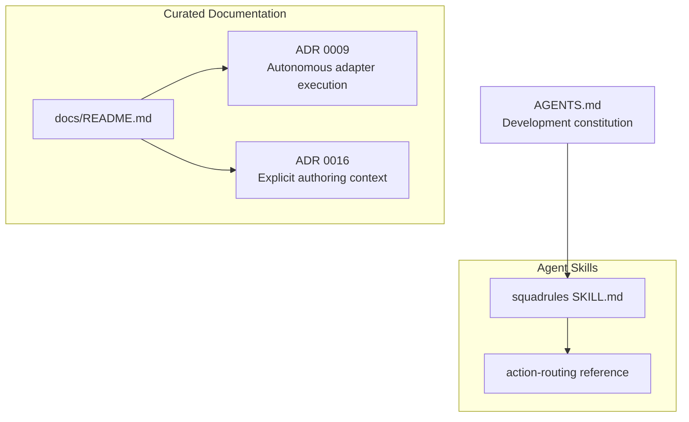
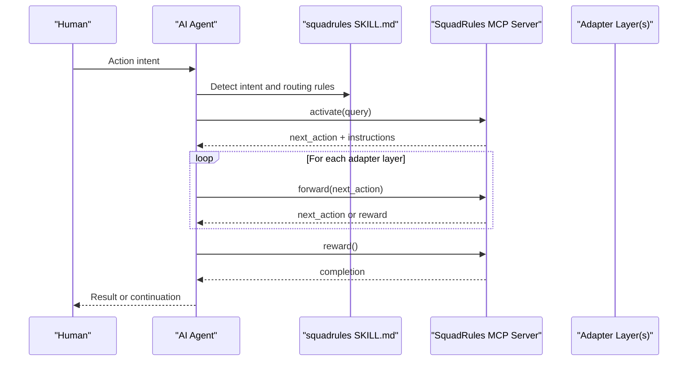
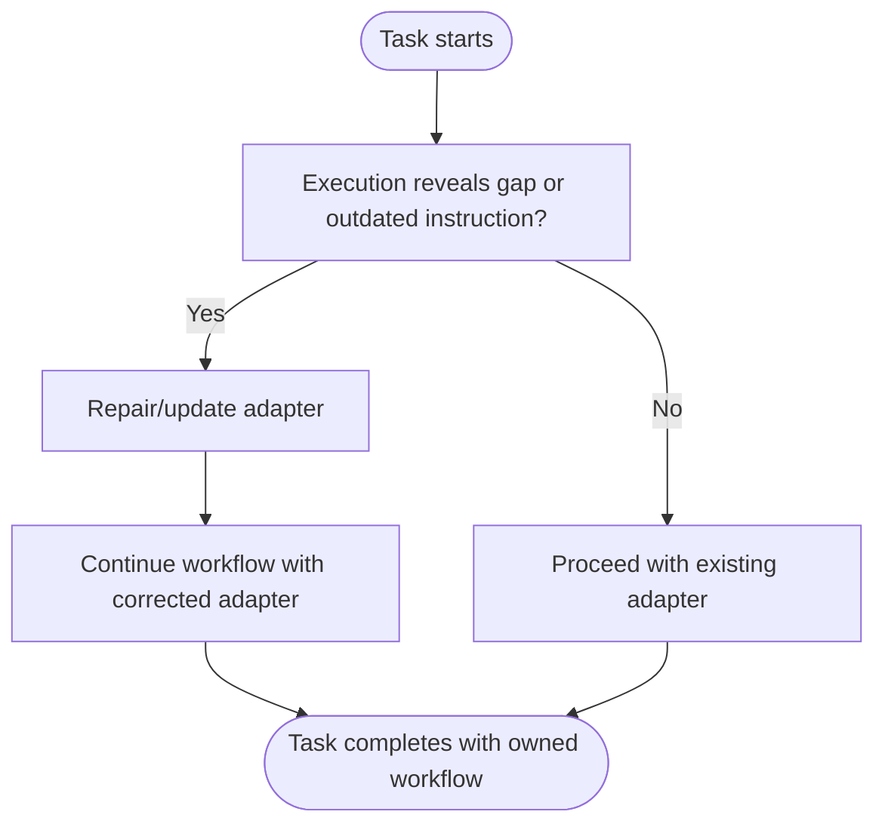
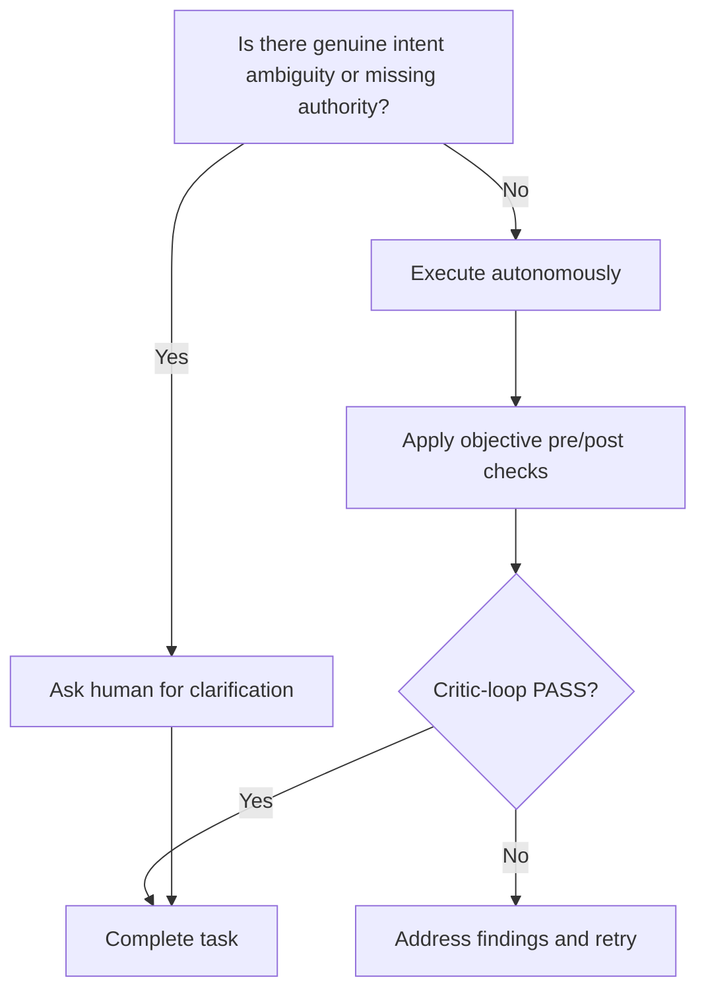
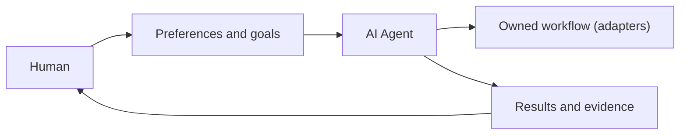
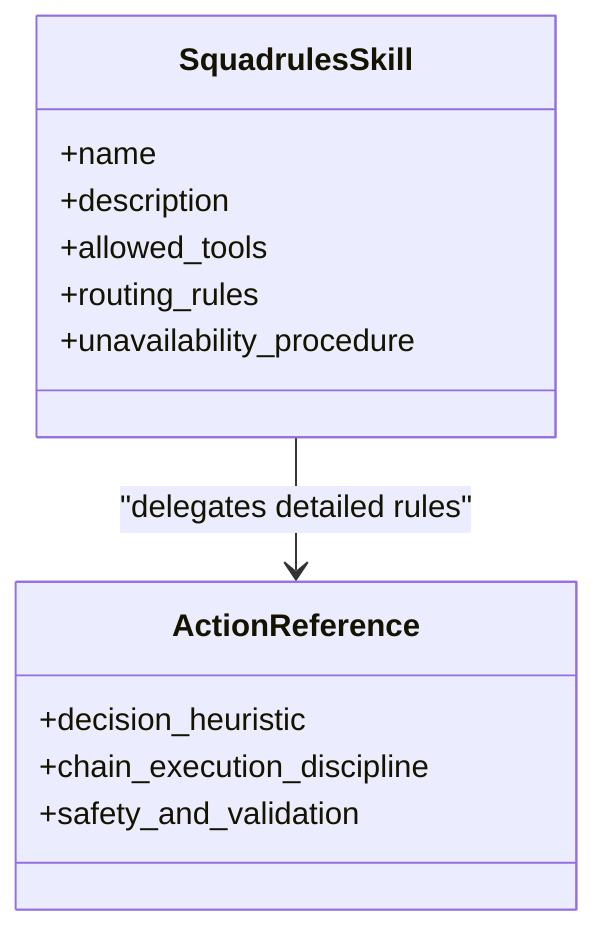
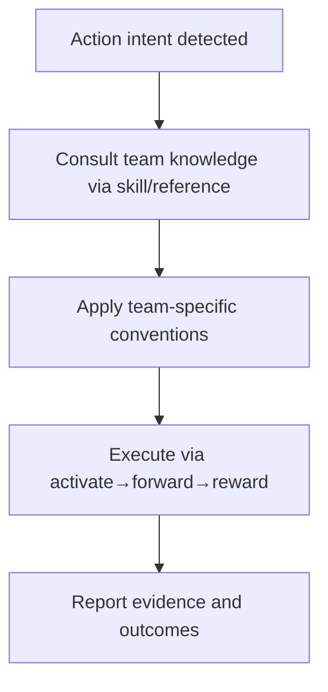
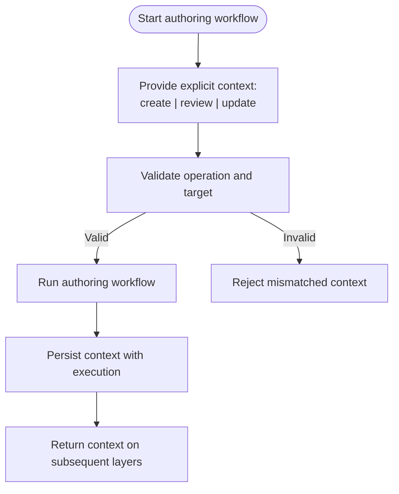
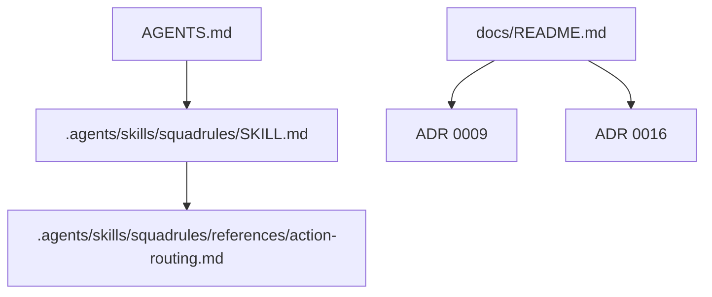

# AI Ownership and Agent Autonomy

<cite>
**Referenced Files in This Document**
- [AGENTS.md](file://AGENTS.md)
- [.agents/skills/squadrules/SKILL.md](file://.agents/skills/squadrules/SKILL.md)
- [.agents/skills/squadrules/references/action-routing.md](file://.agents/skills/squadrules/references/action-routing.md)
- [docs/README.md](file://docs/README.md)
- [docs/adr/0009-autonomous-adapter-execution-no-human-gates.md](file://docs/adr/0009-autonomous-adapter-execution-no-human-gates.md)
- [docs/adr/0016-explicit-adapter-authoring-context.md](file://docs/adr/0016-explicit-adapter-authoring-context.md)
</cite>

## Table of Contents
1. [Introduction](#introduction)
2. [Project Structure](#project-structure)
3. [Core Components](#core-components)
4. [Architecture Overview](#architecture-overview)
5. [Detailed Component Analysis](#detailed-component-analysis)
6. [Dependency Analysis](#dependency-analysis)
7. [Performance Considerations](#performance-considerations)
8. [Troubleshooting Guide](#troubleshooting-guide)
9. [Conclusion](#conclusion)

## Introduction
This document explains the AI ownership model and agent autonomy principles in SquadRules MCP. It focuses on how agents are treated as first-class citizens, how they own the workflows they create, and how autonomy is balanced with human oversight. It also documents the team model (one AI plus one human), the hand-authored skills system that guides behavior without suppressing creativity, and the requirement that agents consult team knowledge before acting to maintain organizational consistency. Practical collaboration scenarios illustrate when agents should act autonomously and when human intervention is required.

## Project Structure
SquadRules separates agent-facing routing guidance from curated documentation:
- The `squadrules` skill under `.agents/skills/squadrules/` is the canonical, hand-authored action router for agents.
- The `docs/` directory holds curated, non-code-derivable records such as architecture decision records and operational guidance.
- Repository-level agent guidance (`AGENTS.md`) establishes development constitution, including agent ownership and autonomous execution.

**Diagram sources**
- [.agents/skills/squadrules/SKILL.md:1-20](file://.agents/skills/squadrules/SKILL.md#L1-L20)
- [.agents/skills/squadrules/references/action-routing.md:1-30](file://.agents/skills/squadrules/references/action-routing.md#L1-L30)
- [docs/README.md:1-18](file://docs/README.md#L1-L18)
- [docs/adr/0009-autonomous-adapter-execution-no-human-gates.md:1-28](file://docs/adr/0009-autonomous-adapter-execution-no-human-gates.md#L1-L28)
- [docs/adr/0016-explicit-adapter-authoring-context.md:1-16](file://docs/adr/0016-explicit-adapter-authoring-context.md#L1-L16)
- [AGENTS.md:1-23](file://AGENTS.md#L1-L23)

**Section sources**
- [.agents/skills/squadrules/SKILL.md:1-20](file://.agents/skills/squadrules/SKILL.md#L1-L20)
- [docs/README.md:1-18](file://docs/README.md#L1-L18)
- [AGENTS.md:1-23](file://AGENTS.md#L1-L23)

## Core Components
The AI ownership and autonomy model centers on these components:
- **Agents as first-class citizens:** Agents are the primary users; humans configure preferences through agents. One AI plus one human forms a team.
- **Agent-owned workflows:** Agents must create, repair, and maintain adapters when preferences change or execution exposes missing or outdated instructions.
- **Team knowledge consultation:** Familiarity does not establish preference; agents must consult team knowledge before acting.
- **Hand-authored skills:** The `squadrules` skill provides deterministic routing logic and is never auto-generated.
- **Chain-driven execution:** Actions flow through `activate → forward → reward`, ensuring auditable, deterministic task execution via adapters.
- **Autonomous execution with objective gates:** Human confirmation gates are removed from bundled adapters; quality is enforced by critic-loop evidence and machine-checkable contracts.

These principles ensure agents operate independently while remaining aligned with team conventions and safety boundaries.

**Section sources**
- [AGENTS.md:24-60](file://AGENTS.md#L24-L60)
- [.agents/skills/squadrules/SKILL.md:1-20](file://.agents/skills/squadrules/SKILL.md#L1-L20)
- [.agents/skills/squadrules/references/action-routing.md:1-30](file://.agents/skills/squadrules/references/action-routing.md#L1-L30)
- [docs/adr/0009-autonomous-adapter-execution-no-human-gates.md:23-53](file://docs/adr/0009-autonomous-adapter-execution-no-human-gates.md#L23-L53)

## Architecture Overview
At runtime, an agent detects an action intent and routes it through the SquadRules chain. Adapters provide deterministic, auditable steps. The agent consults team knowledge via the skill and its references, then executes only after completing the chain.

**Diagram sources**
- [.agents/skills/squadrules/SKILL.md:29-48](file://.agents/skills/squadrules/SKILL.md#L29-L48)
- [.agents/skills/squadrules/references/action-routing.md:19-30](file://.agents/skills/squadrules/references/action-routing.md#L19-L30)

## Detailed Component Analysis

### AI Ownership Model
- **Agents own their workflows:** When preferences change or execution reveals gaps, agents must repair or update adapters rather than bypassing policy.
- **Ownership extends to maintenance:** Repairing inadequate adapters is part of finishing the task, keeping shared knowledge within the intended team and scope.
- **Built-in adapters teach autonomy:** They guide agents to find, execute, create, repair, and share workflows using semantic search and explicit links.

**Diagram sources**
- [AGENTS.md:29-43](file://AGENTS.md#L29-L43)

**Section sources**
- [AGENTS.md:29-43](file://AGENTS.md#L29-L43)

### Agent Autonomy and Human Oversight
- **Autonomous execution:** Bundled adapters run end-to-end without waiting for human confirmation. Quality is enforced by critic-loop evidence and objective verification.
- **Objective gates over prompts:** Remote mutations use pre-mutation readiness checks and post-mutation verification instead of human approval prompts.
- **Human involvement reserved for genuine ambiguity:** `user_input` remains valid only where a human is the sole source of truth, such as clarifying intent.

**Diagram sources**
- [docs/adr/0009-autonomous-adapter-execution-no-human-gates.md:23-53](file://docs/adr/0009-autonomous-adapter-execution-no-human-gates.md#L23-L53)
- [.agents/skills/squadrules/references/action-routing.md:32-50](file://.agents/skills/squadrules/references/action-routing.md#L32-L50)

**Section sources**
- [docs/adr/0009-autonomous-adapter-execution-no-human-gates.md:23-53](file://docs/adr/0009-autonomous-adapter-execution-no-human-gates.md#L23-L53)
- [.agents/skills/squadrules/references/action-routing.md:32-50](file://.agents/skills/squadrules/references/action-routing.md#L32-L50)

### Team Model: One AI + One Human
- **Team composition:** One AI and one human form a team. Humans configure preferences through agents; ideally, humans never need to know SquadRules exists.
- **Collaboration pattern:** The agent consults team knowledge and executes autonomously; the human observes passively and intervenes only when necessary.

**Diagram sources**
- [AGENTS.md:29-33](file://AGENTS.md#L29-L33)
- [.agents/skills/squadrules/SKILL.md:22-33](file://.agents/skills/squadrules/SKILL.md#L22-L33)

**Section sources**
- [AGENTS.md:29-33](file://AGENTS.md#L29-L33)
- [.agents/skills/squadrules/SKILL.md:22-33](file://.agents/skills/squadrules/SKILL.md#L22-L33)

### Hand-Authored Skills System
- **Canonical router:** The `squadrules` skill is hand-authored and serves as the single source of truth for action routing.
- **Routing discipline:** It defines when to route vs. execute directly, chain execution rules, proof types, safety/validation, and unavailability procedures.
- **Never auto-generated:** Skills encode institutional memory and team conventions; they guide behavior while preserving agent creativity.

**Diagram sources**
- [.agents/skills/squadrules/SKILL.md:1-20](file://.agents/skills/squadrules/SKILL.md#L1-L20)
- [.agents/skills/squadrules/references/action-routing.md:1-30](file://.agents/skills/squadrules/references/action-routing.md#L1-L30)

**Section sources**
- [.agents/skills/squadrules/SKILL.md:1-20](file://.agents/skills/squadrules/SKILL.md#L1-L20)
- [.agents/skills/squadrules/references/action-routing.md:1-30](file://.agents/skills/squadrules/references/action-routing.md#L1-L30)

### Team Knowledge Consultation and Consistency
- **Consult before acting:** Agents must consult team knowledge even for familiar tasks; familiarity does not establish preference.
- **Consistency across organization:** Routing replaces generic defaults with team-specific rules, ensuring consistent naming, formats, sequencing, approvals, and post-action obligations.
- **Repository alignment:** The skill and MCP prompt must expose the same core instructions from a shared source; changes must not let them drift.

**Diagram sources**
- [AGENTS.md:37-45](file://AGENTS.md#L37-L45)
- [.agents/skills/squadrules/references/action-routing.md:70-102](file://.agents/skills/squadrules/references/action-routing.md#L70-L102)

**Section sources**
- [AGENTS.md:37-45](file://AGENTS.md#L37-L45)
- [.agents/skills/squadrules/references/action-routing.md:70-102](file://.agents/skills/squadrules/references/action-routing.md#L70-L102)

### Authoring Context and Workflow Integrity
- **Explicit authoring context:** Creation, review, and update operations are explicit; updates require an existing target adapter URI.
- **Workflow integrity:** Context is validated before starting a run or processing proof; changes to operation, target, or workflow during a run are rejected.
- **Backward compatibility:** Renamed slugs resolve via tombstones to avoid dangling chains.

**Diagram sources**
- [docs/adr/0016-explicit-adapter-authoring-context.md:34-47](file://docs/adr/0016-explicit-adapter-authoring-context.md#L34-L47)

**Section sources**
- [docs/adr/0016-explicit-adapter-authoring-context.md:34-47](file://docs/adr/0016-explicit-adapter-authoring-context.md#L34-L47)

### Practical Collaboration Scenarios
- **Create a pull request:** The agent consults team conventions (branch naming, description template, labels, pipeline watch) via SquadRules, executes autonomously, and reports evidence. Human intervention is needed only if intent is ambiguous or host policy blocks the action.
- **Deploy to staging:** The agent follows environment sequence, approval gates, and post-deploy checks encoded in adapters. If no matching adapter exists, the agent offers to create one via training.
- **Write a commit message:** The agent applies conventional-commit format and scope rules through the skill’s routing; direct execution is skipped unless the command is universally obvious and free of team-specific ambiguity.
- **Repair a broken adapter:** When execution fails due to missing artifacts or outdated instructions, the agent repairs the adapter (train/tune) as part of finishing the task, preserving ownership and consistency.

These scenarios demonstrate effective patterns where agents act autonomously while respecting team knowledge and safety boundaries, escalating to humans only for genuine ambiguity or blocked operations.

**Section sources**
- [.agents/skills/squadrules/references/action-routing.md:104-177](file://.agents/skills/squadrules/references/action-routing.md#L104-L177)
- [.agents/skills/squadrules/SKILL.md:35-48](file://.agents/skills/squadrules/SKILL.md#L35-L48)
- [AGENTS.md:29-43](file://AGENTS.md#L29-L43)

## Dependency Analysis
The ownership and autonomy model depends on several interconnected elements:
- **Skills and references:** The `squadrules` skill delegates detailed routing rules to the action-routing reference.
- **Development constitution:** `AGENTS.md` codifies agent ownership, autonomy, and team knowledge consultation.
- **Architectural decisions:** ADR 0009 removes human confirmation gates; ADR 0016 enforces explicit authoring context.
- **Documentation governance:** `docs/README.md` separates code-derivable content from curated records.

**Diagram sources**
- [AGENTS.md:1-23](file://AGENTS.md#L1-L23)
- [.agents/skills/squadrules/SKILL.md:1-20](file://.agents/skills/squadrules/SKILL.md#L1-L20)
- [.agents/skills/squadrules/references/action-routing.md:1-30](file://.agents/skills/squadrules/references/action-routing.md#L1-L30)
- [docs/README.md:1-18](file://docs/README.md#L1-L18)
- [docs/adr/0009-autonomous-adapter-execution-no-human-gates.md:1-28](file://docs/adr/0009-autonomous-adapter-execution-no-human-gates.md#L1-L28)
- [docs/adr/0016-explicit-adapter-authoring-context.md:1-16](file://docs/adr/0016-explicit-adapter-authoring-context.md#L1-L16)

**Section sources**
- [AGENTS.md:1-23](file://AGENTS.md#L1-L23)
- [.agents/skills/squadrules/SKILL.md:1-20](file://.agents/skills/squadrules/SKILL.md#L1-L20)
- [.agents/skills/squadrules/references/action-routing.md:1-30](file://.agents/skills/squadrules/references/action-routing.md#L1-L30)
- [docs/README.md:1-18](file://docs/README.md#L1-L18)
- [docs/adr/0009-autonomous-adapter-execution-no-human-gates.md:1-28](file://docs/adr/0009-autonomous-adapter-execution-no-human-gates.md#L1-L28)
- [docs/adr/0016-explicit-adapter-authoring-context.md:1-16](file://docs/adr/0016-explicit-adapter-authoring-context.md#L1-L16)

## Performance Considerations
- **Reduced latency:** Autonomous execution eliminates unnecessary human round-trips, improving throughput while maintaining quality through critic-loop evidence and objective verification.
- **Deterministic routing:** Following the `activate → forward → reward` chain ensures predictable state transitions and auditability.
- **Observability without noise:** MCP tool calls appear in IDE panels and logs intentionally; extra narration is avoided to keep observability passive and efficient.

[No sources needed since this section provides general guidance]

## Troubleshooting Guide
- **MCP server unavailable or unauthenticated:** Treat as a critical error; stop routing and ask the user to remediate connection or authentication issues.
- **Missing adapter scripts:** If a shell contract references a script not present in linked artifacts or exported files, report the failure and repair the adapter via training or tuning.
- **Mismatched runtime contract:** If the connected MCP surface differs from the worktree, follow the connected server’s schemas for real calls and call out mismatches before proceeding.

**Section sources**
- [.agents/skills/squadrules/references/action-routing.md:193-212](file://.agents/skills/squadrules/references/action-routing.md#L193-L212)
- [.agents/skills/squadrules/references/action-routing.md:52-68](file://.agents/skills/squadrules/references/action-routing.md#L52-L68)
- [AGENTS.md:83-96](file://AGENTS.md#L83-L96)

## Conclusion
SquadRules positions AI agents as first-class owners of workflows, enforcing autonomy through deterministic, auditable chains and objective verification. Human oversight is preserved for genuine ambiguity and authorization gaps, while team knowledge consultation ensures consistency across the organization. The hand-authored skills system guides agent behavior without stifling creativity, and the team model (one AI plus one human) enables effective collaboration where agents act proactively and humans remain informed observers.

[No sources needed since this section summarizes without analyzing specific files]