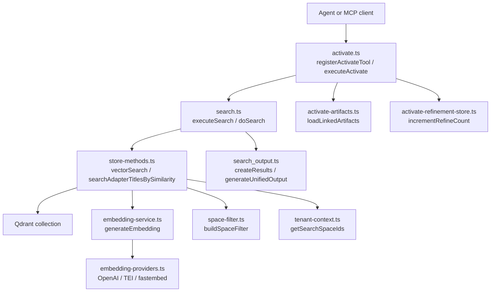
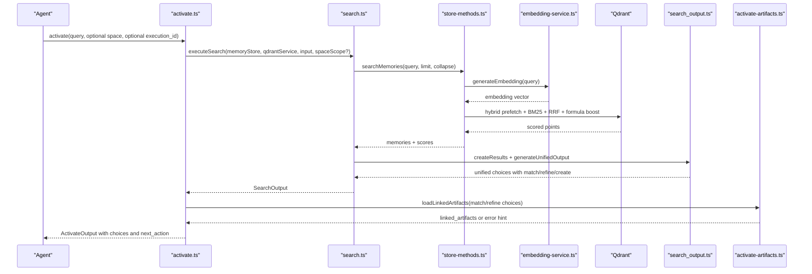
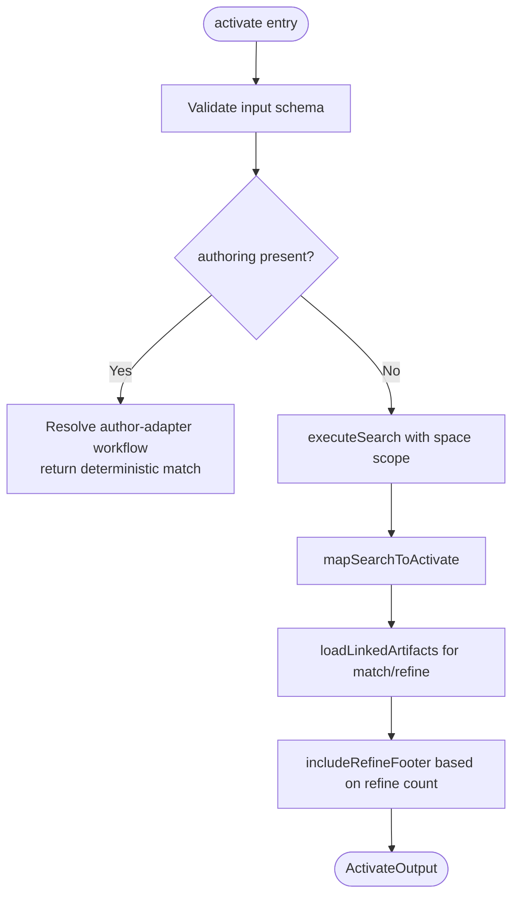
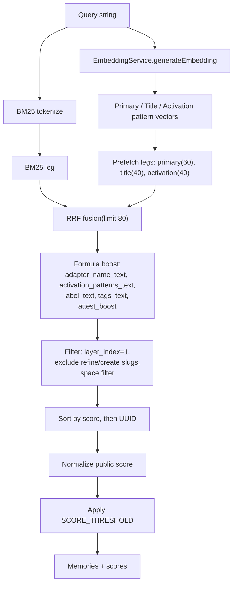
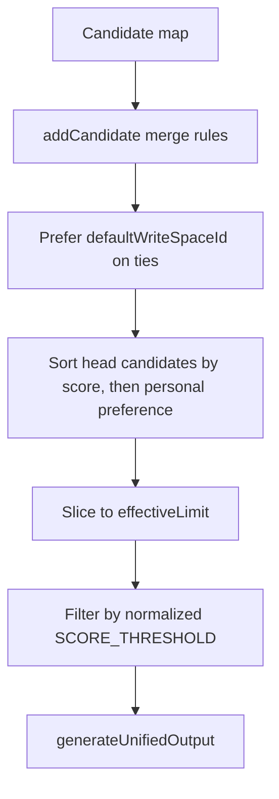
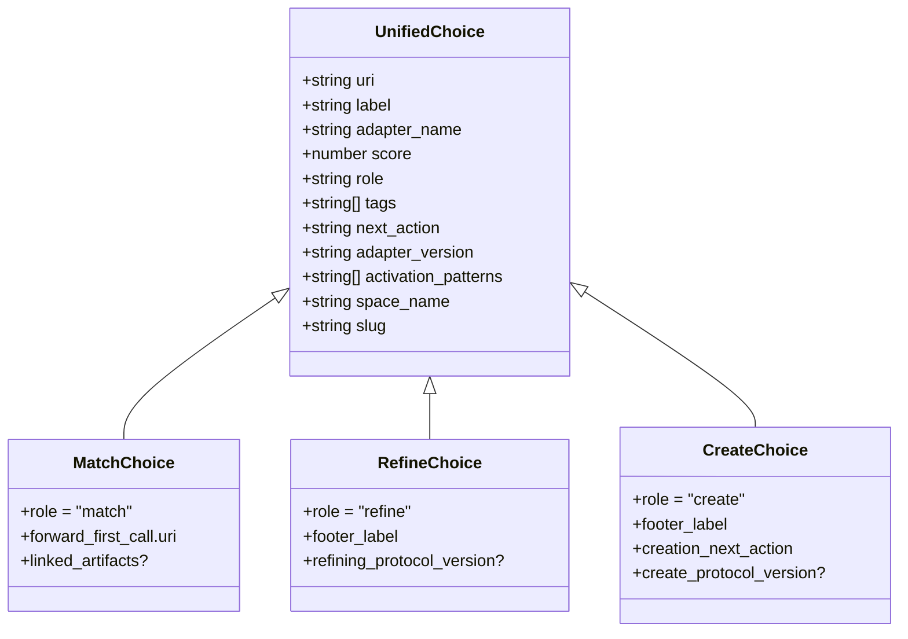
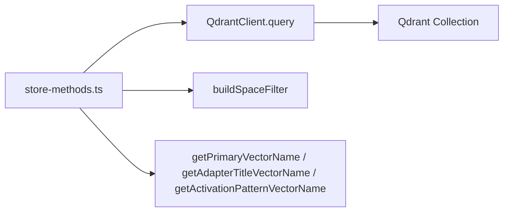
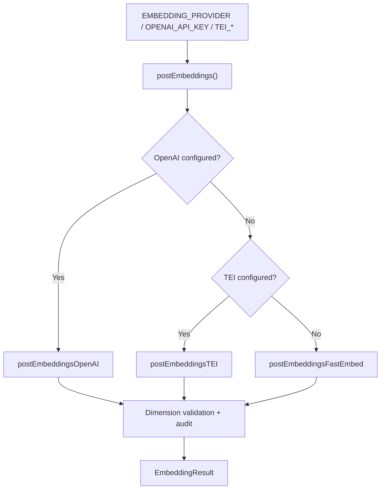
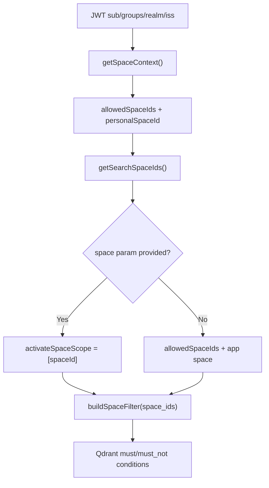
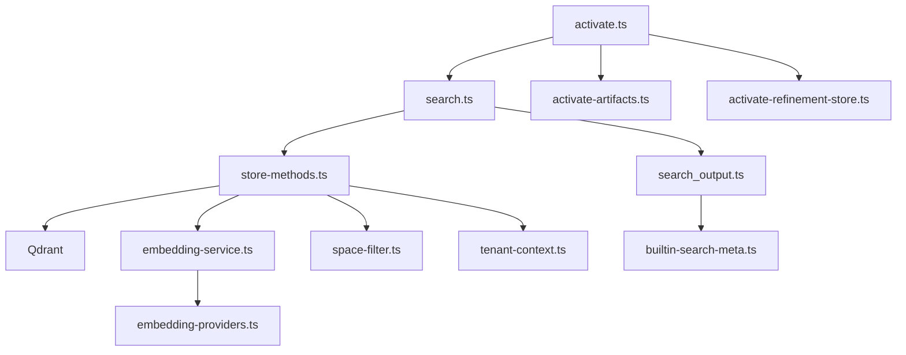

# Activate Phase: Adapter Selection and Discovery

<cite>
**Referenced Files in This Document**
- [activate.ts](file://src/tools/activate.ts)
- [search.ts](file://src/tools/search.ts)
- [search_output.ts](file://src/tools/search_output.ts)
- [store-methods.ts](file://src/services/memory/store-methods.ts)
- [store-title-similarity-search.ts](file://src/services/memory/store-title-similarity-search.ts)
- [activation-search-fields.ts](file://src/services/memory/activation-search-fields.ts)
- [activation-pattern-payload.ts](file://src/services/memory/activation-pattern-payload.ts)
- [store.ts](file://src/services/memory/store.ts)
- [qdrant-search.ts](file://src/services/qdrant/search.ts)
- [embedding-service.ts](file://src/services/embedding/service.ts)
- [embedding-providers.ts](file://src/services/embedding/providers.ts)
- [space-filter.ts](file://src/utils/space-filter.ts)
- [tenant-context.ts](file://src/utils/tenant-context.ts)
- [builtin-search-meta.ts](file://src/constants/builtin-search-meta.ts)
- [config.ts](file://src/config.ts)
- [activate-artifacts.ts](file://src/tools/activate-artifacts.ts)
- [activate-refinement-store.ts](file://src/services/activate-refinement-store.ts)
</cite>

## Table of Contents
1. [Introduction](#introduction)
2. [Project Structure](#project-structure)
3. [Core Components](#core-components)
4. [Architecture Overview](#architecture-overview)
5. [Detailed Component Analysis](#detailed-component-analysis)
6. [Dependency Analysis](#dependency-analysis)
7. [Performance Considerations](#performance-considerations)
8. [Troubleshooting Guide](#troubleshooting-guide)
9. [Conclusion](#conclusion)

## Introduction
The activate phase is the entry point for SquadRules adapter discovery. It converts a short user intent into ranked adapter choices, then guides the agent to the correct next action. The system performs semantic search over stored adapters using vector embeddings and hybrid scoring, filters by space isolation, and returns three role-based options:

- `match`: A stored adapter that likely satisfies the request.
- `refine`: A built-in help workflow to improve the query before re-running activation.
- `create`: A built-in authoring workflow to register a new adapter or protocol.

Activation also resolves linked artifacts when an adapter ships scripts, normalizes URIs, and provides structured guidance for the following `forward` call.

## Project Structure
The activate workflow spans tool registration, shared search logic, memory store search implementation, embedding provider selection, space filtering, and output normalization.

**Diagram sources**
- [activate.ts:168-229](file://src/tools/activate.ts#L168-L229)
- [search.ts:143-253](file://src/tools/search.ts#L143-L253)
- [store-methods.ts:121-259](file://src/services/memory/store-methods.ts#L121-L259)
- [embedding-service.ts:48-128](file://src/services/embedding/service.ts#L48-L128)
- [embedding-providers.ts:296-333](file://src/services/embedding/providers.ts#L296-L333)
- [space-filter.ts:14-26](file://src/utils/space-filter.ts#L14-L26)
- [tenant-context.ts:141-149](file://src/utils/tenant-context.ts#L141-L149)
- [search_output.ts:77-240](file://src/tools/search_output.ts#L77-L240)
- [activate-artifacts.ts:41-93](file://src/tools/activate-artifacts.ts#L41-L93)
- [activate-refinement-store.ts:13-23](file://src/services/activate-refinement-store.ts#L13-L23)

**Section sources**
- [activate.ts:168-229](file://src/tools/activate.ts#L168-L229)
- [search.ts:143-253](file://src/tools/search.ts#L143-L253)
- [store-methods.ts:121-259](file://src/services/memory/store-methods.ts#L121-L259)

## Core Components
- **activate tool**: Validates input, supports authoring mode, runs shared search, maps results to activation choices, loads linked artifacts, and handles refinement iteration.
- **shared search**: Normalizes queries, applies limits, builds candidates through hybrid search, deduplicates, applies thresholds, and appends refine/create footers.
- **memory store search**: Performs dense vector prefetches, BM25 legs, RRF fusion, field boosting, fallback to dense-only, and score normalization.
- **embedding service**: Resolves provider (OpenAI, TEI, fastembed), generates embeddings, validates dimensions, and emits metrics and audit events.
- **output builder**: Converts memories to wire-safe URIs, resolves chain roots, deduplicates matches, and constructs unified choices with roles and next actions.
- **artifact loader**: Resolves adapter artifacts, mint download capabilities, and produces materialize instructions for scripts.
- **refinement counter**: Tracks repeated activation iterations per execution ID to suppress the refine footer after repeated loops.

**Section sources**
- [activate.ts:30-166](file://src/tools/activate.ts#L30-L166)
- [search.ts:58-111](file://src/tools/search.ts#L58-L111)
- [store-methods.ts:121-259](file://src/services/memory/store-methods.ts#L121-L259)
- [embedding-service.ts:48-128](file://src/services/embedding/service.ts#L48-L128)
- [search_output.ts:77-240](file://src/tools/search_output.ts#L77-L240)
- [activate-artifacts.ts:41-93](file://src/tools/activate-artifacts.ts#L41-L93)
- [activate-refinement-store.ts:13-23](file://src/services/activate-refinement-store.ts#L13-L23)

## Architecture Overview
The activate phase follows a layered pipeline:

1. Tool registration and input validation.
2. Optional authoring shortcut.
3. Shared search execution with caching and space scoping.
4. Hybrid vector + BM25 retrieval with RRF fusion and field boosting.
5. Candidate merging, thresholding, and footer injection.
6. Activation choice mapping, artifact loading, and refinement control.

**Diagram sources**
- [activate.ts:168-229](file://src/tools/activate.ts#L168-L229)
- [search.ts:192-253](file://src/tools/search.ts#L192-L253)
- [store-methods.ts:121-259](file://src/services/memory/store-methods.ts#L121-L259)
- [embedding-service.ts:48-128](file://src/services/embedding/service.ts#L48-L128)
- [search_output.ts:117-240](file://src/tools/search_output.ts#L117-L240)
- [activate-artifacts.ts:41-93](file://src/tools/activate-artifacts.ts#L41-L93)

## Detailed Component Analysis

### Activate Tool Pipeline
The activate tool performs:
- Input schema validation and metric instrumentation.
- Authoring mode routing when explicitly requested.
- Shared search invocation with optional space narrowing.
- Mapping search results to activation choices.
- Artifact resolution for adapters that ship scripts.
- Refinement footer control based on repeated activations.

**Diagram sources**
- [activate.ts:231-279](file://src/tools/activate.ts#L231-L279)
- [activate.ts:168-229](file://src/tools/activate.ts#L168-L229)
- [activate.ts:44-166](file://src/tools/activate.ts#L44-L166)
- [activate-artifacts.ts:41-93](file://src/tools/activate-artifacts.ts#L41-L93)
- [activate-refinement-store.ts:13-23](file://src/services/activate-refinement-store.ts#L13-L23)

**Section sources**
- [activate.ts:168-229](file://src/tools/activate.ts#L168-L229)
- [activate.ts:44-166](file://src/tools/activate.ts#L44-L166)
- [activate.ts:231-279](file://src/tools/activate.ts#L231-L279)
- [activate-artifacts.ts:41-93](file://src/tools/activate-artifacts.ts#L41-L93)
- [activate-refinement-store.ts:13-23](file://src/services/activate-refinement-store.ts#L13-L23)

### Semantic Search Algorithm and Scoring
The search algorithm combines multiple retrieval strategies:

- Dense vector search over primary, title, and activation pattern vectors.
- BM25 sparse retrieval over tokenized query text.
- Reciprocal Rank Fusion (RRF) across prefetch legs.
- Field-level boosting for adapter name, activation patterns, label, and tags.
- Attest boost derived from run history.
- Fallback to dense-only if hybrid query fails.
- Score normalization to a public 0–1 scale.

**Diagram sources**
- [store-methods.ts:121-259](file://src/services/memory/store-methods.ts#L121-L259)
- [embedding-service.ts:48-128](file://src/services/embedding/service.ts#L48-L128)
- [activation-search-fields.ts:42-78](file://src/services/memory/activation-search-fields.ts#L42-L78)
- [config.ts:284-294](file://src/config.ts#L284-L294)

**Section sources**
- [store-methods.ts:121-259](file://src/services/memory/store-methods.ts#L121-L259)
- [embedding-service.ts:48-128](file://src/services/embedding/service.ts#L48-L128)
- [activation-search-fields.ts:42-78](file://src/services/memory/activation-search-fields.ts#L42-L78)
- [config.ts:284-294](file://src/config.ts#L284-L294)

### Ranking Criteria and Candidate Merging
Ranking criteria include:

- RRF-fused hybrid score.
- Field boosts for adapter name, activation patterns, label, and tags.
- Attest boost from historical runs.
- Tie-breaking by default write space preference.
- Head candidate deduplication and personal-space preference when scores are equal.
- Public score normalization and threshold filtering.

**Diagram sources**
- [search.ts:58-91](file://src/tools/search.ts#L58-L91)
- [search.ts:143-186](file://src/tools/search.ts#L143-L186)
- [search_output.ts:77-92](file://src/tools/search_output.ts#L77-L92)
- [search_output.ts:117-240](file://src/tools/search_output.ts#L117-L240)

**Section sources**
- [search.ts:58-91](file://src/tools/search.ts#L58-L91)
- [search.ts:143-186](file://src/tools/search.ts#L143-L186)
- [search_output.ts:77-92](file://src/tools/search_output.ts#L77-L92)
- [search_output.ts:117-240](file://src/tools/search_output.ts#L117-L240)

### Adapter Roles and Behaviors
- `match`: Represents a stored adapter. The activation response includes `forward_first_call` pointing to the adapter URI and a `next_action` instructing the agent to call forward without a solution to start the adapter. Linked artifacts may be included when the adapter ships scripts.
- `refine`: Built-in help workflow appended as a footer choice. It guides the agent to improve the query. Repeated activation iterations suppress this footer after two refinements to avoid looping.
- `create`: Built-in authoring workflow appended as a footer choice. It directs the agent to train a new adapter or protocol.

**Diagram sources**
- [search_output.ts:52-66](file://src/tools/search_output.ts#L52-L66)
- [search_output.ts:117-240](file://src/tools/search_output.ts#L117-L240)
- [builtin-search-meta.ts:6-42](file://src/constants/builtin-search-meta.ts#L6-L42)

**Section sources**
- [search_output.ts:52-66](file://src/tools/search_output.ts#L52-L66)
- [search_output.ts:117-240](file://src/tools/search_output.ts#L117-L240)
- [builtin-search-meta.ts:6-42](file://src/constants/builtin-search-meta.ts#L6-L42)

### Vector Database Integration
The system integrates with Qdrant as the primary vector database and uses LanceDB only in embedded/local scenarios. Activation search uses Qdrant’s Query API with prefetch legs, RRF fusion, and formula boosting. Title similarity search is available separately for adapter titles.

Key integration points:
- Qdrant client initialization and collection alias resolution.
- Space-aware filtering via `buildSpaceFilter`.
- Vector names resolved dynamically by embedding dimension.
- Metrics around Qdrant operations and query duration.

**Diagram sources**
- [store.ts:29-62](file://src/services/memory/store.ts#L29-L62)
- [store-methods.ts:121-259](file://src/services/memory/store-methods.ts#L121-L259)
- [store-title-similarity-search.ts:9-60](file://src/services/memory/store-title-similarity-search.ts#L9-L60)
- [qdrant-search.ts:11-83](file://src/services/qdrant/search.ts#L11-L83)

**Section sources**
- [store.ts:29-62](file://src/services/memory/store.ts#L29-L62)
- [store-methods.ts:121-259](file://src/services/memory/store-methods.ts#L121-L259)
- [store-title-similarity-search.ts:9-60](file://src/services/memory/store-title-similarity-search.ts#L9-L60)
- [qdrant-search.ts:11-83](file://src/services/qdrant/search.ts#L11-L83)

### Embedding Providers
Embedding providers are selected automatically or explicitly:

- OpenAI: Preferred when API key or explicit URL is configured.
- TEI: Supported but deprecated; used when configured.
- Fastembed: Local default when no external provider is available.

Provider selection includes retry policies, exponential backoff with jitter, Retry-After header handling, and non-retriable quota detection.

**Diagram sources**
- [embedding-service.ts:48-128](file://src/services/embedding/service.ts#L48-L128)
- [embedding-providers.ts:296-333](file://src/services/embedding/providers.ts#L296-L333)
- [embedding-providers.ts:76-92](file://src/services/embedding/providers.ts#L76-L92)
- [embedding-providers.ts:93-202](file://src/services/embedding/providers.ts#L93-L202)
- [embedding-providers.ts:203-295](file://src/services/embedding/providers.ts#L203-L295)

**Section sources**
- [embedding-service.ts:48-128](file://src/services/embedding/service.ts#L48-L128)
- [embedding-providers.ts:296-333](file://src/services/embedding/providers.ts#L296-L333)
- [embedding-providers.ts:76-92](file://src/services/embedding/providers.ts#L76-L92)
- [embedding-providers.ts:93-202](file://src/services/embedding/providers.ts#L93-L202)
- [embedding-providers.ts:203-295](file://src/services/embedding/providers.ts#L203-L295)

### Role-Based Filtering System
Space isolation ensures searches respect tenant boundaries:

- Allowed spaces derive from JWT groups and personal space.
- Search space IDs include allowed spaces plus the Squadrules app space unless narrowed.
- Explicit `space` or `space_id` narrows activation search to a single space.
- Filters exclude built-in refine/create slugs during vector search.

**Diagram sources**
- [tenant-context.ts:217-291](file://src/utils/tenant-context.ts#L217-L291)
- [tenant-context.ts:141-179](file://src/utils/tenant-context.ts#L141-L179)
- [space-filter.ts:14-26](file://src/utils/space-filter.ts#L14-L26)
- [store-methods.ts:130-137](file://src/services/memory/store-methods.ts#L130-L137)

**Section sources**
- [tenant-context.ts:217-291](file://src/utils/tenant-context.ts#L217-L291)
- [tenant-context.ts:141-179](file://src/utils/tenant-context.ts#L141-L179)
- [space-filter.ts:14-26](file://src/utils/space-filter.ts#L14-L26)
- [store-methods.ts:130-137](file://src/services/memory/store-methods.ts#L130-L137)

### Activation Queries, Results Interpretation, and Edge Cases
Examples of activation queries:

- “review implementation plan”
- “update existing PR adapter worktree isolation”
- “find shell adapter for linting”

Interpretation of results:

- Each choice contains a slug-form URI, label, role, score, tags, next_action, and optional metadata such as adapter version, activation patterns, space name, and linked artifacts.
- For `match` and `refine`, copy `forward_first_call` directly into the next `forward` call.
- For `create`, follow the creation next action to train a new adapter.

Edge cases handled:

- No matches: The message encourages refining or creating; refine footer is included unless suppressed by repeated activations.
- Multiple candidates: Top confidence percentage is shown; agents should pick one choice and obey its next action.
- Weak matches: Prefer refine once before creating.
- Artifact load failure: The response warns that artifact files are unknown and instructs exporting the adapter to obtain scripts.
- Repeated refinement: After more than two activations with the same execution ID, the refine footer is removed to prevent looping.

**Section sources**
- [activate.md:1-118](file://src/embed-docs/tools/activate.md#L1-L118)
- [activate.ts:139-165](file://src/tools/activate.ts#L139-L165)
- [activate.ts:173-178](file://src/tools/activate.ts#L173-L178)
- [activate-artifacts.ts:41-93](file://src/tools/activate-artifacts.ts#L41-L93)

### Error Handling, Rate Limiting, and Performance Optimization
Error handling:

- Input validation errors return structured teaching results.
- Embedding provider errors include retries, backoff, and non-retriable quota detection.
- Qdrant hybrid query failures fall back to dense-only search.
- Artifact loading failures log warnings and return an error hint rather than implying zero artifacts.

Rate limiting:

- HTTP and MCP rate limits are configurable via environment variables.
- Embedding provider rate limits are handled with exponential backoff, Retry-After support, and budget caps.

Performance optimization:

- Activate search cache stores unified outputs with TTL.
- Memory resource cache reduces repeated Qdrant retrievals.
- Group collapse can expand initial fetch and then collapse duplicates.
- Effective limits cap max_choices to prevent excessive resolve latency.
- Hybrid search prefetches multiple legs and uses RRF to reduce redundant computation.

**Section sources**
- [activate.ts:247-279](file://src/tools/activate.ts#L247-L279)
- [embedding-providers.ts:76-92](file://src/services/embedding/providers.ts#L76-L92)
- [embedding-providers.ts:93-202](file://src/services/embedding/providers.ts#L93-L202)
- [embedding-providers.ts:203-295](file://src/services/embedding/providers.ts#L203-L295)
- [search.ts:206-247](file://src/tools/search.ts#L206-L247)
- [store-methods.ts:218-232](file://src/services/memory/store-methods.ts#L218-L232)
- [config.ts:121-126](file://src/config.ts#L121-L126)
- [config.ts:87-93](file://src/config.ts#L87-L93)

## Dependency Analysis
The activate phase depends on several subsystems:

- Tool layer: activate.ts registers the MCP tool and orchestrates activation.
- Search layer: search.ts provides shared search logic and unified output generation.
- Memory layer: store-methods.ts implements hybrid search and title similarity search.
- Embedding layer: embedding-service.ts and providers.ts manage provider selection and embedding generation.
- Storage layer: Qdrant is the primary vector store; LanceDB is embedded/local.
- Context layer: tenant-context.ts and space-filter.ts enforce multitenancy and space isolation.
- Metadata layer: builtin-search-meta.ts defines built-in protocol slugs and labels.

**Diagram sources**
- [activate.ts:168-229](file://src/tools/activate.ts#L168-L229)
- [search.ts:143-253](file://src/tools/search.ts#L143-L253)
- [search_output.ts:117-240](file://src/tools/search_output.ts#L117-L240)
- [store-methods.ts:121-259](file://src/services/memory/store-methods.ts#L121-L259)
- [embedding-service.ts:48-128](file://src/services/embedding/service.ts#L48-L128)
- [embedding-providers.ts:296-333](file://src/services/embedding/providers.ts#L296-L333)
- [space-filter.ts:14-26](file://src/utils/space-filter.ts#L14-L26)
- [tenant-context.ts:141-179](file://src/utils/tenant-context.ts#L141-L179)
- [builtin-search-meta.ts:6-42](file://src/constants/builtin-search-meta.ts#L6-L42)
- [activate-artifacts.ts:41-93](file://src/tools/activate-artifacts.ts#L41-L93)
- [activate-refinement-store.ts:13-23](file://src/services/activate-refinement-store.ts#L13-L23)

**Section sources**
- [activate.ts:168-229](file://src/tools/activate.ts#L168-L229)
- [search.ts:143-253](file://src/tools/search.ts#L143-L253)
- [search_output.ts:117-240](file://src/tools/search_output.ts#L117-L240)
- [store-methods.ts:121-259](file://src/services/memory/store-methods.ts#L121-L259)
- [embedding-service.ts:48-128](file://src/services/embedding/service.ts#L48-L128)
- [embedding-providers.ts:296-333](file://src/services/embedding/providers.ts#L296-L333)
- [space-filter.ts:14-26](file://src/utils/space-filter.ts#L14-L26)
- [tenant-context.ts:141-179](file://src/utils/tenant-context.ts#L141-L179)
- [builtin-search-meta.ts:6-42](file://src/constants/builtin-search-meta.ts#L6-L42)
- [activate-artifacts.ts:41-93](file://src/tools/activate-artifacts.ts#L41-L93)
- [activate-refinement-store.ts:13-23](file://src/services/activate-refinement-store.ts#L13-L23)

## Performance Considerations
- Use `max_choices` judiciously; defaults are bounded by `SQUADRULES_SEARCH_MAX_CHOICES`, with absolute caps at `SQUADRULES_SEARCH_LIMIT_CAP`.
- Enable group collapse to improve recall while controlling duplicate resolution.
- Tune `SCORE_THRESHOLD` to balance precision and recall.
- Monitor embedding provider latency and dimension mismatches via metrics and audit logs.
- Leverage Redis-backed caches for activate search results and memory resources.
- Avoid repeated refine loops by respecting the refine footer suppression rule.

[No sources needed since this section provides general guidance]

## Troubleshooting Guide
Common issues and resolutions:

- No matches returned:
  - Refine the query using the refine footer.
  - Check space scoping; ensure the query targets allowed spaces.
  - Verify adapter metadata includes useful activation patterns and tags.

- Weak matches:
  - Prefer refine once before creating.
  - Improve adapter documentation and activation patterns.

- Artifact missing:
  - Follow the materialize instruction or export the adapter to obtain scripts.
  - If artifact loading failed, the response will warn that artifact files are unknown.

- Embedding provider errors:
  - Check API keys, model configuration, and quota status.
  - Review retry logs and non-retriable quota errors.

- Repeated activation loops:
  - Echo `execution_id` to track refinement sequences.
  - After two refinements, the refine footer is suppressed; create a custom adapter or ask clarifying questions.

**Section sources**
- [activate.ts:139-165](file://src/tools/activate.ts#L139-L165)
- [activate.ts:173-178](file://src/tools/activate.ts#L173-L178)
- [activate-artifacts.ts:41-93](file://src/tools/activate-artifacts.ts#L41-L93)
- [embedding-providers.ts:93-202](file://src/services/embedding/providers.ts#L93-L202)
- [embedding-providers.ts:203-295](file://src/services/embedding/providers.ts#L203-L295)

## Conclusion
The activate phase transforms user intent into actionable adapter choices through robust semantic search, hybrid scoring, and role-based output. It integrates tightly with Qdrant, embedding providers, and space-aware filtering to deliver precise, auditable, and safe adapter discovery. By understanding the search algorithm, ranking criteria, role behaviors, and edge case handling, agents can reliably select optimal adapters and proceed to forward execution with confidence.

[No sources needed since this section summarizes without analyzing specific files]