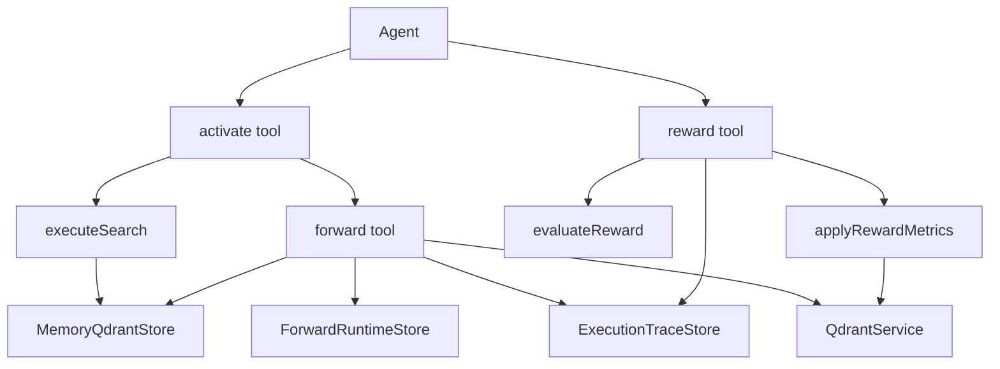
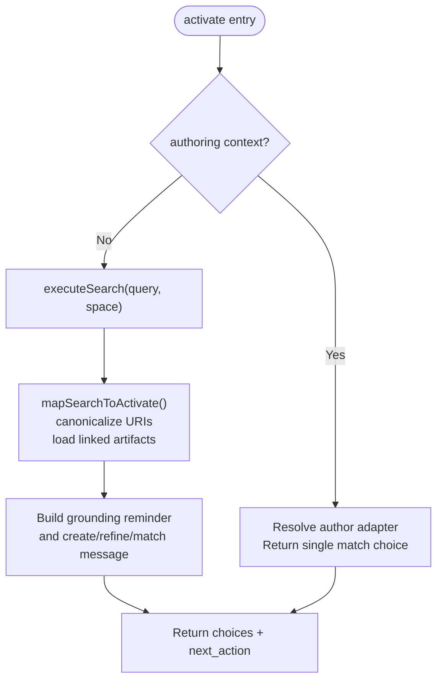
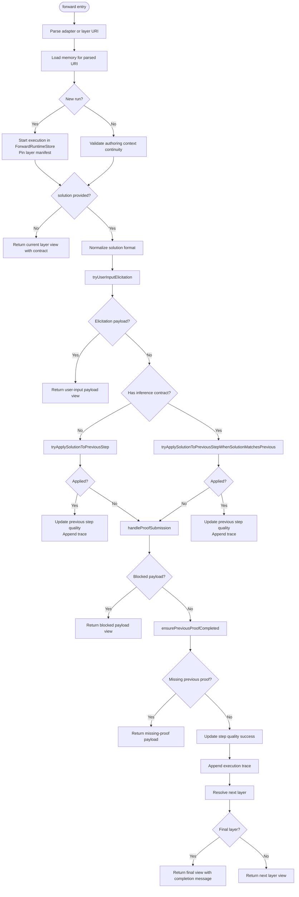
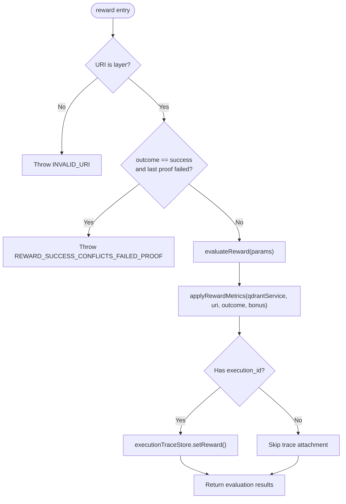
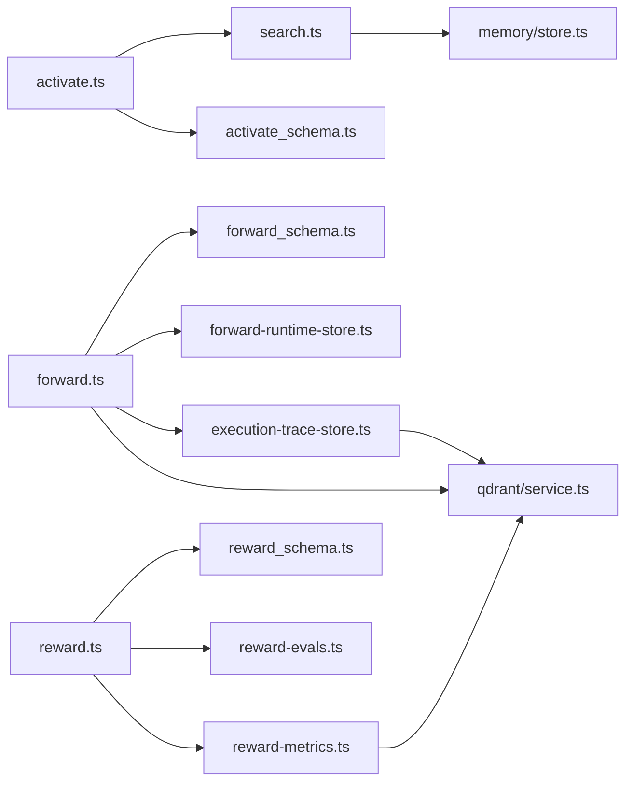

# Activate→Forward→Reward Workflow Chain

<cite>
**Referenced Files in This Document**
- [activate.ts](file://src/tools/activate.ts)
- [search.ts](file://src/tools/search.ts)
- [forward.ts](file://src/tools/forward.ts)
- [reward.ts](file://src/tools/reward.ts)
- [activate_schema.ts](file://src/tools/activate_schema.ts)
- [forward_schema.ts](file://src/tools/forward_schema.ts)
- [reward_schema.ts](file://src/tools/reward_schema.ts)
- [forward-runtime-store.ts](file://src/services/forward-runtime-store.ts)
- [execution-trace-store.ts](file://src/services/execution-trace-store.ts)
- [reward-evals.ts](file://src/services/reward-evals.ts)
- [reward-metrics.ts](file://src/services/reward-metrics.ts)
- [store.ts](file://src/services/memory/store.ts)
- [service.ts](file://src/services/qdrant/service.ts)
</cite>

## Table of Contents
1. [Introduction](#introduction)
2. [Project Structure](#project-structure)
3. [Core Components](#core-components)
4. [Architecture Overview](#architecture-overview)
5. [Detailed Component Analysis](#detailed-component-analysis)
6. [Dependency Analysis](#dependency-analysis)
7. [Performance Considerations](#performance-considerations)
8. [Troubleshooting Guide](#troubleshooting-guide)
9. [Conclusion](#conclusion)

## Introduction
This document explains the activate→forward→reward workflow chain that forms the backbone of SquadRules MCP operations. The chain is agent-first: an AI agent calls `activate` to select the best adapter, calls `forward` repeatedly to execute the selected adapter’s step-by-step workflow, and finally calls `reward` to record feedback that improves future selections.

Key design principles reflected by the implementation:
- Determinism through explicit state, URIs, execution IDs, proof hashes, and layer ordering.
- Adaptivity through semantic search, quality metrics, reward evaluation, and propagation to adapter heads.
- Auditability through execution traces, proof-of-work validation, and structured reward records.
- Safety through input schemas, authoring context guards, missing-proof handling, and outcome conflict checks.

## Project Structure
The workflow spans three tool modules and several supporting services:
- Tools: `activate`, `forward`, `reward`.
- Search and memory: `search`, `MemoryQdrantStore`.
- Runtime state: `ForwardRuntimeStore`, `ExecutionTraceStore`.
- Reward processing: `evaluateReward`, `applyRewardMetrics`.
- Vector store abstraction: `QdrantService`.



**Diagram sources**
- [activate.ts:168-228](file://src/tools/activate.ts#L168-L228)
- [search.ts:192-253](file://src/tools/search.ts#L192-L253)
- [forward.ts:91-339](file://src/tools/forward.ts#L91-L339)
- [reward.ts:28-130](file://src/tools/reward.ts#L28-L130)
- [forward-runtime-store.ts:27-46](file://src/services/forward-runtime-store.ts#L27-L46)
- [execution-trace-store.ts:31-186](file://src/services/execution-trace-store.ts#L31-L186)
- [reward-evals.ts:105-147](file://src/services/reward-evals.ts#L105-L147)
- [reward-metrics.ts:20-119](file://src/services/reward-metrics.ts#L20-L119)
- [store.ts:144-153](file://src/services/memory/store.ts#L144-L153)
- [service.ts:70-114](file://src/services/qdrant/service.ts#L70-L114)

**Section sources**
- [activate.ts:168-228](file://src/tools/activate.ts#L168-L228)
- [search.ts:192-253](file://src/tools/search.ts#L192-L253)
- [forward.ts:91-339](file://src/tools/forward.ts#L91-L339)
- [reward.ts:28-130](file://src/tools/reward.ts#L28-L130)

## Core Components
- Activate selects adapters using semantic search and returns ranked choices with instructions for the next action. It also supports a special authoring mode for creating or reviewing adapters.
- Forward executes one layer at a time. It validates contracts, handles user-input elicitation, applies solutions to previous steps when allowed, enforces proof-of-work, and advances to the next layer.
- Reward evaluates and persists feedback, updates quality metrics, propagates rewards to adapter heads, and attaches structured evaluation metadata.

State management highlights:
- Activation refinement uses an optional `execution_id` to keep refine queries scoped.
- Forward runs are tracked by `ForwardRuntimeStore` with TTL-scoped metadata and pinned layer manifests.
- Execution traces are persisted per execution ID and can include activation query context.
- Reward records are attached to executions and used for export eligibility and model performance tracking.

Error handling highlights:
- Input validation via Zod schemas for all tools.
- Missing-proof guidance with retry counts and must-obey signals.
- Conflict prevention when rewarding success over a failed proof.
- Graceful cache and persistence error paths with actionable messages.

Determinism and adaptivity:
- Determinism comes from strict URI formats, execution IDs, layer indices, proof hashes, and ordered trace storage.
- Adaptivity comes from embedding-based search, quality metric updates, reward evaluation labels, and propagation to adapter heads.

**Section sources**
- [activate.ts:30-166](file://src/tools/activate.ts#L30-L166)
- [activate.ts:168-228](file://src/tools/activate.ts#L168-L228)
- [forward.ts:91-339](file://src/tools/forward.ts#L91-L339)
- [reward.ts:28-130](file://src/tools/reward.ts#L28-L130)
- [forward-runtime-store.ts:27-46](file://src/services/forward-runtime-store.ts#L27-L46)
- [execution-trace-store.ts:119-186](file://src/services/execution-trace-store.ts#L119-L186)
- [reward-evals.ts:105-147](file://src/services/reward-evals.ts#L105-L147)
- [reward-metrics.ts:20-119](file://src/services/reward-metrics.ts#L20-L119)

## Architecture Overview
The end-to-end flow connects agents to MCP tools, which coordinate memory retrieval, vector search, runtime state, and persistent traces and metrics.

```mermaid
sequenceDiagram
participant Agent as "Agent"
participant Activate as "activate"
participant Search as "executeSearch"
participant Memory as "MemoryQdrantStore"
participant Forward as "forward"
participant Runtime as "ForwardRuntimeStore"
participant Trace as "ExecutionTraceStore"
participant Qdrant as "QdrantService"
participant Reward as "reward"
participant Eval as "evaluateReward"
participant Metrics as "applyRewardMetrics"
Agent->>Activate : "query + optional execution_id"
Activate->>Search : "executeSearch(query, space)"
Search->>Memory : "searchMemories(query, limit, collapse)"
Memory-->>Search : "memories + scores"
Search-->>Activate : "choices with next_action"
Activate-->>Agent : "ranked choices + execution_id"
Agent->>Forward : "adapter URI (start) or layer URI (continue)"
Forward->>Runtime : "startExecution() if new run"
Forward->>Memory : "load current layer"
Forward->>Forward : "validate contract / elicit user input"
Forward->>Trace : "appendExecutionTrace()"
Forward->>Qdrant : "updateStepQuality(success|failure)"
Forward-->>Agent : "next layer view or final message"
Agent->>Reward : "layer URI + outcome + score + rater/model"
Reward->>Eval : "evaluateReward(params)"
Reward->>Metrics : "applyRewardMetrics(uri, outcome, bonus)"
Metrics->>Qdrant : "updateQualityMetrics + propagate"
Reward->>Trace : "setReward(executionId, record)"
Reward-->>Agent : "evaluation results + eligibility"
```

**Diagram sources**
- [activate.ts:168-228](file://src/tools/activate.ts#L168-L228)
- [search.ts:192-253](file://src/tools/search.ts#L192-L253)
- [forward.ts:91-339](file://src/tools/forward.ts#L91-L339)
- [reward.ts:28-130](file://src/tools/reward.ts#L28-L130)
- [forward-runtime-store.ts:27-46](file://src/services/forward-runtime-store.ts#L27-L46)
- [execution-trace-store.ts:119-186](file://src/services/execution-trace-store.ts#L119-L186)
- [reward-evals.ts:105-147](file://src/services/reward-evals.ts#L105-L147)
- [reward-metrics.ts:20-119](file://src/services/reward-metrics.ts#L20-L119)
- [store.ts:144-153](file://src/services/memory/store.ts#L144-L153)
- [service.ts:70-114](file://src/services/qdrant/service.ts#L70-L114)

## Detailed Component Analysis

### Activate Phase
Activate performs two main responsibilities:
- Adapter selection: it searches stored adapters and returns ranked choices with clear next actions.
- Authoring routing: when invoked with authoring context, it routes to the built-in author adapter workflow instead of executing a target adapter.

Key behaviors:
- Canonicalizes adapter URIs and enriches choices with linked artifacts and artifact materialization instructions.
- Supports refine sequences through an optional `execution_id`; refine footers are included only for early refinements.
- Delegates search logic to `executeSearch`, which normalizes queries, collapses candidates, and caches results.



**Diagram sources**
- [activate.ts:30-166](file://src/tools/activate.ts#L30-L166)
- [activate.ts:168-228](file://src/tools/activate.ts#L168-L228)
- [search.ts:192-253](file://src/tools/search.ts#L192-L253)

**Section sources**
- [activate.ts:30-166](file://src/tools/activate.ts#L30-L166)
- [activate.ts:168-228](file://src/tools/activate.ts#L168-L228)
- [activate_schema.ts:86-139](file://src/tools/activate_schema.ts#L86-L139)
- [search.ts:35-47](file://src/tools/search.ts#L35-L47)
- [search.ts:93-111](file://src/tools/search.ts#L93-L111)
- [search.ts:143-186](file://src/tools/search.ts#L143-L186)
- [search.ts:192-253](file://src/tools/search.ts#L192-L253)

### Forward Phase
Forward is the execution engine. It loads a layer, validates its contract, optionally elicits user input, applies solutions, enforces proof-of-work, and advances to the next layer.

Important aspects:
- Start vs continue: starting a run omits `solution`; continuing requires a matching solution type and may echo nonce/proof_hash.
- Previous-layer application: forward can apply a solution to a pending prior layer when the contract allows, including blocked payloads and missing-proof flows.
- Proof-of-work: submission is validated against expected previous hashes; failures produce guided retry responses.
- Tracing and quality: each successful or failed step updates execution traces and step quality metrics.



**Diagram sources**
- [forward.ts:91-339](file://src/tools/forward.ts#L91-L339)
- [forward-schema.ts:234-258](file://src/tools/forward_schema.ts#L234-L258)
- [forward-runtime-store.ts:27-46](file://src/services/forward-runtime-store.ts#L27-L46)
- [execution-trace-store.ts:119-186](file://src/services/execution-trace-store.ts#L119-L186)

**Section sources**
- [forward.ts:91-339](file://src/tools/forward.ts#L91-L339)
- [forward_schema.ts:234-258](file://src/tools/forward_schema.ts#L234-L258)
- [forward_runtime_store.ts:27-46](file://src/services/forward-runtime-store.ts#L27-L46)
- [execution_trace_store.ts:119-186](file://src/services/execution-trace-store.ts#L119-L186)

### Reward Phase
Reward records feedback for a completed layer and updates downstream systems:
- Validates that the URI refers to a layer.
- Prevents recording success when the last stored proof for that layer failed.
- Evaluates the reward into normalized and signed scores, labels, and eligibility flags.
- Persists metrics and propagates rewards to adapter heads.
- Attaches the reward to the execution trace for later training or preference data.



**Diagram sources**
- [reward.ts:28-130](file://src/tools/reward.ts#L28-L130)
- [reward-evals.ts:105-147](file://src/services/reward-evals.ts#L105-L147)
- [reward-metrics.ts:20-119](file://src/services/reward-metrics.ts#L20-L119)
- [execution-trace-store.ts:176-186](file://src/services/execution-trace-store.ts#L176-L186)

**Section sources**
- [reward.ts:28-130](file://src/tools/reward.ts#L28-L130)
- [reward_schema.ts:10-18](file://src/tools/reward_schema.ts#L10-L18)
- [reward-evals.ts:105-147](file://src/services/reward-evals.ts#L105-L147)
- [reward-metrics.ts:20-119](file://src/services/reward-metrics.ts#L20-L119)
- [execution-trace-store.ts:176-186](file://src/services/execution-trace-store.ts#L176-L186)

### Concrete Workflow Examples

#### Example 1: Create a New Adapter
- Agent calls `activate` with a natural-language query describing a task.
- `executeSearch` returns choices including a create option.
- Agent follows the create choice’s `next_action` and calls `forward` with the authoring adapter URI and the required authoring context.
- `forward` guides the creation workflow across layers until completion.
- Agent calls `reward` on the final layer with outcome and evaluator identity.

State notes:
- `activate` may return an `execution_id` for refine sequences; for creation, the first `forward` call starts a new execution.
- `forward` pins the layer manifest once per execution to avoid UUID churn.
- `reward` attaches evaluation metadata and eligibility flags.

#### Example 2: Execute an Existing Adapter
- Agent calls `activate` and receives a match choice with a `forward_first_call`.
- Agent calls `forward` with the adapter URI to load the first layer contract.
- Agent submits a solution matching the contract type; `forward` validates, traces, and advances.
- If a previous layer was pending, `forward` may apply the solution there before continuing.
- When the final layer is reached, `forward` instructs the agent to call `reward`.
- Agent calls `reward` with the final layer URI, outcome, and optional score/rater/model.

State notes:
- Continuation calls use a layer URI with `?execution_id=...`.
- Missing proofs trigger guided retry responses with retry counts.
- Success rewards cannot be recorded for layers whose last proof failed.

#### Example 3: Refine Selection After Poor Matches
- Agent calls `activate` again with a refined query and echoes the original `execution_id`.
- `activate` increments the refine count and includes refine footers for early refinements.
- The agent picks a better match and proceeds through `forward` and `reward`.

State notes:
- Refinement keeps the same logical request scope while allowing improved search results.
- Cached search results are keyed by space, query, group-collapse setting, and limit.

[No sources needed since this section aggregates previously analyzed behavior]

## Dependency Analysis
The workflow depends on several services and stores:



**Diagram sources**
- [activate.ts:168-228](file://src/tools/activate.ts#L168-L228)
- [search.ts:192-253](file://src/tools/search.ts#L192-L253)
- [forward.ts:91-339](file://src/tools/forward.ts#L91-L339)
- [reward.ts:28-130](file://src/tools/reward.ts#L28-L130)
- [activate_schema.ts:86-139](file://src/tools/activate_schema.ts#L86-L139)
- [forward_schema.ts:234-258](file://src/tools/forward_schema.ts#L234-L258)
- [reward_schema.ts:10-18](file://src/tools/reward_schema.ts#L10-L18)
- [forward-runtime-store.ts:27-46](file://src/services/forward-runtime-store.ts#L27-L46)
- [execution-trace-store.ts:119-186](file://src/services/execution-trace-store.ts#L119-L186)
- [reward-evals.ts:105-147](file://src/services/reward-evals.ts#L105-L147)
- [reward-metrics.ts:20-119](file://src/services/reward-metrics.ts#L20-L119)
- [store.ts:144-153](file://src/services/memory/store.ts#L144-L153)
- [service.ts:70-114](file://src/services/qdrant/service.ts#L70-L114)

**Section sources**
- [activate.ts:168-228](file://src/tools/activate.ts#L168-L228)
- [search.ts:192-253](file://src/tools/search.ts#L192-L253)
- [forward.ts:91-339](file://src/tools/forward.ts#L91-L339)
- [reward.ts:28-130](file://src/tools/reward.ts#L28-L130)

## Performance Considerations
- Semantic search caching: `executeSearch` caches unified outputs in a key-value store with a fixed TTL. Cache keys include space, normalized query, group-collapse flag, and effective limit.
- Candidate deduplication and head preference: search builds a candidate map, prefers head layers, and breaks ties using personal-space priority.
- Limit caps: search limits are clamped between configured minimum and maximum values.
- Execution tracing: append operations are serialized per execution ID to avoid concurrent mutation races.
- Reward propagation: reward metrics update both step-level quality and adapter-head quality, then invalidate begin-cache to refresh downstream views.
- Storage backends: Qdrant is primary; LanceDB is supported for embedded scenarios. The trace store and Qdrant service are backend-selected singletons to avoid unnecessary initialization costs.

Recommendations:
- Keep activation queries concise and specific to improve embedding relevance.
- Use spaces intentionally to control search scope and personalization.
- Avoid excessive refine iterations; refine footers are limited to early refinements.
- Provide evaluator identity (`rater` or `llm_model_id`) and rubric version to maximize export eligibility.

**Section sources**
- [search.ts:55-57](file://src/tools/search.ts#L55-L57)
- [search.ts:93-111](file://src/tools/search.ts#L93-L111)
- [search.ts:143-186](file://src/tools/search.ts#L143-L186)
- [search.ts:192-253](file://src/tools/search.ts#L192-L253)
- [execution-trace-store.ts:76-97](file://src/services/execution-trace-store.ts#L76-L97)
- [reward-metrics.ts:46-95](file://src/services/reward-metrics.ts#L46-L95)
- [service.ts:153-161](file://src/services/qdrant/service.ts#L153-L161)
- [execution-trace-store.ts:281-288](file://src/services/execution-trace-store.ts#L281-L288)

## Troubleshooting Guide

Common issues and resolutions:
- Invalid activate input: ensure `query` is present and within configured limits; pass `space` or `space_id` when scoping results.
- No matches found: refine the query or explicitly choose the create choice; verify that the desired adapter exists in the intended space.
- Authoring mismatch during forward: continuation calls must reuse the same adapter and authoring context; start a new run if parameters change.
- Missing proof errors: follow the returned `next_action`, supply the required previous proof, and respect `retry_count`.
- Reward success conflict: you cannot record success for a layer whose last stored proof failed; fix the step and rerun, or record failure.
- Reward persistence failures: retry once after storage recovers; the error indicates no reward was stored.
- Execution trace conflicts: do not mix different adapters under the same execution ID; traces enforce adapter identity per execution.

Operational tips:
- Inspect structured content fields such as `must_obey`, `next_action`, `error_code`, and `retry_count` to guide agent behavior.
- Use `execution_id` consistently across activate refine and forward continuation calls.
- For shell or external challenges, follow artifact materialization instructions and verify SHA-256 digests.

**Section sources**
- [activate.ts:247-278](file://src/tools/activate.ts#L247-L278)
- [forward.ts:111-152](file://src/tools/forward.ts#L111-L152)
- [forward.ts:278-339](file://src/tools/forward.ts#L278-L339)
- [reward.ts:32-54](file://src/tools/reward.ts#L32-L54)
- [reward.ts:75-106](file://src/tools/reward.ts#L75-L106)
- [execution-trace-store.ts:127-144](file://src/services/execution-trace-store.ts#L127-L144)
- [execution-trace-store.ts:147-173](file://src/services/execution-trace-store.ts#L147-L173)

## Conclusion
The activate→forward→reward chain provides a robust, auditable, and adaptive workflow for SquadRules MCP operations. Activate finds the right adapter, forward executes it deterministically step-by-step with strong safety guarantees, and reward closes the loop by improving future selections through measurable feedback. Agents should treat the chain as a disciplined protocol: pick carefully, execute faithfully, and reward honestly.