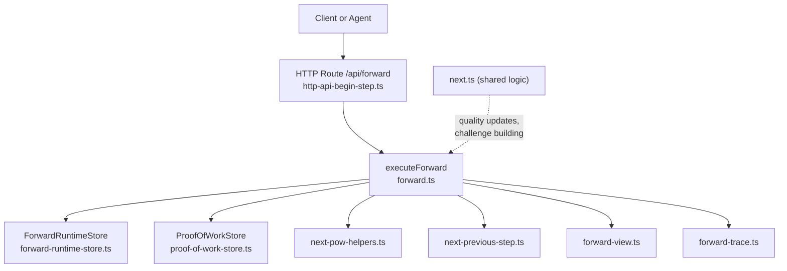
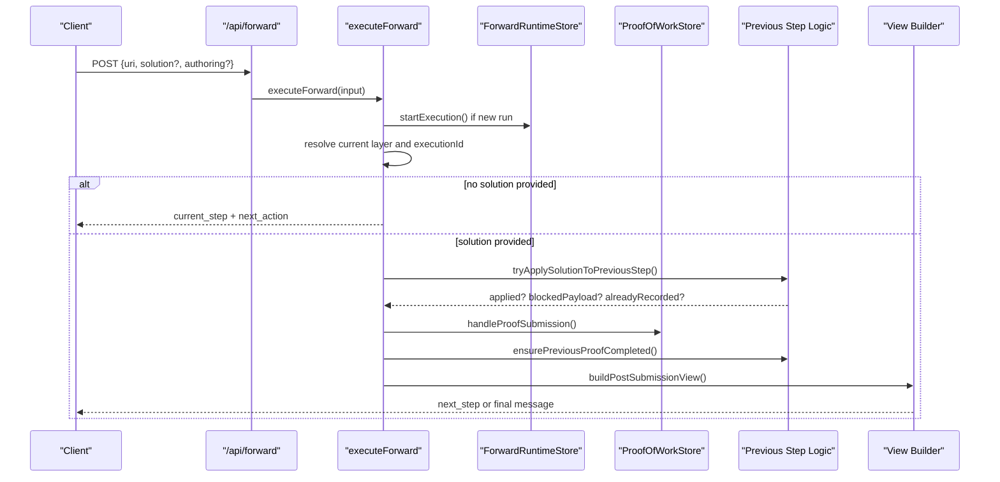
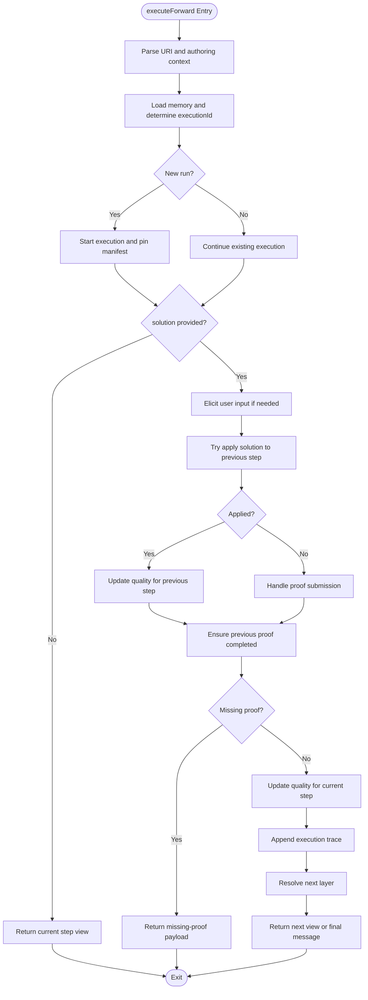
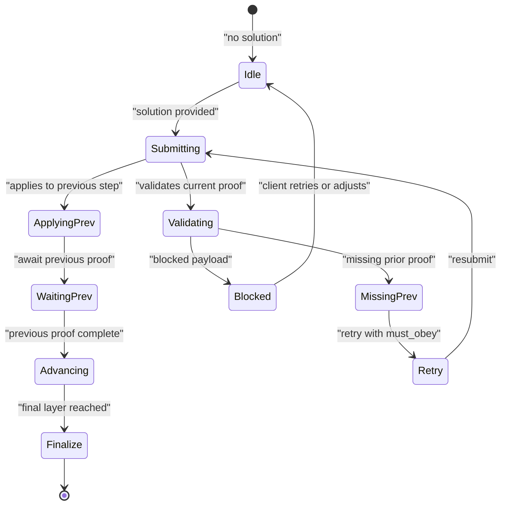
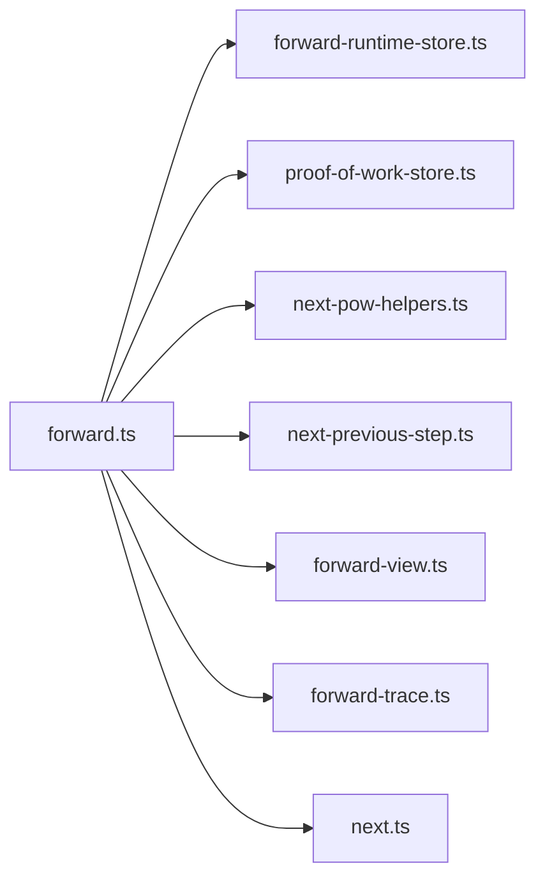

# Forward Phase: Workflow Execution and State Management

<cite>
**Referenced Files in This Document**
- [forward.ts](file://src/tools/forward.ts)
- [next.ts](file://src/tools/next.ts)
- [http-api-begin-step.ts](file://src/http/http-api-begin-step.ts)
- [forward-runtime-store.ts](file://src/services/forward-runtime-store.ts)
- [proof-of-work-store.ts](file://src/services/proof-of-work-store.ts)
- [next-pow-helpers.ts](file://src/tools/next-pow-helpers.ts)
- [next-previous-step.ts](file://src/tools/next-previous-step.ts)
- [forward-view.ts](file://src/tools/forward-view.ts)
- [forward-trace.ts](file://src/tools/forward-trace.ts)
</cite>

## Table of Contents
1. [Introduction](#introduction)
2. [Project Structure](#project-structure)
3. [Core Components](#core-components)
4. [Architecture Overview](#architecture-overview)
5. [Detailed Component Analysis](#detailed-component-analysis)
6. [Dependency Analysis](#dependency-analysis)
7. [Performance Considerations](#performance-considerations)
8. [Troubleshooting Guide](#troubleshooting-guide)
9. [Conclusion](#conclusion)

## Introduction
This document explains the forward phase that executes a selected adapter’s workflow step-by-step. It covers the state machine for workflow progression, proof generation, solution accumulation, next action determination, challenge-response patterns, determinism guarantees, adaptive behavior, multi-step workflows, error recovery, state persistence, security considerations, and troubleshooting techniques.

The forward phase is part of the activate → forward → reward chain. Adapters define deterministic, auditable steps. The system validates inputs, enforces contracts, materializes artifacts when required, invokes scripts safely, and persists execution state so agents can continue across calls.

## Project Structure
The forward phase spans HTTP routing, tool orchestration, runtime state storage, proof-of-work persistence, and view construction.

**Diagram sources**
- [http-api-begin-step.ts:13-37](file://src/http/http-api-begin-step.ts#L13-L37)
- [forward.ts:91-339](file://src/tools/forward.ts#L91-L339)
- [forward-runtime-store.ts:27-46](file://src/services/forward-runtime-store.ts#L27-L46)
- [proof-of-work-store.ts:47-170](file://src/services/proof-of-work-store.ts#L47-L170)
- [next.ts:85-129](file://src/tools/next.ts#L85-L129)

**Section sources**
- [http-api-begin-step.ts:13-37](file://src/http/http-api-begin-step.ts#L13-L37)
- [forward.ts:91-339](file://src/tools/forward.ts#L91-L339)

## Core Components
- executeForward: Orchestrates a single forward call, resolves the current layer, validates authoring context, starts or continues an execution, applies solutions, handles proofs, and returns the next view.
- ForwardRuntimeStore: Persists execution metadata and pinned layer manifests per execution ID with TTL-based cleanup.
- ProofOfWorkStore: Stores proof results, nonces, proof hashes, and retry counters with appropriate TTLs.
- next-pow-helpers: Builds challenges, validates submissions, and manages user-input elicitation and proof submission outcomes.
- next-previous-step: Applies solutions to previous steps, ensures prior proofs are complete, and builds missing-proof payloads.
- forward-view: Builds the forward response payload and maps internal shapes to the wire format.
- forward-trace: Appends execution traces including input solutions and tensor outputs.
- next.ts: Shared logic for quality updates, challenge building, and next-step resolution used by both forward and older HTTP routes.

**Section sources**
- [forward.ts:91-339](file://src/tools/forward.ts#L91-L339)
- [forward-runtime-store.ts:27-46](file://src/services/forward-runtime-store.ts#L27-L46)
- [proof-of-work-store.ts:47-170](file://src/services/proof-of-work-store.ts#L47-L170)
- [next-pow-helpers.ts](file://src/tools/next-pow-helpers.ts)
- [next-previous-step.ts](file://src/tools/next-previous-step.ts)
- [forward-view.ts](file://src/tools/forward-view.ts)
- [forward-trace.ts](file://src/tools/forward-trace.ts)
- [next.ts:85-129](file://src/tools/next.ts#L85-L129)

## Architecture Overview
The forward phase implements a layered state machine over adapter layers. Each call either:
- Returns the current step without a solution (initial request).
- Validates and applies a submitted solution against the current step contract.
- Attempts to apply the solution to a pending previous step when applicable.
- Ensures all prior proofs are complete before advancing.
- Computes the next step and constructs the next challenge or completion message.

**Diagram sources**
- [http-api-begin-step.ts:13-37](file://src/http/http-api-begin-step.ts#L13-L37)
- [forward.ts:91-339](file://src/tools/forward.ts#L91-L339)
- [forward-runtime-store.ts:27-46](file://src/services/forward-runtime-store.ts#L27-L46)
- [proof-of-work-store.ts:47-170](file://src/services/proof-of-work-store.ts#L47-L170)
- [next-previous-step.ts](file://src/tools/next-previous-step.ts)
- [forward-view.ts](file://src/tools/forward-view.ts)

## Detailed Component Analysis

### Forward Orchestration: executeForward
Responsibilities:
- Parse and validate the input URI and optional authoring context.
- Start a new execution or continue an existing one using the execution ID embedded in the layer URI.
- Pin the layer manifest on first forward to prevent UUID churn.
- If no solution is provided, return the current step view.
- If a solution is provided:
  - Normalize and optionally elicit user input via helpers.
  - Attempt to apply the solution to a previous step when appropriate.
  - Validate the proof submission against the current step’s inference contract.
  - Ensure all previous proofs are completed; otherwise, return a missing-proof payload.
  - Update step quality metrics on success/failure paths.
  - Append execution trace data.
  - Resolve the next layer and return the next view or finalization message.

Key behaviors:
- Deterministic execution: executionId is stable within a run; layer manifest is pinned once.
- Adaptive behavior: user-input elicitation may adjust the solution or return a payload.
- Error handling: blocked payloads from proof validation are returned directly; quality metrics are updated accordingly.
- Persistence: execution metadata and traces are persisted; proof hashes and results are stored.

**Diagram sources**
- [forward.ts:91-339](file://src/tools/forward.ts#L91-L339)
- [forward-runtime-store.ts:27-46](file://src/services/forward-runtime-store.ts#L27-L46)
- [proof-of-work-store.ts:47-170](file://src/services/proof-of-work-store.ts#L47-L170)
- [next-previous-step.ts](file://src/tools/next-previous-step.ts)
- [forward-view.ts](file://src/tools/forward-view.ts)
- [forward-trace.ts](file://src/tools/forward-trace.ts)

**Section sources**
- [forward.ts:91-339](file://src/tools/forward.ts#L91-L339)

### State Machine: Workflow Progression
States and transitions:
- Initial: No solution provided; server returns current step and next_action guidance.
- Solution Submitted: Server validates and applies the solution.
- Previous Step Application: If the solution matches a pending previous step, it is applied and the current step remains active until the prior proof is complete.
- Proof Validation: Contract-aware validation determines whether the submission is accepted, blocked, or requires additional information.
- Missing Proof Handling: If a prior step lacks a completed proof, the system returns a missing-proof payload with retry semantics.
- Advancement: Once all prior proofs are complete, the system resolves the next layer and returns the next challenge or finalization message.

Determinism and adaptivity:
- Determinism: executionId stability, pinned layer manifest, and expectedPreviousHash enforce reproducible ordering and linkage between steps.
- Adaptivity: User-input elicitation allows interactive flows without breaking determinism because the elicited result is captured in the solution and traced.

**Diagram sources**
- [forward.ts:154-339](file://src/tools/forward.ts#L154-L339)
- [next-previous-step.ts](file://src/tools/next-previous-step.ts)
- [proof-of-work-store.ts:127-170](file://src/services/proof-of-work-store.ts#L127-L170)

**Section sources**
- [forward.ts:154-339](file://src/tools/forward.ts#L154-L339)

### Proof Generation and Submission
- Challenge building: The system generates a challenge based on the current step’s inference contract and stores a nonce with TTL.
- Submission validation: Submissions are validated against the contract and linked to the previous step via expectedPreviousHash.
- Result persistence: Successful or failed results are stored with type-specific fields and TTLs.
- Retry management: A retry counter tracks attempts per challenge instance, with escalation after MAX_RETRIES.

Security considerations:
- Nonce TTL limits replay windows.
- Proof hash TTL bounds linkage validity.
- Retry TTL bounds retry windows and encourages cleanup.

**Section sources**
- [proof-of-work-store.ts:38-170](file://src/services/proof-of-work-store.ts#L38-L170)
- [next-pow-helpers.ts](file://src/tools/next-pow-helpers.ts)

### Artifact Materialization and Script Invocation
Artifact materialization and script invocation are governed by local artifact directory contracts and shell challenge invocation utilities. While the forward orchestrator focuses on workflow progression, it integrates with these mechanisms through helper modules referenced in the codebase.

- Local artifact directories: Fields describing allowed local artifact locations are included in responses to guide safe materialization.
- Shell challenge invocation: Scripts are invoked under controlled conditions, with diagnostics and failure reporting integrated into the workflow.

Operational notes:
- Artifacts should be verified before execution.
- Scripts must adhere to sandboxing and least-privilege principles.
- Failure diagnostics should be captured and surfaced to clients.

**Section sources**
- [next.ts:21-22](file://src/tools/next.ts#L21-L22)
- [next-pow-helpers.ts](file://src/tools/next-pow-helpers.ts)

### Next Action Determination
After processing a solution:
- If the current layer has no next layer, the system returns a finalization message instructing the client to call reward.
- If there is a next layer, the system returns the next step’s content and a next_action instruction specifying how to proceed (e.g., call forward with the appropriate solution type).

Quality updates:
- On successful application or validation, step quality metrics and metadata are updated.
- On failures or blocked payloads, quality is marked accordingly.

**Section sources**
- [forward.ts:73-89](file://src/tools/forward.ts#L73-L89)
- [next.ts:58-83](file://src/tools/next.ts#L58-L83)
- [next.ts:85-129](file://src/tools/next.ts#L85-L129)

### Multi-Step Workflows
Example pattern:
- Step 1: Generate a proof for a shell command.
- Step 2: Submit a comment confirming review.
- Step 3: Invoke a forward subtask to another adapter.
- Step 4: Provide user confirmation.
- Final: Complete and call reward.

At each step:
- The server returns the current step and next_action.
- The client submits the required solution type.
- The server validates, persists, and advances.

**Section sources**
- [forward.ts:154-339](file://src/tools/forward.ts#L154-L339)
- [next.ts:58-83](file://src/tools/next.ts#L58-L83)

### Error Recovery Mechanisms
- Blocked payloads: Returned immediately when a submission violates constraints; clients should adjust inputs.
- Missing prior proof: The system returns a missing-proof payload with retry_count and must_obey flags to guide resubmission.
- Authoring context mismatch: Enforced when continuing an authoring workflow; clients must use the exact context or start a new run.
- Quality metrics: Updated on both success and failure paths to reflect step reliability.

**Section sources**
- [forward.ts:113-129](file://src/tools/forward.ts#L113-L129)
- [forward.ts:187-215](file://src/tools/forward.ts#L187-L215)
- [forward.ts:288-316](file://src/tools/forward.ts#L288-L316)
- [next.ts:85-129](file://src/tools/next.ts#L85-L129)

### State Persistence Between Calls
- Execution metadata: Stored with adapter identity, authoring context, merge depth, and creation time.
- Layer manifest: Pinned once per execution to avoid UUID churn and ensure deterministic ordering.
- Proof results and hashes: Persisted with TTLs to maintain linkage and allow cleanup.
- Retry counters: Incremented per challenge instance with short TTLs to bound retry windows.

**Section sources**
- [forward-runtime-store.ts:27-46](file://src/services/forward-runtime-store.ts#L27-L46)
- [proof-of-work-store.ts:65-170](file://src/services/proof-of-work-store.ts#L65-L170)

### Security Considerations
- Script execution: Use sandboxed environments, restrict filesystem access, and validate inputs before invoking scripts.
- Artifact verification: Verify checksums and signatures before materializing artifacts; only trust artifacts from authorized sources.
- Proof-of-work mechanism: Enforce nonce TTLs, proof hash TTLs, and retry limits to prevent replay and abuse.
- Input validation: All HTTP inputs are validated against schemas; invalid inputs receive structured errors.

**Section sources**
- [http-api-begin-step.ts:13-37](file://src/http/http-api-begin-step.ts#L13-L37)
- [proof-of-work-store.ts:38-170](file://src/services/proof-of-work-store.ts#L38-L170)

## Dependency Analysis
The forward phase depends on several services and helpers:

**Diagram sources**
- [forward.ts:1-38](file://src/tools/forward.ts#L1-L38)
- [forward-runtime-store.ts:27-46](file://src/services/forward-runtime-store.ts#L27-L46)
- [proof-of-work-store.ts:47-170](file://src/services/proof-of-work-store.ts#L47-L170)
- [next.ts:85-129](file://src/tools/next.ts#L85-L129)

**Section sources**
- [forward.ts:1-38](file://src/tools/forward.ts#L1-L38)

## Performance Considerations
- Caching: Memory resources are cached via Redis in shared logic to reduce database load during next-step resolution.
- Trace persistence: Execution traces are appended asynchronously where possible to avoid blocking the main flow.
- TTL management: Proper TTLs for nonces, proof hashes, and retry counters help manage storage growth and stale state.

[No sources needed since this section provides general guidance]

## Troubleshooting Guide
Common issues and remedies:
- Invalid input: Ensure the URI and solution conform to the schema; inspect field-level errors returned by the route.
- Authoring context mismatch: When continuing an authoring workflow, reuse the exact authoring context and target adapter; otherwise, start a new run.
- Missing prior proof: Follow the missing-proof payload instructions, respecting retry_count and must_obey flags.
- Blocked payload: Review the challenge requirements and adjust the solution type or values accordingly.
- Quality update failures: These are logged but do not fail the request; monitor metrics for recurring issues.

Debugging techniques:
- Inspect execution metadata and pinned manifests via the runtime store keys.
- Review proof results, nonces, and hashes in the proof-of-work store.
- Correlate execution traces with solution inputs and tensor outputs.
- Use structured logs to identify where quality updates or trace persistence failed.

**Section sources**
- [http-api-begin-step.ts:13-37](file://src/http/http-api-begin-step.ts#L13-L37)
- [forward.ts:113-129](file://src/tools/forward.ts#L113-L129)
- [forward.ts:187-215](file://src/tools/forward.ts#L187-L215)
- [forward.ts:288-316](file://src/tools/forward.ts#L288-L316)
- [next.ts:85-129](file://src/tools/next.ts#L85-L129)

## Conclusion
The forward phase implements a robust, deterministic state machine for executing adapter workflows. It validates inputs, enforces contracts, manages proofs, accumulates solutions, and persists state to support multi-step, adaptive workflows. By combining strict validation with controlled adaptivity, the system maintains reproducibility while enabling interactive and complex processes. Proper security practices around script execution, artifact verification, and proof-of-work mechanics ensure safe operation. The troubleshooting guidance helps operators diagnose and recover from common workflow execution issues.