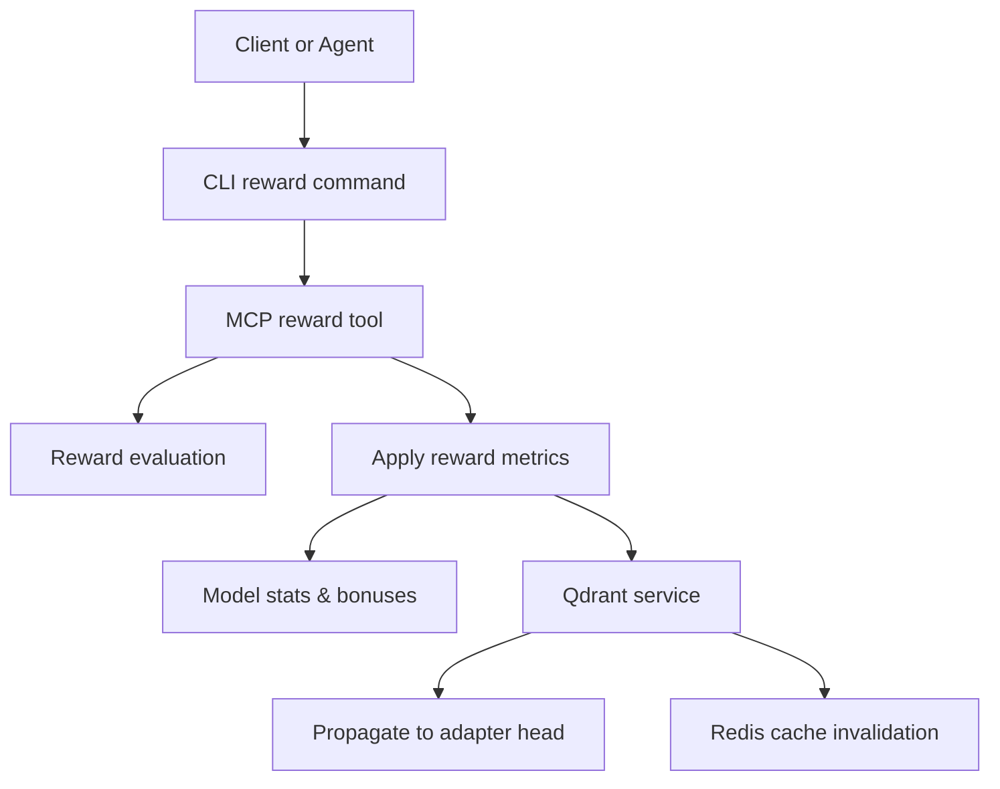
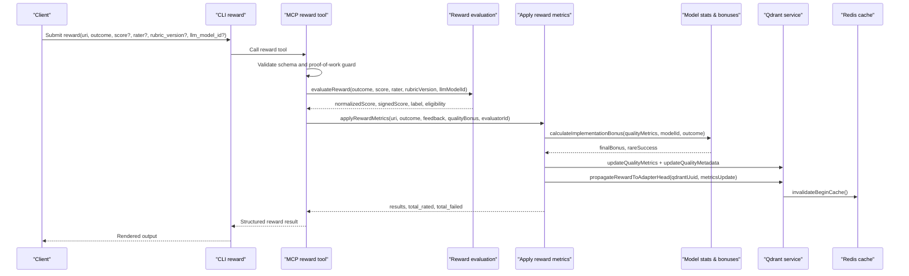
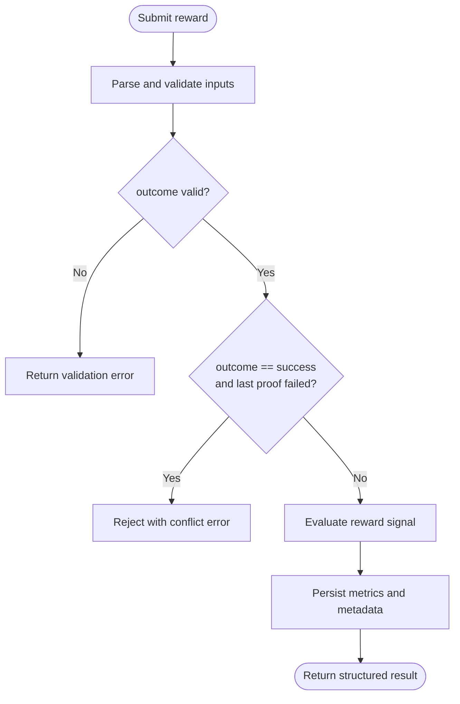
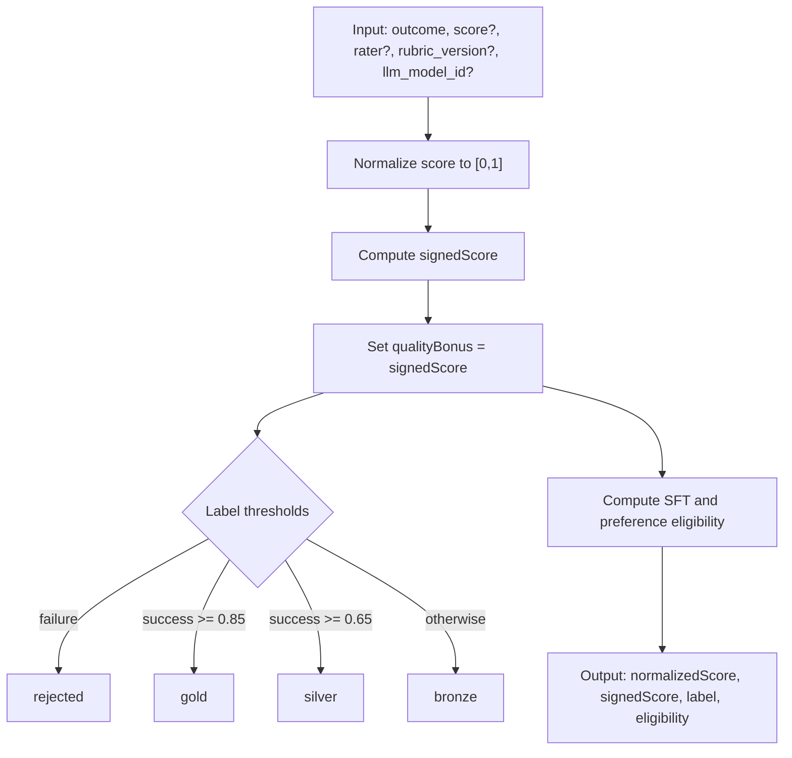
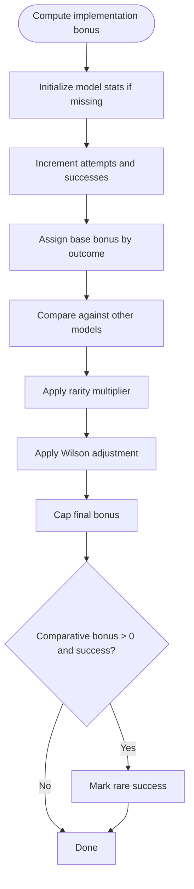
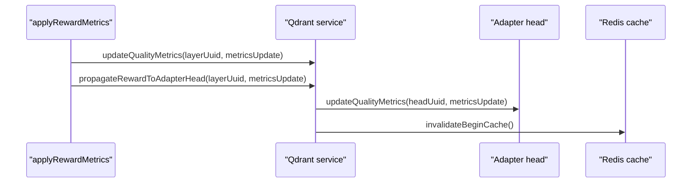
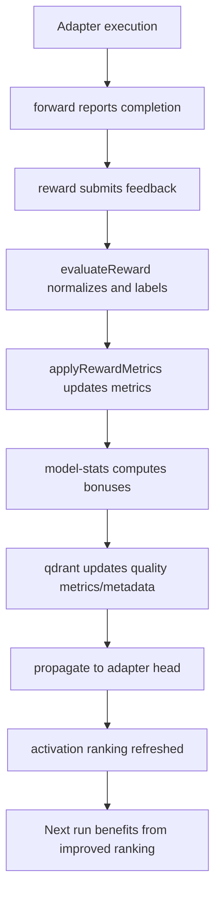
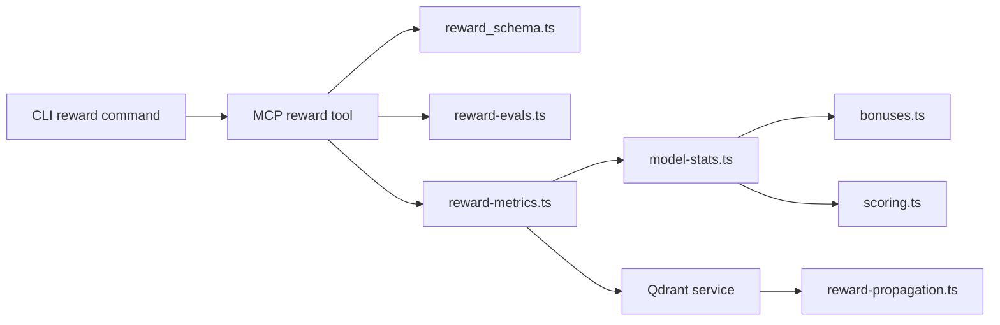

# Reward Phase: Feedback Collection and Learning

<cite>
**Referenced Files in This Document**
- [reward.ts](file://src/cli/commands/reward.ts)
- [reward.md](file://src/embed-docs/tools/reward.md)
- [reward.ts](file://src/tools/reward.ts)
- [reward_schema.ts](file://src/tools/reward_schema.ts)
- [reward-evals.ts](file://src/services/reward-evals.ts)
- [reward-metrics.ts](file://src/services/reward-metrics.ts)
- [model-stats.ts](file://src/services/stats/model-stats.ts)
- [bonuses.ts](file://src/services/stats/bonuses.ts)
- [scoring.ts](file://src/services/stats/scoring.ts)
- [reward-propagation.ts](file://src/services/qdrant/reward-propagation.ts)
</cite>

## Table of Contents
1. [Introduction](#introduction)
2. [Project Structure](#project-structure)
3. [Core Components](#core-components)
4. [Architecture Overview](#architecture-overview)
5. [Detailed Component Analysis](#detailed-component-analysis)
6. [Dependency Analysis](#dependency-analysis)
7. [Performance Considerations](#performance-considerations)
8. [Troubleshooting Guide](#troubleshooting-guide)
9. [Conclusion](#conclusion)
10. [Appendices](#appendices)

## Introduction
This document explains the reward phase that collects feedback after an adapter execution to improve future adapter selections and workflow executions. It covers how rewards are submitted, how scoring and bonuses are computed, how feedback influences activation ranking, and how historical performance shapes future recommendations. It also documents privacy considerations, data retention implications, and the continuous learning loop that improves system accuracy over time.

The reward phase is part of the core activate → forward → reward chain. After a successful or failed run, clients submit a reward for the final layer URI. The system evaluates the signal, persists metrics, updates quality metadata, propagates improvements to the adapter head, and invalidates caches so subsequent activations reflect the latest evidence.

## Project Structure
The reward feature spans CLI entry points, MCP tool registration, evaluation logic, metrics persistence, statistical bonus computation, and vector-store propagation.

**Diagram sources**
- [reward.ts:13-65](file://src/cli/commands/reward.ts#L13-L65)
- [reward.ts:132-175](file://src/tools/reward.ts#L132-L175)
- [reward-evals.ts:105-147](file://src/services/reward-evals.ts#L105-L147)
- [reward-metrics.ts:20-119](file://src/services/reward-metrics.ts#L20-L119)
- [model-stats.ts:153-190](file://src/services/stats/model-stats.ts#L153-L190)
- [reward-propagation.ts:13-73](file://src/services/qdrant/reward-propagation.ts#L13-L73)

**Section sources**
- [reward.ts:13-65](file://src/cli/commands/reward.ts#L13-L65)
- [reward.md:1-24](file://src/embed-docs/tools/reward.md#L1-L24)

## Core Components
- CLI reward command: Accepts layer URI, outcome, optional score, rater, rubric version, and LLM model ID. Validates inputs and forwards to the backend.
- MCP reward tool: Registers the reward tool, validates input schema, enforces proof-of-work constraints, evaluates reward signals, applies metrics, and returns structured results.
- Reward evaluation: Normalizes scores, assigns labels (gold/silver/bronze/rejected), determines grader kind, and computes eligibility for SFT and preference datasets.
- Reward metrics application: Updates per-layer quality metrics, step-level quality metadata, implementation bonuses, and propagates rewards to the adapter head.
- Model statistics and bonuses: Computes Wilson-adjusted success rates, rarity multipliers, comparative bonuses, and tracks agent contributions.
- Reward propagation: Finds the adapter head for a completion layer and updates its quality metrics; invalidates begin-cache to refresh activation ranking.

**Section sources**
- [reward.ts:13-65](file://src/cli/commands/reward.ts#L13-L65)
- [reward.ts:28-130](file://src/tools/reward.ts#L28-L130)
- [reward_schema.ts:1-53](file://src/tools/reward_schema.ts#L1-L53)
- [reward-evals.ts:105-147](file://src/services/reward-evals.ts#L105-L147)
- [reward-metrics.ts:20-119](file://src/services/reward-metrics.ts#L20-L119)
- [model-stats.ts:153-190](file://src/services/stats/model-stats.ts#L153-L190)
- [bonuses.ts:36-119](file://src/services/stats/bonuses.ts#L36-L119)
- [reward-propagation.ts:13-73](file://src/services/qdrant/reward-propagation.ts#L13-L73)

## Architecture Overview
The reward flow integrates user/agent feedback with persistent statistics and search ranking.

**Diagram sources**
- [reward.ts:13-65](file://src/cli/commands/reward.ts#L13-L65)
- [reward.ts:28-130](file://src/tools/reward.ts#L28-L130)
- [reward-evals.ts:105-147](file://src/services/reward-evals.ts#L105-L147)
- [reward-metrics.ts:20-119](file://src/services/reward-metrics.ts#L20-L119)
- [model-stats.ts:153-190](file://src/services/stats/model-stats.ts#L153-L190)
- [reward-propagation.ts:13-73](file://src/services/qdrant/reward-propagation.ts#L13-L73)

## Detailed Component Analysis

### Reward Submission and Validation
- Inputs:
  - uri: Layer URI with optional execution_id.
  - outcome: success or failure.
  - Optional: score (0–1), feedback, rater, rubric_version, llm_model_id.
- Validation:
  - CLI enforces outcome values and numeric score range.
  - MCP tool validates schema and rejects non-layer URIs.
  - A success reward is rejected if the layer’s last stored proof failed.
- Export eligibility:
  - Requires rubric_version and at least one of rater or llm_model_id.
  - Missing fields produce explicit blockers in the response.

**Diagram sources**
- [reward.ts:13-65](file://src/cli/commands/reward.ts#L13-L65)
- [reward.ts:28-130](file://src/tools/reward.ts#L28-L130)
- [reward_schema.ts:1-53](file://src/tools/reward_schema.ts#L1-L53)

**Section sources**
- [reward.ts:13-65](file://src/cli/commands/reward.ts#L13-L65)
- [reward.ts:28-130](file://src/tools/reward.ts#L28-L130)
- [reward_schema.ts:1-53](file://src/tools/reward_schema.ts#L1-L53)
- [reward.md:1-24](file://src/embed-docs/tools/reward.md#L1-L24)

### Reward Scoring System and Evaluation Metrics
- Score normalization:
  - If score is omitted, defaults to 1 for success and 0 for failure.
  - Scores are clamped to [0, 1].
- Signed score and quality bonus:
  - Success yields positive signed score; failure yields negative.
  - Quality bonus equals signed score before additional bonuses.
- Labeling:
  - Failure → rejected.
  - Success ≥ 0.85 → gold.
  - Success ≥ 0.65 → silver.
  - Otherwise → bronze.
- Grader kind:
  - model when llm_model_id provided.
  - human when rater provided.
  - unknown otherwise.
- Eligibility:
  - SFT requires success and normalizedScore ≥ 0.65.
  - Preference requires normalizedScore ≥ 0.7.
  - Both require rubric_version and evaluator identity.

**Diagram sources**
- [reward-evals.ts:105-147](file://src/services/reward-evals.ts#L105-L147)
- [reward_schema.ts:1-53](file://src/tools/reward_schema.ts#L1-L53)

**Section sources**
- [reward-evals.ts:105-147](file://src/services/reward-evals.ts#L105-L147)
- [reward_schema.ts:1-53](file://src/tools/reward_schema.ts#L1-L53)

### Bonus System and Statistical Analysis
- Implementation bonus:
  - Base bonus depends on outcome: success adds base points, partial adds fewer, failure adds none.
  - Rarity multiplier increases when overall success rate is low.
  - Comparative bonus rewards models outperforming peers.
  - Wilson adjustment stabilizes estimates with small sample sizes.
  - Final bonus capped at a maximum value.
- Model statistics orchestration:
  - Persists cumulative implementation bonuses and rare success counts.
  - Tracks recent discoveries and agent contribution metrics.
- Step-level quality metadata:
  - Combines description, domain, task, type, tags, and execution outcome.
  - Applies execution multiplier to adjust step quality score and tier.

**Diagram sources**
- [bonuses.ts:36-119](file://src/services/stats/bonuses.ts#L36-L119)
- [model-stats.ts:153-190](file://src/services/stats/model-stats.ts#L153-L190)
- [scoring.ts:74-106](file://src/services/stats/scoring.ts#L74-L106)

**Section sources**
- [bonuses.ts:36-119](file://src/services/stats/bonuses.ts#L36-L119)
- [model-stats.ts:153-190](file://src/services/stats/model-stats.ts#L153-L190)
- [scoring.ts:74-106](file://src/services/stats/scoring.ts#L74-L106)

### How Feedback Influences Activation Ranking
- Per-layer metrics update:
  - retrievalCount, successCount, failureCount, lastRated, lastRater, qualityBonus.
  - usageContext stores feedback text when provided.
- Step-level quality metadata update:
  - step_quality_score and step_quality recalculated based on content and outcome.
- Propagation to adapter head:
  - Finds the adapter head record for the same adapter and layer_index=1.
  - Updates adapter head quality metrics with the same metricsUpdate object.
  - Invalidates begin-cache to ensure next activation uses updated ranking.

**Diagram sources**
- [reward-metrics.ts:46-95](file://src/services/reward-metrics.ts#L46-L95)
- [reward-propagation.ts:13-73](file://src/services/qdrant/reward-propagation.ts#L13-L73)

**Section sources**
- [reward-metrics.ts:46-95](file://src/services/reward-metrics.ts#L46-L95)
- [reward-propagation.ts:13-73](file://src/services/qdrant/reward-propagation.ts#L13-L73)

### Relationship Between Rewards and Search Ranking
- Vector store records carry quality_metrics and quality_metadata.
- Rewards increment success/failure counters and accumulate qualityBonus.
- Step-level quality tiers influence how relevant a step appears in semantic search and activation ranking.
- Adapter head updates ensure the top-level selection sees aggregated outcomes.
- Cache invalidation ensures fresh ranking after rewards.

**Section sources**
- [reward-metrics.ts:46-95](file://src/services/reward-metrics.ts#L46-L95)
- [reward-propagation.ts:13-73](file://src/services/qdrant/reward-propagation.ts#L13-L73)

### Historical Performance and Learning Mechanisms
- Historical success rates per model inform Wilson-adjusted bonuses.
- Comparative bonuses reward models that consistently outperform others.
- Rare success events are tracked and contribute to agent achievement metrics.
- Recent discoveries and contribution summaries are persisted for visibility and auditing.

**Section sources**
- [bonuses.ts:36-119](file://src/services/stats/bonuses.ts#L36-L119)
- [model-stats.ts:153-190](file://src/services/stats/model-stats.ts#L153-L190)

### Examples of Reward Submission and Scoring Calculations
- Example submission patterns:
  - Human-rated success with rubric version and rater identifier.
  - Model-rated success with llm_model_id and optional score.
  - Failure with feedback describing root cause.
- Scoring calculations:
  - Omitted score defaults to 1 for success, 0 for failure.
  - Signed score flips sign for failures.
  - Quality bonus equals signed score before implementation bonuses.
  - Final ranking impact includes basic bonus, implementation bonus, and quality bonus.

[No sources needed since this section provides conceptual examples without quoting code]

### Continuous Feedback Loop

**Diagram sources**
- [reward.ts:28-130](file://src/tools/reward.ts#L28-L130)
- [reward-evals.ts:105-147](file://src/services/reward-evals.ts#L105-L147)
- [reward-metrics.ts:20-119](file://src/services/reward-metrics.ts#L20-L119)
- [model-stats.ts:153-190](file://src/services/stats/model-stats.ts#L153-L190)
- [reward-propagation.ts:13-73](file://src/services/qdrant/reward-propagation.ts#L13-L73)

## Dependency Analysis

**Diagram sources**
- [reward.ts:13-65](file://src/cli/commands/reward.ts#L13-L65)
- [reward.ts:132-175](file://src/tools/reward.ts#L132-L175)
- [reward_schema.ts:1-53](file://src/tools/reward_schema.ts#L1-L53)
- [reward-evals.ts:105-147](file://src/services/reward-evals.ts#L105-L147)
- [reward-metrics.ts:20-119](file://src/services/reward-metrics.ts#L20-L119)
- [model-stats.ts:153-190](file://src/services/stats/model-stats.ts#L153-L190)
- [bonuses.ts:36-119](file://src/services/stats/bonuses.ts#L36-L119)
- [scoring.ts:74-106](file://src/services/stats/scoring.ts#L74-L106)
- [reward-propagation.ts:13-73](file://src/services/qdrant/reward-propagation.ts#L13-L73)

**Section sources**
- [reward.ts:13-65](file://src/cli/commands/reward.ts#L13-L65)
- [reward.ts:132-175](file://src/tools/reward.ts#L132-L175)
- [reward_schema.ts:1-53](file://src/tools/reward_schema.ts#L1-L53)
- [reward-evals.ts:105-147](file://src/services/reward-evals.ts#L105-L147)
- [reward-metrics.ts:20-119](file://src/services/reward-metrics.ts#L20-L119)
- [model-stats.ts:153-190](file://src/services/stats/model-stats.ts#L153-L190)
- [bonuses.ts:36-119](file://src/services/stats/bonuses.ts#L36-L119)
- [scoring.ts:74-106](file://src/services/stats/scoring.ts#L74-L106)
- [reward-propagation.ts:13-73](file://src/services/qdrant/reward-propagation.ts#L13-L73)

## Performance Considerations
- Reward evaluation is pure and fast; it runs synchronously before persistence.
- Metrics application performs vector store updates and cache invalidation; batch operations should be avoided unless necessary.
- Propagation queries the adapter head once per reward; caching and indexing reduce overhead.
- Avoid excessive feedback payloads; only include concise, actionable context.

[No sources needed since this section provides general guidance]

## Troubleshooting Guide
- Invalid outcome or score:
  - Ensure outcome is success or failure.
  - Ensure score is a number between 0 and 1 when provided.
- Non-layer URI:
  - Use squadrules://layer/{uuid}; include ?execution_id=... when available.
- Success reward conflicts with failed proof:
  - If the layer’s last stored proof failed, success rewards are rejected. Fix the step or submit failure.
- Persistence errors:
  - If reward storage is unhealthy, retry once; errors indicate no reward was stored.
- Export eligibility blockers:
  - Provide rubric_version and either rater or llm_model_id to enable SFT and preference export.

**Section sources**
- [reward.ts:13-65](file://src/cli/commands/reward.ts#L13-L65)
- [reward.ts:28-130](file://src/tools/reward.ts#L28-L130)
- [reward_schema.ts:1-53](file://src/tools/reward_schema.ts#L1-L53)
- [reward.md:1-24](file://src/embed-docs/tools/reward.md#L1-L24)

## Conclusion
The reward phase transforms post-execution feedback into durable signals that improve future adapter selection and workflow execution. By normalizing scores, labeling outcomes, computing statistical bonuses, and propagating updates to adapter heads, the system continuously learns from both successful and unsuccessful runs. Properly providing rubric versions and evaluator identities unlocks exportable datasets for supervised fine-tuning and preference optimization, while preserving auditability and privacy through controlled metadata and cache management.

[No sources needed since this section summarizes without analyzing specific files]

## Appendices

### Privacy and Data Retention Considerations
- Feedback text may contain sensitive information; keep it concise and avoid secrets.
- Evaluator identity can be a human rater or an LLM model ID; choose the minimal identifier required.
- Rubric versions provide policy traceability without exposing raw evaluation prompts.
- Metrics and quality metadata are persisted in the vector store; ensure appropriate access controls and retention policies align with organizational requirements.

[No sources needed since this section provides general guidance]