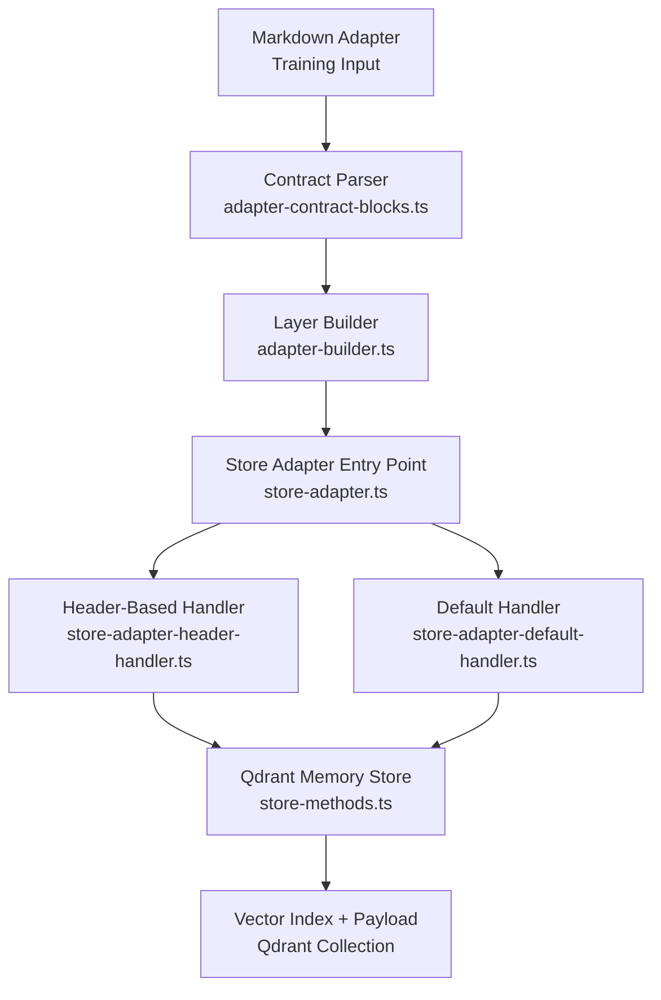
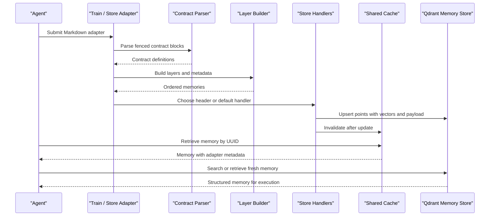
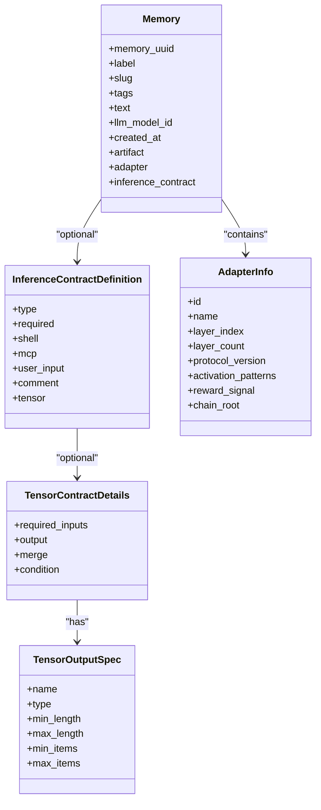
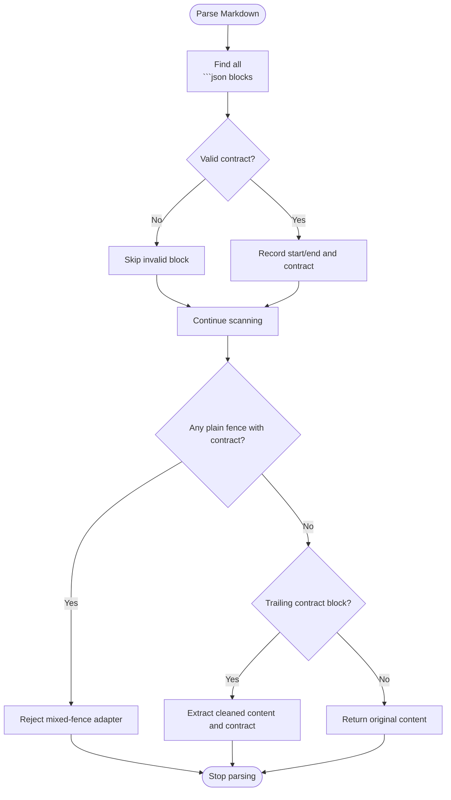
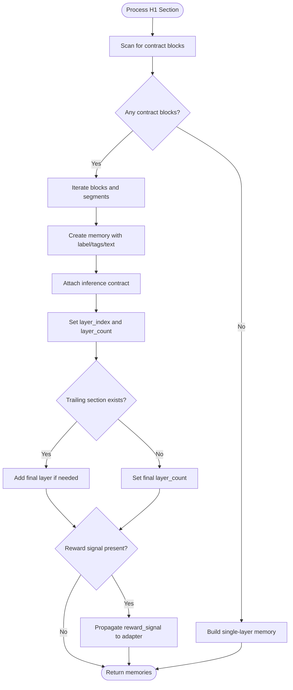
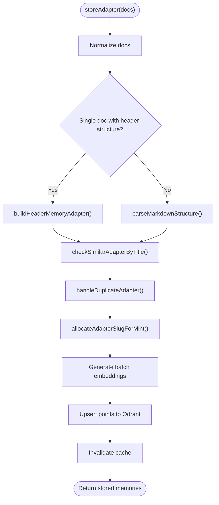
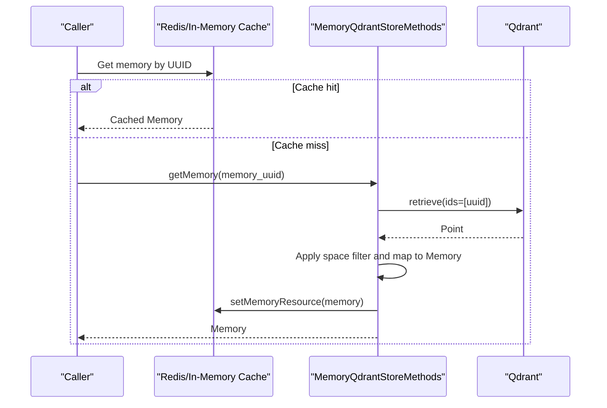
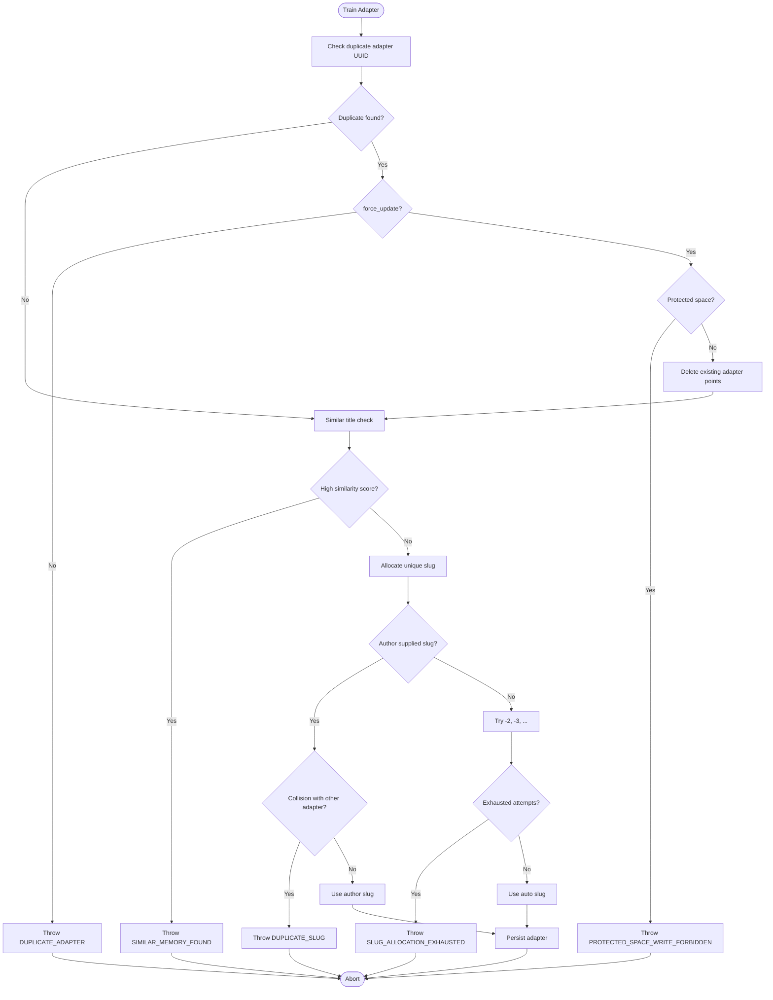
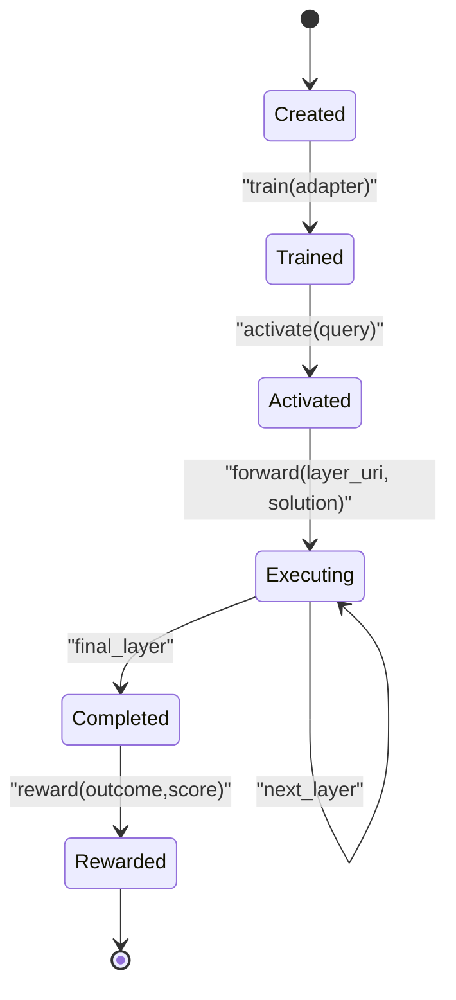
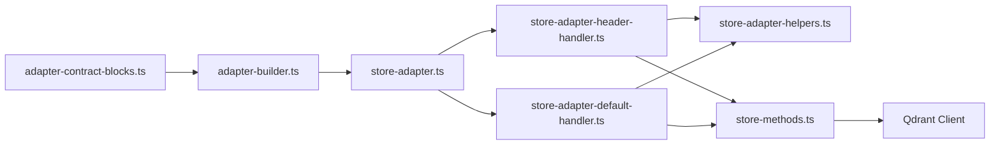

# Adapter Architecture

<cite>
**Referenced Files in This Document**
- [memory.ts](file://src/types/memory.ts)
- [adapter-contract-blocks.ts](file://src/services/memory/adapter-contract-blocks.ts)
- [adapter-builder.ts](file://src/services/memory/adapter-builder.ts)
- [store-adapter.ts](file://src/services/memory/store-adapter.ts)
- [store-adapter-header-handler.ts](file://src/services/memory/store-adapter-header-handler.ts)
- [store-adapter-default-handler.ts](file://src/services/memory/store-adapter-default-handler.ts)
- [store-adapter-helpers.ts](file://src/services/memory/store-adapter-helpers.ts)
- [store-methods.ts](file://src/services/memory/store-methods.ts)
- [validate-protocol-structure.ts](file://src/services/memory/validate-protocol-structure.ts)
- [adapter-example-all-types.md](file://docs/examples/adapter-example-all-types.md)
- [adapter-example-shell.md](file://docs/examples/adapter-example-shell.md)
- [adapter-example-mcp.md](file://docs/examples/adapter-example-mcp.md)
- [adapter-example-user-input.md](file://docs/examples/adapter-example-user-input.md)
- [adapter-example-comment.md](file://docs/examples/adapter-example-comment.md)
- [0009-autonomous-adapter-execution-no-human-gates.md](file://docs/adr/0009-autonomous-adapter-execution-no-human-gates.md)
</cite>

## Table of Contents
1. [Introduction](#introduction)
2. [Project Structure](#project-structure)
3. [Core Components](#core-components)
4. [Architecture Overview](#architecture-overview)
5. [Detailed Component Analysis](#detailed-component-analysis)
6. [Dependency Analysis](#dependency-analysis)
7. [Performance Considerations](#performance-considerations)
8. [Troubleshooting Guide](#troubleshooting-guide)
9. [Conclusion](#conclusion)

## Introduction
This document explains the adapter architecture that makes SquadRules task execution deterministic and auditable. An adapter is a versioned, layered workflow stored as memory points with typed inference contracts. Agents create adapters from Markdown, train them into vector storage, and execute them through a strict forward chain where each layer validates its solution against a contract before advancing. The system supports five inference types: tensor, shell, mcp, user_input, and comment. Adapters are versioned by slug and optional protocol version, deduplicated or replaced under controlled rules, and retrieved through a shared cache plus Qdrant-backed memory store.

The design enforces that familiarity does not equal established preference: agents must consult team knowledge and repair adapters when workflows change rather than assuming old behavior still applies.

## Project Structure
Adapter-related code is concentrated under `src/services/memory`, with type definitions in `src/types/memory.ts` and usage examples under `docs/examples`. The training path parses Markdown, extracts layers and contracts, computes embeddings, and persists points to Qdrant. The runtime path retrieves an adapter’s current layer, validates solutions, and advances the execution trace.



**Diagram sources**
- [adapter-contract-blocks.ts:1-117](file://src/services/memory/adapter-contract-blocks.ts#L1-L117)
- [adapter-builder.ts:70-257](file://src/services/memory/adapter-builder.ts#L70-L257)
- [store-adapter.ts:43-147](file://src/services/memory/store-adapter.ts#L43-L147)
- [store-adapter-header-handler.ts:30-201](file://src/services/memory/store-adapter-header-handler.ts#L30-L201)
- [store-adapter-default-handler.ts:34-254](file://src/services/memory/store-adapter-default-handler.ts#L34-L254)
- [store-methods.ts:25-268](file://src/services/memory/store-methods.ts#L25-L268)

**Section sources**
- [memory.ts:1-125](file://src/types/memory.ts#L1-L125)
- [adapter-contract-blocks.ts:1-117](file://src/services/memory/adapter-contract-blocks.ts#L1-L117)
- [adapter-builder.ts:1-258](file://src/services/memory/adapter-builder.ts#L1-L258)
- [store-adapter.ts:1-154](file://src/services/memory/store-adapter.ts#L1-L154)
- [store-adapter-header-handler.ts:1-203](file://src/services/memory/store-adapter-header-handler.ts#L1-L203)
- [store-adapter-default-handler.ts:1-256](file://src/services/memory/store-adapter-default-handler.ts#L1-L256)
- [store-methods.ts:1-270](file://src/services/memory/store-methods.ts#L1-L270)

## Core Components
- Inference contract model: Defines the five supported contract types and their fields.
- Contract parser: Extracts fenced JSON contract blocks and detects mixed fences.
- Layer builder: Converts Markdown sections into ordered layers with metadata.
- Store entry point: Normalizes input, chooses header-based or default storage, and handles slug/versioning.
- Header/default handlers: Persist points with vectors, BM25, payload metadata, and duplicate/slug handling.
- Memory methods: Provide retrieval, search, and mapping between Qdrant points and domain models.
- Validation helpers: Enforce required sections, allowed contract types, and structural integrity.

Key responsibilities:
- Determinism: Contracts define exact inputs, outputs, and validation rules per layer.
- Auditability: Execution traces record adapter URI, layer URI, inputs, outputs, and rewards.
- Versioning: Slugs and optional protocol versions identify stable adapter revisions.
- Retrieval: Shared cache plus Qdrant retrieval returns structured memories with adapter metadata.

**Section sources**
- [memory.ts:1-125](file://src/types/memory.ts#L1-L125)
- [adapter-contract-blocks.ts:1-117](file://src/services/memory/adapter-contract-blocks.ts#L1-L117)
- [adapter-builder.ts:70-257](file://src/services/memory/adapter-builder.ts#L70-L257)
- [store-adapter.ts:43-147](file://src/services/memory/store-adapter.ts#L43-L147)
- [store-adapter-header-handler.ts:30-201](file://src/services/memory/store-adapter-header-handler.ts#L30-L201)
- [store-adapter-default-handler.ts:34-254](file://src/services/memory/store-adapter-default-handler.ts#L34-L254)
- [store-methods.ts:38-92](file://src/services/memory/store-methods.ts#L38-L92)
- [validate-protocol-structure.ts:1-34](file://src/services/memory/validate-protocol-structure.ts#L1-L34)

## Architecture Overview
Adapters flow through three phases: creation/training, storage/indexing, and execution/retrieval.



**Diagram sources**
- [adapter-contract-blocks.ts:21-117](file://src/services/memory/adapter-contract-blocks.ts#L21-L117)
- [adapter-builder.ts:70-257](file://src/services/memory/adapter-builder.ts#L70-L257)
- [store-adapter.ts:43-147](file://src/services/memory/store-adapter.ts#L43-L147)
- [store-adapter-header-handler.ts:30-201](file://src/services/memory/store-adapter-header-handler.ts#L30-L201)
- [store-adapter-default-handler.ts:34-254](file://src/services/memory/store-adapter-default-handler.ts#L34-L254)
- [store-methods.ts:38-92](file://src/services/memory/store-methods.ts#L38-L92)

## Detailed Component Analysis

### Inference Contracts and Metadata Model
Contracts describe how each layer executes and what it accepts. Supported types:
- tensor: Typed tensor I/O with merge and condition controls.
- shell: Command execution with timeout and interpreter options.
- mcp: Tool invocation with tool_name, optional arguments schema, and expected result guidance.
- user_input: Human confirmation prompt.
- comment: Free-form verification text with minimum length.

Metadata includes adapter identity, layer ordering, activation patterns, reward signal, and optional protocol version.



**Diagram sources**
- [memory.ts:1-125](file://src/types/memory.ts#L1-L125)

**Section sources**
- [memory.ts:1-125](file://src/types/memory.ts#L1-L125)

### Contract Parsing and Layer Extraction
Parsing focuses on fenced JSON blocks containing a contract object. It:
- Finds all ```json blocks with a contract key.
- Rejects mixed plain fence blocks that contain contracts.
- Supports single-layer documents with a trailing contract block.
- Produces normalized contract definitions with required defaults.



**Diagram sources**
- [adapter-contract-blocks.ts:1-117](file://src/services/memory/adapter-contract-blocks.ts#L1-L117)

**Section sources**
- [adapter-contract-blocks.ts:1-117](file://src/services/memory/adapter-contract-blocks.ts#L1-L117)

### Layer Building and Adapter Construction
The builder converts Markdown into ordered layers:
- Sanitizes headings to avoid numbering artifacts.
- Extracts activation patterns and reward signals.
- Builds one memory per layer, attaching adapter metadata and inference contract.
- Handles both multi-layer adapters (fenced contract boundaries) and single-layer adapters.



**Diagram sources**
- [adapter-builder.ts:10-257](file://src/services/memory/adapter-builder.ts#L10-L257)

**Section sources**
- [adapter-builder.ts:10-257](file://src/services/memory/adapter-builder.ts#L10-L257)

### Storage Path Selection and Persistence
The store entry point normalizes Markdown, parses frontmatter, and selects:
- Header-based adapter storage when H1/H2 structure is detected.
- Default adapter storage otherwise.

Both paths:
- Compute embeddings for primary, title, and activation pattern vectors.
- Tokenize sparse BM25 indices.
- Handle duplicate adapters and allocate unique slugs.
- Upsert points with payload metadata including adapter info and inference contracts.
- Invalidate caches and emit metrics.



**Diagram sources**
- [store-adapter.ts:43-147](file://src/services/memory/store-adapter.ts#L43-L147)
- [store-adapter-header-handler.ts:30-201](file://src/services/memory/store-adapter-header-handler.ts#L30-L201)
- [store-adapter-default-handler.ts:34-254](file://src/services/memory/store-adapter-default-handler.ts#L34-L254)
- [store-adapter-helpers.ts:52-254](file://src/services/memory/store-adapter-helpers.ts#L52-L254)

**Section sources**
- [store-adapter.ts:43-147](file://src/services/memory/store-adapter.ts#L43-L147)
- [store-adapter-header-handler.ts:30-201](file://src/services/memory/store-adapter-header-handler.ts#L30-L201)
- [store-adapter-default-handler.ts:34-254](file://src/services/memory/store-adapter-default-handler.ts#L34-L254)
- [store-adapter-helpers.ts:52-254](file://src/services/memory/store-adapter-helpers.ts#L52-L254)

### Retrieval and Caching
Retrieval uses a shared cache first, then Qdrant:
- getMemory checks Redis/in-memory cache, falls back to Qdrant retrieval, applies space access control, maps to Memory, and populates cache.
- getMemoryFresh bypasses cache for freshest view.
- searchMemories performs hybrid dense + BM25 search with activation-aware boosting and caching.



**Diagram sources**
- [store-methods.ts:38-92](file://src/services/memory/store-methods.ts#L38-L92)

**Section sources**
- [store-methods.ts:38-92](file://src/services/memory/store-methods.ts#L38-L92)

### Versioning, Deduplication, and Slug Allocation
Versioning and uniqueness are enforced during training:
- Duplicate detection by adapter UUID throws or deletes existing entries depending on force_update and protected spaces.
- Similarity guard warns about similar adapter titles and suggests export/repair actions.
- Slug allocation ensures author-supplied slugs do not collide; auto slugs append numeric suffixes until free.
- Protocol version can be carried from frontmatter or train input.



**Diagram sources**
- [store-adapter-helpers.ts:52-254](file://src/services/memory/store-adapter-helpers.ts#L52-L254)

**Section sources**
- [store-adapter-helpers.ts:52-254](file://src/services/memory/store-adapter-helpers.ts#L52-L254)

### Execution Lifecycle: Creation Through Training to Execution
Lifecycle stages:
1. Creation: Agents write Markdown adapters with Activation Patterns, steps, and Reward Signal.
2. Training: Markdown is parsed, validated, embedded, and persisted as layered memories.
3. Activation: activate selects an adapter based on query similarity and returns the first layer.
4. Forward: Each layer validates the solution against its contract and advances to the next layer.
5. Reward: After completion, reward records outcomes and quality signals.



**Diagram sources**
- [validate-protocol-structure.ts:1-34](file://src/services/memory/validate-protocol-structure.ts#L1-L34)
- [store-methods.ts:94-260](file://src/services/memory/store-methods.ts#L94-L260)

**Section sources**
- [validate-protocol-structure.ts:1-34](file://src/services/memory/validate-protocol-structure.ts#L1-L34)
- [store-methods.ts:94-260](file://src/services/memory/store-methods.ts#L94-L260)

### Contract System: Input/Output Specifications and Validation Rules
The contract system defines:
- Type-specific fields: shell command configuration, MCP tool invocation parameters, user input prompts, comment constraints, and tensor I/O specs.
- Required flag: Indicates whether a layer must be solved.
- Structural validation: Ensures required sections, allowed contract types, and rejects mixed fences.

Validation rules include:
- Allowed contract types: shell, mcp, user_input, comment, tensor.
- Presence of Activation Patterns and Reward Signal.
- At least one valid ```json contract block.
- Mixed fence rejection to prevent ambiguous layer parsing.

**Section sources**
- [memory.ts:13-58](file://src/types/memory.ts#L13-L58)
- [validate-protocol-structure.ts:1-34](file://src/services/memory/validate-protocol-structure.ts#L1-L34)

### Examples of Adapter Types and Use Cases
Examples demonstrate practical use cases:
- Shell: Run project tests or commands and verify exit codes.
- MCP: Call tools like activate with constrained arguments and report success.
- User Input: Obtain explicit human approval before proceeding.
- Comment: Require a verification summary above a minimum length.
- All Types: Combine multiple challenge types in one adapter.

These examples show how agents should construct adapters that enforce deterministic outcomes and provide audit trails.

**Section sources**
- [adapter-example-shell.md:1-33](file://docs/examples/adapter-example-shell.md#L1-L33)
- [adapter-example-mcp.md:1-53](file://docs/examples/adapter-example-mcp.md#L1-L53)
- [adapter-example-user-input.md:1-32](file://docs/examples/adapter-example-user-input.md#L1-L32)
- [adapter-example-comment.md:1-32](file://docs/examples/adapter-example-comment.md#L1-L32)
- [adapter-example-all-types.md:1-81](file://docs/examples/adapter-example-all-types.md#L1-L81)

### Agent Repair Principle: Familiarity Does Not Equal Established Preference
Agents must treat familiar tasks as opportunities to consult team knowledge and repair adapters when workflows change. Autonomous execution avoids unnecessary human gates but requires objective pre/post checks and evidence. When workflows evolve, agents should:
- Inspect similar adapters via export.
- Replace or fork adapters using force_update or new slug strategies.
- Maintain proof hashes and nonces to ensure deterministic execution chains.

**Section sources**
- [0009-autonomous-adapter-execution-no-human-gates.md:86-108](file://docs/adr/0009-autonomous-adapter-execution-no-human-gates.md#L86-L108)

## Dependency Analysis
The adapter subsystem has clear separation between parsing, building, storing, and retrieving:
- Contract parser depends only on regex and JSON parsing.
- Layer builder depends on markdown utilities and code block processing.
- Store handlers depend on embedding service, BM25 tokenizer, ID generator, and Qdrant client.
- Memory methods encapsulate cache, search, and mapping logic.



**Diagram sources**
- [adapter-contract-blocks.ts:1-117](file://src/services/memory/adapter-contract-blocks.ts#L1-L117)
- [adapter-builder.ts:1-258](file://src/services/memory/adapter-builder.ts#L1-L258)
- [store-adapter.ts:1-154](file://src/services/memory/store-adapter.ts#L1-L154)
- [store-adapter-header-handler.ts:1-203](file://src/services/memory/store-adapter-header-handler.ts#L1-L203)
- [store-adapter-default-handler.ts:1-256](file://src/services/memory/store-adapter-default-handler.ts#L1-L256)
- [store-adapter-helpers.ts:1-255](file://src/services/memory/store-adapter-helpers.ts#L1-L255)
- [store-methods.ts:1-270](file://src/services/memory/store-methods.ts#L1-L270)

**Section sources**
- [adapter-contract-blocks.ts:1-117](file://src/services/memory/adapter-contract-blocks.ts#L1-L117)
- [adapter-builder.ts:1-258](file://src/services/memory/adapter-builder.ts#L1-L258)
- [store-adapter.ts:1-154](file://src/services/memory/store-adapter.ts#L1-L154)
- [store-adapter-header-handler.ts:1-203](file://src/services/memory/store-adapter-header-handler.ts#L1-L203)
- [store-adapter-default-handler.ts:1-256](file://src/services/memory/store-adapter-default-handler.ts#L1-L256)
- [store-adapter-helpers.ts:1-255](file://src/services/memory/store-adapter-helpers.ts#L1-L255)
- [store-methods.ts:1-270](file://src/services/memory/store-methods.ts#L1-L270)

## Performance Considerations
- Embedding batching reduces latency during training by generating primary, title, and activation pattern vectors together.
- Hybrid search combines dense vectors and BM25 with fusion and boosting for better recall and precision.
- Shared cache minimizes repeated Qdrant reads for common adapter retrievals.
- Sparse BM25 fallback improves robustness when collections lack sparse config.
- Metrics track memory store duration, adapter size distribution, and quality scores.

[No sources needed since this section provides general guidance]

## Troubleshooting Guide
Common issues and resolutions:
- Duplicate adapter error: Occurs when training an adapter with an existing UUID without force_update. Resolve by exporting the existing adapter, inspecting similarity, and either replacing with force_update or choosing a distinct title/slug.
- Protected space write forbidden: Attempting to replace adapters in protected spaces is denied. Adjust permissions or target allowed spaces.
- Similar memory found: Title similarity exceeds threshold. Export the similar adapter, compare content, and decide whether to reuse or rename.
- Slug collision: Author-supplied slug already used by another protocol. Choose a different slug or allow auto-suffix generation.
- Mixed fence contract blocks: Plain ``` blocks containing contracts cause ambiguous parsing. Convert all contract blocks to ```json.

Operational tips:
- Use force_update carefully and only when intentionally replacing known adapters.
- Keep Activation Patterns descriptive to improve activation matching.
- Include Reward Signal to guide agent evaluation and learning.
- Validate contracts strictly to ensure deterministic execution.

**Section sources**
- [store-adapter-helpers.ts:52-172](file://src/services/memory/store-adapter-helpers.ts#L52-L172)
- [validate-protocol-structure.ts:1-34](file://src/services/memory/validate-protocol-structure.ts#L1-L34)

## Conclusion
SquadRules adapters provide deterministic, auditable task execution by enforcing typed contracts per layer, versioning through slugs and protocol versions, and persisting structured memories with rich metadata. The lifecycle from creation through training to execution is governed by strict parsing, validation, embedding, and retrieval mechanisms. Agents maintain reliability by consulting team knowledge and repairing adapters when workflows change, ensuring that familiarity never substitutes for verified preference.

[No sources needed since this section summarizes without analyzing specific files]