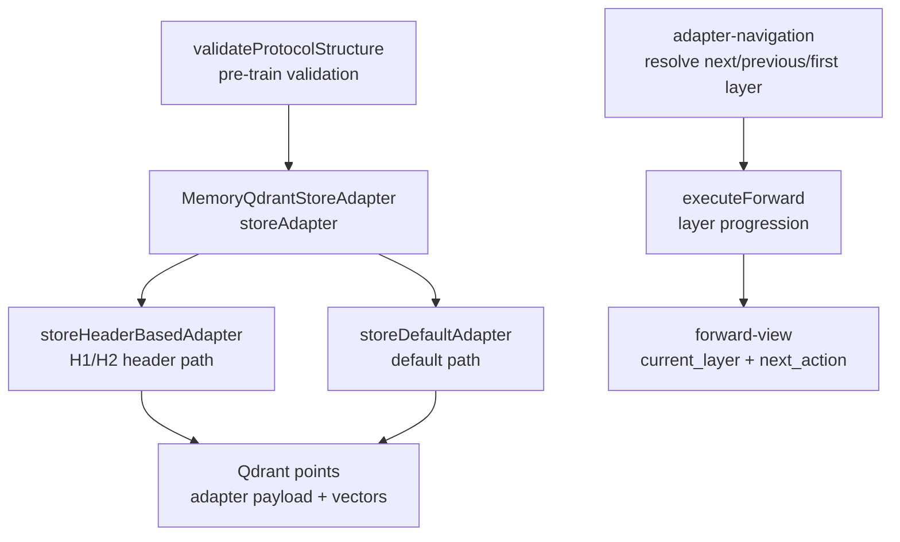
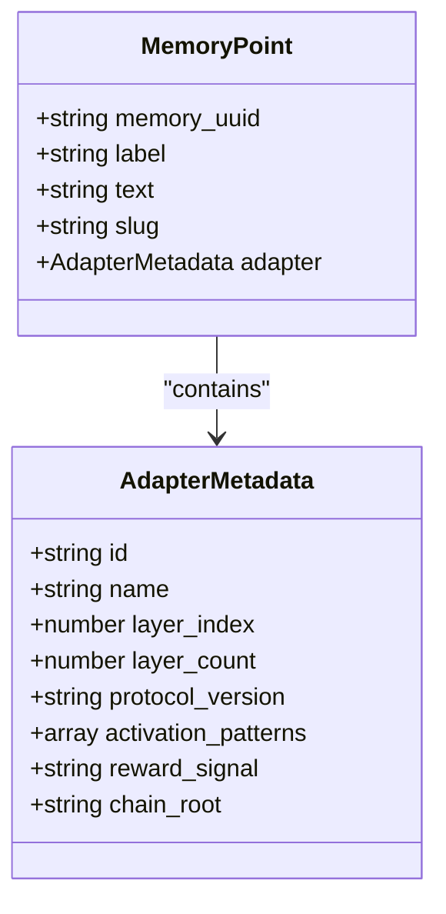
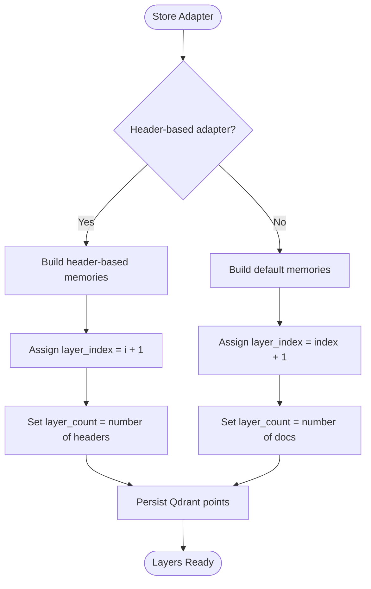
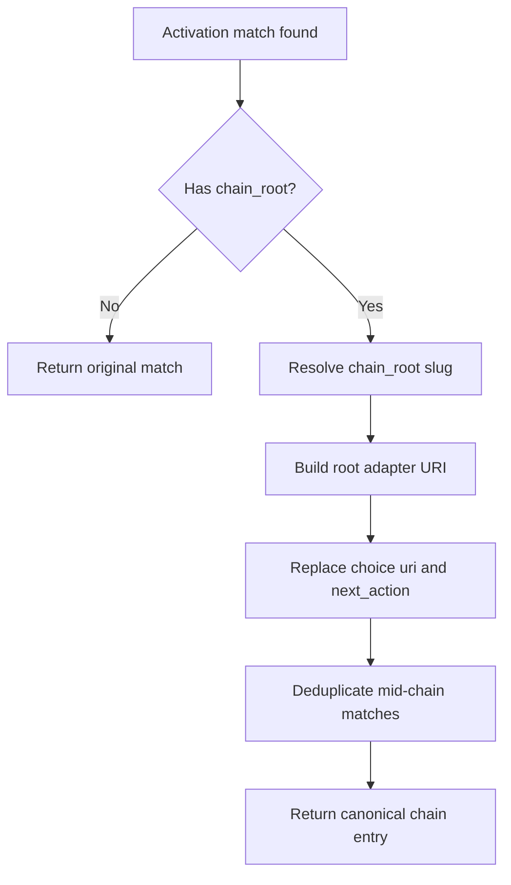
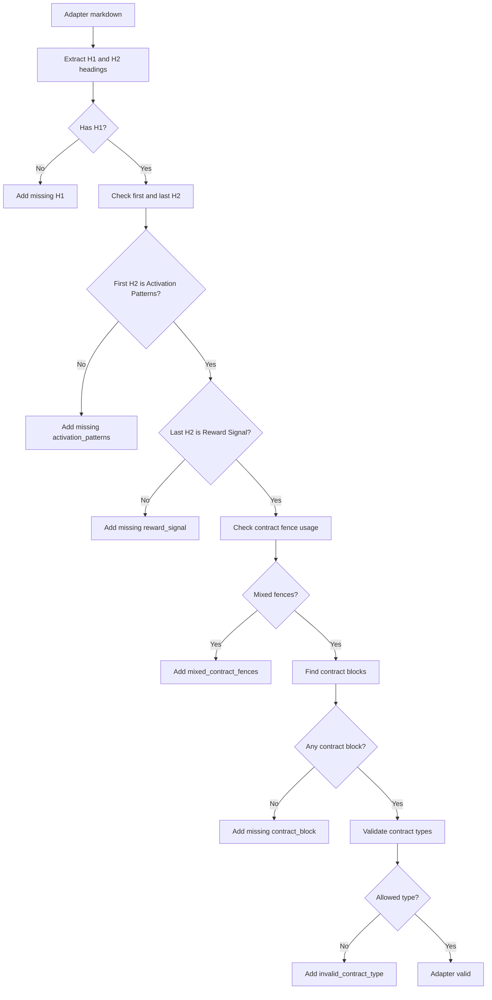
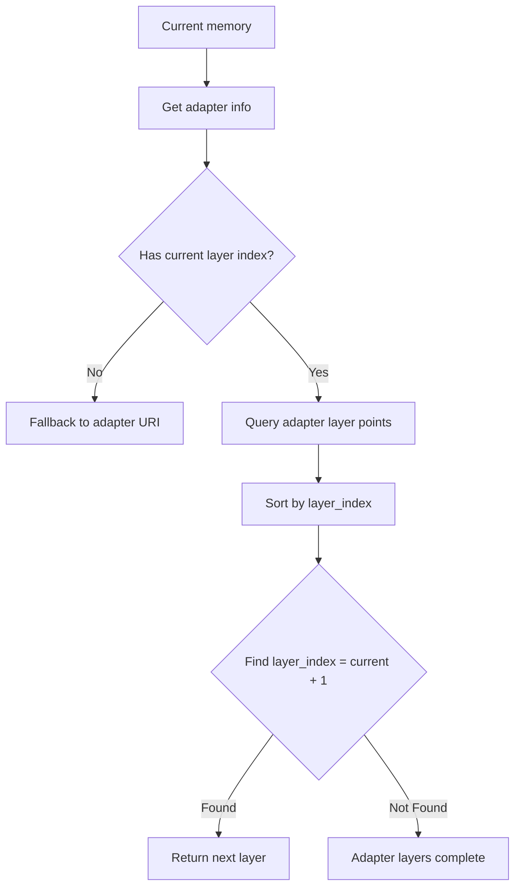
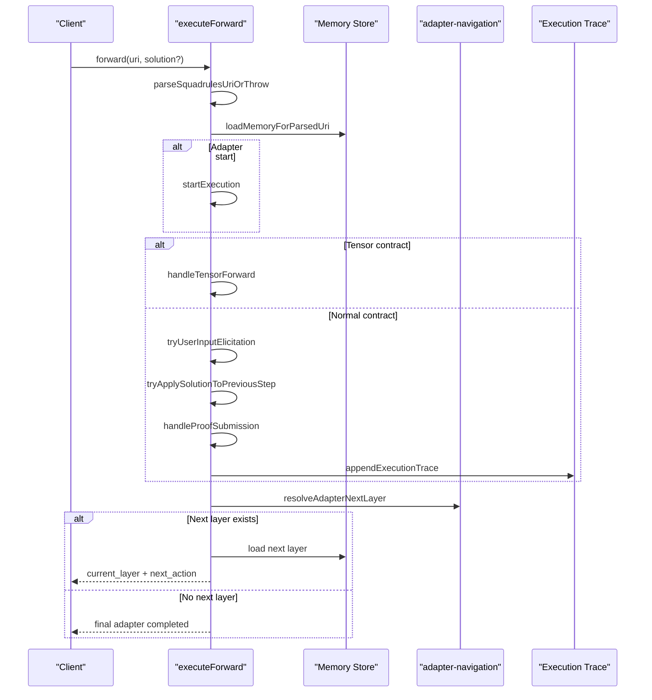
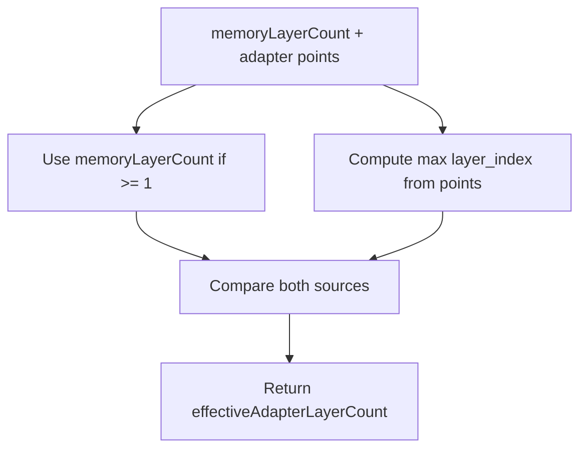
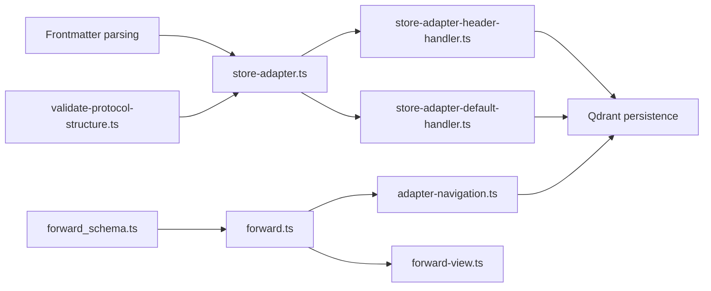

# Adapter Layers and Structure

<cite>
**Referenced Files in This Document**
- [store-adapter.ts](file://src/services/memory/store-adapter.ts)
- [store-adapter-header-handler.ts](file://src/services/memory/store-adapter-header-handler.ts)
- [store-adapter-default-handler.ts](file://src/services/memory/store-adapter-default-handler.ts)
- [validate-protocol-structure.ts](file://src/services/memory/validate-protocol-structure.ts)
- [adapter-layer-count.ts](file://src/services/adapter-layer-count.ts)
- [adapter-navigation.ts](file://src/services/adapter-navigation.ts)
- [forward.ts](file://src/tools/forward.ts)
- [forward-view.ts](file://src/tools/forward-view.ts)
- [forward_schema.ts](file://src/tools/forward_schema.ts)
- [protocol-linking-guide.md](file://src/embed-docs/mem/protocol-linking-guide.md)
</cite>

## Table of Contents
1. [Introduction](#introduction)
2. [Project Structure](#project-structure)
3. [Core Components](#core-components)
4. [Architecture Overview](#architecture-overview)
5. [Detailed Component Analysis](#detailed-component-analysis)
6. [Dependency Analysis](#dependency-analysis)
7. [Performance Considerations](#performance-considerations)
8. [Troubleshooting Guide](#troubleshooting-guide)
9. [Conclusion](#conclusion)

## Introduction
This document explains the adapter layer model used by SquadRules. An adapter is a unit of agent-executable knowledge or workflow, and it can be organized as one or more numbered layers. Each layer represents a discrete step with its own label, contract, and position inside an adapter’s execution sequence.

The key ideas are:
- Layers use 1-based indexing: the first layer has `layer_index = 1`, and the last layer has `layer_index = layer_count`.
- Layer metadata includes `id`, `name`, `layer_index`, `layer_count`, and optionally `protocol_version`.
- Adapters chain together through activation and forwarding to form complete workflows.
- `chain_root` collapses ambiguous activation matches into a single canonical entry point for multi-adapter chains.
- The system validates adapter structure before storage and navigates layers during forward execution.

## Project Structure
Adapter layer logic spans storage, validation, navigation, and runtime execution:



**Diagram sources**
- [store-adapter.ts:43-144](file://src/services/memory/store-adapter.ts#L43-L144)
- [store-adapter-header-handler.ts:30-201](file://src/services/memory/store-adapter-header-handler.ts#L30-L201)
- [store-adapter-default-handler.ts:34-254](file://src/services/memory/store-adapter-default-handler.ts#L34-L254)
- [validate-protocol-structure.ts:113-186](file://src/services/memory/validate-protocol-structure.ts#L113-L186)
- [adapter-navigation.ts:28-117](file://src/services/adapter-navigation.ts#L28-L117)
- [forward.ts:93-317](file://src/tools/forward.ts#L93-L317)
- [forward-view.ts:337-343](file://src/tools/forward-view.ts#L337-L343)

**Section sources**
- [store-adapter.ts:43-144](file://src/services/memory/store-adapter.ts#L43-L144)
- [store-adapter-header-handler.ts:30-201](file://src/services/memory/store-adapter-header-handler.ts#L30-L201)
- [store-adapter-default-handler.ts:34-254](file://src/services/memory/store-adapter-default-handler.ts#L34-L254)
- [validate-protocol-structure.ts:113-186](file://src/services/memory/validate-protocol-structure.ts#L113-L186)
- [adapter-navigation.ts:28-117](file://src/services/adapter-navigation.ts#L28-L117)
- [forward.ts:93-317](file://src/tools/forward.ts#L93-L317)
- [forward-view.ts:337-343](file://src/tools/forward-view.ts#L337-L343)

## Core Components
The adapter layer model is defined by how adapters are stored, validated, and navigated:

| Concept | Meaning | Where It Appears |
|---|---|---|
| Adapter | A logical workflow or knowledge unit that may contain multiple layers | Storage handlers, navigation, forward execution |
| Layer | A numbered step inside an adapter with its own content and contract | `layer_index`, `layer_count`, memory payloads |
| Layer index | 1-based position within the adapter | Stored per memory point; used for ordering |
| Layer count | Total number of layers in the adapter | Computed from stored memories or header sections |
| Protocol version | Optional adapter-level protocol marker | Propagated to each layer’s adapter metadata |
| Chain root | Canonical slug that redirects ambiguous activation matches to a single entry point | Activation output collapsing |
| Forward execution | Agent-driven continuation across layers using `execution_id` | Layer URI with `?execution_id=...` |

Key responsibilities:
- **Storage**: Assigns `layer_index` and `layer_count`, attaches optional `protocol_version`, and persists adapter metadata alongside each layer.
- **Validation**: Ensures required adapter structure before training/storage.
- **Navigation**: Finds the first, next, previous, and entry layer for an adapter.
- **Execution**: Advances agents through layers while preserving execution state.

**Section sources**
- [store-adapter-header-handler.ts:91-155](file://src/services/memory/store-adapter-header-handler.ts#L91-L155)
- [store-adapter-default-handler.ts:83-106](file://src/services/memory/store-adapter-default-handler.ts#L83-L106)
- [validate-protocol-structure.ts:113-186](file://src/services/memory/validate-protocol-structure.ts#L113-L186)
- [adapter-navigation.ts:28-117](file://src/services/adapter-navigation.ts#L28-L117)
- [forward.ts:93-317](file://src/tools/forward.ts#L93-L317)

## Architecture Overview
At a high level, adapters flow through three phases:

1. **Training / storage phase**: Markdown is parsed, validated, embedded, and stored as one or more memory points. Each point carries adapter metadata describing its layer position.
2. **Activation phase**: Agents search for matching adapters. When `chain_root` is present, ambiguous matches collapse to a canonical root adapter.
3. **Forward / reward phase**: Agents start at the first layer, submit solutions, and advance through layers until completion.

```mermaid
sequenceDiagram
participant Author as "Adapter Author"
participant Train as "Train / Store"
participant Memory as "Memory Store"
participant Agent as "Agent"
participant Activate as "Activate"
participant Forward as "Forward"
participant Reward as "Reward"
Author->>Train : Submit adapter markdown
Train->>Memory : Store layers with adapter metadata
Agent->>Activate : Search for matching adapters
Activate-->>Agent : Canonicalized choices (chain_root collapsed)
Agent->>Forward : Start adapter or continue layer
Forward->>Memory : Load current layer
Forward->>Forward : Validate solution / apply previous proof
Forward-->>Agent : current_layer + next_action
Agent->>Forward : Continue until final layer
Forward-->>Agent : Final adapter completed
Agent->>Reward : Finalize execution
```

**Diagram sources**
- [store-adapter.ts:43-144](file://src/services/memory/store-adapter.ts#L43-L144)
- [store-adapter-header-handler.ts:91-155](file://src/services/memory/store-adapter-header-handler.ts#L91-L155)
- [store-adapter-default-handler.ts:83-106](file://src/services/memory/store-adapter-default-handler.ts#L83-L106)
- [protocol-linking-guide.md:198-214](file://src/embed-docs/mem/protocol-linking-guide.md#L198-L214)
- [forward.ts:93-317](file://src/tools/forward.ts#L93-L317)

## Detailed Component Analysis

### Layer Metadata Model
Each stored memory point includes an `adapter` object describing the adapter context for that layer. The metadata contains:

| Field | Type | Required | Description |
|---|---|---:|---|
| `id` | string | Yes | Stable adapter identifier |
| `name` | string | Yes | Human-readable adapter title |
| `layer_index` | number | Yes | 1-based layer position |
| `layer_count` | number | Yes | Total number of layers in the adapter |
| `protocol_version` | string | No | Optional protocol version propagated to all layers |
| `activation_patterns` | array/string | No | Optional activation pattern data passed through |
| `reward_signal` | string | No | Optional reward signal attached to the adapter |
| `chain_root` | string | No | Optional chain entry-point slug for activation collapsing |

Important rules:
- `layer_index` starts at 1.
- `layer_count` equals the number of layers stored under the same adapter.
- `protocol_version` is applied uniformly to every layer when present.
- `chain_root` affects activation routing but does not change normal `forward` behavior inside a chain.



**Diagram sources**
- [store-adapter-header-handler.ts:143-152](file://src/services/memory/store-adapter-header-handler.ts#L143-L152)
- [store-adapter-default-handler.ts:195-203](file://src/services/memory/store-adapter-default-handler.ts#L195-L203)
- [activation-pattern-payload.ts:40-59](file://src/services/memory/activation-pattern-payload.ts#L40-L59)

**Section sources**
- [store-adapter-header-handler.ts:143-152](file://src/services/memory/store-adapter-header-handler.ts#L143-L152)
- [store-adapter-default-handler.ts:195-203](file://src/services/memory/store-adapter-default-handler.ts#L195-L203)
- [activation-pattern-payload.ts:40-59](file://src/services/memory/activation-pattern-payload.ts#L40-L59)

### Layer Ordering and Indexing
Layers are ordered by their `layer_index`:
- The first layer has `layer_index = 1`.
- Subsequent layers increment by 1.
- The last layer has `layer_index = layer_count`.

Two storage paths assign these values:

| Path | How Layers Are Created | Index Assignment |
|---|---|---|
| Header-based adapter | H1/H2 sections become layers | `i + 1` where `i` is the section index |
| Default adapter | Each normalized document becomes a layer | `index + 1` where `index` is the document index |

Layer ordering matters because:
- Navigation functions find the next layer by looking for `layer_index + 1`.
- UI and CLI rendering display progress as `step X/Y`.
- Execution traces and quality metrics associate results with specific layers.



**Diagram sources**
- [store-adapter-header-handler.ts:91-112](file://src/services/memory/store-adapter-header-handler.ts#L91-L112)
- [store-adapter-default-handler.ts:83-106](file://src/services/memory/store-adapter-default-handler.ts#L83-L106)

**Section sources**
- [store-adapter-header-handler.ts:91-112](file://src/services/memory/store-adapter-header-handler.ts#L91-L112)
- [store-adapter-default-handler.ts:83-106](file://src/services/memory/store-adapter-default-handler.ts#L83-L106)

### Protocol Version Propagation
When a protocol version is supplied:
- For header-based adapters, the version is attached to every layer’s adapter metadata.
- For default adapters, the version is included when constructing the adapter object.
- The version is also considered when comparing adapter payloads for activation normalization.

This ensures that adapters created or updated under different protocol versions remain distinguishable and consistent.

**Section sources**
- [store-adapter.ts:67-80](file://src/services/memory/store-adapter.ts#L67-L80)
- [store-adapter-header-handler.ts:148-149](file://src/services/memory/store-adapter-header-handler.ts#L148-L149)
- [store-adapter-default-handler.ts:96-96](file://src/services/memory/store-adapter-default-handler.ts#L96-L96)
- [activation-pattern-payload.ts:40-59](file://src/services/memory/activation-pattern-payload.ts#L40-L59)

### Chain Root Collapsing
`chain_root` is a mechanism for collapsing ambiguous activation matches into a single canonical entry point. Its purpose is to make multi-adapter chains deterministic:

- If an activated adapter has `chain_root`, the server resolves the slug to the root adapter’s URI.
- The choice’s `uri` and `next_action` are replaced to point at the chain entry point.
- Multiple mid-chain matches from the same chain are deduplicated.
- The agent always starts at the chain root, not at a mid-chain adapter.

Rules:
- The chain root adapter must NOT have `chain_root` in its frontmatter.
- `chain_root` must refer to an existing slug.
- `forward` calls within a chain are unaffected; collapsing only changes activation output routing.



**Diagram sources**
- [protocol-linking-guide.md:198-214](file://src/embed-docs/mem/protocol-linking-guide.md#L198-L214)

**Section sources**
- [protocol-linking-guide.md:198-214](file://src/embed-docs/mem/protocol-linking-guide.md#L198-L214)

### Layer Validation
Before training, adapter markdown is validated to ensure structural integrity:

Required checks:
- At least one H1 title.
- First H2 section is `Activation Patterns`.
- Last H2 section is `Reward Signal`.
- At least one JSON contract block.
- Contract blocks must use fenced JSON syntax, not plain code blocks.
- Contract type must be one of the allowed types.

If validation fails, training returns a structured error indicating which required elements are missing.



**Diagram sources**
- [validate-protocol-structure.ts:29-104](file://src/services/memory/validate-protocol-structure.ts#L29-L104)
- [validate-protocol-structure.ts:113-186](file://src/services/memory/validate-protocol-structure.ts#L113-L186)

**Section sources**
- [validate-protocol-structure.ts:113-186](file://src/services/memory/validate-protocol-structure.ts#L113-L186)

### Layer Navigation
During execution, the system navigates between layers using the adapter’s stored points:

| Function | Purpose | Behavior |
|---|---|---|
| `resolveAdapterEntry` | Resolves the adapter entry point | Returns adapter URI if current layer is 1 or no layer info exists |
| `resolveAdapterFirstLayer` | Finds layer 1 | Returns first layer with `layer_index === 1` |
| `resolveAdapterNextLayer` | Finds the next layer | Looks for `layer_index === currentLayerIndex + 1` |
| `resolveAdapterPreviousLayer` | Finds the previous layer | Looks for `layer_index === currentLayerIndex - 1` |

Navigation depends on:
- Adapter ID.
- Current layer index.
- Layer count.
- Qdrant adapter layer points.



**Diagram sources**
- [adapter-navigation.ts:28-117](file://src/services/adapter-navigation.ts#L28-L117)

**Section sources**
- [adapter-navigation.ts:28-117](file://src/services/adapter-navigation.ts#L28-L117)

### Forward Execution Flow
The forward tool drives layer progression:

1. Parse the input URI as either an adapter URI or a layer URI.
2. Load the target memory.
3. Start a new execution if this is an adapter start call.
4. Handle tensor contracts separately.
5. Apply user-input elicitation when needed.
6. Apply solutions to previous steps when appropriate.
7. Validate proofs and expected previous hashes.
8. Append execution trace data.
9. Resolve the next layer or mark the adapter as complete.



**Diagram sources**
- [forward.ts:93-317](file://src/tools/forward.ts#L93-L317)
- [adapter-navigation.ts:75-93](file://src/services/adapter-navigation.ts#L75-L93)

**Section sources**
- [forward.ts:93-317](file://src/tools/forward.ts#L93-L317)
- [adapter-navigation.ts:75-93](file://src/services/adapter-navigation.ts#L75-L93)

### Multi-Layer Adapters and Examples
A multi-layer adapter represents a sequential workflow split into discrete steps. Example patterns include:

- **Conductor adapter**: A root adapter that coordinates several subtasks.
- **Refinement adapter**: A multi-step process where each layer refines evidence or output.
- **Extension adapter**: A separate adapter invoked after completing a conductor, such as coding or PR work.

How agents navigate:
- Start with `activate` to discover adapters.
- Use `forward` with an adapter URI to begin at the first layer.
- Continue calling `forward` with the returned layer URI plus `solution`.
- Advance through layers until the response indicates the adapter is complete.
- Call `reward` to finalize the execution.

Multi-layer guidance:
- Prefer layers within one adapter when steps fit under a cohesive concern.
- Split into multiple adapters only when necessary, such as exceeding recommended size limits or needing reusable components.
- Use `forward` with a known slug when the next adapter is deterministic.
- Use `activate` when the next adapter must be discovered at runtime.

**Section sources**
- [protocol-linking-guide.md:119-134](file://src/embed-docs/mem/protocol-linking-guide.md#L119-L134)
- [protocol-linking-guide.md:198-214](file://src/embed-docs/mem/protocol-linking-guide.md#L198-L214)
- [forward_schema.ts:308-318](file://src/tools/forward_schema.ts#L308-L318)

### Layer Integrity and Count Reconciliation
The system reconciles `layer_count` with actual stored layer points:

- `maxLayerIndexFromAdapterPoints` computes the largest `layer_index` among stored adapter points.
- `effectiveAdapterLayerCount` prefers the maximum of the stored memory layer count and the observed layer indices.
- This defense-in-depth approach handles stale cache values by trusting Qdrant adapter points when they disagree with embedded counts.



**Diagram sources**
- [adapter-layer-count.ts:12-32](file://src/services/adapter-layer-count.ts#L12-L32)

**Section sources**
- [adapter-layer-count.ts:12-32](file://src/services/adapter-layer-count.ts#L12-L32)

## Dependency Analysis
The adapter layer system has clear dependencies:



**Diagram sources**
- [store-adapter.ts:43-144](file://src/services/memory/store-adapter.ts#L43-L144)
- [store-adapter-header-handler.ts:30-201](file://src/services/memory/store-adapter-header-handler.ts#L30-L201)
- [store-adapter-default-handler.ts:34-254](file://src/services/memory/store-adapter-default-handler.ts#L34-L254)
- [validate-protocol-structure.ts:113-186](file://src/services/memory/validate-protocol-structure.ts#L113-L186)
- [adapter-navigation.ts:28-117](file://src/services/adapter-navigation.ts#L28-L117)
- [forward.ts:93-317](file://src/tools/forward.ts#L93-L317)
- [forward-schema.ts:308-318](file://src/tools/forward_schema.ts#L308-L318)

**Section sources**
- [store-adapter.ts:43-144](file://src/services/memory/store-adapter.ts#L43-L144)
- [store-adapter-header-handler.ts:30-201](file://src/services/memory/store-adapter-header-handler.ts#L30-L201)
- [store-adapter-default-handler.ts:34-254](file://src/services/memory/store-adapter-default-handler.ts#L34-L254)
- [validate-protocol-structure.ts:113-186](file://src/services/memory/validate-protocol-structure.ts#L113-L186)
- [adapter-navigation.ts:28-117](file://src/services/adapter-navigation.ts#L28-L117)
- [forward.ts:93-317](file://src/tools/forward.ts#L93-L317)
- [forward_schema.ts:308-318](file://src/tools/forward_schema.ts#L308-L318)

## Performance Considerations
- Embedding generation is batched per layer to reduce overhead.
- Vector dimension mismatches fall back to zero vectors rather than failing the entire adapter.
- Sparse BM25 indexing is conditionally retried without sparse vectors when the collection lacks sparse configuration.
- Layer count reconciliation avoids relying solely on cached values by inspecting stored adapter points.

[No sources needed since this section provides general guidance]

## Troubleshooting Guide
Common issues and resolutions:

| Symptom | Likely Cause | Resolution |
|---|---|---|
| Adapter has wrong layer count | Stale cache or inconsistent layer indices | Trust Qdrant adapter points via `effectiveAdapterLayerCount` |
| Activation returns unexpected mid-chain adapter | Missing or incorrect `chain_root` | Ensure chain root slug is set and refers to the correct entry point |
| Training rejects adapter | Missing required structure | Add H1, Activation Patterns, Reward Signal, and valid JSON contract blocks |
| Forward cannot find next layer | Missing or nonsequential `layer_index` | Ensure layers are stored with consecutive 1-based indices |
| Layer URI not accepted | Missing `execution_id` on continuation | Include `?execution_id=...` when continuing a layer |
| UI shows incomplete progress | `adapter_layer_index` or `adapter_layer_count` missing | Verify adapter metadata is persisted correctly |

**Section sources**
- [adapter-layer-count.ts:21-32](file://src/services/adapter-layer-count.ts#L21-L32)
- [validate-protocol-structure.ts:113-186](file://src/services/memory/validate-protocol-structure.ts#L113-L186)
- [forward_schema.ts:308-318](file://src/tools/forward_schema.ts#L308-L318)

## Conclusion
SquadRules models adapters as hierarchical, numbered layers that represent discrete workflow steps. Layer metadata (`id`, `name`, `layer_index`, `layer_count`, and optional `protocol_version`) makes each step auditable and navigable. Validation ensures structural integrity before storage, while navigation and forward execution guide agents through layer sequences. `chain_root` provides deterministic routing for multi-adapter chains by collapsing ambiguous activation matches into a canonical entry point. Together, these mechanisms enable reliable, agent-first workflows that are both executable and inspectable.

[No sources needed since this section summarizes without analyzing specific files]