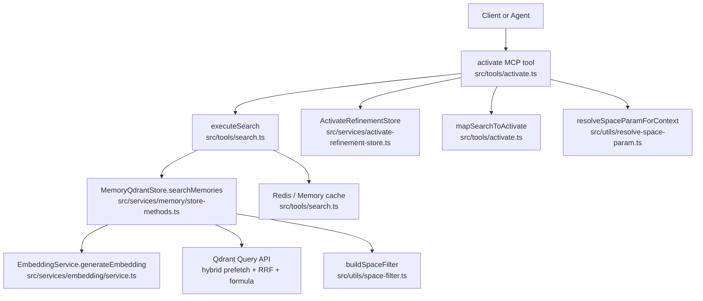
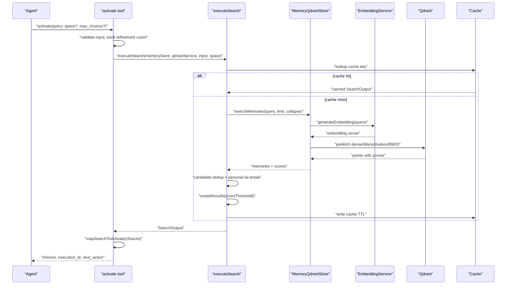
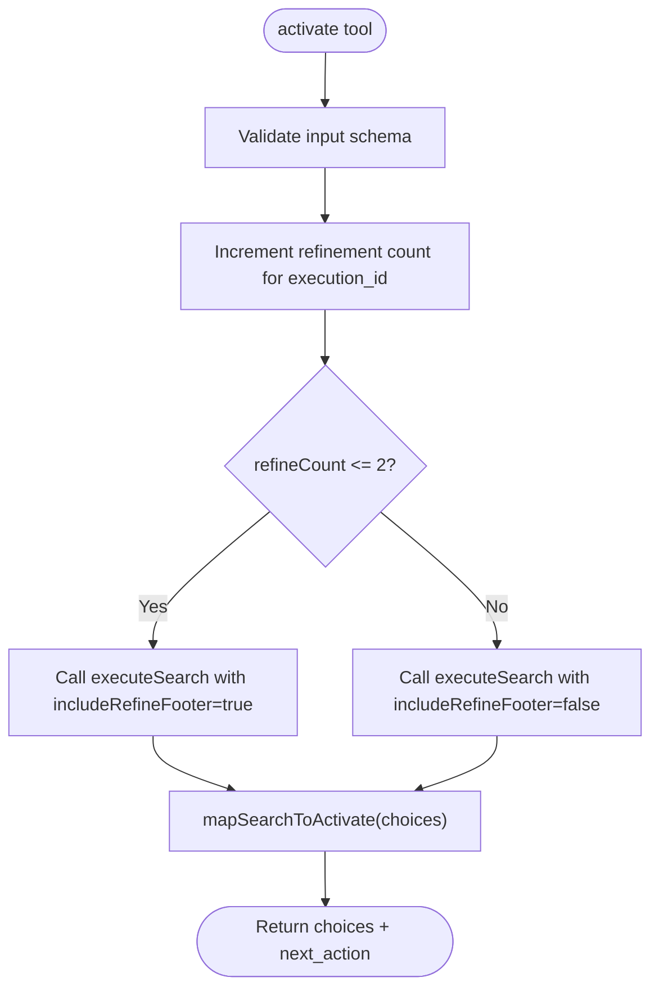
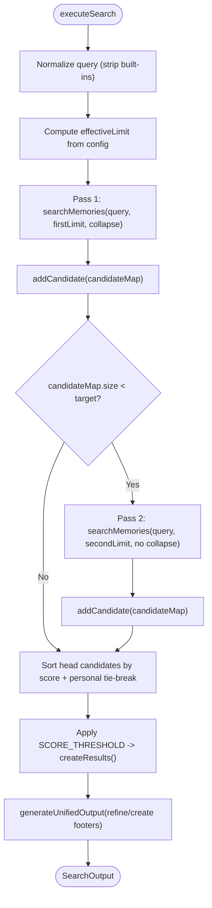
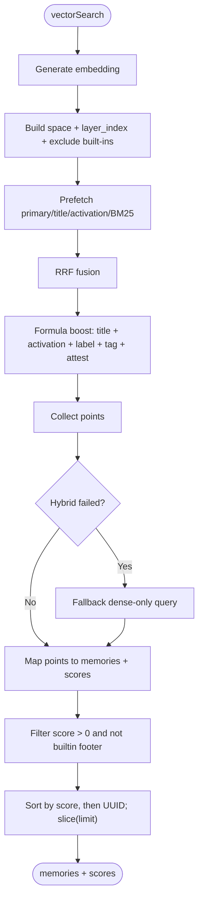
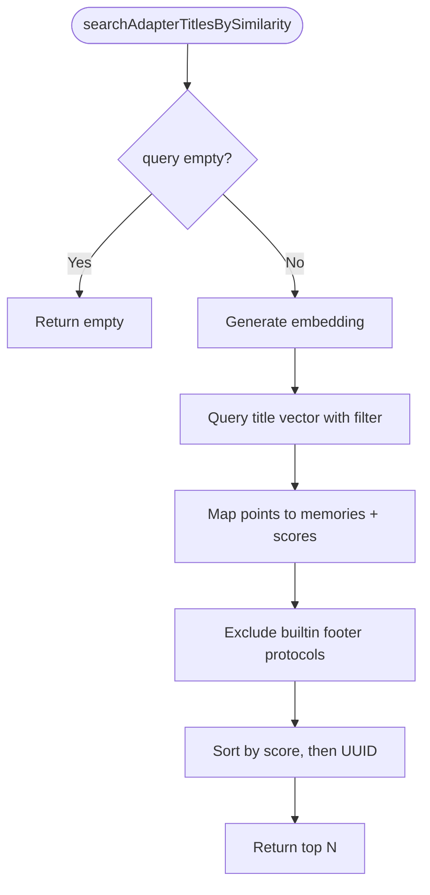
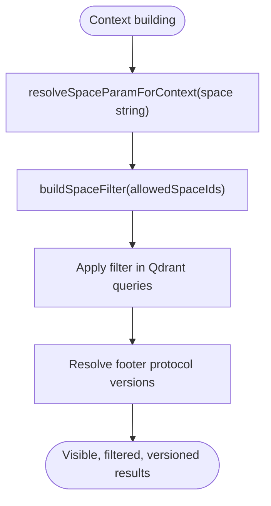
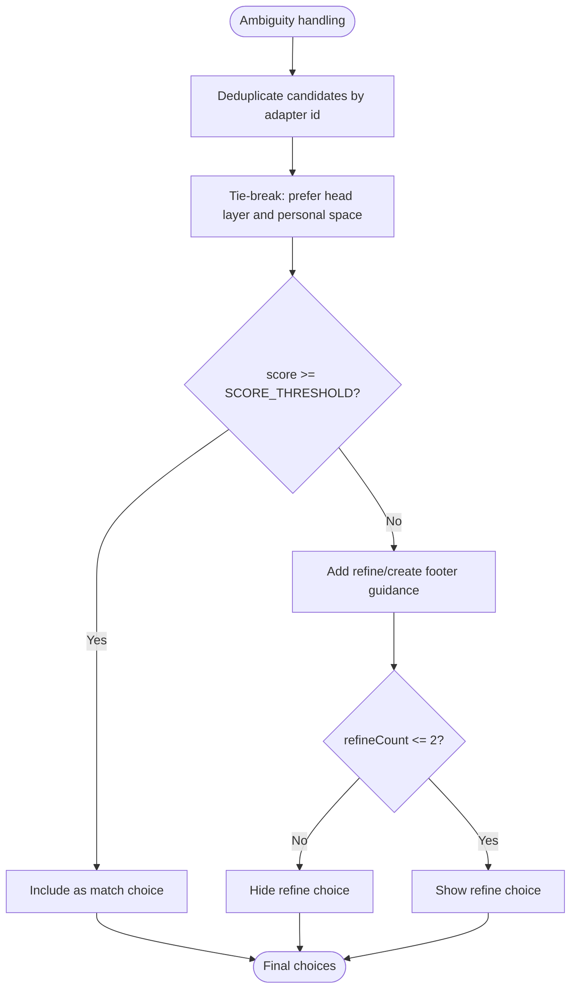
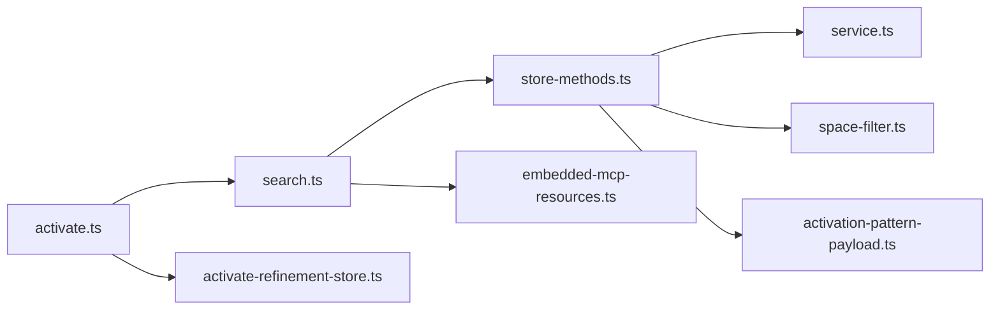

# Adapter Activation Phase

<cite>
**Referenced Files in This Document**
- [activate.ts](file://src/tools/activate.ts)
- [search.ts](file://src/tools/search.ts)
- [store-methods.ts](file://src/services/memory/store-methods.ts)
- [store-title-similarity-search.ts](file://src/services/memory/store-title-similarity-search.ts)
- [service.ts](file://src/services/embedding/service.ts)
- [space-filter.ts](file://src/utils/space-filter.ts)
- [resolve-space-param.ts](file://src/utils/resolve-space-param.ts)
- [activation-pattern-payload.ts](file://src/services/memory/activation-pattern-payload.ts)
- [activate-refinement-store.ts](file://src/services/activate-refinement-store.ts)
- [embedded-mcp-resources.ts](file://src/resources/embedded-mcp-resources.ts)
</cite>

## Table of Contents
1. [Introduction](#introduction)
2. [Project Structure](#project-structure)
3. [Core Components](#core-components)
4. [Architecture Overview](#architecture-overview)
5. [Detailed Component Analysis](#detailed-component-analysis)
6. [Dependency Analysis](#dependency-analysis)
7. [Performance Considerations](#performance-considerations)
8. [Troubleshooting Guide](#troubleshooting-guide)
9. [Conclusion](#conclusion)

## Introduction
The adapter activation phase is the system’s intent-resolution entry point. It converts a natural-language prompt into vector embeddings, performs hybrid semantic and lexical search against stored adapters, ranks candidates, resolves conflicts across spaces and titles, and builds execution-ready context for the selected adapter. The output is a ranked set of choices with roles such as match, refine, or create, along with guidance for the next forward call.

This document explains:
- How user queries become embeddings and are searched against multiple vector fields.
- How ranking combines dense vectors, sparse BM25, title matches, activation patterns, labels, tags, and attest boosts.
- How ambiguous or low-confidence matches are handled through refinement and creation footers.
- How space filtering, protocol versioning, and permission checks shape the visible results.
- How repeated activations benefit from caching and how performance is optimized.

## Project Structure
The activation workflow spans tool registration, shared search logic, memory store search, embedding generation, space scoping, and result mapping.

**Diagram sources**
- [activate.ts:209-235](file://src/tools/activate.ts#L209-L235)
- [search.ts:192-253](file://src/tools/search.ts#L192-L253)
- [store-methods.ts:94-104](file://src/services/memory/store-methods.ts#L94-L104)
- [service.ts:49-129](file://src/services/embedding/service.ts#L49-L129)
- [space-filter.ts:14-26](file://src/utils/space-filter.ts#L14-L26)
- [resolve-space-param.ts:26-103](file://src/utils/resolve-space-param.ts#L26-L103)
- [activate-refinement-store.ts:13-23](file://src/services/activate-refinement-store.ts#L13-L23)

**Section sources**
- [activate.ts:209-235](file://src/tools/activate.ts#L209-L235)
- [search.ts:192-253](file://src/tools/search.ts#L192-L253)
- [store-methods.ts:94-104](file://src/services/memory/store-methods.ts#L94-L104)
- [service.ts:49-129](file://src/services/embedding/service.ts#L49-L129)
- [space-filter.ts:14-26](file://src/utils/space-filter.ts#L14-L26)
- [resolve-space-param.ts:26-103](file://src/utils/resolve-space-param.ts#L26-L103)
- [activate-refinement-store.ts:13-23](file://src/services/activate-refinement-store.ts#L13-L23)

## Core Components
- activate MCP tool: validates input, tracks refinement attempts, delegates to shared search, and maps search results to activation choices.
- executeSearch: normalizes query, applies limits, caches results, builds candidate map, and generates unified output including refine/create footers.
- MemoryQdrantStore.searchMemories: performs hybrid search using dense vectors, title vectors, activation pattern vectors, and BM25; caches per-query results.
- EmbeddingService: generates embeddings for OpenAI, TEI, or fastembed providers with dimension validation and audit metrics.
- Space utilities: resolve human-friendly space parameters and build Qdrant filters for tenant isolation.
- Activation payload normalization: canonicalizes adapter metadata and activation patterns used by indexing and search.

**Section sources**
- [activate.ts:209-235](file://src/tools/activate.ts#L209-L235)
- [search.ts:93-186](file://src/tools/search.ts#L93-L186)
- [store-methods.ts:121-260](file://src/services/memory/store-methods.ts#L121-L260)
- [service.ts:49-129](file://src/services/embedding/service.ts#L49-L129)
- [space-filter.ts:14-26](file://src/utils/space-filter.ts#L14-L26)
- [resolve-space-param.ts:26-103](file://src/utils/resolve-space-param.ts#L26-L103)
- [activation-pattern-payload.ts:84-117](file://src/services/memory/activation-pattern-payload.ts#L84-L117)

## Architecture Overview
The activation flow is layered:
- Input validation and refinement tracking occur at the tool layer.
- Shared search logic handles query normalization, limits, caching, and candidate aggregation.
- Memory store executes hybrid search over Qdrant with multiple vector fields and BM25.
- Embedding service provides provider-agnostic embeddings.
- Space utilities enforce read/write permissions and scope visibility.
- Result mapping produces agent-facing choices with next-action guidance.

**Diagram sources**
- [activate.ts:209-235](file://src/tools/activate.ts#L209-L235)
- [search.ts:192-253](file://src/tools/search.ts#L192-L253)
- [store-methods.ts:121-260](file://src/services/memory/store-methods.ts#L121-L260)
- [service.ts:49-129](file://src/services/embedding/service.ts#L49-L129)

## Detailed Component Analysis

### Activation Entry Point and Refinement Control
The activate tool:
- Generates or accepts an execution_id to group refinement attempts.
- Increments a refinement counter keyed by execution_id.
- Includes the refine footer only when refinement attempts are within a threshold.
- Delegates to executeSearch with optional space scoping.
- Maps search results to activation choices, canonicalizing URIs and attaching linked artifacts where available.

**Diagram sources**
- [activate.ts:209-235](file://src/tools/activate.ts#L209-L235)
- [activate.ts:44-207](file://src/tools/activate.ts#L44-L207)
- [activate-refinement-store.ts:13-23](file://src/services/activate-refinement-store.ts#L13-L23)

**Section sources**
- [activate.ts:209-235](file://src/tools/activate.ts#L209-L235)
- [activate.ts:44-207](file://src/tools/activate.ts#L44-L207)
- [activate-refinement-store.ts:13-23](file://src/services/activate-refinement-store.ts#L13-L23)

### Shared Search Pipeline and Candidate Ranking
executeSearch:
- Normalizes the query by stripping built-in protocol references that should not influence search.
- Computes effective limits based on configuration caps and min/max bounds.
- Builds a candidate map by merging results from two passes: initial pass with group collapse and fallback pass without collapse if needed.
- Deduplicates candidates by adapter id or memory uuid, preferring head-layer entries and personal-space ties.
- Applies a score threshold to produce final results and logs anomalies.
- Wraps results in unified output with refine/create footers and protocol versions.

**Diagram sources**
- [search.ts:35-47](file://src/tools/search.ts#L35-L47)
- [search.ts:58-91](file://src/tools/search.ts#L58-L91)
- [search.ts:93-111](file://src/tools/search.ts#L93-L111)
- [search.ts:143-186](file://src/tools/search.ts#L143-L186)

**Section sources**
- [search.ts:35-47](file://src/tools/search.ts#L35-L47)
- [search.ts:58-91](file://src/tools/search.ts#L58-L91)
- [search.ts:93-111](file://src/tools/search.ts#L93-L111)
- [search.ts:143-186](file://src/tools/search.ts#L143-L186)

### Hybrid Vector Search and Ranking Algorithm
MemoryQdrantStore.vectorSearch:
- Generates an embedding for the query via EmbeddingService.
- Constructs a base filter restricting to layer_index 1 and excluding built-in refining/creation slugs.
- Executes a multi-prefetch hybrid query:
  - Primary dense vector.
  - Title vector.
  - Activation pattern vector.
  - Two BM25 legs.
- Uses reciprocal rank fusion (RRF) across prefetches and then applies a server-side formula boosting title matches, activation pattern matches, label matches, tag matches, and attest_boost.
- Falls back to dense-only search if the hybrid query fails.
- Filters out zero-score results and builtin footer protocols, sorts by score then UUID, and slices to the requested limit.

**Diagram sources**
- [store-methods.ts:121-260](file://src/services/memory/store-methods.ts#L121-L260)
- [service.ts:49-129](file://src/services/embedding/service.ts#L49-L129)

**Section sources**
- [store-methods.ts:121-260](file://src/services/memory/store-methods.ts#L121-L260)
- [service.ts:49-129](file://src/services/embedding/service.ts#L49-L129)

### Title Similarity Search
A dedicated title similarity search function:
- Generates an embedding for the query.
- Queries the title vector field with space and layer filters.
- Excludes builtin refining/creation protocols.
- Rescores via quantization parameters and returns top matches sorted by score.

**Diagram sources**
- [store-title-similarity-search.ts:9-61](file://src/services/memory/store-title-similarity-search.ts#L9-L61)

**Section sources**
- [store-title-similarity-search.ts:9-61](file://src/services/memory/store-title-similarity-search.ts#L9-L61)

### Context Building: Space Filtering, Protocol Version Validation, and Permissions
- Space filtering: buildSpaceFilter merges allowed space IDs into Qdrant must conditions, ensuring results respect tenant isolation.
- Space parameter resolution: resolveSpaceParamForContext translates human inputs like “personal”, group names, or raw IDs into allowed space IDs, with special handling for read-only app space in search scoping.
- Protocol version validation: unified output includes refine/create protocol versions resolved from stored footer layers; these versions inform agents about the current protocol contract.
- Permission checks: getSpaceContext and getSearchSpaceIds restrict which spaces are visible during search and retrieval.

**Diagram sources**
- [space-filter.ts:14-26](file://src/utils/space-filter.ts#L14-L26)
- [resolve-space-param.ts:26-103](file://src/utils/resolve-space-param.ts#L26-L103)
- [search.ts:113-141](file://src/tools/search.ts#L113-L141)

**Section sources**
- [space-filter.ts:14-26](file://src/utils/space-filter.ts#L14-L26)
- [resolve-space-param.ts:26-103](file://src/utils/resolve-space-param.ts#L26-L103)
- [search.ts:113-141](file://src/tools/search.ts#L113-L141)

### Conflict Resolution and Ambiguity Handling
- Multiple candidates: addCandidate deduplicates by adapter id or memory uuid, preferring head-layer entries and breaking ties in favor of the default write space (typically personal).
- Low-confidence matches: SCORE_THRESHOLD determines whether results qualify as matches; below threshold, refine/create footers guide the agent to improve the query or create a new adapter.
- Repeated weak activations: refinement count controls inclusion of the refine footer; after exceeding the threshold, the system encourages creation or clarification rather than endless refinement loops.
- Builtin footer exclusion: both hybrid and title searches explicitly exclude refining and creation protocols from regular matching to avoid false positives.

**Diagram sources**
- [search.ts:58-91](file://src/tools/search.ts#L58-L91)
- [search.ts:143-186](file://src/tools/search.ts#L143-L186)
- [activate.ts:69-71](file://src/tools/activate.ts#L69-L71)
- [activate.ts:181-206](file://src/tools/activate.ts#L181-L206)

**Section sources**
- [search.ts:58-91](file://src/tools/search.ts#L58-L91)
- [search.ts:143-186](file://src/tools/search.ts#L143-L186)
- [activate.ts:69-71](file://src/tools/activate.ts#L69-L71)
- [activate.ts:181-206](file://src/tools/activate.ts#L181-L206)

### Examples of Activation Queries, Scoring Thresholds, and Edge Cases
- Example queries:
  - “review implementation plan”
  - “deploy staging changes”
  - “create new protocol”
  - “audit adapters”
- Scoring thresholds:
  - SCORE_THRESHOLD gates whether a candidate becomes a match.
  - Activation scores returned in choices are normalized confidence values between 0.0 and 1.0.
- Ambiguous or low-confidence matches:
  - If all scores are below threshold, the response includes refine guidance once before suggesting creation.
  - Repeated activations with the same execution_id beyond the refinement threshold suppress the refine footer to prevent looping.

These behaviors are documented in the embedded MCP resource descriptions for activate, spaces, train, and related tools.

**Section sources**
- [embedded-mcp-resources.ts:16-22](file://src/resources/embedded-mcp-resources.ts#L16-L22)
- [search.ts:143-186](file://src/tools/search.ts#L143-L186)
- [activate.ts:181-206](file://src/tools/activate.ts#L181-L206)

## Dependency Analysis
Activation depends on:
- Tool layer: input validation, refinement counting, result mapping.
- Search layer: query normalization, caching, candidate aggregation, thresholding.
- Storage layer: hybrid search over Qdrant with multiple vector fields and BM25.
- Embedding layer: provider selection, dimension validation, audit metrics.
- Space utilities: resolving human-friendly space strings and constructing Qdrant filters.
- Metadata normalization: canonical activation patterns and adapter payloads.

**Diagram sources**
- [activate.ts:209-235](file://src/tools/activate.ts#L209-L235)
- [search.ts:192-253](file://src/tools/search.ts#L192-L253)
- [store-methods.ts:121-260](file://src/services/memory/store-methods.ts#L121-L260)
- [service.ts:49-129](file://src/services/embedding/service.ts#L49-L129)
- [space-filter.ts:14-26](file://src/utils/space-filter.ts#L14-L26)
- [activate-refinement-store.ts:13-23](file://src/services/activate-refinement-store.ts#L13-L23)
- [activation-pattern-payload.ts:84-117](file://src/services/memory/activation-pattern-payload.ts#L84-L117)

**Section sources**
- [activate.ts:209-235](file://src/tools/activate.ts#L209-L235)
- [search.ts:192-253](file://src/tools/search.ts#L192-L253)
- [store-methods.ts:121-260](file://src/services/memory/store-methods.ts#L121-L260)
- [service.ts:49-129](file://src/services/embedding/service.ts#L49-L129)
- [space-filter.ts:14-26](file://src/utils/space-filter.ts#L14-L26)
- [activate-refinement-store.ts:13-23](file://src/services/activate-refinement-store.ts#L13-L23)
- [activation-pattern-payload.ts:84-117](file://src/services/memory/activation-pattern-payload.ts#L84-L117)

## Performance Considerations
- Hybrid search optimization:
  - Prefetch multiple vector fields and BM25 legs, fused via RRF to reduce latency while preserving recall.
  - Server-side formula boosts prioritize title and activation pattern relevance without extra round-trips.
  - Fallback to dense-only search ensures robustness when hybrid queries fail.
- Caching strategies:
  - activate/search results are cached with a TTL, keyed by space, normalized query, group-collapse flag, and effective limit.
  - Memory resource reads use Redis-backed shared cache when configured.
- Embedding efficiency:
  - Provider selection supports OpenAI, TEI, and fastembed; dimension validation prevents mismatch errors.
  - Audit metrics track request counts, durations, errors, vector sizes, and batch sizes.
- Limit management:
  - Configurable minimum/maximum limits cap search cost and result size.
  - Candidate deduplication reduces redundant work and stabilizes rankings.

[No sources needed since this section provides general guidance]

## Troubleshooting Guide
Common issues and resolutions:
- No matches found:
  - Verify the query is concise and specific; consider running the refine adapter once to improve wording.
  - Ensure the target space is correct; use “personal” or a valid group path.
- Weak matches only:
  - Review SCORE_THRESHOLD behavior; refine once, then decide between clarification or creating a new adapter.
  - Check that activation patterns and titles are well-written and aligned with real user language.
- Repeated refinement loops:
  - After exceeding the refinement threshold, the refine footer is hidden; switch to creation or ask clarifying questions.
- Space visibility problems:
  - Confirm allowed spaces and default write space; ensure the app space is only used for read-only search scoping.
- Embedding failures:
  - Inspect provider configuration and dimension settings; check audit logs for anomaly detection and error messages.

**Section sources**
- [search.ts:143-186](file://src/tools/search.ts#L143-L186)
- [activate.ts:181-206](file://src/tools/activate.ts#L181-L206)
- [activate-refinement-store.ts:13-23](file://src/services/activate-refinement-store.ts#L13-L23)
- [resolve-space-param.ts:26-103](file://src/utils/resolve-space-param.ts#L26-L103)
- [service.ts:49-129](file://src/services/embedding/service.ts#L49-L129)

## Conclusion
The adapter activation phase integrates semantic search, lexical matching, and domain-aware ranking to select relevant adapters for user intents. It balances precision and recall through hybrid prefetching, RRF fusion, and targeted boosts, while enforcing space isolation, protocol version awareness, and permission constraints. Ambiguity is managed via refinement footers and creation guidance, and performance is optimized through caching, limit control, and provider-agnostic embeddings. Together, these components provide a robust, auditable, and agent-first activation experience.