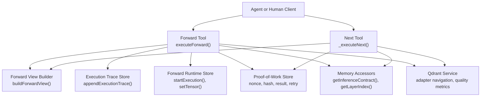
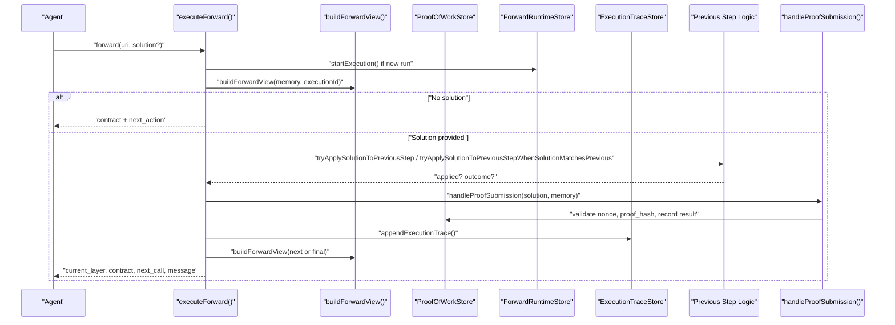
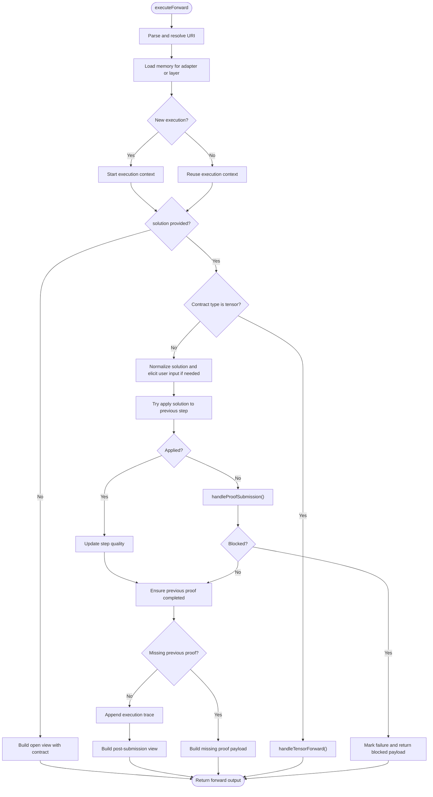
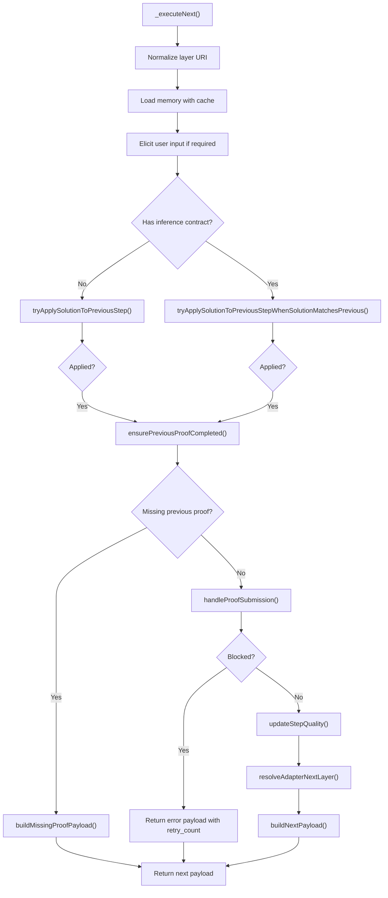
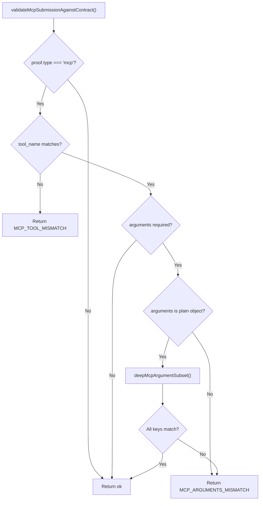
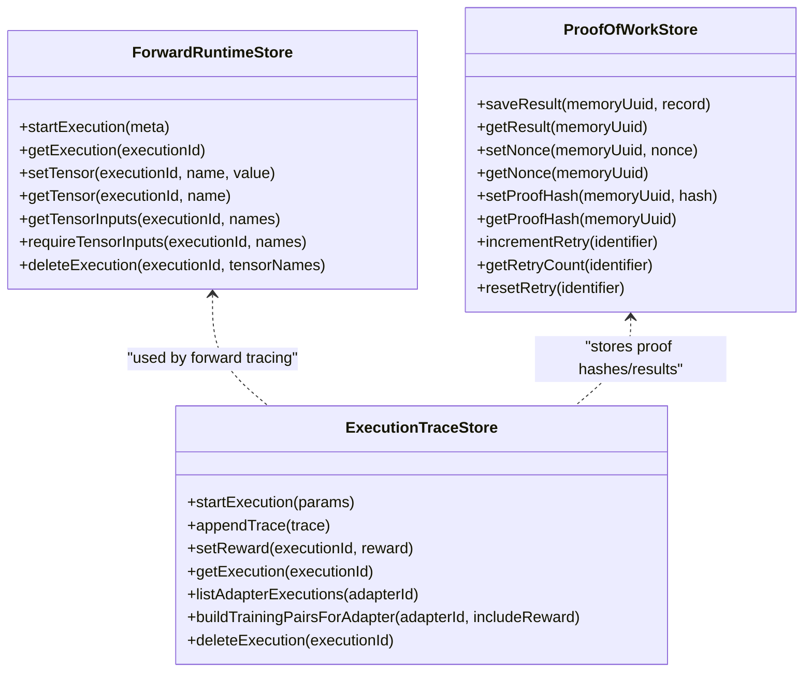
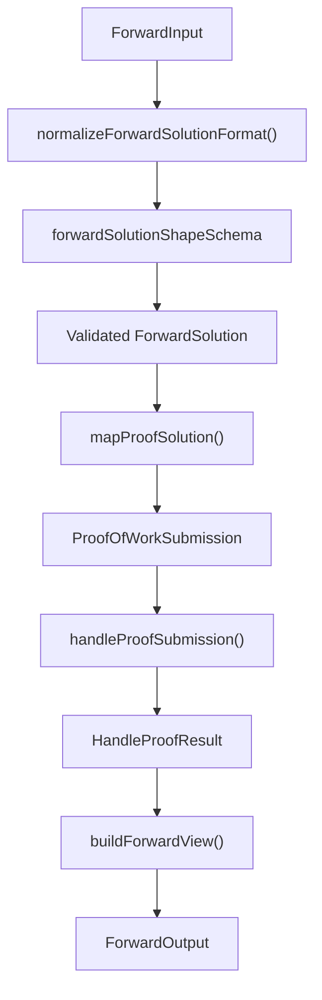
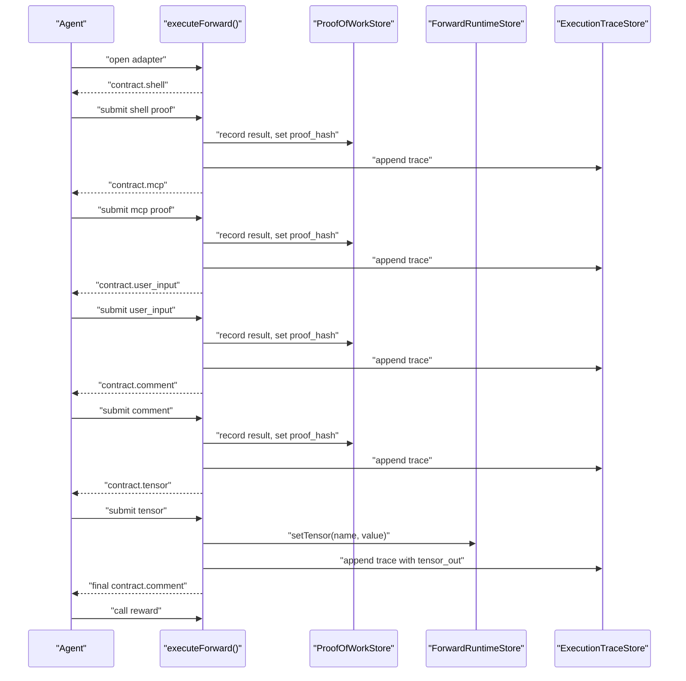
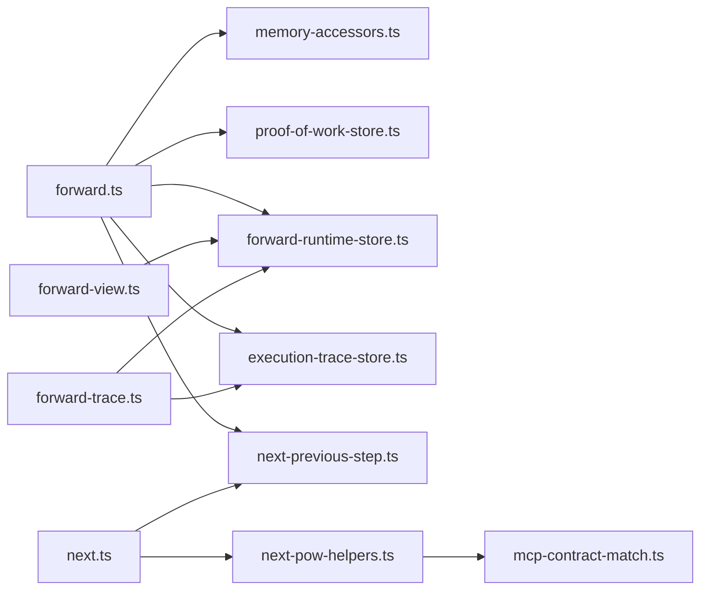

# Adapter Execution Phase

<cite>
**Referenced Files in This Document**
- [forward.ts](file://src/tools/forward.ts)
- [next.ts](file://src/tools/next.ts)
- [forward-view.ts](file://src/tools/forward-view.ts)
- [forward-trace.ts](file://src/tools/forward-trace.ts)
- [mcp-contract-match.ts](file://src/tools/mcp-contract-match.ts)
- [next-pow-helpers.ts](file://src/tools/next-pow-helpers.ts)
- [next-previous-step.ts](file://src/tools/next-previous-step.ts)
- [forward_schema.ts](file://src/tools/forward_schema.ts)
- [next_schema.ts](file://src/tools/next_schema.ts)
- [memory-accessors.ts](file://src/services/memory/memory-accessors.ts)
- [forward-runtime-store.ts](file://src/services/forward-runtime-store.ts)
- [execution-trace-store.ts](file://src/services/execution-trace-store.ts)
- [proof-of-work-store.ts](file://src/services/proof-of-work-store.ts)
</cite>

## Table of Contents
1. [Introduction](#introduction)
2. [Project Structure](#project-structure)
3. [Core Components](#core-components)
4. [Architecture Overview](#architecture-overview)
5. [Detailed Component Analysis](#detailed-component-analysis)
6. [Dependency Analysis](#dependency-analysis)
7. [Performance Considerations](#performance-considerations)
8. [Troubleshooting Guide](#troubleshooting-guide)
9. [Conclusion](#conclusion)

## Introduction
This document explains the adapter execution phase that runs an adapter’s inference contracts, validates submissions, and manages state transitions across multi-step workflows. It focuses on:

- The forward operation that executes selected adapters with provided inputs.
- MCP tool invocation handling and contract matching.
- Next action determination logic for protocol chain progression.
- State persistence for execution progress, failures, and recovery.
- Contract validation, data transformation, and type safety.
- Examples of complex multi-step executions, error handling patterns, and debugging techniques.
- Concurrency control, timeout management, and resource cleanup during long-running operations.

The system is agent-first: agents drive activation, forward, and reward flows while humans configure preferences. Adapters provide deterministic, auditable task execution through typed inference contracts such as shell commands, MCP tool calls, user input confirmation, comments, or tensor outputs.

## Project Structure
The adapter execution phase spans tools, services, and schemas:

- Tools implement the runtime workflow: `forward`, `next`, proof helpers, previous-step recovery, MCP contract matching, view builders, and trace recording.
- Services provide persistent state: forward runtime metadata, proof-of-work results, nonces, hashes, retry counters, and execution traces.
- Schemas define strict input/output shapes for forward and next operations.
- Memory accessors expose adapter metadata, layer indices, and inference contracts.

**Diagram sources**
- [forward.ts:93-317](file://src/tools/forward.ts#L93-L317)
- [next.ts:137-272](file://src/tools/next.ts#L137-L272)
- [forward-view.ts:242-290](file://src/tools/forward-view.ts#L242-L290)
- [forward-trace.ts:94-117](file://src/tools/forward-trace.ts#L94-L117)
- [forward-runtime-store.ts:25-42](file://src/services/forward-runtime-store.ts#L25-L42)
- [proof-of-work-store.ts:48-173](file://src/services/proof-of-work-store.ts#L48-L173)
- [memory-accessors.ts:27-29](file://src/services/memory/memory-accessors.ts#L27-L29)

**Section sources**
- [forward.ts:1-317](file://src/tools/forward.ts#L1-L317)
- [next.ts:1-273](file://src/tools/next.ts#L1-L273)
- [forward-view.ts:1-344](file://src/tools/forward-view.ts#L1-L344)
- [forward-trace.ts:1-230](file://src/tools/forward-trace.ts#L1-L230)
- [forward_runtime_store.ts:1-80](file://src/services/forward-runtime-store.ts#L1-L80)
- [proof_of_work_store.ts:1-175](file://src/services/proof-of-work-store.ts#L1-L175)
- [memory_accessors.ts:1-60](file://src/services/memory/memory-accessors.ts#L1-L60)

## Core Components
- Forward execution orchestrates adapter layer resolution, solution normalization, proof validation, previous-step recovery, tensor handling, and response building.
- Next execution computes the next step payload, challenge generation, missing-proof handling, and quality updates.
- Proof-of-work store persists nonces, proof hashes, results, and retry counters with TTLs.
- Forward runtime store tracks execution metadata and tensor inputs/outputs across steps.
- Execution trace store records per-layer traces, activation queries, tensor I/O, and rewards.
- MCP contract matcher enforces tool name and argument subset semantics.
- Forward view builder constructs structured responses including current layer, contract, next call guidance, and UI summaries.

**Section sources**
- [forward.ts:93-317](file://src/tools/forward.ts#L93-L317)
- [next.ts:85-129](file://src/tools/next.ts#L85-L129)
- [proof-of-work-store.ts:39-173](file://src/services/proof-of-work-store.ts#L39-L173)
- [forward-runtime-store.ts:25-78](file://src/services/forward-runtime-store.ts#L25-L78)
- [execution-trace-store.ts:31-289](file://src/services/execution-trace-store.ts#L31-L289)
- [mcp-contract-match.ts:1-87](file://src/tools/mcp-contract-match.ts#L1-L87)
- [forward-view.ts:242-343](file://src/tools/forward-view.ts#L242-L343)

## Architecture Overview
The adapter execution phase follows a layered flow:

1. Resolve adapter or layer URI and load memory.
2. Start or reuse execution context.
3. Normalize and validate the submitted solution.
4. Handle user input elicitation when required.
5. Validate proof-of-work (shell, MCP, user_input, comment).
6. Check previous-step requirements and apply solutions to prior layers when appropriate.
7. Persist results, nonces, hashes, and traces.
8. Determine next action and build response.

**Diagram sources**
- [forward.ts:93-317](file://src/tools/forward.ts#L93-L317)
- [forward-view.ts:242-290](file://src/tools/forward-view.ts#L242-L290)
- [next-pow-helpers.ts:155-326](file://src/tools/next-pow-helpers.ts#L155-L326)
- [next-previous-step.ts:29-106](file://src/tools/next-previous-step.ts#L29-L106)
- [forward-trace.ts:94-117](file://src/tools/forward-trace.ts#L94-L117)
- [forward-runtime-store.ts:25-42](file://src/services/forward-runtime-store.ts#L25-L42)

## Detailed Component Analysis

### Forward Operation
The forward operation is the primary entry point for executing adapter layers:

- Parses and resolves adapter or layer URIs.
- Starts execution context and initializes trace recording.
- Handles tensor contracts separately via tensor-specific validation and storage.
- Normalizes solution formats and supports v1/v2 envelopes.
- Invokes user input elicitation when the contract requires human confirmation.
- Applies solutions to previous steps when the current step lacks a stored contract or when the client submits the previous step’s solution against the next step’s URI.
- Validates proof-of-work, checks previous-step completion, and updates step quality.
- Persists execution traces and builds the next response.

**Diagram sources**
- [forward.ts:93-317](file://src/tools/forward.ts#L93-L317)
- [forward-trace.ts:133-229](file://src/tools/forward-trace.ts#L133-L229)
- [next-pow-helpers.ts:155-326](file://src/tools/next-pow-helpers.ts#L155-L326)
- [next-previous-step.ts:29-156](file://src/tools/next-previous-step.ts#L29-L156)

**Section sources**
- [forward.ts:93-317](file://src/tools/forward.ts#L93-L317)
- [forward-trace.ts:133-229](file://src/tools/forward-trace.ts#L133-L229)

### Next Action Determination
The next action logic determines whether to continue forward, request reward, or guide recovery:

- Builds current step and challenge payloads.
- Resolves next layer and constructs next_action instructions.
- Handles missing proofs by instructing how to complete the previous step.
- Updates step quality metrics on success or failure.
- Returns structured payloads with must_obey flags and retry counts.

**Diagram sources**
- [next.ts:137-272](file://src/tools/next.ts#L137-L272)
- [next-previous-step.ts:108-156](file://src/tools/next-previous-step.ts#L108-L156)
- [next-pow-helpers.ts:155-326](file://src/tools/next-pow-helpers.ts#L155-L326)

**Section sources**
- [next.ts:85-129](file://src/tools/next.ts#L85-L129)
- [next.ts:137-272](file://src/tools/next.ts#L137-L272)

### MCP Tool Invocation and Contract Matching
MCP tool invocations are validated against stored contracts:

- Enforces tool_name equality when specified.
- Requires arguments object when contract specifies mcp.arguments.
- Performs deep subset matching for nested objects and arrays.
- Produces machine-readable error codes for mismatches.

**Diagram sources**
- [mcp-contract-match.ts:1-87](file://src/tools/mcp-contract-match.ts#L1-L87)

**Section sources**
- [mcp-contract-match.ts:1-87](file://src/tools/mcp-contract-match.ts#L1-L87)
- [next-pow-helpers.ts:245-260](file://src/tools/next-pow-helpers.ts#L245-L260)

### State Persistence and Recovery
State persistence covers execution metadata, proof-of-work results, nonces, hashes, retry counters, and execution traces:

- Forward runtime store tracks execution_id, adapter_id, adapter_uri, merge_depth, created_at, and optional slug disambiguation notes.
- Proof-of-work store persists results, nonces, hashes, and retry counters with TTLs.
- Execution trace store records per-layer traces, activation queries, tensor I/O, and rewards with mutation locks.

**Diagram sources**
- [forward-runtime-store.ts:25-78](file://src/services/forward-runtime-store.ts#L25-L78)
- [proof-of-work-store.ts:48-173](file://src/services/proof-of-work-store.ts#L48-L173)
- [execution-trace-store.ts:31-289](file://src/services/execution-trace-store.ts#L31-L289)

**Section sources**
- [forward-runtime-store.ts:25-78](file://src/services/forward-runtime-store.ts#L25-L78)
- [proof-of-work-store.ts:39-173](file://src/services/proof-of-work-store.ts#L39-L173)
- [execution-trace-store.ts:99-174](file://src/services/execution-trace-store.ts#L99-L174)

### Contract Matching and Data Transformation
Contract matching ensures type safety and schema compliance:

- Forward schemas normalize v1/v2 solution formats and enforce required fields.
- Next schemas define challenges and solutions for shell, MCP, user_input, and comment types.
- Memory accessors extract inference contracts and adapter metadata.
- Forward view builder summarizes contracts and generates next_call guidance.

**Diagram sources**
- [forward_schema.ts:146-226](file://src/tools/forward_schema.ts#L146-L226)
- [forward-view.ts:83-139](file://src/tools/forward-view.ts#L83-L139)
- [next-pow-helpers.ts:155-326](file://src/tools/next-pow-helpers.ts#L155-L326)

**Section sources**
- [forward_schema.ts:146-226](file://src/tools/forward_schema.ts#L146-L226)
- [next_schema.ts:16-49](file://src/tools/next_schema.ts#L16-L49)
- [memory-accessors.ts:27-29](file://src/services/memory/memory-accessors.ts#L27-L29)
- [forward-view.ts:83-139](file://src/tools/forward-view.ts#L83-L139)

### Multi-Step Workflow Example
A complex multi-step execution might involve:

1. Open adapter to receive initial contract.
2. Execute shell command and submit proof.
3. Call MCP tool and submit MCP proof with arguments and result.
4. Provide user input confirmation.
5. Write a comment summary.
6. Produce tensor output consumed by subsequent layers.
7. Complete adapter and call reward.

**Diagram sources**
- [forward.ts:93-317](file://src/tools/forward.ts#L93-L317)
- [forward-trace.ts:94-117](file://src/tools/forward-trace.ts#L94-L117)
- [proof-of-work-store.ts:66-122](file://src/services/proof-of-work-store.ts#L66-L122)
- [forward-runtime-store.ts:34-42](file://src/services/forward-runtime-store.ts#L34-L42)

**Section sources**
- [forward.ts:93-317](file://src/tools/forward.ts#L93-L317)
- [forward-trace.ts:94-117](file://src/tools/forward-trace.ts#L94-L117)

## Dependency Analysis
Key dependencies and relationships:

- Forward depends on memory accessors, proof-of-work store, forward runtime store, execution trace store, and previous-step logic.
- Next depends on proof-of-work helpers, previous-step logic, and qdrant service for quality updates.
- MCP contract matching is used within proof submission validation.
- Forward view builder composes current layer, contract, next_call, and UI summaries.

**Diagram sources**
- [forward.ts:93-317](file://src/tools/forward.ts#L93-L317)
- [next.ts:137-272](file://src/tools/next.ts#L137-L272)
- [next-pow-helpers.ts:155-326](file://src/tools/next-pow-helpers.ts#L155-L326)
- [mcp-contract-match.ts:1-87](file://src/tools/mcp-contract-match.ts#L1-L87)
- [forward-view.ts:242-343](file://src/tools/forward-view.ts#L242-L343)
- [forward-trace.ts:94-229](file://src/tools/forward-trace.ts#L94-L229)

**Section sources**
- [forward.ts:93-317](file://src/tools/forward.ts#L93-L317)
- [next.ts:137-272](file://src/tools/next.ts#L137-L272)
- [next-pow-helpers.ts:155-326](file://src/tools/next-pow-helpers.ts#L155-L326)
- [mcp-contract-match.ts:1-87](file://src/tools/mcp-contract-match.ts#L1-L87)
- [forward-view.ts:242-343](file://src/tools/forward-view.ts#L242-L343)
- [forward-trace.ts:94-229](file://src/tools/forward-trace.ts#L94-L229)

## Performance Considerations
- Caching: Next loads memory with Redis-backed caching to reduce repeated reads.
- Fire-and-forget tracing: Execution trace persistence is fire-and-forget to avoid blocking forward responses; failures are logged but do not fail requests.
- Concurrency control: Execution trace store uses mutation locks per execution ID to serialize writes and prevent race conditions.
- TTLs: Nonce TTL is 1 hour, proof hash TTL is 7 days, retry counter TTL is 60 seconds, and forward execution metadata TTL is 7 days.
- Timeout management: Comment semantic validation has a configurable timeout to avoid long embedding operations.
- Resource cleanup: Forward runtime store provides deletion methods for execution metadata and tensors; proof-of-work store resets retry counters on successful submissions.

[No sources needed since this section provides general guidance]

## Troubleshooting Guide
Common error patterns and debugging techniques:

- NONCE_MISMATCH: Submitted nonce does not match stored nonce; server rotates nonce and returns a fresh challenge. Use the nonce from the latest response.
- PROOF_HASH_MISMATCH: Submitted proof_hash does not match expected previous hash; use proof_hash from the previous response or current contract.
- MISSING_PROOF: Previous step proof is missing; follow next_action instructions to complete the previous step before continuing.
- MCP_TOOL_MISMATCH: Tool name does not match contract; ensure tool_name equals the contract’s expected tool.
- MCP_ARGUMENTS_MISMATCH: Arguments do not satisfy contract; verify nested object structure and required keys.
- COMMAND_FAILED: Required proof failed; fix the underlying issue and retry.
- MAX_RETRIES_EXCEEDED: Retry limit reached; must_obey becomes false and the agent should recover manually or tune the failing step.

Debugging tips:

- Inspect execution traces using execution_trace_store.getExecution(executionId) to review raw_solution, tensor_in/tensor_out, and layer instructions.
- Check proof-of-work store for nonce, proof_hash, result status, and retry count.
- Review forward runtime store for tensor inputs required by tensor contracts.
- Use structured logs for pow events, quality update errors, and trace persistence failures.

**Section sources**
- [next-pow-helpers.ts:171-216](file://src/tools/next-pow-helpers.ts#L171-L216)
- [next-pow-helpers.ts:245-305](file://src/tools/next-pow-helpers.ts#L245-L305)
- [next-previous-step.ts:108-156](file://src/tools/next-previous-step.ts#L108-L156)
- [mcp-contract-match.ts:47-86](file://src/tools/mcp-contract-match.ts#L47-L86)
- [execution-trace-store.ts:188-215](file://src/services/execution-trace-store.ts#L188-L215)
- [proof-of-work-store.ts:128-170](file://src/services/proof-of-work-store.ts#L128-L170)

## Conclusion
The adapter execution phase provides a robust, typed, and auditable workflow for running adapters across multiple steps. It combines strict schema validation, proof-of-work verification, MCP contract matching, and comprehensive state persistence to support reliable multi-step protocols. Agents can execute shell commands, invoke MCP tools, collect user confirmations, write verified comments, and produce tensor outputs while the system tracks progress, handles failures, and guides recovery. Proper use of execution IDs, nonces, proof hashes, and retry counters ensures safe concurrency and resilience during long-running operations.

[No sources needed since this section summarizes without analyzing specific files]