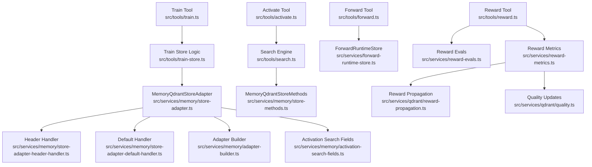
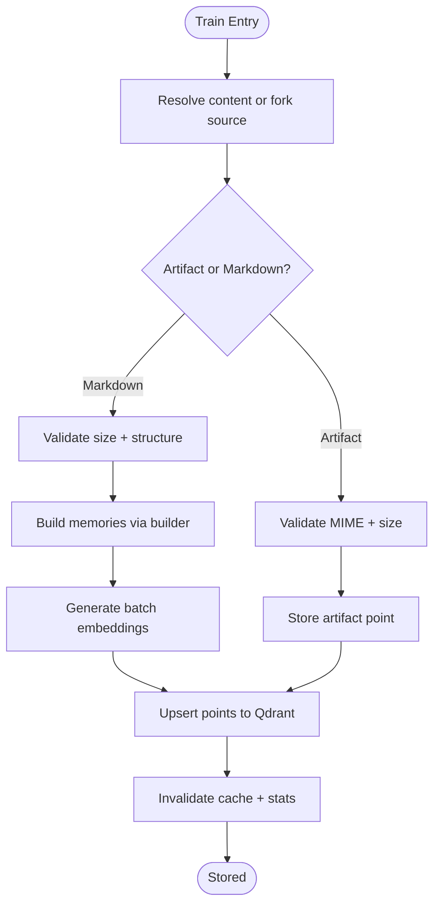
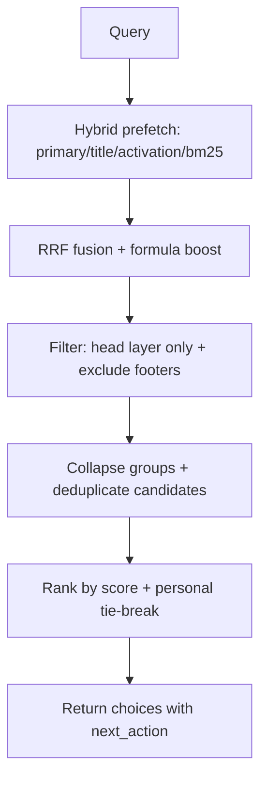
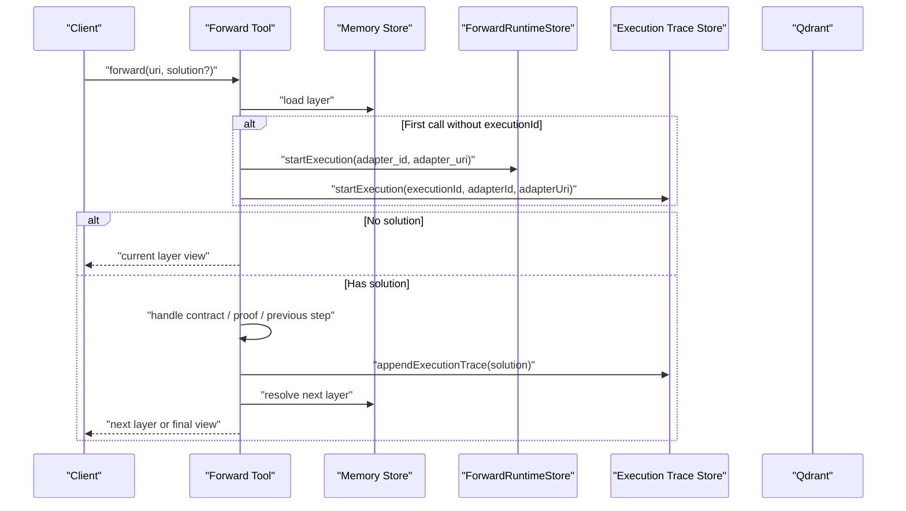
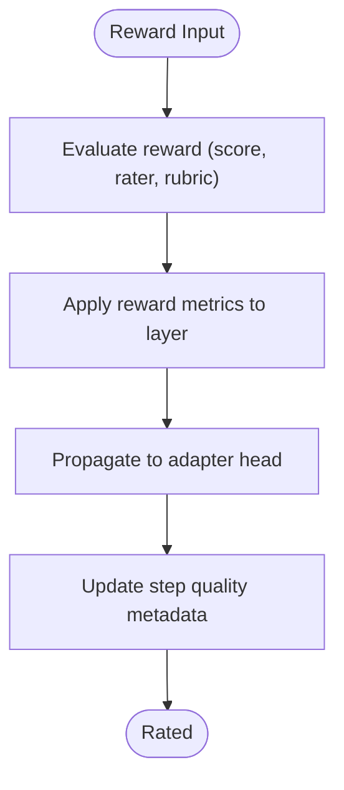
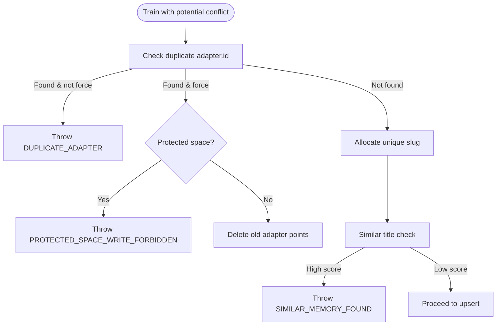
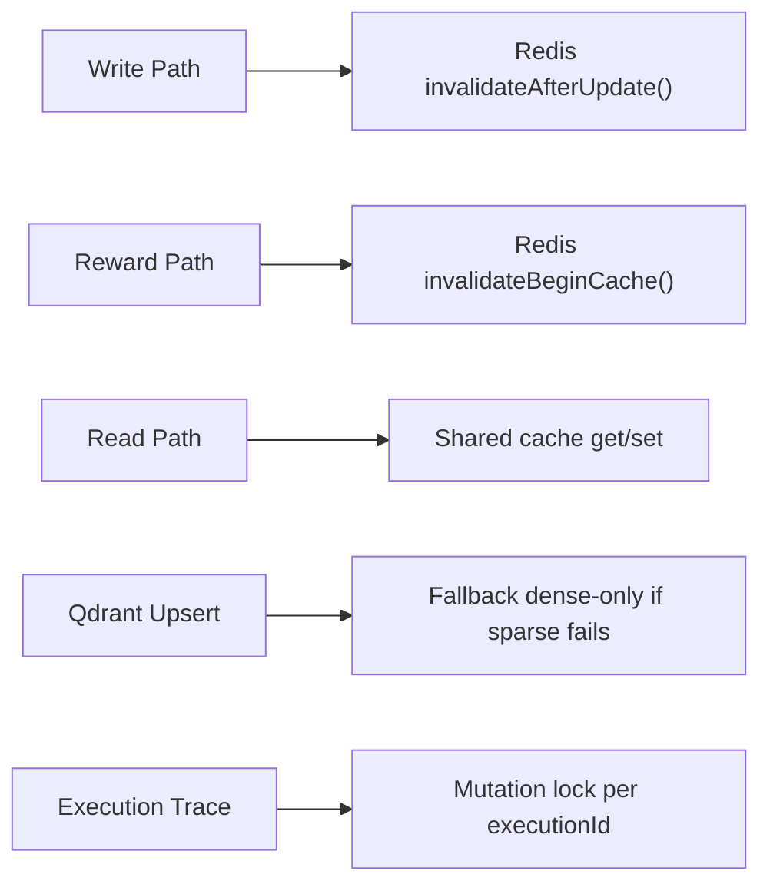
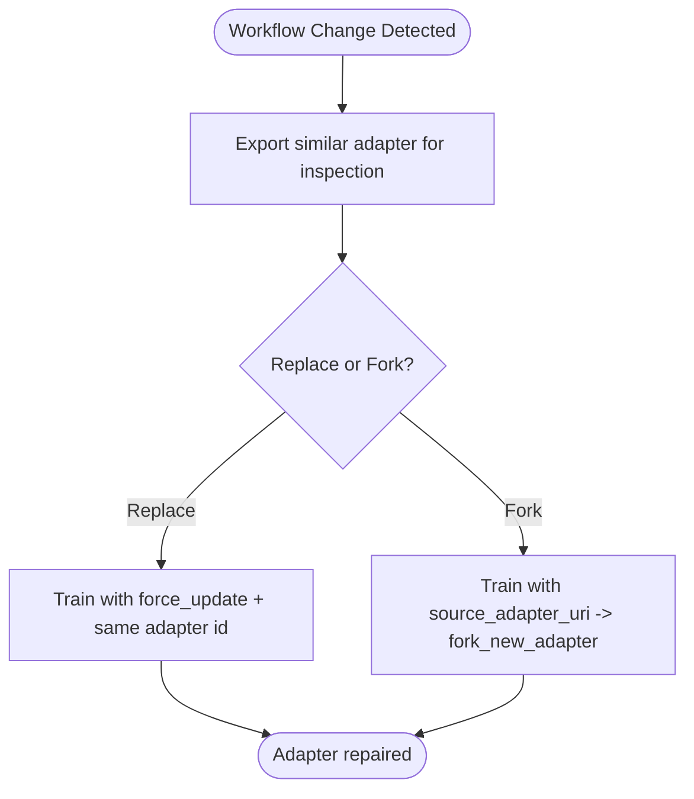
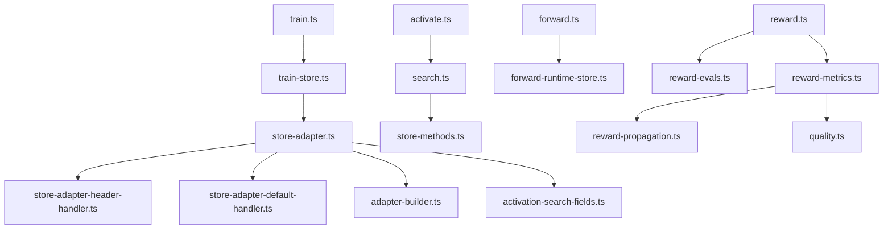

# Adapter Lifecycle Management

<cite>
**Referenced Files in This Document**
- [train.ts](file://src/tools/train.ts)
- [train-store.ts](file://src/tools/train-store.ts)
- [store-adapter.ts](file://src/services/memory/store-adapter.ts)
- [adapter-builder.ts](file://src/services/memory/adapter-builder.ts)
- [store-adapter-header-handler.ts](file://src/services/memory/store-adapter-header-handler.ts)
- [store-adapter-default-handler.ts](file://src/services/memory/store-adapter-default-handler.ts)
- [activation-search-fields.ts](file://src/services/memory/activation-search-fields.ts)
- [store-methods.ts](file://src/services/memory/store-methods.ts)
- [activate.ts](file://src/tools/activate.ts)
- [search.ts](file://src/tools/search.ts)
- [forward.ts](file://src/tools/forward.ts)
- [reward.ts](file://src/tools/reward.ts)
- [reward-evals.ts](file://src/services/reward-evals.ts)
- [reward-metrics.ts](file://src/services/reward-metrics.ts)
- [reward-propagation.ts](file://src/services/qdrant/reward-propagation.ts)
- [quality.ts](file://src/services/qdrant/quality.ts)
- [LanceExecutionTraceStore.ts](file://src/services/vector-store/lancedb/LanceExecutionTraceStore.ts)
- [forward-runtime-store.ts](file://src/services/forward-runtime-store.ts)
- [store-adapter-helpers.ts](file://src/services/memory/store-adapter-helpers.ts)
</cite>

## Table of Contents
1. [Introduction](#introduction)
2. [Project Structure](#project-structure)
3. [Core Components](#core-components)
4. [Architecture Overview](#architecture-overview)
5. [Detailed Component Analysis](#detailed-component-analysis)
6. [Dependency Analysis](#dependency-analysis)
7. [Performance Considerations](#performance-considerations)
8. [Troubleshooting Guide](#troubleshooting-guide)
9. [Conclusion](#conclusion)

## Introduction
This document explains the complete adapter lifecycle in SquadRules: creation, training, activation, execution, reward collection, and repair. Adapters are structured memory entries derived from Markdown or artifacts, enriched with vector embeddings for semantic search, and executed through deterministic inference contracts. The system supports versioning, conflict resolution, distributed consistency, and quality feedback that improves future activation ranking.

## Project Structure
The lifecycle spans MCP tools, memory storage, embedding services, Qdrant-backed retrieval, and runtime state stores:



**Diagram sources**
- [train.ts:135-241](file://src/tools/train.ts#L135-L241)
- [train-store.ts:47-130](file://src/tools/train-store.ts#L47-L130)
- [store-adapter.ts:43-147](file://src/services/memory/store-adapter.ts#L43-L147)
- [adapter-builder.ts:75-210](file://src/services/memory/adapter-builder.ts#L75-L210)
- [store-adapter-header-handler.ts:30-201](file://src/services/memory/store-adapter-header-handler.ts#L30-L201)
- [store-adapter-default-handler.ts:34-254](file://src/services/memory/store-adapter-default-handler.ts#L34-L254)
- [activation-search-fields.ts:42-92](file://src/services/memory/activation-search-fields.ts#L42-L92)
- [activate.ts:209-235](file://src/tools/activate.ts#L209-L235)
- [search.ts:192-253](file://src/tools/search.ts#L192-L253)
- [store-methods.ts:121-259](file://src/services/memory/store-methods.ts#L121-L259)
- [forward.ts:93-317](file://src/tools/forward.ts#L93-L317)
- [forward-runtime-store.ts:25-78](file://src/services/forward-runtime-store.ts#L25-L78)
- [reward.ts:27-109](file://src/tools/reward.ts#L27-L109)
- [reward-evals.ts:105-147](file://src/services/reward-evals.ts#L105-L147)
- [reward-metrics.ts:20-118](file://src/services/reward-metrics.ts#L20-L118)
- [reward-propagation.ts:13-73](file://src/services/qdrant/reward-propagation.ts#L13-L73)
- [quality.ts:25-58](file://src/services/qdrant/quality.ts#L25-L58)

**Section sources**
- [train.ts:135-241](file://src/tools/train.ts#L135-L241)
- [train-store.ts:47-130](file://src/tools/train-store.ts#L47-L130)
- [store-adapter.ts:43-147](file://src/services/memory/store-adapter.ts#L43-L147)
- [activate.ts:209-235](file://src/tools/activate.ts#L209-L235)
- [search.ts:192-253](file://src/tools/search.ts#L192-L253)
- [forward.ts:93-317](file://src/tools/forward.ts#L93-L317)
- [reward.ts:27-109](file://src/tools/reward.ts#L27-L109)

## Core Components
- Training pipeline: validates structure, normalizes content, builds memories, generates embeddings, and persists points to Qdrant.
- Activation engine: hybrid dense + BM25 search with title, label, tags, and activation pattern boosts; returns ranked choices.
- Forward executor: resolves layers, enforces inference contracts, manages proof-of-work steps, and advances state transitions.
- Reward evaluator: normalizes outcomes, computes eligibility, updates metrics, and propagates quality signals to adapter heads.
- Versioning and conflict handling: slug allocation, duplicate detection, similarity guard, and force-update semantics.
- Distributed consistency: Redis cache invalidation, space-scoped filters, and safe upserts.

**Section sources**
- [train-store.ts:47-130](file://src/tools/train-store.ts#L47-L130)
- [store-adapter.ts:43-147](file://src/services/memory/store-adapter.ts#L43-L147)
- [store-methods.ts:121-259](file://src/services/memory/store-methods.ts#L121-L259)
- [forward.ts:93-317](file://src/tools/forward.ts#L93-L317)
- [reward.ts:27-109](file://src/tools/reward.ts#L27-L109)

## Architecture Overview
The lifecycle follows a clear chain: train → activate → forward → reward. Each stage interacts with shared storage (Qdrant), optional embedded trace store (LanceDB), and runtime key-value store.

```mermaid
sequenceDiagram
participant Agent as "Agent"
participant Train as "Train Tool"
participant Store as "MemoryQdrantStoreAdapter"
participant Embed as "Embedding Service"
participant Qdrant as "Qdrant Collection"
participant Cache as "Redis Cache"
participant Activate as "Activate Tool"
participant Search as "Search Engine"
participant Forward as "Forward Tool"
participant Runtime as "ForwardRuntimeStore"
participant Reward as "Reward Tool"
participant RM as "Reward Metrics"
participant Prop as "Reward Propagation"
Agent->>Train : "Submit markdown or artifact"
Train->>Store : "validate + build memories"
Store->>Embed : "generate batch embeddings"
Embed-->>Store : "vectors"
Store->>Qdrant : "upsert points with payload"
Store->>Cache : "invalidate after update"
Agent->>Activate : "query"
Activate->>Search : "execute search"
Search->>Qdrant : "hybrid query (dense + bm25)"
Qdrant-->>Search : "ranked results"
Search-->>Activate : "choices"
Agent->>Forward : "start adapter run"
Forward->>Runtime : "start execution"
Forward->>Qdrant : "load layer(s)"
Forward-->>Agent : "contract / next step"
Agent->>Reward : "submit outcome"
Reward->>RM : "evaluate + persist metrics"
RM->>Prop : "propagate to adapter head"
Prop->>Qdrant : "update head quality"
```

**Diagram sources**
- [train.ts:135-241](file://src/tools/train.ts#L135-L241)
- [store-adapter.ts:43-147](file://src/services/memory/store-adapter.ts#L43-L147)
- [store-adapter-header-handler.ts:61-89](file://src/services/memory/store-adapter-header-handler.ts#L61-L89)
- [store-adapter-default-handler.ts:112-142](file://src/services/memory/store-adapter-default-handler.ts#L112-L142)
- [activate.ts:209-235](file://src/tools/activate.ts#L209-L235)
- [search.ts:192-253](file://src/tools/search.ts#L192-L253)
- [store-methods.ts:121-259](file://src/services/memory/store-methods.ts#L121-L259)
- [forward.ts:93-317](file://src/tools/forward.ts#L93-L317)
- [forward-runtime-store.ts:25-78](file://src/services/forward-runtime-store.ts#L25-L78)
- [reward.ts:27-109](file://src/tools/reward.ts#L27-L109)
- [reward-metrics.ts:20-118](file://src/services/reward-metrics.ts#L20-L118)
- [reward-propagation.ts:13-73](file://src/services/qdrant/reward-propagation.ts#L13-L73)

## Detailed Component Analysis

### Training Pipeline: Markdown to Structured Memory Entries
Training converts Markdown adapters into layered memory entries with proper metadata and embeddings. It supports:
- Single-document default path and header-based multi-layer adapters.
- Artifact training for non-Markdown content linked to an adapter URI.
- Forking from an existing adapter to create a new versioned copy.
- Size limits, structural validation, slug allocation, and duplicate/similarity guards.

Key behaviors:
- Content normalization and frontmatter parsing.
- H1/H2 section parsing and contract extraction.
- Activation patterns and reward signal propagation across layers.
- Batch embedding generation with fallback to zero vectors on shape mismatch.
- Upsert to Qdrant with primary, title, activation pattern vectors, and BM25 sparse index.
- Redis cache invalidation and model stats contribution.



**Diagram sources**
- [train.ts:86-178](file://src/tools/train.ts#L86-L178)
- [train-store.ts:47-130](file://src/tools/train-store.ts#L47-L130)
- [store-adapter.ts:43-147](file://src/services/memory/store-adapter.ts#L43-L147)
- [adapter-builder.ts:75-210](file://src/services/memory/adapter-builder.ts#L75-L210)
- [store-adapter-header-handler.ts:61-89](file://src/services/memory/store-adapter-header-handler.ts#L61-L89)
- [store-adapter-default-handler.ts:112-142](file://src/services/memory/store-adapter-default-handler.ts#L112-L142)

**Section sources**
- [train.ts:86-178](file://src/tools/train.ts#L86-L178)
- [train-store.ts:47-130](file://src/tools/train-store.ts#L47-L130)
- [store-adapter.ts:43-147](file://src/services/memory/store-adapter.ts#L43-L147)
- [adapter-builder.ts:75-210](file://src/services/memory/adapter-builder.ts#L75-L210)
- [store-adapter-header-handler.ts:30-201](file://src/services/memory/store-adapter-header-handler.ts#L30-L201)
- [store-adapter-default-handler.ts:34-254](file://src/services/memory/store-adapter-default-handler.ts#L34-L254)

### Activation Phase: Semantic Similarity Selection
Activation selects the best adapter(s) by combining multiple search legs:
- Dense primary vector.
- Title vector.
- Activation pattern vector.
- BM25 sparse index.
- Query-time formula boosting title, activation patterns, label, and tags.
- Space filtering and exclusion of built-in footer protocols.
- Group collapse and candidate deduplication favoring head layers and personal spaces.



**Diagram sources**
- [store-methods.ts:121-259](file://src/services/memory/store-methods.ts#L121-L259)
- [search.ts:93-186](file://src/tools/search.ts#L93-L186)
- [activate.ts:44-206](file://src/tools/activate.ts#L44-L206)

**Section sources**
- [store-methods.ts:121-259](file://src/services/memory/store-methods.ts#L121-L259)
- [search.ts:93-186](file://src/tools/search.ts#L93-L186)
- [activate.ts:44-206](file://src/tools/activate.ts#L44-L206)

### Forward Execution: Inference Contracts and State Transitions
Forward runs the selected adapter’s inference contracts and manages state transitions:
- Resolves current layer and execution context.
- Starts execution metadata and traces.
- Handles tensor contracts and user input elicitation.
- Applies solutions to previous steps when needed.
- Enforces proof-of-work ordering and missing proof handling.
- Advances to next layer or finalizes when no contract remains.



**Diagram sources**
- [forward.ts:93-317](file://src/tools/forward.ts#L93-L317)
- [forward-runtime-store.ts:25-78](file://src/services/forward-runtime-store.ts#L25-L78)
- [LanceExecutionTraceStore.ts:122-147](file://src/services/vector-store/lancedb/LanceExecutionTraceStore.ts#L122-L147)

**Section sources**
- [forward.ts:93-317](file://src/tools/forward.ts#L93-L317)
- [forward-runtime-store.ts:25-78](file://src/services/forward-runtime-store.ts#L25-L78)
- [LanceExecutionTraceStore.ts:122-147](file://src/services/vector-store/lancedb/LanceExecutionTraceStore.ts#L122-L147)

### Reward Collection and Evaluation
Reward evaluation normalizes outcomes, computes eligibility for SFT and preference datasets, and updates quality metrics:
- Normalized and signed scores based on outcome and optional explicit score.
- Label assignment (gold/silver/bronze/rejected).
- Eligibility blockers for rubric version and evaluator identity.
- Persistence of metrics and propagation to adapter head.
- Cache invalidation and model stats integration.



**Diagram sources**
- [reward.ts:27-109](file://src/tools/reward.ts#L27-L109)
- [reward-evals.ts:105-147](file://src/services/reward-evals.ts#L105-L147)
- [reward-metrics.ts:20-118](file://src/services/reward-metrics.ts#L20-L118)
- [reward-propagation.ts:13-73](file://src/services/qdrant/reward-propagation.ts#L13-L73)
- [quality.ts:25-58](file://src/services/qdrant/quality.ts#L25-L58)

**Section sources**
- [reward.ts:27-109](file://src/tools/reward.ts#L27-L109)
- [reward-evals.ts:105-147](file://src/services/reward-evals.ts#L105-L147)
- [reward-metrics.ts:20-118](file://src/services/reward-metrics.ts#L20-L118)
- [reward-propagation.ts:13-73](file://src/services/qdrant/reward-propagation.ts#L13-L73)
- [quality.ts:25-58](file://src/services/qdrant/quality.ts#L25-L58)

### Versioning Strategies and Conflict Resolution
Versioning and conflict handling ensure stable adapter identities and predictable updates:
- Duplicate adapter detection by adapter UUID; throws unless force_update is set.
- Protected space write guard prevents overwrites in restricted spaces.
- Slug allocation: author-supplied slugs must be unique; auto slugs append numeric suffixes.
- Pre-train similarity guard detects similar titles and suggests inspection or replacement.
- Forking creates a new adapter id instead of reusing v5-derived id.



**Diagram sources**
- [store-adapter-helpers.ts:52-93](file://src/services/memory/store-adapter-helpers.ts#L52-L93)
- [store-adapter-helpers.ts:112-172](file://src/services/memory/store-adapter-helpers.ts#L112-L172)
- [store-adapter-helpers.ts:201-254](file://src/services/memory/store-adapter-helpers.ts#L201-L254)
- [store-adapter.ts:90-115](file://src/services/memory/store-adapter.ts#L90-L115)

**Section sources**
- [store-adapter-helpers.ts:52-93](file://src/services/memory/store-adapter-helpers.ts#L52-L93)
- [store-adapter-helpers.ts:112-172](file://src/services/memory/store-adapter-helpers.ts#L112-L172)
- [store-adapter-helpers.ts:201-254](file://src/services/memory/store-adapter-helpers.ts#L201-L254)
- [store-adapter.ts:90-115](file://src/services/memory/store-adapter.ts#L90-L115)

### Consistency Across Distributed Deployments
Consistency is maintained through:
- Space-scoped filters ensuring reads/writes respect allowed spaces.
- Redis cache invalidation after writes and during reward propagation.
- Safe upserts with fallback to dense-only vectors if sparse config is missing.
- Execution trace locking per execution ID to prevent reassignment.
- Shared cache for memory retrieval and search results.



**Diagram sources**
- [store-adapter-header-handler.ts:166-184](file://src/services/memory/store-adapter-header-handler.ts#L166-L184)
- [store-adapter-default-handler.ts:216-232](file://src/services/memory/store-adapter-default-handler.ts#L216-L232)
- [reward-propagation.ts:65-70](file://src/services/qdrant/reward-propagation.ts#L65-L70)
- [LanceExecutionTraceStore.ts:103-120](file://src/services/vector-store/lancedb/LanceExecutionTraceStore.ts#L103-L120)
- [store-methods.ts:38-73](file://src/services/memory/store-methods.ts#L38-L73)

**Section sources**
- [store-adapter-header-handler.ts:166-184](file://src/services/memory/store-adapter-header-handler.ts#L166-L184)
- [store-adapter-default-handler.ts:216-232](file://src/services/memory/store-adapter-default-handler.ts#L216-L232)
- [reward-propagation.ts:65-70](file://src/services/qdrant/reward-propagation.ts#L65-L70)
- [LanceExecutionTraceStore.ts:103-120](file://src/services/vector-store/lancedb/LanceExecutionTraceStore.ts#L103-L120)
- [store-methods.ts:38-73](file://src/services/memory/store-methods.ts#L38-L73)

### Adapter Repair Mechanisms
When workflows evolve, agents can repair adapters through:
- Guided creation flow via the creation protocol.
- Refinement flow via the refining protocol.
- Force update to replace existing adapters with identical ids.
- Forking from an existing adapter to produce a new versioned copy.
- Exporting and inspecting similar adapters before replacement.



**Diagram sources**
- [train.ts:86-178](file://src/tools/train.ts#L86-L178)
- [train-store.ts:100-118](file://src/tools/train-store.ts#L100-L118)
- [store-adapter-helpers.ts:112-172](file://src/services/memory/store-adapter-helpers.ts#L112-L172)

**Section sources**
- [train.ts:86-178](file://src/tools/train.ts#L86-L178)
- [train-store.ts:100-118](file://src/tools/train-store.ts#L100-L118)
- [store-adapter-helpers.ts:112-172](file://src/services/memory/store-adapter-helpers.ts#L112-L172)

## Dependency Analysis
The following diagram shows core dependencies between lifecycle components:



**Diagram sources**
- [train.ts:135-241](file://src/tools/train.ts#L135-L241)
- [train-store.ts:47-130](file://src/tools/train-store.ts#L47-L130)
- [store-adapter.ts:43-147](file://src/services/memory/store-adapter.ts#L43-L147)
- [store-adapter-header-handler.ts:30-201](file://src/services/memory/store-adapter-header-handler.ts#L30-L201)
- [store-adapter-default-handler.ts:34-254](file://src/services/memory/store-adapter-default-handler.ts#L34-L254)
- [adapter-builder.ts:75-210](file://src/services/memory/adapter-builder.ts#L75-L210)
- [activation-search-fields.ts:42-92](file://src/services/memory/activation-search-fields.ts#L42-L92)
- [activate.ts:209-235](file://src/tools/activate.ts#L209-L235)
- [search.ts:192-253](file://src/tools/search.ts#L192-L253)
- [store-methods.ts:121-259](file://src/services/memory/store-methods.ts#L121-L259)
- [forward.ts:93-317](file://src/tools/forward.ts#L93-L317)
- [forward-runtime-store.ts:25-78](file://src/services/forward-runtime-store.ts#L25-L78)
- [reward.ts:27-109](file://src/tools/reward.ts#L27-L109)
- [reward-evals.ts:105-147](file://src/services/reward-evals.ts#L105-L147)
- [reward-metrics.ts:20-118](file://src/services/reward-metrics.ts#L20-L118)
- [reward-propagation.ts:13-73](file://src/services/qdrant/reward-propagation.ts#L13-L73)
- [quality.ts:25-58](file://src/services/qdrant/quality.ts#L25-L58)

**Section sources**
- [train.ts:135-241](file://src/tools/train.ts#L135-L241)
- [store-adapter.ts:43-147](file://src/services/memory/store-adapter.ts#L43-L147)
- [activate.ts:209-235](file://src/tools/activate.ts#L209-L235)
- [forward.ts:93-317](file://src/tools/forward.ts#L93-L317)
- [reward.ts:27-109](file://src/tools/reward.ts#L27-L109)

## Performance Considerations
- Hybrid search reduces latency by prefetching multiple legs and fusing results at the database layer.
- Batch embedding generation minimizes network overhead; fallback to zero vectors avoids blocking on provider errors.
- Redis caching accelerates repeated activations and memory reads.
- Sparse BM25 indexing complements dense vectors for keyword matching.
- Execution trace mutation locks prevent concurrent corruption within an execution.

[No sources needed since this section provides general guidance]

## Troubleshooting Guide
Common issues and resolutions:
- Duplicate adapter error: Use force_update with the same adapter id to replace, or choose a distinct title.
- Similar memory found: Inspect the similar adapter via export; adjust title or use force_update with the same id.
- Protected space write forbidden: Do not overwrite adapters in protected spaces; create a new adapter or request permissions.
- Reward persistence failures: Retry once; check Qdrant health and cache invalidation logs.
- Missing proof errors: Follow next_action to provide required proofs for prior steps.

**Section sources**
- [train.ts:36-84](file://src/tools/train.ts#L36-L84)
- [store-adapter-helpers.ts:52-93](file://src/services/memory/store-adapter-helpers.ts#L52-L93)
- [store-adapter-helpers.ts:112-172](file://src/services/memory/store-adapter-helpers.ts#L112-L172)
- [reward.ts:18-25](file://src/tools/reward.ts#L18-L25)
- [forward.ts:152-221](file://src/tools/forward.ts#L152-L221)

## Conclusion
SquadRules’ adapter lifecycle integrates robust training, semantic activation, deterministic execution, and continuous quality improvement. Versioning, conflict resolution, and distributed consistency mechanisms ensure reliable operation across environments. Agents can repair adapters as workflows evolve, guided by structured flows and backed by measurable feedback loops.