# Adapter Reward & Evaluation

<cite>
**Referenced Files in This Document**
- [reward.ts](file://src/tools/reward.ts)
- [reward_schema.ts](file://src/tools/reward_schema.ts)
- [reward-evals.ts](file://src/services/reward-evals.ts)
- [reward-metrics.ts](file://src/services/reward-metrics.ts)
- [model-stats.ts](file://src/services/stats/model-stats.ts)
- [scoring.ts](file://src/services/stats/scoring.ts)
- [quality.ts](file://src/services/qdrant/quality.ts)
- [reward-propagation.ts](file://src/services/qdrant/reward-propagation.ts)
- [service.ts](file://src/services/qdrant/service.ts)
- [lance-records-mutations.ts](file://src/services/vector-store/lancedb/lance-records-mutations.ts)
- [squadrules-attest-scoring.test.ts](file://tests/integration/write/squadrules-attest-scoring.test.ts)
</cite>

## Table of Contents
1. [Introduction](#introduction)
2. [Project Structure](#project-structure)
3. [Core Components](#core-components)
4. [Architecture Overview](#architecture-overview)
5. [Detailed Component Analysis](#detailed-component-analysis)
6. [Dependency Analysis](#dependency-analysis)
7. [Performance Considerations](#performance-considerations)
8. [Troubleshooting Guide](#troubleshooting-guide)
9. [Conclusion](#conclusion)
10. [Appendices](#appendices)

## Introduction
This document explains the reward collection and evaluation system that improves adapter quality over time. It covers how human feedback, agent self-assessment, and automated quality signals are captured; how rewards are scored and aggregated; how evaluation results influence activation ranking; and how reward propagation updates vector embeddings so semantic search becomes more reliable. It also documents statistical confidence mechanisms used by the attest-based boost and provides guidance for A/B testing and significance analysis when evaluating adapter improvements.

## Project Structure
The reward and evaluation system spans tooling, service logic, scoring algorithms, vector storage, and integration tests:

- Tool layer exposes `reward` to agents and clients.
- Service layer evaluates rewards, applies metrics, and propagates them to adapter heads.
- Scoring subsystem computes quality metadata and implementation bonuses.
- Vector storage (Qdrant or LanceDB) persists quality metrics and boosts.
- Integration tests validate reward propagation and attest-based score boosts.

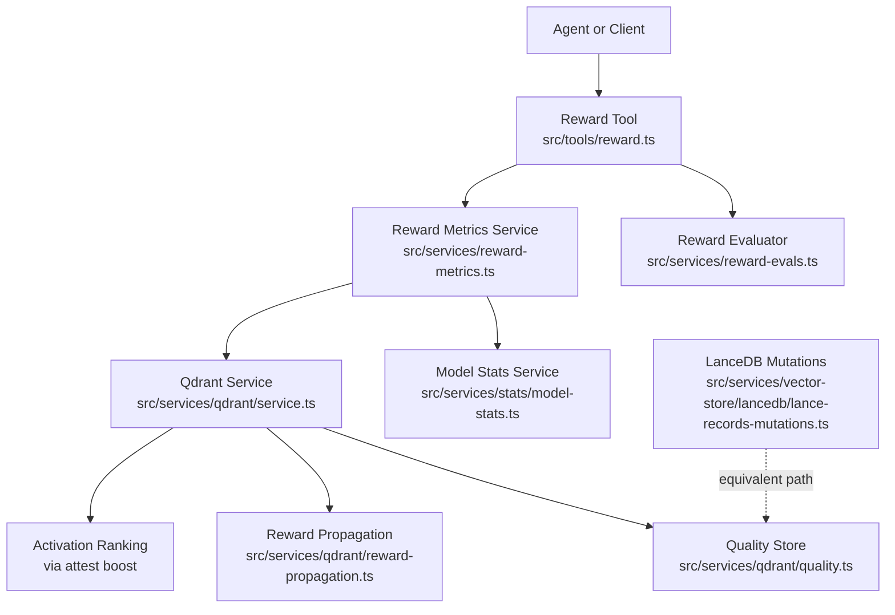

**Diagram sources**
- [reward.ts:27-110](file://src/tools/reward.ts#L27-L110)
- [reward-evals.ts:105-147](file://src/services/reward-evals.ts#L105-L147)
- [reward-metrics.ts:20-119](file://src/services/reward-metrics.ts#L20-L119)
- [model-stats.ts:145-191](file://src/services/stats/model-stats.ts#L145-L191)
- [service.ts:103-114](file://src/services/qdrant/service.ts#L103-L114)
- [quality.ts:25-58](file://src/services/qdrant/quality.ts#L25-L58)
- [reward-propagation.ts:13-73](file://src/services/qdrant/reward-propagation.ts#L13-L73)
- [lance-records-mutations.ts:164-191](file://src/services/vector-store/lancedb/lance-records-mutations.ts#L164-L191)

**Section sources**
- [reward.ts:27-110](file://src/tools/reward.ts#L27-L110)
- [reward-metrics.ts:20-119](file://src/services/reward-metrics.ts#L20-L119)
- [service.ts:103-114](file://src/services/qdrant/service.ts#L103-L114)

## Core Components
- Reward tool: validates input, evaluates reward eligibility, persists metrics, and records execution trace data.
- Reward evaluator: normalizes scores, assigns labels, determines grader kind, and computes export eligibility for SFT and preference datasets.
- Reward metrics service: aggregates basic outcome bonus with implementation bonus and optional quality bonus, updates quality metrics, propagates to adapter head, and updates step-level quality metadata.
- Model stats service: calculates implementation bonuses, rare successes, and stores persistent state for agent performance tracking.
- Quality store: persists cumulative success/failure counts, quality bonus, and compute attest boost based on runs and confidence.
- Reward propagation: resolves the adapter head from a completion layer and updates its quality metrics so activation ranking sees final outcomes.
- LanceDB equivalent: provides the same propagation behavior for embedded vector storage.

**Section sources**
- [reward.ts:27-110](file://src/tools/reward.ts#L27-L110)
- [reward-evals.ts:105-147](file://src/services/reward-evals.ts#L105-L147)
- [reward-metrics.ts:20-119](file://src/services/reward-metrics.ts#L20-L119)
- [model-stats.ts:145-191](file://src/services/stats/model-stats.ts#L145-L191)
- [quality.ts:25-58](file://src/services/qdrant/quality.ts#L25-L58)
- [reward-propagation.ts:13-73](file://src/services/qdrant/reward-propagation.ts#L13-L73)
- [lance-records-mutations.ts:164-191](file://src/services/vector-store/lancedb/lance-records-mutations.ts#L164-L191)

## Architecture Overview
The end-to-end flow starts with an agent calling the reward tool after an adapter execution completes. The tool evaluates the reward, computes eligibility, and delegates to the metrics service. The metrics service updates quality counters, computes implementation bonuses, updates step-level quality metadata, and propagates reward to the adapter head. The quality store computes an attest boost that influences activation ranking.

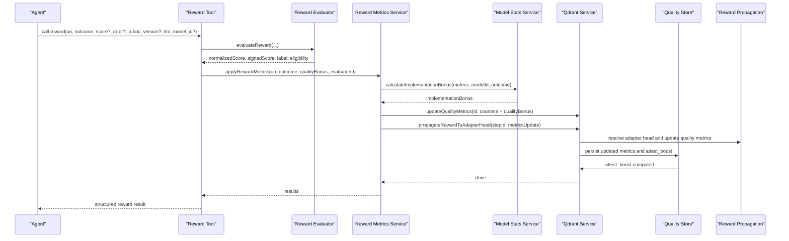

**Diagram sources**
- [reward.ts:27-110](file://src/tools/reward.ts#L27-L110)
- [reward-evals.ts:105-147](file://src/services/reward-evals.ts#L105-L147)
- [reward-metrics.ts:20-119](file://src/services/reward-metrics.ts#L20-L119)
- [model-stats.ts:145-191](file://src/services/stats/model-stats.ts#L145-L191)
- [service.ts:103-114](file://src/services/qdrant/service.ts#L103-L114)
- [quality.ts:25-58](file://src/services/qdrant/quality.ts#L25-L58)
- [reward-propagation.ts:13-73](file://src/services/qdrant/reward-propagation.ts#L13-L73)

## Detailed Component Analysis

### Reward Tool and Schema
The reward tool validates inputs using a strict schema, parses layer URIs, evaluates the reward, and persists both vector store metrics and execution traces. It returns structured fields including evaluation label, grader kind, and eligibility blockers.

Key responsibilities:
- Validate URI shape and execution context.
- Evaluate reward eligibility and label.
- Build metrics payload with outcome, feedback, and quality bonus.
- Persist metrics via the Qdrant service.
- Record execution trace data for auditability.

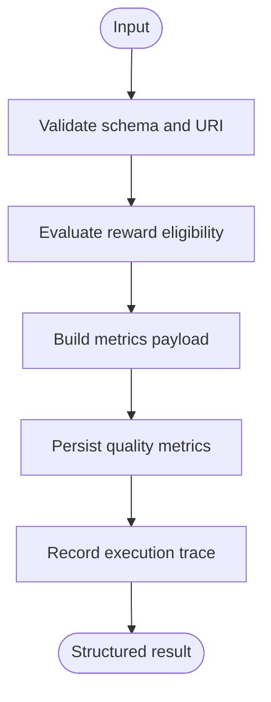

**Diagram sources**
- [reward.ts:27-110](file://src/tools/reward.ts#L27-L110)
- [reward_schema.ts:10-48](file://src/tools/reward_schema.ts#L10-L48)

**Section sources**
- [reward.ts:27-110](file://src/tools/reward.ts#L27-L110)
- [reward_schema.ts:10-48](file://src/tools/reward_schema.ts#L10-L48)

### Reward Evaluator
The evaluator normalizes scores, infers grader kind, assigns labels, and computes eligibility for SFT and preference exports. It enforces thresholds and required metadata such as rubric version and evaluator identity.

Scoring rules:
- Normalize score to [0, 1].
- Sign score based on outcome.
- Label mapping: failure → rejected; high scores → gold/silver/bronze.
- Eligibility blockers include missing rubric version, missing evaluator identity, unsuccessful outcome, and low score thresholds.

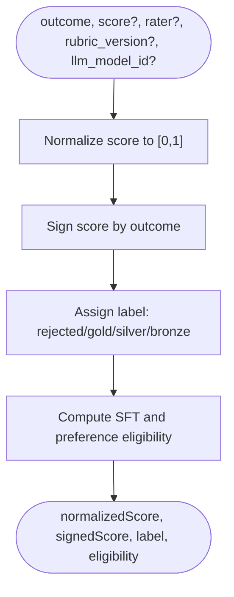

**Diagram sources**
- [reward-evals.ts:34-49](file://src/services/reward-evals.ts#L34-L49)
- [reward-evals.ts:55-93](file://src/services/reward-evals.ts#L55-L93)
- [reward-evals.ts:105-147](file://src/services/reward-evals.ts#L105-L147)

**Section sources**
- [reward-evals.ts:34-49](file://src/services/reward-evals.ts#L34-L49)
- [reward-evals.ts:55-93](file://src/services/reward-evals.ts#L55-L93)
- [reward-evals.ts:105-147](file://src/services/reward-evals.ts#L105-L147)

### Reward Metrics Service
The metrics service aggregates rewards over time:
- Basic outcome bonus: success adds positive value; failure subtracts.
- Implementation bonus: computed by model stats based on historical performance.
- Optional quality bonus: supplied by the evaluator.
- Updates retrieval, success, failure counts, last rated timestamp, and rater identity.
- Updates step-level quality metadata using scoring algorithms.
- Calls processQualityFeedback and updates implementation bonus totals.

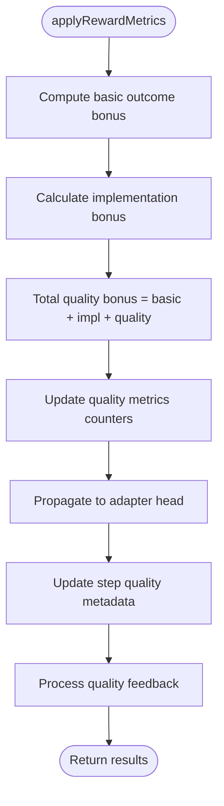

**Diagram sources**
- [reward-metrics.ts:20-119](file://src/services/reward-metrics.ts#L20-L119)
- [model-stats.ts:145-191](file://src/services/stats/model-stats.ts#L145-L191)
- [scoring.ts:74-106](file://src/services/stats/scoring.ts#L74-L106)

**Section sources**
- [reward-metrics.ts:20-119](file://src/services/reward-metrics.ts#L20-L119)
- [model-stats.ts:145-191](file://src/services/stats/model-stats.ts#L145-L191)
- [scoring.ts:74-106](file://src/services/stats/scoring.ts#L74-L106)

### Quality Store and Attest Boost
The quality store persists cumulative metrics and computes an attest boost that increases activation ranking reliability:
- Aggregates retrieval, success, partial, and failure counts.
- Accumulates quality bonus.
- Computes attest boost based on success ratio and confidence derived from run count thresholds.

Statistical confidence:
- Minimum runs threshold before boost applies.
- Confidence scales with number of runs up to a maximum.
- Boost is capped at a configured maximum.

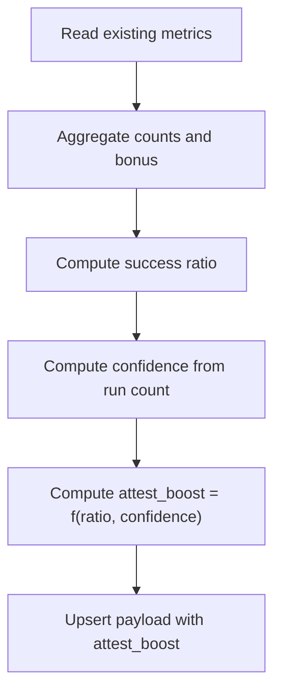

**Diagram sources**
- [quality.ts:9-16](file://src/services/qdrant/quality.ts#L9-L16)
- [quality.ts:25-58](file://src/services/qdrant/quality.ts#L25-L58)

**Section sources**
- [quality.ts:9-16](file://src/services/qdrant/quality.ts#L9-L16)
- [quality.ts:25-58](file://src/services/qdrant/quality.ts#L25-L58)

### Reward Propagation to Adapter Head
Reward propagation ensures that the final outcome affects the adapter head’s quality metrics, enabling activation ranking to reflect real-world performance:
- Resolves the step point and extracts adapter identifier.
- Skips if already at adapter head.
- Finds the adapter head record within allowed spaces.
- Updates adapter head quality metrics and invalidates cache.

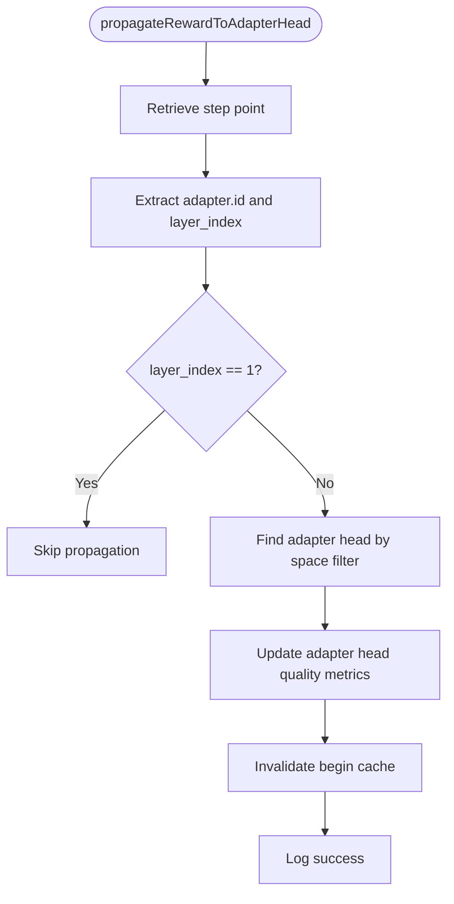

**Diagram sources**
- [reward-propagation.ts:13-73](file://src/services/qdrant/reward-propagation.ts#L13-L73)
- [service.ts:111-114](file://src/services/qdrant/service.ts#L111-L114)

**Section sources**
- [reward-propagation.ts:13-73](file://src/services/qdrant/reward-propagation.ts#L13-L73)
- [service.ts:111-114](file://src/services/qdrant/service.ts#L111-L114)

### LanceDB Equivalent Path
For embedded vector storage, LanceDB mutations provide equivalent reward propagation:
- Resolves completion layer step row.
- Identifies adapter head by adapter id and layer index.
- Updates quality metrics and invalidates cache.

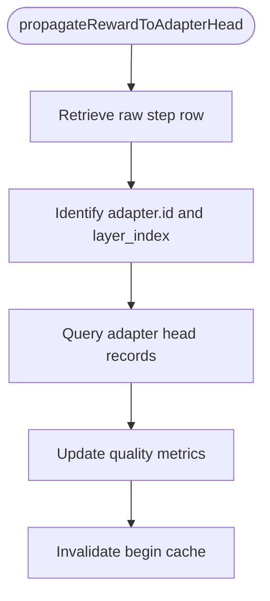

**Diagram sources**
- [lance-records-mutations.ts:164-191](file://src/services/vector-store/lancedb/lance-records-mutations.ts#L164-L191)

**Section sources**
- [lance-records-mutations.ts:164-191](file://src/services/vector-store/lancedb/lance-records-mutations.ts#L164-L191)

### Scoring Algorithms and Step Quality Metadata
Scoring algorithms compute component scores and aggregate quality:
- Specificity, expert value, broad utility, longevity.
- Determine overall quality tier.
- Step-level metadata adjusts scores based on execution success.

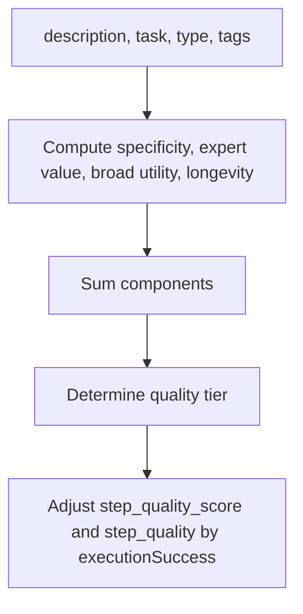

**Diagram sources**
- [scoring.ts:8-37](file://src/services/stats/scoring.ts#L8-L37)
- [scoring.ts:48-69](file://src/services/stats/scoring.ts#L48-L69)
- [scoring.ts:74-106](file://src/services/stats/scoring.ts#L74-L106)

**Section sources**
- [scoring.ts:8-37](file://src/services/stats/scoring.ts#L8-L37)
- [scoring.ts:48-69](file://src/services/stats/scoring.ts#L48-L69)
- [scoring.ts:74-106](file://src/services/stats/scoring.ts#L74-L106)

### Model Stats Service
Model stats orchestrates implementation bonuses and rare success tracking:
- Calculates implementation bonus per model identity and outcome.
- Increments agent metrics and accumulates totals.
- Persists state and recent discoveries.

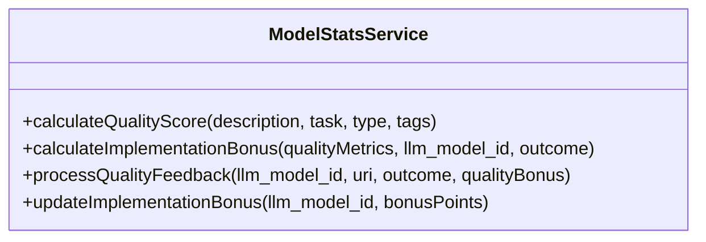

**Diagram sources**
- [model-stats.ts:69-101](file://src/services/stats/model-stats.ts#L69-L101)
- [model-stats.ts:145-191](file://src/services/stats/model-stats.ts#L145-L191)
- [model-stats.ts:291-293](file://src/services/stats/model-stats.ts#L291-L293)

**Section sources**
- [model-stats.ts:69-101](file://src/services/stats/model-stats.ts#L69-L101)
- [model-stats.ts:145-191](file://src/services/stats/model-stats.ts#L145-L191)
- [model-stats.ts:291-293](file://src/services/stats/model-stats.ts#L291-L293)

## Dependency Analysis
The reward system composes multiple modules:

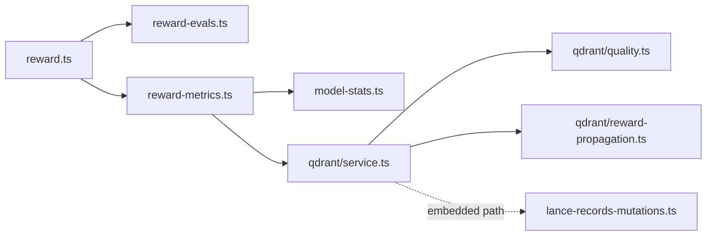

**Diagram sources**
- [reward.ts:27-110](file://src/tools/reward.ts#L27-L110)
- [reward-evals.ts:105-147](file://src/services/reward-evals.ts#L105-L147)
- [reward-metrics.ts:20-119](file://src/services/reward-metrics.ts#L20-L119)
- [model-stats.ts:145-191](file://src/services/stats/model-stats.ts#L145-L191)
- [service.ts:103-114](file://src/services/qdrant/service.ts#L103-L114)
- [quality.ts:25-58](file://src/services/qdrant/quality.ts#L25-L58)
- [reward-propagation.ts:13-73](file://src/services/qdrant/reward-propagation.ts#L13-L73)
- [lance-records-mutations.ts:164-191](file://src/services/vector-store/lancedb/lance-records-mutations.ts#L164-L191)

**Section sources**
- [reward.ts:27-110](file://src/tools/reward.ts#L27-L110)
- [reward-metrics.ts:20-119](file://src/services/reward-metrics.ts#L20-L119)
- [service.ts:103-114](file://src/services/qdrant/service.ts#L103-L114)

## Performance Considerations
- Reward persistence should be idempotent where possible; duplicate calls may increment counters unless deduplicated upstream.
- Cache invalidation after adapter head updates prevents stale activation rankings.
- Attest boost computation depends on run counts; early runs have lower confidence and no boost until thresholds are met.
- Avoid excessive feedback payloads; keep usageContext concise to reduce storage overhead.

[No sources needed since this section provides general guidance]

## Troubleshooting Guide
Common issues and resolutions:
- Reward persistence failures: The tool wraps errors into a specific error type indicating no reward was stored; retry once storage is healthy.
- Missing evaluator identity or rubric version: These block exportable_for_sft and exportable_for_preference; ensure rater or llm_model_id and rubric_version are provided.
- No adapter head found during propagation: Ensure the completion layer references a valid adapter and that the adapter head exists within allowed spaces.
- Low attest boost: Increase successful runs to raise confidence; below minimum runs, boost remains zero.

**Section sources**
- [reward.ts:18-25](file://src/tools/reward.ts#L18-L25)
- [reward-evals.ts:55-93](file://src/services/reward-evals.ts#L55-L93)
- [reward-propagation.ts:13-73](file://src/services/qdrant/reward-propagation.ts#L13-L73)
- [quality.ts:9-16](file://src/services/qdrant/quality.ts#L9-L16)

## Conclusion
The reward and evaluation system integrates human and model feedback with automated quality signals to continuously improve adapter selection. Rewards are evaluated for eligibility, aggregated into quality metrics, propagated to adapter heads, and reflected in activation ranking through attest-based boosts. Statistical confidence ensures robustness by requiring sufficient runs before boosting. This design enables measurable improvement loops for adapters and better semantic search outcomes over time.

[No sources needed since this section summarizes without analyzing specific files]

## Appendices

### Reward Collection Workflows
- Human feedback: Provide rater and rubric_version to enable export eligibility and stronger attribution.
- Agent self-assessment: Use llm_model_id to attribute rewards to specific models and track implementation bonuses.
- Automated signals: Outcome alone contributes basic bonus; combined with implementation bonus and optional quality bonus, it drives metric aggregation.

**Section sources**
- [reward.ts:36-53](file://src/tools/reward.ts#L36-L53)
- [reward-evals.ts:105-147](file://src/services/reward-evals.ts#L105-L147)
- [reward-metrics.ts:46-95](file://src/services/reward-metrics.ts#L46-L95)

### Scoring Calculations and Activation Ranking
- Score normalization and labeling determine eligibility and exportability.
- Implementation bonuses adjust total quality bonus per model identity.
- Attest boost influences activation ranking based on success ratio and confidence.

**Section sources**
- [reward-evals.ts:105-147](file://src/services/reward-evals.ts#L105-L147)
- [model-stats.ts:145-191](file://src/services/stats/model-stats.ts#L145-L191)
- [quality.ts:9-16](file://src/services/qdrant/quality.ts#L9-L16)

### Statistical Significance, Confidence Intervals, and A/B Testing
- Statistical confidence: Attest boost uses run count thresholds to scale confidence; below minimum runs, boost is zero.
- Confidence intervals: Not explicitly implemented in the codebase; consider adding Wilson interval calculations to implementation_stats.model_success_rates for richer uncertainty estimates.
- A/B testing: Compare activation ranking changes before and after reward propagation by measuring choice distributions and success rates across cohorts; use integration tests as templates for controlled experiments.

**Section sources**
- [quality.ts:9-16](file://src/services/qdrant/quality.ts#L9-L16)
- [squadrules-attest-scoring.test.ts:1-39](file://tests/integration/write/squadrules-attest-scoring.test.ts#L1-L39)