# Adapter Training Phase

<cite>
**Referenced Files in This Document**
- [train.ts](file://src/tools/train.ts)
- [train-store.ts](file://src/tools/train-store.ts)
- [store-adapter.ts](file://src/services/memory/store-adapter.ts)
- [store-adapter-default-handler.ts](file://src/services/memory/store-adapter-default-handler.ts)
- [store-adapter-header-handler.ts](file://src/services/memory/store-adapter-header-handler.ts)
- [store-adapter-helpers.ts](file://src/services/memory/store-adapter-helpers.ts)
- [store-methods.ts](file://src/services/memory/store-methods.ts)
- [memory-store-utils.ts](file://src/utils/memory-store-utils.ts)
- [service.ts](file://src/services/embedding/service.ts)
- [providers.ts](file://src/services/embedding/providers.ts)
- [config.ts](file://src/services/embedding/config.ts)
- [cli-train.ts](file://src/cli/commands/cli-train.ts)
</cite>

## Table of Contents
1. [Introduction](#introduction)
2. [Project Structure](#project-structure)
3. [Core Components](#core-components)
4. [Architecture Overview](#architecture-overview)
5. [Detailed Component Analysis](#detailed-component-analysis)
6. [Dependency Analysis](#dependency-analysis)
7. [Performance Considerations](#performance-considerations)
8. [Troubleshooting Guide](#troubleshooting-guide)
9. [Conclusion](#conclusion)

## Introduction
This document explains the adapter training phase that converts markdown adapters into structured memory entries for semantic search. It covers how markdown is normalized, how frontmatter and protocol structure are parsed and validated, how header-based versus default adapters are handled, how embeddings are generated through configured providers (FastEmbed, OpenAI, TEI), and how vectors are stored in Qdrant. It also documents versioning strategies, conflict detection for similar adapters, the force update mechanism, error handling for malformed content, and performance considerations for bulk training operations.

## Project Structure
The training pipeline spans CLI input, MCP tool orchestration, store validation, adapter storage handlers, embedding service, and vector persistence:

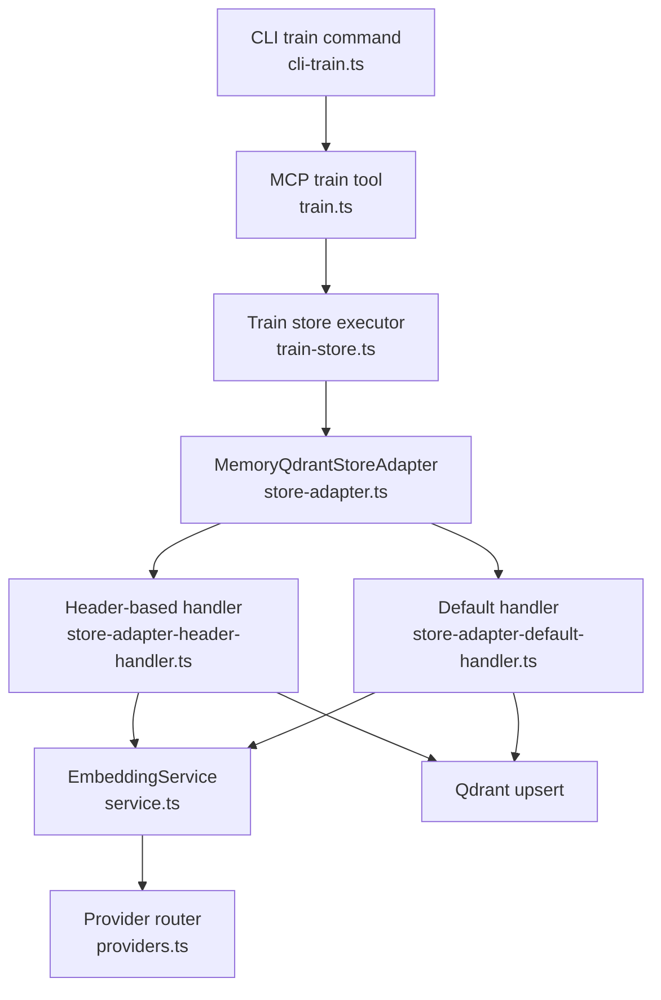

**Diagram sources**
- [cli-train.ts:40-212](file://src/cli/commands/cli-train.ts#L40-L212)
- [train.ts:135-242](file://src/tools/train.ts#L135-L242)
- [train-store.ts:47-131](file://src/tools/train-store.ts#L47-L131)
- [store-adapter.ts:43-148](file://src/services/memory/store-adapter.ts#L43-L148)
- [store-adapter-header-handler.ts:30-203](file://src/services/memory/store-adapter-header-handler.ts#L30-L203)
- [store-adapter-default-handler.ts:34-256](file://src/services/memory/store-adapter-default-handler.ts#L34-L256)
- [service.ts:38-284](file://src/services/embedding/service.ts#L38-L284)
- [providers.ts:283-317](file://src/services/embedding/providers.ts#L283-L317)

**Section sources**
- [cli-train.ts:40-212](file://src/cli/commands/cli-train.ts#L40-L212)
- [train.ts:135-242](file://src/tools/train.ts#L135-L242)
- [train-store.ts:47-131](file://src/tools/train-store.ts#L47-L131)
- [store-adapter.ts:43-148](file://src/services/memory/store-adapter.ts#L43-L148)

## Core Components
- Train tool entrypoint: validates inputs, resolves source adapter fork, determines MIME type, and delegates to the store executor.
- Train store executor: enforces artifact allowlist and size limits, validates markdown size and protocol structure, then calls memory store.
- Memory store adapter: normalizes markdown, parses frontmatter, detects header-based adapters, performs similarity checks, and dispatches to header or default handlers.
- Header-based handler: builds layered memories from H1/H2 sections, generates embeddings, and persists points.
- Default handler: treats each document as a single memory, enhances text with code block metadata, generates embeddings, and persists points.
- Embedding service: selects provider (OpenAI, TEI, FastEmbed), batches requests, validates dimensions, and emits metrics/audit.
- Provider router: implements OpenAI and TEI HTTP clients with retries/backoff and FastEmbed local fallback.
- Store methods: build header memories, perform hybrid search, and map Qdrant points to memory objects.
- Utilities: normalize markdown blobs, parse markdown structure, generate labels/tags.

**Section sources**
- [train.ts:135-242](file://src/tools/train.ts#L135-L242)
- [train-store.ts:47-131](file://src/tools/train-store.ts#L47-L131)
- [store-adapter.ts:43-148](file://src/services/memory/store-adapter.ts#L43-L148)
- [store-adapter-header-handler.ts:30-203](file://src/services/memory/store-adapter-header-handler.ts#L30-L203)
- [store-adapter-default-handler.ts:34-256](file://src/services/memory/store-adapter-default-handler.ts#L34-L256)
- [service.ts:38-284](file://src/services/embedding/service.ts#L38-L284)
- [providers.ts:283-317](file://src/services/embedding/providers.ts#L283-L317)
- [store-methods.ts:266-268](file://src/services/memory/store-methods.ts#L266-L268)
- [memory-store-utils.ts:6-23](file://src/utils/memory-store-utils.ts#L6-L23)

## Architecture Overview
End-to-end flow from CLI to persistent vectors:

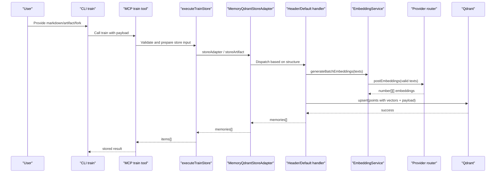

**Diagram sources**
- [cli-train.ts:40-212](file://src/cli/commands/cli-train.ts#L40-L212)
- [train.ts:135-242](file://src/tools/train.ts#L135-L242)
- [train-store.ts:47-131](file://src/tools/train-store.ts#L47-L131)
- [store-adapter.ts:43-148](file://src/services/memory/store-adapter.ts#L43-L148)
- [store-adapter-header-handler.ts:30-203](file://src/services/memory/store-adapter-header-handler.ts#L30-L203)
- [store-adapter-default-handler.ts:34-256](file://src/services/memory/store-adapter-default-handler.ts#L34-L256)
- [service.ts:131-223](file://src/services/embedding/service.ts#L131-L223)
- [providers.ts:283-317](file://src/services/embedding/providers.ts#L283-L317)

## Detailed Component Analysis

### Markdown Normalization and Structure Parsing
- Normalization unwraps JSON-stringified markdown strings and trims whitespace.
- Structure parsing scans lines while ignoring code blocks, extracting H1 and H2 headers to detect header-based adapters.
- Label generation picks the first heading or first non-empty line; tags are derived from label tokens and bullet lists.

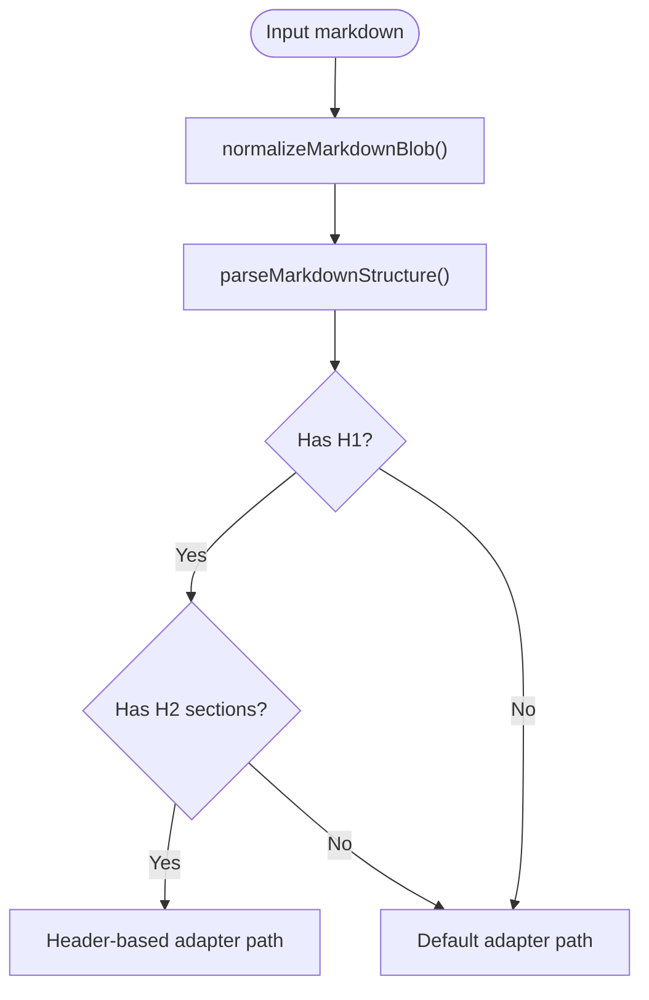

**Diagram sources**
- [memory-store-utils.ts:6-23](file://src/utils/memory-store-utils.ts#L6-L23)
- [memory-store-utils.ts:30-60](file://src/utils/memory-store-utils.ts#L30-L60)
- [memory-store-utils.ts:62-94](file://src/utils/memory-store-utils.ts#L62-L94)

**Section sources**
- [memory-store-utils.ts:6-23](file://src/utils/memory-store-utils.ts#L6-L23)
- [memory-store-utils.ts:30-60](file://src/utils/memory-store-utils.ts#L30-L60)
- [memory-store-utils.ts:62-94](file://src/utils/memory-store-utils.ts#L62-L94)

### Frontmatter Parsing and Protocol Validation
- Frontmatter is parsed to extract version, title, slug, and chain root.
- The store executor validates markdown size and protocol structure before persisting.
- Fork mode strips author-supplied slug to avoid collisions when forking across spaces.

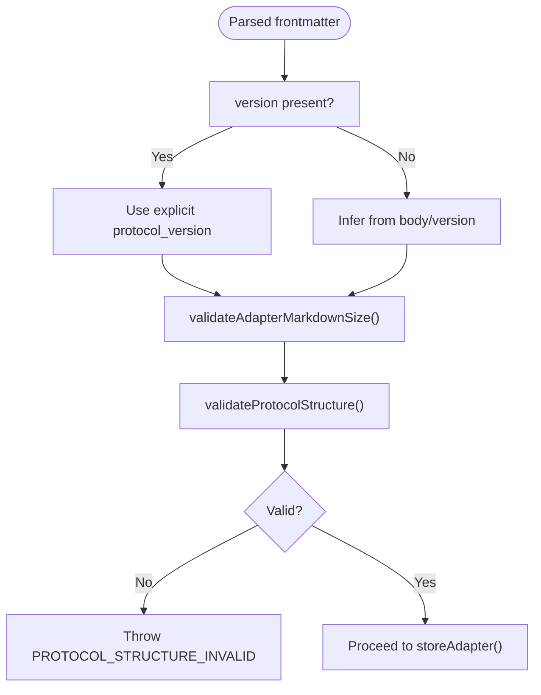

**Diagram sources**
- [store-adapter.ts:62-119](file://src/services/memory/store-adapter.ts#L62-L119)
- [train-store.ts:100-118](file://src/tools/train-store.ts#L100-L118)

**Section sources**
- [store-adapter.ts:62-119](file://src/services/memory/store-adapter.ts#L62-L119)
- [train-store.ts:100-118](file://src/tools/train-store.ts#L100-L118)

### Adapter Routing: Header-Based vs Default
- If a single document has H1 and H2 sections, it is treated as a header-based adapter with multiple layers.
- Otherwise, each document becomes a single memory under a default adapter.
- Similarity check runs before both paths to prevent accidental duplicates by title.

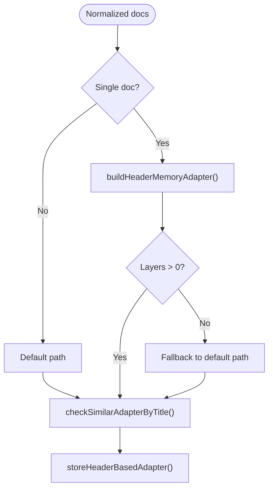

**Diagram sources**
- [store-adapter.ts:43-148](file://src/services/memory/store-adapter.ts#L43-L148)
- [store-methods.ts:266-268](file://src/services/memory/store-methods.ts#L266-L268)
- [store-adapter-helpers.ts:112-172](file://src/services/memory/store-adapter-helpers.ts#L112-L172)

**Section sources**
- [store-adapter.ts:43-148](file://src/services/memory/store-adapter.ts#L43-L148)
- [store-methods.ts:266-268](file://src/services/memory/store-methods.ts#L266-L268)

### Code Block Processing and Enhanced Search Text
- The default handler processes markdown to extract code identifiers and enhances searchable text with code context.
- Tags include base tags plus top code identifiers to improve BM25 and dense retrieval.

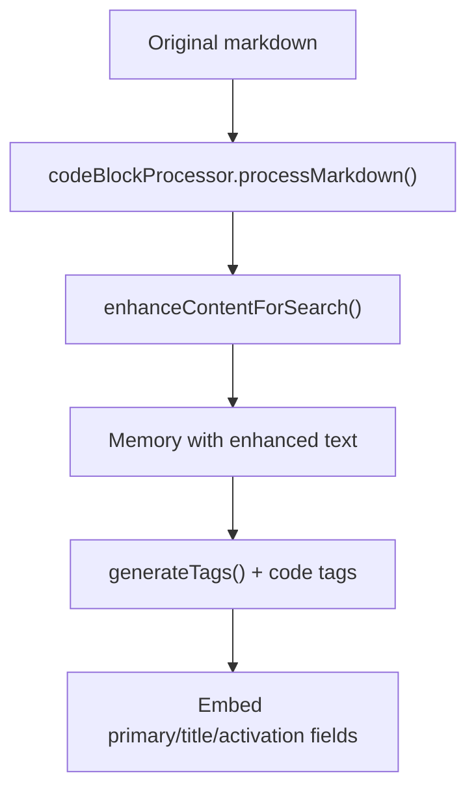

**Diagram sources**
- [store-adapter-default-handler.ts:50-54](file://src/services/memory/store-adapter-default-handler.ts#L50-L54)
- [store-adapter-default-handler.ts:83-106](file://src/services/memory/store-adapter-default-handler.ts#L83-L106)

**Section sources**
- [store-adapter-default-handler.ts:50-54](file://src/services/memory/store-adapter-default-handler.ts#L50-L54)
- [store-adapter-default-handler.ts:83-106](file://src/services/memory/store-adapter-default-handler.ts#L83-L106)

### Embedding Generation and Provider Selection
- EmbeddingService selects provider via environment configuration: OpenAI, TEI, or FastEmbed.
- Batch embeddings are requested for primary, title, and activation pattern fields.
- Dimension validation ensures consistency; anomalies are audited and errors are surfaced.

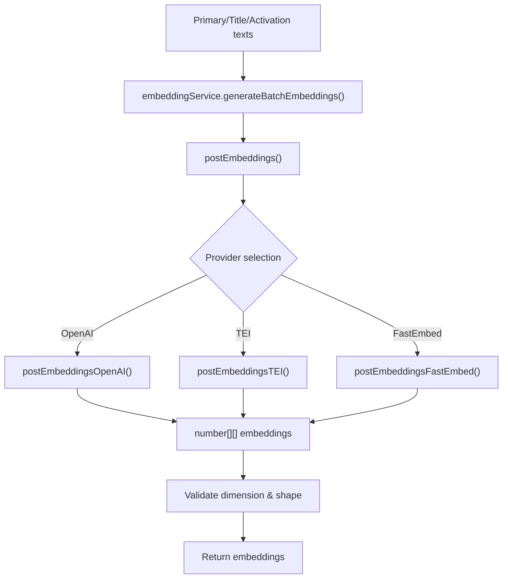

**Diagram sources**
- [service.ts:131-223](file://src/services/embedding/service.ts#L131-L223)
- [providers.ts:283-317](file://src/services/embedding/providers.ts#L283-L317)
- [config.ts:16-36](file://src/services/embedding/config.ts#L16-L36)

**Section sources**
- [service.ts:38-284](file://src/services/embedding/service.ts#L38-L284)
- [providers.ts:283-317](file://src/services/embedding/providers.ts#L283-L317)
- [config.ts:16-36](file://src/services/embedding/config.ts#L16-L36)

### Vector Storage in Qdrant
- Both header and default handlers construct Qdrant points with dense vectors (primary, title, activation pattern) and sparse BM25 indices.
- Payload includes space, label, tags, text, model attribution, timestamps, adapter metadata, task/type classification, quality metadata, and slug.
- Upsert retries without BM25 if the collection lacks sparse configuration.

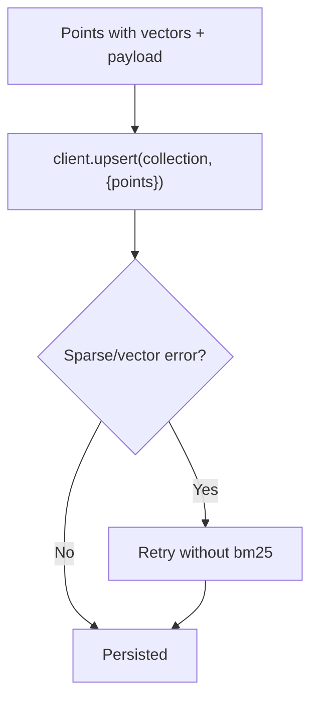

**Diagram sources**
- [store-adapter-header-handler.ts:96-182](file://src/services/memory/store-adapter-header-handler.ts#L96-L182)
- [store-adapter-default-handler.ts:147-232](file://src/services/memory/store-adapter-default-handler.ts#L147-L232)

**Section sources**
- [store-adapter-header-handler.ts:96-182](file://src/services/memory/store-adapter-header-handler.ts#L96-L182)
- [store-adapter-default-handler.ts:147-232](file://src/services/memory/store-adapter-default-handler.ts#L147-L232)

### Versioning Strategies During Training
- Explicit `protocol_version` from frontmatter or input overrides inferred version.
- For header-based adapters, version is propagated to all layer memories.
- Fork mode allocates a new adapter UUID and removes author-supplied slug to avoid cross-space collisions.

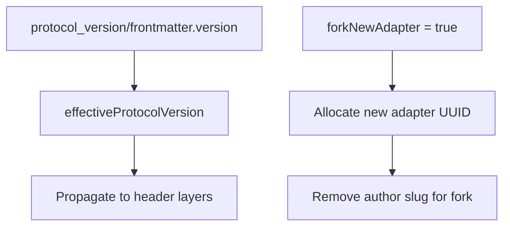

**Diagram sources**
- [store-adapter.ts:62-119](file://src/services/memory/store-adapter.ts#L62-L119)
- [train-store.ts:19-29](file://src/tools/train-store.ts#L19-L29)

**Section sources**
- [store-adapter.ts:62-119](file://src/services/memory/store-adapter.ts#L62-L119)
- [train-store.ts:19-29](file://src/tools/train-store.ts#L19-L29)

### Conflict Detection and Force Update Mechanism
- Pre-train similarity search compares adapter titles against existing memories using hybrid search.
- If similarity exceeds threshold, a detailed error is returned with next actions and content preview.
- With `force_update: true`, duplicate adapter UUIDs are deleted before insertion; protected spaces raise explicit errors.

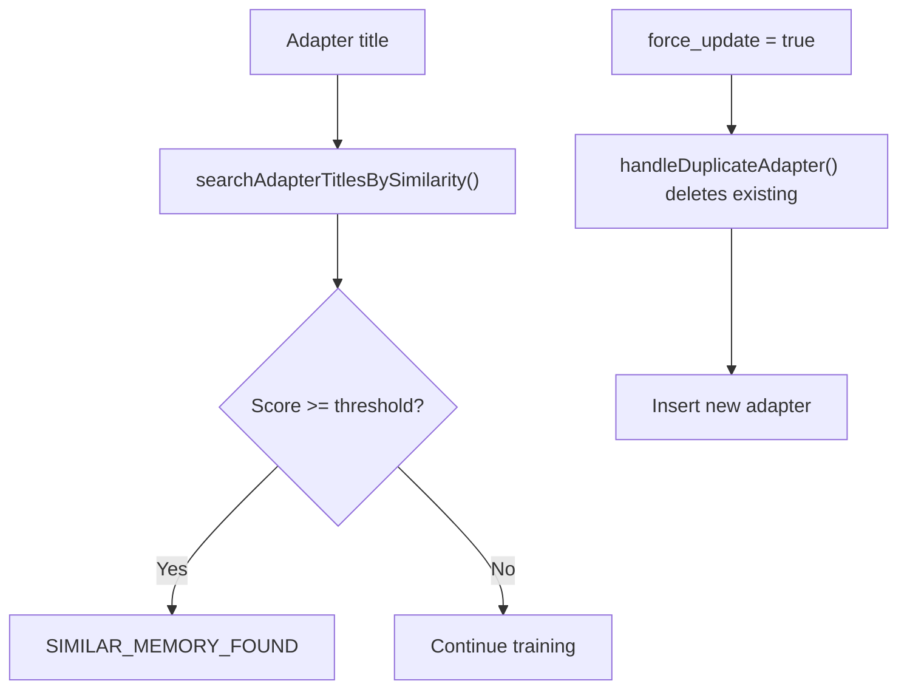

**Diagram sources**
- [store-adapter-helpers.ts:112-172](file://src/services/memory/store-adapter-helpers.ts#L112-L172)
- [store-adapter-helpers.ts:52-93](file://src/services/memory/store-adapter-helpers.ts#L52-L93)

**Section sources**
- [store-adapter-helpers.ts:112-172](file://src/services/memory/store-adapter-helpers.ts#L112-L172)
- [store-adapter-helpers.ts:52-93](file://src/services/memory/store-adapter-helpers.ts#L52-L93)

### Examples of Training Different Adapter Types
- Header-based training: A single markdown file with H1 and multiple H2 sections is split into layered memories under one adapter.
- Default training: Each markdown document becomes a single memory; multiple documents create multiple memories under a default adapter.
- Artifact training: Non-markdown files are attached to an adapter URI with allowed MIME types and size validation.

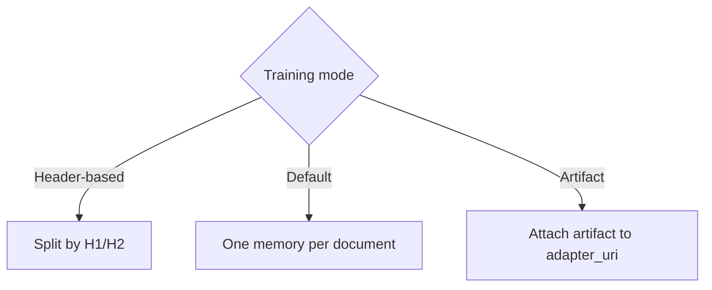

**Diagram sources**
- [store-adapter.ts:62-148](file://src/services/memory/store-adapter.ts#L62-L148)
- [train-store.ts:64-98](file://src/tools/train-store.ts#L64-L98)

**Section sources**
- [store-adapter.ts:62-148](file://src/services/memory/store-adapter.ts#L62-L148)
- [train-store.ts:64-98](file://src/tools/train-store.ts#L64-L98)

### Error Handling for Malformed Content
- Missing content or empty source export raises explicit errors.
- Unsupported MIME types or oversized artifacts are rejected early.
- Invalid protocol structure returns actionable guidance to open guided creation.
- Duplicate adapter and similar adapter errors include details and next actions.

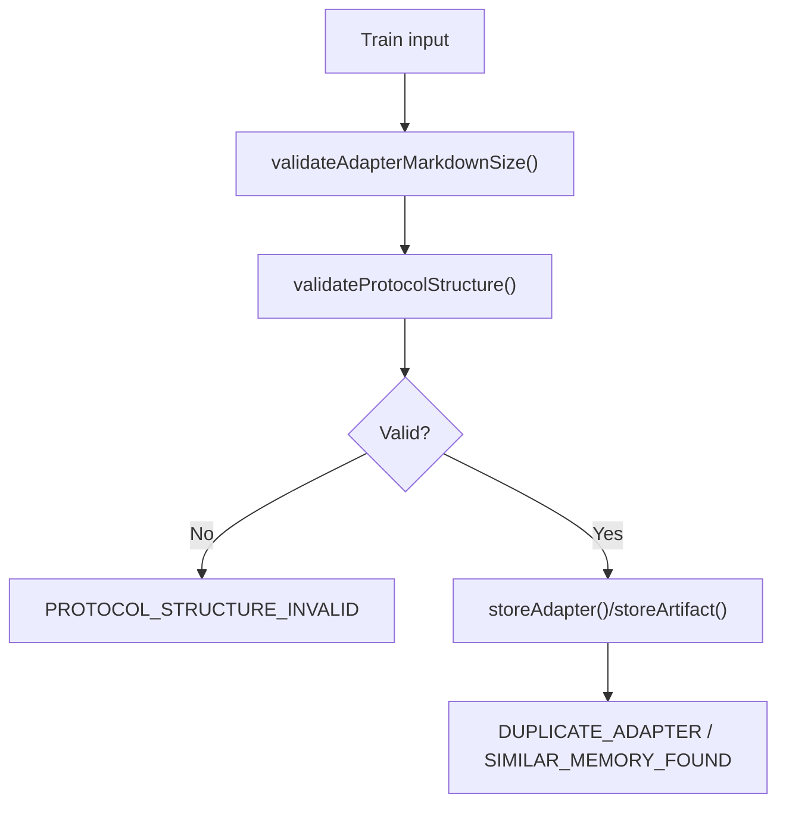

**Diagram sources**
- [train.ts:86-146](file://src/tools/train.ts#L86-L146)
- [train-store.ts:64-118](file://src/tools/train-store.ts#L64-L118)

**Section sources**
- [train.ts:86-146](file://src/tools/train.ts#L86-L146)
- [train-store.ts:64-118](file://src/tools/train-store.ts#L64-L118)

## Dependency Analysis
Key dependencies among components during training:

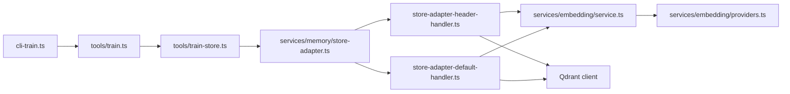

**Diagram sources**
- [cli-train.ts:40-212](file://src/cli/commands/cli-train.ts#L40-L212)
- [train.ts:135-242](file://src/tools/train.ts#L135-L242)
- [train-store.ts:47-131](file://src/tools/train-store.ts#L47-L131)
- [store-adapter.ts:43-148](file://src/services/memory/store-adapter.ts#L43-L148)
- [store-adapter-header-handler.ts:30-203](file://src/services/memory/store-adapter-header-handler.ts#L30-L203)
- [store-adapter-default-handler.ts:34-256](file://src/services/memory/store-adapter-default-handler.ts#L34-L256)
- [service.ts:38-284](file://src/services/embedding/service.ts#L38-L284)
- [providers.ts:283-317](file://src/services/embedding/providers.ts#L283-L317)

**Section sources**
- [cli-train.ts:40-212](file://src/cli/commands/cli-train.ts#L40-L212)
- [train.ts:135-242](file://src/tools/train.ts#L135-L242)
- [train-store.ts:47-131](file://src/tools/train-store.ts#L47-L131)
- [store-adapter.ts:43-148](file://src/services/memory/store-adapter.ts#L43-L148)

## Performance Considerations
- Batch embeddings: All primary, title, and activation pattern texts are embedded together to reduce overhead.
- Dimension validation: Embedding results are validated for count and dimension to fail fast on provider misconfiguration.
- Sparse vector fallback: Upsert retries without BM25 if the collection lacks sparse configuration, avoiding repeated failures.
- Metrics and audit: Embedding requests, durations, errors, batch sizes, and vector sizes are tracked; provider calls are audited.
- Cache invalidation: Redis cache is invalidated after updates to ensure consistent reads.
- Bulk CLI training: Directory-based training uses compact summaries and optional JSON manifests to minimize stdout overhead.

[No sources needed since this section provides general guidance]

## Troubleshooting Guide
- Missing content: Ensure either `content` or `source_adapter_uri` is provided; forking requires a valid Qdrant-backed adapter slug.
- Source adapter not found: Verify the slug exists and the head layer can be dumped.
- Unsupported MIME: Use an allowed artifact MIME type or pass a supported markdown file.
- Oversized artifacts/markdown: Reduce content size to meet limits.
- Invalid protocol structure: Follow the suggested next action to open guided creation or fix missing required fields.
- Duplicate adapter: Choose a distinct adapter title or use `force_update: true` with the same adapter id to replace.
- Similar adapter detected: Inspect the similar adapter via export and either rename or force update with matching adapter id.
- Protected space write: Force updates cannot overwrite protected spaces; adjust permissions or choose a different target.

**Section sources**
- [train.ts:86-146](file://src/tools/train.ts#L86-L146)
- [train-store.ts:64-118](file://src/tools/train-store.ts#L64-L118)
- [store-adapter-helpers.ts:52-93](file://src/services/memory/store-adapter-helpers.ts#L52-L93)
- [store-adapter-helpers.ts:112-172](file://src/services/memory/store-adapter-helpers.ts#L112-L172)

## Conclusion
The adapter training phase transforms markdown into structured, searchable memories by normalizing content, parsing frontmatter, validating structure, routing to header-based or default handlers, generating multi-field embeddings via configurable providers, and persisting vectors in Qdrant. Robust conflict detection, versioning, and force update mechanisms ensure safe evolution of adapters. Proper error handling and performance optimizations support reliable bulk training workflows.