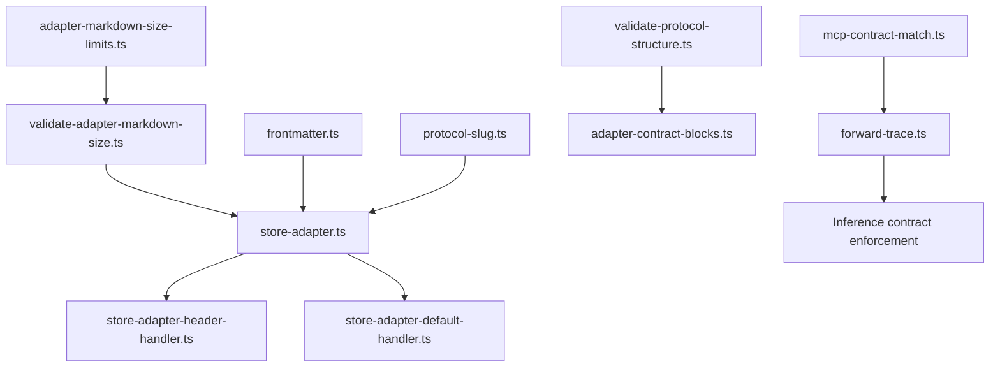
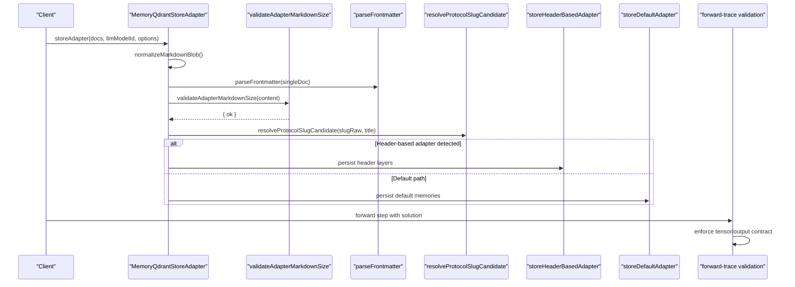
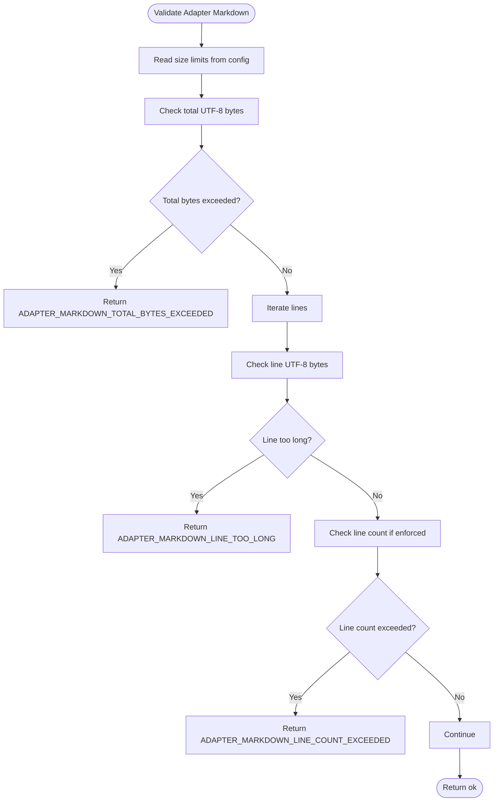
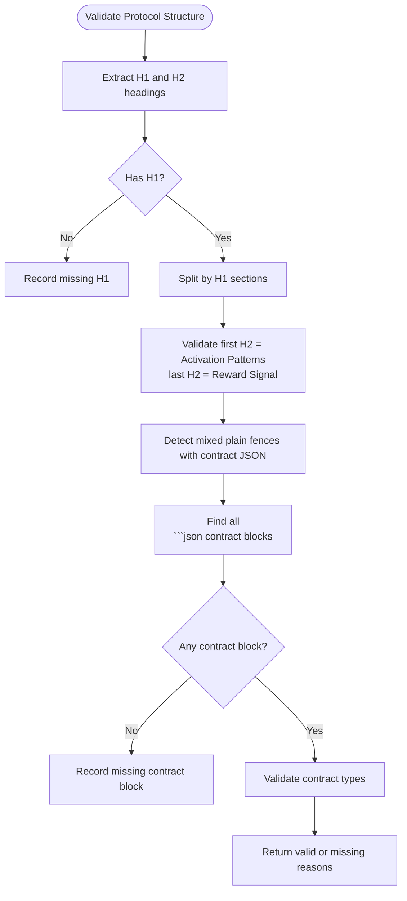
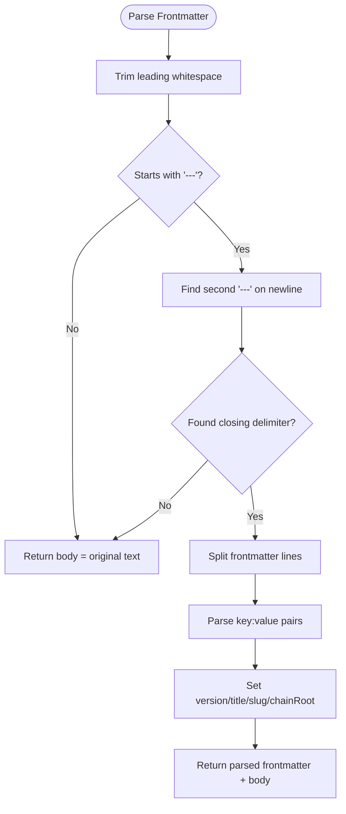
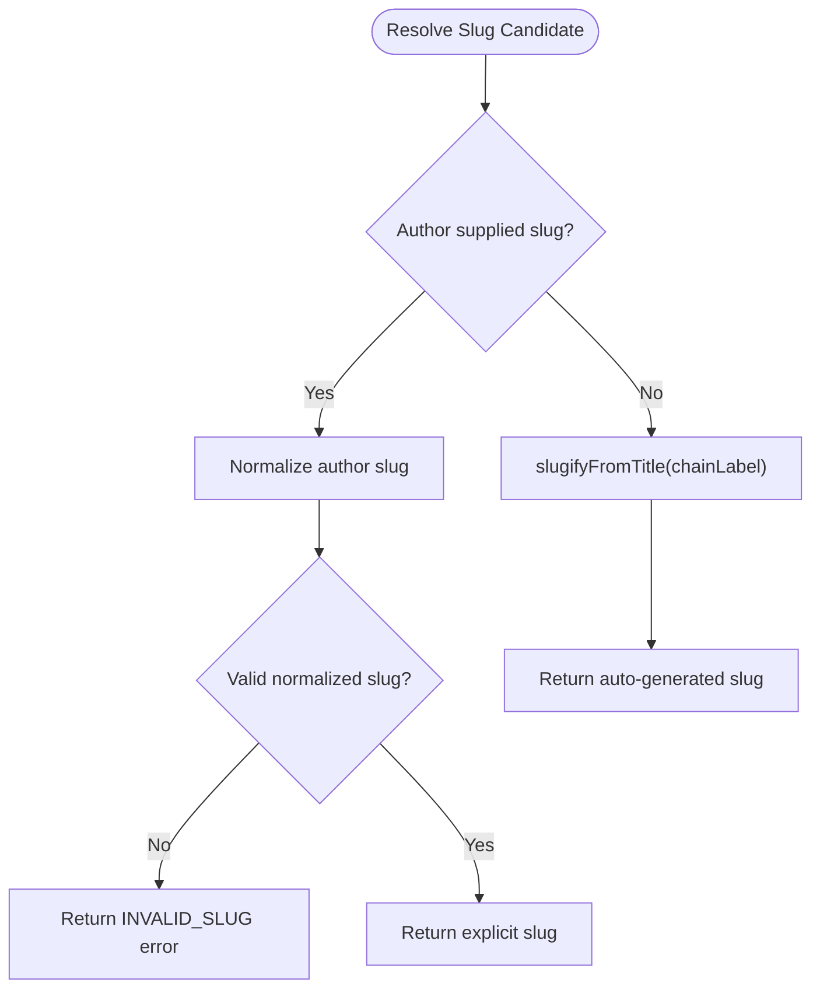
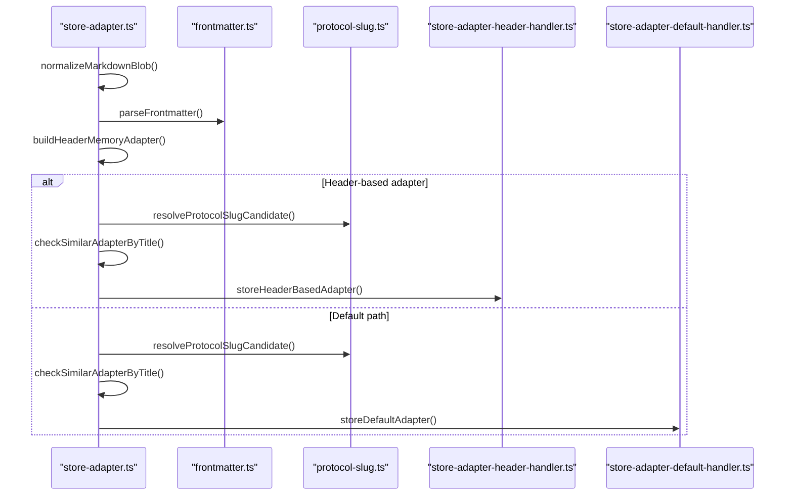
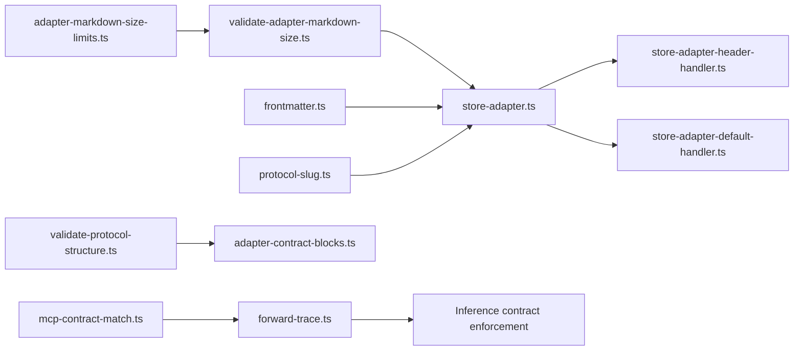

# Adapter Validation and Schema

<cite>
**Referenced Files in This Document**
- [validate-adapter-markdown-size.ts](file://src/services/memory/validate-adapter-markdown-size.ts)
- [adapter-markdown-size-limits.ts](file://src/config/adapter-markdown-size-limits.ts)
- [validate-protocol-structure.ts](file://src/services/memory/validate-protocol-structure.ts)
- [adapter-contract-blocks.ts](file://src/services/memory/adapter-contract-blocks.ts)
- [frontmatter.ts](file://src/utils/frontmatter.ts)
- [protocol-slug.ts](file://src/utils/protocol-slug.ts)
- [store-adapter.ts](file://src/services/memory/store-adapter.ts)
- [store-adapter-header-handler.ts](file://src/services/memory/store-adapter-header-handler.ts)
- [store-adapter-default-handler.ts](file://src/services/memory/store-adapter-default-handler.ts)
- [forward-trace.ts](file://src/tools/forward-trace.ts)
- [mcp-contract-match.ts](file://src/tools/mcp-contract-match.ts)
</cite>

## Table of Contents
1. [Introduction](#introduction)
2. [Project Structure](#project-structure)
3. [Core Components](#core-components)
4. [Architecture Overview](#architecture-overview)
5. [Detailed Component Analysis](#detailed-component-analysis)
6. [Dependency Analysis](#dependency-analysis)
7. [Performance Considerations](#performance-considerations)
8. [Troubleshooting Guide](#troubleshooting-guide)
9. [Conclusion](#conclusion)

## Introduction
This document explains how adapters are validated and enforced before storage and runtime execution. It covers:
- Protocol structure validation for adapter syntax, layer ordering, and contract definitions.
- Markdown size limits and content validation rules that prevent oversized or malformed adapters.
- Frontmatter parsing and validation for metadata extraction, slug generation, tag handling, and protocol versioning.
- Schema enforcement for inference contracts, including required fields and type checks.
- Error handling strategies, validation failure recovery, and best practices for writing valid adapters.
- Performance considerations for large-scale validation operations.

The system is designed around an agent-first workflow where deterministic, auditable adapters drive activation, forwarding, and reward steps. Adapters may be stored as header-based multi-layer documents or default single-document memories, with consistent validation across both paths.

## Project Structure
Adapter validation spans configuration, parsing, structural checks, and storage handlers:
- Configuration defines environment-driven size limits.
- Size validators enforce byte, line, and line-length ceilings.
- Protocol structure validators ensure required sections and contract blocks.
- Contract block parsers extract inference contracts from fenced JSON.
- Frontmatter parser extracts metadata such as version, title, slug, and chain root.
- Slug utilities normalize and validate routing slugs.
- Store adapters orchestrate normalization, frontmatter parsing, slug resolution, similarity checks, and persistence.
- Runtime trace validation enforces concrete inference contract outputs.



**Diagram sources**
- [adapter-markdown-size-limits.ts:1-44](file://src/config/adapter-markdown-size-limits.ts#L1-L44)
- [validate-adapter-markdown-size.ts:1-125](file://src/services/memory/validate-adapter-markdown-size.ts#L1-L125)
- [frontmatter.ts:1-55](file://src/utils/frontmatter.ts#L1-L55)
- [protocol-slug.ts:1-91](file://src/utils/protocol-slug.ts#L1-L91)
- [store-adapter.ts:1-154](file://src/services/memory/store-adapter.ts#L1-L154)
- [store-adapter-header-handler.ts:1-203](file://src/services/memory/store-adapter-header-handler.ts#L1-L203)
- [store-adapter-default-handler.ts:1-256](file://src/services/memory/store-adapter-default-handler.ts#L1-L256)
- [validate-protocol-structure.ts:1-187](file://src/services/memory/validate-protocol-structure.ts#L1-L187)
- [adapter-contract-blocks.ts:1-117](file://src/services/memory/adapter-contract-blocks.ts#L1-L117)
- [forward-trace.ts:176-196](file://src/tools/forward-trace.ts#L176-L196)
- [mcp-contract-match.ts:35-86](file://src/tools/mcp-contract-match.ts#L35-L86)

**Section sources**
- [adapter-markdown-size-limits.ts:1-44](file://src/config/adapter-markdown-size-limits.ts#L1-L44)
- [validate-adapter-markdown-size.ts:1-125](file://src/services/memory/validate-adapter-markdown-size.ts#L1-L125)
- [frontmatter.ts:1-55](file://src/utils/frontmatter.ts#L1-L55)
- [protocol-slug.ts:1-91](file://src/utils/protocol-slug.ts#L1-L91)
- [store-adapter.ts:1-154](file://src/services/memory/store-adapter.ts#L1-L154)
- [store-adapter-header-handler.ts:1-203](file://src/services/memory/store-adapter-header-handler.ts#L1-L203)
- [store-adapter-default-handler.ts:1-256](file://src/services/memory/store-adapter-default-handler.ts#L1-L256)
- [validate-protocol-structure.ts:1-187](file://src/services/memory/validate-protocol-structure.ts#L1-L187)
- [adapter-contract-blocks.ts:1-117](file://src/services/memory/adapter-contract-blocks.ts#L1-L117)
- [forward-trace.ts:176-196](file://src/tools/forward-trace.ts#L176-L196)
- [mcp-contract-match.ts:35-86](file://src/tools/mcp-contract-match.ts#L35-L86)

## Core Components
- Markdown size limits: Environment-driven configuration provides maximum lines, maximum line bytes, safety factor, and derived total UTF-8 byte ceiling.
- Size validator: Single-pass validation rejecting oversized documents, excessively long lines, and excessive line counts; also validates artifact content sizes.
- Protocol structure validator: Ensures H1 title presence, Activation Patterns as first H2, Reward Signal as last H2, at least one ```json contract block, no mixed plain fences with contract JSON, and allowed contract types.
- Contract block parser: Extracts all ```json blocks containing a contract object, detects trailing contract blocks, and rejects mixed-fence documents.
- Frontmatter parser: Parses YAML-like frontmatter to extract version, title, slug, and chain root, returning the body text.
- Slug utilities: Normalize author-supplied slugs, derive slugs from titles, resolve candidates, and generate auto-incremented suffixes on collision.
- Store adapter: Orchestrates normalization, frontmatter parsing, header vs default path selection, slug resolution, similarity checks, and persistence.
- Runtime trace validation: Enforces tensor output name, type, length bounds, and item count bounds against inference contracts.
- MCP contract matcher: Validates MCP tool names and argument subsets against proof contracts.

**Section sources**
- [adapter-markdown-size-limits.ts:1-44](file://src/config/adapter-markdown-size-limits.ts#L1-L44)
- [validate-adapter-markdown-size.ts:1-125](file://src/services/memory/validate-adapter-markdown-size.ts#L1-L125)
- [validate-protocol-structure.ts:1-187](file://src/services/memory/validate-protocol-structure.ts#L1-L187)
- [adapter-contract-blocks.ts:1-117](file://src/services/memory/adapter-contract-blocks.ts#L1-L117)
- [frontmatter.ts:1-55](file://src/utils/frontmatter.ts#L1-L55)
- [protocol-slug.ts:1-91](file://src/utils/protocol-slug.ts#L1-L91)
- [store-adapter.ts:1-154](file://src/services/memory/store-adapter.ts#L1-L154)
- [forward-trace.ts:176-196](file://src/tools/forward-trace.ts#L176-L196)
- [mcp-contract-match.ts:35-86](file://src/tools/mcp-contract-match.ts#L35-L86)

## Architecture Overview
The adapter validation pipeline integrates multiple stages:
- Input normalization and frontmatter parsing.
- Size validation using environment-driven limits.
- Protocol structure validation ensuring required sections and contract blocks.
- Contract extraction and type checking.
- Slug resolution and uniqueness allocation.
- Storage via header-based or default handlers with embedding generation and Qdrant persistence.
- Runtime enforcement of inference contracts during forward traces.



**Diagram sources**
- [store-adapter.ts:43-147](file://src/services/memory/store-adapter.ts#L43-L147)
- [validate-adapter-markdown-size.ts:31-106](file://src/services/memory/validate-adapter-markdown-size.ts#L31-L106)
- [frontmatter.ts:23-54](file://src/utils/frontmatter.ts#L23-L54)
- [protocol-slug.ts:58-74](file://src/utils/protocol-slug.ts#L58-L74)
- [store-adapter-header-handler.ts:30-201](file://src/services/memory/store-adapter-header-handler.ts#L30-L201)
- [store-adapter-default-handler.ts:34-254](file://src/services/memory/store-adapter-default-handler.ts#L34-L254)
- [forward-trace.ts:176-196](file://src/tools/forward-trace.ts#L176-L196)

## Detailed Component Analysis

### Markdown Size Limits and Content Validation
- Configuration reads environment variables for max lines, max line bytes, and safety factor, computing a total UTF-8 byte ceiling.
- The size validator performs a cheap total-byte check followed by a single pass over content to detect:
  - Total bytes exceeding the ceiling.
  - Individual lines exceeding the maximum line byte limit.
  - Excessive line counts (configurable enforcement).
- Artifact content validation applies the same total-byte ceiling without line counting.



**Diagram sources**
- [adapter-markdown-size-limits.ts:32-43](file://src/config/adapter-markdown-size-limits.ts#L32-L43)
- [validate-adapter-markdown-size.ts:31-106](file://src/services/memory/validate-adapter-markdown-size.ts#L31-L106)

**Section sources**
- [adapter-markdown-size-limits.ts:1-44](file://src/config/adapter-markdown-size-limits.ts#L1-L44)
- [validate-adapter-markdown-size.ts:1-125](file://src/services/memory/validate-adapter-markdown-size.ts#L1-L125)

### Protocol Structure Validation
- Ensures presence of an H1 title.
- Requires the first H2 section to be Activation Patterns and the last H2 to be Reward Signal.
- Requires at least one ```json contract block and rejects mixed-fence documents where plain ``` blocks contain contract JSON.
- Validates each contract’s type against an allowed set: shell, mcp, user_input, comment, tensor.



**Diagram sources**
- [validate-protocol-structure.ts:29-104](file://src/services/memory/validate-protocol-structure.ts#L29-L104)
- [validate-protocol-structure.ts:113-186](file://src/services/memory/validate-protocol-structure.ts#L113-L186)
- [adapter-contract-blocks.ts:51-89](file://src/services/memory/adapter-contract-blocks.ts#L51-L89)

**Section sources**
- [validate-protocol-structure.ts:1-187](file://src/services/memory/validate-protocol-structure.ts#L1-L187)
- [adapter-contract-blocks.ts:1-117](file://src/services/memory/adapter-contract-blocks.ts#L1-L117)

### Frontmatter Parsing and Metadata Extraction
- Parses YAML-like frontmatter delimited by --- markers.
- Extracts version, title, slug (raw), and chain_root/chainroot values.
- Returns the body text after closing delimiter; if no closing delimiter is found, returns original text as body.



**Diagram sources**
- [frontmatter.ts:23-54](file://src/utils/frontmatter.ts#L23-L54)

**Section sources**
- [frontmatter.ts:1-55](file://src/utils/frontmatter.ts#L1-L55)

### Slug Generation and Validation
- Normalizes author-supplied slugs to lowercase alphanumeric segments separated by single hyphens, capped at a maximum length.
- Derives slugs from H1-style titles by normalizing Unicode, replacing non-alphanumeric characters with hyphens, and trimming edges.
- Resolves final slug candidate, throwing an error when explicit slug is invalid.
- Generates auto-incremented suffixes (-2, -3, ...) for collisions while respecting maximum length.



**Diagram sources**
- [protocol-slug.ts:26-46](file://src/utils/protocol-slug.ts#L26-L46)
- [protocol-slug.ts:58-74](file://src/utils/protocol-slug.ts#L58-L74)
- [protocol-slug.ts:80-88](file://src/utils/protocol-slug.ts#L80-L88)

**Section sources**
- [protocol-slug.ts:1-91](file://src/utils/protocol-slug.ts#L1-L91)

### Store Adapter Orchestration
- Normalizes input documents and parses frontmatter for single-doc cases.
- Determines effective protocol version from options or frontmatter.
- Builds header-based memories when applicable; otherwise falls back to default path.
- Resolves slug candidate and checks for similar adapters by title.
- Persists via header handler or default handler, updating metrics and cache.



**Diagram sources**
- [store-adapter.ts:43-147](file://src/services/memory/store-adapter.ts#L43-L147)
- [frontmatter.ts:23-54](file://src/utils/frontmatter.ts#L23-L54)
- [protocol-slug.ts:58-74](file://src/utils/protocol-slug.ts#L58-L74)
- [store-adapter-header-handler.ts:30-201](file://src/services/memory/store-adapter-header-handler.ts#L30-L201)
- [store-adapter-default-handler.ts:34-254](file://src/services/memory/store-adapter-default-handler.ts#L34-L254)

**Section sources**
- [store-adapter.ts:1-154](file://src/services/memory/store-adapter.ts#L1-L154)
- [store-adapter-header-handler.ts:1-203](file://src/services/memory/store-adapter-header-handler.ts#L1-L203)
- [store-adapter-default-handler.ts:1-256](file://src/services/memory/store-adapter-default-handler.ts#L1-L256)

### Inference Contract Enforcement
- Contract block parser extracts ```json blocks containing a contract object, normalizing required field defaults.
- Runtime trace validation enforces tensor output name, type constraints (string or string array), min/max length, and min/max items for arrays.
- MCP contract matcher validates tool_name equality and argument subset matching, returning structured validation results.

```mermaid
classDiagram
class ContractBlockParser {
+findAllLayerContractBlocks(content) LayerContractBlockMatch[]
+hasPlainFenceLayerContractBlock(content) boolean
+extractInferenceContract(content) { cleaned, contract }
}
class RuntimeTraceValidation {
+enforceTensorOutput(contract, tensor) void
}
class McpContractMatcher {
+validateMcpSubmissionAgainstContract(proof, mcp) McpContractValidation
}
ContractBlockParser --> RuntimeTraceValidation : "provides contract"
McpContractMatcher --> RuntimeTraceValidation : "validates MCP submission"
```

**Diagram sources**
- [adapter-contract-blocks.ts:21-45](file://src/services/memory/adapter-contract-blocks.ts#L21-L45)
- [adapter-contract-blocks.ts:51-117](file://src/services/memory/adapter-contract-blocks.ts#L51-L117)
- [forward-trace.ts:176-196](file://src/tools/forward-trace.ts#L176-L196)
- [mcp-contract-match.ts:35-86](file://src/tools/mcp-contract-match.ts#L35-L86)

**Section sources**
- [adapter-contract-blocks.ts:1-117](file://src/services/memory/adapter-contract-blocks.ts#L1-L117)
- [forward-trace.ts:176-196](file://src/tools/forward-trace.ts#L176-L196)
- [mcp-contract-match.ts:35-86](file://src/tools/mcp-contract-match.ts#L35-L86)

## Dependency Analysis
Key dependencies and relationships:
- Size validation depends on environment-driven limits.
- Protocol structure validation depends on contract block detection.
- Store adapter depends on frontmatter parsing, slug resolution, and similarity checks.
- Header and default handlers depend on embedding services, BM25 tokenization, and Qdrant persistence.
- Runtime trace validation depends on inference contracts extracted from adapters.
- MCP contract matcher depends on proof structures and argument objects.



**Diagram sources**
- [adapter-markdown-size-limits.ts:1-44](file://src/config/adapter-markdown-size-limits.ts#L1-L44)
- [validate-adapter-markdown-size.ts:1-125](file://src/services/memory/validate-adapter-markdown-size.ts#L1-L125)
- [frontmatter.ts:1-55](file://src/utils/frontmatter.ts#L1-L55)
- [protocol-slug.ts:1-91](file://src/utils/protocol-slug.ts#L1-L91)
- [validate-protocol-structure.ts:1-187](file://src/services/memory/validate-protocol-structure.ts#L1-L187)
- [adapter-contract-blocks.ts:1-117](file://src/services/memory/adapter-contract-blocks.ts#L1-L117)
- [store-adapter.ts:1-154](file://src/services/memory/store-adapter.ts#L1-L154)
- [store-adapter-header-handler.ts:1-203](file://src/services/memory/store-adapter-header-handler.ts#L1-L203)
- [store-adapter-default-handler.ts:1-256](file://src/services/memory/store-adapter-default-handler.ts#L1-L256)
- [forward-trace.ts:176-196](file://src/tools/forward-trace.ts#L176-L196)
- [mcp-contract-match.ts:35-86](file://src/tools/mcp-contract-match.ts#L35-L86)

**Section sources**
- [adapter-markdown-size-limits.ts:1-44](file://src/config/adapter-markdown-size-limits.ts#L1-L44)
- [validate-adapter-markdown-size.ts:1-125](file://src/services/memory/validate-adapter-markdown-size.ts#L1-L125)
- [frontmatter.ts:1-55](file://src/utils/frontmatter.ts#L1-L55)
- [protocol-slug.ts:1-91](file://src/utils/protocol-slug.ts#L1-L91)
- [validate-protocol-structure.ts:1-187](file://src/services/memory/validate-protocol-structure.ts#L1-L187)
- [adapter-contract-blocks.ts:1-117](file://src/services/memory/adapter-contract-blocks.ts#L1-L117)
- [store-adapter.ts:1-154](file://src/services/memory/store-adapter.ts#L1-L154)
- [store-adapter-header-handler.ts:1-203](file://src/services/memory/store-adapter-header-handler.ts#L1-L203)
- [store-adapter-default-handler.ts:1-256](file://src/services/memory/store-adapter-default-handler.ts#L1-L256)
- [forward-trace.ts:176-196](file://src/tools/forward-trace.ts#L176-L196)
- [mcp-contract-match.ts:35-86](file://src/tools/mcp-contract-match.ts#L35-L86)

## Performance Considerations
- Size validation uses a single-pass algorithm over content after a cheap total-byte check, minimizing memory allocations and avoiding repeated scans.
- Environment-driven limits allow dynamic tuning without restarts, enabling safe scaling for large datasets.
- Embedding generation batches multiple vectors per adapter layer, reducing API calls and improving throughput.
- Fallback to zero vectors occurs when embedding service responses have shape mismatches, preventing failures but potentially degrading search quality; this should be monitored.
- Qdrant upsert retries without sparse BM25 vectors when collections lack sparse configuration, improving resilience at the cost of reduced hybrid search capability.
- Metrics and telemetry track adapter size distribution and quality scores, aiding capacity planning and performance monitoring.

[No sources needed since this section provides general guidance]

## Troubleshooting Guide
Common validation failures and recovery strategies:
- ADAPTER_MARKDOWN_TOTAL_BYTES_EXCEEDED: Reduce document size or adjust environment variables for larger limits.
- ADAPTER_MARKDOWN_LINE_TOO_LONG: Break long lines into shorter segments or remove excessive inline content.
- ADAPTER_MARKDOWN_LINE_COUNT_EXCEEDED: Condense content or disable line count enforcement for specific updates.
- Protocol structure missing H1, Activation Patterns, or Reward Signal: Ensure proper markdown headings and section order.
- Mixed contract fences: Use only ```json for contract blocks; avoid plain ``` blocks containing contract JSON.
- Invalid contract type: Set type to exactly one of tensor, shell, mcp, user_input, or comment.
- INVALID_SLUG: Provide a lowercase alphanumeric slug with single hyphens, or rely on auto-generation from title.
- Embedding shape mismatch: Inspect embedding service configuration and vector dimensions; fallback to zero vectors is applied automatically.
- Qdrant sparse vector errors: Upsert retries without BM25; verify collection schema supports sparse vectors.

Best practices for writing valid adapters:
- Keep adapters concise and well-structured with clear H1/H2 sections.
- Include at least one ```json contract block with a valid type.
- Use frontmatter for version, title, slug, and chain_root when appropriate.
- Avoid overly long lines and excessive line counts.
- Ensure runtime solutions conform to inferred contract shapes (tensor name, type, length, item bounds).
- Validate MCP submissions match expected tool names and argument subsets.

**Section sources**
- [validate-adapter-markdown-size.ts:31-106](file://src/services/memory/validate-adapter-markdown-size.ts#L31-L106)
- [validate-protocol-structure.ts:113-186](file://src/services/memory/validate-protocol-structure.ts#L113-L186)
- [adapter-contract-blocks.ts:51-89](file://src/services/memory/adapter-contract-blocks.ts#L51-L89)
- [protocol-slug.ts:58-74](file://src/utils/protocol-slug.ts#L58-L74)
- [store-adapter-header-handler.ts:61-89](file://src/services/memory/store-adapter-header-handler.ts#L61-L89)
- [store-adapter-header-handler.ts:166-182](file://src/services/memory/store-adapter-header-handler.ts#L166-L182)
- [store-adapter-default-handler.ts:112-142](file://src/services/memory/store-adapter-default-handler.ts#L112-L142)
- [store-adapter-default-handler.ts:216-232](file://src/services/memory/store-adapter-default-handler.ts#L216-L232)
- [forward-trace.ts:176-196](file://src/tools/forward-trace.ts#L176-L196)
- [mcp-contract-match.ts:47-86](file://src/tools/mcp-contract-match.ts#L47-L86)

## Conclusion
Adapter validation and schema enforcement provide robust safeguards for adapter quality and consistency across the SquadRules platform. By combining environment-driven size limits, strict protocol structure checks, precise frontmatter parsing, deterministic slug resolution, and runtime inference contract validation, the system ensures reliable, auditable, and performant adapter processing. Following the outlined best practices and troubleshooting guidance will help authors produce valid adapters and maintain high-quality knowledge assets.

[No sources needed since this section summarizes without analyzing specific files]