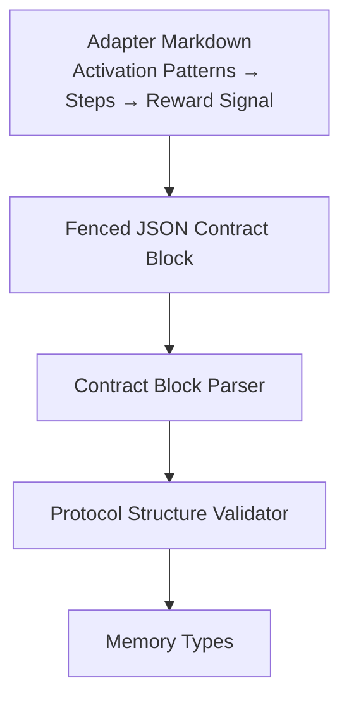
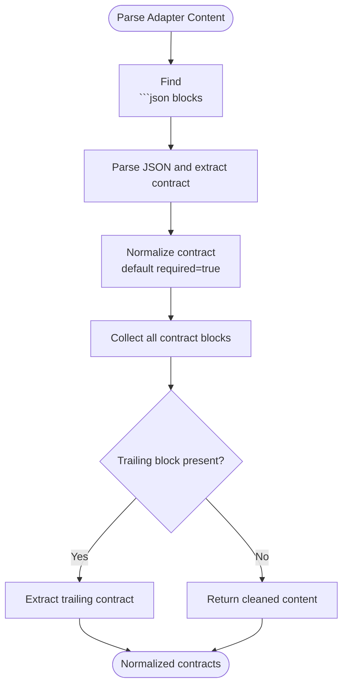
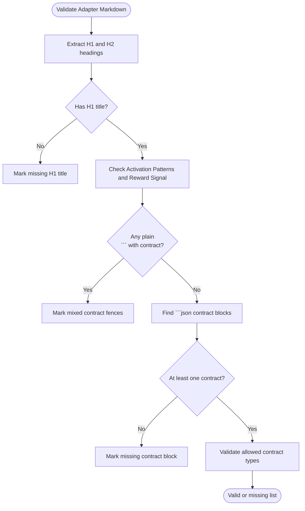
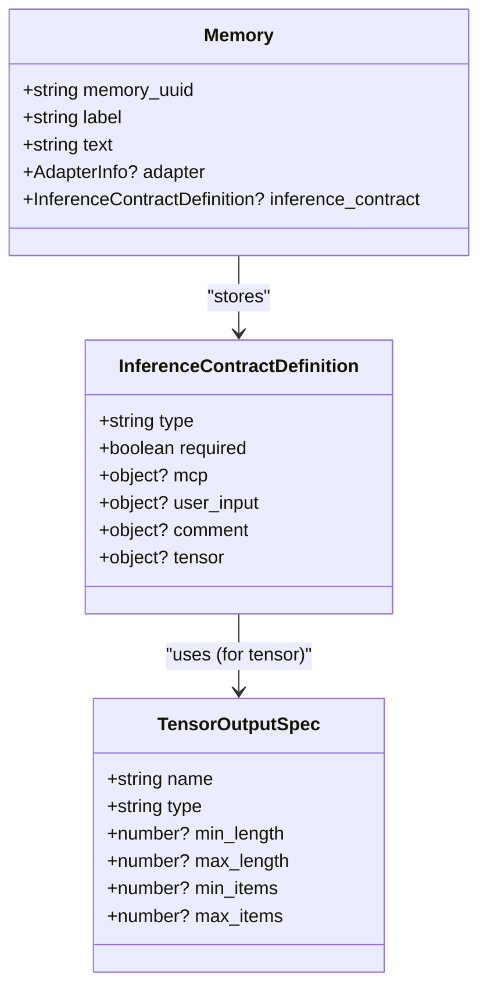
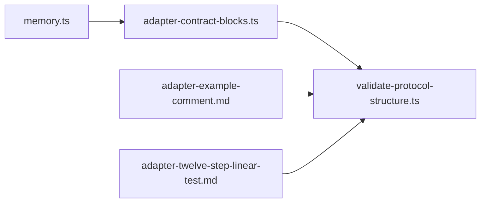

# Comment Contracts

<cite>
**Referenced Files in This Document**   
- [adapter-example-comment.md](file://docs/examples/adapter-example-comment.md)
- [memory.ts](file://src/types/memory.ts)
- [adapter-contract-blocks.ts](file://src/services/memory/adapter-contract-blocks.ts)
- [validate-protocol-structure.ts](file://src/services/memory/validate-protocol-structure.ts)
- [adapter-twelve-step-linear-test.md](file://docs/examples/adapter-twelve-step-linear-test.md)
- [validate-protocol-structure.test.ts](file://tests/unit/validate-protocol-structure.test.ts)
</cite>

## Table of Contents
1. [Introduction](#introduction)
2. [Project Structure](#project-structure)
3. [Core Components](#core-components)
4. [Architecture Overview](#architecture-overview)
5. [Detailed Component Analysis](#detailed-component-analysis)
6. [Dependency Analysis](#dependency-analysis)
7. [Performance Considerations](#performance-considerations)
8. [Troubleshooting Guide](#troubleshooting-guide)
9. [Conclusion](#conclusion)
10. [Appendices](#appendices)

## Introduction
Comment contracts are documentation-only adapter steps that require the agent or user to provide a textual comment instead of executing code, calling an MCP tool, or submitting structured tensors. They are useful for recording reasoning, summarizing changes, documenting business logic, and enforcing minimum documentation coverage across complex workflows.

In this project, adapters are Markdown documents that describe activation patterns, ordered steps, and a reward signal. Each step can include a JSON contract block declaring how its input should be validated. A comment contract declares `type: "comment"` and may constrain the submitted comment through `comment.min_length`. The system parses these contracts during training/validation, stores them with the adapter, and uses them to guide execution without running arbitrary computation at parse time.

## Project Structure
Comment contracts live inside adapter Markdown files as fenced JSON blocks. The repository provides example adapters demonstrating their usage:

- A minimal comment challenge showing one real step plus a final verification step.
- A twelve-step linear test adapter using repeated comment checkpoints.
- Unit tests validating protocol structure, including comment contract type handling.
- Type definitions describing the allowed contract types and the optional `min_length` constraint.



**Diagram sources**
- [adapter-example-comment.md:1-32](file://docs/examples/adapter-example-comment.md#L1-L32)
- [adapter-contract-blocks.ts:1-117](file://src/services/memory/adapter-contract-blocks.ts#L1-L117)
- [validate-protocol-structure.ts:1-187](file://src/services/memory/validate-protocol-structure.ts#L1-L187)
- [memory.ts:29-58](file://src/types/memory.ts#L29-L58)

**Section sources**
- [adapter-example-comment.md:1-32](file://docs/examples/adapter-example-comment.md#L1-L32)
- [adapter-twelve-step-linear-test.md:107-180](file://docs/examples/adapter-twelve-step-linear-test.md#L107-L180)

## Core Components
The comment contract feature is composed of three main parts:

1. **Type definition**: Declares `comment` as an allowed inference contract type and defines the optional `min_length` field under `comment`.
2. **Contract block parsing**: Finds fenced ` ```json ` blocks containing a `contract` object, normalizes it, and extracts trailing contracts from step bodies.
3. **Protocol structure validation**: Ensures adapters have required sections, use only ` ```json ` for contracts, and set `type` to one of the allowed values, including `comment`.

Key responsibilities:
- `memory.ts`: Defines the schema for inference contracts, including `type: "comment"` and `comment.min_length`.
- `adapter-contract-blocks.ts`: Parses all ` ```json ` contract blocks and supports extracting the trailing contract per layer.
- `validate-protocol-structure.ts`: Validates adapter structure and enforces allowed contract types.

**Section sources**
- [memory.ts:29-58](file://src/types/memory.ts#L29-L58)
- [adapter-contract-blocks.ts:1-117](file://src/services/memory/adapter-contract-blocks.ts#L1-L117)
- [validate-protocol-structure.ts:1-187](file://src/services/memory/validate-protocol-structure.ts#L1-L187)

## Architecture Overview
Comment contracts integrate into the adapter workflow as documentation-only layers. They do not execute shell commands, call MCP tools, or compute tensor outputs. Instead, they enforce that a human or agent supplies adequate explanatory text before advancing to subsequent steps.

```mermaid
sequenceDiagram
participant Author as "Adapter Author"
participant Train as "Train / Store"
participant Parser as "Contract Block Parser"
participant Validator as "Protocol Structure Validator"
participant Store as "Adapter Store"
Author->>Train : Submit adapter Markdown with comment contract
Train->>Parser : Find
```json contract blocks
  Parser-->>Train: Normalized InferenceContractDefinition
  Train->>Validator: Validate structure and allowed types
  Validator-->>Train: ValidationResult
  Train->>Store: Persist adapter + inference_contract
  Store-->>Author: Success or structural error
```

**Diagram sources**
- [adapter-contract-blocks.ts:47-71](file://src/services/memory/adapter-contract-blocks.ts#L47-L71)
- [validate-protocol-structure.ts:113-186](file://src/services/memory/validate-protocol-structure.ts#L113-L186)

## Detailed Component Analysis

### Comment Contract Type and Configuration
A comment contract is declared by setting `type` to `"comment"` inside a fenced JSON block. The optional `comment.min_length` field enforces a minimum number of characters in the submitted comment.

Example configuration pattern:
- `type`: `"comment"`
- `comment.min_length`: numeric threshold ensuring sufficient explanation
- `required`: `true`, indicating the step must be solved before proceeding

This pattern appears in:
- The minimal comment example adapter.
- The twelve-step linear test adapter.
- Unit tests asserting protocol structure validation.

**Section sources**
- [adapter-example-comment.md:9-23](file://docs/examples/adapter-example-comment.md#L9-L23)
- [adapter-twelve-step-linear-test.md:111-175](file://docs/examples/adapter-twelve-step-linear-test.md#L111-L175)
- [validate-protocol-structure.test.ts:56-59](file://tests/unit/validate-protocol-structure.test.ts#L56-L59)

### Contract Block Parsing
The parser locates fenced ` ```json ` blocks and extracts the inner `contract` object. It normalizes the parsed contract and attaches a default `required: true` when absent. It also supports extracting a trailing contract block from step content so each layer can carry its own contract.

Important behaviors:
- Only ` ```json ` blocks are treated as contract blocks.
- Plain ` ``` ` blocks containing JSON with a `contract` key are rejected as mixed-fence documents.
- All contract blocks are collected so multi-layer adapters can define multiple steps.



**Diagram sources**
- [adapter-contract-blocks.ts:47-71](file://src/services/memory/adapter-contract-blocks.ts#L47-L71)
- [adapter-contract-blocks.ts:91-116](file://src/services/memory/adapter-contract-blocks.ts#L91-L116)

**Section sources**
- [adapter-contract-blocks.ts:1-117](file://src/services/memory/adapter-contract-blocks.ts#L1-L117)

### Protocol Structure Validation
Before storing an adapter, the system validates its Markdown structure:

- Requires an H1 title.
- Requires `Activation Patterns` as the first H2 section.
- Requires `Reward Signal` as the last H2 section.
- Requires at least one ` ```json ` contract block.
- Rejects mixed-fence documents where plain ` ``` ` blocks contain contract JSON.
- Validates that each contract’s `type` is one of the allowed values: `tensor`, `shell`, `mcp`, `user_input`, or `comment`.

For comment contracts, validation ensures the type is exactly `"comment"` rather than a placeholder or combined value.



**Diagram sources**
- [validate-protocol-structure.ts:26-60](file://src/services/memory/validate-protocol-structure.ts#L26-L60)
- [validate-protocol-structure.ts:113-186](file://src/services/memory/validate-protocol-structure.ts#L113-L186)

**Section sources**
- [validate-protocol-structure.ts:1-187](file://src/services/memory/validate-protocol-structure.ts#L1-L187)

### Data Model for Comment Contracts
The memory type model defines the contract schema used throughout the system. For comment contracts:

- `type` is part of `InferenceContractType`, which includes `"comment"`.
- `InferenceContractDefinition.comment` contains optional `min_length`.
- `required` indicates whether the step must be completed.



**Diagram sources**
- [memory.ts:13-58](file://src/types/memory.ts#L13-L58)
- [memory.ts:99-120](file://src/types/memory.ts#L99-L120)

**Section sources**
- [memory.ts:29-58](file://src/types/memory.ts#L29-L58)
- [memory.ts:99-120](file://src/types/memory.ts#L99-L120)

### Example Usage Patterns

#### Minimal Comment Challenge
The minimal example shows:
- An activation pattern matching specific phrases.
- One step requiring a summary comment with a minimum length.
- A second step reachable only after the first is solved.
- A reward signal marking completion.

This demonstrates how comment contracts document a simple workflow while enforcing documentation quality.

**Section sources**
- [adapter-example-comment.md:1-32](file://docs/examples/adapter-example-comment.md#L1-L32)

#### Twelve-Step Linear Test
The twelve-step adapter repeats comment checkpoints, each requiring a short explanatory comment. This illustrates:
- Reusing comment contracts across many steps.
- Maintaining consistent documentation standards.
- Creating long-running workflows where each checkpoint requires human or agent reflection.

**Section sources**
- [adapter-twelve-step-linear-test.md:107-180](file://docs/examples/adapter-twelve-step-linear-test.md#L107-L180)

#### Validation Tests
Unit tests confirm:
- Comment contracts are accepted as valid types.
- Mixed-fence documents are rejected.
- Required sections must be present.
- Invalid or combined contract types fail validation.

These tests provide confidence that comment contracts are parsed and validated consistently.

**Section sources**
- [validate-protocol-structure.test.ts:56-59](file://tests/unit/validate-protocol-structure.test.ts#L56-L59)
- [validate-protocol-structure.test.ts:174-191](file://tests/unit/validate-protocol-structure.test.ts#L174-L191)
- [validate-protocol-structure.test.ts:274-299](file://tests/unit/validate-protocol-structure.test.ts#L274-L299)

## Dependency Analysis
Comment contracts depend on shared infrastructure for parsing, validation, and typing:

- `adapter-contract-blocks.ts` depends on `memory.ts` for the contract type definition.
- `validate-protocol-structure.ts` depends on `adapter-contract-blocks.ts` to find and validate contract blocks.
- Example adapters depend on the runtime behavior defined by the parser and validator.



**Diagram sources**
- [memory.ts:29-58](file://src/types/memory.ts#L29-L58)
- [adapter-contract-blocks.ts:1-117](file://src/services/memory/adapter-contract-blocks.ts#L1-L117)
- [validate-protocol-structure.ts:1-187](file://src/services/memory/validate-protocol-structure.ts#L1-L187)
- [adapter-example-comment.md:1-32](file://docs/examples/adapter-example-comment.md#L1-L32)
- [adapter-twelve-step-linear-test.md:107-180](file://docs/examples/adapter-twelve-step-linear-test.md#L107-L180)

**Section sources**
- [adapter-contract-blocks.ts:1-117](file://src/services/memory/adapter-contract-blocks.ts#L1-L117)
- [validate-protocol-structure.ts:1-187](file://src/services/memory/validate-protocol-structure.ts#L1-L187)
- [memory.ts:29-58](file://src/types/memory.ts#L29-L58)

## Performance Considerations
Comment contracts are lightweight because they do not execute external processes or invoke network calls during parsing. Their primary cost is:

- Scanning Markdown for fenced JSON blocks.
- Parsing small JSON payloads.
- Validating structure and allowed types.

Since comment contracts avoid computational work, they are suitable for frequent checkpoints in long workflows. However, overly verbose adapters can still trigger size limits enforced elsewhere in the system. Keep comment contracts concise and focused on meaningful documentation.

[No sources needed since this section provides general guidance]

## Troubleshooting Guide
Common issues when working with comment contracts:

- **Missing H1 title**: The adapter must start with a top-level heading.
- **Missing Activation Patterns**: The first H2 section must be named `Activation Patterns`.
- **Missing Reward Signal**: The last H2 section must be named `Reward Signal`.
- **No contract block**: At least one ` ```json ` block with a `contract` object is required.
- **Mixed contract fences**: Do not use plain ` ``` ` blocks for contracts; always use ` ```json `.
- **Invalid contract type**: Use exactly `"comment"` for documentation-only steps.

When validation fails, the system returns a result indicating which requirements are missing. Fix the adapter Markdown according to the reported errors and retry training.

**Section sources**
- [validate-protocol-structure.ts:113-186](file://src/services/memory/validate-protocol-structure.ts#L113-L186)
- [validate-protocol-structure.test.ts:56-59](file://tests/unit/validate-protocol-structure.test.ts#L56-L59)
- [validate-protocol-structure.test.ts:174-191](file://tests/unit/validate-protocol-structure.test.ts#L174-L191)
- [validate-protocol-structure.test.ts:274-299](file://tests/unit/validate-protocol-structure.test.ts#L274-L299)

## Conclusion
Comment contracts provide a safe, documentation-focused way to enforce meaningful explanations within adapter workflows. By combining `type: "comment"` with `comment.min_length`, authors can ensure agents and users supply adequate context before progressing through complex chains. The parser and validator keep contracts consistent, while examples demonstrate practical usage for summarization, checkpointing, and maintaining adapter documentation standards.

[No sources needed since this section summarizes without analyzing specific files]

## Appendices

### Best Practices for Writing Effective Comment Contracts
- Use clear step titles that explain what documentation is expected.
- Set `min_length` high enough to prevent trivial comments but low enough to remain achievable.
- Keep comments focused on business rationale, decisions, and evidence rather than implementation details.
- Avoid mixing plain ` ``` ` blocks with contract JSON; always use ` ```json `.
- Place `Activation Patterns` first and `Reward Signal` last in every adapter.
- Reuse comment contracts for repetitive checkpoints to maintain consistency.
- Treat comment contracts as audit trails: future readers should understand why a step was taken.

[No sources needed since this section provides general guidance]