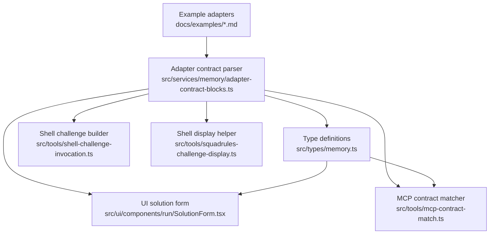
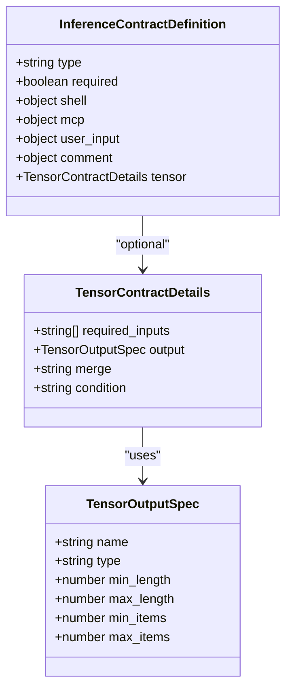
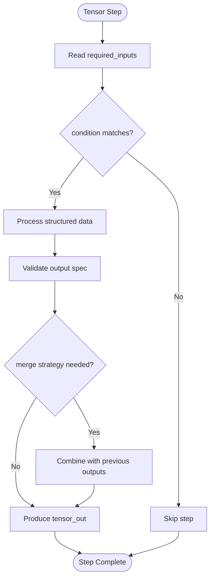
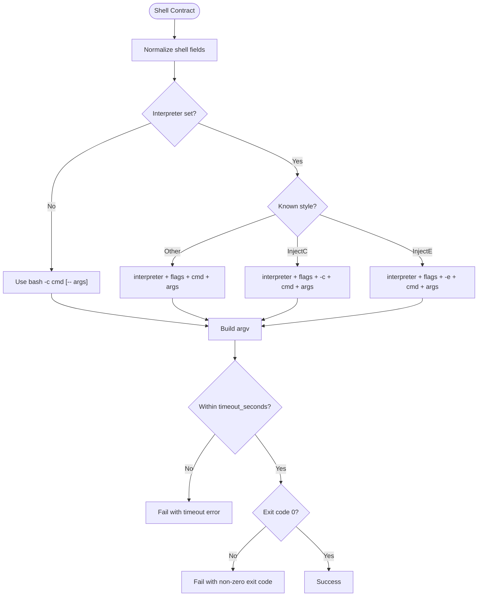
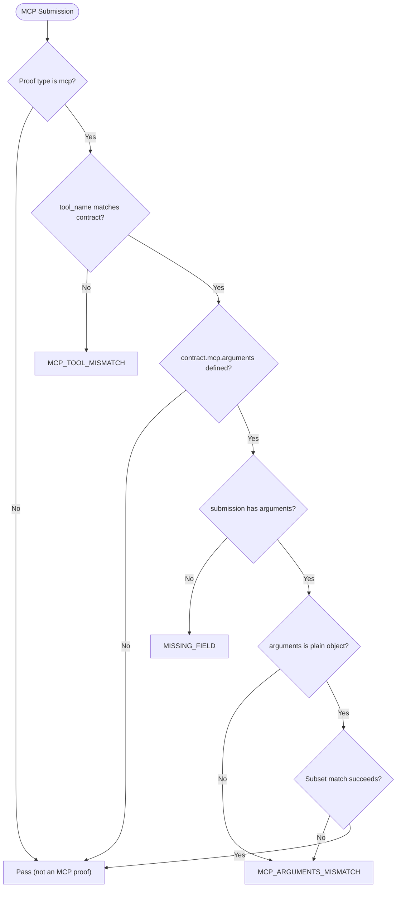
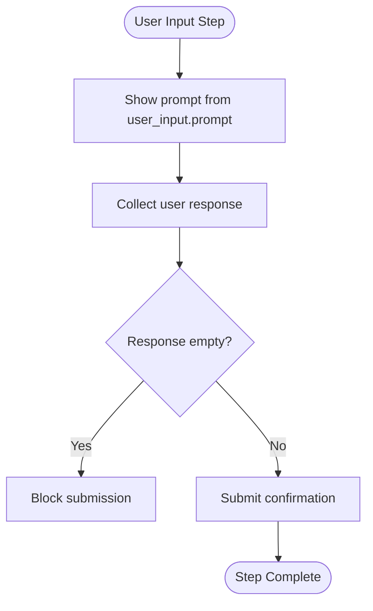
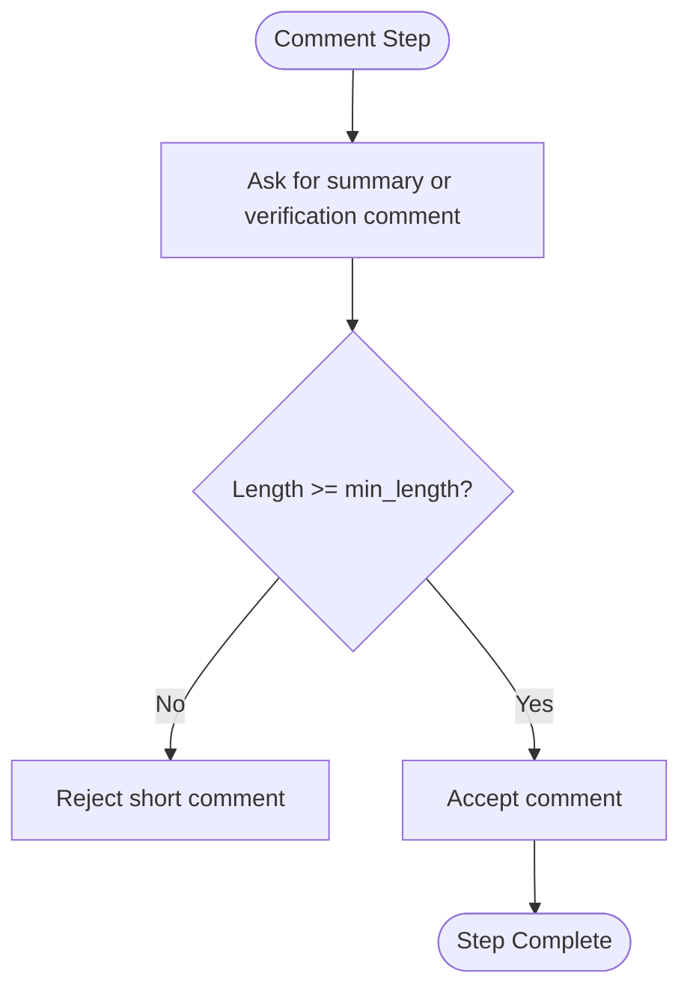
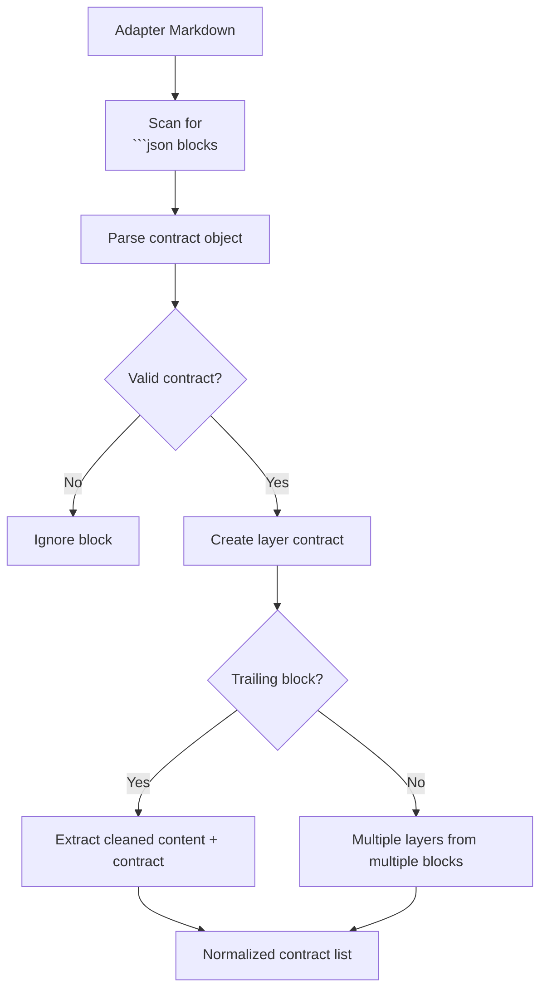
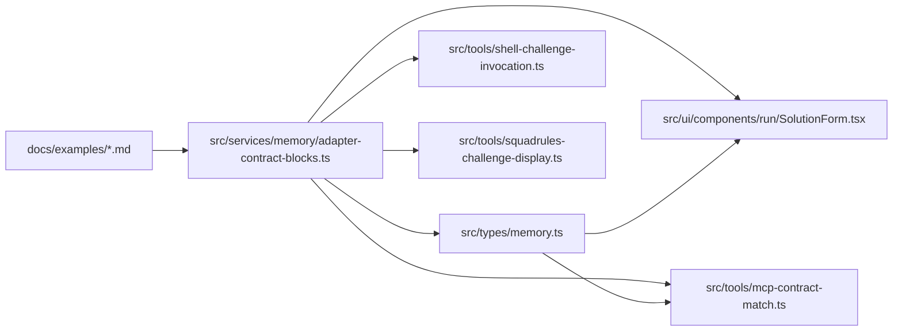

# Inference Contracts

<cite>
**Referenced Files in This Document**
- [memory.ts](file://src/types/memory.ts)
- [adapter-contract-blocks.ts](file://src/services/memory/adapter-contract-blocks.ts)
- [mcp-contract-match.ts](file://src/tools/mcp-contract-match.ts)
- [shell-challenge-invocation.ts](file://src/tools/shell-challenge-invocation.ts)
- [squadrules-challenge-display.ts](file://src/tools/squadrules-challenge-display.ts)
- [SolutionForm.tsx](file://src/ui/components/run/SolutionForm.tsx)
- [adapter-example-all-types.md](file://docs/examples/adapter-example-all-types.md)
- [adapter-example-shell.md](file://docs/examples/adapter-example-shell.md)
- [adapter-example-mcp.md](file://docs/examples/adapter-example-mcp.md)
- [adapter-example-user-input.md](file://docs/examples/adapter-example-user-input.md)
- [adapter-example-comment.md](file://docs/examples/adapter-example-comment.md)
</cite>

## Table of Contents
1. [Introduction](#introduction)
2. [Project Structure](#project-structure)
3. [Core Components](#core-components)
4. [Architecture Overview](#architecture-overview)
5. [Detailed Component Analysis](#detailed-component-analysis)
6. [Dependency Analysis](#dependency-analysis)
7. [Performance Considerations](#performance-considerations)
8. [Troubleshooting Guide](#troubleshooting-guide)
9. [Conclusion](#conclusion)

## Introduction
Inference contracts define how adapters execute tasks and validate solutions. Each adapter step declares a contract that tells the system what kind of work must be performed, what inputs are required, and how to verify success. The five supported contract types are:

- **tensor**: structured data processing with input/output specifications, merge strategies, and conditional logic.
- **shell**: command execution with interpreter, flags, arguments, working directory, and timeout configuration.
- **mcp**: tool invocation with tool name, argument schema constraints, and result validation.
- **user_input**: human interaction through customizable prompts.
- **comment**: documentation-only steps with minimum length validation.

These contracts appear as fenced JSON blocks inside adapter markdown. During training or forward execution, the system parses them into an `InferenceContractDefinition`, executes the appropriate task, and validates the submitted solution against the declared contract.

## Project Structure
The inference contract system is centered around a shared type definition, markdown parsing utilities, per-contract validators, and UI helpers.



**Diagram sources**
- [memory.ts:13-58](file://src/types/memory.ts#L13-L58)
- [adapter-contract-blocks.ts:21-45](file://src/services/memory/adapter-contract-blocks.ts#L21-L45)
- [shell-challenge-invocation.ts:6-12](file://src/tools/shell-challenge-invocation.ts#L6-L12)
- [squadrules-challenge-display.ts:44-56](file://src/tools/squadrules-challenge-display.ts#L44-L56)
- [mcp-contract-match.ts:43-86](file://src/tools/mcp-contract-match.ts#L43-L86)
- [SolutionForm.tsx:56-81](file://src/ui/components/run/SolutionForm.tsx#L56-L81)

**Section sources**
- [memory.ts:13-58](file://src/types/memory.ts#L13-L58)
- [adapter-contract-blocks.ts:21-45](file://src/services/memory/adapter-contract-blocks.ts#L21-L45)

## Core Components
The core contract model is defined by a single unified shape. Every contract includes:

- `type`: one of `tensor`, `shell`, `mcp`, `user_input`, or `comment`.
- `required`: whether the step must succeed for the layer to pass.
- Type-specific fields such as `shell`, `mcp`, `user_input`, `comment`, and `tensor`.

This design allows adapters to mix different contract types across steps while keeping validation consistent.



**Diagram sources**
- [memory.ts:13-58](file://src/types/memory.ts#L13-L58)

**Section sources**
- [memory.ts:13-58](file://src/types/memory.ts#L13-L58)

## Architecture Overview
Inference contracts participate in two main phases:

1. **Parsing phase**: Adapter markdown is scanned for fenced JSON blocks containing a `contract` object. The parser extracts the contract and cleans the surrounding text.
2. **Execution/validation phase**: Depending on `type`, the system either runs a task (shell, MCP, tensor) or collects human input (user_input, comment), then validates the solution against the contract.

```mermaid
sequenceDiagram
participant Author as "Adapter Author"
participant Parser as "Contract Parser"
participant Executor as "Task Executor"
participant Validator as "Contract Validator"
participant UI as "Solution Form"
Author->>Parser : Markdown with
```json contract block
  Parser-->>Author: Cleaned content + InferenceContractDefinition
  Executor->>Validator: Run task and collect solution
  Validator-->>Executor: Validation result
  UI->>Validator: Client-side validation before submit
  Validator-->>UI: isValid based on contract type
```

**Diagram sources**
- [adapter-contract-blocks.ts:21-45](file://src/services/memory/adapter-contract-blocks.ts#L21-L45)
- [SolutionForm.tsx:56-81](file://src/ui/components/run/SolutionForm.tsx#L56-L81)

## Detailed Component Analysis

### Tensor Contracts
Tensor contracts describe structured data processing. They declare:

- `required_inputs`: names of input tensors expected from previous steps.
- `output`: a `TensorOutputSpec` describing the produced tensor’s name, type, and size constraints.
- `merge`: optional strategy for combining outputs when multiple branches converge.
- `condition`: optional expression controlling whether the step runs.

Use cases include transforming embeddings, merging results from parallel branches, filtering records, or producing normalized payloads for downstream adapters.

Key characteristics:
- Input/output coupling makes tensor contracts suitable for deterministic data pipelines.
- Length and item count constraints help enforce payload shape without requiring full schema validation at every step.
- Conditional execution enables branching workflows where later steps depend on earlier results.



**Diagram sources**
- [memory.ts:13-27](file://src/types/memory.ts#L13-L27)

**Section sources**
- [memory.ts:13-27](file://src/types/memory.ts#L13-L27)

### Shell Contracts
Shell contracts define command execution. The modern `shell` object supports:

- `cmd`: the command string to run.
- `timeout_seconds`: maximum execution time.
- `interpreter`: optional interpreter override; defaults to bash behavior.
- `flags`: optional interpreter flags.
- `args`: optional arguments passed after the command.
- `workdir`: optional working directory for process execution.

The system normalizes these fields into an argv-like structure and builds an executable invocation. It handles common interpreters such as Python, Perl, Node, Ruby, and “other” tools like Terraform, Docker, or Kubernetes clients.



**Diagram sources**
- [shell-challenge-invocation.ts:14-33](file://src/tools/shell-challenge-invocation.ts#L14-L33)
- [shell-challenge-invocation.ts:85-121](file://src/tools/shell-challenge-invocation.ts#L85-L121)
- [squadrules-challenge-display.ts:44-56](file://src/tools/squadrules-challenge-display.ts#L44-L56)

Concrete example reference:
- [adapter-example-shell.md:13-23](file://docs/examples/adapter-example-shell.md#L13-L23)

**Section sources**
- [memory.ts:34-44](file://src/types/memory.ts#L34-L44)
- [shell-challenge-invocation.ts:6-12](file://src/tools/shell-challenge-invocation.ts#L6-L12)
- [shell-challenge-invocation.ts:85-121](file://src/tools/shell-challenge-invocation.ts#L85-L121)
- [squadrules-challenge-display.ts:44-56](file://src/tools/squadrules-challenge-display.ts#L44-L56)
- [adapter-example-shell.md:13-23](file://docs/examples/adapter-example-shell.md#L13-L23)

### MCP Contracts
MCP contracts define tool invocation requirements. A contract can specify:

- `tool_name`: the exact MCP tool that must be called.
- `arguments`: optional constraint object; when present, the submission must provide a plain object matching those keys using subset semantics.
- `expected_result`: optional validation value for the tool result.

Validation enforces:
- Tool name equality when specified.
- Presence and shape of `arguments` when the contract requires it.
- Deep subset matching for nested objects and fixed-length arrays.
- Primitive equality, including NaN handling.



**Diagram sources**
- [mcp-contract-match.ts:43-86](file://src/tools/mcp-contract-match.ts#L43-L86)

Concrete example references:
- [adapter-example-mcp.md:13-23](file://docs/examples/adapter-example-mcp.md#L13-L23)
- [adapter-example-mcp.md:33-44](file://docs/examples/adapter-example-mcp.md#L33-L44)

**Section sources**
- [memory.ts:45-50](file://src/types/memory.ts#L45-L50)
- [mcp-contract-match.ts:3-41](file://src/tools/mcp-contract-match.ts#L3-L41)
- [mcp-contract-match.ts:43-86](file://src/tools/mcp-contract-match.ts#L43-L86)
- [adapter-example-mcp.md:13-23](file://docs/examples/adapter-example-mcp.md#L13-L23)
- [adapter-example-mcp.md:33-44](file://docs/examples/adapter-example-mcp.md#L33-L44)

### User Input Contracts
User input contracts represent human-in-the-loop steps. They use:

- `prompt`: a customizable message shown to the user.
- `required`: whether the confirmation must be provided.

The UI validates that the user has entered a non-empty response before allowing submission. This contract type is commonly used for approvals, confirmations, or explicit consent before destructive or irreversible actions.



**Diagram sources**
- [SolutionForm.tsx:56-63](file://src/ui/components/run/SolutionForm.tsx#L56-L63)

Concrete example reference:
- [adapter-example-user-input.md:13-22](file://docs/examples/adapter-example-user-input.md#L13-L22)

**Section sources**
- [memory.ts:51-53](file://src/types/memory.ts#L51-L53)
- [SolutionForm.tsx:56-63](file://src/ui/components/run/SolutionForm.tsx#L56-L63)
- [adapter-example-user-input.md:13-22](file://docs/examples/adapter-example-user-input.md#L13-L22)

### Comment Contracts
Comment contracts are documentation-only steps. They use:

- `min_length`: optional minimum character count for the submitted comment.
- `required`: whether the comment must be provided.

They are useful for summaries, verification notes, audit trails, or explanations that must meet a quality threshold even though they do not execute external work.



**Diagram sources**
- [SolutionForm.tsx:56-63](file://src/ui/components/run/SolutionForm.tsx#L56-L63)

Concrete example reference:
- [adapter-example-comment.md:13-22](file://docs/examples/adapter-example-comment.md#L13-L22)

**Section sources**
- [memory.ts:54-56](file://src/types/memory.ts#L54-L56)
- [SolutionForm.tsx:56-63](file://src/ui/components/run/SolutionForm.tsx#L56-L63)
- [adapter-example-comment.md:13-22](file://docs/examples/adapter-example-comment.md#L13-L22)

### Contract Parsing and Workflow Integration
Adapter markdown may contain multiple fenced JSON blocks. The parser:

- Finds all ` ```json ` blocks containing a `contract` object.
- Normalizes each block into an `InferenceContractDefinition`.
- Supports a trailing contract block as a convenience for single-step adapters.
- Detects plain fenced blocks that accidentally contain contracts to warn about mismatched layer parsing.



**Diagram sources**
- [adapter-contract-blocks.ts:21-45](file://src/services/memory/adapter-contract-blocks.ts#L21-L45)
- [adapter-contract-blocks.ts:47-71](file://src/services/memory/adapter-contract-blocks.ts#L47-L71)
- [adapter-contract-blocks.ts:91-116](file://src/services/memory/adapter-contract-blocks.ts#L91-L116)

**Section sources**
- [adapter-contract-blocks.ts:21-45](file://src/services/memory/adapter-contract-blocks.ts#L21-L45)
- [adapter-contract-blocks.ts:47-71](file://src/services/memory/adapter-contract-blocks.ts#L47-L71)
- [adapter-contract-blocks.ts:91-116](file://src/services/memory/adapter-contract-blocks.ts#L91-L116)

## Dependency Analysis
The inference contract system has clear separation between schema, parsing, execution, and validation.



**Diagram sources**
- [memory.ts:13-58](file://src/types/memory.ts#L13-L58)
- [adapter-contract-blocks.ts:21-45](file://src/services/memory/adapter-contract-blocks.ts#L21-L45)
- [shell-challenge-invocation.ts:6-12](file://src/tools/shell-challenge-invocation.ts#L6-L12)
- [squadrules-challenge-display.ts:44-56](file://src/tools/squadrules-challenge-display.ts#L44-L56)
- [mcp-contract-match.ts:43-86](file://src/tools/mcp-contract-match.ts#L43-L86)
- [SolutionForm.tsx:56-81](file://src/ui/components/run/SolutionForm.tsx#L56-L81)

**Section sources**
- [memory.ts:13-58](file://src/types/memory.ts#L13-L58)
- [adapter-contract-blocks.ts:21-45](file://src/services/memory/adapter-contract-blocks.ts#L21-L45)

## Performance Considerations
- Contract parsing uses regular expressions over markdown content; keep adapter documents concise and avoid unnecessary large code blocks outside contract fences.
- Shell commands should set reasonable `timeout_seconds` to prevent long-running processes from blocking workflow execution.
- MCP argument validation performs deep subset checks; complex nested structures increase comparison cost but remain bounded by contract size.
- Tensor contracts rely on caller-provided input/output shapes; ensure upstream steps produce predictable payloads to minimize reprocessing.

[No sources needed since this section provides general guidance]

## Troubleshooting Guide
Common issues and their likely causes:

- **MCP tool mismatch**: The submitted `tool_name` does not match the contract’s `mcp.tool_name`.
- **Missing MCP arguments**: The contract specifies `mcp.arguments`, but the submission lacks `solution.evidence.arguments`.
- **MCP arguments mismatch**: The submission’s arguments are not a plain object or do not satisfy the contract’s subset constraints.
- **Shell timeout**: The command exceeded `timeout_seconds`.
- **Shell non-zero exit code**: The command failed; inspect stdout/stderr and interpreter availability.
- **Short comment**: The submitted comment is shorter than `comment.min_length`.
- **Empty user input**: The user did not provide a response to `user_input.prompt`.
- **Contract not parsed**: The JSON block is not fenced as ` ```json `, or it does not contain a top-level `contract` object.

Recommended diagnostics:
- Verify the adapter contains exactly one valid ` ```json ` block per intended layer.
- Confirm MCP submissions include both `tool_name` and, when required, a plain-object `arguments`.
- For shell steps, test the constructed invocation locally using the same interpreter, flags, and arguments.
- Use the UI’s client-side validation hints to catch missing or invalid inputs early.

**Section sources**
- [mcp-contract-match.ts:43-86](file://src/tools/mcp-contract-match.ts#L43-L86)
- [shell-challenge-invocation.ts:85-121](file://src/tools/shell-challenge-invocation.ts#L85-L121)
- [SolutionForm.tsx:56-81](file://src/ui/components/run/SolutionForm.tsx#L56-L81)
- [adapter-contract-blocks.ts:21-45](file://src/services/memory/adapter-contract-blocks.ts#L21-L45)

## Conclusion
Inference contracts provide a uniform way to describe adapter tasks across structured data, shell commands, MCP tool calls, human interaction, and documentation steps. The shared `InferenceContractDefinition` type keeps parsing and validation consistent, while per-type helpers handle execution details and error reporting. By combining concrete examples with strict contract validation, adapters remain auditable, reproducible, and adaptable to evolving workflows.

[No sources needed since this section summarizes without analyzing specific files]