# MCP Contracts

<cite>
**Referenced Files in This Document**
- [mcp-contract-match.ts](file://src/tools/mcp-contract-match.ts)
- [forward_schema.ts](file://src/tools/forward_schema.ts)
- [memory.ts](file://src/types/memory.ts)
- [next-pow-challenge-shape.ts](file://src/tools/next-pow-challenge-shape.ts)
- [forward.ts](file://src/tools/forward.ts)
- [http-mcp-handler.ts](file://src/http/http-mcp-handler.ts)
- [mcp-tool-input-teaching.ts](file://src/tools/mcp-tool-input-teaching.ts)
- [mcp-runtime-error.ts](file://src/tools/mcp-runtime-error.ts)
- [mcp-loose-input-schema.ts](file://src/tools/mcp-loose-input-schema.ts)
- [adapter-example-mcp.md](file://docs/examples/adapter-example-mcp.md)
- [embedded-mcp-resources.ts](file://src/resources/embedded-mcp-resources.ts)
- [mcp-call-normalize.ts](file://tests/integration/harness/helpers/mcp-call-normalize.ts)
- [mcp-contract-match.test.ts](file://tests/unit/mcp-contract-match.test.ts)
</cite>

## Table of Contents
1. [Introduction](#introduction)
2. [Project Structure](#project-structure)
3. [Core Components](#core-components)
4. [Architecture Overview](#architecture-overview)
5. [Detailed Component Analysis](#detailed-component-analysis)
6. [Dependency Analysis](#dependency-analysis)
7. [Performance Considerations](#performance-considerations)
8. [Troubleshooting Guide](#troubleshooting-guide)
9. [Conclusion](#conclusion)

## Introduction
This document explains the Model Context Protocol (MCP) contracts used to invoke tools inside adapters and enforce deterministic, auditable execution. An MCP contract declares which tool must be called, what parameters are required, and how the solution is validated. The system supports:

- `tool_name` for target tool specification.
- `arguments` for parameter validation using subset semantics.
- `expected_result` as a hint or verification expectation attached to the challenge display.
- Integration with the broader MCP ecosystem through tool discovery, parameter binding, result processing, and the adapter workflow.

The primary workflow is activate → forward → reward. Adapters define layers; each layer may include an MCP contract that requires the agent to call a specific MCP tool and submit proof. The server validates the proof against the contract before advancing the workflow.

## Project Structure
MCP contract logic spans several modules:

- Contract schema and types define the shape of MCP challenges and solutions.
- Contract matching validates submitted proofs against declared contracts.
- Forward execution drives the adapter workflow and integrates proof handling.
- HTTP transport exposes MCP endpoints, handles authentication, concurrency, and audit events.
- Teaching utilities convert validation errors into agent-friendly guidance.
- Examples and embedded resources show how authors write MCP contracts.

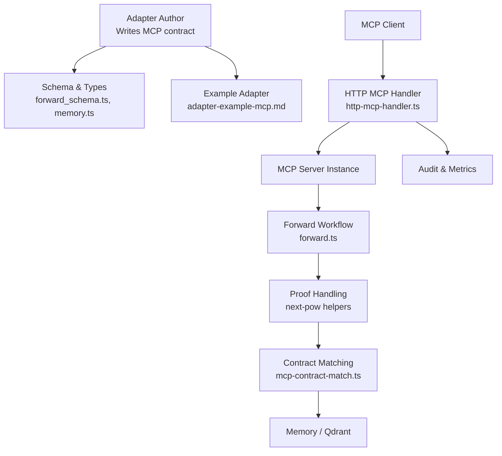

**Diagram sources**
- [forward_schema.ts:30-52](file://src/tools/forward_schema.ts#L30-L52)
- [memory.ts:31-58](file://src/types/memory.ts#L31-L58)
- [http-mcp-handler.ts:115-348](file://src/http/http-mcp-handler.ts#L115-L348)
- [forward.ts:93-317](file://src/tools/forward.ts#L93-L317)
- [mcp-contract-match.ts:47-86](file://src/tools/mcp-contract-match.ts#L47-L86)

**Section sources**
- [forward_schema.ts:30-52](file://src/tools/forward_schema.ts#L30-L52)
- [memory.ts:31-58](file://src/types/memory.ts#L31-L58)
- [http-mcp-handler.ts:115-348](file://src/http/http-mcp-handler.ts#L115-L348)
- [forward.ts:93-317](file://src/tools/forward.ts#L93-L317)
- [mcp-contract-match.ts:47-86](file://src/tools/mcp-contract-match.ts#L47-L86)
- [adapter-example-mcp.md:1-53](file://docs/examples/adapter-example-mcp.md#L1-L53)

## Core Components
This section documents the MCP contract object and its role in the workflow.

### MCP Contract Object
An MCP contract appears inside an adapter’s inference contract and describes a step that requires calling an MCP tool. It includes:

- `type`: Must be `mcp`.
- `required`: Indicates whether this step is mandatory.
- `description`: Optional human-readable instruction.
- `nonce` and `proof_hash`: Optional fields echoed by solutions for proof-based layers.
- `mcp.tool_name`: Required string identifying the target tool.
- `mcp.arguments`: Optional plain object specifying required keys and values. Validation uses subset semantics: every key/value pair in the contract must appear in the submission, but extra keys are allowed.
- `mcp.expected_result`: Optional arbitrary value attached to the challenge display to guide or verify expected output.

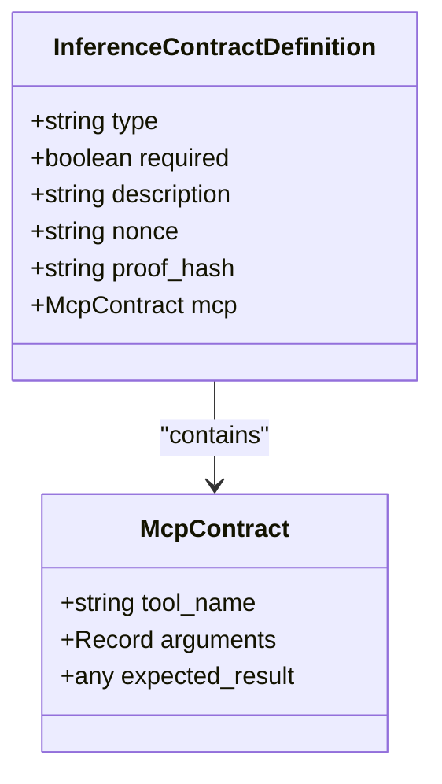

**Diagram sources**
- [memory.ts:31-58](file://src/types/memory.ts#L31-L58)
- [forward_schema.ts:30-52](file://src/tools/forward_schema.ts#L30-L52)

**Section sources**
- [memory.ts:31-58](file://src/types/memory.ts#L31-L58)
- [forward_schema.ts:30-52](file://src/tools/forward_schema.ts#L30-L52)

### MCP Solution Envelope
Solutions follow a unified envelope regardless of challenge type. For MCP steps, the evidence contains:

- `tool_name`: The tool actually invoked.
- `arguments`: The parameters passed to the tool.
- `response`: The tool’s response payload.
- `outcome`: Success, failure, or skipped.
- `nonce` and `proof_hash`: Echoed from the contract when present.

Older wire shapes are still accepted and normalized internally, but new protocols should use the unified envelope.

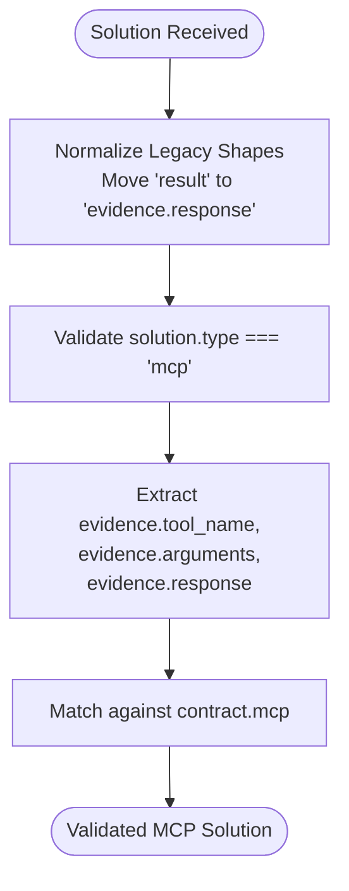

**Diagram sources**
- [forward_schema.ts:146-186](file://src/tools/forward_schema.ts#L146-L186)
- [forward_schema.ts:188-226](file://src/tools/forward_schema.ts#L188-L226)

**Section sources**
- [forward_schema.ts:146-186](file://src/tools/forward_schema.ts#L146-L186)
- [forward_schema.ts:188-226](file://src/tools/forward_schema.ts#L188-L226)

### Tool Discovery and Invocation
Clients discover available tools via the MCP endpoint and call them through JSON-RPC. The server creates per-request MCP servers, tracks concurrency, and emits audit events. Clients can normalize tool results to parse JSON payloads or handle error responses consistently.

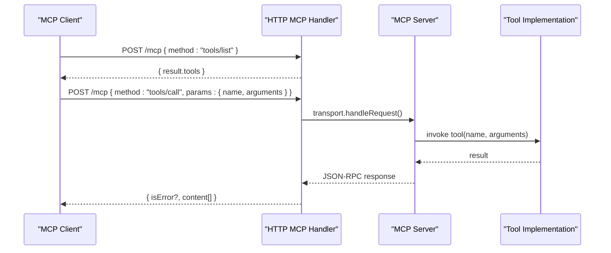

**Diagram sources**
- [http-mcp-handler.ts:115-348](file://src/http/http-mcp-handler.ts#L115-L348)
- [mcp-call-normalize.ts:1-22](file://tests/integration/harness/helpers/mcp-call-normalize.ts#L1-L22)

**Section sources**
- [http-mcp-handler.ts:115-348](file://src/http/http-mcp-handler.ts#L115-L348)
- [mcp-call-normalize.ts:1-22](file://tests/integration/harness/helpers/mcp-call-normalize.ts#L1-L22)

## Architecture Overview
The MCP contract lifecycle connects authoring, transport, workflow execution, and proof validation.

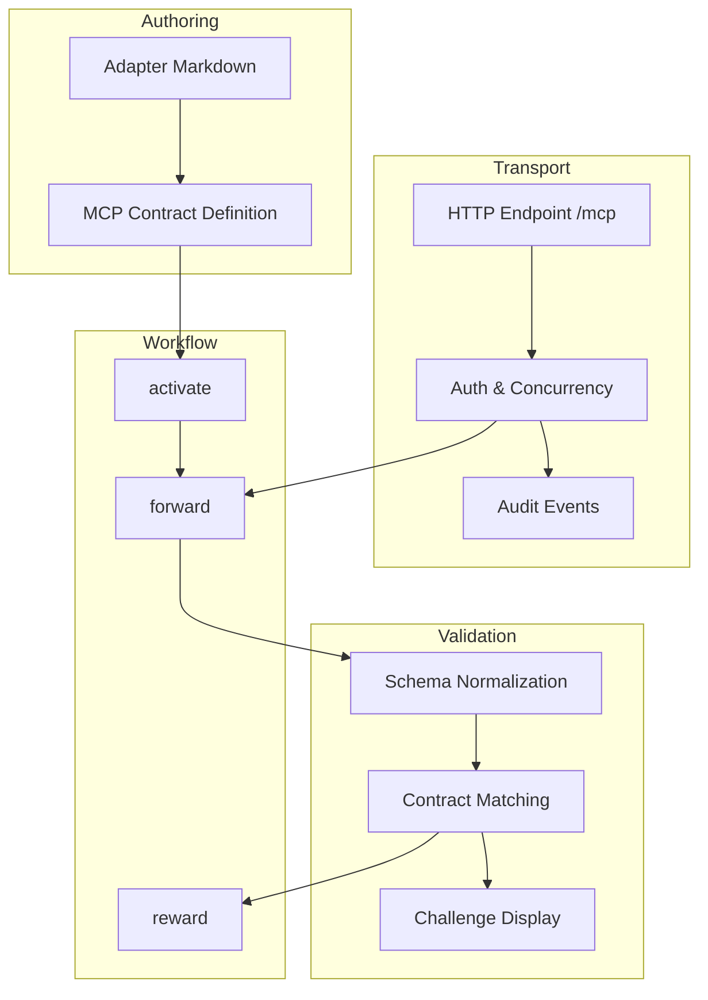

**Diagram sources**
- [forward.ts:93-317](file://src/tools/forward.ts#L93-L317)
- [http-mcp-handler.ts:115-348](file://src/http/http-mcp-handler.ts#L115-L348)
- [mcp-contract-match.ts:47-86](file://src/tools/mcp-contract-match.ts#L47-L86)
- [next-pow-challenge-shape.ts:21-30](file://src/tools/next-pow-challenge-shape.ts#L21-L30)

**Section sources**
- [forward.ts:93-317](file://src/tools/forward.ts#L93-L317)
- [http-mcp-handler.ts:115-348](file://src/http/http-mcp-handler.ts#L115-L348)
- [mcp-contract-match.ts:47-86](file://src/tools/mcp-contract-match.ts#L47-L86)
- [next-pow-challenge-shape.ts:21-30](file://src/tools/next-pow-challenge-shape.ts#L21-L30)

## Detailed Component Analysis

### MCP Contract Matching
Contract matching enforces two critical guarantees:

1. **Tool identity**: If the contract specifies `tool_name`, the solution must call exactly that tool.
2. **Parameter subset match**: If the contract specifies `arguments`, the solution’s `arguments` must contain all required keys and values. Extra keys are allowed at each level. Arrays are fixed-length and order-sensitive; primitives use strict equality including NaN.

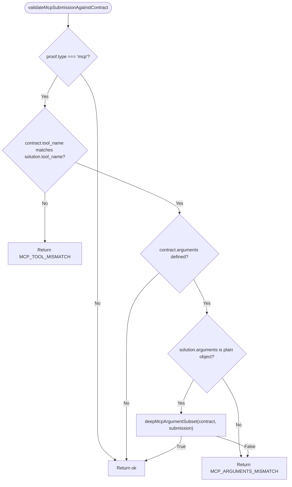

**Diagram sources**
- [mcp-contract-match.ts:47-86](file://src/tools/mcp-contract-match.ts#L47-L86)
- [mcp-contract-match.ts:3-41](file://src/tools/mcp-contract-match.ts#L3-L41)

**Section sources**
- [mcp-contract-match.ts:3-41](file://src/tools/mcp-contract-match.ts#L3-L41)
- [mcp-contract-match.ts:47-86](file://src/tools/mcp-contract-match.ts#L47-L86)
- [mcp-contract-match.test.ts:24-156](file://tests/unit/mcp-contract-match.test.ts#L24-L156)

### Forward Workflow Integration
The forward workflow loads the current layer, normalizes the solution, elicits user input when needed, applies previous-step solutions, and advances to the next layer or terminal state. MCP contracts flow through proof handling and quality tracking.

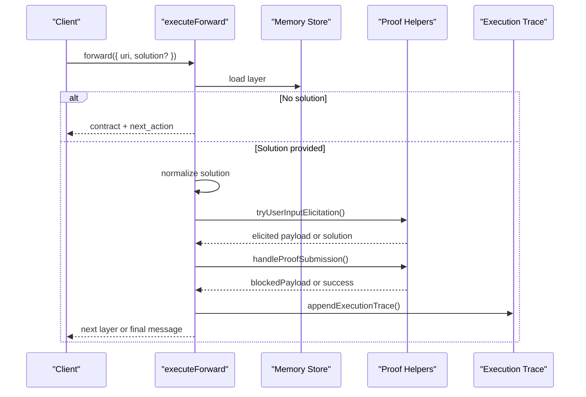

**Diagram sources**
- [forward.ts:93-317](file://src/tools/forward.ts#L93-L317)

**Section sources**
- [forward.ts:93-317](file://src/tools/forward.ts#L93-L317)

### Challenge Display and Expected Result
When building the challenge shape for MCP steps, the system includes:

- `tool_name`: The required tool.
- `arguments`: If specified in the contract, included as a hint.
- `expected_result`: Attached to the challenge display to guide verification.

This helps agents understand not only which tool to call, but also what outcome is expected.

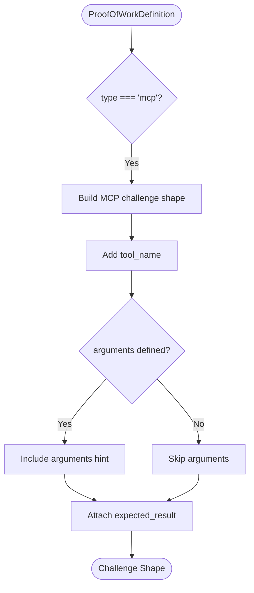

**Diagram sources**
- [next-pow-challenge-shape.ts:21-30](file://src/tools/next-pow-challenge-shape.ts#L21-L30)

**Section sources**
- [next-pow-challenge-shape.ts:21-30](file://src/tools/next-pow-challenge-shape.ts#L21-L30)

### MCP Contract Examples
Authors write MCP contracts in adapter markdown. The example demonstrates:

- A simple MCP contract requiring the `activate` tool.
- Using `arguments` to constrain parameters such as `query`.
- Subset semantics allowing extra keys in the solution.

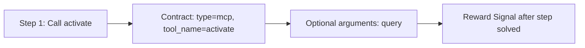

**Diagram sources**
- [adapter-example-mcp.md:9-44](file://docs/examples/adapter-example-mcp.md#L9-L44)

**Section sources**
- [adapter-example-mcp.md:9-44](file://docs/examples/adapter-example-mcp.md#L9-L44)

### Relationship to the Overall Workflow Execution Model
MCP contracts integrate into the activate → forward → reward chain:

- `activate` selects an adapter and returns initial instructions.
- `forward` loads the first layer and returns the contract.
- The agent calls the specified MCP tool and submits a solution.
- The server validates the solution against the contract.
- On success, the workflow advances to the next layer or terminal state.
- `reward` finalizes the run.

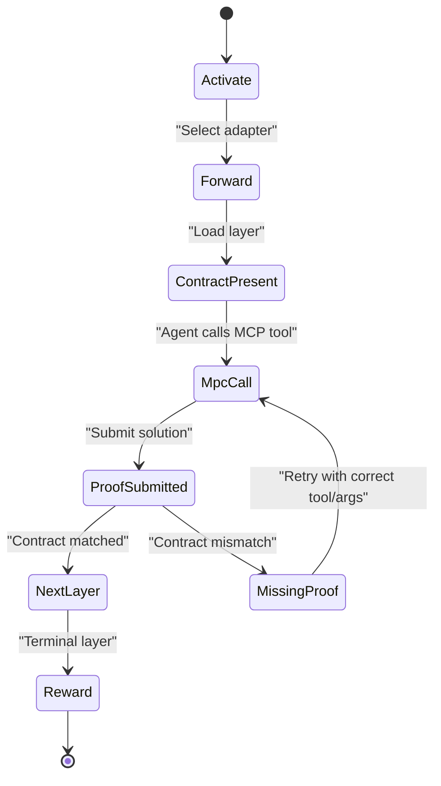

**Diagram sources**
- [forward.ts:93-317](file://src/tools/forward.ts#L93-L317)
- [embedded-mcp-resources.ts:19-36](file://src/resources/embedded-mcp-resources.ts#L19-L36)

**Section sources**
- [forward.ts:93-317](file://src/tools/forward.ts#L93-L317)
- [embedded-mcp-resources.ts:19-36](file://src/resources/embedded-mcp-resources.ts#L19-L36)

## Dependency Analysis
Key dependencies between components:

- `forward_schema.ts` defines Zod schemas for contracts, solutions, and wire formats.
- `memory.ts` defines the internal types for inference contracts, including MCP fields.
- `mcp-contract-match.ts` implements subset argument matching and tool-name validation.
- `next-pow-challenge-shape.ts` builds challenge displays including `expected_result`.
- `forward.ts` orchestrates workflow execution and integrates proof handling.
- `http-mcp-handler.ts` manages transport, auth, concurrency, and audit.
- `mcp-tool-input-teaching.ts` converts validation errors into agent teaching payloads.
- `mcp-runtime-error.ts` structures rate-limit errors for embedding providers.
- `mcp-loose-input-schema.ts` allows handlers to receive any object for safe parsing.

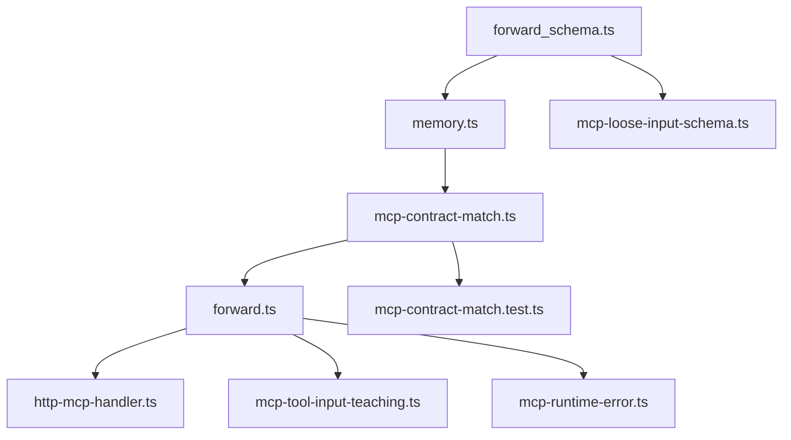

**Diagram sources**
- [forward_schema.ts:30-52](file://src/tools/forward_schema.ts#L30-L52)
- [memory.ts:31-58](file://src/types/memory.ts#L31-L58)
- [mcp-contract-match.ts:47-86](file://src/tools/mcp-contract-match.ts#L47-L86)
- [forward.ts:93-317](file://src/tools/forward.ts#L93-L317)
- [http-mcp-handler.ts:115-348](file://src/http/http-mcp-handler.ts#L115-L348)
- [mcp-tool-input-teaching.ts:284-318](file://src/tools/mcp-tool-input-teaching.ts#L284-L318)
- [mcp-runtime-error.ts:14-35](file://src/tools/mcp-runtime-error.ts#L14-L35)
- [mcp-loose-input-schema.ts:8-10](file://src/tools/mcp-loose-input-schema.ts#L8-L10)
- [mcp-contract-match.test.ts:24-156](file://tests/unit/mcp-contract-match.test.ts#L24-L156)

**Section sources**
- [forward_schema.ts:30-52](file://src/tools/forward_schema.ts#L30-L52)
- [memory.ts:31-58](file://src/types/memory.ts#L31-L58)
- [mcp-contract-match.ts:47-86](file://src/tools/mcp-contract-match.ts#L47-L86)
- [forward.ts:93-317](file://src/tools/forward.ts#L93-L317)
- [http-mcp-handler.ts:115-348](file://src/http/http-mcp-handler.ts#L115-L348)
- [mcp-tool-input-teaching.ts:284-318](file://src/tools/mcp-tool-input-teaching.ts#L284-L318)
- [mcp-runtime-error.ts:14-35](file://src/tools/mcp-runtime-error.ts#L14-L35)
- [mcp-loose-input-schema.ts:8-10](file://src/tools/mcp-loose-input-schema.ts#L8-L10)
- [mcp-contract-match.test.ts:24-156](file://tests/unit/mcp-contract-match.test.ts#L24-L156)

## Performance Considerations
- Per-request MCP server instances allow concurrent handling without single-transport limits.
- Concurrency control rejects requests when over capacity with a retryable error.
- Timeout logging warns before typical client timeouts to aid debugging.
- Audit events capture request start/end and tool call details for observability.
- Execution traces record solutions and tensor outputs asynchronously to avoid blocking the main flow.

[No sources needed since this section provides general guidance]

## Troubleshooting Guide

### Common MCP Contract Errors
- `MCP_TOOL_MISMATCH`: The solution called a different tool than the contract requires.
- `MISSING_FIELD`: The contract specified `arguments`, but the solution omitted `arguments`.
- `MCP_ARGUMENTS_MISMATCH`: The solution’s `arguments` did not satisfy the contract’s subset requirements.

Use the unit tests as reference for expected behavior.

**Section sources**
- [mcp-contract-match.ts:47-86](file://src/tools/mcp-contract-match.ts#L47-L86)
- [mcp-contract-match.test.ts:55-130](file://tests/unit/mcp-contract-match.test.ts#L55-L130)

### Agent Teaching for Invalid Inputs
When MCP tool inputs fail validation, the system returns structured teaching payloads with:

- Error code `INVALID_TOOL_INPUT`.
- Human-readable message.
- Suggested `next_action`.
- Invalid field paths.
- Example payloads.

This helps agents self-correct without exposing internal stack traces.

**Section sources**
- [mcp-tool-input-teaching.ts:4-74](file://src/tools/mcp-tool-input-teaching.ts#L4-L74)
- [mcp-tool-input-teaching.ts:76-190](file://src/tools/mcp-tool-input-teaching.ts#L76-L190)
- [mcp-tool-input-teaching.ts:284-318](file://src/tools/mcp-tool-input-teaching.ts#L284-L318)

### Rate Limit and Provider Errors
Embedding provider rate limits are converted into structured MCP error results so clients can parse actionable messages instead of raw strings.

**Section sources**
- [mcp-runtime-error.ts:14-35](file://src/tools/mcp-runtime-error.ts#L14-L35)

### Authentication Requirements
The MCP endpoint supports optional bearer token validation. When authentication is enabled and missing, the handler returns a 401 with WWW-Authenticate headers for OAuth discovery. UI offerings require authentication; other methods may allow anonymous discovery depending on configuration.

**Section sources**
- [http-mcp-handler.ts:44-60](file://src/http/http-mcp-handler.ts#L44-L60)
- [http-mcp-handler.ts:151-165](file://src/http/http-mcp-handler.ts#L151-L165)

### Debugging Techniques
- Use the integration helper to normalize MCP tool results and throw on errors for test assertions.
- Inspect audit logs for request duration, method, tool name, and correlation IDs.
- Review execution traces to see solutions, tensor outputs, and adapter context.
- Compare tool lists via `tools/list` to ensure the expected tool is registered.

**Section sources**
- [mcp-call-normalize.ts:1-22](file://tests/integration/harness/helpers/mcp-call-normalize.ts#L1-L22)
- [http-mcp-handler.ts:115-348](file://src/http/http-mcp-handler.ts#L115-L348)
- [forward.ts:299-308](file://src/tools/forward.ts#L299-L308)

## Conclusion
MCP contracts provide a robust mechanism for enforcing deterministic tool invocation within adapters. By declaring `tool_name`, `arguments`, and optionally `expected_result`, authors create verifiable steps that integrate cleanly with the activate → forward → reward workflow. The server validates submissions using subset semantics, surfaces clear teaching payloads for invalid inputs, and maintains strong observability through audit and trace mechanisms. This design ensures agents execute tasks reliably while preserving human oversight through structured contracts and rewards.

[No sources needed since this section summarizes without analyzing specific files]