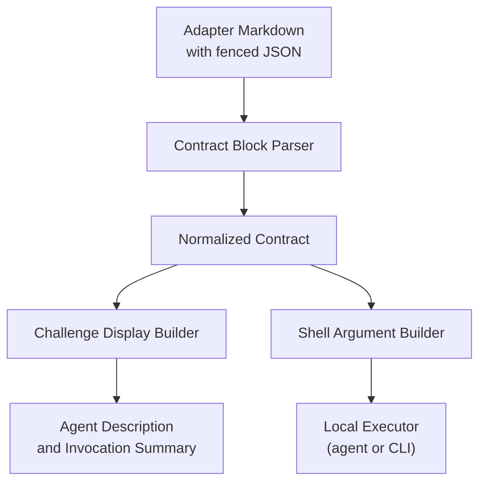
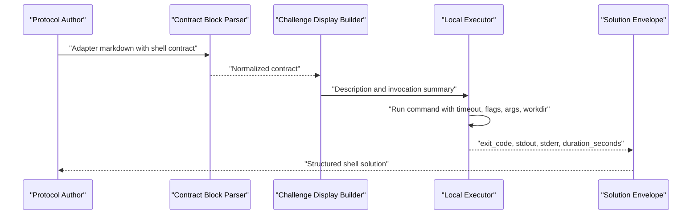
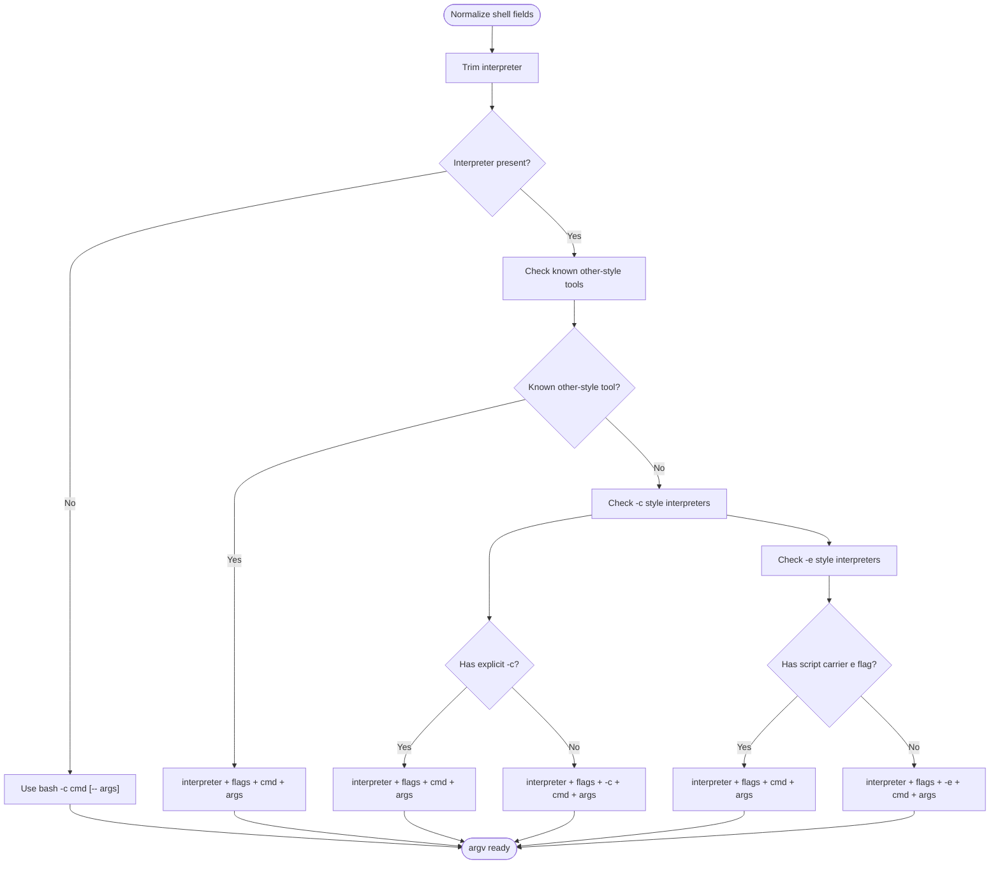
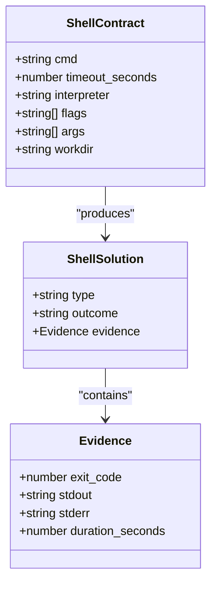
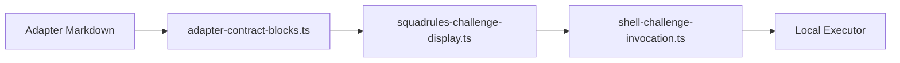

# Shell Contracts

<cite>
**Referenced Files in This Document**
- [adapter-example-shell.md](file://docs/examples/adapter-example-shell.md)
- [challenge-type-guide.md](file://src/embed-docs/mem/challenge-type-guide.md)
- [shell-challenge-invocation.ts](file://src/tools/shell-challenge-invocation.ts)
- [squadrules-challenge-display.ts](file://src/tools/squadrules-challenge-display.ts)
- [adapter-contract-blocks.ts](file://src/services/memory/adapter-contract-blocks.ts)
</cite>

## Table of Contents
1. [Introduction](#introduction)
2. [Project Structure](#project-structure)
3. [Core Components](#core-components)
4. [Architecture Overview](#architecture-overview)
5. [Detailed Component Analysis](#detailed-component-analysis)
6. [Dependency Analysis](#dependency-analysis)
7. [Performance Considerations](#performance-considerations)
8. [Troubleshooting Guide](#troubleshooting-guide)
9. [Conclusion](#conclusion)

## Introduction
Shell contracts are the mechanism by which adapters express deterministic, executable verification steps. A shell contract describes a command to run, how long it may run, which interpreter should execute it, what flags and dynamic arguments to pass, and which working directory context to use. The system converts these contracts into clear instructions for agents or executors, builds safe invocation summaries, and expects structured execution evidence including exit code, standard output, standard error, and duration.

The intended audience includes protocol authors who define adapter layers, agents that interpret contracts, and operators who review or troubleshoot shell-based verification steps.

## Project Structure
Shell contracts live inside adapter layer definitions as JSON blocks. The repository contains:
- Example adapters showing shell contracts in practice.
- Documentation describing challenge types, interpreter selection, security rules, and solution shapes.
- TypeScript utilities that normalize shell fields, build argv, and generate human-readable descriptions.
- Contract parsing logic that extracts JSON blocks from adapter documentation.

**Diagram sources**
- [adapter-contract-blocks.ts:21-45](file://src/services/memory/adapter-contract-blocks.ts#L21-L45)
- [squadrules-challenge-display.ts:19-62](file://src/tools/squadrules-challenge-display.ts#L19-L62)
- [shell-challenge-invocation.ts:18-121](file://src/tools/shell-challenge-invocation.ts#L18-L121)

**Section sources**
- [adapter-example-shell.md:1-33](file://docs/examples/adapter-example-shell.md#L1-L33)
- [adapter-contract-blocks.ts:1-117](file://src/services/memory/adapter-contract-blocks.ts#L1-L117)

## Core Components
The shell contract object is defined under `contract.shell` and supports the following fields:

| Field | Type | Required | Purpose |
|---|---|---:|---|
| `cmd` | string | Yes | Command or inline script to execute. |
| `timeout_seconds` | number | No | Maximum allowed execution time; defaults to 30 when not provided. |
| `interpreter` | string | No | Explicit interpreter such as `python3`, `perl`, `node`, `docker`, or `bash`. |
| `flags` | string array | No | Static command-line options passed before the command. |
| `args` | string array | No | Dynamic parameters appended after the command. |
| `workdir` | string | No | Working directory used when running the process. |

Key behaviors:
- If no interpreter is set, or the interpreter is `bash`, the system runs `bash -c cmd [-- args]`.
- For known interpreters using `-c` (for example Python or POSIX shell), the system injects `-c` unless an explicit `-c` flag is already present.
- For known interpreters using `-e` (for example Perl, Node, Ruby), the system injects `-e` unless a script-carrier flag like `-e`, `-ne`, or `-pe` is already present.
- Known “other” tools such as `terraform`, `docker`, `kubectl`, `npm`, `cargo`, and similar receive `interpreter + flags + cmd + args` without auto-injected code flags.
- `flags` and `args` are preserved when explicitly provided.
- `interpreter` and `workdir` are trimmed; empty values are omitted.

**Section sources**
- [shell-challenge-invocation.ts:6-12](file://src/tools/shell-challenge-invocation.ts#L6-L12)
- [shell-challenge-invocation.ts:18-33](file://src/tools/shell-challenge-invocation.ts#L18-L33)
- [shell-challenge-invocation.ts:40-63](file://src/tools/shell-challenge-invocation.ts#L40-L63)
- [shell-challenge-invocation.ts:88-121](file://src/tools/shell-challenge-invocation.ts#L88-L121)
- [squadrules-challenge-display.ts:35-62](file://src/tools/squadrules-challenge-display.ts#L35-L62)

## Architecture Overview
A shell contract flows through three main phases:

1. **Definition:** Protocol authors write adapter markdown containing a fenced JSON block with `type: "shell"` and a `shell` configuration.
2. **Normalization and display:** The system parses the contract, normalizes shell fields, builds a safe argv representation, and generates a description telling the executor exactly what to run, how to capture output, and how to treat success.
3. **Execution and evidence:** An executor runs the command locally, captures stdout, stderr, exit code, and duration, then returns a structured solution.

**Diagram sources**
- [adapter-contract-blocks.ts:21-45](file://src/services/memory/adapter-contract-blocks.ts#L21-L45)
- [squadrules-challenge-display.ts:19-62](file://src/tools/squadrules-challenge-display.ts#L19-L62)
- [challenge-type-guide.md:102-128](file://src/embed-docs/mem/challenge-type-guide.md#L102-L128)

## Detailed Component Analysis

### Shell Contract Definition Format
A shell contract is placed inside a fenced JSON block in adapter documentation. The minimal required shape uses `type: "shell"` and a `shell` object containing at least `cmd` and optionally `timeout_seconds`.

Example reference:
- [adapter-example-shell.md:13-24](file://docs/examples/adapter-example-shell.md#L13-L24)

Recommended practices:
- Keep `cmd` focused on one verifiable action.
- Set `timeout_seconds` based on expected runtime.
- Use `interpreter` only when the command requires a specific runtime.
- Prefer `flags` for static options and `args` for dynamic parameters.
- Use `workdir` when the command must run in a specific directory.

**Section sources**
- [adapter-example-shell.md:1-33](file://docs/examples/adapter-example-shell.md#L1-L33)
- [challenge-type-guide.md:70-75](file://src/embed-docs/mem/challenge-type-guide.md#L70-L75)

### Shell Configuration Object Semantics
The shell configuration object controls how the command is executed.

| Field | Behavior |
|---|---|
| `cmd` | The primary command or inline script. When missing or empty, bash defaults to a no-op. |
| `timeout_seconds` | Used in generated descriptions and executor guidance. Default is 30 seconds if absent. |
| `interpreter` | Overrides default bash behavior. Trimming removes surrounding whitespace. |
| `flags` | Passed before the command. Auto-injection avoids duplicate `-c` or `-e` where applicable. |
| `args` | Passed after the command. For bash, they are separated from the command via `--`. |
| `workdir` | Sets the process working directory after environment variable expansion. Empty values are ignored. |

**Diagram sources**
- [shell-challenge-invocation.ts:18-33](file://src/tools/shell-challenge-invocation.ts#L18-L33)
- [shell-challenge-invocation.ts:40-63](file://src/tools/shell-challenge-invocation.ts#L40-L63)
- [shell-challenge-invocation.ts:88-121](file://src/tools/shell-challenge-invocation.ts#L88-L121)

**Section sources**
- [shell-challenge-invocation.ts:18-121](file://src/tools/shell-challenge-invocation.ts#L18-L121)
- [squadrules-challenge-display.ts:35-62](file://src/tools/squadrules-challenge-display.ts#L35-L62)

### Interpreter Selection Rules
The interpreter selection logic distinguishes between:
- Default bash execution.
- Known “other-style” tools that manage their own subcommands and flags.
- Interpreters that accept inline code via `-c`.
- Interpreters that accept inline code via `-e`.

Known groups:
- `-c` group: Python and POSIX shell variants.
- `-e` group: Perl, Node, and Ruby variants.
- Other-style group: Infrastructure and language tooling such as Terraform, Docker, Kubernetes CLI, package managers, and build tools.

This design prevents accidental double injection of code flags while still allowing authors to supply explicit flags.

**Section sources**
- [shell-challenge-invocation.ts:40-63](file://src/tools/shell-challenge-invocation.ts#L40-L63)
- [shell-challenge-invocation.ts:75-83](file://src/tools/shell-challenge-invocation.ts#L75-L83)
- [shell-challenge-invocation.ts:88-121](file://src/tools/shell-challenge-invocation.ts#L88-L121)

### Output Capture and Solution Shape
For shell challenges, success is determined by the real process exit code. The expected solution envelope includes:
- `type`: `"shell"`
- `outcome`: `"success"`, `"failure"`, or `"skipped"`
- `evidence.exit_code`: Real process exit code
- `evidence.stdout`: Captured standard output
- `evidence.stderr`: Captured standard error
- `evidence.duration_seconds`: Execution duration

The display builder instructs executors to capture both stdout and stderr, not suppress stderr, and to report real values rather than fabricating results.

**Diagram sources**
- [shell-challenge-invocation.ts:6-12](file://src/tools/shell-challenge-invocation.ts#L6-L12)
- [challenge-type-guide.md:102-128](file://src/embed-docs/mem/challenge-type-guide.md#L102-L128)
- [squadrules-challenge-display.ts:44-62](file://src/tools/squadrules-challenge-display.ts#L44-L62)

**Section sources**
- [challenge-type-guide.md:102-128](file://src/embed-docs/mem/challenge-type-guide.md#L102-L128)
- [squadrules-challenge-display.ts:44-62](file://src/tools/squadrules-challenge-display.ts#L44-L62)

### Security Considerations
Security is central to shell contracts because they can execute arbitrary commands.

Key rules:
- Treat shell contracts as privileged operations.
- Avoid hardcoding filenames; use variables supplied by the parent agent.
- Use `$SQUADRULES_LOCAL_ARTIFACT_DIR` as the base directory for local handoff artifacts.
- Resolve URIs from `squadrules_local_artifact_dir` into absolute paths before running.
- Never write credentials or secrets to files.
- Validate that `workdir` exists, is a directory, and resolves to a non-empty path.
- Fail clearly when prerequisites are missing instead of silently succeeding.

These rules are documented in the challenge type guide and reinforced in the display instructions.

**Section sources**
- [challenge-type-guide.md:191-211](file://src/embed-docs/mem/challenge-type-guide.md#L191-L211)
- [squadrules-challenge-display.ts:47-54](file://src/tools/squadrules-challenge-display.ts#L47-L54)

### Environment Variable Handling
Environment variables play two roles:
1. **Command inputs:** Commands may read variables such as `$DRAFT_FILE`, `$VERDICT_FILE`, or `$TARGET_REPO`. These should be set by the parent agent so parallel sessions do not collide.
2. **Workspace resolution:** The parent agent should export `$SQUADRULES_LOCAL_ARTIFACT_DIR` when needed, derived from the latest activation, forwarding, or next step response.

When `workdir` is provided, it is treated as the real process working directory after environment variable expansion.

**Section sources**
- [challenge-type-guide.md:191-211](file://src/embed-docs/mem/challenge-type-guide.md#L191-L211)
- [squadrules-challenge-display.ts:51-54](file://src/tools/squadrules-challenge-display.ts#L51-L54)

### Error Handling Patterns
Error handling should preserve the real shell status and make failures actionable.

Recommended patterns:
- Chain checks with `&&` so the first failure stops execution.
- Preserve the original exit code even when printing status markers.
- Do not mask failures with constructs that change left-to-right evaluation order.
- Report real `exit_code`, `stdout`, and `stderr`; never fabricate evidence.
- Fail early when the interpreter is not available or the working directory is invalid.

The display builder explicitly tells executors to capture stderr and report real values. The challenge type guide provides guidance for preserving shell statuses and avoiding weak verification patterns.

**Section sources**
- [squadrules-challenge-display.ts:44-46](file://src/tools/squadrules-challenge-display.ts#L44-L46)
- [challenge-type-guide.md:213-234](file://src/embed-docs/mem/challenge-type-guide.md#L213-L234)

### Practical Examples

#### File Processing
Use shell contracts to verify file existence, content, checksums, or transformation results. Prefer variables over hardcoded paths and validate outputs deterministically.

Reference pattern:
- [challenge-type-guide.md:213-246](file://src/embed-docs/mem/challenge-type-guide.md#L213-L246)

#### API Calls
Use shell contracts to call external APIs through CLI tools, validate responses, and assert status codes or response bodies. Combine with timeouts appropriate for network latency.

Reference pattern:
- [challenge-type-guide.md:213-234](file://src/embed-docs/mem/challenge-type-guide.md#L213-L234)

#### System Administration Tasks
Use shell contracts for git state checks, service health probes, deployment validations, and infrastructure commands. Choose interpreters and flags according to the tool’s expected argv shape.

Reference pattern:
- [shell-challenge-invocation.ts:50-63](file://src/tools/shell-challenge-invocation.ts#L50-L63)

#### Common Adapter Example
The repository includes a minimal shell adapter example that runs a test suite and treats exit code 0 as success.

Reference:
- [adapter-example-shell.md:9-24](file://docs/examples/adapter-example-shell.md#L9-L24)

## Dependency Analysis
The shell contract feature depends on several modules:

- Contract parsing reads JSON blocks from adapter markdown.
- Display building consumes normalized contracts and produces agent-facing descriptions.
- Argument building converts shell configuration into argv for local execution.
- Tests validate trimming, field preservation, and argv construction.

**Diagram sources**
- [adapter-contract-blocks.ts:21-45](file://src/services/memory/adapter-contract-blocks.ts#L21-L45)
- [squadrules-challenge-display.ts:1-8](file://src/tools/squadrules-challenge-display.ts#L1-L8)
- [shell-challenge-invocation.ts:1-12](file://src/tools/shell-challenge-invocation.ts#L1-L12)

**Section sources**
- [adapter-contract-blocks.ts:1-117](file://src/services/memory/adapter-contract-blocks.ts#L1-L117)
- [squadrules-challenge-display.ts:1-90](file://src/tools/squadrules-challenge-display.ts#L1-L90)
- [shell-challenge-invocation.ts:1-138](file://src/tools/shell-challenge-invocation.ts#L1-L138)

## Performance Considerations
- Keep shell commands fast and deterministic. Long-running commands should have realistic `timeout_seconds`.
- Prefer lightweight validation commands for verification steps.
- Avoid unnecessary subprocesses; chain checks within a single shell command when possible.
- Use `flags` and `args` to avoid rebuilding large command strings repeatedly.
- Limit stdout and stderr size by redirecting verbose logs when appropriate.
- Reuse stable artifact directories under `$SQUADRULES_LOCAL_ARTIFACT_DIR` to reduce filesystem churn.

[No sources needed since this section provides general guidance]

## Troubleshooting Guide

### Command Does Not Run
- Verify `cmd` is present and non-empty.
- Confirm the interpreter is installed and reachable on PATH.
- Check that `flags` and `args` match the interpreter’s expected argv shape.
- Review the generated invocation summary to see how the system interpreted the contract.

**Section sources**
- [squadrules-challenge-display.ts:44-62](file://src/tools/squadrules-challenge-display.ts#L44-L62)
- [shell-challenge-invocation.ts:88-121](file://src/tools/shell-challenge-invocation.ts#L88-L121)

### Wrong Interpreter Behavior
- If the command behaves like a shell script but was given a non-bash interpreter, add the correct `interpreter`.
- If `-c` or `-e` appears twice, remove the explicit flag from `flags` and let the system inject it automatically.
- For tools like Docker or Terraform, rely on the “other-style” path and place subcommands in `cmd` or `flags` as appropriate.

**Section sources**
- [shell-challenge-invocation.ts:40-63](file://src/tools/shell-challenge-invocation.ts#L40-L63)
- [shell-challenge-invocation.ts:75-83](file://src/tools/shell-challenge-invocation.ts#L75-L83)
- [shell-challenge-invocation.ts:88-121](file://src/tools/shell-challenge-invocation.ts#L88-L121)

### Timeout Errors
- Increase `timeout_seconds` for slow tests, network calls, or large data processing.
- Split long tasks into smaller steps with intermediate artifacts.
- Ensure the command itself does not hang waiting for user input.

**Section sources**
- [squadrules-challenge-display.ts:35-38](file://src/tools/squadrules-challenge-display.ts#L35-L38)
- [adapter-example-shell.md:13-24](file://docs/examples/adapter-example-shell.md#L13-L24)

### Working Directory Problems
- Ensure `workdir` points to an existing directory.
- Expand environment variables before resolving the path.
- Export `$SQUADRULES_LOCAL_ARTIFACT_DIR` when working with shared artifacts.
- Fail clearly if the resolved path is empty or not a directory.

**Section sources**
- [squadrules-challenge-display.ts:51-54](file://src/tools/squadrules-challenge-display.ts#L51-L54)
- [challenge-type-guide.md:191-211](file://src/embed-docs/mem/challenge-type-guide.md#L191-L211)

### Missing or Incorrect Evidence
- Always capture stdout and stderr.
- Return the real `exit_code`.
- Include `duration_seconds`.
- Do not fabricate evidence; report actual command results.

**Section sources**
- [squadrules-challenge-display.ts:44-46](file://src/tools/squadrules-challenge-display.ts#L44-L46)
- [challenge-type-guide.md:102-128](file://src/embed-docs/mem/challenge-type-guide.md#L102-L128)

## Conclusion
Shell contracts provide a structured, auditable way to execute and verify commands inside adapters. By combining a well-defined configuration object, predictable interpreter selection, strict security rules, and structured output capture, the system enables agents and operators to reason about command execution safely and reproducibly. Authors should prefer strong observable contracts, choose interpreters deliberately, protect sensitive data, and design commands that produce deterministic, machine-checkable evidence.

[No sources needed since this section summarizes without analyzing specific files]