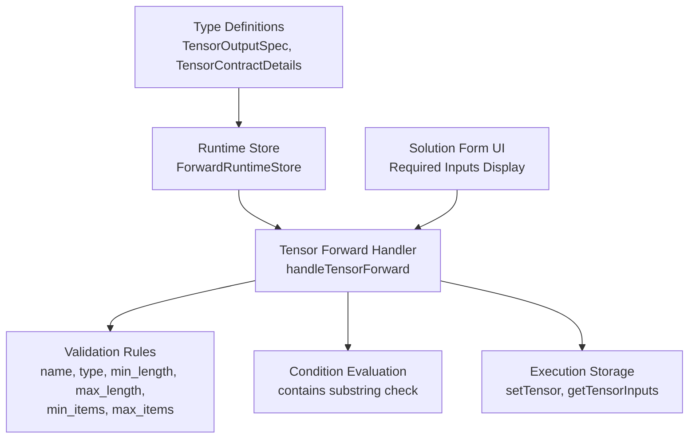
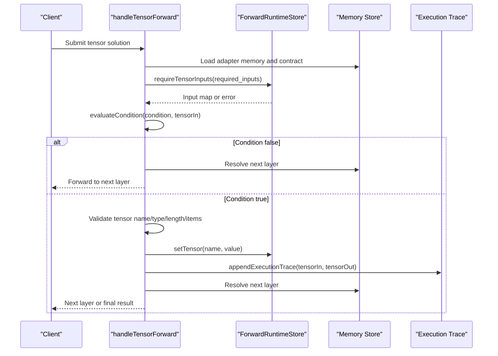
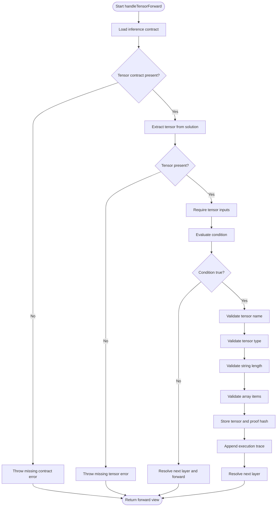
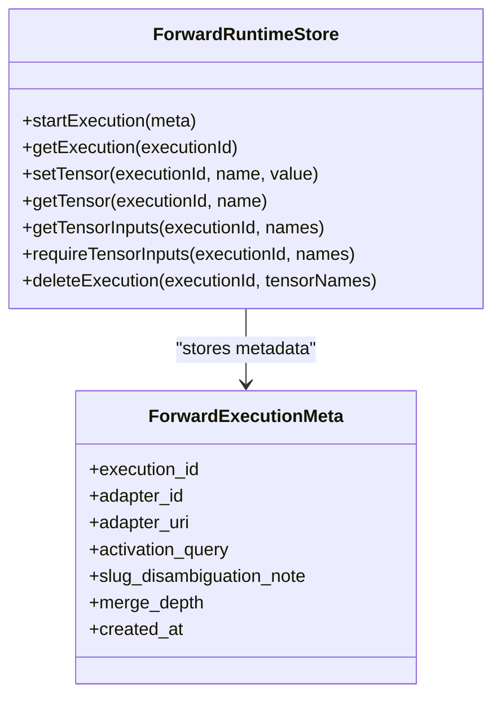
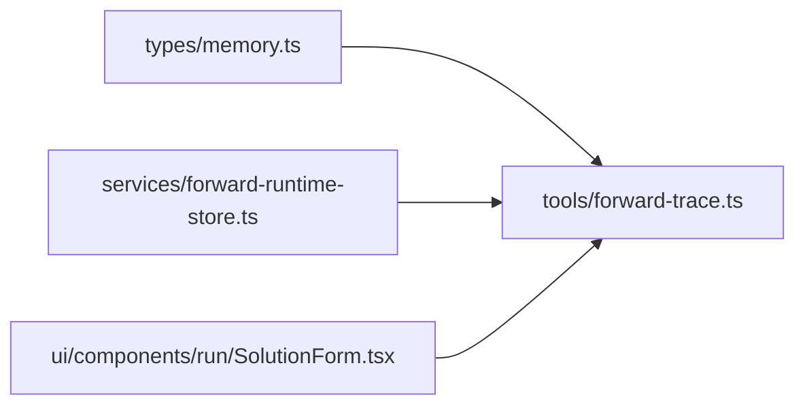

# Tensor Contracts

<cite>
**Referenced Files in This Document**
- [memory.ts](file://src/types/memory.ts)
- [forward-trace.ts](file://src/tools/forward-trace.ts)
- [forward-runtime-store.ts](file://src/services/forward-runtime-store.ts)
- [SolutionForm.tsx](file://src/ui/components/run/SolutionForm.tsx)
- [adapter-example-all-types.md](file://docs/examples/adapter-example-all-types.md)
</cite>

## Table of Contents
1. [Introduction](#introduction)
2. [Project Structure](#project-structure)
3. [Core Components](#core-components)
4. [Architecture Overview](#architecture-overview)
5. [Detailed Component Analysis](#detailed-component-analysis)
6. [Dependency Analysis](#dependency-analysis)
7. [Performance Considerations](#performance-considerations)
8. [Troubleshooting Guide](#troubleshooting-guide)
9. [Conclusion](#conclusion)

## Introduction
Tensor contracts are the structured data processing contract type used by adapters to define deterministic, auditable input/output behavior for tensor-producing steps. A tensor contract declares:
- Which previously produced tensors must be available as inputs.
- What output tensor name and shape are expected.
- Optional runtime constraints such as string length or array item count.
- Optional conditional routing that can skip a layer based on earlier outputs.
- Optional merge metadata that describes how multiple tensor outputs should be combined across adapter layers.

This document explains the contract schema, validation rules, execution flow, integration patterns within adapter workflows, best practices, and common troubleshooting scenarios.

## Project Structure
The tensor contract system is implemented across three main areas:
- Type definitions for tensor contracts and values.
- Runtime handling for tensor validation, storage, and conditional forwarding.
- UI components that display required inputs and guide users when submitting tensor solutions.

**Diagram sources**
- [memory.ts:13-27](file://src/types/memory.ts#L13-L27)
- [forward-runtime-store.ts:25-62](file://src/services/forward-runtime-store.ts#L25-L62)
- [forward-trace.ts:119-229](file://src/tools/forward-trace.ts#L119-L229)
- [SolutionForm.tsx:185-213](file://src/ui/components/run/SolutionForm.tsx#L185-L213)

**Section sources**
- [memory.ts:13-27](file://src/types/memory.ts#L13-L27)
- [forward-trace.ts:119-229](file://src/tools/forward-trace.ts#L119-L229)
- [forward-runtime-store.ts:25-62](file://src/services/forward-runtime-store.ts#L25-L62)
- [SolutionForm.tsx:185-213](file://src/ui/components/run/SolutionForm.tsx#L185-L213)

## Core Components
The core tensor contract model consists of two primary types:

- `TensorOutputSpec` defines the expected output tensor:
  - `name`: The required tensor name.
  - `type`: Expected value type, currently supporting string and string array semantics.
  - `min_length`, `max_length`: Optional string length bounds.
  - `min_items`, `max_items`: Optional array item count bounds.

- `TensorContractDetails` extends the output spec with runtime behavior:
  - `required_inputs`: Array of tensor names that must exist before this step runs.
  - `output`: The `TensorOutputSpec` describing the produced tensor.
  - `merge`: Optional strategy field indicating how multiple tensor outputs should be combined.
  - `condition`: Optional condition expression controlling whether the layer executes.

These types are consumed by the forward handler to validate inputs, enforce output contracts, and route execution through adapter layers.

**Section sources**
- [memory.ts:13-27](file://src/types/memory.ts#L13-L27)

## Architecture Overview
Tensor contracts integrate into the adapter workflow through the forward chain. When an adapter layer has a tensor contract:
1. The handler loads the inference contract from the adapter memory.
2. It retrieves required input tensors from the runtime store.
3. It evaluates the optional condition against those inputs.
4. If the condition fails, it forwards to the next eligible layer.
5. If the condition passes, it validates the submitted tensor against the output spec.
6. On success, it stores the tensor, records proof-of-work, appends an execution trace, and resolves the next layer.

**Diagram sources**
- [forward-trace.ts:133-229](file://src/tools/forward-trace.ts#L133-L229)
- [forward-runtime-store.ts:55-62](file://src/services/forward-runtime-store.ts#L55-L62)

## Detailed Component Analysis

### Tensor Contract Schema
The schema defines both the output specification and the runtime contract details.

| Field | Location | Purpose | Notes |
|---|---|---|---|
| `name` | `TensorOutputSpec.name` | Declares the required tensor name | Must match the submitted tensor name |
| `type` | `TensorOutputSpec.type` | Declares expected value type | Supports string and string array semantics |
| `min_length` | `TensorOutputSpec.min_length` | Minimum string length | Applied only when value is a string |
| `max_length` | `TensorOutputSpec.max_length` | Maximum string length | Applied only when value is a string |
| `min_items` | `TensorOutputSpec.min_items` | Minimum array item count | Applied only when value is an array |
| `max_items` | `TensorOutputSpec.max_items` | Maximum array item count | Applied only when value is an array |
| `required_inputs` | `TensorContractDetails.required_inputs` | Required previous tensor names | Missing inputs cause a runtime error |
| `output` | `TensorContractDetails.output` | Output specification | References `TensorOutputSpec` |
| `merge` | `TensorContractDetails.merge` | Merge strategy metadata | Describes how multiple outputs combine |
| `condition` | `TensorContractDetails.condition` | Conditional routing expression | Controls whether the layer executes |

**Section sources**
- [memory.ts:13-27](file://src/types/memory.ts#L13-L27)

### Validation Rules
The tensor forward handler enforces strict validation after loading required inputs and evaluating conditions.

Validation order:
1. Ensure a tensor contract exists.
2. Extract the tensor from the solution.
3. Require all `required_inputs` to be present.
4. Evaluate the `condition` expression.
5. Validate tensor name against `output.name`.
6. Validate tensor value type against `output.type`.
7. Apply `min_length` and `max_length` for strings.
8. Apply `min_items` and `max_items` for arrays.
9. Store the tensor and record proof-of-work.
10. Append execution trace and resolve the next layer.

**Diagram sources**
- [forward-trace.ts:133-229](file://src/tools/forward-trace.ts#L133-L229)

**Section sources**
- [forward-trace.ts:133-229](file://src/tools/forward-trace.ts#L133-L229)

### Conditional Logic
The `condition` field supports a simple substring containment rule:
- Syntax: `<input_name> contains '<substring>'`
- Behavior: If the named input is a string containing the substring, the condition evaluates to true; otherwise, it evaluates to false.
- Effect: When false, the handler skips the current layer and forwards to the next eligible layer.

This allows adapters to branch execution based on prior tensor outputs without requiring complex expressions.

**Section sources**
- [forward-trace.ts:119-131](file://src/tools/forward-trace.ts#L119-L131)
- [forward-trace.ts:158-174](file://src/tools/forward-trace.ts#L158-L174)

### Merge Strategy
The `merge` field exists in `TensorContractDetails` as optional metadata describing how multiple tensor outputs should be combined across adapter layers. In the current implementation:
- The field is declared but not actively parsed or enforced by the tensor forward handler.
- Execution traces include a `merge_depth` field, suggesting future or external merge orchestration.
- Consumers should treat `merge` as declarative contract metadata rather than an automatically executed strategy.

Best practice:
- Use `merge` to document intended combination behavior (for example, concatenation, aggregation, or selection).
- Keep downstream consumers or higher-level orchestrators responsible for interpreting and applying the merge strategy.
- Avoid relying on automatic merging inside the tensor forward handler unless explicitly extended.

**Section sources**
- [memory.ts:22-27](file://src/types/memory.ts#L22-L27)
- [forward-trace.ts:103-116](file://src/tools/forward-trace.ts#L103-L116)

### Integration Patterns Within Adapter Workflows
Tensor contracts fit naturally into the activate → forward → reward chain:
- `activate` selects an adapter and begins an execution.
- `forward` processes each layer according to its contract.
- For tensor layers, the handler validates and persists outputs.
- Subsequent layers can consume earlier tensors via `required_inputs`.
- `reward` finalizes the run after all layers complete.

Example adapter structure:
- Step 1: Produce a string tensor representing extracted text.
- Step 2: Require the text tensor and produce a list of tags.
- Step 3: Require the tag list and produce a summary comment.
- Final step: Display accumulated results.

The example adapter file demonstrates other challenge types and shows how contracts appear inside markdown adapters ready for training.

**Section sources**
- [adapter-example-all-types.md:1-81](file://docs/examples/adapter-example-all-types.md#L1-L81)

### Runtime Storage and Input Resolution
The runtime store manages per-execution tensor state:
- `setTensor`: Persists a tensor under an execution-scoped key.
- `getTensor`: Retrieves a tensor by name.
- `getTensorInputs`: Resolves a subset of tensors by required names.
- `requireTensorInputs`: Throws if any required tensor is missing.

This design ensures:
- Deterministic input availability.
- Clear error messages when prerequisites are missing.
- Isolation between concurrent executions.

**Diagram sources**
- [forward-runtime-store.ts:6-15](file://src/services/forward-runtime-store.ts#L6-L15)
- [forward-runtime-store.ts:25-76](file://src/services/forward-runtime-store.ts#L25-L76)

**Section sources**
- [forward-runtime-store.ts:25-76](file://src/services/forward-runtime-store.ts#L25-L76)

### User Interface Integration
The solution form displays tensor contract information to help users submit valid values:
- Shows the expected output tensor name and type.
- Lists required inputs when present.
- Provides a JSON textarea for entering tensor values.

This improves usability by making contract expectations visible during manual or guided runs.

**Section sources**
- [SolutionForm.tsx:185-213](file://src/ui/components/run/SolutionForm.tsx#L185-L213)

## Dependency Analysis
The tensor contract system has clear boundaries:
- Types define the contract schema.
- The forward handler consumes the schema and orchestrates validation.
- The runtime store provides isolated execution state.
- The UI renders contract metadata for user interaction.

**Diagram sources**
- [memory.ts:13-27](file://src/types/memory.ts#L13-L27)
- [forward-trace.ts:133-229](file://src/tools/forward-trace.ts#L133-L229)
- [forward-runtime-store.ts:25-76](file://src/services/forward-runtime-store.ts#L25-L76)
- [SolutionForm.tsx:185-213](file://src/ui/components/run/SolutionForm.tsx#L185-L213)

**Section sources**
- [memory.ts:13-27](file://src/types/memory.ts#L13-L27)
- [forward-trace.ts:133-229](file://src/tools/forward-trace.ts#L133-L229)
- [forward-runtime-store.ts:25-76](file://src/services/forward-runtime-store.ts#L25-L76)
- [SolutionForm.tsx:185-213](file://src/ui/components/run/SolutionForm.tsx#L185-L213)

## Performance Considerations
- Tensor storage uses execution-scoped keys, avoiding cross-run collisions.
- Required input resolution iterates over declared names once per forward call.
- Validation is lightweight and operates on already loaded values.
- Execution traces are appended asynchronously with fire-and-forget persistence, reducing blocking overhead.

Recommendations:
- Keep `required_inputs` minimal to reduce lookup cost.
- Avoid excessively large tensors unless necessary.
- Prefer deterministic conditions to minimize branching complexity.
- Monitor execution trace persistence failures since they are logged but do not stop execution.

[No sources needed since this section provides general guidance]

## Troubleshooting Guide
Common validation errors and their causes:

| Error Pattern | Likely Cause | Resolution |
|---|---|---|
| Missing required tensor inputs | A previous layer did not produce a tensor listed in `required_inputs` | Ensure upstream layers produce the expected tensor names and values |
| Tensor name mismatch | Submitted tensor name differs from `output.name` | Align the submitted tensor name with the contract |
| Wrong tensor type | Submitted value does not match `output.type` | Use a string when `type` expects a string, or an array when it expects a string array |
| String too short | Value length is below `min_length` | Increase the string content to meet the minimum |
| String too long | Value length exceeds `max_length` | Reduce the string content to meet the maximum |
| Array too small | Array length is below `min_items` | Add more items to the array |
| Array too large | Array length exceeds `max_items` | Remove extra items from the array |
| Layer skipped unexpectedly | `condition` evaluated to false | Review the condition expression and upstream tensor values |

Debugging tips:
- Check execution traces to see which tensors were available as inputs.
- Verify that upstream adapters produce tensors with correct names.
- Inspect the UI-required inputs list to confirm expected dependencies.
- Simplify conditions temporarily to isolate routing issues.

**Section sources**
- [forward-trace.ts:158-196](file://src/tools/forward-trace.ts#L158-L196)
- [forward-runtime-store.ts:55-62](file://src/services/forward-runtime-store.ts#L55-L62)

## Conclusion
Tensor contracts provide a precise, auditable way to define structured data processing within adapters. They enforce input requirements, validate output shapes, support conditional routing, and expose merge metadata for future orchestration. By designing contracts with clear names, appropriate types, sensible length and item constraints, and minimal required inputs, teams can build reliable, composable adapter workflows. When problems arise, the error messages, execution traces, and UI hints make it straightforward to identify missing inputs, invalid shapes, or unexpected condition evaluations.

[No sources needed since this section summarizes without analyzing specific files]