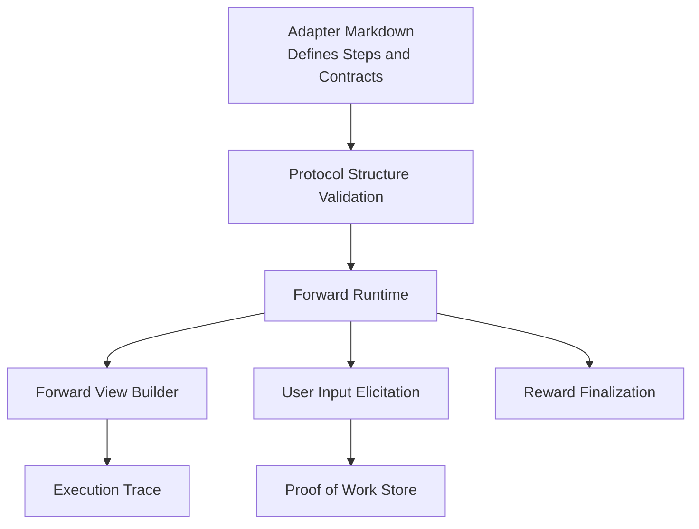
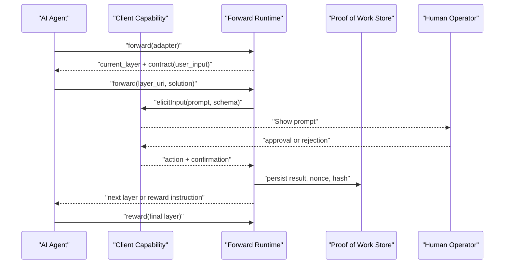
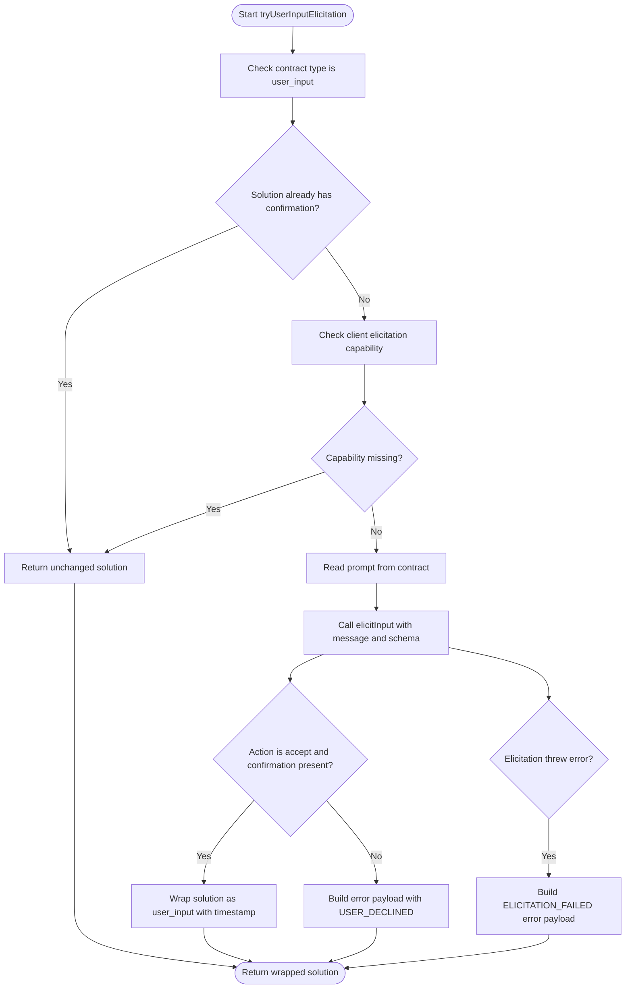
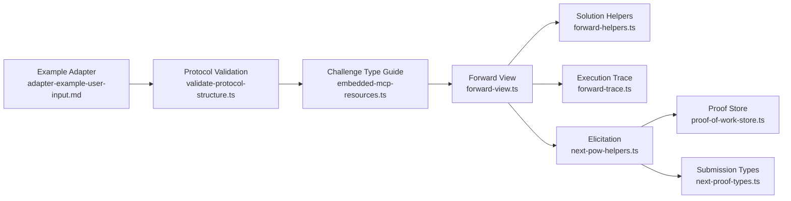

# User Input Contracts

<cite>
**Referenced Files in This Document**   
- [adapter-example-user-input.md](file://docs/examples/adapter-example-user-input.md)
- [embedded-mcp-resources.ts](file://src/resources/embedded-mcp-resources.ts)
- [validate-protocol-structure.ts](file://src/services/memory/validate-protocol-structure.ts)
- [next-pow-helpers.ts](file://src/tools/next-pow-helpers.ts)
- [forward-view.ts](file://src/tools/forward-view.ts)
- [forward-trace.ts](file://src/tools/forward-trace.ts)
- [forward-helpers.ts](file://src/tools/forward-helpers.ts)
- [next-proof-types.ts](file://src/tools/next-proof-types.ts)
- [proof-of-work-store.ts](file://src/services/proof-of-work-store.ts)
</cite>

## Table of Contents
1. [Introduction](#introduction)
2. [Project Structure](#project-structure)
3. [Core Components](#core-components)
4. [Architecture Overview](#architecture-overview)
5. [Detailed Component Analysis](#detailed-component-analysis)
6. [Dependency Analysis](#dependency-analysis)
7. [Performance Considerations](#performance-considerations)
8. [Troubleshooting Guide](#troubleshooting-guide)
9. [Conclusion](#conclusion)
10. [Appendices](#appendices)

## Introduction
User input contracts are the mechanism that lets an automated workflow pause for human participation. In this project, adapters define steps as contracts, and a `user_input` contract signals that a step requires a human response before the workflow can continue. The system integrates these contracts into the standard `activate → forward → reward` chain so AI agents and human operators collaborate in a deterministic, auditable loop.

At a high level:
- An adapter defines one or more layers.
- Each layer exposes a contract describing what must happen next.
- A `user_input` contract asks the human operator to confirm, approve, reject, or otherwise respond.
- The runtime elicits the response, validates it, records it, and advances the workflow only when the contract is satisfied.
- When all layers are solved, the workflow reaches `reward`, which finalizes the run.

This document explains how to define `user_input` contracts, how they integrate with the activation and forwarding pipeline, and how to design effective prompts and validation patterns for approval workflows, data validation, and decision points.

## Project Structure
The user input feature spans documentation, protocol validation, runtime elicitation, solution mapping, tracing, and persistence. The most relevant locations are:

| Area | Responsibility | Key files |
|---|---|---|
| Example adapter | Shows a minimal adapter requiring human confirmation | [adapter-example-user-input.md](file://docs/examples/adapter-example-user-input.md) |
| Challenge type guidance | Documents when to use `user_input` and its JSON shape | [embedded-mcp-resources.ts](file://src/resources/embedded-mcp-resources.ts) |
| Protocol validation | Enforces allowed contract types during training | [validate-protocol-structure.ts](file://src/services/memory/validate-protocol-structure.ts) |
| Human elicitation | Calls the client capability to ask the human for input | [next-pow-helpers.ts](file://src/tools/next-pow-helpers.ts) |
| Forward view | Summarizes contracts, maps solutions, and builds next calls | [forward-view.ts](file://src/tools/forward-view.ts) |
| Execution trace | Normalizes user input into traceable tensor values | [forward-trace.ts](file://src/tools/forward-trace.ts) |
| Solution helpers | Builds evidence hints and empty solution templates | [forward-helpers.ts](file://src/tools/forward-helpers.ts) |
| Submission types | Defines the shape of proof submissions including `user_input` | [next-proof-types.ts](file://src/tools/next-proof-types.ts) |
| Proof persistence | Stores results, nonces, hashes, and retry state | [proof-of-work-store.ts](file://src/services/proof-of-work-store.ts) |



**Diagram sources**
- [adapter-example-user-input.md:1-32](file://docs/examples/adapter-example-user-input.md#L1-L32)
- [validate-protocol-structure.ts:113-186](file://src/services/memory/validate-protocol-structure.ts#L113-L186)
- [forward-view.ts:242-290](file://src/tools/forward-view.ts#L242-L290)
- [next-pow-helpers.ts:58-120](file://src/tools/next-pow-helpers.ts#L58-L120)
- [proof-of-work-store.ts:48-175](file://src/services/proof-of-work-store.ts#L48-L175)
- [forward-trace.ts:94-117](file://src/tools/forward-trace.ts#L94-L117)

**Section sources**
- [adapter-example-user-input.md:1-32](file://docs/examples/adapter-example-user-input.md#L1-L32)
- [embedded-mcp-resources.ts:19-31](file://src/resources/embedded-mcp-resources.ts#L19-L31)
- [validate-protocol-structure.ts:24-24](file://src/services/memory/validate-protocol-structure.ts#L24-L24)

## Core Components
A `user_input` contract has two main parts:

1. **Contract definition**: Declares that the step is a human interaction and provides a prompt guiding the participant.
2. **Solution envelope**: Carries the human’s response, typically a confirmation value and optional timestamp.

### Contract Definition
In adapter markdown, a `user_input` contract looks like this:

```json
{
  "contract": {
    "type": "user_input",
    "user_input": {
      "prompt": "Approve deployment to production?"
    },
    "required": true
  }
}
```

Key fields:
- `type`: Must be exactly `user_input`.
- `user_input.prompt`: The message shown to the human operator.
- `required`: If true, the step blocks progression until a valid confirmation is provided.

The example adapter demonstrates this pattern by asking for deployment approval before continuing to a completion step.

**Section sources**
- [adapter-example-user-input.md:9-23](file://docs/examples/adapter-example-user-input.md#L9-L23)
- [embedded-mcp-resources.ts:19-31](file://src/resources/embedded-mcp-resources.ts#L19-L31)

### Solution Envelope
Every solution follows a unified envelope with `type`, `outcome`, `evidence`, `nonce`, and `proof_hash`. For `user_input`, the evidence contains at least a confirmation value:

```json
{
  "type": "user_input",
  "outcome": "success",
  "evidence": {
    "confirmation": "agreed. proceed",
    "timestamp": "2026-05-18T14:49:00Z"
  }
}
```

The runtime also accepts older shapes where `user_input.confirmation` appears directly under the submission object. Both forms are normalized internally.

**Section sources**
- [embedded-mcp-resources.ts:19-31](file://src/resources/embedded-mcp-resources.ts#L19-L31)
- [forward-view.ts:112-137](file://src/tools/forward-view.ts#L112-L137)
- [next-proof-types.ts:21-24](file://src/tools/next-proof-types.ts#L21-L24)

## Architecture Overview
The `user_input` contract participates in the same lifecycle as other challenge types:

1. `activate` selects an adapter and returns the first layer.
2. `forward` loads the current layer and returns a contract.
3. If the contract is `user_input`, the runtime may elicit human input through the client’s elicitation capability.
4. The agent submits a solution containing the human’s response.
5. The runtime validates the solution, persists the result, and returns the next layer or finalization instructions.
6. After all layers are solved, `reward` finalizes the execution.



**Diagram sources**
- [next-pow-helpers.ts:58-120](file://src/tools/next-pow-helpers.ts#L58-L120)
- [forward-view.ts:242-290](file://src/tools/forward-view.ts#L242-L290)
- [proof-of-work-store.ts:48-175](file://src/services/proof-of-work-store.ts#L48-L175)

**Section sources**
- [embedded-mcp-resources.ts:19-31](file://src/resources/embedded-mcp-resources.ts#L19-L31)
- [next-pow-helpers.ts:58-120](file://src/tools/next-pow-helpers.ts#L58-L120)
- [forward-view.ts:242-290](file://src/tools/forward-view.ts#L242-L290)

## Detailed Component Analysis

### Protocol Validation and Allowed Types
The protocol validator enforces that adapter markdown uses only supported contract types. `user_input` is explicitly allowed alongside `shell`, `mcp`, `comment`, and `tensor`. During training, missing sections, invalid fences, or unsupported types produce structured errors that guide the author back to a valid adapter structure.

Important behaviors:
- Only exact string types are accepted.
- Mixed fenced code blocks with contract JSON are rejected.
- Every adapter must include required structural sections such as activation patterns and reward signal.

**Section sources**
- [validate-protocol-structure.ts:24-24](file://src/services/memory/validate-protocol-structure.ts#L24-L24)
- [validate-protocol-structure.ts:113-186](file://src/services/memory/validate-protocol-structure.ts#L113-L186)

### Elicitation Flow
When the current contract is `user_input` and the solution does not already contain a confirmation, the runtime attempts to elicit input from the client. It reads the prompt from the contract and sends a schema requesting a confirmation field with allowed values.

Flow highlights:
- If the client does not support elicitation, the runtime falls back to returning the existing solution without forcing elicitation.
- On acceptance with a confirmation, the runtime wraps the solution as a `user_input` proof and adds a timestamp.
- On decline or cancellation, the runtime returns an error payload with a retryable challenge.
- On elicitation failure, the runtime returns a structured error indicating the failure.



**Diagram sources**
- [next-pow-helpers.ts:58-120](file://src/tools/next-pow-helpers.ts#L58-L120)

**Section sources**
- [next-pow-helpers.ts:58-120](file://src/tools/next-pow-helpers.ts#L58-L120)

### Solution Mapping and Display
The forward view normalizes incoming solutions into a consistent internal representation. For `user_input`, it extracts `confirmation` and optionally `timestamp`. It also summarizes the contract for display purposes, showing the prompt text when available.

Key responsibilities:
- Normalize both unified envelope and legacy shapes.
- Provide a human-readable summary of the current contract.
- Generate the next call: either another `forward` or `reward`.

**Section sources**
- [forward-view.ts:77-80](file://src/tools/forward-view.ts#L77-L80)
- [forward-view.ts:112-137](file://src/tools/forward-view.ts#L112-L137)
- [forward-view.ts:242-290](file://src/tools/forward-view.ts#L242-L290)

### Execution Tracing
User input is recorded in execution traces as a tensor-like value named `user_input`. The trace stores the raw solution along with adapter context, layer index, and layer instructions. This makes human decisions part of the audit trail even though the actual confirmation text may be sensitive.

**Section sources**
- [forward-trace.ts:56-60](file://src/tools/forward-trace.ts#L56-L60)
- [forward-trace.ts:94-117](file://src/tools/forward-trace.ts#L94-L117)

### Proof Submission and Persistence
The proof submission handler validates the submitted proof against the contract. For `user_input`, it requires a confirmation field. Successful submissions are persisted with a result record, proof hash, and timestamp. Nonces and retry counters protect against replay and help recover from transient failures.

Persistence details:
- Results are stored with a long TTL.
- Nonces have a shorter TTL to limit replay windows.
- Retry counts are bounded and reset on success.
- Max retries escalate to a less strict mode after repeated failures.

**Section sources**
- [next-pow-helpers.ts:155-326](file://src/tools/next-pow-helpers.ts#L155-L326)
- [proof-of-work-store.ts:4-46](file://src/services/proof-of-work-store.ts#L4-L46)
- [proof-of-work-store.ts:66-175](file://src/services/proof-of-work-store.ts#L66-L175)

### Evidence Hints and Templates
To help agents construct correct solutions, the runtime provides:
- Evidence hints describing which fields belong in `evidence` for each contract type.
- Empty solution templates pre-filled with the expected type and outcome.

For `user_input`, the hint indicates that `evidence.confirmation` should contain the user reply.

**Section sources**
- [forward-helpers.ts:3-10](file://src/tools/forward-helpers.ts#L3-L10)
- [forward-helpers.ts:13-28](file://src/tools/forward-helpers.ts#L13-L28)

## Dependency Analysis
The following diagram shows how the core modules depend on each other around `user_input`:



**Diagram sources**
- [adapter-example-user-input.md:1-32](file://docs/examples/adapter-example-user-input.md#L1-L32)
- [validate-protocol-structure.ts:113-186](file://src/services/memory/validate-protocol-structure.ts#L113-L186)
- [embedded-mcp-resources.ts:19-31](file://src/resources/embedded-mcp-resources.ts#L19-L31)
- [forward-view.ts:242-290](file://src/tools/forward-view.ts#L242-L290)
- [forward-helpers.ts:3-28](file://src/tools/forward-helpers.ts#L3-L28)
- [forward-trace.ts:56-60](file://src/tools/forward-trace.ts#L56-L60)
- [next-pow-helpers.ts:58-120](file://src/tools/next-pow-helpers.ts#L58-L120)
- [proof-of-work-store.ts:48-175](file://src/services/proof-of-work-store.ts#L48-L175)
- [next-proof-types.ts:21-24](file://src/tools/next-proof-types.ts#L21-L24)

**Section sources**
- [forward-view.ts:242-290](file://src/tools/forward-view.ts#L242-L290)
- [next-pow-helpers.ts:58-120](file://src/tools/next-pow-helpers.ts#L58-L120)
- [proof-of-work-store.ts:48-175](file://src/services/proof-of-work-store.ts#L48-L175)

## Performance Considerations
- Elicitation is an interactive step and should be used sparingly. Prefer deterministic contracts (`shell`, `mcp`) for machine-verifiable work.
- Keep prompts concise and specific to reduce ambiguity and improve validation.
- Avoid storing large or sensitive human responses unnecessarily; the trace stores the confirmation value, so treat it as auditable data.
- Use `required: true` only when the workflow genuinely cannot proceed without human approval.
- Leverage the built-in retry and nonce mechanisms rather than implementing custom loops.

[No sources needed since this section provides general guidance]

## Troubleshooting Guide

### Common Issues and Resolutions

| Symptom | Likely Cause | Resolution |
|---|---|---|
| Adapter fails training with invalid contract type | The markdown contains a contract type not in the allowed set | Ensure `type` is exactly one of `shell`, `mcp`, `user_input`, `comment`, or `tensor`. |
| Prompt is missing or unclear | The `user_input.prompt` field is absent or vague | Add a clear, actionable prompt describing the required human decision. |
| Workflow stalls after prompting | Client does not support elicitation | Confirm the client exposes the elicitation capability; otherwise the runtime will not force human input. |
| Step repeatedly fails after user declines | Decline produces a retryable error payload | Review the prompt and allow the agent to retry with updated context. |
| Elicitation throws an error | Client-side elicitation failed | Inspect the error code `ELICITATION_FAILED` and fix the client integration. |
| Solution rejected for missing field | Confirmation was omitted | Include `user_input.confirmation` in the solution envelope. |
| Replay or nonce mismatch | Agent reused an old nonce or proof hash | Use the nonce and proof hash from the latest contract response. |

**Section sources**
- [validate-protocol-structure.ts:153-186](file://src/services/memory/validate-protocol-structure.ts#L153-L186)
- [next-pow-helpers.ts:79-119](file://src/tools/next-pow-helpers.ts#L79-L119)
- [next-pow-helpers.ts:155-326](file://src/tools/next-pow-helpers.ts#L155-L326)
- [proof-of-work-store.ts:39-46](file://src/services/proof-of-work-store.ts#L39-L46)

## Conclusion
User input contracts provide a controlled, auditable way to involve human operators in automated workflows. They fit naturally into the `activate → forward → reward` chain: adapters declare `user_input` steps, the runtime elicits and validates human responses, and the workflow proceeds only when the contract requirements are met. Effective prompts, careful validation, and appropriate use of `required` ensure that human-in-the-loop interactions remain reliable, secure, and easy to debug.

[No sources needed since this section summarizes without analyzing specific files]

## Appendices

### Example Interaction Patterns

#### Approval Workflow
Use `user_input` when a human must explicitly approve an action before it proceeds. The example adapter demonstrates approval for deployment.

Recommended contract shape:
- `type`: `user_input`
- `user_input.prompt`: A direct question such as whether to proceed.
- `required`: `true` when the workflow must stop without approval.

**Section sources**
- [adapter-example-user-input.md:9-23](file://docs/examples/adapter-example-user-input.md#L9-L23)

#### Data Validation Gate
Use `user_input` when a human must validate data quality, correctness, or compliance before downstream processing. The prompt should describe what was checked and what the human should verify.

Validation best practices:
- Show enough context for the human to make an informed decision.
- Ask for a clear confirmation or rejection.
- Record the timestamp for auditability.

**Section sources**
- [embedded-mcp-resources.ts:19-31](file://src/resources/embedded-mcp-resources.ts#L19-L31)
- [next-pow-helpers.ts:93-98](file://src/tools/next-pow-helpers.ts#L93-L98)

#### Decision Point
Use `user_input` when multiple paths exist and a human must choose among options. While the current implementation focuses on confirmation-style responses, you can encode decision semantics in the prompt and confirmation text.

Design tips:
- Make choices explicit in the prompt.
- Require a confirmation that reflects the chosen path.
- Follow up with deterministic steps that branch based on the recorded confirmation.

**Section sources**
- [forward-view.ts:77-80](file://src/tools/forward-view.ts#L77-L80)
- [forward-trace.ts:56-60](file://src/tools/forward-trace.ts#L56-L60)

### Best Practices for Prompts and Validation

| Area | Recommendation |
|---|---|
| Prompt clarity | State the goal, context, risk, and expected response format. |
| Scope | Limit each `user_input` step to one decision. |
| Required gates | Mark steps as required only when the workflow cannot safely continue. |
| Response handling | Treat confirmation as auditable evidence; avoid assuming free-form text is safe. |
| Fallbacks | Handle decline, cancellation, and elicitation failures gracefully. |
| Security | Do not expose secrets in prompts or traces unless absolutely necessary. |
| Determinism | Prefer machine-checkable contracts for irreversible actions; use `user_input` for genuine human judgment. |

**Section sources**
- [embedded-mcp-resources.ts:19-31](file://src/resources/embedded-mcp-resources.ts#L19-L31)
- [next-pow-helpers.ts:79-119](file://src/tools/next-pow-helpers.ts#L79-L119)
- [forward-helpers.ts:3-28](file://src/tools/forward-helpers.ts#L3-L28)