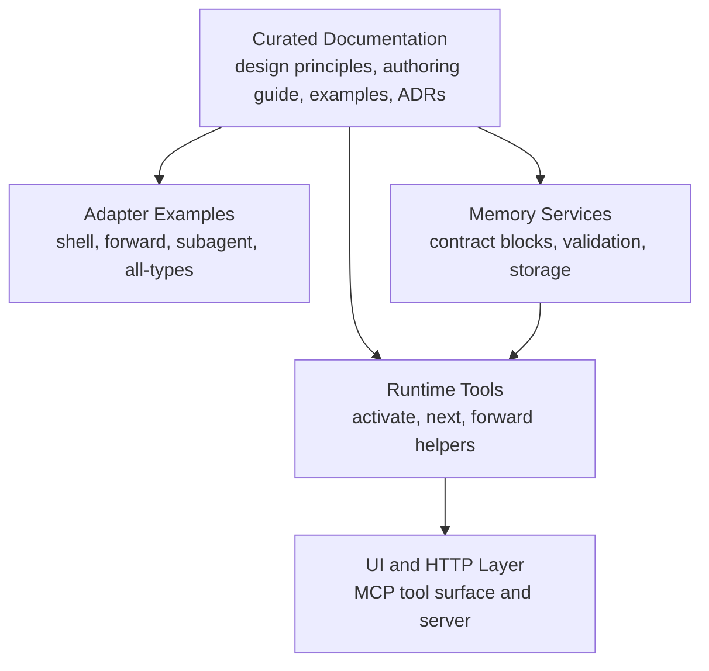
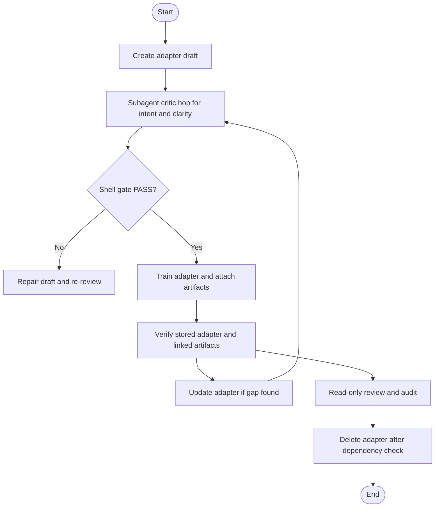
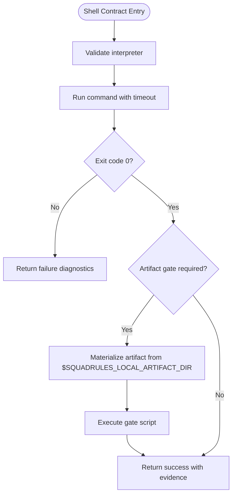
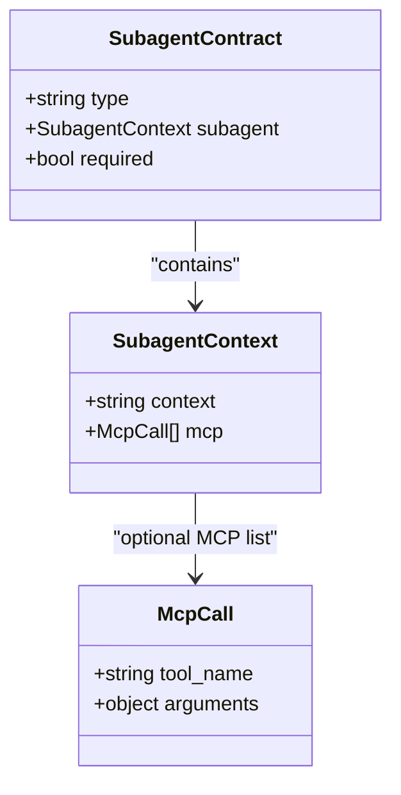
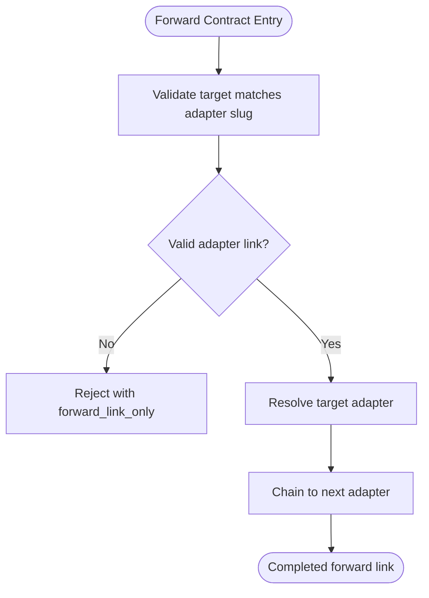
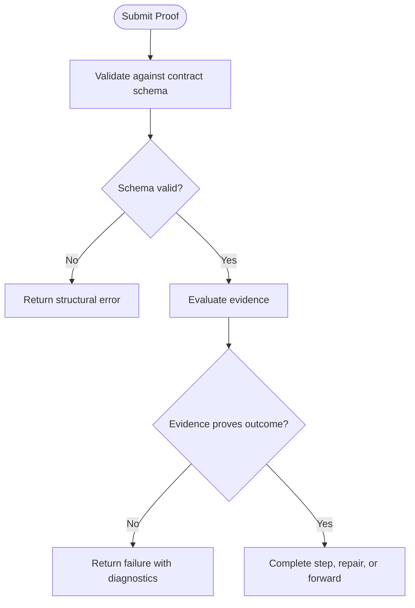
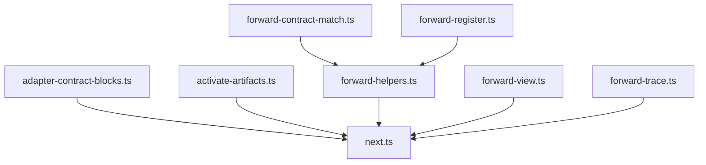

# Adapter Pattern and Workflow Execution

<cite>
**Referenced Files in This Document**
- [adapter-authoring-guide.md](file://docs/adapter-authoring-guide.md)
- [adapter-design-principles.md](file://docs/adapter-design-principles.md)
- [adapter-example-all-types.md](file://docs/examples/adapter-example-all-types.md)
- [adapter-example-shell.md](file://docs/examples/adapter-example-shell.md)
- [adapter-example-forward.md](file://docs/examples/adapter-example-forward.md)
- [adapter-example-subagent.md](file://docs/examples/adapter-example-subagent.md)
- [0024-adapter-contract-verification-ladder.md](file://docs/adr/0024-adapter-contract-verification-ladder.md)
- [0025-mcp-contract-forward-link-only.md](file://docs/adr/0025-mcp-contract-forward-link-only.md)
- [0026-shell-interpreter-required.md](file://docs/adr/0026-shell-interpreter-required.md)
- [0028-forward-contract-type-rename.md](file://docs/adr/0028-forward-contract-type-rename.md)
- [0029-subagent-mcp-and-context-authority.md](file://docs/adr/0029-subagent-mcp-and-context-authority.md)
- [0034-verification-isolation-critic-hop.md](file://docs/adr/0034-verification-isolation-critic-hop.md)
- [adapter-contract-blocks.ts](file://src/services/memory/adapter-contract-blocks.ts)
- [forward-contract-match.ts](file://src/tools/forward-contract-match.ts)
- [forward-error-payload.ts](file://src/tools/forward-error-payload.ts)
- [forward-helpers.ts](file://src/tools/forward-helpers.ts)
- [forward-register.ts](file://src/tools/forward-register.ts)
- [forward-tool-error.ts](file://src/tools/forward-tool-error.ts)
- [forward-trace.ts](file://src/tools/forward-trace.ts)
- [forward-view.ts](file://src/tools/forward-view.ts)
- [activate-artifacts.ts](file://src/tools/activate-artifacts.ts)
- [activate.ts](file://src/tools/activate.ts)
- [activate_schema.ts](file://src/tools/activate_schema.ts)
- [next.ts](file://src/tools/next.ts)
- [next_proof_types.ts](file://src/tools/next-proof-types.ts)
</cite>

## Table of Contents
1. [Introduction](#introduction)
2. [Project Structure](#project-structure)
3. [Core Components](#core-components)
4. [Architecture Overview](#architecture-overview)
5. [Detailed Component Analysis](#detailed-component-analysis)
6. [Dependency Analysis](#dependency-analysis)
7. [Performance Considerations](#performance-considerations)
8. [Troubleshooting Guide](#troubleshooting-guide)
9. [Conclusion](#conclusion)

## Introduction
SquadRules is an agent-first MCP framework where AI agents are the primary users. Adapters encode team preferences so an agent can execute work deterministically, with auditable evidence and verification contracts. The core workflow is activate → forward → reward: activation resolves an adapter and its steps; forward executes a step and produces proof; reward closes or advances the run based on verified outcomes.

Adapters provide deterministic, auditable task execution by separating what must be observed from what must be judged. They also guide AI agents through authoring, repair, and maintenance workflows rather than treating adapters as static configuration. The system favors autonomy, help over puzzles, and honest verification: checks should interrupt only when meaningful, instructions should teach rather than puzzle, and evidence should observe real outcomes instead of trusting claims.

This document explains how adapters implement the adapter pattern in SquadRules, how their lifecycle flows from creation to activation to execution, how verification contracts define input/output schemas and error handling, and how different adapter types—shell, subagent, and forward—serve distinct use cases within the broader workflow and agent autonomy model.

## Project Structure
The repository separates curated documentation from generated code artifacts. Authoring guidance lives under `docs/`, including design principles, the authoring guide, examples, and ADRs that record binding decisions. Runtime behavior for adapters is implemented under `src/`, particularly in tools and memory services that validate contracts, resolve forward links, materialize artifacts, and drive the step-by-step execution loop.



**Diagram sources**
- [adapter-design-principles.md:1-139](file://docs/adapter-design-principles.md#L1-L139)
- [adapter-authoring-guide.md:1-234](file://docs/adapter-authoring-guide.md#L1-L234)
- [adapter-contract-blocks.ts](file://src/services/memory/adapter-contract-blocks.ts)
- [activate.ts](file://src/tools/activate.ts)
- [next.ts](file://src/tools/next.ts)

**Section sources**
- [adapter-design-principles.md:1-139](file://docs/adapter-design-principles.md#L1-L139)
- [adapter-authoring-guide.md:1-234](file://docs/adapter-authoring-guide.md#L1-L234)

## Core Components
At the center of the adapter pattern are:

- **Adapters**: Markdown-based workflows describing triggers, steps, verification contracts, completion criteria, and reward signals.
- **Contracts**: Structured verification units attached to steps. Supported types include shell, forward, subagent, user_input, and comment.
- **Verification Ladder**: An ordered decision process that prefers empirical observation first, then delegated judgment, then delegated tool work, and finally acknowledgment as a last resort.
- **Execution Loop**: The runtime sequence that activates an adapter, presents the next step, validates submitted proof, and either completes the step, repairs the adapter, asks for emergency user input, or chains to another adapter via forward.
- **Authoring Context**: Guidance that helps AI agents create, update, review, and delete adapters while respecting structural rules and the verification ladder.

Key responsibilities:
- Contracts define what evidence proves, what failure means, and what happens next.
- Shell contracts assert observable state such as exit codes, files, refs, or report lines.
- Subagent contracts delegate judgment or MCP tool work and return reports without leaking full transcripts into the caller’s context.
- Forward contracts link to another adapter slug, enabling chainable workflows.
- User input is reserved for genuine authority gaps.
- Comment is a closing acknowledgment for read-only or knowledge adapters.

**Section sources**
- [adapter-design-principles.md:1-139](file://docs/adapter-design-principles.md#L1-L139)
- [adapter-authoring-guide.md:1-234](file://docs/adapter-authoring-guide.md#L1-L234)

## Architecture Overview
The adapter pattern integrates with the MCP tool surface through a consistent lifecycle:

1. **Activate**: Resolve the target adapter, load its steps and contracts, materialize linked artifacts, and present the first step.
2. **Next**: Determine the current step, required inputs, and expected proof shape.
3. **Forward**: Execute the step, collect evidence, validate it against the contract, and decide whether to complete the step, repair the adapter, ask for user input, or forward to another adapter.
4. **Reward**: Close the run or advance the workflow once verification succeeds.

```mermaid
sequenceDiagram
participant Agent as "AI Agent"
participant Activate as "activate"
participant Next as "next"
participant Forward as "forward helpers"
participant Store as "memory store"
participant Reward as "reward"
Agent->>Activate : "Resolve adapter and steps"
Activate-->>Agent : "First step and contract schema"
Agent->>Next : "Submit proof for current step"
Next->>Store : "Load stored adapter and previous steps"
Store-->>Next : "Adapter state and contract metadata"
Next->>Forward : "Validate evidence against contract"
Forward-->>Next : "Verdict : pass, fail, repair, or forward"
alt "Forward link"
Next-->>Agent : "Chain to next adapter"
else "Step completed"
Next-->>Agent : "Show outputs and request reward"
Agent->>Reward : "Close or advance workflow"
end
```

**Diagram sources**
- [activate.ts](file://src/tools/activate.ts)
- [activate_schema.ts](file://src/tools/activate_schema.ts)
- [next.ts](file://src/tools/next.ts)
- [next_proof_types.ts](file://src/tools/next-proof-types.ts)
- [forward-helpers.ts](file://src/tools/forward-helpers.ts)
- [forward-contract-match.ts](file://src/tools/forward-contract-match.ts)

**Section sources**
- [activate.ts](file://src/tools/activate.ts)
- [activate_schema.ts](file://src/tools/activate_schema.ts)
- [next.ts](file://src/tools/next.ts)
- [next_proof_types.ts](file://src/tools/next-proof-types.ts)
- [forward-helpers.ts](file://src/tools/forward-helpers.ts)
- [forward-contract-match.ts](file://src/tools/forward-contract-match.ts)

## Detailed Component Analysis

### Adapter Lifecycle: Creation Through Activation to Execution
The lifecycle begins with authoring and ends with execution and reward. Creation and updates are guided by the authoring workflow, which emphasizes intent, authorization, clarity, and minimal necessary contracts. Review is read-only and audits structural compliance, contract coverage, ladder placement, and activation accuracy. Deletion requires dependency checks and post-delete verification.



**Diagram sources**
- [adapter-authoring-guide.md:202-234](file://docs/adapter-authoring-guide.md#L202-L234)
- [adapter-design-principles.md:97-139](file://docs/adapter-design-principles.md#L97-L139)

**Section sources**
- [adapter-authoring-guide.md:202-234](file://docs/adapter-authoring-guide.md#L202-L234)
- [adapter-design-principles.md:97-139](file://docs/adapter-design-principles.md#L97-L139)

### Verification Ladder and Contract Selection
The verification ladder is ordered and soft-enforced through authoring guidance, critic-loop review, and authoring checklists. Hard, fail-closed rules include interpreter requirements, forward-link-only constraints, and invalid subagent MCP structures.

| Rung | Type | Use When | Evidence Produced |
| --- | --- | --- | --- |
| 1 | shell | Step leaves observable state | Empirical check result |
| 2 | subagent | Correctness needs judgment | Reviewer report with explicit criteria |
| 3 | subagent | Evidence is a tool result the caller should not hold | Subagent report; transcript stays isolated |
| Fallback | comment | No artifact and no judgment needed | Closing acknowledgment |

The critic never runs on the executor’s thread. A critic hop uses a subagent contract whose MCP list names `forward` → `squadrules://adapter/critic-loop`. The caller’s shell gate remains required after the hop.

**Section sources**
- [adapter-authoring-guide.md:23-58](file://docs/adapter-authoring-guide.md#L23-L58)
- [adapter-design-principles.md:43-80](file://docs/adapter-design-principles.md#L43-L80)
- [0024-adapter-contract-verification-ladder.md](file://docs/adr/0024-adapter-contract-verification-ladder.md)
- [0034-verification-isolation-critic-hop.md](file://docs/adr/0034-verification-isolation-critic-hop.md)

### Shell Contract: Empirical Checks
Shell contracts are rung 1 of the verification ladder. They assert observable outcomes such as exit codes, file content, git refs, or report lines. The interpreter field is required and restricted to allowed values. Complex checks should ship as gate script artifacts materialized at runtime rather than being inlined as one-liners.



**Diagram sources**
- [adapter-authoring-guide.md:87-113](file://docs/adapter-authoring-guide.md#L87-L113)
- [adapter-example-shell.md:1-36](file://docs/examples/adapter-example-shell.md#L1-L36)
- [0026-shell-interpreter-required.md](file://docs/adr/0026-shell-interpreter-required.md)

**Section sources**
- [adapter-authoring-guide.md:87-113](file://docs/adapter-authoring-guide.md#L87-L113)
- [adapter-example-shell.md:1-36](file://docs/examples/adapter-example-shell.md#L1-L36)
- [0026-shell-interpreter-required.md](file://docs/adr/0026-shell-interpreter-required.md)

### Subagent Contract: Delegated Judgment and Tool Work
Subagent contracts cover rung 2 (delegated judgment) and rung 3 (delegated MCP tool work). Proof is always the subagent’s actual report, never the caller’s summary. For rung 3, `subagent.mcp` lists required tool calls executed by the subagent; the transcript does not reach the caller.



**Diagram sources**
- [adapter-example-subagent.md:1-69](file://docs/examples/adapter-example-subagent.md#L1-L69)
- [adapter-example-all-types.md:45-64](file://docs/examples/adapter-example-all-types.md#L45-L64)
- [0029-subagent-mcp-and-context-authority.md](file://docs/adr/0029-subagent-mcp-and-context-authority.md)

**Section sources**
- [adapter-example-subagent.md:1-69](file://docs/examples/adapter-example-subagent.md#L1-L69)
- [adapter-example-all-types.md:45-64](file://docs/examples/adapter-example-all-types.md#L45-L64)
- [0029-subagent-mcp-and-context-authority.md](file://docs/adr/0029-subagent-mcp-and-context-authority.md)

### Forward Contract: Adapter Chaining
A forward contract is only valid as a link to another adapter. Its target must match `squadrules://adapter/<slug>`. Bare MCP tool calls are not valid forward contracts. Mid-adapter forwarding is permitted only to reusable sub-adapters driven through their own forward/reward loops, and never to audit the caller.



**Diagram sources**
- [adapter-example-forward.md:1-61](file://docs/examples/adapter-example-forward.md#L1-L61)
- [adapter-example-all-types.md:29-43](file://docs/examples/adapter-example-all-types.md#L29-L43)
- [0028-forward-contract-type-rename.md](file://docs/adr/0028-forward-contract-type-rename.md)
- [0025-mcp-contract-forward-link-only.md](file://docs/adr/0025-mcp-contract-forward-link-only.md)

**Section sources**
- [adapter-example-forward.md:1-61](file://docs/examples/adapter-example-forward.md#L1-L61)
- [adapter-example-all-types.md:29-43](file://docs/examples/adapter-example-all-types.md#L29-L43)
- [0028-forward-contract-type-rename.md](file://docs/adr/0028-forward-contract-type-rename.md)
- [0025-mcp-contract-forward-link-only.md](file://docs/adr/0025-mcp-contract-forward-link-only.md)

### User Input and Comment Contracts
User input is an emergency valve for genuine authority or decision gaps, not routine confirmation. Comment is a closing acknowledgment for read-only or knowledge adapters that produce no observable artifact and require no judgment. At most one comment per adapter, never combined with other types in production.

**Section sources**
- [adapter-authoring-guide.md:171-189](file://docs/adapter-authoring-guide.md#L171-L189)
- [adapter-example-all-types.md:66-96](file://docs/examples/adapter-example-all-types.md#L66-L96)

### Error Handling Patterns
Error handling distinguishes failed results from checks that could not run. Failure responses must name the detected failure, supporting evidence, next action, and retry limits. Structural failures include missing interpreter, invalid forward targets, malformed subagent MCP lists, and absent contract blocks. Runtime errors are surfaced through forward error payloads and tool error utilities.



**Diagram sources**
- [adapter-authoring-guide.md:194-200](file://docs/adapter-authoring-guide.md#L194-L200)
- [forward-error-payload.ts](file://src/tools/forward-error-payload.ts)
- [forward-tool-error.ts](file://src/tools/forward-tool-error.ts)

**Section sources**
- [adapter-authoring-guide.md:194-200](file://docs/adapter-authoring-guide.md#L194-L200)
- [forward-error-payload.ts](file://src/tools/forward-error-payload.ts)
- [forward-tool-error.ts](file://src/tools/forward-tool-error.ts)

## Dependency Analysis
Adapters depend on several runtime components:

- **Contract Block Validation**: Ensures adapters contain required contract blocks and enforce structural rules.
- **Forward Matching and Registration**: Validates forward targets, resolves adapter slugs, and registers forward links.
- **Activation Artifacts**: Materializes linked artifacts into the local artifact directory before execution.
- **Next Step Resolution**: Determines the current step, required inputs, and expected proof shapes.
- **Trace and View Utilities**: Provide visibility into forward execution and adapter state.



**Diagram sources**
- [adapter-contract-blocks.ts](file://src/services/memory/adapter-contract-blocks.ts)
- [forward-contract-match.ts](file://src/tools/forward-contract-match.ts)
- [forward-register.ts](file://src/tools/forward-register.ts)
- [activate-artifacts.ts](file://src/tools/activate-artifacts.ts)
- [next.ts](file://src/tools/next.ts)
- [forward-helpers.ts](file://src/tools/forward-helpers.ts)
- [forward-view.ts](file://src/tools/forward-view.ts)
- [forward-trace.ts](file://src/tools/forward-trace.ts)

**Section sources**
- [adapter-contract-blocks.ts](file://src/services/memory/adapter-contract-blocks.ts)
- [forward-contract-match.ts](file://src/tools/forward-contract-match.ts)
- [forward-register.ts](file://src/tools/forward-register.ts)
- [activate-artifacts.ts](file://src/tools/activate-artifacts.ts)
- [next.ts](file://src/tools/next.ts)
- [forward-helpers.ts](file://src/tools/forward-helpers.ts)
- [forward-view.ts](file://src/tools/forward-view.ts)
- [forward-trace.ts](file://src/tools/forward-trace.ts)

## Performance Considerations
- Prefer shell checks for observable outcomes to avoid unnecessary round trips.
- Keep dependent instructions together to reduce adapter hops.
- Use gate script artifacts for complex checks to keep contracts concise and executable.
- Avoid acknowledgment loops; length does not establish understanding or execution.
- Bound retries and distinguish failed results from checks that could not run.
- Use subagent delegation judiciously to isolate tool transcripts and prevent context bloat.

[No sources needed since this section provides general guidance]

## Troubleshooting Guide
Common issues and resolutions:

- **Missing interpreter**: Ensure every shell contract specifies an allowed interpreter. Absence is a structural failure.
- **Invalid forward target**: Confirm the target matches `squadrules://adapter/<slug>` and is not a bare MCP tool call.
- **Malformed subagent MCP list**: Each entry must have a non-empty string `tool_name`; optional `arguments` must be a plain object.
- **Critic running on executor thread**: Reach the critic through a subagent contract whose MCP list names `forward` → `squadrules://adapter/critic-loop`.
- **Fake proofs**: Do not invent commands that print success without observing real state. Use empirical checks or proper subagent delegation.
- **Too many contracts**: One contract per adapter is default; extra shell gates are justified only before hard-to-roll-back actions.

**Section sources**
- [adapter-authoring-guide.md:87-113](file://docs/adapter-authoring-guide.md#L87-L113)
- [adapter-authoring-guide.md:115-169](file://docs/adapter-authoring-guide.md#L115-L169)
- [adapter-authoring-guide.md:194-200](file://docs/adapter-authoring-guide.md#L194-L200)
- [adapter-design-principles.md:82-95](file://docs/adapter-design-principles.md#L82-L95)

## Conclusion
In SquadRules, adapters implement the adapter pattern by encoding team preferences into deterministic, auditable workflows. The verification ladder ensures evidence is honest and appropriately strong: observe first, judge second, delegate tool work third, acknowledge last. The lifecycle—from creation through activation to execution—keeps agents autonomous while providing clear authoring context and structural safeguards. Shell, subagent, and forward contracts serve complementary roles: empirical checks, delegated judgment/tool work, and adapter chaining. Together, they integrate with the broader workflow system to support agent-driven automation that is both flexible and verifiable.

[No sources needed since this section summarizes without analyzing specific files]