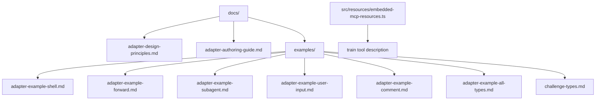
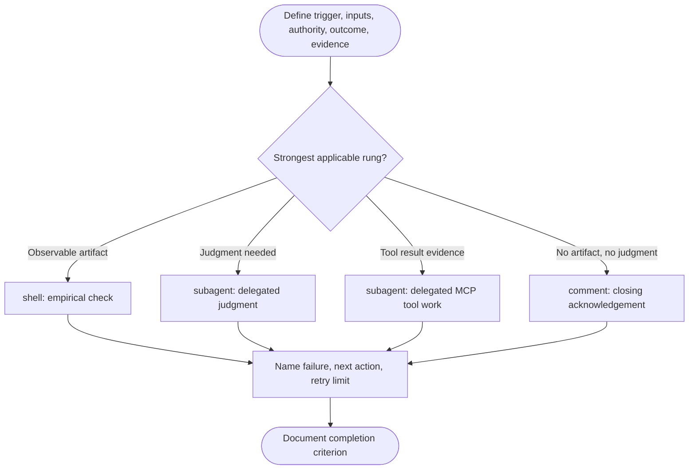
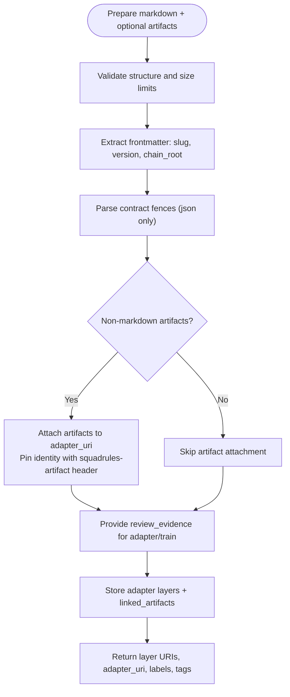
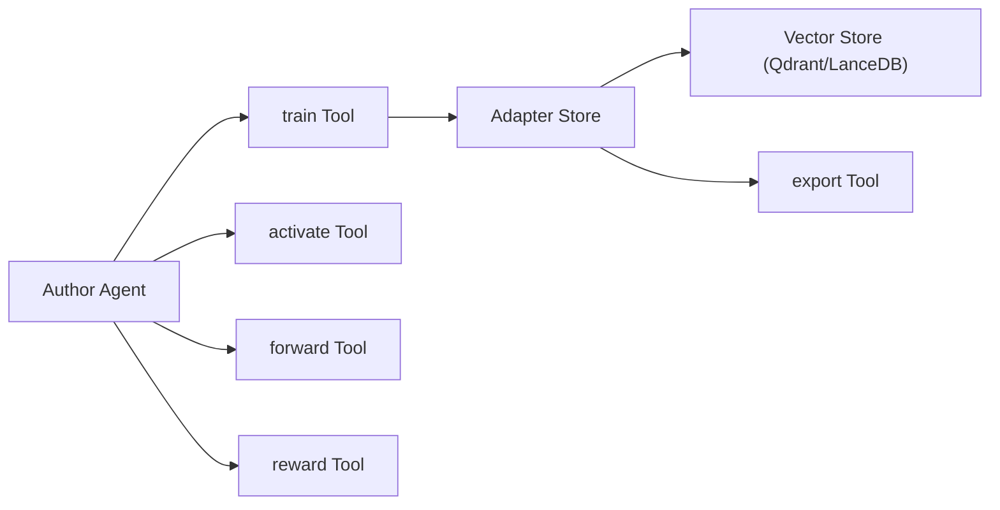

# Adapter Authoring Guide

<cite>
**Referenced Files in This Document**
- [adapter-authoring-guide.md](file://docs/adapter-authoring-guide.md)
- [adapter-design-principles.md](file://docs/adapter-design-principles.md)
- [challenge-types.md](file://docs/examples/challenge-types.md)
- [adapter-example-all-types.md](file://docs/examples/adapter-example-all-types.md)
- [adapter-example-shell.md](file://docs/examples/adapter-example-shell.md)
- [adapter-example-forward.md](file://docs/examples/adapter-example-forward.md)
- [adapter-example-subagent.md](file://docs/examples/adapter-example-subagent.md)
- [adapter-example-user-input.md](file://docs/examples/adapter-example-user-input.md)
- [adapter-example-comment.md](file://docs/examples/adapter-example-comment.md)
- [embedded-mcp-resources.ts](file://src/resources/embedded-mcp-resources.ts)
</cite>

## Table of Contents
1. [Introduction](#introduction)
2. [Project Structure](#project-structure)
3. [Core Components](#core-components)
4. [Architecture Overview](#architecture-overview)
5. [Detailed Component Analysis](#detailed-component-analysis)
6. [Dependency Analysis](#dependency-analysis)
7. [Performance Considerations](#performance-considerations)
8. [Troubleshooting Guide](#troubleshooting-guide)
9. [Conclusion](#conclusion)
10. [Appendices](#appendices)

## Introduction
This guide explains how to author effective SQUADRULES adapters that encapsulate deterministic, auditable task execution. Adapters encode team preferences so an agent can execute work without re-deriving intent every time. The core lifecycle is activate → forward → reward, and adapters must be created, repaired, and maintained by agents as part of finishing the task.

The documentation covers:
- Adapter structure: metadata, frontmatter, headings, steps, and contract blocks.
- Contract types and verification ladder: shell, forward, subagent, user_input, comment.
- Training from markdown to vector embeddings: content requirements, artifact handling, size limits, and review evidence.
- Best practices for input/output schemas, error handling, and evidence collection.
- Practical examples at different complexity levels.
- Pitfalls, performance optimization, debugging strategies, version management, testing approaches, and deployment workflows.

**Section sources**
- [adapter-design-principles.md:1-139](file://docs/adapter-design-principles.md#L1-L139)
- [adapter-authoring-guide.md:1-234](file://docs/adapter-authoring-guide.md#L1-L234)

## Project Structure
Adapter-related knowledge lives primarily under `docs/`:
- Design principles and authoring guidance are in `docs/`.
- Trainable example adapters are in `docs/examples/`.
- Embedded MCP tool descriptions (including `train`) are in `src/resources/embedded-mcp-resources.ts`.



**Diagram sources**
- [adapter-design-principles.md:1-139](file://docs/adapter-design-principles.md#L1-L139)
- [adapter-authoring-guide.md:1-234](file://docs/adapter-authoring-guide.md#L1-L234)
- [challenge-types.md:1-101](file://docs/examples/challenge-types.md#L1-L101)
- [adapter-example-all-types.md:1-105](file://docs/examples/adapter-example-all-types.md#L1-L105)
- [embedded-mcp-resources.ts:20-33](file://src/resources/embedded-mcp-resources.ts#L20-L33)

**Section sources**
- [adapter-design-principles.md:1-139](file://docs/adapter-design-principles.md#L1-L139)
- [adapter-authoring-guide.md:1-234](file://docs/adapter-authoring-guide.md#L1-L234)
- [challenge-types.md:1-101](file://docs/examples/challenge-types.md#L1-L101)
- [adapter-example-all-types.md:1-105](file://docs/examples/adapter-example-all-types.md#L1-L105)
- [embedded-mcp-resources.ts:20-33](file://src/resources/embedded-mcp-resources.ts#L20-L33)

## Core Components
An adapter is a markdown document with:
- Optional YAML frontmatter containing `slug`, optional `version`, and optional `chain_root`.
- A single H1 title.
- First H2: `Activation Patterns`.
- Last H2: `Reward Signal`.
- One or more H2 steps, each ending with a fenced ```json block containing a top-level `contract` object.

Key responsibilities:
- Metadata: `slug` pins the adapter URI; `version` records semantic version; `chain_root` supports chain collapsing.
- Schema definitions: contract shapes per type define required fields and solution envelopes.
- Implementation patterns: empirical checks (`shell`), chaining (`forward`), delegated judgment/tool work (`subagent`), emergency authority gaps (`user_input`), and last-resort acknowledgements (`comment`).

Training inputs include:
- `content` (markdown), `llm_model_id`, optional `force_update`, optional `protocol_version`, optional `space`.
- For non-markdown artifacts: `mime`, `artifact_name`, `adapter_uri`, optional `relative_path`, plus review evidence when training adapters/markdown.

Quality gates:
- Structural validation before storage.
- Size limits enforced early.
- Review evidence via critic-loop for mutations.

**Section sources**
- [embedded-mcp-resources.ts:20-33](file://src/resources/embedded-mcp-resources.ts#L20-L33)
- [adapter-authoring-guide.md:11-21](file://docs/adapter-authoring-guide.md#L11-L21)
- [challenge-types.md:25-79](file://docs/examples/challenge-types.md#L25-L79)

## Architecture Overview
The adapter lifecycle connects authoring, training, execution, and evaluation:

```mermaid
sequenceDiagram
participant Author as "Author Agent"
participant Train as "train Tool"
participant Store as "Adapter Store"
participant Activate as "activate Tool"
participant Forward as "forward Tool"
participant Reward as "reward Tool"
Author->>Train : "Register adapter markdown + review evidence"
Train->>Store : "Validate structure, size, contracts"
Store-->>Train : "Stored status + layer URIs"
Author->>Activate : "Resolve activation pattern"
Activate-->>Author : "First step challenge"
Author->>Forward : "Submit solution per contract type"
Forward-->>Author : "Next step or final direction"
Author->>Reward : "Finalize run with outcome"
```

**Diagram sources**
- [embedded-mcp-resources.ts:20-33](file://src/resources/embedded-mcp-resources.ts#L20-L33)
- [challenge-types.md:80-101](file://docs/examples/challenge-types.md#L80-L101)

**Section sources**
- [embedded-mcp-resources.ts:20-33](file://src/resources/embedded-mcp-resources.ts#L20-L33)
- [challenge-types.md:80-101](file://docs/examples/challenge-types.md#L80-L101)

## Detailed Component Analysis

### Verification Ladder and Contract Selection
The verification ladder is ordered and strict:
1. `shell` — empirical observation of observable state.
2. `subagent` — delegated judgment where correctness cannot be reduced to a test.
3. `subagent` — delegated MCP tool work where the evidence is a tool result.
Fallback: `comment` — read-only/knowledge adapters with no observable artifact and no judgment.

Rules:
- One contract per adapter is default; extra `shell` gates only at irreversible boundaries.
- Minimum one contract per adapter; no contract block is a structural failure.
- `comment` is last resort, at most one per adapter, never combined with other types.



**Diagram sources**
- [adapter-authoring-guide.md:23-84](file://docs/adapter-authoring-guide.md#L23-L84)
- [adapter-design-principles.md:43-95](file://docs/adapter-design-principles.md#L43-L95)

**Section sources**
- [adapter-authoring-guide.md:23-84](file://docs/adapter-authoring-guide.md#L23-L84)
- [adapter-design-principles.md:43-95](file://docs/adapter-design-principles.md#L43-L95)

### Shell Contracts (Rung 1)
- Required interpreter: `bash`, `sh`, `python3`, `python`, or `node`.
- `cmd` is program text, not a file path. Use wrapper invocation for scripts.
- Prefer empirical checks on resulting state; avoid fake proofs.
- Complex checks should be shipped as adapter artifacts and invoked via `$SQUADRULES_LOCAL_ARTIFACT_DIR`.

Best practices:
- Keep contract lines short and readable.
- Export-check the bundle to ensure the script exists at the expected path.
- Preserve exit codes and output for diagnostics.

Example references:
- Simple shell check: [adapter-example-shell.md](file://docs/examples/adapter-example-shell.md).
- Artifact gate pattern: [artifact-gate/adapter-example-artifact-gate.md](file://docs/examples/artifact-gate/adapter-example-artifact-gate.md).

**Section sources**
- [adapter-authoring-guide.md:87-113](file://docs/adapter-authoring-guide.md#L87-L113)
- [challenge-types.md:27-40](file://docs/examples/challenge-types.md#L27-L40)
- [adapter-example-shell.md:1-36](file://docs/examples/adapter-example-shell.md#L1-L36)

### Forward Contracts (Chain Links)
- Must link to another adapter: `forward.target` matches `squadrules://adapter/<slug>`.
- Bare MCP tool calls are invalid here; use `subagent.mcp` for delegated tool work.
- Place tail links at the end of the adapter; mid-adapter forwarding is allowed only for reusable sub-adapters not auditing the caller.

Solution shape:
- `type: "forward"`, `evidence: { target, success }`, with `success === true` and matching target.

Example reference:
- [adapter-example-forward.md](file://docs/examples/adapter-example-forward.md).

**Section sources**
- [adapter-authoring-guide.md:115-140](file://docs/adapter-authoring-guide.md#L115-L140)
- [challenge-types.md:42-48](file://docs/examples/challenge-types.md#L42-L48)
- [adapter-example-forward.md:1-61](file://docs/examples/adapter-example-forward.md#L1-L61)

### Subagent Contracts (Rungs 2 and 3)
- Rung 2: delegated judgment; proof is `evidence.report`.
- Rung 3: delegated MCP tool work; list required calls in `subagent.mcp`; transcript stays isolated; proof is still `evidence.report`.

Guidelines:
- Omit `subagent.mcp` for pure judgment tasks.
- Include it when the step requires specific MCP tool calls to have happened.
- Never substitute your own summary for the subagent’s actual report.

Example references:
- [adapter-example-subagent.md](file://docs/examples/adapter-example-subagent.md).
- All-types reference showing both rungs: [adapter-example-all-types.md](file://docs/examples/adapter-example-all-types.md).

**Section sources**
- [adapter-authoring-guide.md:142-169](file://docs/adapter-authoring-guide.md#L142-L169)
- [challenge-types.md:50-59](file://docs/examples/challenge-types.md#L50-L59)
- [adapter-example-subagent.md:1-69](file://docs/examples/adapter-example-subagent.md#L1-L69)
- [adapter-example-all-types.md:45-64](file://docs/examples/adapter-example-all-types.md#L45-L64)

### User Input Contracts (Emergency Only)
- Use only for genuine authority or decision gaps the agent cannot resolve autonomously.
- Prompt must state what was determined, why it cannot decide alone, and the exact answer needed.
- Not for routine confirmations or approval gates.

Example reference:
- [adapter-example-user-input.md](file://docs/examples/adapter-example-user-input.md).

**Section sources**
- [adapter-authoring-guide.md:171-179](file://docs/adapter-authoring-guide.md#L171-L179)
- [adapter-example-user-input.md:1-48](file://docs/examples/adapter-example-user-input.md#L1-L48)

### Comment Contracts (Last Resort)
- Read-only/knowledge adapters with no observable artifact and no judgment required.
- At most one per adapter; never combined with other types.
- `min_length` is a formality, not quality proof.

Example reference:
- [adapter-example-comment.md](file://docs/examples/adapter-example-comment.md).

**Section sources**
- [adapter-authoring-guide.md:181-189](file://docs/adapter-authoring-guide.md#L181-L189)
- [adapter-example-comment.md:1-44](file://docs/examples/adapter-example-comment.md#L1-L44)

### Complete Multi-Type Example
A reference demonstration shows all contract types side by side:
- Steps cover shell, forward, subagent, user_input, and comment.
- It is a teaching fixture, not a production model.

Reference:
- [adapter-example-all-types.md](file://docs/examples/adapter-example-all-types.md).

**Section sources**
- [adapter-example-all-types.md:1-105](file://docs/examples/adapter-example-all-types.md#L1-L105)

### Training Workflow: Markdown to Vector Embeddings
Training registers adapters from markdown and attaches artifacts:
- Validate structure: H1 title, first H2 `Activation Patterns`, last H2 `Reward Signal`, at least one fenced ```json contract block.
- Enforce size limits early (logical lines, per-line bytes, total bytes).
- Frontmatter `slug:` pins the adapter slug; `version` is optional; `chain_root` supports chain collapsing.
- Non-markdown artifacts attach to an existing adapter using `adapter_uri`; pin identity with `# squadrules-artifact:` header including `slug` and optional `version`.
- Review evidence is required for adapter/markdown trains: verdict file path, exit code, stdout line 1 must be PASS.



**Diagram sources**
- [embedded-mcp-resources.ts:20-33](file://src/resources/embedded-mcp-resources.ts#L20-L33)

**Section sources**
- [embedded-mcp-resources.ts:20-33](file://src/resources/embedded-mcp-resources.ts#L20-L33)

### Lifecycle Flows: Create, Update, Review, Delete
- Create: draft markdown, delegate critic-loop through `subagent`, gate with a `shell` check reading the verdict, then train with review evidence; attach artifacts in a second train; verify stored result via `activate` and export.
- Update: export target, identify gap, plan minimal change, re-run critic on changed parts, prove verdict with `tune`, read back stored adapter as completion criterion.
- Review: read-only audit against checklist; produce findings report; do not mutate.
- Delete: confirm slug is not a chain dependency, delete, verify it no longer resolves; extra `shell` gate justified before destructive action.

**Section sources**
- [adapter-authoring-guide.md:202-234](file://docs/adapter-authoring-guide.md#L202-L234)

## Dependency Analysis
Adapters depend on:
- Framework enforcement: structural validation, interpreter rules, forward-link rules, subagent MCP validity.
- Execution environment: local artifact directory, available interpreters, and MCP tools.
- Storage: adapter store and vector stores (Qdrant/LanceDB) for semantic search.



**Diagram sources**
- [embedded-mcp-resources.ts:20-33](file://src/resources/embedded-mcp-resources.ts#L20-L33)
- [challenge-types.md:80-101](file://docs/examples/challenge-types.md#L80-L101)

**Section sources**
- [embedded-mcp-resources.ts:20-33](file://src/resources/embedded-mcp-resources.ts#L20-L33)
- [challenge-types.md:80-101](file://docs/examples/challenge-types.md#L80-L101)

## Performance Considerations
- Prefer `shell` checks over unnecessary round trips; keep dependent instructions together.
- Avoid acknowledgment loops; length does not establish understanding.
- Use artifacts for complex checks to keep contracts readable and fast.
- Limit adapter size to 350 lines; split into chains when needed.
- Use `forward` + slug for deterministic chaining instead of repeated `activate` calls.

[No sources needed since this section provides general guidance]

## Troubleshooting Guide
Common issues and resolutions:
- Missing interpreter: add explicit `interpreter` field; absent interpreter is invalid.
- Invalid forward contract: set `forward.target` to `squadrules://adapter/<slug>`; bare tool calls are rejected.
- Broken artifact linkage: verify `linked_artifacts[].relative_path` matches contract invocation; run export check to confirm script presence and digests.
- Critic loop failures: address every finding, increment iteration, re-delegate critic-loop; stop at iteration ceiling.
- Review evidence missing: provide verdict file path, exit code, and stdout line 1 PASS for adapter/markdown trains.

Debugging strategies:
- Run `export` with `skill_tree` or `skill_zip` to inspect adapter and artifacts.
- Use `activate` to validate materialization paths and linked artifacts.
- Inspect server diagnostics for artifact mismatches or invalid relative paths.

**Section sources**
- [adapter-authoring-guide.md:87-113](file://docs/adapter-authoring-guide.md#L87-L113)
- [adapter-authoring-guide.md:115-140](file://docs/adapter-authoring-guide.md#L115-L140)
- [embedded-mcp-resources.ts:20-33](file://src/resources/embedded-mcp-resources.ts#L20-L33)

## Conclusion
Effective adapters combine clear intent, strong verification, and deterministic execution. Follow the verification ladder, constrain contracts to their purpose, and treat review evidence as a quality gate. Train with validated markdown and pinned artifacts, execute through activate/forward/reward, and maintain adapters autonomously with critic-loop feedback.

[No sources needed since this section summarizes without analyzing specific files]

## Appendices

### Appendix A: Contract Type Reference
- shell: empirical check with required interpreter.
- forward: link to another adapter via `squadrules://adapter/<slug>`.
- subagent: delegated judgment or MCP tool work; proof is `evidence.report`.
- user_input: emergency authority gap with a precise prompt.
- comment: last-resort acknowledgement, at most one per adapter.

References:
- [challenge-types.md:25-79](file://docs/examples/challenge-types.md#L25-L79)
- [adapter-example-all-types.md:11-96](file://docs/examples/adapter-example-all-types.md#L11-L96)

**Section sources**
- [challenge-types.md:25-79](file://docs/examples/challenge-types.md#L25-L79)
- [adapter-example-all-types.md:11-96](file://docs/examples/adapter-example-all-types.md#L11-L96)

### Appendix B: Solution Shapes
- shell: `{ type: "shell", evidence: { exit_code, stdout?, stderr?, duration_seconds? } }`, pass if `exit_code === 0`.
- forward: `{ type: "forward", evidence: { target, success } }`, pass if `success === true` and target matches contract.
- subagent: `{ type: "subagent", evidence: { report } }`, pass if report is non-empty.
- user_input: `{ type: "user_input", user_input: { confirmation, timestamp? } }`.
- comment: `{ type: "comment", comment: { text } }`, pass if `text.length ≥ min_length`.

Echo `nonce` and `proof_hash` when present. After the final forward, call reward to finish.

**Section sources**
- [challenge-types.md:80-101](file://docs/examples/challenge-types.md#L80-L101)

### Appendix C: Version Management and Testing
- Pin adapter versions in frontmatter when semantic changes require tracking.
- Use `force_update` for structural replacement; otherwise preserve identity.
- Test adapters by activating them, verifying linked artifacts, and running export checks.
- Use the twelve-step linear test fixture for UI and long-run scenarios.

**Section sources**
- [embedded-mcp-resources.ts:20-33](file://src/resources/embedded-mcp-resources.ts#L20-L33)
- [adapter-authoring-guide.md:202-234](file://docs/adapter-authoring-guide.md#L202-L234)