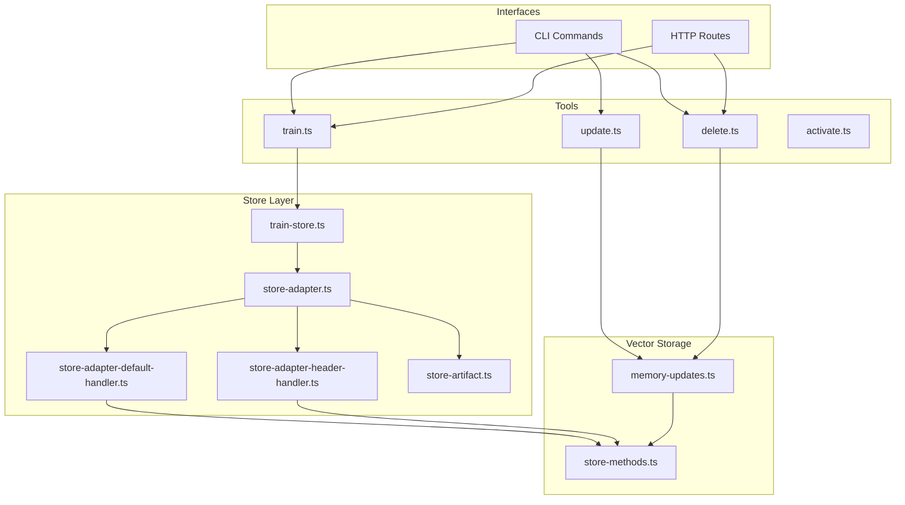
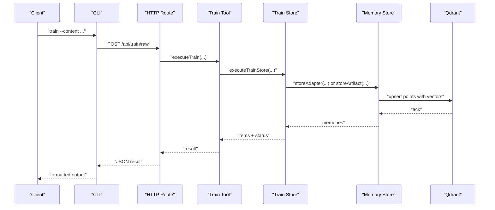
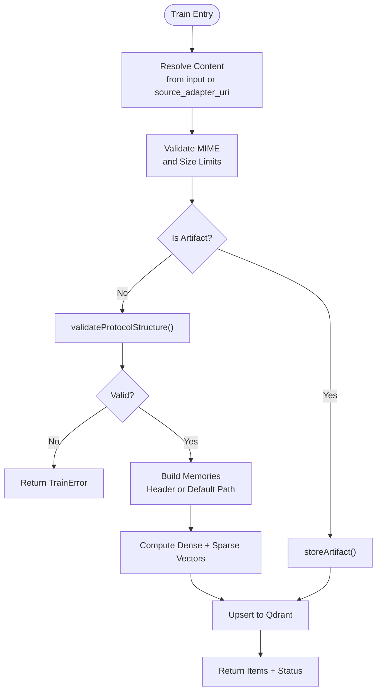
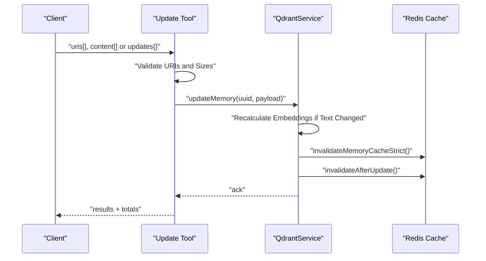
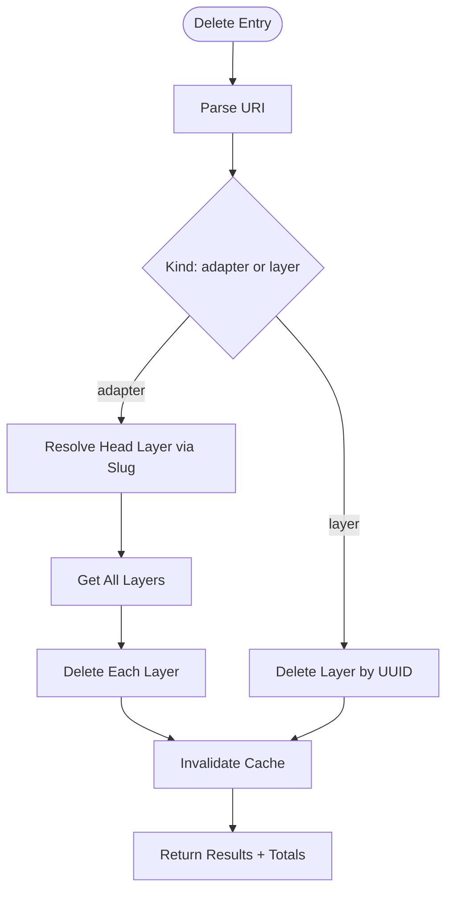
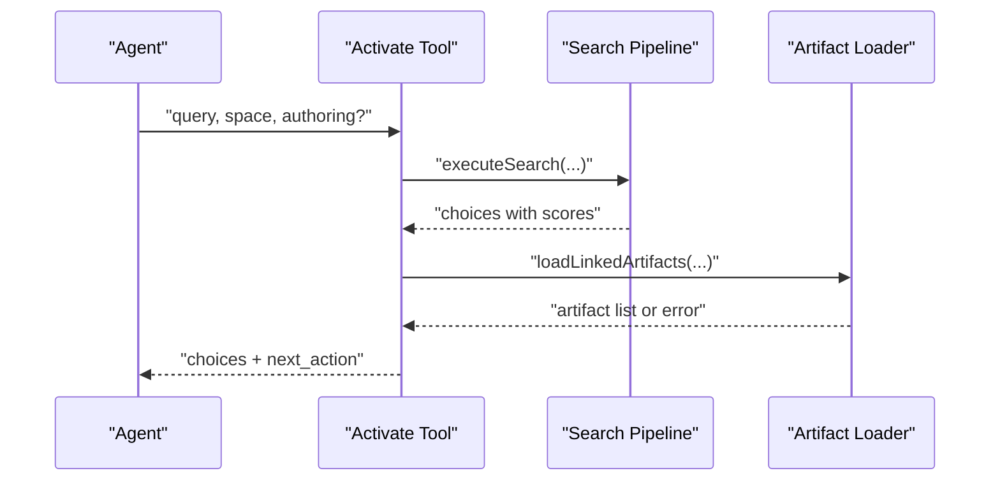
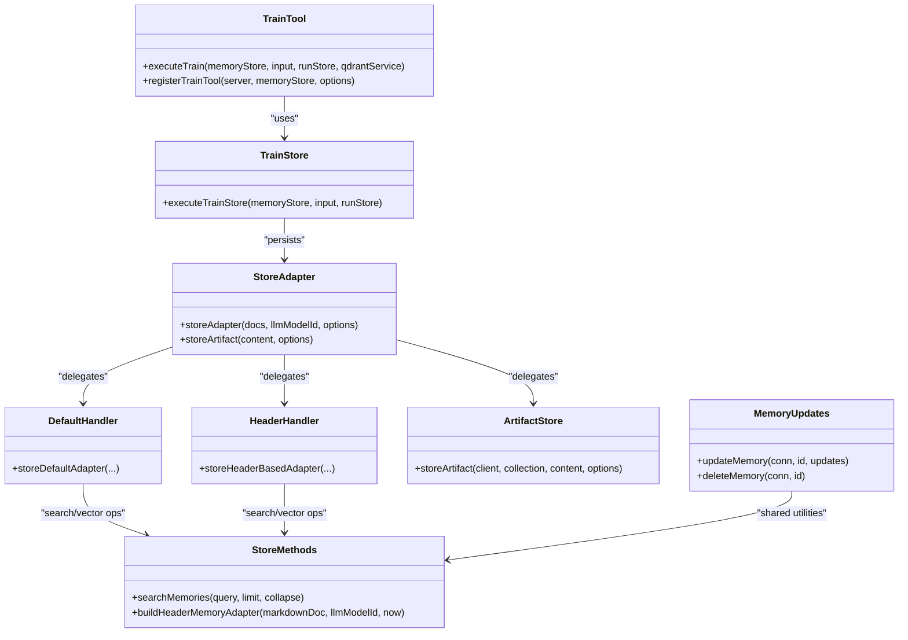

# Adapter Lifecycle Management

<cite>
**Referenced Files in This Document**
- [train.ts](file://src/tools/train.ts)
- [train-store.ts](file://src/tools/train-store.ts)
- [store-adapter.ts](file://src/services/memory/store-adapter.ts)
- [store-methods.ts](file://src/services/memory/store-methods.ts)
- [store-adapter-default-handler.ts](file://src/services/memory/store-adapter-default-handler.ts)
- [store-adapter-header-handler.ts](file://src/services/memory/store-adapter-header-handler.ts)
- [store-artifact.ts](file://src/services/memory/store-artifact.ts)
- [memory-updates.ts](file://src/services/qdrant/memory-updates.ts)
- [update.ts](file://src/tools/update.ts)
- [delete.ts](file://src/tools/delete.ts)
- [activate.ts](file://src/tools/activate.ts)
- [http-api-train-raw.ts](file://src/http/http-api-train-raw.ts)
- [http-api-delete.ts](file://src/http/http-api-delete.ts)
- [cli-delete.ts](file://src/cli/commands/delete.ts)
</cite>

## Table of Contents
1. [Introduction](#introduction)
2. [Project Structure](#project-structure)
3. [Core Components](#core-components)
4. [Architecture Overview](#architecture-overview)
5. [Detailed Component Analysis](#detailed-component-analysis)
6. [Dependency Analysis](#dependency-analysis)
7. [Performance Considerations](#performance-considerations)
8. [Troubleshooting Guide](#troubleshooting-guide)
9. [Conclusion](#conclusion)

## Introduction
This document explains the complete adapter lifecycle: creation, training into searchable vectors, updates with versioning and backward compatibility, deletion with cleanup, activation for execution, and deactivation through maintenance operations. It covers both CLI and API interfaces, data migration strategies, rollback procedures, health monitoring, and storage optimization for large adapter fleets.

SquadRules is an agent-first MCP framework where agents create, repair, activate, forward, and reward adapters. Adapters are stored as layered memories with dense and sparse vector embeddings for semantic search, plus metadata for routing, quality scoring, and artifact linkage.

## Project Structure
The lifecycle spans tool handlers, memory store logic, Qdrant persistence, HTTP routes, and CLI commands:

**Diagram sources**
- [train.ts:246-382](file://src/tools/train.ts#L246-L382)
- [update.ts:8-72](file://src/tools/update.ts#L8-L72)
- [delete.ts:12-71](file://src/tools/delete.ts#L12-L71)
- [activate.ts:168-229](file://src/tools/activate.ts#L168-L229)
- [train-store.ts:47-130](file://src/tools/train-store.ts#L47-L130)
- [store-adapter.ts:43-152](file://src/services/memory/store-adapter.ts#L43-L152)
- [store-adapter-default-handler.ts:34-255](file://src/services/memory/store-adapter-default-handler.ts#L34-L255)
- [store-adapter-header-handler.ts:30-202](file://src/services/memory/store-adapter-header-handler.ts#L30-L202)
- [store-artifact.ts:168-300](file://src/services/memory/store-artifact.ts#L168-L300)
- [store-methods.ts:94-260](file://src/services/memory/store-methods.ts#L94-L260)
- [memory-updates.ts:15-233](file://src/services/qdrant/memory-updates.ts#L15-L233)

**Section sources**
- [train.ts:246-382](file://src/tools/train.ts#L246-L382)
- [train-store.ts:47-130](file://src/tools/train-store.ts#L47-L130)
- [store-adapter.ts:43-152](file://src/services/memory/store-adapter.ts#L43-L152)
- [store-methods.ts:94-260](file://src/services/memory/store-methods.ts#L94-L260)
- [memory-updates.ts:15-233](file://src/services/qdrant/memory-updates.ts#L15-L233)

## Core Components
- Training pipeline: validates markdown or artifacts, builds adapter layers, computes embeddings, and persists to Qdrant. Supports fork-based creation and artifact attachment.
- Update pipeline: mutates layer text or metadata, recalculates embeddings when text changes, and invalidates caches.
- Delete pipeline: deletes adapter layers by slug or UUID, including all versions.
- Activation pipeline: searches hybrid dense/sparse vectors, ranks choices, and returns actionable next steps for agents.
- Storage backends: Qdrant (primary), Redis cache, filesystem for local artifacts.

Key responsibilities:
- `train.ts` and `train-store.ts`: orchestrate input validation, MIME handling, duplicate/similarity checks, and persistence.
- `store-adapter.ts`, default/header handlers: build memories, compute vectors, allocate slugs, handle duplicates, and upsert points.
- `store-methods.ts`: hybrid search, caching, and point-to-memory mapping.
- `memory-updates.ts`: update and delete operations with embedding recalculation and cache invalidation.
- `activate.ts`: search-driven activation with artifact loading and guidance.

**Section sources**
- [train.ts:88-244](file://src/tools/train.ts#L88-L244)
- [train-store.ts:47-130](file://src/tools/train-store.ts#L47-L130)
- [store-adapter.ts:43-152](file://src/services/memory/store-adapter.ts#L43-L152)
- [store-methods.ts:94-260](file://src/services/memory/store-methods.ts#L94-L260)
- [memory-updates.ts:15-233](file://src/services/qdrant/memory-updates.ts#L15-L233)
- [activate.ts:168-229](file://src/tools/activate.ts#L168-L229)

## Architecture Overview
The lifecycle flows from user/tool/API inputs through validation, embedding generation, persistence, and retrieval.

**Diagram sources**
- [http-api-train-raw.ts:48-153](file://src/http/http-api-train-raw.ts#L48-L153)
- [train.ts:246-382](file://src/tools/train.ts#L246-L382)
- [train-store.ts:47-130](file://src/tools/train-store.ts#L47-L130)
- [store-adapter.ts:43-152](file://src/services/memory/store-adapter.ts#L43-L152)

## Detailed Component Analysis

### Creation and Training
Training converts markdown or artifacts into searchable representations:
- Input normalization: content, source adapter URI for forks, MIME inference, review evidence gating.
- Validation: protocol structure, size limits, allowed artifact MIMEs.
- Persistence: header-based or default adapter paths; artifact attachment with chain linkage.
- Embeddings: primary, title, activation pattern vectors; BM25 sparse index.
- Duplicate/similarity handling: slug allocation, force update semantics, similarity warnings.

**Diagram sources**
- [train.ts:88-244](file://src/tools/train.ts#L88-L244)
- [train-store.ts:47-130](file://src/tools/train-store.ts#L47-L130)
- [store-adapter-default-handler.ts:34-255](file://src/services/memory/store-adapter-default-handler.ts#L34-L255)
- [store-adapter-header-handler.ts:30-202](file://src/services/memory/store-adapter-header-handler.ts#L30-L202)
- [store-artifact.ts:168-300](file://src/services/memory/store-artifact.ts#L168-L300)

**Section sources**
- [train.ts:88-244](file://src/tools/train.ts#L88-L244)
- [train-store.ts:47-130](file://src/tools/train-store.ts#L47-L130)
- [store-adapter.ts:43-152](file://src/services/memory/store-adapter.ts#L43-L152)
- [store-adapter-default-handler.ts:34-255](file://src/services/memory/store-adapter-default-handler.ts#L34-L255)
- [store-adapter-header-handler.ts:30-202](file://src/services/memory/store-adapter-header-handler.ts#L30-L202)
- [store-artifact.ts:168-300](file://src/services/memory/store-artifact.ts#L168-L300)

### Update Mechanism
Updates modify existing adapter layers while preserving history and compatibility:
- Accepts layer URIs, optional per-URI content, or bulk updates.
- Validates markdown size and extracts body markers.
- Recalculates embeddings only when text changes.
- Updates metadata fields and quality metadata.
- Invalidates Redis cache strictly to prevent stale reads.

**Diagram sources**
- [update.ts:8-72](file://src/tools/update.ts#L8-L72)
- [memory-updates.ts:15-197](file://src/services/qdrant/memory-updates.ts#L15-L197)

**Section sources**
- [update.ts:8-72](file://src/tools/update.ts#L8-L72)
- [memory-updates.ts:15-197](file://src/services/qdrant/memory-updates.ts#L15-L197)

### Deletion Process
Deletion removes adapter resources and cleans up related data:
- Supports adapter-level deletion by slug, which resolves head layer and deletes all layers.
- Supports direct layer deletion by UUID.
- Ensures cache invalidation after deletion.

**Diagram sources**
- [delete.ts:12-71](file://src/tools/delete.ts#L12-L71)
- [memory-updates.ts:199-233](file://src/services/qdrant/memory-updates.ts#L199-L233)

**Section sources**
- [delete.ts:12-71](file://src/tools/delete.ts#L12-L71)
- [memory-updates.ts:199-233](file://src/services/qdrant/memory-updates.ts#L199-L233)

### Activation and Deactivation
Activation makes adapters available for execution:
- Performs hybrid search across dense and sparse vectors.
- Maps search results to activation choices with roles (match, refine, create).
- Loads linked artifacts and provides next-action guidance.
- Tracks refinement counts and includes UI hints.

Deactivation is achieved by updating or deleting adapters; there is no explicit deactivate endpoint. Maintenance typically involves:
- Updating layers to mark them deprecated or redirecting to new versions.
- Deleting adapters to remove them from search and execution.

**Diagram sources**
- [activate.ts:168-229](file://src/tools/activate.ts#L168-L229)
- [activate.ts:44-166](file://src/tools/activate.ts#L44-L166)

**Section sources**
- [activate.ts:44-166](file://src/tools/activate.ts#L44-L166)
- [activate.ts:168-229](file://src/tools/activate.ts#L168-L229)

### Examples Using CLI and API

- CLI train:
  - Use the CLI to train markdown or artifacts. The CLI delegates to backend methods that call the HTTP API.
  - Example flow: `squadrules train --content "..."` → backend → HTTP POST `/api/train/raw`.

- API train raw:
  - POST `/api/train/raw` with markdown body and query parameters for model ID, force update, protocol version, and space.
  - Returns structured items and status.

- CLI delete:
  - Use the CLI to delete one or more adapter/layer URIs.
  - Example flow: `squadrules delete squadrules://adapter/my-slug`.

- API delete:
  - POST `/api/delete` with array of URIs.
  - Returns results with total deleted and failed counts.

- Update via tools:
  - Use the update tool to mutate layer content or metadata.
  - For HTTP, tune route exists but update logic is shared via `executeUpdate`; use MCP tool interface for layer updates.

**Section sources**
- [http-api-train-raw.ts:48-153](file://src/http/http-api-train-raw.ts#L48-L153)
- [http-api-delete.ts:11-35](file://src/http/http-api-delete.ts#L11-L35)
- [cli-delete.ts:13-30](file://src/cli/commands/delete.ts#L13-L30)
- [update.ts:8-72](file://src/tools/update.ts#L8-L72)

## Dependency Analysis
The lifecycle components have clear dependencies:

**Diagram sources**
- [train.ts:246-382](file://src/tools/train.ts#L246-L382)
- [train-store.ts:47-130](file://src/tools/train-store.ts#L47-L130)
- [store-adapter.ts:43-152](file://src/services/memory/store-adapter.ts#L43-L152)
- [store-adapter-default-handler.ts:34-255](file://src/services/memory/store-adapter-default-handler.ts#L34-L255)
- [store-adapter-header-handler.ts:30-202](file://src/services/memory/store-adapter-header-handler.ts#L30-L202)
- [store-artifact.ts:168-300](file://src/services/memory/store-artifact.ts#L168-L300)
- [store-methods.ts:94-260](file://src/services/memory/store-methods.ts#L94-L260)
- [memory-updates.ts:15-233](file://src/services/qdrant/memory-updates.ts#L15-L233)

**Section sources**
- [train.ts:246-382](file://src/tools/train.ts#L246-L382)
- [train-store.ts:47-130](file://src/tools/train-store.ts#L47-L130)
- [store-adapter.ts:43-152](file://src/services/memory/store-adapter.ts#L43-L152)
- [store-methods.ts:94-260](file://src/services/memory/store-methods.ts#L94-L260)
- [memory-updates.ts:15-233](file://src/services/qdrant/memory-updates.ts#L15-L233)

## Performance Considerations
- Batch embeddings: default and header handlers generate batch embeddings for primary, title, and activation pattern vectors to reduce latency.
- Hybrid search: RRF fusion across dense legs and BM25 improves ranking efficiency and relevance.
- Fallback behavior: if embedding generation fails or dimensions mismatch, zero vectors are used to keep the system operational.
- Sparse index fallback: if Qdrant lacks sparse config, upsert retries without BM25 to avoid failures.
- Caching: Redis cache stores memory resources and search results; strict invalidation on updates/deletes prevents stale reads.
- Metrics: tool calls, durations, errors, and memory/Qdrant operations are instrumented for observability.

Recommendations:
- Prefer batch training for large adapter sets.
- Monitor embedding dimension mismatches and sparse index availability.
- Tune search limits and prefetch sizes based on workload.
- Use force update judiciously to avoid accidental overwrites.

[No sources needed since this section provides general guidance]

## Troubleshooting Guide
Common issues and resolutions:
- Duplicate adapter:
  - Cause: label already exists.
  - Resolution: use force update or choose a different label.
- Similar memory found:
  - Cause: title similarity detected.
  - Resolution: inspect match and confirm before overwrite; provide same adapter id with force update.
- Protocol structure invalid:
  - Cause: missing required fields in markdown.
  - Resolution: follow guided creation flow or correct frontmatter/body structure.
- Unsupported MIME:
  - Cause: artifact MIME not allowlisted.
  - Resolution: use allowed MIME types or adjust artifact naming.
- Space permissions:
  - Cause: writing to read-only or unknown space.
  - Resolution: resolve writable space context before training/updating.

Operational checks:
- Verify Qdrant connectivity and collection configuration.
- Confirm embedding service availability and dimension alignment.
- Inspect Redis cache invalidation logs after updates/deletes.
- Review metrics for tool errors and duration spikes.

**Section sources**
- [train-store.ts:31-41](file://src/tools/train-store.ts#L31-L41)
- [train-store.ts:100-119](file://src/tools/train-store.ts#L100-L119)
- [train-store.ts:64-73](file://src/tools/train-store.ts#L64-L73)
- [http-api-train-raw.ts:154-212](file://src/http/http-api-train-raw.ts#L154-L212)
- [memory-updates.ts:15-233](file://src/services/qdrant/memory-updates.ts#L15-L233)

## Conclusion
The adapter lifecycle integrates validation, embedding generation, persistence, and retrieval across CLI, HTTP, and internal services. Training supports markdown and artifacts with robust duplicate/similarity handling. Updates maintain version history and backward compatibility through careful metadata and embedding management. Deletion ensures comprehensive cleanup. Activation provides actionable choices for agents, while deactivation is achieved via updates or deletions. Monitoring, caching, and fallback mechanisms ensure reliability at scale.

[No sources needed since this section summarizes without analyzing specific files]