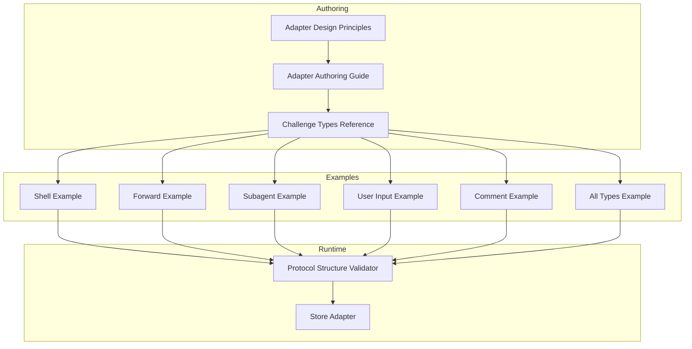
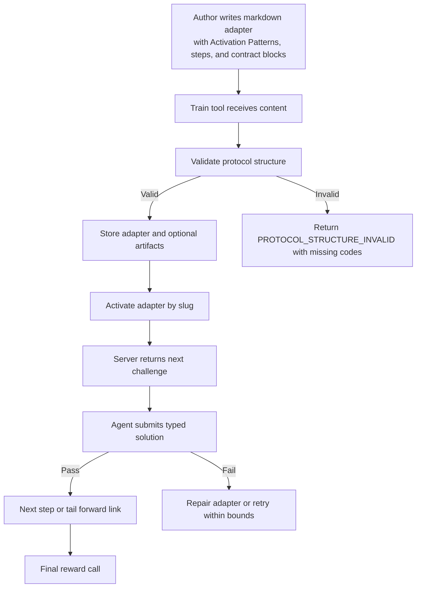
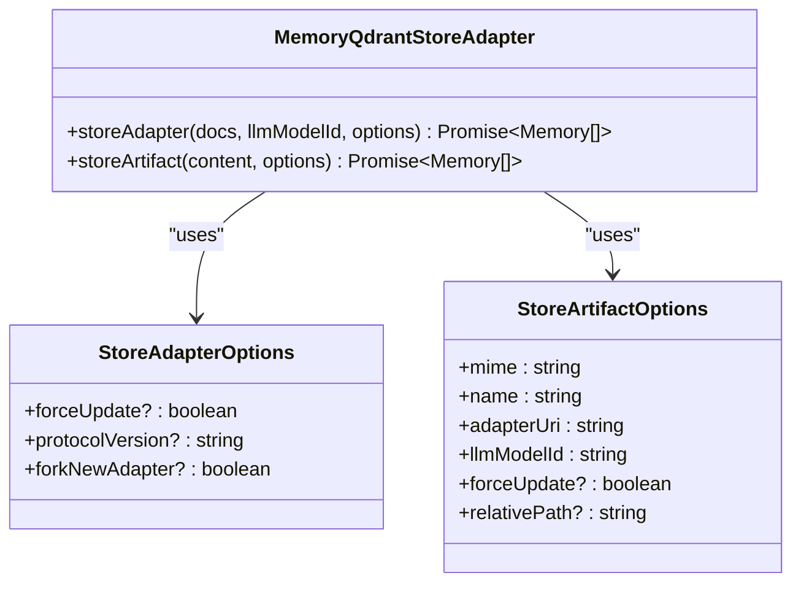
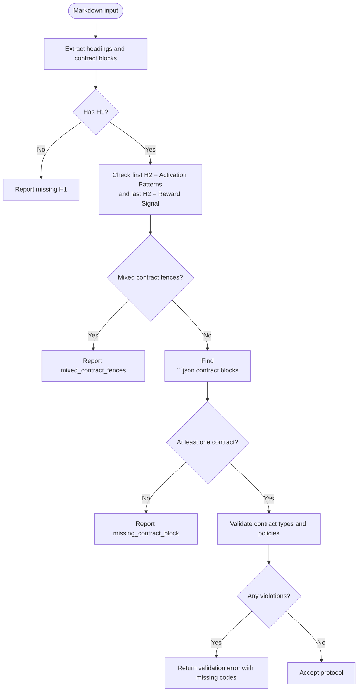
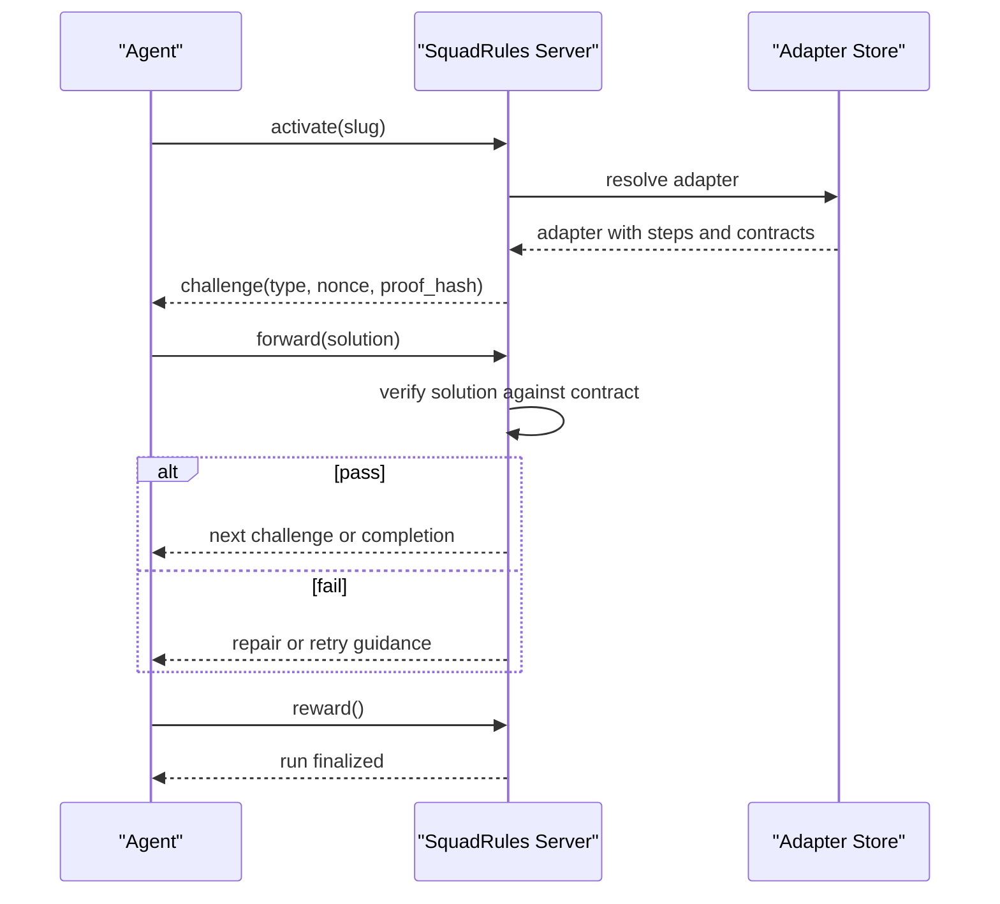
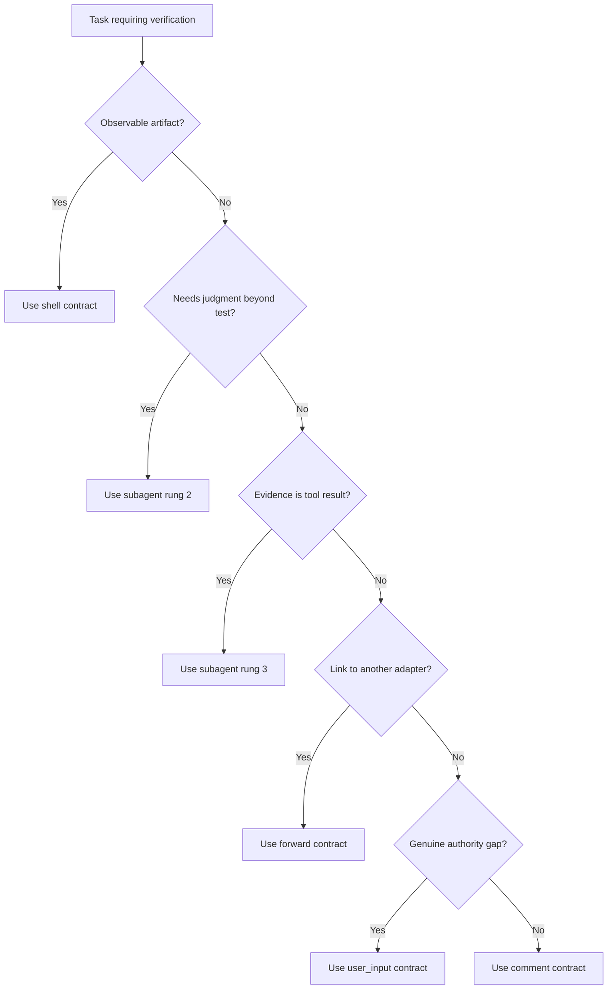
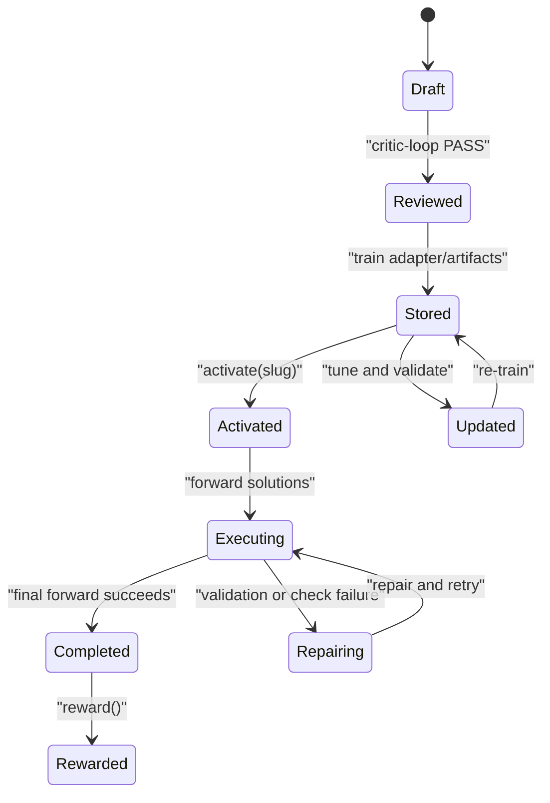
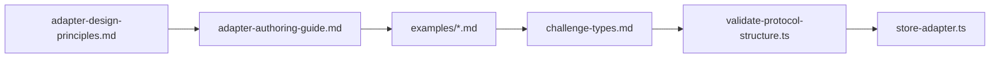

# Adapters & Protocols

<cite>
**Referenced Files in This Document**   
- [adapter-authoring-guide.md](file://docs/adapter-authoring-guide.md)
- [adapter-design-principles.md](file://docs/adapter-design-principles.md)
- [challenge-types.md](file://docs/examples/challenge-types.md)
- [adapter-example-all-types.md](file://docs/examples/adapter-example-all-types.md)
- [adapter-example-shell.md](file://docs/examples/adapter-example-shell.md)
- [adapter-example-forward.md](file://docs/examples/adapter-example-forward.md)
- [adapter-example-subagent.md](file://docs/examples/adapter-example-subagent.md)
- [adapter-example-user-input.md](file://docs/examples/adapter-example-user-input.md)
- [adapter-example-comment.md](file://docs/examples/adapter-example-comment.md)
- [store-adapter.ts](file://src/services/memory/store-adapter.ts)
- [validate-protocol-structure.ts](file://src/services/memory/validate-protocol-structure.ts)
</cite>

## Table of Contents
1. [Introduction](#introduction)
2. [Project Structure](#project-structure)
3. [Core Components](#core-components)
4. [Architecture Overview](#architecture-overview)
5. [Detailed Component Analysis](#detailed-component-analysis)
6. [Dependency Analysis](#dependency-analysis)
7. [Performance Considerations](#performance-considerations)
8. [Troubleshooting Guide](#troubleshooting-guide)
9. [Conclusion](#conclusion)

## Introduction
This document explains the adapters and protocols that make SquadRules deterministic, auditable, and agent-first. An adapter is a human-readable workflow specification trained into a protocol that the runtime executes through a strict challenge-response loop. The core execution chain is:

- `activate`: select an adapter and begin its steps.
- `forward`: submit solutions to challenges until completion or failure.
- `reward`: finalize the run after the last successful step.

Adapters encapsulate task-specific logic behind well-defined inputs, outputs, and verification contracts. The framework enforces structural rules at training time and execution-time semantics for each contract type. The design prioritizes autonomy, help over puzzles, and honest verification so agents can own workflows end to end while producing evidence suitable for audit.

## Project Structure
The repository separates authoring guidance, runnable example adapters, and runtime implementation:

- Authoring guidance defines principles, the verification ladder, per-type rules, and lifecycle flows.
- Example adapters demonstrate every contract shape and are ready to train.
- Runtime code stores adapters, validates their structure, and participates in the activation/forward/reward flow.



**Diagram sources**
- [adapter-design-principles.md:1-139](file://docs/adapter-design-principles.md#L1-L139)
- [adapter-authoring-guide.md:1-234](file://docs/adapter-authoring-guide.md#L1-L234)
- [challenge-types.md:1-101](file://docs/examples/challenge-types.md#L1-L101)
- [store-adapter.ts:43-147](file://src/services/memory/store-adapter.ts#L43-L147)
- [validate-protocol-structure.ts:207-297](file://src/services/memory/validate-protocol-structure.ts#L207-L297)

**Section sources**
- [adapter-design-principles.md:1-139](file://docs/adapter-design-principles.md#L1-L139)
- [adapter-authoring-guide.md:1-234](file://docs/adapter-authoring-guide.md#L1-L234)
- [challenge-types.md:1-101](file://docs/examples/challenge-types.md#L1-L101)
- [store-adapter.ts:43-147](file://src/services/memory/store-adapter.ts#L43-L147)
- [validate-protocol-structure.ts:207-297](file://src/services/memory/validate-protocol-structure.ts#L207-L297)

## Core Components
SquadRules adapters are built from three layers:

1. **Authoring layer**: design principles and authoring rules define when and how to use each contract type.
2. **Protocol layer**: markdown adapters with structured sections and JSON contract blocks become trainable protocols.
3. **Execution layer**: the runtime validates, stores, activates, forwards, and rewards adapters deterministically.

Key responsibilities:

- **Design principles** establish autonomy, help over puzzles, and honest verification as the foundation for all adapter decisions.
- **Authoring guide** translates principles into the verification ladder, quantity limits, per-type rules, and create/update/review/delete lifecycles.
- **Challenge types reference** documents contract shapes, required fields, solution shapes, and proof requirements.
- **Example adapters** provide concrete, trainable templates for shell, forward, subagent, user_input, and comment.
- **Store adapter** normalizes markdown, parses frontmatter, resolves slugs, checks similarity, and persists adapters or artifacts.
- **Protocol structure validator** enforces fail-closed structural rules before storage.

**Section sources**
- [adapter-design-principles.md:1-139](file://docs/adapter-design-principles.md#L1-L139)
- [adapter-authoring-guide.md:1-234](file://docs/adapter-authoring-guide.md#L1-L234)
- [challenge-types.md:1-101](file://docs/examples/challenge-types.md#L1-L101)
- [store-adapter.ts:43-147](file://src/services/memory/store-adapter.ts#L43-L147)
- [validate-protocol-structure.ts:207-297](file://src/services/memory/validate-protocol-structure.ts#L207-L297)

## Architecture Overview
The adapter protocol architecture follows a layered pipeline:



**Diagram sources**
- [adapter-authoring-guide.md:202-234](file://docs/adapter-authoring-guide.md#L202-L234)
- [challenge-types.md:80-101](file://docs/examples/challenge-types.md#L80-L101)
- [validate-protocol-structure.ts:207-297](file://src/services/memory/validate-protocol-structure.ts#L207-L297)
- [store-adapter.ts:43-147](file://src/services/memory/store-adapter.ts#L43-L147)

## Detailed Component Analysis

### Adapter Pattern Implementation
An adapter pattern in SquadRules means wrapping task-specific logic behind a stable interface:

- **Input**: activation patterns, step instructions, and a contract block describing verification.
- **Processing**: the runtime interprets the contract type and invokes the appropriate execution path.
- **Output**: deterministic evidence such as exit status, report text, target confirmation, or acknowledgment length.

The store adapter implements this pattern by accepting markdown, normalizing it, parsing frontmatter, resolving slugs, checking for similar adapters, and persisting either header-based or default adapters plus optional artifacts.



**Diagram sources**
- [store-adapter.ts:18-33](file://src/services/memory/store-adapter.ts#L18-L33)
- [store-adapter.ts:35-152](file://src/services/memory/store-adapter.ts#L35-L152)

**Section sources**
- [store-adapter.ts:43-147](file://src/services/memory/store-adapter.ts#L43-L147)

### Protocol Definitions and Structural Validation
Protocols are markdown adapters validated before storage. The validator enforces:

- Required H1 title.
- First H2 must be Activation Patterns.
- Last H2 must be Reward Signal.
- At least one JSON contract block.
- No mixed plain fences containing contract JSON.
- Allowed contract types: shell, forward, user_input, comment, subagent.
- Per-type policies:
  - shell requires interpreter from an allowed set.
  - forward must be a link to another adapter URI.
  - subagent.mcp must be an array of objects with non-empty string tool_name; arguments must be a plain object when present.



**Diagram sources**
- [validate-protocol-structure.ts:120-198](file://src/services/memory/validate-protocol-structure.ts#L120-L198)
- [validate-protocol-structure.ts:207-297](file://src/services/memory/validate-protocol-structure.ts#L207-L297)

**Section sources**
- [validate-protocol-structure.ts:1-298](file://src/services/memory/validate-protocol-structure.ts#L1-L298)

### Challenge-Response Patterns and Proof Generation
The challenge-response loop ensures auditable execution:

- The server issues a challenge with a nonce and proof hash.
- The agent submits a solution matching the contract type.
- The server verifies the solution against the contract policy.
- On success, the next step proceeds; on failure, the agent repairs or retries within bounds.
- After the final forward, the client calls reward to finish the run.

Proof varies by type:

- shell: exit code zero.
- forward: success flag and matching target.
- subagent: non-empty report.
- user_input: confirmation from the human.
- comment: text meeting minimum length.



**Diagram sources**
- [challenge-types.md:80-101](file://docs/examples/challenge-types.md#L80-L101)
- [adapter-authoring-guide.md:202-234](file://docs/adapter-authoring-guide.md#L202-L234)

**Section sources**
- [challenge-types.md:80-101](file://docs/examples/challenge-types.md#L80-L101)
- [adapter-authoring-guide.md:202-234](file://docs/adapter-authoring-guide.md#L202-L234)

### Contract Matching Algorithms
Contract selection is guided by the verification ladder and structural validation:

1. Prefer empirical observation (shell).
2. Delegate judgment (subagent rung 2).
3. Delegate MCP tool work (subagent rung 3).
4. Link to another adapter (forward).
5. Use user_input only for genuine authority gaps.
6. Use comment only as a last-resort acknowledgment.

The validator enforces hard rules:

- shell.interpreter must be allowed.
- forward.target must match the adapter URI pattern.
- subagent.mcp entries must have valid shape.
- Only allowed contract types are accepted.



**Diagram sources**
- [adapter-authoring-guide.md:23-84](file://docs/adapter-authoring-guide.md#L23-L84)
- [validate-protocol-structure.ts:59-86](file://src/services/memory/validate-protocol-structure.ts#L59-L86)

**Section sources**
- [adapter-authoring-guide.md:23-84](file://docs/adapter-authoring-guide.md#L23-L84)
- [validate-protocol-structure.ts:59-86](file://src/services/memory/validate-protocol-structure.ts#L59-L86)

### Concrete Contract Examples

#### Shell Contract
- Purpose: empirical check with observable outcome.
- Required fields: interpreter, cmd, timeout_seconds.
- Success condition: exit code zero.
- Guidance: wrap build tools in a shell line; prefer script artifacts for complex checks.

Reference examples:
- [adapter-example-shell.md:1-36](file://docs/examples/adapter-example-shell.md#L1-L36)
- [adapter-example-all-types.md:11-27](file://docs/examples/adapter-example-all-types.md#L11-L27)

**Section sources**
- [adapter-example-shell.md:1-36](file://docs/examples/adapter-example-shell.md#L1-L36)
- [adapter-example-all-types.md:11-27](file://docs/examples/adapter-example-all-types.md#L11-L27)
- [challenge-types.md:27-41](file://docs/examples/challenge-types.md#L27-L41)

#### Forward Contract
- Purpose: chain completion to another adapter.
- Required field: forward.target matching squadrules://adapter/<slug>.
- Success condition: success true and target matches contract target.
- Rule: bare MCP tool calls are not valid forward contracts.

Reference examples:
- [adapter-example-forward.md:1-61](file://docs/examples/adapter-example-forward.md#L1-L61)
- [adapter-example-all-types.md:29-43](file://docs/examples/adapter-example-all-types.md#L29-L43)

**Section sources**
- [adapter-example-forward.md:1-61](file://docs/examples/adapter-example-forward.md#L1-L61)
- [adapter-example-all-types.md:29-43](file://docs/examples/adapter-example-all-types.md#L29-L43)
- [challenge-types.md:42-49](file://docs/examples/challenge-types.md#L42-L49)

#### Subagent Contract
- Purpose: delegated judgment (rung 2) or delegated MCP tool work (rung 3).
- Fields: context; optional mcp list of tool_name and arguments.
- Proof: evidence.report must be non-empty.
- Rule: mcp list constrains what the subagent must do; transcript never reaches caller.

Reference examples:
- [adapter-example-subagent.md:1-69](file://docs/examples/adapter-example-subagent.md#L1-L69)
- [adapter-example-all-types.md:45-64](file://docs/examples/adapter-example-all-types.md#L45-L64)

**Section sources**
- [adapter-example-subagent.md:1-69](file://docs/examples/adapter-example-subagent.md#L1-L69)
- [adapter-example-all-types.md:45-64](file://docs/examples/adapter-example-all-types.md#L45-L64)
- [challenge-types.md:50-59](file://docs/examples/challenge-types.md#L50-L59)

#### User Input Contract
- Purpose: emergency authority gap only.
- Field: prompt stating determination, reason for inability to decide, and needed answer.
- Solution: confirmation from human.

Reference examples:
- [adapter-example-user-input.md:1-48](file://docs/examples/adapter-example-user-input.md#L1-L48)
- [adapter-example-all-types.md:66-80](file://docs/examples/adapter-example-all-types.md#L66-L80)

**Section sources**
- [adapter-example-user-input.md:1-48](file://docs/examples/adapter-example-user-input.md#L1-L48)
- [adapter-example-all-types.md:66-80](file://docs/examples/adapter-example-all-types.md#L66-L80)
- [challenge-types.md:61-68](file://docs/examples/challenge-types.md#L61-L68)

#### Comment Contract
- Purpose: last resort acknowledgment for read-only or knowledge adapters.
- Field: min_length.
- Rule: at most one per adapter; never combined with other types.

Reference examples:
- [adapter-example-comment.md:1-44](file://docs/examples/adapter-example-comment.md#L1-L44)
- [adapter-example-all-types.md:82-96](file://docs/examples/adapter-example-all-types.md#L82-L96)

**Section sources**
- [adapter-example-comment.md:1-44](file://docs/examples/adapter-example-comment.md#L1-L44)
- [adapter-example-all-types.md:82-96](file://docs/examples/adapter-example-all-types.md#L82-L96)
- [challenge-types.md:69-79](file://docs/examples/challenge-types.md#L69-L79)

### Adapter Lifecycle: Training, Activation, Execution, Versioning, Quality
Lifecycle stages:

- Create: draft markdown, review with critic hop, gate store write with shell check, train adapter and artifacts, verify stored result.
- Update: export target, identify gap, plan minimal change, re-run critic, prove verdict with tune, read back stored adapter.
- Review: read-only audit against checklist; produce findings without mutation.
- Delete: confirm no chain dependency, delete, verify resolution fails.

Version management and quality:

- Store adapter supports protocolVersion and forkNewAdapter options.
- Frontmatter version and chainRoot are applied to header-based adapters.
- Similarity checks prevent accidental duplicates unless forceUpdate is used.
- Critic-loop PASS is the sole quality gate for mutations.



**Diagram sources**
- [adapter-authoring-guide.md:202-234](file://docs/adapter-authoring-guide.md#L202-L234)
- [store-adapter.ts:43-147](file://src/services/memory/store-adapter.ts#L43-L147)

**Section sources**
- [adapter-authoring-guide.md:202-234](file://docs/adapter-authoring-guide.md#L202-L234)
- [store-adapter.ts:43-147](file://src/services/memory/store-adapter.ts#L43-L147)

### Evidence Collection and Reward Propagation
Evidence collection differs by contract type:

- shell: capture exit_code, stdout, stderr, duration_seconds.
- forward: capture target and success.
- subagent: capture report verbatim.
- user_input: capture confirmation and optional timestamp.
- comment: capture text and enforce min_length.

Reward propagation finalizes runs after the last successful forward. The challenge types reference explicitly states that after the final forward, the server directs the client to call reward.

**Section sources**
- [challenge-types.md:80-101](file://docs/examples/challenge-types.md#L80-L101)

### Common Patterns: Error Handling, Evidence, Rewards
- Fail-closed validation: structural errors return specific missing codes rather than guessing.
- Interpreter enforcement: absent or disallowed interpreter is invalid.
- Forward-link enforcement: only adapter URIs are accepted.
- Subagent MCP enforcement: malformed lists are rejected.
- Honest verification: avoid acknowledgment loops; choose evidence that matches the claim.
- Failure responses: name detected failure, supporting evidence, next action, and retry limits.

**Section sources**
- [adapter-design-principles.md:43-96](file://docs/adapter-design-principles.md#L43-L96)
- [validate-protocol-structure.ts:247-297](file://src/services/memory/validate-protocol-structure.ts#L247-L297)

## Dependency Analysis
The adapter system has clear dependencies between documentation, examples, and runtime:



**Diagram sources**
- [adapter-design-principles.md:1-139](file://docs/adapter-design-principles.md#L1-L139)
- [adapter-authoring-guide.md:1-234](file://docs/adapter-authoring-guide.md#L1-L234)
- [challenge-types.md:1-101](file://docs/examples/challenge-types.md#L1-L101)
- [validate-protocol-structure.ts:1-298](file://src/services/memory/validate-protocol-structure.ts#L1-L298)
- [store-adapter.ts:1-154](file://src/services/memory/store-adapter.ts#L1-L154)

**Section sources**
- [adapter-design-principles.md:1-139](file://docs/adapter-design-principles.md#L1-L139)
- [adapter-authoring-guide.md:1-234](file://docs/adapter-authoring-guide.md#L1-L234)
- [challenge-types.md:1-101](file://docs/examples/challenge-types.md#L1-L101)
- [validate-protocol-structure.ts:1-298](file://src/services/memory/validate-protocol-structure.ts#L1-L298)
- [store-adapter.ts:1-154](file://src/services/memory/store-adapter.ts#L1-L154)

## Performance Considerations
- Keep contracts minimal: one per adapter is the default; extra shell gates are justified only before irreversible actions.
- Prefer empirical checks over claims to reduce ambiguity and improve auditability.
- Avoid unnecessary round trips: group dependent instructions when no intermediate decision is required.
- Use artifacts for complex checks instead of long inline commands.
- Bound retries and timeouts to prevent runaway execution.

[No sources needed since this section provides general guidance]

## Troubleshooting Guide
Common validation failures and resolutions:

- Missing H1 title: add a top-level heading.
- Missing Activation Patterns: ensure the first H2 is exactly Activation Patterns.
- Missing Reward Signal: ensure the last H2 is exactly Reward Signal.
- Missing contract block: add at least one ```json block with a contract.
- Mixed contract fences: use only ```json for contract blocks.
- Invalid contract type: use exactly shell, forward, user_input, comment, or subagent.
- shell_interpreter_required: set shell.interpreter to bash, sh, python3, python, or node.
- forward_link_only: set forward.target to squadrules://adapter/<slug>.
- subagent_mcp_invalid: ensure mcp is an array of objects with non-empty string tool_name; arguments must be a plain object when present.

Resolution strategy:

- Read the missing code message returned by validation.
- Consult the corresponding example adapter.
- Apply the verification ladder to choose the correct contract type.
- Repair the adapter and re-train or tune.

**Section sources**
- [validate-protocol-structure.ts:247-297](file://src/services/memory/validate-protocol-structure.ts#L247-L297)
- [adapter-authoring-guide.md:194-234](file://docs/adapter-authoring-guide.md#L194-L234)

## Conclusion
SquadRules adapters turn team preferences into deterministic, auditable workflows. The adapter pattern isolates task-specific logic behind stable inputs and outputs. Protocol definitions enforce structural integrity, while challenge-response semantics and proof generation ensure execution can be verified. The verification ladder guides authors toward honest verification, and the runtime enforces hard rules so agents can execute autonomously while preserving evidence suitable for audit. Effective adapters are minimal, explicit, and focused on meaningful outcomes.

[No sources needed since this section summarizes without analyzing specific files]