# Challenge Types & Protocols

<cite>
**Referenced Files in This Document**
- [challenge-type-guide.md](file://src/embed-docs/mem/challenge-type-guide.md)
- [challenge-types.md](file://docs/examples/challenge-types.md)
- [embedded-mcp-resources.ts](file://src/resources/embedded-mcp-resources.ts)
- [validate-protocol-structure.ts](file://src/services/memory/validate-protocol-structure.ts)
- [forward-contract-match.ts](file://src/tools/forward-contract-match.ts)
- [next-pow-helpers.ts](file://src/tools/next-pow-helpers.ts)
- [shell-challenge-invocation.ts](file://src/tools/shell-challenge-invocation.ts)
- [next.ts](file://src/tools/next.ts)
- [reward-propagation.ts](file://src/services/qdrant/reward-propagation.ts)
</cite>

## Table of Contents
1. [Introduction](#introduction)
2. [Project Structure](#project-structure)
3. [Core Components](#core-components)
4. [Architecture Overview](#architecture-overview)
5. [Detailed Component Analysis](#detailed-component-analysis)
6. [Dependency Analysis](#dependency-analysis)
7. [Performance Considerations](#performance-considerations)
8. [Troubleshooting Guide](#troubleshooting-guide)
9. [Conclusion](#conclusion)

## Introduction
This document explains the deterministic workflow protocol used by SquadRules adapters and how challenge types drive execution, verification, and reward propagation. It covers:

- Five challenge types: shell, forward, user_input, subagent, and comment.
- The unified solution envelope and per-type evidence requirements.
- Proof generation, nonce rotation, proof hashing, and retry semantics.
- Contract validation rules that enforce interpreter selection, forward-link targets, and subagent MCP structure.
- Security and sandboxing guidance for shell challenges and artifact handoff.
- Reward propagation from completed steps to adapter heads for activation ranking.

The goal is to make it possible for agents and humans to author, execute, review, and repair adapters deterministically while keeping strong separation between execution and review.

## Project Structure
Challenge-related logic is split across documentation, tool orchestration, contract validation, and storage services:

- Documentation and examples define the intended shapes and decision rules.
- Tool helpers implement proof submission, challenge building, and error handling.
- Validation enforces structural rules before adapters are stored.
- Forward matching validates target contracts at runtime.
- Reward propagation updates adapter-level quality metrics after completion.

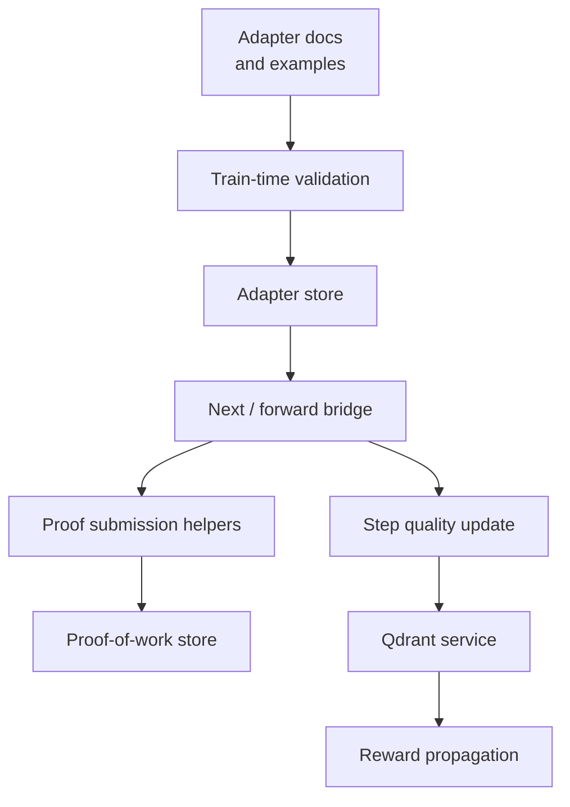

**Diagram sources**
- [embedded-mcp-resources.ts:18-34](file://src/resources/embedded-mcp-resources.ts#L18-L34)
- [validate-protocol-structure.ts:207-297](file://src/services/memory/validate-protocol-structure.ts#L207-L297)
- [next.ts:137-279](file://src/tools/next.ts#L137-L279)
- [next-pow-helpers.ts:127-333](file://src/tools/next-pow-helpers.ts#L127-L333)
- [reward-propagation.ts:13-73](file://src/services/qdrant/reward-propagation.ts#L13-L73)

**Section sources**
- [challenge-type-guide.md:1-312](file://src/embed-docs/mem/challenge-type-guide.md#L1-L312)
- [challenge-types.md:1-101](file://docs/examples/challenge-types.md#L1-L101)
- [embedded-mcp-resources.ts:18-34](file://src/resources/embedded-mcp-resources.ts#L18-L34)

## Core Components
This section summarizes the five challenge types, their schemas, validation rules, and execution context.

| Challenge type | Purpose | Required fields | Evidence shape | Pass condition | Security notes |
|---|---|---|---|---|---|
| `shell` | Execute or verify local state empirically | `shell.interpreter`, `shell.cmd`, `shell.timeout_seconds` | `exit_code`, optional `stdout`, `stderr`, `duration_seconds` | `exit_code === 0` | Use allowed interpreters; prefer artifacts for multi-line scripts; isolate work under `$SQUADRULES_LOCAL_ARTIFACT_DIR`; never hardcode secrets. |
| `forward` | Chain to another adapter by slug | `forward.target` matching `squadrules://adapter/<slug>` | `target`, `success` | `success === true` and `target` matches contract | Target must be an adapter URI; bare MCP tool calls belong in `subagent.mcp`. |
| `user_input` | Request human approval or clarification | `user_input.prompt` | `confirmation`, optional `timestamp` | Confirmation supplied; host may elicit interactively | Use only for genuine authority gaps, not routine approvals. |
| `subagent` | Delegate judgment or MCP tool work | `subagent.context`; optional `subagent.mcp` | `report` (non-empty) | Report present | Rung 2 is delegated judgment; rung 3 names real MCP tools executed inside a separate subagent context. |
| `comment` | Pure reasoning acknowledgement with no observable artifact | Optional `comment.min_length` | `text` | Length meets minimum and semantic relevance check passes when enabled | Last resort; maximum one per adapter unless exempted. |

Key protocol behaviors:

- Every solution uses the unified envelope: `type`, `outcome`, `evidence`, plus echoed `nonce` and `proof_hash`.
- Nonces protect against replay; mismatch rotates a fresh nonce and returns a recovery payload.
- Proof hashes bind each successful step record so later steps can reference prior outcomes.
- Shell commands are program text executed through an allowed interpreter; build tools must be wrapped in `bash`.
- Forward submissions are validated against the contract’s expected adapter target.
- Subagent MCP entries require a non-empty string `tool_name` and an object-shaped `arguments` field when present.

**Section sources**
- [challenge-type-guide.md:41-154](file://src/embed-docs/mem/challenge-type-guide.md#L41-L154)
- [challenge-types.md:25-92](file://docs/examples/challenge-types.md#L25-L92)
- [embedded-mcp-resources.ts:18-34](file://src/resources/embedded-mcp-resources.ts#L18-L34)
- [validate-protocol-structure.ts:32-86](file://src/services/memory/validate-protocol-structure.ts#L32-L86)
- [forward-contract-match.ts:17-53](file://src/tools/forward-contract-match.ts#L17-L53)
- [next-pow-helpers.ts:127-333](file://src/tools/next-pow-helpers.ts#L127-L333)

## Architecture Overview
The deterministic workflow follows an activate → forward → reward chain. Adapters describe layers as markdown sections with fenced JSON contracts. The server exposes `activate`, `forward`, and `reward` operations; `forward` advances state and returns the next challenge.

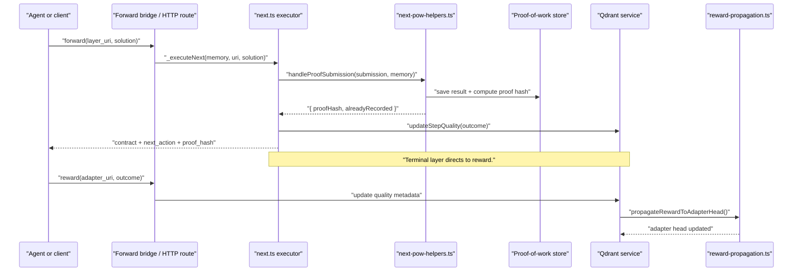

**Diagram sources**
- [next.ts:137-279](file://src/tools/next.ts#L137-L279)
- [next-pow-helpers.ts:127-333](file://src/tools/next-pow-helpers.ts#L127-L333)
- [reward-propagation.ts:13-73](file://src/services/qdrant/reward-propagation.ts#L13-L73)

## Detailed Component Analysis

### Shell Challenges
Shell challenges are the strongest empirical verification for local state changes, file checks, command results, and system state.

Implementation highlights:

- Allowed interpreters are strictly enforced: `bash`, `sh`, `python3`, `python`, `node`.
- `cmd` is program text, not a file path. For scripts, invoke a wrapper that materializes the artifact first.
- The server does not spawn processes; executors run the logical argv built from the contract.
- Missing interpreter is invalid; missing required fields produce structured errors.
- Template placeholders in stdout/stderr are rejected to prevent fake evidence.

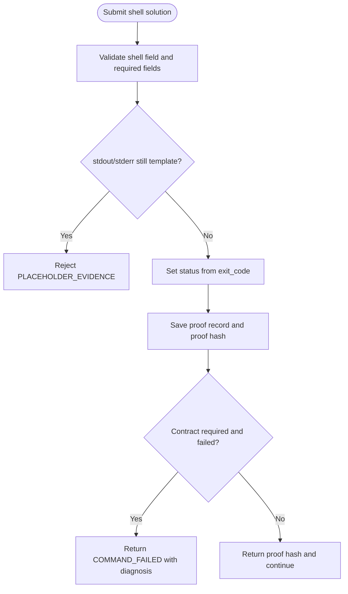

**Diagram sources**
- [shell-challenge-invocation.ts:15-17](file://src/tools/shell-challenge-invocation.ts#L15-L17)
- [shell-challenge-invocation.ts:86-117](file://src/tools/shell-challenge-invocation.ts#L86-L117)
- [next-pow-helpers.ts:208-230](file://src/tools/next-pow-helpers.ts#L208-L230)
- [next-pow-helpers.ts:317-325](file://src/tools/next-pow-helpers.ts#L317-L325)

Security and working directory rules:

- Use `$SQUADRULES_LOCAL_ARTIFACT_DIR` for collision-free handoff paths.
- Resolve `project://` and `user://` hints from `activate`/`forward`/`next` responses.
- Keep worktrees outside existing checkouts.
- Never write credentials into files referenced by shell challenges.
- Prefer adapter artifacts for multi-step gates instead of inline programs.

**Section sources**
- [challenge-type-guide.md:156-223](file://src/embed-docs/mem/challenge-type-guide.md#L156-L223)
- [challenge-types.md:27-40](file://docs/examples/challenge-types.md#L27-L40)
- [shell-challenge-invocation.ts:15-47](file://src/tools/shell-challenge-invocation.ts#L15-L47)
- [next-pow-helpers.ts:208-230](file://src/tools/next-pow-helpers.ts#L208-L230)

### Forward Challenges
Forward challenges link this adapter’s completion to another adapter by slug. They are not raw MCP tool calls.

Validation rules:

- `forward.target` must match `squadrules://adapter/<slug>`.
- At submission time, the submitted `evidence.target` is compared to the contract’s expected target.
- Any mismatch — absent target, wrong scheme, or different slug — returns `FORWARD_TARGET_MISMATCH`.

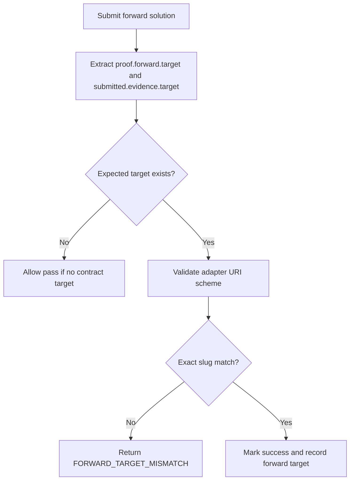

**Diagram sources**
- [forward-contract-match.ts:17-53](file://src/tools/forward-contract-match.ts#L17-L53)
- [next-pow-helpers.ts:231-254](file://src/tools/next-pow-helpers.ts#L231-L254)

**Section sources**
- [challenge-types.md:42-48](file://docs/examples/challenge-types.md#L42-L48)
- [forward-contract-match.ts:1-54](file://src/tools/forward-contract-match.ts#L1-L54)
- [next-pow-helpers.ts:231-254](file://src/tools/next-pow-helpers.ts#L231-L254)

### User-Input Challenges
User-input challenges request human confirmation or clarification.

Behavior:

- If the host supports elicitation, the server can prompt the client and inject a confirmed solution.
- Decline or cancellation returns an error payload with retry guidance.
- If elicitation is unavailable, the agent supplies `user_input.confirmation`.

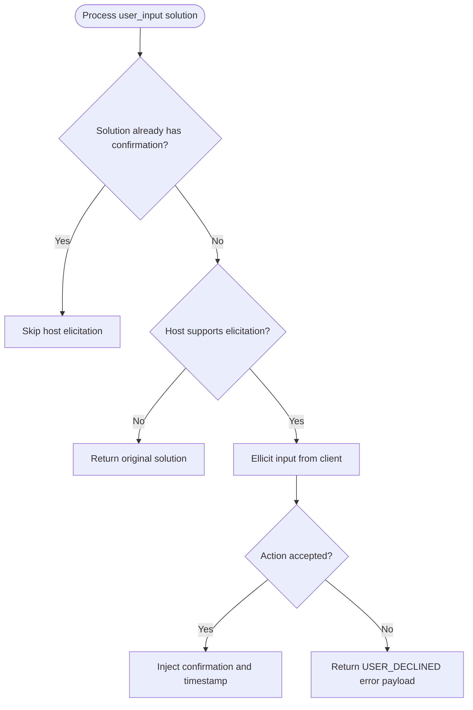

**Diagram sources**
- [next-pow-helpers.ts:63-125](file://src/tools/next-pow-helpers.ts#L63-L125)

**Section sources**
- [challenge-type-guide.md:88-91](file://src/embed-docs/mem/challenge-type-guide.md#L88-L91)
- [challenge-types.md:61-68](file://docs/examples/challenge-types.md#L61-L68)
- [next-pow-helpers.ts:63-125](file://src/tools/next-pow-helpers.ts#L63-L125)

### Subagent Challenges
Subagent challenges delegate work to another agent or MCP tool invocation.

Two modes:

- Rung 2: delegated judgment with `subagent.context`.
- Rung 3: delegated MCP tool work with `subagent.mcp`, where each entry names a real tool call.

Validation rules:

- `subagent.report` must be present and non-empty.
- `subagent.mcp` must be an array of objects with a non-empty string `tool_name`; `arguments` must be an object when present.
- The tool transcript stays inside the subagent context; the caller receives only the report.

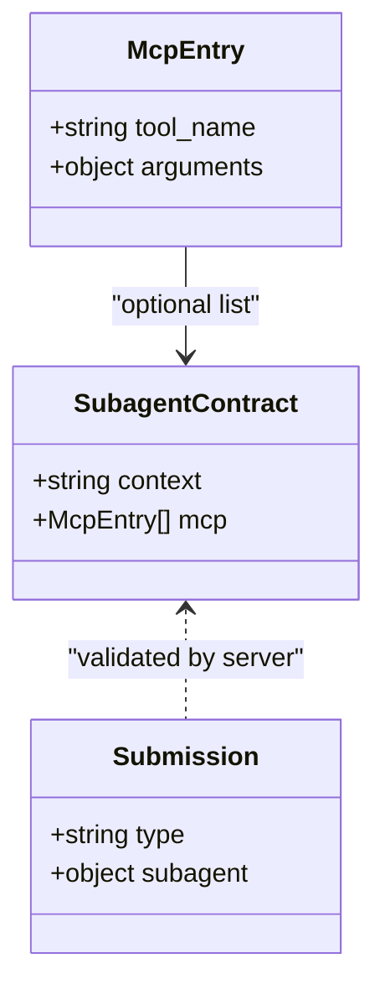

**Diagram sources**
- [validate-protocol-structure.ts:68-83](file://src/services/memory/validate-protocol-structure.ts#L68-L83)
- [next-pow-helpers.ts:299-305](file://src/tools/next-pow-helpers.ts#L299-L305)

**Section sources**
- [challenge-type-guide.md:93-110](file://src/embed-docs/mem/challenge-type-guide.md#L93-L110)
- [challenge-types.md:50-59](file://docs/examples/challenge-types.md#L50-L59)
- [validate-protocol-structure.ts:68-83](file://src/services/memory/validate-protocol-structure.ts#L68-L83)
- [next-pow-helpers.ts:299-305](file://src/tools/next-pow-helpers.ts#L299-L305)

### Comment Challenges
Comment challenges are last-resort acknowledgements for pure reasoning without observable artifacts.

Validation rules:

- Must include `comment.text`.
- Minimum length is enforced via `comment.min_length`.
- When enabled, semantic similarity between the comment and step content is checked against a threshold.
- Embedding failures or timeouts fail open to allow length-valid comments.

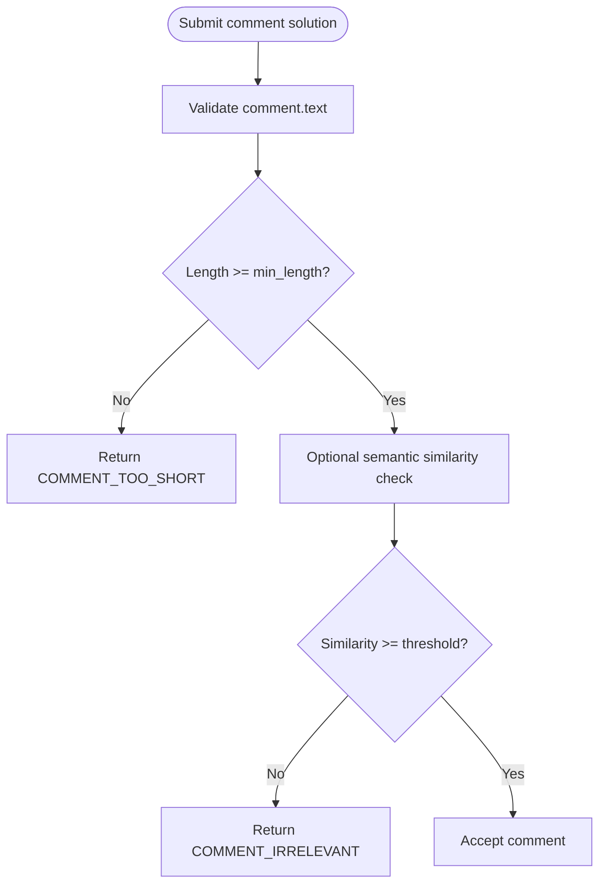

**Diagram sources**
- [next-pow-helpers.ts:265-298](file://src/tools/next-pow-helpers.ts#L265-L298)

**Section sources**
- [challenge-type-guide.md:112-115](file://src/embed-docs/mem/challenge-type-guide.md#L112-L115)
- [challenge-types.md:69-79](file://docs/examples/challenge-types.md#L69-L79)
- [next-pow-helpers.ts:265-298](file://src/tools/next-pow-helpers.ts#L265-L298)

### Unified Solution Envelope and Protocol Flow
Every solution envelope includes:

- `type`: the challenge type.
- `outcome`: `success`, `failure`, or `skipped`.
- `evidence`: type-specific proof data.
- `nonce`: echoed from the active challenge.
- `proof_hash`: echoed from the previous response or contract.

The main execution flow:

1. Client calls `forward` with a layer URI and solution.
2. Server loads the current memory and builds the challenge.
3. Proof submission validates nonce, proof hash, type, and type-specific evidence.
4. Successful proofs are recorded and hashed; failed required proofs return diagnostic errors.
5. Step quality metrics are updated on success or failure.
6. The response contains the next contract, prose guidance, and machine-readable `next_call`.
7. Terminal layers direct the client to `reward`.

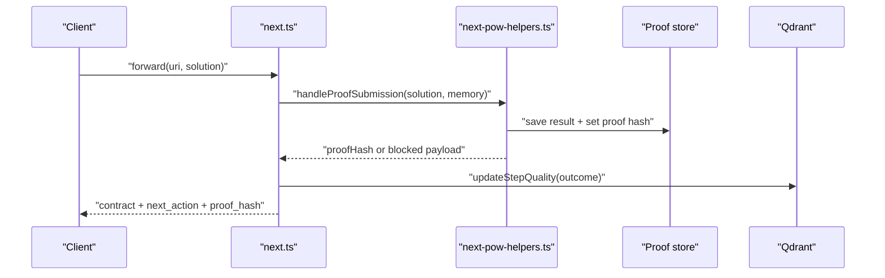

**Diagram sources**
- [next.ts:137-279](file://src/tools/next.ts#L137-L279)
- [next-pow-helpers.ts:127-333](file://src/tools/next-pow-helpers.ts#L127-L333)

**Section sources**
- [embedded-mcp-resources.ts:18-34](file://src/resources/embedded-mcp-resources.ts#L18-L34)
- [next.ts:58-83](file://src/tools/next.ts#L58-L83)
- [next.ts:137-279](file://src/tools/next.ts#L137-L279)

### Contract Matching Algorithms
Contract matching occurs at two stages:

1. **Train-time structural validation**: ensures adapters have required headings, valid contract fences, allowed contract types, correct interpreter values, valid forward links, and valid subagent MCP structure.
2. **Runtime forward-target validation**: ensures the submitted forward target exactly matches the contract’s expected adapter URI.

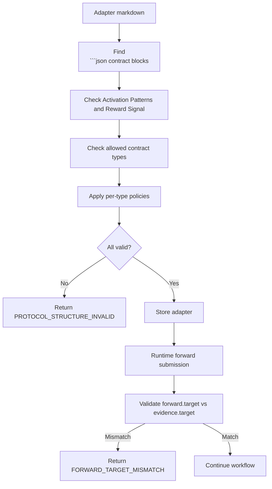

**Diagram sources**
- [validate-protocol-structure.ts:207-297](file://src/services/memory/validate-protocol-structure.ts#L207-L297)
- [forward-contract-match.ts:17-53](file://src/tools/forward-contract-match.ts#L17-L53)

**Section sources**
- [validate-protocol-structure.ts:32-86](file://src/services/memory/validate-protocol-structure.ts#L32-L86)
- [validate-protocol-structure.ts:207-297](file://src/services/memory/validate-protocol-structure.ts#L207-L297)
- [forward-contract-match.ts:1-54](file://src/tools/forward-contract-match.ts#L1-L54)

### Reward Propagation
After a terminal layer completes, the client calls `reward`. The system updates step quality metrics and propagates them to the adapter head so activation ranking reflects final outcomes.

Key behavior:

- The step point is retrieved and its adapter ID is resolved.
- If the step is not already the adapter head, the adapter head is located within the same space filter.
- Quality metrics are updated on the adapter head.
- Cache invalidation is attempted after updating the head.

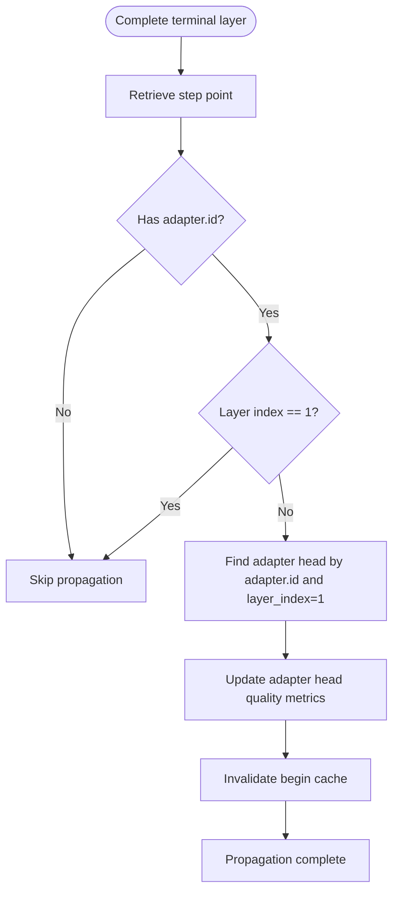

**Diagram sources**
- [reward-propagation.ts:13-73](file://src/services/qdrant/reward-propagation.ts#L13-L73)

**Section sources**
- [reward-propagation.ts:1-76](file://src/services/qdrant/reward-propagation.ts#L1-L76)

## Dependency Analysis
Challenge processing depends on several modules:

- `next.ts` orchestrates layer resolution, proof application, quality updates, and next-step construction.
- `next-pow-helpers.ts` implements nonce management, proof hashing, type-specific validation, and error payloads.
- `forward-contract-match.ts` centralizes forward-target validation.
- `shell-challenge-invocation.ts` defines allowed interpreters and builds logical argv for executors.
- `validate-protocol-structure.ts` enforces adapter structure and contract policies at train time.
- `reward-propagation.ts` connects completed steps to adapter-level quality metrics.

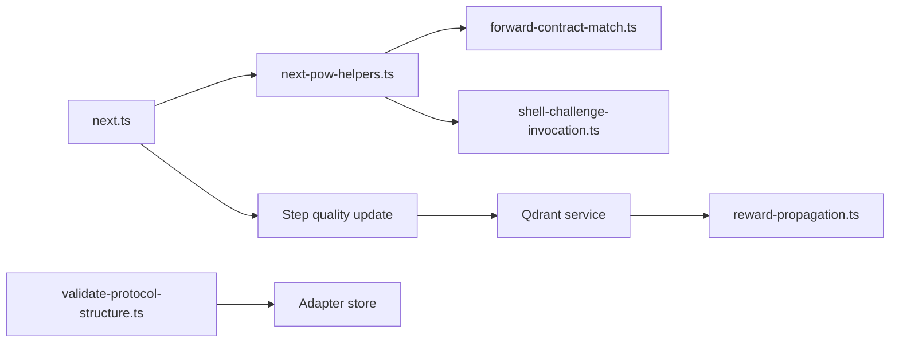

**Diagram sources**
- [next.ts:137-279](file://src/tools/next.ts#L137-L279)
- [next-pow-helpers.ts:127-333](file://src/tools/next-pow-helpers.ts#L127-L333)
- [forward-contract-match.ts:17-53](file://src/tools/forward-contract-match.ts#L17-L53)
- [shell-challenge-invocation.ts:15-17](file://src/tools/shell-challenge-invocation.ts#L15-L17)
- [validate-protocol-structure.ts:207-297](file://src/services/memory/validate-protocol-structure.ts#L207-L297)
- [reward-propagation.ts:13-73](file://src/services/qdrant/reward-propagation.ts#L13-L73)

**Section sources**
- [next.ts:137-279](file://src/tools/next.ts#L137-L279)
- [next-pow-helpers.ts:127-333](file://src/tools/next-pow-helpers.ts#L127-L333)
- [forward-contract-match.ts:1-54](file://src/tools/forward-contract-match.ts#L1-L54)
- [shell-challenge-invocation.ts:15-117](file://src/tools/shell-challenge-invocation.ts#L15-L117)
- [validate-protocol-structure.ts:207-297](file://src/services/memory/validate-protocol-structure.ts#L207-L297)
- [reward-propagation.ts:13-73](file://src/services/qdrant/reward-propagation.ts#L13-L73)

## Performance Considerations
- Proof records are saved once; duplicate successful submissions return the existing proof hash rather than rewriting state.
- Nonce rotation prevents stale-nonce loops by issuing a fresh nonce on mismatch.
- Semantic similarity checks for comments are bounded by a timeout and fail open on provider errors.
- Quality metric updates are best-effort; failures are logged but do not block normal workflow progress.
- Reward propagation skips already-head steps and logs when adapter heads cannot be found.

[No sources needed since this section provides general guidance]

## Troubleshooting Guide
Common issues and resolutions:

| Symptom | Likely cause | Resolution |
|---|---|---|
| `NONCE_MISMATCH` | Submitted nonce does not match stored nonce. | Use `retry_nonce` from the error response and resubmit. |
| `PROOF_HASH_MISMATCH` | `proof_hash` does not match expected previous hash. | Echo `proof_hash` from the previous response or contract. |
| `TYPE_MISMATCH` | Solution type differs from contract type. | Submit the challenge type defined by the current contract. |
| `PLACEHOLDER_EVIDENCE` | Shell stdout/stderr still contain template markers. | Run the command and replace placeholders with real output. |
| `COMMAND_FAILED` | Shell proof failed and contract is required. | Fix the underlying command or environment and retry. |
| `FORWARD_TARGET_MISMATCH` | Submitted forward target differs from contract target. | Call `forward` with the exact adapter URI specified by the contract. |
| `COMMENT_TOO_SHORT` | Comment text below `min_length`. | Expand the acknowledgement to meet the minimum length. |
| `COMMENT_IRRELEVANT` | Comment similarity below threshold. | Write a comment that engages with the step content. |
| `USER_DECLINED` | Host elicitation declined or cancelled. | Address the blocker or adjust the adapter’s user-input prompt. |
| `REVIEW_EVIDENCE_REQUIRED` | Train/tune called without critic-loop PASS evidence. | Run critic-loop, capture verdict evidence, and retry. |

**Section sources**
- [next-pow-helpers.ts:143-199](file://src/tools/next-pow-helpers.ts#L143-L199)
- [next-pow-helpers.ts:208-325](file://src/tools/next-pow-helpers.ts#L208-L325)
- [embedded-mcp-resources.ts:18-34](file://src/resources/embedded-mcp-resources.ts#L18-L34)

## Conclusion
SquadRules challenge types provide a deterministic, auditable protocol for agent-driven workflows. Shell challenges offer empirical verification, forward challenges enforce deterministic adapter chaining, user-input challenges handle genuine authority gaps, subagent challenges separate execution from delegated judgment, and comment challenges serve as minimal acknowledgements. The unified solution envelope, nonce rotation, proof hashing, and strict contract validation ensure that runs are reproducible and repairable. Reward propagation closes the loop by connecting step outcomes to adapter-level quality signals, enabling activation ranking to reflect real-world success and failure.

[No sources needed since this section summarizes without analyzing specific files]