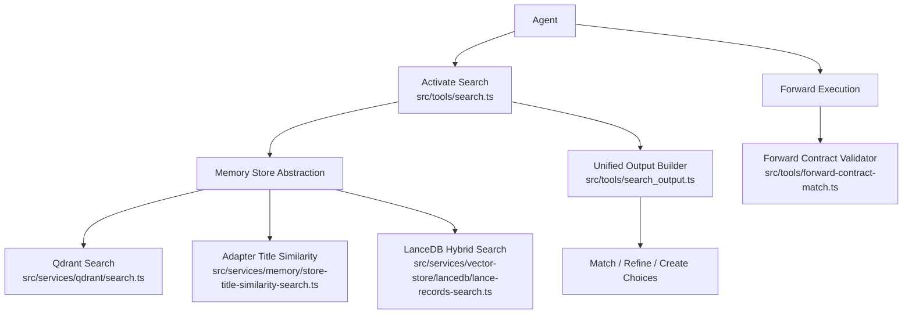
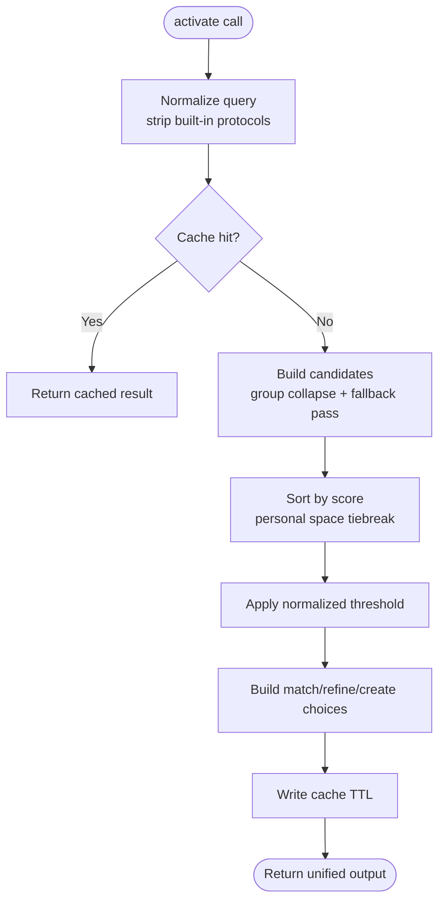
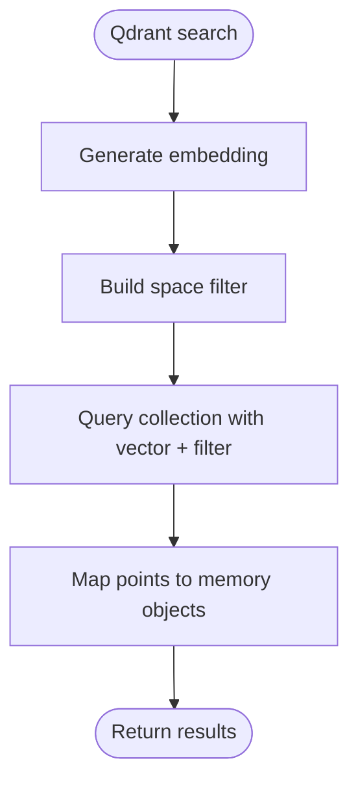
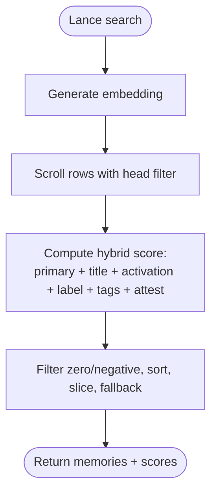
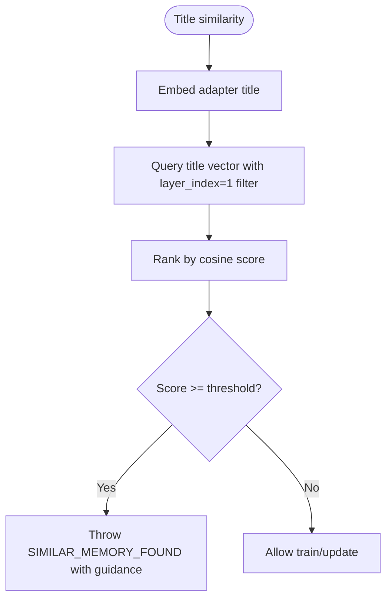
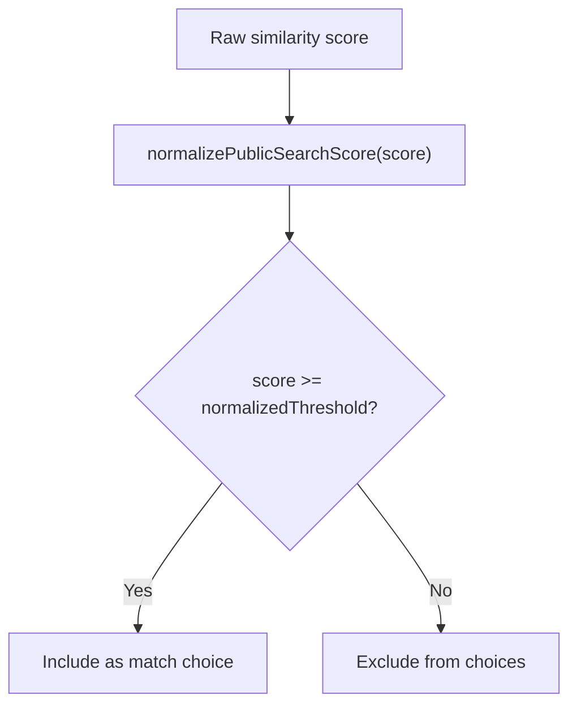
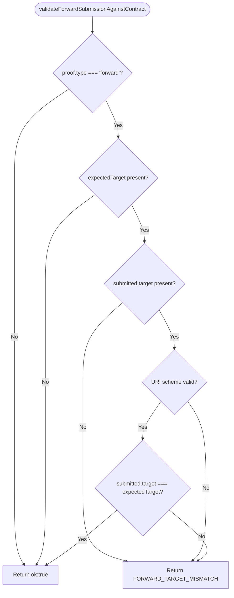
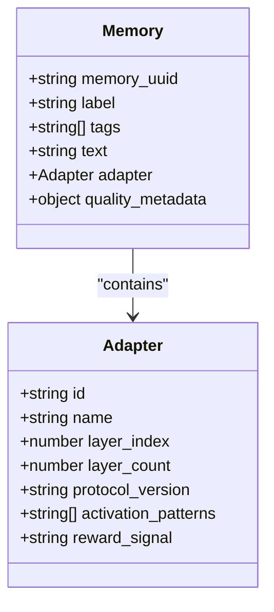
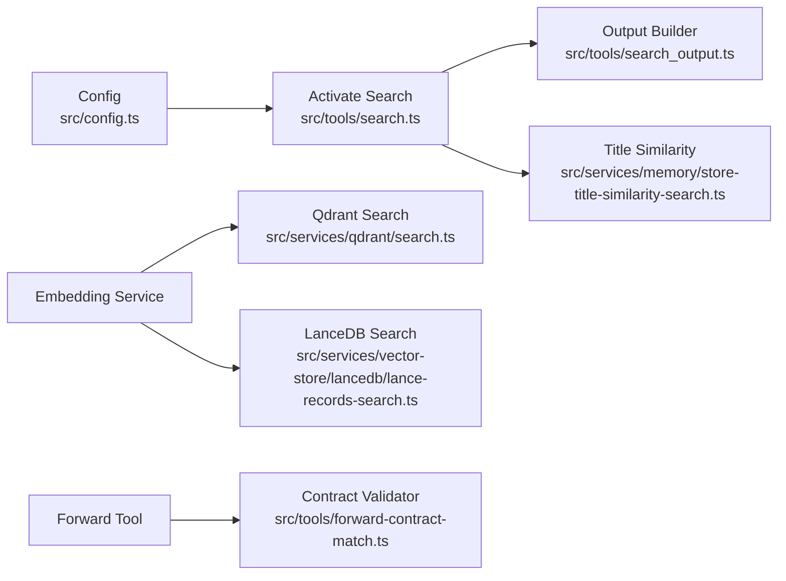

# Contract Matching & Selection

<cite>
**Referenced Files in This Document**
- [search.ts](file://src/tools/search.ts)
- [search_output.ts](file://src/tools/search_output.ts)
- [forward-contract-match.ts](file://src/tools/forward-contract-match.ts)
- [store-title-similarity-search.ts](file://src/services/memory/store-title-similarity-search.ts)
- [lance-records-search.ts](file://src/services/vector-store/lancedb/lance-records-search.ts)
- [qdrant-search.ts](file://src/services/qdrant/search.ts)
- [store-adapter-default-handler.ts](file://src/services/memory/store-adapter-default-handler.ts)
- [store-adapter-helpers.ts](file://src/services/memory/store-adapter-helpers.ts)
- [config.ts](file://src/config.ts)
</cite>

## Table of Contents
1. [Introduction](#introduction)
2. [Project Structure](#project-structure)
3. [Core Components](#core-components)
4. [Architecture Overview](#architecture-overview)
5. [Detailed Component Analysis](#detailed-component-analysis)
6. [Dependency Analysis](#dependency-analysis)
7. [Performance Considerations](#performance-considerations)
8. [Troubleshooting Guide](#troubleshooting-guide)
9. [Conclusion](#conclusion)

## Introduction
This document explains how SquadRules determines which adapter should handle a given task. It covers the semantic search pipeline, vector similarity scoring, contract matching, and selection logic for both Qdrant and LanceDB backends. It also documents query processing, similarity thresholds, ranking strategies, performance optimizations, and troubleshooting guidance.

The system is agent-first: an agent calls `activate` with a short intent query, receives ranked adapter choices, and then invokes `forward` on the selected adapter. The server validates forward submissions against stored contracts to ensure deterministic, auditable execution.

## Project Structure
Contract matching spans three layers:
- Query normalization and candidate aggregation
- Vector similarity search over adapters
- Output construction and contract validation



**Diagram sources**
- [search.ts:93-186](file://src/tools/search.ts#L93-L186)
- [qdrant-search.ts:11-36](file://src/services/qdrant/search.ts#L11-L36)
- [store-title-similarity-search.ts:9-41](file://src/services/memory/store-title-similarity-search.ts#L9-L41)
- [lance-records-search.ts:96-140](file://src/services/vector-store/lancedb/lance-records-search.ts#L96-L140)
- [search_output.ts:117-239](file://src/tools/search_output.ts#L117-L239)
- [forward-contract-match.ts:17-52](file://src/tools/forward-contract-match.ts#L17-L52)

**Section sources**
- [search.ts:1-254](file://src/tools/search.ts#L1-L254)
- [search_output.ts:1-241](file://src/tools/search_output.ts#L1-L241)
- [forward-contract-match.ts:1-54](file://src/tools/forward-contract-match.ts#L1-L54)

## Core Components
- Activate search orchestrator: normalizes queries, aggregates candidates, applies thresholds, and builds unified output.
- Vector similarity search: computes embeddings and performs similarity retrieval using Qdrant or LanceDB.
- Adapter title similarity gate: specialized title-only similarity used during training and duplicate detection.
- Unified output builder: converts ranked memories into match/refine/create choices with normalized scores and next actions.
- Forward contract validator: ensures submitted forward targets match the adapter’s stored contract.

Key responsibilities:
- Semantic search pipeline: embedding generation, space filtering, and vector retrieval.
- Ranking strategy: hybrid cosine similarity plus text boosts (LanceDB), rescore-enabled Qdrant queries, and public score normalization.
- Contract matching: strict URI scheme and target equality checks for forward submissions.

**Section sources**
- [search.ts:35-53](file://src/tools/search.ts#L35-L53)
- [search.ts:93-186](file://src/tools/search.ts#L93-L186)
- [store-title-similarity-search.ts:9-60](file://src/services/memory/store-title-similarity-search.ts#L9-L60)
- [lance-records-search.ts:32-35](file://src/services/vector-store/lancedb/lance-records-search.ts#L32-L35)
- [search_output.ts:68-91](file://src/tools/search_output.ts#L68-L91)
- [forward-contract-match.ts:3-52](file://src/tools/forward-contract-match.ts#L3-L52)

## Architecture Overview
The activation flow transforms a user query into a ranked set of adapter choices. The forward flow validates that the chosen adapter is executed exactly as specified by its contract.

```mermaid
sequenceDiagram
participant Agent as "Agent"
participant Activate as "Activate Search"
participant Embedding as "Embedding Service"
participant Store as "Memory Store"
participant Qdrant as "Qdrant Client"
participant Lance as "LanceDB Engine"
participant Output as "Output Builder"
participant Forward as "Forward Tool"
participant Validator as "Contract Validator"
Agent->>Activate : activate(query, space, max_choices)
Activate->>Embedding : generateEmbedding(normalizedQuery)
Activate->>Store : searchMemories(query, limit, groupCollapse?)
Store->>Qdrant : query(collection, vector, filter, rescore)
Store->>Lance : scroll(headFilter) + cosine scoring
Store-->>Activate : {memories, scores}
Activate->>Output : createResults + generateUnifiedOutput
Output-->>Agent : {choices : [match|refine|create], next_action}
Agent->>Forward : forward(uri, solution)
Forward->>Validator : validateForwardSubmissionAgainstContract(proof, evidence)
Validator-->>Forward : ok | mismatch error
```

**Diagram sources**
- [search.ts:192-252](file://src/tools/search.ts#L192-L252)
- [qdrant-search.ts:11-36](file://src/services/qdrant/search.ts#L11-L36)
- [lance-records-search.ts:96-140](file://src/services/vector-store/lancedb/lance-records-search.ts#L96-L140)
- [search_output.ts:117-239](file://src/tools/search_output.ts#L117-L239)
- [forward-contract-match.ts:17-52](file://src/tools/forward-contract-match.ts#L17-L52)

## Detailed Component Analysis

### Activate Search Pipeline
The activate search pipeline normalizes the query, caches results, aggregates candidates from multiple search passes, sorts by score with personal-space tie-breaking, and produces unified choices.

Key behaviors:
- Query normalization strips built-in protocol URIs and slugs to avoid biasing search and cache keys.
- Candidate aggregation merges results across group-collapsed and uncollapsed searches, preferring head-layer adapters and default write space on ties.
- Thresholding uses a normalized public score pivot so weak matches are filtered before output.
- Unified output adds refine and create footer choices when no strong match exists.



**Diagram sources**
- [search.ts:35-53](file://src/tools/search.ts#L35-L53)
- [search.ts:93-186](file://src/tools/search.ts#L93-L186)
- [search.ts:206-248](file://src/tools/search.ts#L206-L248)
- [search_output.ts:77-91](file://src/tools/search_output.ts#L77-L91)
- [search_output.ts:117-239](file://src/tools/search_output.ts#L117-L239)

**Section sources**
- [search.ts:35-53](file://src/tools/search.ts#L35-L53)
- [search.ts:93-186](file://src/tools/search.ts#L93-L186)
- [search.ts:206-248](file://src/tools/search.ts#L206-L248)
- [search_output.ts:68-91](file://src/tools/search_output.ts#L68-L91)
- [search_output.ts:117-239](file://src/tools/search_output.ts#L117-L239)

### Semantic Search Backends

#### Qdrant Search
Qdrant search generates an embedding for the query, constructs a space-aware filter, and executes a vector query with optional rescore enabled. Results include confidence and metadata fields.

Important aspects:
- Uses dynamic vector dimension name based on embedding length.
- Applies tenant and space context filters.
- Wraps operations with reconnect handling and metrics.



**Diagram sources**
- [qdrant-search.ts:11-36](file://src/services/qdrant/search.ts#L11-L36)
- [qdrant-search.ts:47-72](file://src/services/qdrant/search.ts#L47-L72)

**Section sources**
- [qdrant-search.ts:11-83](file://src/services/qdrant/search.ts#L11-L83)

#### LanceDB Hybrid Search
LanceDB implements a JS-side hybrid-style ranking over three dense vectors (primary, title, activation pattern) plus text boosts for label and tags, mirroring Qdrant’s ranking contract.

Scoring formula components:
- Primary cosine similarity
- Title cosine similarity boost
- Activation pattern cosine similarity boost
- Label text match boost
- Tags text match boost
- Stored attest boost



**Diagram sources**
- [lance-records-search.ts:32-35](file://src/services/vector-store/lancedb/lance-records-search.ts#L32-L35)
- [lance-records-search.ts:96-140](file://src/services/vector-store/lancedb/lance-records-search.ts#L96-L140)

**Section sources**
- [lance-records-search.ts:1-142](file://src/services/vector-store/lancedb/lance-records-search.ts#L1-L142)

#### Adapter Title Similarity Gate
Title similarity search is used to detect similar adapters during training and duplicate prevention. It embeds the adapter title and queries only the title vector, excluding creation and refining footers.

Use cases:
- Pre-train similarity guard
- Duplicate adapter detection
- Training feedback with similarity score and next action



**Diagram sources**
- [store-title-similarity-search.ts:9-41](file://src/services/memory/store-title-similarity-search.ts#L9-L41)
- [store-adapter-helpers.ts:95-172](file://src/services/memory/store-adapter-helpers.ts#L95-L172)

**Section sources**
- [store-title-similarity-search.ts:9-60](file://src/services/memory/store-title-similarity-search.ts#L9-L60)
- [store-adapter-helpers.ts:95-172](file://src/services/memory/store-adapter-helpers.ts#L95-L172)

### Scoring Algorithm and Ranking Strategy
The ranking strategy combines vector similarity and textual signals:
- Qdrant: single primary vector similarity with optional rescore; confidence returned directly.
- LanceDB: hybrid score combining primary/title/activation cosine similarities and label/tags text matches, plus attest boost.
- Public score normalization: internal scores are transformed via a pivot function to produce a normalized 0–1 range for display and thresholding.

Thresholds and limits:
- SCORE_THRESHOLD controls minimum normalized score for match choices.
- SQUADRULES_SEARCH_MAX_CHOICES, LIMIT_CAP, and LIMIT_MIN bound the number of choices.
- Group collapse can be toggled to improve recall vs precision trade-offs.



**Diagram sources**
- [search_output.ts:68-91](file://src/tools/search_output.ts#L68-L91)
- [lance-records-search.ts:32-35](file://src/services/vector-store/lancedb/lance-records-search.ts#L32-L35)
- [qdrant-search.ts:27-36](file://src/services/qdrant/search.ts#L27-L36)

**Section sources**
- [search_output.ts:68-91](file://src/tools/search_output.ts#L68-L91)
- [lance-records-search.ts:96-140](file://src/services/vector-store/lancedb/lance-records-search.ts#L96-L140)
- [qdrant-search.ts:11-36](file://src/services/qdrant/search.ts#L11-L36)
- [config.ts:284-294](file://src/config.ts#L284-L294)

### Contract Matching Process
Forward contract matching ensures that the adapter invoked by the agent matches the stored proof contract. It enforces:
- Forward type presence
- Expected target URI presence
- Valid adapter URI scheme
- Exact target equality

If any check fails, it returns a mismatch error with guidance.



**Diagram sources**
- [forward-contract-match.ts:17-52](file://src/tools/forward-contract-match.ts#L17-L52)

**Section sources**
- [forward-contract-match.ts:1-54](file://src/tools/forward-contract-match.ts#L1-L54)

### Data Storage and Quality Metadata
Adapters are stored with multiple vector fields and payload metadata:
- Primary, title, and activation pattern dense vectors
- BM25 sparse indices (when supported)
- Space, slug, label, tags, task, type, quality metadata
- Adapter identity and chain information

Quality metadata is computed at storage time and updated through runtime flows.



**Diagram sources**
- [store-adapter-default-handler.ts:83-106](file://src/services/memory/store-adapter-default-handler.ts#L83-L106)
- [store-adapter-default-handler.ts:147-205](file://src/services/memory/store-adapter-default-handler.ts#L147-L205)

**Section sources**
- [store-adapter-default-handler.ts:31-255](file://src/services/memory/store-adapter-default-handler.ts#L31-L255)

## Dependency Analysis
The activation and forward flows depend on configuration, embedding service, space context, and vector store implementations.



**Diagram sources**
- [config.ts:284-294](file://src/config.ts#L284-L294)
- [search.ts:1-254](file://src/tools/search.ts#L1-L254)
- [qdrant-search.ts:1-83](file://src/services/qdrant/search.ts#L1-L83)
- [lance-records-search.ts:1-142](file://src/services/vector-store/lancedb/lance-records-search.ts#L1-L142)
- [search_output.ts:1-241](file://src/tools/search_output.ts#L1-L241)
- [store-title-similarity-search.ts:1-62](file://src/services/memory/store-title-similarity-search.ts#L1-L62)
- [forward-contract-match.ts:1-54](file://src/tools/forward-contract-match.ts#L1-L54)

**Section sources**
- [config.ts:284-294](file://src/config.ts#L284-L294)
- [search.ts:1-254](file://src/tools/search.ts#L1-L254)

## Performance Considerations
Optimization techniques implemented in the codebase:
- Caching: activate/search results are cached with a configurable TTL keyed by space, normalized query, group collapse flag, and effective limit.
- Overfetch and group collapse: initial search with a larger limit and optional group collapse improves recall; a second pass fills gaps when needed.
- Rescore toggle: Qdrant rescore can be enabled/disabled via environment configuration.
- Dimension-aware vector names: dynamic vector column names prevent schema mismatches between query and stored data.
- Text tokenization and lightweight text matches: LanceDB text boosts use simple token sets to avoid heavy NLP overhead.
- Fallback scoring: when no positive results remain after filtering, a fallback score preserves ordering for UI consistency.

Recommended tuning parameters:
- SCORE_THRESHOLD: adjust to balance precision vs recall in match choices.
- SIMILAR_MEMORY_THRESHOLD: control duplicate detection sensitivity during training.
- MIN_ATTEST_RUNS, RUNS_FULL_CONFIDENCE, ATTEST_BOOST_MAX: tune attest-based tiebreaking.
- SQUADRULES_SEARCH_MAX_CHOICES, LIMIT_CAP, LIMIT_MIN: cap and bound choice counts.
- SQUADRULES_ENABLE_GROUP_COLLAPSE: enable for better recall at potential cost.

**Section sources**
- [search.ts:206-248](file://src/tools/search.ts#L206-L248)
- [search.ts:93-111](file://src/tools/search.ts#L93-L111)
- [lance-records-search.ts:82-94](file://src/services/vector-store/lancedb/lance-records-search.ts#L82-L94)
- [config.ts:284-294](file://src/config.ts#L284-L294)

## Troubleshooting Guide
Common matching issues and resolutions:
- No matches returned:
  - Verify SCORE_THRESHOLD is not too high.
  - Ensure embeddings are generated successfully and vector dimensions match stored data.
  - Check space context and allowed spaces; filters may exclude adapters.
- Weak matches consistently below threshold:
  - Lower SCORE_THRESHOLD temporarily to diagnose.
  - Improve adapter titles and activation patterns to increase title/activation similarity.
  - Enable group collapse to broaden candidate pool.
- Similar adapter detected during training:
  - Review SIMILAR_MEMORY_THRESHOLD; consider force_update if intentionally replacing.
  - Inspect existing adapter content preview and suggested next action.
- Forward contract mismatch:
  - Ensure submitted forward target matches the exact adapter URI from the contract.
  - Confirm URI scheme is valid and target is present.

Operational diagnostics:
- Monitor cache hits/misses and TTL behavior in activate search logs.
- Inspect Qdrant query duration and operation metrics.
- Validate vector field names and dimensions for both Qdrant and LanceDB.

**Section sources**
- [search.ts:206-248](file://src/tools/search.ts#L206-L248)
- [store-adapter-helpers.ts:112-172](file://src/services/memory/store-adapter-helpers.ts#L112-L172)
- [forward-contract-match.ts:17-52](file://src/tools/forward-contract-match.ts#L17-L52)
- [qdrant-search.ts:39-45](file://src/services/qdrant/search.ts#L39-L45)

## Conclusion
SquadRules’ contract matching and adapter selection system combines semantic search, hybrid scoring, and strict contract validation to route tasks deterministically. The activate pipeline normalizes queries, aggregates candidates, applies thresholds, and produces actionable choices. The forward pipeline enforces exact contract compliance. Tunable parameters allow operators to balance precision, recall, and performance across Qdrant and LanceDB backends while maintaining auditability and safety.