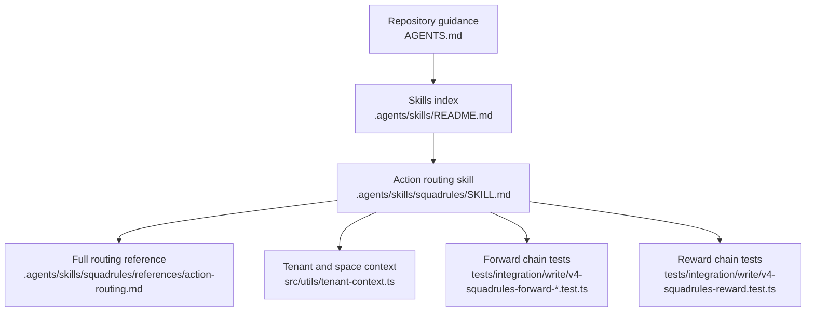
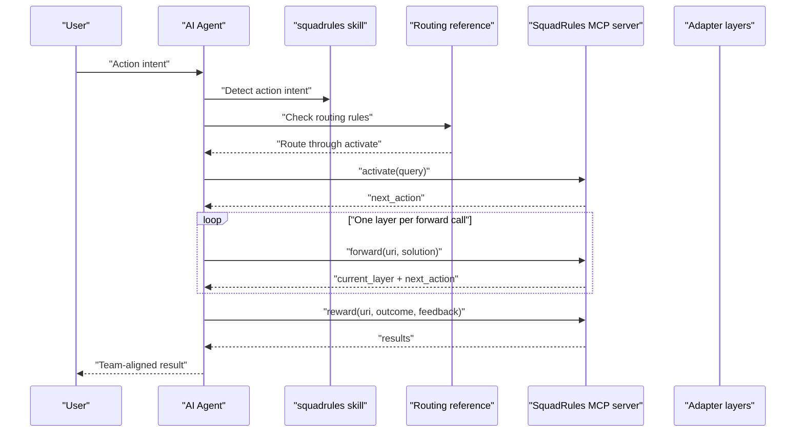
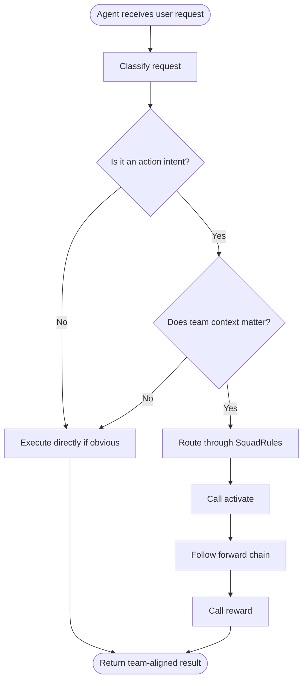
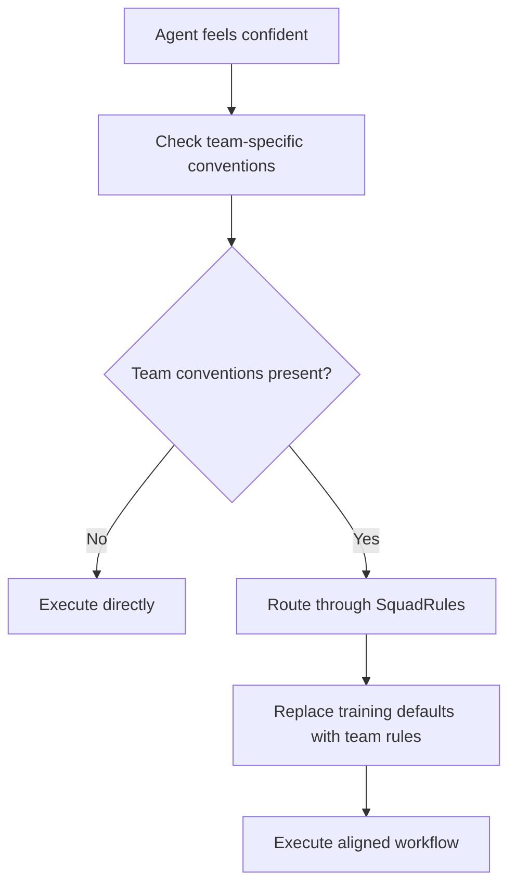
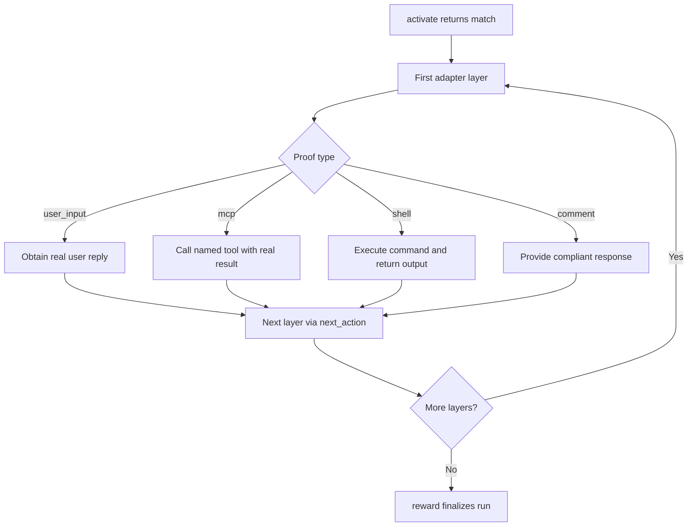
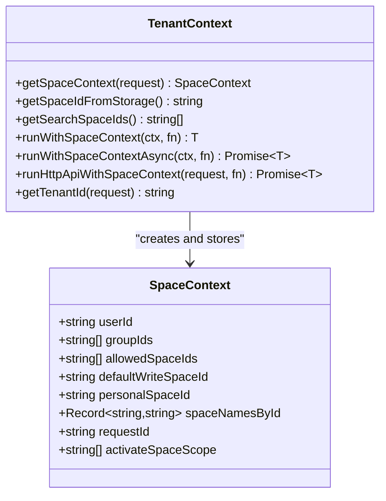
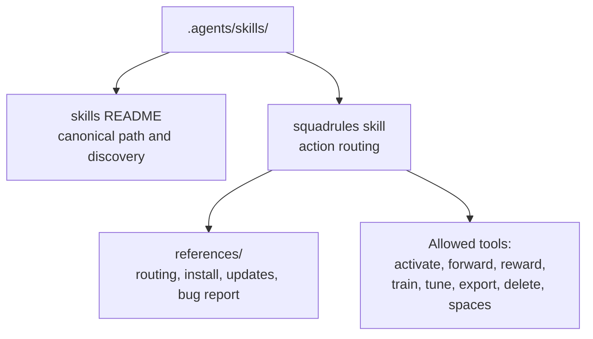
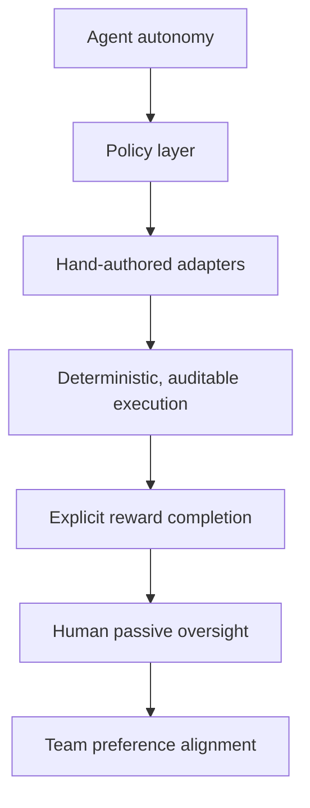
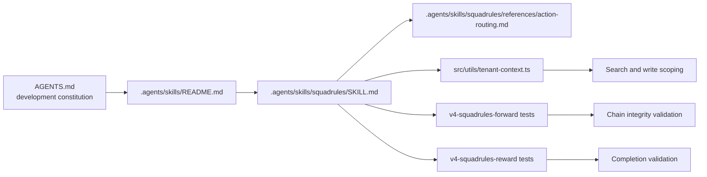

# Agent Autonomy Model

<cite>
**Referenced Files in This Document**
- [AGENTS.md](file://AGENTS.md)
- [.agents/skills/README.md](file://.agents/skills/README.md)
- [.agents/skills/squadrules/SKILL.md](file://.agents/skills/squadrules/SKILL.md)
- [.agents/skills/squadrules/references/action-routing.md](file://.agents/skills/squadrules/references/action-routing.md)
- [src/utils/tenant-context.ts](file://src/utils/tenant-context.ts)
- [tests/integration/write/v4-squadrules-forward-continue.test.ts](file://tests/integration/write/v4-squadrules-forward-continue.test.ts)
- [tests/integration/write/v4-squadrules-reward.test.ts](file://tests/integration/write/v4-squadrules-reward.test.ts)
- [tests/integration/write/v4-squadrules-forward-mcp-contract-args.test.ts](file://tests/integration/write/v4-squadrules-forward-mcp-contract-args.test.ts)
</cite>

## Table of Contents
1. [Introduction](#introduction)
2. [Project Structure](#project-structure)
3. [Core Components](#core-components)
4. [Architecture Overview](#architecture-overview)
5. [Detailed Component Analysis](#detailed-component-analysis)
6. [Dependency Analysis](#dependency-analysis)
7. [Performance Considerations](#performance-considerations)
8. [Troubleshooting Guide](#troubleshooting-guide)
9. [Conclusion](#conclusion)

## Introduction
SquadRules is an agent-first MCP framework where AI agents are the primary users and humans configure preferences through agents. The core design principle is that one AI plus one human forms a team, and the system should keep agent actions aligned with team preferences rather than generic training defaults.

The autonomy model has three pillars:
- Agents maintain knowledge but must consult team knowledge before acting.
- Team preferences are encoded as hand-authored skills and adapters, not inferred by the agent.
- Human oversight is preserved through deterministic, auditable adapter execution and explicit completion via `reward`.

This document explains how the repository enforces these principles through:
- A mandatory routing discipline for action intents.
- A tenant context system that manages identity, allowed spaces, and write permissions.
- A skill system under `.agents/skills/` that provides canonical action routing.
- An `activate → forward → reward` chain that balances autonomous execution with team control.

## Project Structure
The autonomy model lives at the intersection of documentation, skills, runtime utilities, and tests:

**Diagram sources**
- [AGENTS.md:7-23](file://AGENTS.md#L7-L23)
- [.agents/skills/README.md:1-21](file://.agents/skills/README.md#L1-L21)
- [.agents/skills/squadrules/SKILL.md:1-20](file://.agents/skills/squadrules/SKILL.md#L1-L20)
- [.agents/skills/squadrules/references/action-routing.md:1-30](file://.agents/skills/squadrules/references/action-routing.md#L1-L30)
- [src/utils/tenant-context.ts:1-8](file://src/utils/tenant-context.ts#L1-L8)
- [tests/integration/write/v4-squadrules-forward-continue.test.ts:174-213](file://tests/integration/write/v4-squadrules-forward-continue.test.ts#L174-L213)
- [tests/integration/write/v4-squadrules-reward.test.ts:87-104](file://tests/integration/write/v4-squadrules-reward.test.ts#L87-L104)

**Section sources**
- [AGENTS.md:7-23](file://AGENTS.md#L7-L23)
- [.agents/skills/README.md:1-21](file://.agents/skills/README.md#L1-L21)
- [.agents/skills/squadrules/SKILL.md:1-20](file://.agents/skills/squadrules/SKILL.md#L1-L20)
- [.agents/skills/squadrules/references/action-routing.md:1-30](file://.agents/skills/squadrules/references/action-routing.md#L1-L30)
- [src/utils/tenant-context.ts:1-8](file://src/utils/tenant-context.ts#L1-L8)

## Core Components
The agent autonomy model is implemented through four interacting components:

| Component | Responsibility | Where it appears |
|---|---|---|
| Repository development constitution | Establishes that agents must consult team knowledge before acting and own their workflows | [AGENTS.md](file://AGENTS.md) |
| Skills index | Declares `.agents/skills/` as the canonical path and identifies the user-facing `squadrules` skill | [.agents/skills/README.md](file://.agents/skills/README.md) |
| Action routing skill | Provides the concise router for `activate → forward → reward` and delegates detailed rules to references | [.agents/skills/squadrules/SKILL.md](file://.agents/skills/squadrules/SKILL.md) |
| Routing reference | Defines when to route, chain discipline, safety, and unavailability handling | [.agents/skills/squadrules/references/action-routing.md](file://.agents/skills/squadrules/references/action-routing.md) |
| Tenant context | Derives identity, allowed spaces, default write space, and search scope from auth or configuration | [src/utils/tenant-context.ts](file://src/utils/tenant-context.ts) |
| Integration tests | Validate that `forward` chains progress deterministically and end with `reward` | [tests/integration/write/v4-squadrules-forward-continue.test.ts](file://tests/integration/write/v4-squadrules-forward-continue.test.ts), [tests/integration/write/v4-squadrules-reward.test.ts](file://tests/integration/write/v4-squadrules-reward.test.ts) |

**Section sources**
- [AGENTS.md:24-60](file://AGENTS.md#L24-L60)
- [.agents/skills/README.md:1-21](file://.agents/skills/README.md#L1-L21)
- [.agents/skills/squadrules/SKILL.md:1-20](file://.agents/skills/squadrules/SKILL.md#L1-L20)
- [.agents/skills/squadrules/references/action-routing.md:1-30](file://.agents/skills/squadrules/references/action-routing.md#L1-L30)
- [src/utils/tenant-context.ts:1-8](file://src/utils/tenant-context.ts#L1-L8)
- [tests/integration/write/v4-squadrules-forward-continue.test.ts:174-213](file://tests/integration/write/v4-squadrules-forward-continue.test.ts#L174-L213)
- [tests/integration/write/v4-squadrules-reward.test.ts:87-104](file://tests/integration/write/v4-squadrules-reward.test.ts#L87-L104)

## Architecture Overview
At runtime, an agent receives a user message and decides whether to act directly or consult SquadRules. If the task involves team-specific conventions, the agent routes through the MCP tools:

**Diagram sources**
- [.agents/skills/squadrules/SKILL.md:35-46](file://.agents/skills/squadrules/SKILL.md#L35-L46)
- [.agents/skills/squadrules/references/action-routing.md:19-30](file://.agents/skills/squadrules/references/action-routing.md#L19-L30)
- [tests/integration/write/v4-squadrules-forward-continue.test.ts:174-213](file://tests/integration/write/v4-squadrules-forward-continue.test.ts#L174-L213)
- [tests/integration/write/v4-squadrules-reward.test.ts:87-104](file://tests/integration/write/v4-squadrules-reward.test.ts#L87-L104)

## Detailed Component Analysis

### Agent Autonomy and Knowledge Consultation
The repository explicitly states that familiarity with a task does not establish this team's preferences. The development constitution requires agents to create, repair, and maintain adapters when preferences change, and to consult team knowledge before acting.

Key behavioral rules include:
- Agents are the operational users; humans configure preferences through agents.
- Agents own their workflows and must repair inadequate adapters.
- Familiarity is not authority; routing replaces generic training defaults with team-specific rules.
- Built-in adapters should teach autonomy by guiding agents to find, execute, create, repair, and share workflows.

**Diagram sources**
- [AGENTS.md:24-60](file://AGENTS.md#L24-L60)
- [.agents/skills/squadrules/references/action-routing.md:49-81](file://.agents/skills/squadrules/references/action-routing.md#L49-L81)
- [.agents/skills/squadrules/references/action-routing.md:83-111](file://.agents/skills/squadrules/references/action-routing.md#L83-L111)

**Section sources**
- [AGENTS.md:24-60](file://AGENTS.md#L24-L60)
- [.agents/skills/squadrules/references/action-routing.md:49-111](file://.agents/skills/squadrules/references/action-routing.md#L49-L111)

### Why Agents Must Consult Team Knowledge Even for Familiar Tasks
The routing reference makes a deliberate distinction between trained actions and customized actions:
- Trained actions are generic capabilities from training data.
- Customized actions are the same mechanics wrapped in team-specific rules such as branch naming, ticket linking, MR templates, pipeline requirements, approval gates, and post-merge checklists.

The policy is explicit: the more confident an agent feels about a task, the more likely it is carrying training defaults that conflict with the team’s process. Routing exists precisely because confidence alone is not proof of alignment.

**Diagram sources**
- [.agents/skills/squadrules/references/action-routing.md:49-76](file://.agents/skills/squadrules/references/action-routing.md#L49-L76)

**Section sources**
- [.agents/skills/squadrules/references/action-routing.md:49-81](file://.agents/skills/squadrules/references/action-routing.md#L49-L81)

### Routing Discipline and Chain Enforcement
The `squadrules` skill defines the concise routing contract: detect intent, call `activate`, follow `next_action` through `forward` calls until the chain indicates `reward`, then finalize with `reward`. The full routing reference adds enforcement rules:

- Echo verbatim server-generated URIs, nonces, hashes, IDs, `must_obey`, and `next_action`.
- Do not skip, reorder, or merge adapter layers.
- Treat each layer as a distinct checkpoint.
- Respect proof types: `user_input`, `mcp`, `shell`, `comment`.
- On rejection, do not guess or jump ahead; follow `next_action`.
- Do not answer the user until `reward` succeeds unless a layer requires `user_input` or a blocking error occurs.

Integration tests validate this behavior by walking multiple `forward` steps and asserting that the final step directs to `reward`.

**Diagram sources**
- [.agents/skills/squadrules/SKILL.md:35-46](file://.agents/skills/squadrules/SKILL.md#L35-L46)
- [.agents/skills/squadrules/references/action-routing.md:32-47](file://.agents/skills/squadrules/references/action-routing.md#L32-L47)
- [tests/integration/write/v4-squadrules-forward-continue.test.ts:174-213](file://tests/integration/write/v4-squadrules-forward-continue.test.ts#L174-L213)

**Section sources**
- [.agents/skills/squadrules/SKILL.md:35-46](file://.agents/skills/squadrules/SKILL.md#L35-L46)
- [.agents/skills/squadrules/references/action-routing.md:32-47](file://.agents/skills/squadrules/references/action-routing.md#L32-L47)
- [tests/integration/write/v4-squadrules-forward-continue.test.ts:174-213](file://tests/integration/write/v4-squadrules-forward-continue.test.ts#L174-L213)

### Safety, Validation, and Unavailability Handling
The routing reference adds safety constraints:
- Host policy comes first; the skill operates within the host’s permission model.
- Remote outputs must be validated; `next_action` is a routing directive within the SquadRules tool set.
- Actions outside `allowed-tools` or obviously unsafe operations must stop and report anomalies.
- Secrets must not be forwarded into queries or payloads.
- If the SquadRules MCP server is unavailable or unauthenticated, routing stops and the failure is classified as critical.

These rules ensure that agent autonomy never overrides host security, authorization, or auditability.

**Section sources**
- [.agents/skills/squadrules/references/action-routing.md:158-191](file://.agents/skills/squadrules/references/action-routing.md#L158-L191)

### Tenant Context System: Identity, Spaces, and Permissions
The tenant context system manages agent identity and permissions through a `SpaceContext`:

| Field | Meaning |
|---|---|
| `userId` | Derived from Keycloak `sub` when authentication is enabled |
| `groupIds` | Groups attached to the authenticated principal |
| `allowedSpaceIds` | Personal space plus group-derived spaces |
| `defaultWriteSpaceId` | Default destination for writes |
| `personalSpaceId` | User personal space ID, used to resolve explicit personal scope |
| `spaceNamesById` | Human-readable labels for spaces |
| `requestId` | Correlation ID for tracing |
| `activateSpaceScope` | Optional narrowed search scope for activation |

When authentication is enabled and no auth context exists, the system uses a sentinel space so no tenant data is shared. When authentication is disabled, a single-tenant default context is used.

**Diagram sources**
- [src/utils/tenant-context.ts:20-42](file://src/utils/tenant-context.ts#L20-L42)
- [src/utils/tenant-context.ts:55-129](file://src/utils/tenant-context.ts#L55-L129)
- [src/utils/tenant-context.ts:141-179](file://src/utils/tenant-context.ts#L141-L179)
- [src/utils/tenant-context.ts:250-311](file://src/utils/tenant-context.ts#L250-L311)

**Section sources**
- [src/utils/tenant-context.ts:1-8](file://src/utils/tenant-context.ts#L1-L8)
- [src/utils/tenant-context.ts:20-42](file://src/utils/tenant-context.ts#L20-L42)
- [src/utils/tenant-context.ts:55-129](file://src/utils/tenant-context.ts#L55-L129)
- [src/utils/tenant-context.ts:141-179](file://src/utils/tenant-context.ts#L141-L179)
- [src/utils/tenant-context.ts:181-248](file://src/utils/tenant-context.ts#L181-L248)
- [src/utils/tenant-context.ts:250-311](file://src/utils/tenant-context.ts#L250-L311)

### Skill System: Hand-Authored Canonical Routing
The skill system is intentionally not auto-generated. The repository ships exactly one discoverable skill: `squadrules`. Its purpose is action routing for structured workflow execution.

Important characteristics:
- Canonical path: `.agents/skills/`.
- Hosts load repo-scoped skills from `.agents/` and user-scoped skills from `~/.agents/`.
- The `squadrules` skill is the only skill end users install.
- `SKILL.md` is a concise router; depth lives in `references/`.
- The skill lists allowed tools: `activate`, `forward`, `reward`, `train`, `tune`, `export`, `delete`, `spaces`.
- The skill is marked `always_active: true`, meaning it is available for agent routing decisions.

**Diagram sources**
- [.agents/skills/README.md:1-21](file://.agents/skills/README.md#L1-L21)
- [.agents/skills/squadrules/SKILL.md:1-20](file://.agents/skills/squadrules/SKILL.md#L1-L20)

**Section sources**
- [.agents/skills/README.md:1-21](file://.agents/skills/README.md#L1-L21)
- [.agents/skills/squadrules/SKILL.md:1-20](file://.agents/skills/squadrules/SKILL.md#L1-L20)

### Balancing Autonomy with Human Oversight
SquadRules balances autonomy and oversight through several mechanisms:

| Mechanism | How it works |
|---|---|
| Mandatory routing | Agents must consult team knowledge before acting on action intents involving team-specific conventions. |
| Deterministic adapters | Adapters provide deterministic, auditable task execution rather than opaque model-driven behavior. |
| Explicit chain completion | The agent must complete `activate → forward → reward`; an incomplete chain is not a valid stopping point. |
| Passive observability | MCP tool calls appear in IDE panels and logs, allowing humans to observe without needing to interact. |
| Permission scoping | Tenant context restricts which spaces can be searched and written based on identity and groups. |
| Rejection handling | Rejections require following `next_action` instead of guessing or bypassing the workflow. |
| Critical error handling | Unavailable or unauthenticated MCP routing is treated as a critical error requiring remediation. |

**Diagram sources**
- [AGENTS.md:24-60](file://AGENTS.md#L24-L60)
- [.agents/skills/squadrules/SKILL.md:22-33](file://.agents/skills/squadrules/SKILL.md#L22-L33)
- [.agents/skills/squadrules/references/action-routing.md:29-47](file://.agents/skills/squadrules/references/action-routing.md#L29-L47)
- [src/utils/tenant-context.ts:1-8](file://src/utils/tenant-context.ts#L1-L8)

**Section sources**
- [AGENTS.md:24-60](file://AGENTS.md#L24-L60)
- [.agents/skills/squadrules/SKILL.md:22-33](file://.agents/skills/squadrules/SKILL.md#L22-L33)
- [.agents/skills/squadrules/references/action-routing.md:29-47](file://.agents/skills/squadrules/references/action-routing.md#L29-L47)
- [src/utils/tenant-context.ts:1-8](file://src/utils/tenant-context.ts#L1-L8)

## Dependency Analysis
The autonomy model depends on layered relationships between documentation, skills, runtime context, and tests:

**Diagram sources**
- [AGENTS.md:7-23](file://AGENTS.md#L7-L23)
- [.agents/skills/README.md:1-21](file://.agents/skills/README.md#L1-L21)
- [.agents/skills/squadrules/SKILL.md:1-20](file://.agents/skills/squadrules/SKILL.md#L1-L20)
- [.agents/skills/squadrules/references/action-routing.md:1-30](file://.agents/skills/squadrules/references/action-routing.md#L1-L30)
- [src/utils/tenant-context.ts:1-8](file://src/utils/tenant-context.ts#L1-L8)
- [tests/integration/write/v4-squadrules-forward-continue.test.ts:174-213](file://tests/integration/write/v4-squadrules-forward-continue.test.ts#L174-L213)
- [tests/integration/write/v4-squadrules-reward.test.ts:87-104](file://tests/integration/write/v4-squadrules-reward.test.ts#L87-L104)

**Section sources**
- [AGENTS.md:7-23](file://AGENTS.md#L7-L23)
- [.agents/skills/README.md:1-21](file://.agents/skills/README.md#L1-L21)
- [.agents/skills/squadrules/SKILL.md:1-20](file://.agents/skills/squadrules/SKILL.md#L1-L20)
- [.agents/skills/squadrules/references/action-routing.md:1-30](file://.agents/skills/squadrules/references/action-routing.md#L1-L30)
- [src/utils/tenant-context.ts:1-8](file://src/utils/tenant-context.ts#L1-L8)
- [tests/integration/write/v4-squadrules-forward-continue.test.ts:174-213](file://tests/integration/write/v4-squadrules-forward-continue.test.ts#L174-L213)
- [tests/integration/write/v4-squadrules-reward.test.ts:87-104](file://tests/integration/write/v4-squadrules-reward.test.ts#L87-L104)

## Performance Considerations
The autonomy model favors correctness and alignment over speed:
- Routing introduces an extra step before substantive work, ensuring team preferences are applied.
- Adapter layers enforce sequential checkpoints rather than allowing parallel shortcuts.
- Tenant context derivation adds minimal overhead compared to the cost of misaligned agent actions.
- Tests validate deterministic chain progression, reducing the risk of inconsistent behavior across runs.

[No sources needed since this section provides general guidance]

## Troubleshooting Guide
Common issues related to the autonomy model:

| Issue | Symptom | Resolution |
|---|---|---|
| MCP server unavailable | Routing cannot proceed; agent treats it as a critical error | Verify endpoint URL, health check, and MCP configuration |
| MCP server unauthenticated | Authentication fails; routing stops | Refresh credentials and verify session/token validity |
| Incomplete chain | Agent responds before `reward` | Complete the full `activate → forward → reward` chain |
| Wrong adapter layer order | Behavior differs from expected workflow | Follow `next_action` exactly; do not skip or reorder layers |
| Unauthorized space access | Requested space is not allowed | Use only spaces derived from JWT or explicitly allowed |
| Secret leakage risk | Credentials included in queries or payloads | Remove secrets from `activate` queries and `forward` payloads |

**Section sources**
- [.agents/skills/squadrules/references/action-routing.md:158-191](file://.agents/skills/squadrules/references/action-routing.md#L158-L191)
- [src/utils/tenant-context.ts:156-179](file://src/utils/tenant-context.ts#L156-L179)

## Conclusion
SquadRules’ agent autonomy model is not “let the agent do whatever it knows.” It is “let the agent act autonomously, but always through team-defined workflows.”

The system enforces this through:
- A development constitution that requires consulting team knowledge before acting.
- A hand-authored skill system that provides canonical routing.
- A strict `activate → forward → reward` chain that prevents partial or unverified execution.
- A tenant context system that binds identity, permissions, and workspace scope to every operation.
- Integration tests that validate deterministic chain behavior and completion.

The result is an agent-first framework where autonomy is real, but bounded by team preferences, established workflows, and auditable execution.