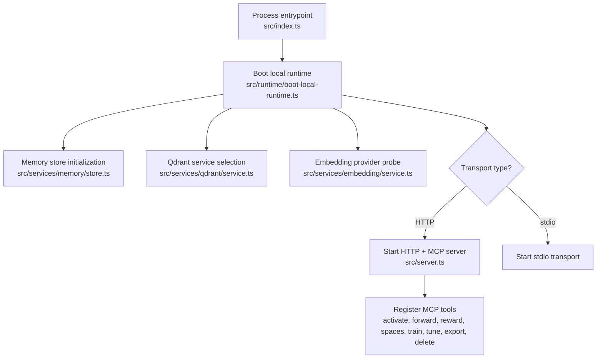
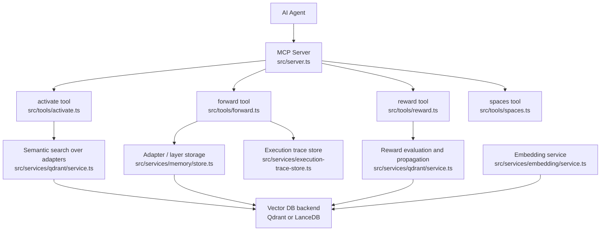
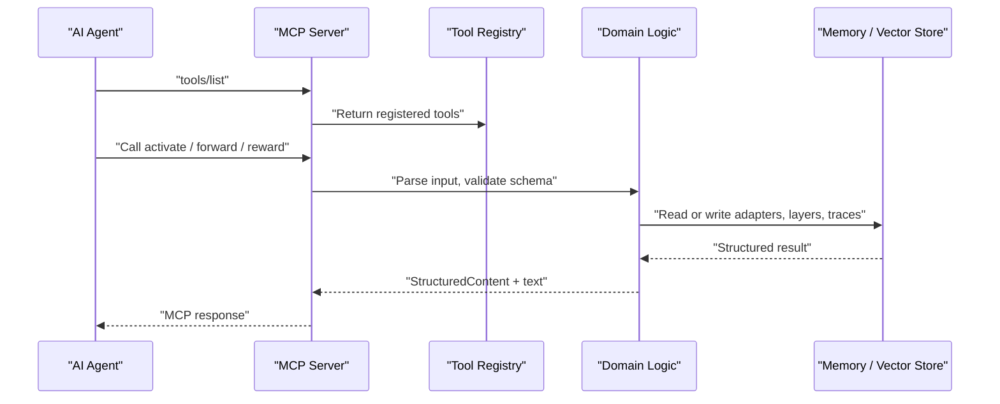
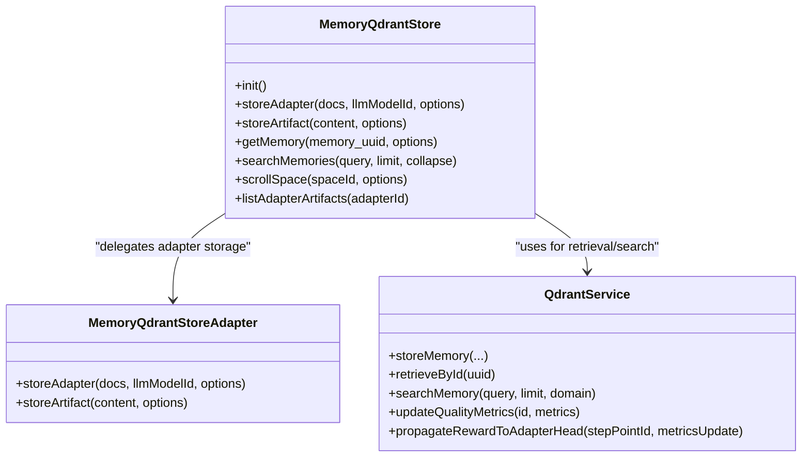
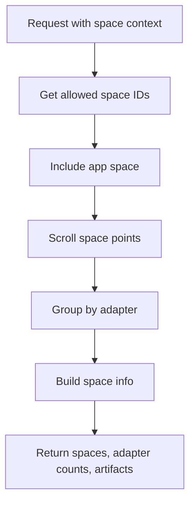
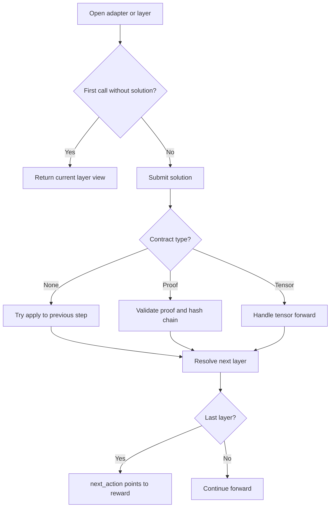
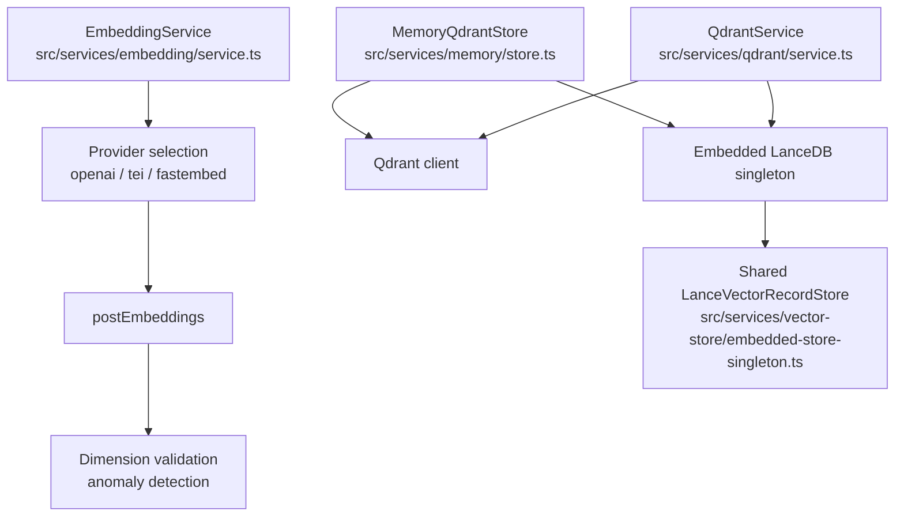
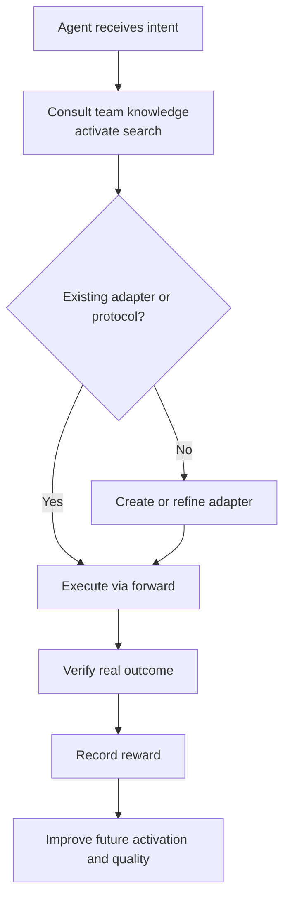
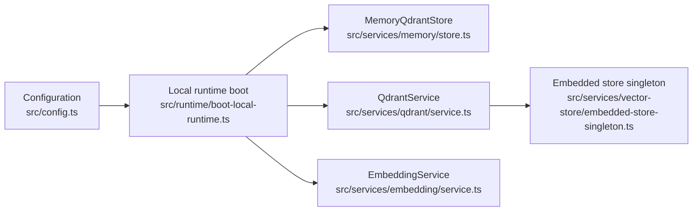

# Core Concepts

<cite>
**Referenced Files in This Document**
- [index.ts](file://src/index.ts)
- [server.ts](file://src/server.ts)
- [config.ts](file://src/config.ts)
- [activate.ts](file://src/tools/activate.ts)
- [forward-register.ts](file://src/tools/forward-register.ts)
- [forward.ts](file://src/tools/forward.ts)
- [reward.ts](file://src/tools/reward.ts)
- [spaces.ts](file://src/tools/spaces.ts)
- [store.ts](file://src/services/memory/store.ts)
- [store-adapter.ts](file://src/services/memory/store-adapter.ts)
- [service.ts](file://src/services/qdrant/service.ts)
- [service.ts](file://src/services/embedding/service.ts)
- [embedded-store-singleton.ts](file://src/services/vector-store/embedded-store-singleton.ts)
- [LanceExecutionTraceStore.ts](file://src/services/vector-store/lancedb/LanceExecutionTraceStore.ts)
- [execution-trace-store.ts](file://src/services/execution-trace-store.ts)
- [boot-local-runtime.ts](file://src/runtime/boot-local-runtime.ts)
- [AGENTS.md](file://AGENTS.md)
</cite>

## Table of Contents
1. [Introduction](#introduction)
2. [Project Structure](#project-structure)
3. [Core Components](#core-components)
4. [Architecture Overview](#architecture-overview)
5. [Detailed Component Analysis](#detailed-component-analysis)
6. [Dependency Analysis](#dependency-analysis)
7. [Performance Considerations](#performance-considerations)
8. [Troubleshooting Guide](#troubleshooting-guide)
9. [Conclusion](#conclusion)

## Introduction
SquadRules is an agent-first Model Context Protocol (MCP) framework. The primary users are AI agents; humans configure preferences, spaces, and workflows through the same MCP surface. A team is modeled as one AI plus one human. Agents own their knowledge: they discover existing adapters or protocols, execute them deterministically, and create or repair adapters when execution reveals missing or outdated instructions.

The core operational chain is:
- **Activate**: find the best adapter or protocol for a query.
- **Forward**: run the first or next layer of an adapter or protocol.
- **Reward**: record outcome-based feedback that improves future activation and quality scoring.

Adapters are deterministic, auditable task specifications. Protocols are multi-step workflow specifications composed from adapters. Spaces are logical groupings of adapters and artifacts. Memory is vector-backed semantic search over adapters, layers, artifacts, and execution traces.

## Project Structure
At runtime, the process entrypoint initializes global error handling, signal handling, optional metrics, local artifact directory hints, embedding dimension probing, and then boots the shared memory store before starting either HTTP or stdio transport.



**Diagram sources**
- [index.ts:60-107](file://src/index.ts#L60-L107)
- [boot-local-runtime.ts:51-84](file://src/runtime/boot-local-runtime.ts#L51-L84)
- [server.ts:44-69](file://src/server.ts#L44-L69)

**Section sources**
- [index.ts:1-130](file://src/index.ts#L1-L130)
- [boot-local-runtime.ts:51-84](file://src/runtime/boot-local-runtime.ts#L51-L84)

## Core Components
SquadRules exposes MCP tools that implement the activate → forward → reward chain. The MCP server registers these tools with strict JSON schemas, structured content, UI metadata, and metrics instrumentation.

| Component | Responsibility | Key implementation |
|---|---|---|
| MCP Server | Creates capabilities, registers tools, resources, prompts, and UI offerings | `createServer` |
| Activate Tool | Semantic search over adapters and protocols; returns ranked choices with next actions | `registerActivateTool`, `executeActivate` |
| Forward Tool | Runs the first or next layer; handles contracts, proof-of-work, previous-step application, tensor steps, and execution tracing | `registerForwardTool`, `executeForward` |
| Reward Tool | Evaluates outcomes, propagates reward metrics, and persists per-execution rewards | `registerRewardTool`, `executeReward` |
| Spaces Tool | Lists spaces, adapter counts, titles, layer counts, and artifacts | `registerSpacesTool`, `executeSpaces` |
| Memory Store | Stores adapters, artifacts, and layers; supports space-scoped queries and scroll operations | `MemoryQdrantStore` |
| Qdrant Service | Backend abstraction for retrieval, search, protocol lookup, quality updates, and reward propagation | `QdrantService` |
| Embedding Service | Generates embeddings via OpenAI, TEI, or fastembed; validates dimensions and emits audit/metrics | `EmbeddingService` |
| Execution Trace Store | Records adapter runs, solutions, activation queries, and rewards for observability | `executionTraceStore` |

**Section sources**
- [server.ts:44-80](file://src/server.ts#L44-L80)
- [activate.ts:237-287](file://src/tools/activate.ts#L237-L287)
- [forward-register.ts:18-65](file://src/tools/forward-register.ts#L18-L65)
- [reward.ts:112-155](file://src/tools/reward.ts#L112-L155)
- [spaces.ts:195-254](file://src/tools/spaces.ts#L195-L254)

## Architecture Overview
SquadRules implements MCP by exposing typed tools to AI agents. Each tool parses input, performs domain logic against memory and vector backends, records metrics, and returns structured content suitable for both machine consumption and UI rendering.



**Diagram sources**
- [server.ts:44-80](file://src/server.ts#L44-L80)
- [activate.ts:209-235](file://src/tools/activate.ts#L209-L235)
- [forward.ts:93-130](file://src/tools/forward.ts#L93-L130)
- [reward.ts:27-110](file://src/tools/reward.ts#L27-L110)
- [service.ts:17-161](file://src/services/qdrant/service.ts#L17-L161)
- [service.ts:38-284](file://src/services/embedding/service.ts#L38-L284)

## Detailed Component Analysis

### Model Context Protocol (MCP) in SquadRules
SquadRules uses MCP as the communication contract between AI agents and the system. The MCP server declares capabilities for tools, resources, prompts, and custom UI offerings. Tools are registered with:
- Strict input schemas validated at runtime.
- Output schemas describing structured results.
- UI metadata enabling richer client experiences.
- Metrics around call count, duration, input size, output size, and errors.

The server also installs a strict tools list handler so clients receive accurate tool definitions derived from Zod schemas.



**Diagram sources**
- [server.ts:29-41](file://src/server.ts#L29-L41)
- [server.ts:60-69](file://src/server.ts#L60-L69)
- [activate.ts:253-284](file://src/tools/activate.ts#L253-L284)
- [forward-register.ts:31-63](file://src/tools/forward-register.ts#L31-L63)
- [reward.ts:122-153](file://src/tools/reward.ts#L122-L153)

**Section sources**
- [server.ts:1-115](file://src/server.ts#L1-L115)

### Activate → Forward → Reward Chain Workflow
The chain models how an agent moves from intent to execution to learning.

1. **Activate**
   - Accepts a query, optional space context, and execution tracking fields.
   - Performs semantic search across adapters and protocols.
   - Returns ranked choices with roles such as match, refine, or create.
   - Provides explicit next_action guidance, including materialization of linked artifacts when present.

2. **Forward**
   - Accepts an adapter URI or layer URI and an optional solution.
   - Starts a new execution if none exists.
   - Handles tensor-style contracts, user-input elicitation, previous-step application, proof-of-work validation, and step progression.
   - Emits execution traces and may update step quality based on success or failure.

3. **Reward**
   - Requires a layer URI.
   - Evaluates outcome, score, rater, rubric version, and LLM model ID.
   - Propagates reward metrics through the vector backend.
   - Persists per-execution reward data for later analysis and training signals.

```mermaid
sequenceDiagram
participant Agent as "AI Agent"
participant Activate as "activate"
participant Forward as "forward"
participant Reward as "reward"
participant Memory as "Memory Store"
participant Qdrant as "Qdrant Service"
participant Trace as "Execution Trace Store"
Agent->>Activate : "query, space, execution_id"
Activate->>Qdrant : "semantic search"
Qdrant-->>Activate : "ranked choices"
Activate-->>Agent : "choices, next_action"
Agent->>Forward : "adapter_uri or layer_uri, solution?"
Forward->>Memory : "load layer / adapter"
Forward->>Trace : "start_execution"
Forward->>Qdrant : "quality updates, proof checks"
Forward-->>Agent : "current_layer, next_action, proof_hash"
Agent->>Reward : "layer_uri, outcome, feedback"
Reward->>Qdrant : "propagate reward metrics"
Reward->>Trace : "set_reward"
Reward-->>Agent : "results, total_rated, next_call=null"
```

**Diagram sources**
- [activate.ts:209-235](file://src/tools/activate.ts#L209-L235)
- [forward.ts:93-130](file://src/tools/forward.ts#L93-L130)
- [forward.ts:256-316](file://src/tools/forward.ts#L256-L316)
- [reward.ts:27-110](file://src/tools/reward.ts#L27-L110)
- [execution-trace-store.ts:119-145](file://src/services/execution-trace-store.ts#L119-L145)

**Section sources**
- [activate.ts:44-207](file://src/tools/activate.ts#L44-L207)
- [forward.ts:45-91](file://src/tools/forward.ts#L45-L91)
- [forward.ts:93-316](file://src/tools/forward.ts#L93-L316)
- [reward.ts:18-110](file://src/tools/reward.ts#L18-L110)

### Adapters: Deterministic, Auditable Task Execution
An adapter is a stored unit of knowledge that can be searched, activated, and executed. Adapters support:
- Header-based parsing for structured protocol metadata.
- Default Markdown fallback parsing.
- Artifact attachment for downloadable, checksummed assets.
- Versioning and slug normalization.
- Similarity checks to avoid duplicate adapters.

The store adapter normalizes documents, parses frontmatter, resolves slugs, checks similar adapters, and delegates to header-based or default storage paths. Artifacts are stored separately but associated with adapters.



**Diagram sources**
- [store.ts:29-142](file://src/services/memory/store.ts#L29-L142)
- [store-adapter.ts:35-152](file://src/services/memory/store-adapter.ts#L35-L152)
- [service.ts:17-151](file://src/services/qdrant/service.ts#L17-L151)

**Section sources**
- [store-adapter.ts:43-148](file://src/services/memory/store-adapter.ts#L43-L148)
- [store.ts:132-176](file://src/services/memory/store.ts#L132-L176)

### Spaces: Logical Groupings of Adapters and Protocols
Spaces organize adapters, layers, and artifacts into personal, group, app, or other categories. The spaces tool:
- Reads the current request’s space context.
- Includes the app space alongside allowed spaces.
- Scrolls points per space.
- Groups points by adapter.
- Reports adapter titles, layer counts, slugs, URIs, and optionally artifacts.

This makes spaces a practical grouping mechanism for tenant isolation, team sharing, and built-in application protocols.



**Diagram sources**
- [spaces.ts:59-63](file://src/tools/spaces.ts#L59-L63)
- [spaces.ts:172-188](file://src/tools/spaces.ts#L172-L188)
- [spaces.ts:65-166](file://src/tools/spaces.ts#L65-L166)

**Section sources**
- [spaces.ts:1-255](file://src/tools/spaces.ts#L1-L255)

### Protocols: Multi-Step Workflow Specifications
Protocols are adapters composed of multiple layers. Forward traversal treats each layer as a step:
- The first call opens the adapter or layer without a solution.
- Subsequent calls submit solutions matching the layer’s contract.
- Contracts may be tensor-based, comment-based, shell-based, or MCP-based.
- Previous-step application allows correcting earlier steps when appropriate.
- Completion directs the agent to reward.



**Diagram sources**
- [forward.ts:93-130](file://src/tools/forward.ts#L93-L130)
- [forward.ts:136-139](file://src/tools/forward.ts#L136-L139)
- [forward.ts:152-221](file://src/tools/forward.ts#L152-L221)
- [forward.ts:224-316](file://src/tools/forward.ts#L224-L316)

**Section sources**
- [forward.ts:45-91](file://src/tools/forward.ts#L45-L91)
- [forward.ts:93-316](file://src/tools/forward.ts#L93-L316)

### Memory Management: Vector-Based Semantic Search, Embeddings, and Storage Backends
SquadRules uses vector databases for semantic search over rules, adapters, protocols, and execution traces. Two backends are supported:
- **Qdrant**: primary, remote-capable backend.
- **LanceDB**: secondary, embedded backend used in local or simple mode.

The embedding service selects providers in this order:
1. Explicit provider preference.
2. OpenAI when API key and model are configured.
3. TEI when base URL and model are configured.
4. Fastembed as the local default.

It validates embedding dimensions, tracks latency, batch sizes, vector sizes, and emits audit events for success and failure.

Storage responsibilities are split:
- `MemoryQdrantStore` manages adapter and artifact persistence, space-scoped scrolling, and direct Qdrant access where needed.
- `QdrantService` abstracts retrieval, search, quality updates, protocol lookup, and reward propagation.
- Embedded path shares a single `LanceVectorRecordStore` instance across memory and qdrant service slots to keep reads and writes consistent.



**Diagram sources**
- [service.ts:38-284](file://src/services/embedding/service.ts#L38-L284)
- [store.ts:29-66](file://src/services/memory/store.ts#L29-L66)
- [service.ts:17-161](file://src/services/qdrant/service.ts#L17-L161)
- [embedded-store-singleton.ts:1-17](file://src/services/vector-store/embedded-store-singleton.ts#L1-L17)

**Section sources**
- [service.ts:38-284](file://src/services/embedding/service.ts#L38-L284)
- [store.ts:29-176](file://src/services/memory/store.ts#L29-L176)
- [service.ts:153-161](file://src/services/qdrant/service.ts#L153-L161)
- [embedded-store-singleton.ts:1-17](file://src/services/vector-store/embedded-store-singleton.ts#L1-L17)

### Agent Autonomy Model
The codebase enforces an autonomy model where:
- Agents are the primary users.
- Agents must consult team knowledge before acting.
- Familiarity does not establish preference; agents must verify team-specific adapters and protocols.
- Agents create, repair, and maintain adapters when execution reveals gaps.
- Built-in adapters teach discovery, execution, creation, repair, and sharing.
- Entry points and prompts must stay aligned.
- Less capable models receive precise instructions, explicit conditions, and observable completion criteria.
- Real outcomes are verified; failures are repaired when recoverable.

This philosophy appears in the agent guidelines and is reflected in tool behavior: activate returns explicit next actions, forward guides step-by-step execution, and reward closes the loop with measurable feedback.



**Diagram sources**
- [AGENTS.md:24-55](file://AGENTS.md#L24-L55)
- [activate.ts:181-206](file://src/tools/activate.ts#L181-L206)
- [forward.ts:256-316](file://src/tools/forward.ts#L256-L316)
- [reward.ts:27-110](file://src/tools/reward.ts#L27-L110)

**Section sources**
- [AGENTS.md:24-55](file://AGENTS.md#L24-L55)

## Dependency Analysis
The runtime boot sequence composes dependencies and selects backends based on configuration.



**Diagram sources**
- [config.ts:296-302](file://src/config.ts#L296-L302)
- [boot-local-runtime.ts:51-84](file://src/runtime/boot-local-runtime.ts#L51-L84)
- [store.ts:29-66](file://src/services/memory/store.ts#L29-L66)
- [service.ts:17-161](file://src/services/qdrant/service.ts#L17-L161)
- [embedded-store-singleton.ts:1-17](file://src/services/vector-store/embedded-store-singleton.ts#L1-L17)

**Section sources**
- [config.ts:1-350](file://src/config.ts#L1-L350)
- [boot-local-runtime.ts:51-84](file://src/runtime/boot-local-runtime.ts#L51-L84)

## Performance Considerations
- Embedding requests track latency, batch size, vector size, and anomalies.
- Search parameters include overfetch factor, max fetch cap, and group collapse controls.
- Health checks for Qdrant use timeouts and race guards to avoid hanging startup.
- Execution traces are appended asynchronously where possible, with warnings on persistence failures.
- Embedded LanceDB provides a single shared store instance to reduce connection overhead and ensure consistency.

[No sources needed since this section provides general guidance]

## Troubleshooting Guide
Common issues and their locations:

| Issue | Symptom | Where to inspect |
|---|---|---|
| Missing Qdrant configuration | Startup throws when QDRANT_URL is required | [config.ts:296-302](file://src/config.ts#L296-L302) |
| Embedding dimension mismatch | Error about unexpected embedding length | [service.ts:65-75](file://src/services/embedding/service.ts#L65-L75) |
| Reward persistence failure | 503-like error indicating reward storage unhealthy | [reward.ts:18-25](file://src/tools/reward.ts#L18-L25), [reward.ts:55-86](file://src/tools/reward.ts#L55-L86) |
| Layer not found during forward | NOT_FOUND error | [forward.ts:106-108](file://src/tools/forward.ts#L106-L108) |
| Execution trace mutation conflict | Error refusing reassignment of execution to different adapter | [execution-trace-store.ts:128-134](file://src/services/execution-trace-store.ts#L128-L134), [LanceExecutionTraceStore.ts:129-135](file://src/services/vector-store/lancedb/LanceExecutionTraceStore.ts#L129-L135) |
| Spaces listing errors | Internal error returned as MCP text | [spaces.ts:242-251](file://src/tools/spaces.ts#L242-L251) |

**Section sources**
- [config.ts:296-302](file://src/config.ts#L296-L302)
- [service.ts:65-75](file://src/services/embedding/service.ts#L65-L75)
- [reward.ts:18-86](file://src/tools/reward.ts#L18-L86)
- [forward.ts:106-108](file://src/tools/forward.ts#L106-L108)
- [execution-trace-store.ts:119-145](file://src/services/execution-trace-store.ts#L119-L145)
- [LanceExecutionTraceStore.ts:103-147](file://src/services/vector-store/lancedb/LanceExecutionTraceStore.ts#L103-L147)
- [spaces.ts:242-251](file://src/tools/spaces.ts#L242-L251)

## Conclusion
SquadRules structures agent communication around MCP tools that implement a clear activate → forward → reward chain. Adapters provide deterministic, auditable execution; protocols compose multi-step workflows; spaces group related adapters and artifacts; and vector-backed memory enables semantic discovery. The embedding service abstracts provider selection and validation, while Qdrant and LanceDB serve as complementary storage backends. The autonomy model ensures agents consult team knowledge, maintain their own workflows, and close the loop with rewards that improve future behavior.

[No sources needed since this section summarizes without analyzing specific files]