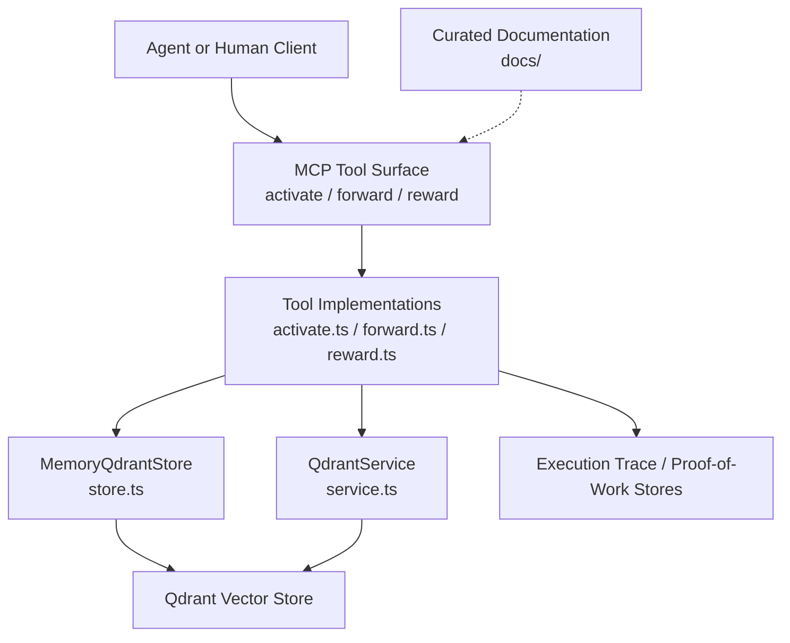
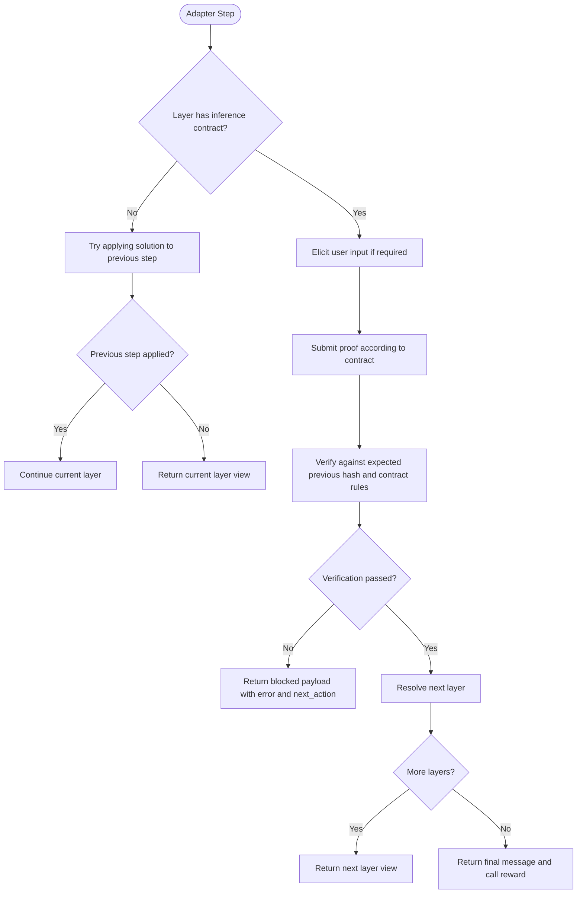
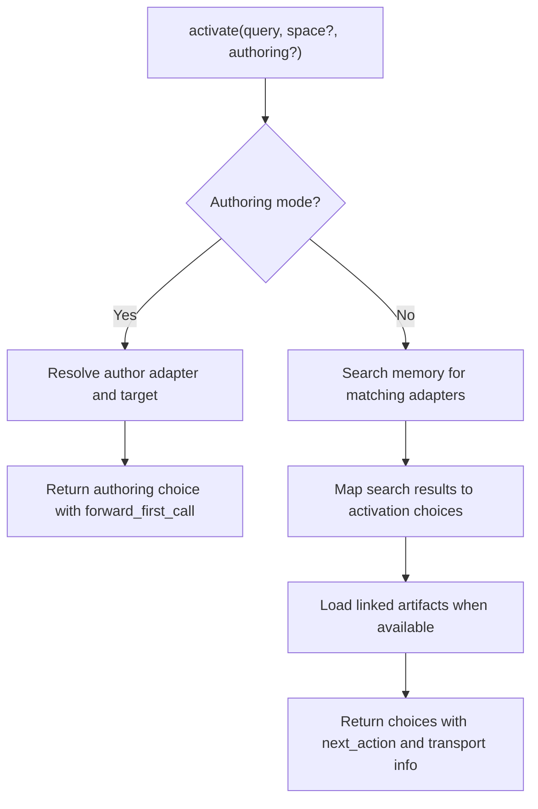
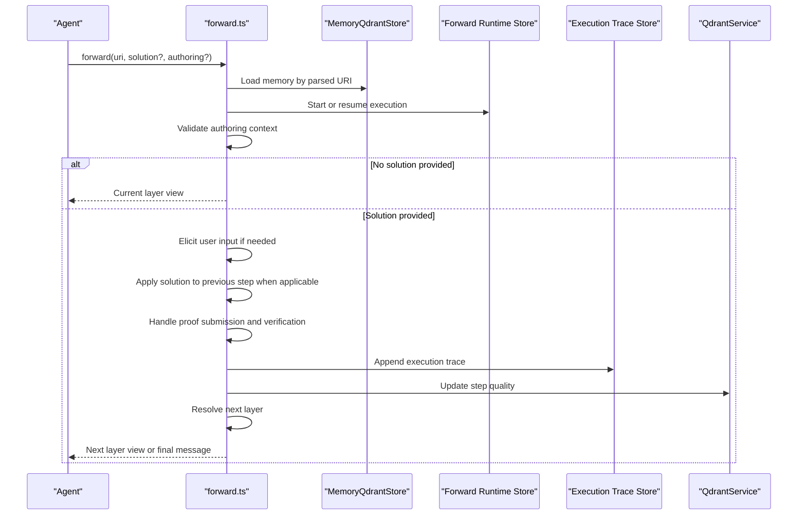
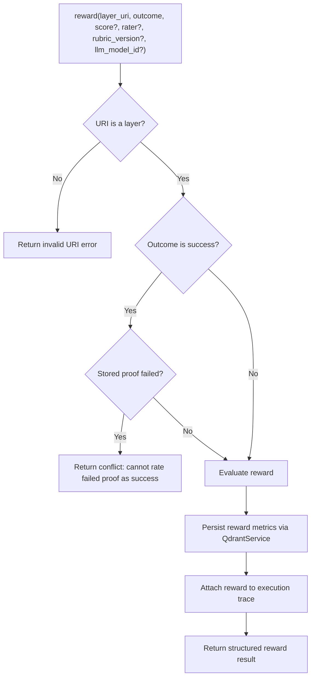
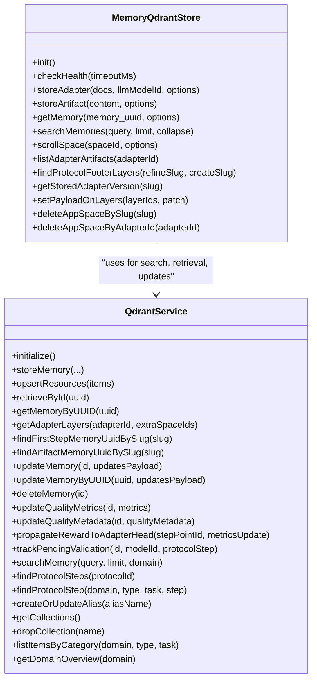
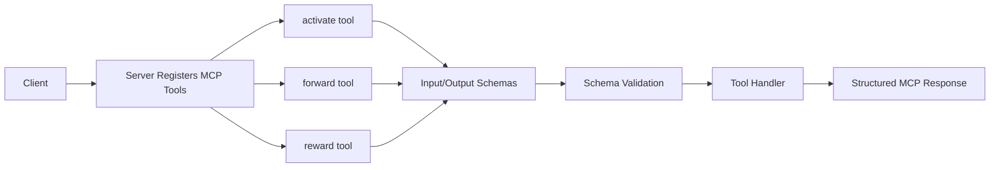
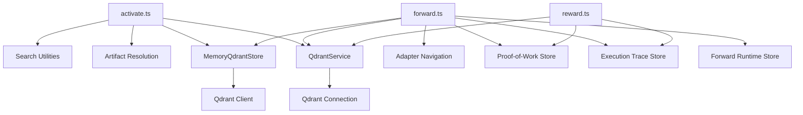

# Core Concepts

<cite>
**Referenced Files in This Document**
- [README.md](file://docs/README.md)
- [memory.ts](file://src/types/memory.ts)
- [activate.ts](file://src/tools/activate.ts)
- [forward.ts](file://src/tools/forward.ts)
- [reward.ts](file://src/tools/reward.ts)
- [store.ts](file://src/services/memory/store.ts)
- [service.ts](file://src/services/qdrant/service.ts)
- [adapter-design-principles.md](file://docs/adapter-design-principles.md)
</cite>

## Table of Contents
1. [Introduction](#introduction)
2. [Project Structure](#project-structure)
3. [Core Components](#core-components)
4. [Architecture Overview](#architecture-overview)
5. [Detailed Component Analysis](#detailed-component-analysis)
6. [Dependency Analysis](#dependency-analysis)
7. [Performance Considerations](#performance-considerations)
8. [Troubleshooting Guide](#troubleshooting-guide)
9. [Conclusion](#conclusion)

## Introduction
SquadRules is an agent-first Model Context Protocol (MCP) framework. Its core idea is simple: agents are the primary users, and human preferences are captured as adapters. An adapter is a deterministic, auditable workflow that tells an agent how to find, execute, verify, and maintain work. The system’s fundamental execution chain is activate → forward → reward.

- Activate finds or creates the right adapter for the current request.
- Forward executes the adapter layer by layer under verification contracts.
- Reward records outcomes so the system learns which adapters and steps were useful.

The memory system stores adapters and artifacts with semantic search, supports space-based multi-tenancy, and persists execution traces and rewards. Qdrant is the primary vector store; LanceDB can be used as an embedded alternative. Auth uses Keycloak and Google IdP, and JWTs validate both human and agent requests. Skills under `.agents/skills/` provide hand-authored routing logic and are not auto-generated.

This document explains the conceptual model, the MCP tooling surface, the adapter pattern, the activation workflow, the memory architecture, and the AI ownership model where agents create, repair, and maintain workflows autonomously.

## Project Structure
At a high level, the repository separates documentation, tools, services, types, HTTP/MCP integration, UI, and configuration:

- `docs/` contains curated documentation and design principles.
- `src/tools/` implements MCP tools such as activate, forward, and reward.
- `src/services/` implements memory, Qdrant, embedding, metrics, and runtime support.
- `src/types/` defines shared data models such as Memory, AdapterInfo, InferenceContractDefinition, ExecutionTrace, and RewardRecord.
- `src/http/` exposes MCP over HTTP and integrates authentication, metrics, and UI resources.
- `src/mcp-apps/` provides MCP widget assets and UI capability registration.
- `src/ui/` is the React frontend for guided runs, protocol editing, spaces, and exports.
- `.agents/skills/` holds hand-authored skills, including the canonical action router.



**Diagram sources**
- [activate.ts:231-280](file://src/tools/activate.ts#L231-L280)
- [forward.ts:91-156](file://src/tools/forward.ts#L91-L156)
- [reward.ts:132-175](file://src/tools/reward.ts#L132-L175)
- [store.ts:29-62](file://src/services/memory/store.ts#L29-L62)
- [service.ts:17-28](file://src/services/qdrant/service.ts#L17-L28)

**Section sources**
- [README.md:1-33](file://docs/README.md#L1-L33)

## Core Components
The most important concepts are:

| Concept | Meaning | Why it matters |
|---|---|---|
| Adapter | A versioned, layered workflow describing how an agent should perform a task. | Adapters encode team preferences so agents do not re-derive intent every time. |
| Layer | A step inside an adapter with instructions, optional contract, and links to previous/next layers. | Layers make complex workflows deterministic and auditable. |
| Inference Contract | A typed rule for a layer, such as shell, forward, user_input, comment, or subagent. | Contracts enforce deterministic verification instead of relying on claims. |
| Memory | A stored record representing an adapter layer, artifact, or related content. | Memory is the persistent, searchable representation of knowledge and workflows. |
| Execution Trace | A per-run log of inputs, outputs, and rewards. | Traces make agent behavior observable and reviewable. |
| Reward | A structured outcome attached to a layer or run. | Rewards teach the system which adapters and steps are valuable. |
| Space | A multi-tenant partition used for scoping storage and search. | Spaces isolate teams, projects, or environments. |

Key data models include:

- `AdapterInfo`: stable identifier, title, layer index, total layers, optional protocol version, activation patterns, reward signal, and chain root.
- `InferenceContractDefinition`: contract type plus type-specific fields such as shell commands, forward targets, user input prompts, comment length, or subagent MCP calls.
- `Memory`: UUID, optional space ID, label, slug, tags, text, LLM model ID, creation time, content type, optional artifact metadata, optional adapter metadata, and optional inference contract.
- `ExecutionTrace`: execution ID, adapter URI, layer URI, layer index, timestamps, activation query, tensor inputs and outputs, trace text, raw solution, optional reward, and merge depth.
- `RewardRecord`: outcome, score, signed score, quality bonus, feedback, rater, rubric version, LLM model ID, grader kind, evaluation label, export flags, blockers, and rating timestamp.

These models appear together in the shared type definitions and are consumed by tools and services during activation, forwarding, and rewarding.

**Section sources**
- [memory.ts:3-15](file://src/types/memory.ts#L3-L15)
- [memory.ts:17-46](file://src/types/memory.ts#L17-L46)
- [memory.ts:48-85](file://src/types/memory.ts#L48-L85)
- [memory.ts:87-108](file://src/types/memory.ts#L87-L108)

## Architecture Overview
SquadRules implements MCP through a small set of tools that follow a strict lifecycle:

1. **Activate**: Search memory for matching adapters, resolve linked artifacts, and return ranked choices with explicit next actions.
2. **Forward**: Load the selected adapter layer, apply verification contracts, manage proof submission, continue to the next layer, and pin layer manifests for stability.
3. **Reward**: Validate the layer URI, check consistency with stored proofs, evaluate the reward, persist metrics, and attach structured results to the execution trace.

```mermaid
sequenceDiagram
participant Agent as "Agent"
participant MCP as "MCP Server"
participant Activate as "activate.ts"
participant Memory as "MemoryQdrantStore"
participant Qdrant as "QdrantService"
participant Forward as "forward.ts"
participant Reward as "reward.ts"
Agent->>MCP : Call activate(query, space?)
MCP->>Activate : Parse and validate input
Activate->>Memory : Search memories
Activate->>Qdrant : Resolve artifacts and metadata
Activate-->>Agent : Ranked choices with next_action
Agent->>MCP : Call forward(uri, solution?, authoring?)
MCP->>Forward : Load layer and execution context
Forward->>Memory : Read current and previous layers
Forward->>Qdrant : Update quality and propagate state
Forward-->>Agent : Current layer view or final message
Agent->>MCP : Call reward(layer_uri, outcome, score?)
MCP->>Reward : Validate URI and proof status
Reward->>Qdrant : Persist reward metrics
Reward-->>Agent : Structured reward result
```

**Diagram sources**
- [activate.ts:168-228](file://src/tools/activate.ts#L168-L228)
- [forward.ts:91-156](file://src/tools/forward.ts#L91-L156)
- [reward.ts:28-129](file://src/tools/reward.ts#L28-L129)
- [store.ts:144-153](file://src/services/memory/store.ts#L144-L153)
- [service.ts:120-121](file://src/services/qdrant/service.ts#L120-L121)

## Detailed Component Analysis

### The Adapter Pattern and Deterministic Verification
An adapter is not just documentation; it is a runnable protocol. Each adapter has layers, each layer may have an inference contract, and each contract specifies what evidence proves completion. The design principles emphasize autonomy, help over puzzles, and honest verification.

- Autonomy means agents find, execute, create, repair, and maintain workflows without unnecessary human gates.
- Help over rules means adapters give precise instructions and recovery paths rather than riddles.
- Honest verification means checks observe real outcomes before accepting success.



**Diagram sources**
- [forward.ts:154-170](file://src/tools/forward.ts#L154-L170)
- [forward.ts:171-242](file://src/tools/forward.ts#L171-L242)
- [forward.ts:244-338](file://src/tools/forward.ts#L244-L338)

Adapters also support linked artifacts. When an adapter references scripts or files, activation resolves those artifacts and instructs the agent to materialize them before running shell contracts. This keeps executable dependencies explicit and auditable.

**Section sources**
- [adapter-design-principles.md:1-11](file://docs/adapter-design-principles.md#L1-L11)
- [adapter-design-principles.md:13-28](file://docs/adapter-design-principles.md#L13-L28)
- [adapter-design-principles.md:30-65](file://docs/adapter-design-principles.md#L30-L65)
- [adapter-design-principles.md:67-95](file://docs/adapter-design-principles.md#L67-L95)
- [activate.ts:80-135](file://src/tools/activate.ts#L80-L135)

### The Activate Phase
Activate is the entry point into the workflow. It performs semantic search across memory, normalizes adapter URIs, loads linked artifacts, and returns choices with explicit next actions.

Important behaviors:

- It accepts an optional space or space ID to scope search and authoring.
- It distinguishes match, refine, and create roles.
- For match and refine choices, it attaches artifact loading guidance.
- It always returns a clear next action pointing to forward.
- It tracks refinement attempts and includes a refine footer only when appropriate.
- It registers the MCP tool with input/output schemas and metrics.



**Diagram sources**
- [activate.ts:168-228](file://src/tools/activate.ts#L168-L228)
- [activate.ts:44-166](file://src/tools/activate.ts#L44-L166)

**Section sources**
- [activate.ts:30-42](file://src/tools/activate.ts#L30-L42)
- [activate.ts:44-166](file://src/tools/activate.ts#L44-L166)
- [activate.ts:168-228](file://src/tools/activate.ts#L168-L228)
- [activate.ts:231-280](file://src/tools/activate.ts#L231-L280)

### The Forward Phase
Forward drives adapter execution. It loads the requested layer, starts or continues an execution, validates authoring context, applies solutions, handles user-input elicitation, enforces proof ordering, and advances to the next layer.

Key responsibilities:

- Parse and assert adapter or layer URIs.
- Start a new execution or resume an existing one.
- Pin the layer manifest on first forward to prevent UUID churn.
- Handle missing solutions by returning the current layer view.
- Apply solutions to previous steps when allowed.
- Enforce proof-of-work and expected previous hashes.
- Record execution traces and update step quality.
- Return either the next layer or a final message indicating that reward should be called.



**Diagram sources**
- [forward.ts:91-156](file://src/tools/forward.ts#L91-L156)
- [forward.ts:154-170](file://src/tools/forward.ts#L154-L170)
- [forward.ts:171-242](file://src/tools/forward.ts#L171-L242)
- [forward.ts:244-338](file://src/tools/forward.ts#L244-L338)

**Section sources**
- [forward.ts:43-59](file://src/tools/forward.ts#L43-L59)
- [forward.ts:61-89](file://src/tools/forward.ts#L61-L89)
- [forward.ts:91-156](file://src/tools/forward.ts#L91-L156)
- [forward.ts:154-170](file://src/tools/forward.ts#L154-L170)
- [forward.ts:171-242](file://src/tools/forward.ts#L171-L242)
- [forward.ts:244-338](file://src/tools/forward.ts#L244-L338)

### The Reward Phase
Reward finalizes a completed step or run. It requires a layer URI, refuses to mark a failed proof as successful, evaluates the reward, persists metrics, and attaches structured results to the execution trace.

Important guarantees:

- Only layer URIs are accepted.
- A success reward cannot override a stored failed proof for the same layer.
- Evaluation produces normalized scores, labels, exporter flags, and blockers.
- Metrics are persisted through Qdrant service methods.
- Execution traces receive detailed reward payloads when an execution ID is present.



**Diagram sources**
- [reward.ts:28-54](file://src/tools/reward.ts#L28-L54)
- [reward.ts:56-129](file://src/tools/reward.ts#L56-L129)
- [reward.ts:132-175](file://src/tools/reward.ts#L132-L175)

**Section sources**
- [reward.ts:19-26](file://src/tools/reward.ts#L19-L26)
- [reward.ts:28-54](file://src/tools/reward.ts#L28-L54)
- [reward.ts:56-129](file://src/tools/reward.ts#L56-L129)
- [reward.ts:132-175](file://src/tools/reward.ts#L132-L175)

### Memory System Architecture
The memory system combines persistent storage, semantic search, and space-based multi-tenancy.

- `MemoryQdrantStore` wraps a Qdrant client, manages collection aliases, initializes storage, and exposes methods for storing adapters, artifacts, reading memory, searching, scrolling spaces, listing adapter artifacts, and managing app-space data.
- `QdrantService` composes connection, initialization, storage, retrieval, updates, quality metrics, resource upserts, search, protocol helpers, listing, and reward propagation.
- Memory records carry optional `space_id`, enabling isolation across teams or projects.
- Searches and scrolls use filters that respect space boundaries.
- Execution traces and proof-of-work data are maintained separately but tied to adapter and layer URIs.



**Diagram sources**
- [store.ts:29-62](file://src/services/memory/store.ts#L29-L62)
- [store.ts:132-153](file://src/services/memory/store.ts#L132-L153)
- [store.ts:157-214](file://src/services/memory/store.ts#L157-L214)
- [service.ts:17-28](file://src/services/qdrant/service.ts#L17-L28)
- [service.ts:48-151](file://src/services/qdrant/service.ts#L48-L151)

**Section sources**
- [store.ts:29-62](file://src/services/memory/store.ts#L29-L62)
- [store.ts:132-153](file://src/services/memory/store.ts#L132-L153)
- [store.ts:157-214](file://src/services/memory/store.ts#L157-L214)
- [store.ts:240-264](file://src/services/memory/store.ts#L240-L264)
- [service.ts:17-28](file://src/services/qdrant/service.ts#L17-L28)
- [service.ts:48-151](file://src/services/qdrant/service.ts#L48-L151)

### MCP Fundamentals and SquadRules Implementation
MCP exposes tools that clients call with structured inputs and receive structured outputs. SquadRules implements this through:

- `activate`: finds or creates adapters and returns actionable choices.
- `forward`: executes adapter layers under verification contracts.
- `reward`: records outcomes and enriches training and preference data.
- Additional tools such as train, tune, delete, export, and spaces exist in the broader codebase, but the core learning loop centers on activate → forward → reward.

Each tool registers an input schema, output schema, and optional UI metadata. Inputs are validated, metrics are recorded, and errors are normalized. The server can expose these tools over HTTP or stdio transports.



**Diagram sources**
- [activate.ts:231-280](file://src/tools/activate.ts#L231-L280)
- [forward.ts:91-156](file://src/tools/forward.ts#L91-L156)
- [reward.ts:132-175](file://src/tools/reward.ts#L132-L175)

**Section sources**
- [activate.ts:231-280](file://src/tools/activate.ts#L231-L280)
- [reward.ts:132-175](file://src/tools/reward.ts#L132-L175)

### AI Ownership Model
The AI ownership model says agents own their workflows. Agents should:

- Consult team knowledge before acting.
- Create new adapters when no existing adapter matches.
- Repair broken or incomplete adapters when execution reveals gaps.
- Maintain adapters as part of finishing a task, not as a separate permission request.
- Use `user_input` only for genuine authority or decision gaps.
- Treat familiarity with a task as a reason to review existing preferences, not as automatic approval to ignore them.

This model is reflected in the activate flow, which can return a create role, and in the forward flow, which supports authoring operations and proof splitting.

**Section sources**
- [adapter-design-principles.md:13-28](file://docs/adapter-design-principles.md#L13-L28)
- [activate.ts:62-78](file://src/tools/activate.ts#L62-L78)
- [forward.ts:112-131](file://src/tools/forward.ts#L112-L131)

### Practical Examples

#### Example 1: Finding and Running an Existing Adapter
Scenario: An agent receives a request to update a deployment configuration.

1. The agent calls `activate` with the request text and optionally a space.
2. Activate searches memory, resolves linked artifacts, and returns a match with a next action.
3. The agent calls `forward` with the returned adapter URI and no solution to start the first layer.
4. Forward returns the current layer view with instructions and any required contract.
5. The agent submits a solution that satisfies the contract.
6. Forward verifies the proof, records the trace, and returns the next layer or a final message.
7. The agent calls `reward` with the layer URI and outcome.

This example shows how activation chooses the workflow, forward executes it deterministically, and reward closes the loop.

#### Example 2: Creating a New Workflow
Scenario: No existing adapter matches the request.

1. Activate returns a create role with guidance to start the authoring workflow.
2. The agent follows the authoring choice and calls forward with the authoring context.
3. Forward validates that the authoring adapter is used and pins the execution context.
4. The agent writes or repairs the adapter layers under authoring guidance.
5. Once the workflow is ready, the agent treats the created adapter like any other adapter: activate, forward, reward.

This example demonstrates autonomous creation and maintenance of workflows.

#### Example 3: Repairing a Broken Shell Contract
Scenario: A shell contract fails because a script path is unavailable.

1. Activation resolves linked artifacts and warns the agent to materialize them before running shell commands.
2. Forward detects missing or invalid proof and returns a blocked payload with a clear next action.
3. The agent repairs the adapter by updating the artifact reference or fixing the command.
4. The agent reruns forward until the proof passes.
5. The agent records a success reward only after the step truly succeeds.

This example highlights honest verification and the importance of deterministic contracts.

[No sources needed since this section provides practical scenarios derived from analyzed components]

## Dependency Analysis
The main runtime dependencies are:

- Tools depend on memory accessors, URI builders, schema validators, and tenant context utilities.
- Activate depends on search and artifact resolution.
- Forward depends on adapter navigation, proof-of-work storage, execution trace storage, and runtime execution storage.
- Reward depends on proof-of-work storage, execution trace storage, and Qdrant service for metric persistence.
- Memory store depends on Qdrant client and collection alias resolution.
- Qdrant service composes connection, initialization, storage, retrieval, updates, quality, resources, search, protocol, listing, and reward propagation.



**Diagram sources**
- [activate.ts:168-228](file://src/tools/activate.ts#L168-L228)
- [forward.ts:91-156](file://src/tools/forward.ts#L91-L156)
- [reward.ts:28-129](file://src/tools/reward.ts#L28-L129)
- [store.ts:29-62](file://src/services/memory/store.ts#L29-L62)
- [service.ts:17-28](file://src/services/qdrant/service.ts#L17-L28)

**Section sources**
- [activate.ts:168-228](file://src/tools/activate.ts#L168-L228)
- [forward.ts:91-156](file://src/tools/forward.ts#L91-L156)
- [reward.ts:28-129](file://src/tools/reward.ts#L28-L129)
- [store.ts:29-62](file://src/services/memory/store.ts#L29-L62)
- [service.ts:17-28](file://src/services/qdrant/service.ts#L17-L28)

## Performance Considerations
- Prefer deterministic checks over repeated reasoning. Contracts reduce ambiguity and round trips.
- Use space scoping to limit search and scroll operations to relevant tenants.
- Avoid unnecessary artifact downloads; activation already surfaces whether artifacts are available.
- Reuse execution IDs when continuing a workflow to avoid fragmenting traces.
- Keep contracts minimal and focused on meaningful outcomes to reduce validation overhead.
- Use Qdrant collections and aliases appropriately; alias resolution happens at store construction time.

[No sources needed since this section provides general guidance]

## Troubleshooting Guide

Common issues and their likely causes:

| Symptom | Likely Cause | Recommended Action |
|---|---|---|
| Activate returns no matches | Query does not match stored adapters or space filter excludes them. | Refine the query, remove or adjust space filtering, or create a new adapter. |
| Forward reports missing proof | A prior layer did not complete its proof or the solution was rejected. | Follow the blocked payload’s next action, fix the prior step, and retry. |
| Reward rejects success | The layer’s last stored proof failed. | Fix the step and rerun forward, or record failure with a reason. |
| Artifact scripts fail at runtime | Linked artifacts were not materialized or SHA mismatch occurred. | Rerun activate to obtain artifact guidance, materialize artifacts, then rerun forward. |
| Authoring workflow fails | Wrong adapter or changed authoring context. | Use the exact next_call returned by activate or start a new run with consistent authoring parameters. |

**Section sources**
- [activate.ts:139-165](file://src/tools/activate.ts#L139-L165)
- [forward.ts:112-131](file://src/tools/forward.ts#L112-L131)
- [forward.ts:171-242](file://src/tools/forward.ts#L171-L242)
- [reward.ts:32-54](file://src/tools/reward.ts#L32-L54)

## Conclusion
SquadRules turns team preferences into durable, verifiable workflows. Adapters replace guesswork with deterministic contracts. The activate → forward → reward chain ensures that agents choose the right workflow, execute it safely, and leave measurable evidence behind. The memory system provides persistent, searchable, and space-scoped storage, while the AI ownership model empowers agents to create, repair, and maintain workflows autonomously. Together, these concepts form a robust foundation for agent-driven automation that is auditable, repairable, and learnable.

[No sources needed since this section summarizes without analyzing specific files]