# Core Concepts

<cite>
**Referenced Files in This Document**
- [http-mcp-handler.ts](file://src/http/http-mcp-handler.ts)
- [activate.ts](file://src/tools/activate.ts)
- [forward.ts](file://src/tools/forward.ts)
- [reward.ts](file://src/tools/reward.ts)
- [search.ts](file://src/tools/search.ts)
- [store-methods.ts](file://src/services/memory/store-methods.ts)
- [store-title-similarity-search.ts](file://src/services/memory/store-title-similarity-search.ts)
- [service.ts](file://src/services/embedding/service.ts)
- [tenant-context.ts](file://src/utils/tenant-context.ts)
- [space-filter.ts](file://src/utils/space-filter.ts)
- [adapter-example-all-types.md](file://docs/examples/adapter-example-all-types.md)
- [adapter-example-forward.md](file://docs/examples/adapter-example-forward.md)
- [adapter-example-subagent.md](file://docs/examples/adapter-example-subagent.md)
- [README.md](file://docs/README.md)
</cite>

## Table of Contents
1. [Introduction](#introduction)
2. [Project Structure](#project-structure)
3. [Core Components](#core-components)
4. [Architecture Overview](#architecture-overview)
5. [Detailed Component Analysis](#detailed-component-analysis)
6. [Dependency Analysis](#dependency-analysis)
7. [Performance Considerations](#performance-considerations)
8. [Troubleshooting Guide](#troubleshooting-guide)
9. [Conclusion](#conclusion)

## Introduction
SquadRules is an agent-first Model Context Protocol (MCP) framework. AI agents are the primary users, while humans configure preferences through adapters and rewards. The system exposes MCP tools such as `activate`, `forward`, `train`, `reward`, `tune`, `delete`, and `export`. Adapters define deterministic, auditable workflows with typed contracts. The core execution chain is:

- **Activate**: discover or create the best adapter for a query.
- **Forward**: execute adapter layers step-by-step, validating proofs and chaining to other adapters.
- **Reward**: record outcome signals that improve future activation and training.

Vector search over Qdrant and LanceDB indexes rules and workflow metadata. Storage uses Redis for sessions and caching, Qdrant/LanceDB for embeddings, and the filesystem for configuration and artifacts. Authentication integrates Keycloak and Google IdP via OAuth2/JWT, and tenant context flows through async storage so every downstream service can enforce space isolation.

The documentation split is intentional: code-derivable content lives in the generated Wiki, while this repository’s `docs/` directory contains curated, non-code-derivable records such as architecture decision records, CLI reference, and known limitations.

**Section sources**
- [README.md:1-33](file://docs/README.md#L1-L33)

## Project Structure
At a high level, the repository separates HTTP/MCP transport, tool implementations, memory/vector services, embedding providers, tenant context utilities, example adapters, and UI resources.

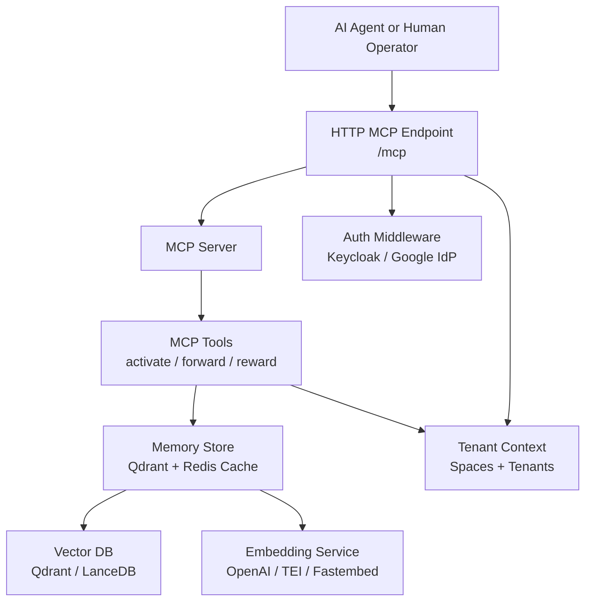

**Diagram sources**
- [http-mcp-handler.ts:115-308](file://src/http/http-mcp-handler.ts#L115-L308)
- [activate.ts:231-280](file://src/tools/activate.ts#L231-L280)
- [forward.ts:91-156](file://src/tools/forward.ts#L91-L156)
- [reward.ts:132-175](file://src/tools/reward.ts#L132-L175)
- [store-methods.ts:38-104](file://src/services/memory/store-methods.ts#L38-L104)
- [service.ts:48-128](file://src/services/embedding/service.ts#L48-L128)
- [tenant-context.ts:95-179](file://src/utils/tenant-context.ts#L95-L179)

**Section sources**
- [http-mcp-handler.ts:115-308](file://src/http/http-mcp-handler.ts#L115-L308)
- [activate.ts:231-280](file://src/tools/activate.ts#L231-L280)
- [forward.ts:91-156](file://src/tools/forward.ts#L91-L156)
- [reward.ts:132-175](file://src/tools/reward.ts#L132-L175)
- [store-methods.ts:38-104](file://src/services/memory/store-methods.ts#L38-L104)
- [service.ts:48-128](file://src/services/embedding/service.ts#L48-L128)
- [tenant-context.ts:95-179](file://src/utils/tenant-context.ts#L95-L179)

## Core Components
This section explains the fundamental concepts behind SquadRules MCP.

### Model Context Protocol Fundamentals
MCP enables AI agents to discover and call standardized tools. In SquadRules:

- The HTTP endpoint `/mcp` receives JSON-RPC requests.
- Each request creates a per-request MCP server instance and transport.
- Auth middleware validates bearer tokens when authentication is enabled.
- Space and tenant context are injected into async execution so downstream services see the correct scope.
- Tools expose input/output schemas, structured content, and audit metrics.

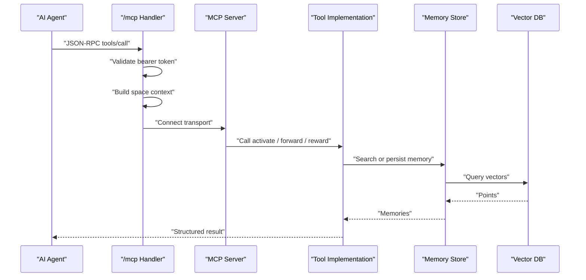

**Diagram sources**
- [http-mcp-handler.ts:115-308](file://src/http/http-mcp-handler.ts#L115-L308)
- [activate.ts:231-280](file://src/tools/activate.ts#L231-L280)
- [forward.ts:91-156](file://src/tools/forward.ts#L91-L156)
- [reward.ts:132-175](file://src/tools/reward.ts#L132-L175)
- [store-methods.ts:121-260](file://src/services/memory/store-methods.ts#L121-L260)

### Adapter Pattern for Deterministic Workflow Execution
Adapters are Markdown-based protocols describing steps with typed contracts. The framework supports:

- Shell commands with required interpreter and timeout.
- Forward links to another adapter by slug URI.
- Subagent delegation for judgment or MCP tool work.
- User input for genuine authority gaps.
- Comments for read-only knowledge adapters.

Examples in the repository demonstrate all contract types side by side, forward-linking between adapters, and subagent rungs for delegated judgment versus delegated MCP tool calls.

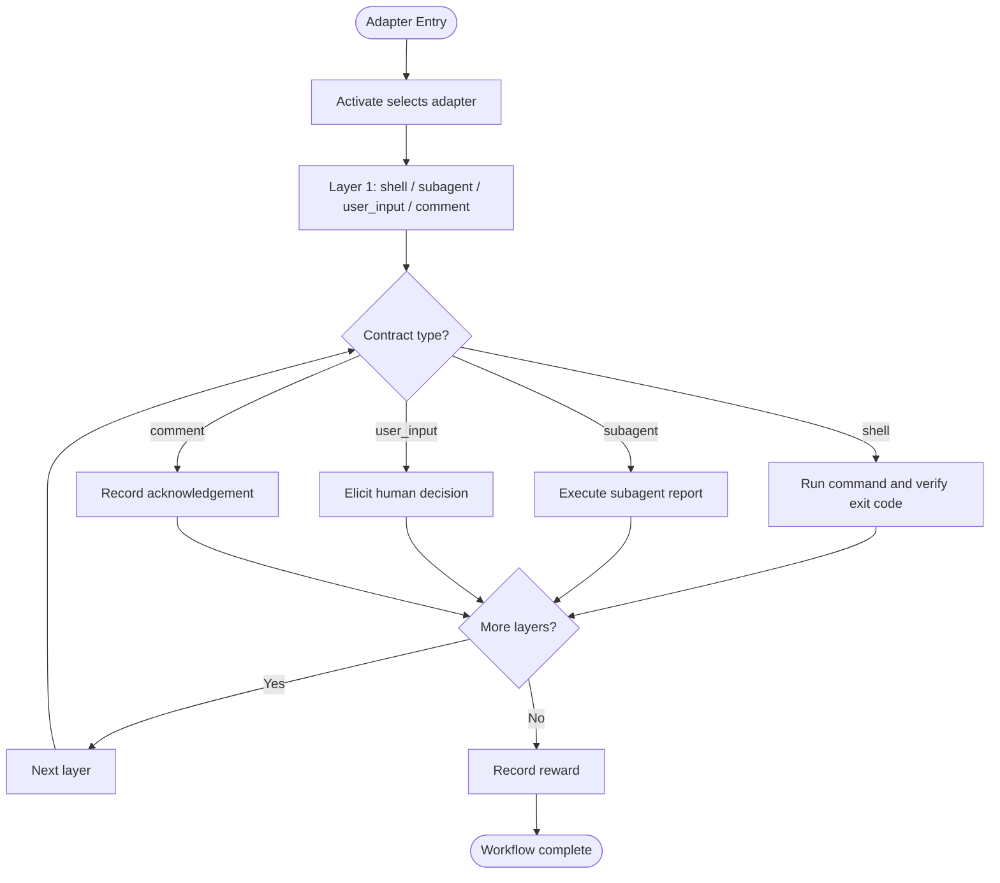

**Diagram sources**
- [adapter-example-all-types.md:1-105](file://docs/examples/adapter-example-all-types.md#L1-L105)
- [adapter-example-forward.md:1-61](file://docs/examples/adapter-example-forward.md#L1-L61)
- [adapter-example-subagent.md:1-69](file://docs/examples/adapter-example-subagent.md#L1-L69)

**Section sources**
- [adapter-example-all-types.md:1-105](file://docs/examples/adapter-example-all-types.md#L1-L105)
- [adapter-example-forward.md:1-61](file://docs/examples/adapter-example-forward.md#L1-L61)
- [adapter-example-subagent.md:1-69](file://docs/examples/adapter-example-subagent.md#L1-L69)

### Protocol Definitions and Contracts
Protocol definitions live in adapter Markdown documents. The runtime parses frontmatter, builds header-based adapters, falls back to default parsing, checks slug validity, detects similar adapters, and stores memories with vector fields.

Key implementation points:

- Header-based adapters can set protocol version and chain root.
- Slug candidates are normalized and validated before storage.
- Title similarity checks help detect duplicate or overlapping adapters.
- Artifacts can be stored alongside adapters for scripts and binaries.

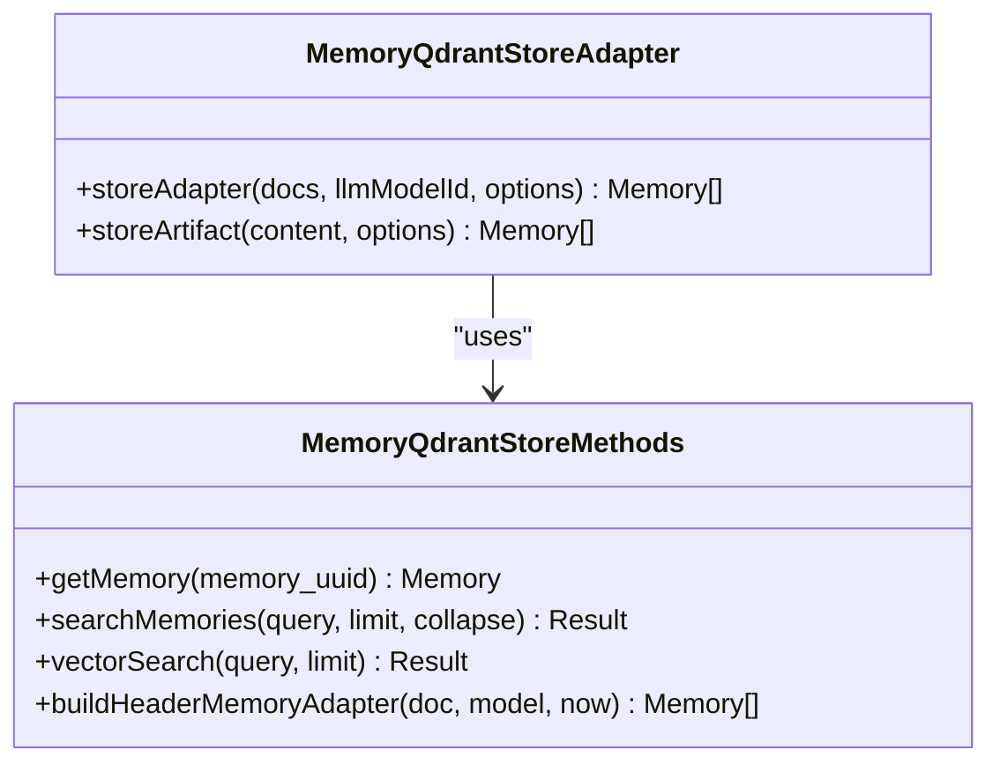

**Diagram sources**
- [store-methods.ts:25-36](file://src/services/memory/store-methods.ts#L25-L36)
- [store-methods.ts:38-104](file://src/services/memory/store-methods.ts#L38-L104)
- [store-methods.ts:121-260](file://src/services/memory/store-methods.ts#L121-L260)
- [store-methods.ts:266-268](file://src/services/memory/store-methods.ts#L266-L268)

**Section sources**
- [store-methods.ts:25-36](file://src/services/memory/store-methods.ts#L25-L36)
- [store-methods.ts:38-104](file://src/services/memory/store-methods.ts#L38-L104)
- [store-methods.ts:121-260](file://src/services/memory/store-methods.ts#L121-L260)
- [store-methods.ts:266-268](file://src/services/memory/store-methods.ts#L266-L268)

### Relationship Between Adapters and Their Contracts
An adapter is a multi-layer protocol; each layer has a contract shape. The runtime enforces:

- Forward contracts must link to another adapter URI, not bare MCP tools.
- Subagent contracts may delegate judgment without MCP calls or may constrain MCP tool calls executed by the subagent.
- Shell contracts require an interpreter and observable results.
- User input is reserved for authority gaps, not routine confirmation.
- Comments are last-resort acknowledgements and are constrained by verification policy.

Concrete examples show how forward links connect adapters, how subagent reports become evidence, and how shell commands produce verifiable outcomes.

**Section sources**
- [adapter-example-forward.md:1-61](file://docs/examples/adapter-example-forward.md#L1-L61)
- [adapter-example-subagent.md:1-69](file://docs/examples/adapter-example-subagent.md#L1-L69)
- [adapter-example-all-types.md:1-105](file://docs/examples/adapter-example-all-types.md#L1-L105)

## Architecture Overview
The end-to-end flow from agent request to auditable task execution follows the activate→forward→reward chain.

```mermaid
sequenceDiagram
participant Agent as "AI Agent"
participant MCP as "MCP Transport"
participant Activate as "activate"
participant Search as "executeSearch"
participant Store as "MemoryQdrantStore"
participant Embed as "EmbeddingService"
participant Qdrant as "Qdrant"
participant Forward as "forward"
participant Reward as "reward"
Agent->>MCP : "tools/call activate"
MCP->>Activate : "parse + validate input"
Activate->>Search : "search adapters"
Search->>Embed : "generate query embedding"
Embed-->>Search : "embedding"
Search->>Store : "hybrid search"
Store->>Qdrant : "prefetch + fusion query"
Qdrant-->>Store : "points"
Store-->>Search : "memories + scores"
Search-->>Activate : "choices"
Activate-->>Agent : "best adapter choices"
Agent->>MCP : "tools/call forward"
MCP->>Forward : "load layer + proof"
Forward->>Store : "resolve previous/next layer"
Forward-->>Agent : "step view or next layer"
Agent->>MCP : "tools/call reward"
MCP->>Reward : "validate + evaluate reward"
Reward-->>Agent : "rated results"
```

**Diagram sources**
- [http-mcp-handler.ts:115-308](file://src/http/http-mcp-handler.ts#L115-L308)
- [activate.ts:168-229](file://src/tools/activate.ts#L168-L229)
- [search.ts:192-253](file://src/tools/search.ts#L192-L253)
- [store-methods.ts:121-260](file://src/services/memory/store-methods.ts#L121-L260)
- [service.ts:48-128](file://src/services/embedding/service.ts#L48-L128)
- [forward.ts:91-339](file://src/tools/forward.ts#L91-L339)
- [reward.ts:28-130](file://src/tools/reward.ts#L28-L130)

## Detailed Component Analysis

### MCP Transport and Request Lifecycle
The HTTP MCP handler:

- Accepts JSON-RPC requests at `/mcp`.
- Validates bearer tokens when authentication is enabled.
- Creates a new MCP server per request for concurrency.
- Enforces a concurrent request limit and returns a retry hint on overload.
- Injects space context using async local storage.
- Emits audit events for request start/end and tool calls.
- Converts internal errors into safe client-facing messages.

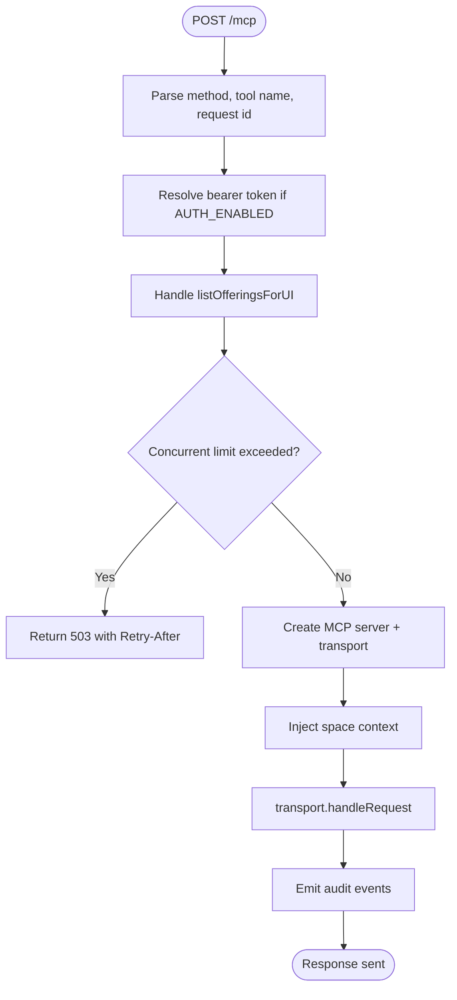

**Diagram sources**
- [http-mcp-handler.ts:115-308](file://src/http/http-mcp-handler.ts#L115-L308)

**Section sources**
- [http-mcp-handler.ts:115-308](file://src/http/http-mcp-handler.ts#L115-L308)

### Activate Tool
The activate tool finds the best adapter for a query and returns ranked choices. It:

- Parses and validates input.
- Supports authoring mode for creating or reviewing adapters.
- Delegates search to `executeSearch`.
- Maps search results into activation choices with labels, roles, scores, artifact instructions, and next actions.
- Records MCP metrics for duration, input size, output size, calls, and errors.

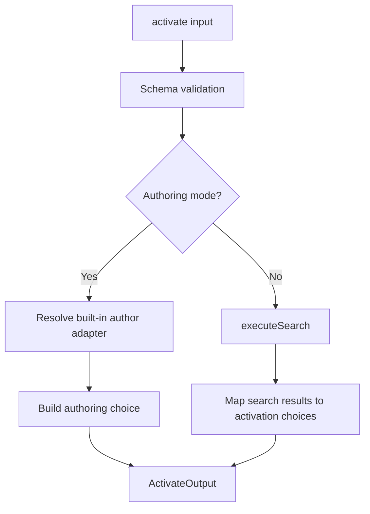

**Diagram sources**
- [activate.ts:168-229](file://src/tools/activate.ts#L168-L229)
- [activate.ts:231-280](file://src/tools/activate.ts#L231-L280)

**Section sources**
- [activate.ts:168-229](file://src/tools/activate.ts#L168-L229)
- [activate.ts:231-280](file://src/tools/activate.ts#L231-L280)

### Forward Tool
The forward tool executes one or more adapter layers. It:

- Parses adapter or layer URIs.
- Loads the current memory layer.
- Starts or continues an execution session.
- Pins the layer manifest on first forward to prevent UUID churn.
- Handles user-input elicitation, proof submission, missing proofs, and previous-step application.
- Appends execution traces and updates step quality.
- Returns either the current layer view, the next layer, or completion guidance.

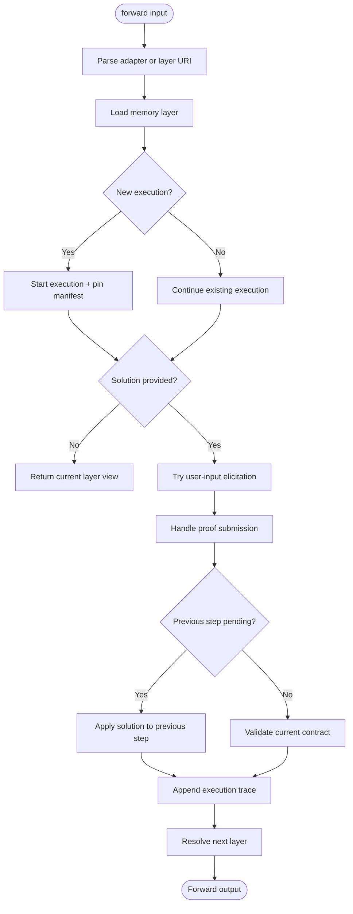

**Diagram sources**
- [forward.ts:43-59](file://src/tools/forward.ts#L43-L59)
- [forward.ts:91-156](file://src/tools/forward.ts#L91-L156)
- [forward.ts:158-339](file://src/tools/forward.ts#L158-L339)

**Section sources**
- [forward.ts:43-59](file://src/tools/forward.ts#L43-L59)
- [forward.ts:91-156](file://src/tools/forward.ts#L91-L156)
- [forward.ts:158-339](file://src/tools/forward.ts#L158-L339)

### Reward Tool
The reward tool finalizes an execution by recording outcome signals. It:

- Requires a layer URI.
- Prevents recording success when the last stored proof failed.
- Evaluates reward signals including score, rater, rubric version, and LLM model ID.
- Applies reward metrics to Qdrant.
- Persists evaluation details to the execution trace store.
- Returns rated results and counts.

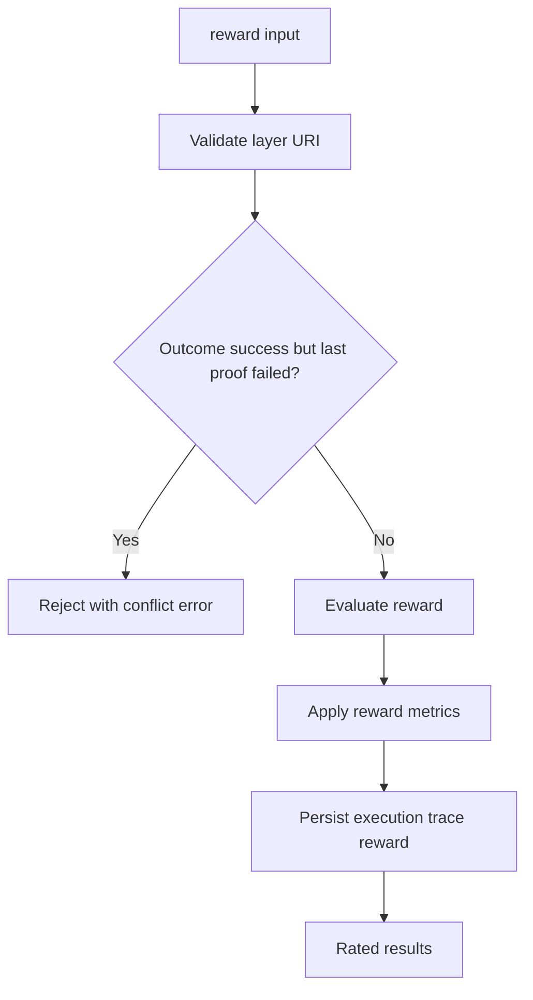

**Diagram sources**
- [reward.ts:28-130](file://src/tools/reward.ts#L28-L130)
- [reward.ts:132-175](file://src/tools/reward.ts#L132-L175)

**Section sources**
- [reward.ts:28-130](file://src/tools/reward.ts#L28-L130)
- [reward.ts:132-175](file://src/tools/reward.ts#L132-L175)

### Spaces and Multi-Tenancy
Spaces provide tenant isolation. The context system:

- Derives allowed spaces from JWT claims.
- Maintains a default write space and personal space.
- Uses async local storage to propagate tenant and space context across async boundaries.
- Narrows search scope when a space parameter is supplied.
- Ensures reads and writes respect allowed spaces.

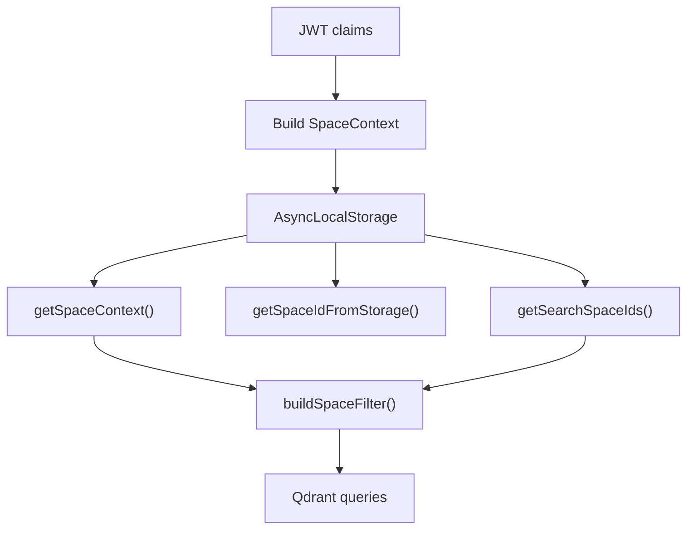

**Diagram sources**
- [tenant-context.ts:23-42](file://src/utils/tenant-context.ts#L23-L42)
- [tenant-context.ts:95-179](file://src/utils/tenant-context.ts#L95-L179)
- [tenant-context.ts:256-311](file://src/utils/tenant-context.ts#L256-L311)
- [space-filter.ts:14-26](file://src/utils/space-filter.ts#L14-L26)

**Section sources**
- [tenant-context.ts:23-42](file://src/utils/tenant-context.ts#L23-L42)
- [tenant-context.ts:95-179](file://src/utils/tenant-context.ts#L95-L179)
- [tenant-context.ts:256-311](file://src/utils/tenant-context.ts#L256-L311)
- [space-filter.ts:14-26](file://src/utils/space-filter.ts#L14-L26)

### Vector Search and Embeddings
SquadRules uses semantic similarity and hybrid ranking:

- The embedding service generates embeddings from configured providers.
- The memory store performs hybrid search with dense vectors, title vectors, activation pattern vectors, and BM25 sparse vectors.
- Results are fused and rescored in Qdrant.
- A fallback path exists if the hybrid query fails.
- Title similarity search is also available separately.

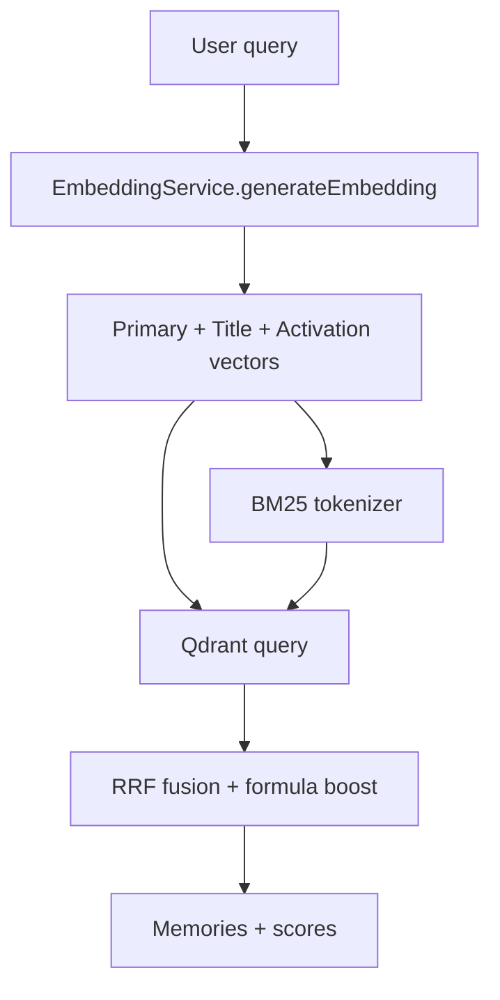

**Diagram sources**
- [service.ts:48-128](file://src/services/embedding/service.ts#L48-L128)
- [store-methods.ts:121-260](file://src/services/memory/store-methods.ts#L121-L260)
- [store-title-similarity-search.ts:9-61](file://src/services/memory/store-title-similarity-search.ts#L9-L61)

**Section sources**
- [service.ts:48-128](file://src/services/embedding/service.ts#L48-L128)
- [store-methods.ts:121-260](file://src/services/memory/store-methods.ts#L121-L260)
- [store-title-similarity-search.ts:9-61](file://src/services/memory/store-title-similarity-search.ts#L9-L61)

### Activate→Forward→Reward Workflow Chain
The chain ensures auditable, reproducible task execution:

1. **Activate** selects an adapter and provides next-action guidance.
2. **Forward** executes layers, validates proofs, handles missing proofs, applies solutions to previous steps, and advances to the next layer.
3. **Reward** records outcome signals after completion, preventing contradictory success rewards when prior proofs failed.

```mermaid
sequenceDiagram
participant Agent as "AI Agent"
participant Activate as "activate"
participant Forward as "forward"
participant Reward as "reward"
Agent->>Activate : "Find adapter"
Activate-->>Agent : "Choices + next_action"
Agent->>Forward : "Submit solution step-by-step"
Forward-->>Agent : "Current or next layer"
Agent->>Reward : "Record outcome"
Reward-->>Agent : "Rated results"
```

**Diagram sources**
- [activate.ts:168-229](file://src/tools/activate.ts#L168-L229)
- [forward.ts:91-339](file://src/tools/forward.ts#L91-L339)
- [reward.ts:28-130](file://src/tools/reward.ts#L28-L130)

**Section sources**
- [activate.ts:168-229](file://src/tools/activate.ts#L168-L229)
- [forward.ts:91-339](file://src/tools/forward.ts#L91-L339)
- [reward.ts:28-130](file://src/tools/reward.ts#L28-L130)

## Dependency Analysis
The main runtime dependencies are:

- MCP transport depends on auth middleware, tenant context, and tool registration.
- Tools depend on memory store, embedding service, and Qdrant services.
- Memory store depends on Qdrant client, Redis cache, embedding service, and space filters.
- Embedding service depends on provider resolution and environment configuration.
- Tenant context depends on configuration and space resolution utilities.

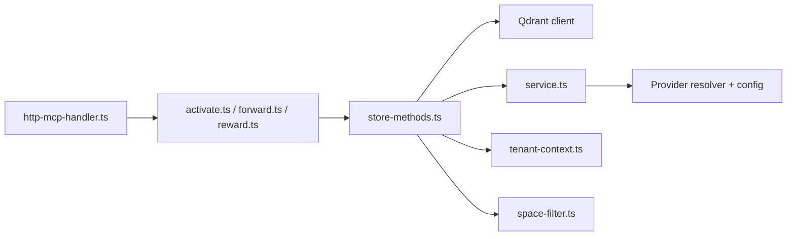

**Diagram sources**
- [http-mcp-handler.ts:115-308](file://src/http/http-mcp-handler.ts#L115-L308)
- [activate.ts:168-229](file://src/tools/activate.ts#L168-L229)
- [forward.ts:91-156](file://src/tools/forward.ts#L91-L156)
- [reward.ts:132-175](file://src/tools/reward.ts#L132-L175)
- [store-methods.ts:121-260](file://src/services/memory/store-methods.ts#L121-L260)
- [service.ts:48-128](file://src/services/embedding/service.ts#L48-L128)
- [tenant-context.ts:95-179](file://src/utils/tenant-context.ts#L95-L179)
- [space-filter.ts:14-26](file://src/utils/space-filter.ts#L14-L26)

**Section sources**
- [http-mcp-handler.ts:115-308](file://src/http/http-mcp-handler.ts#L115-L308)
- [activate.ts:168-229](file://src/tools/activate.ts#L168-L229)
- [forward.ts:91-156](file://src/tools/forward.ts#L91-L156)
- [reward.ts:132-175](file://src/tools/reward.ts#L132-L175)
- [store-methods.ts:121-260](file://src/services/memory/store-methods.ts#L121-L260)
- [service.ts:48-128](file://src/services/embedding/service.ts#L48-L128)
- [tenant-context.ts:95-179](file://src/utils/tenant-context.ts#L95-L179)
- [space-filter.ts:14-26](file://src/utils/space-filter.ts#L14-L26)

## Performance Considerations
- Hybrid search prefers Qdrant-side fusion and rescore paths, falling back to dense search when needed.
- Embedding dimensions are probed and validated to avoid mismatched vectors.
- Memory reads use Redis-backed caching where configured.
- MCP transport limits concurrent requests and emits audit events for long-running operations.
- Activate/search results are cached with a TTL keyed by space, query normalization, group collapse setting, and limit.

[No sources needed since this section provides general guidance]

## Troubleshooting Guide
Common issues and their architectural causes:

- **Activation returns no meaningful choices**: Check whether the query is being narrowed to an allowed space, whether built-in refining/creation footers are excluded, and whether hybrid search fell back to dense search.
- **Forward rejects a forward link**: Ensure the submitted target matches the contract’s adapter URI exactly; bare MCP tool names are invalid.
- **Reward cannot record success**: If the last stored proof for the layer failed, success is rejected until the step is fixed or failure is recorded.
- **Space access denied**: Reads filter by `space_id`; writes use the default write space. Narrowing search to a space does not grant write access unless it is allowed.
- **Embedding dimension mismatch**: The embedding service validates output dimensions against the expected dimension and logs audit failures.

**Section sources**
- [search.ts:192-253](file://src/tools/search.ts#L192-L253)
- [store-methods.ts:121-260](file://src/services/memory/store-methods.ts#L121-L260)
- [forward-contract-match.ts:1-54](file://src/tools/forward-contract-match.ts#L1-L54)
- [reward.ts:28-130](file://src/tools/reward.ts#L28-L130)
- [tenant-context.ts:141-179](file://src/utils/tenant-context.ts#L141-L179)
- [service.ts:48-128](file://src/services/embedding/service.ts#L48-L128)

## Conclusion
SquadRules combines MCP tooling, adapter contracts, and vectorized memory to make AI agent workflows deterministic and auditable. The activate→forward→reward chain turns ambiguous natural-language requests into structured, provable executions. Spaces and tenant context isolate data, while hybrid search and embedding providers power semantic discovery. When designing workflows, prefer explicit adapter contracts, clear forward links, scoped subagent delegation, and honest reward signals. Use the examples as templates, but always align contracts with the verification ladder and the security properties enforced by the runtime.

[No sources needed since this section summarizes without analyzing specific files]