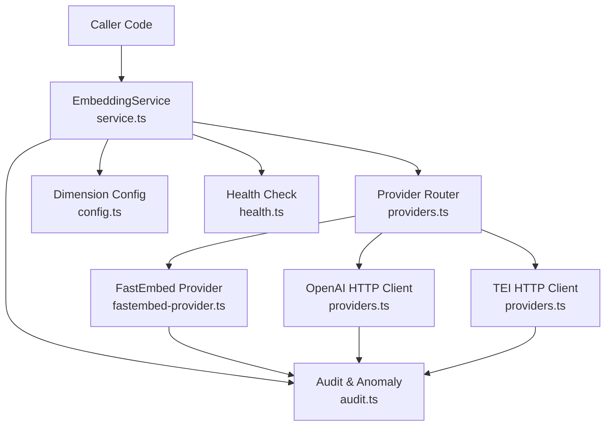
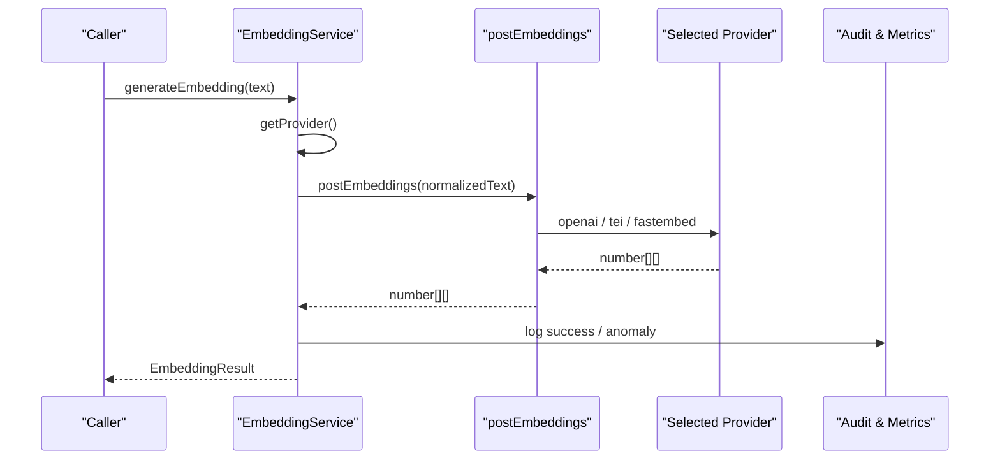
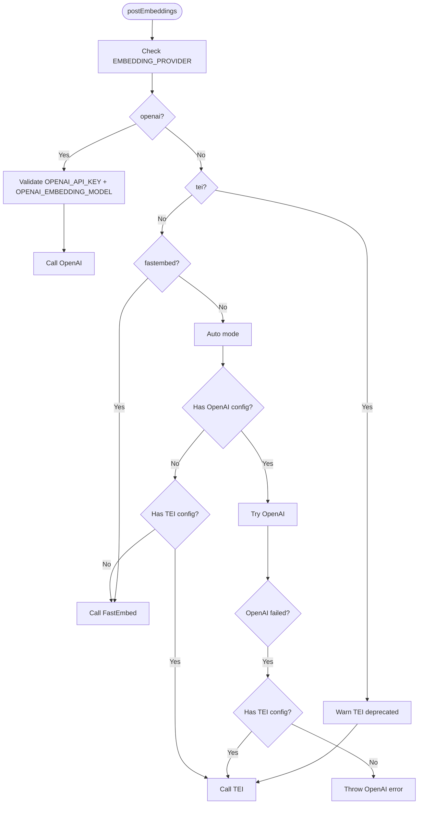
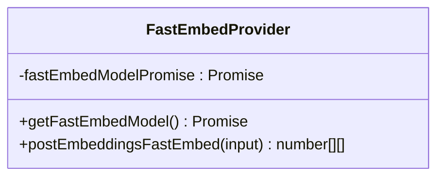
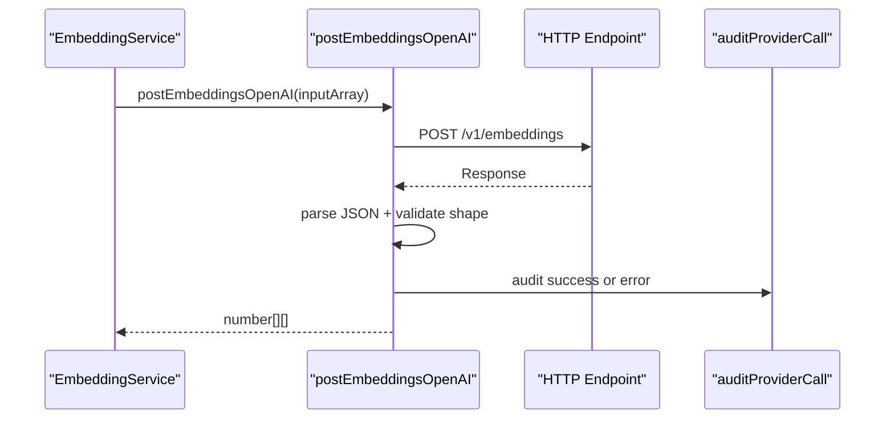
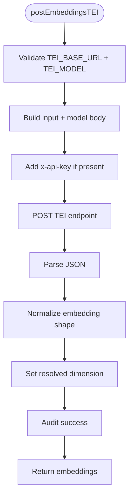
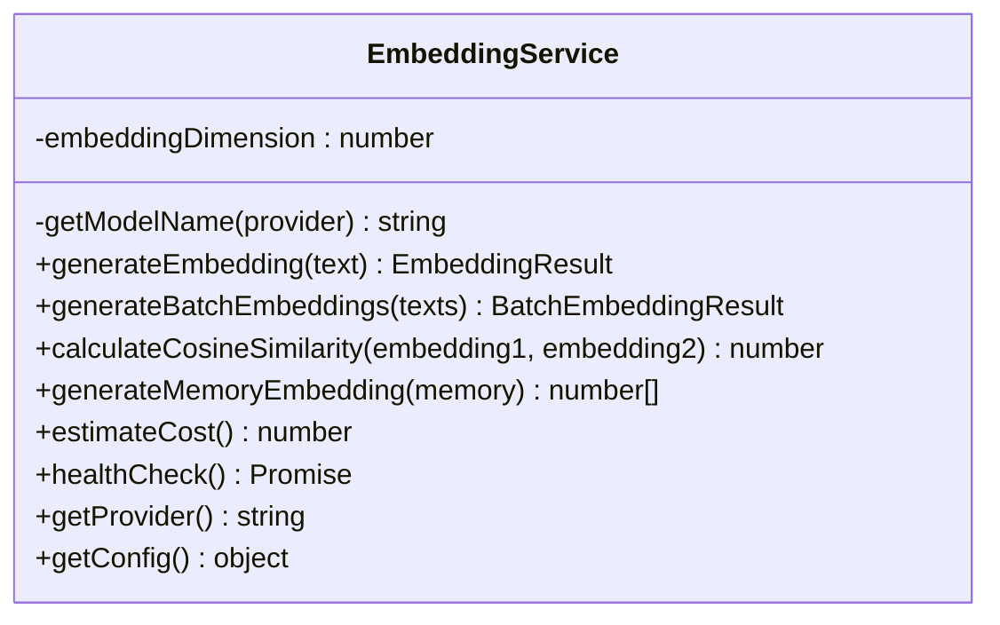
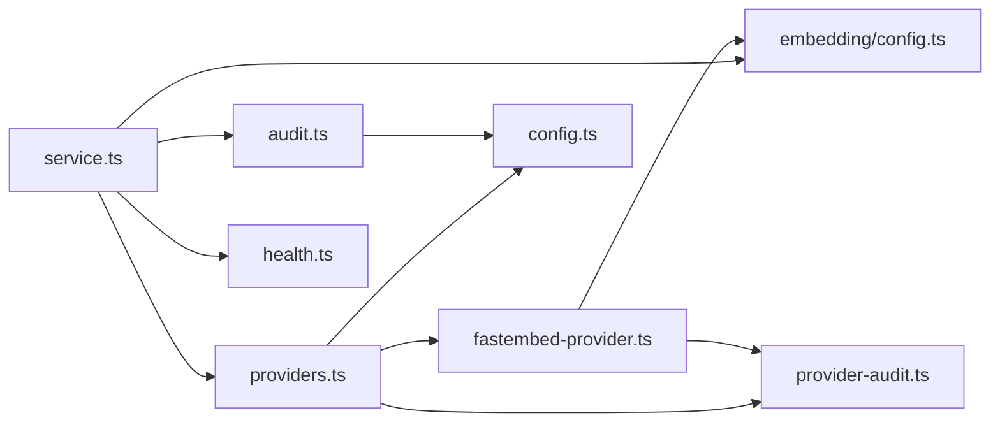
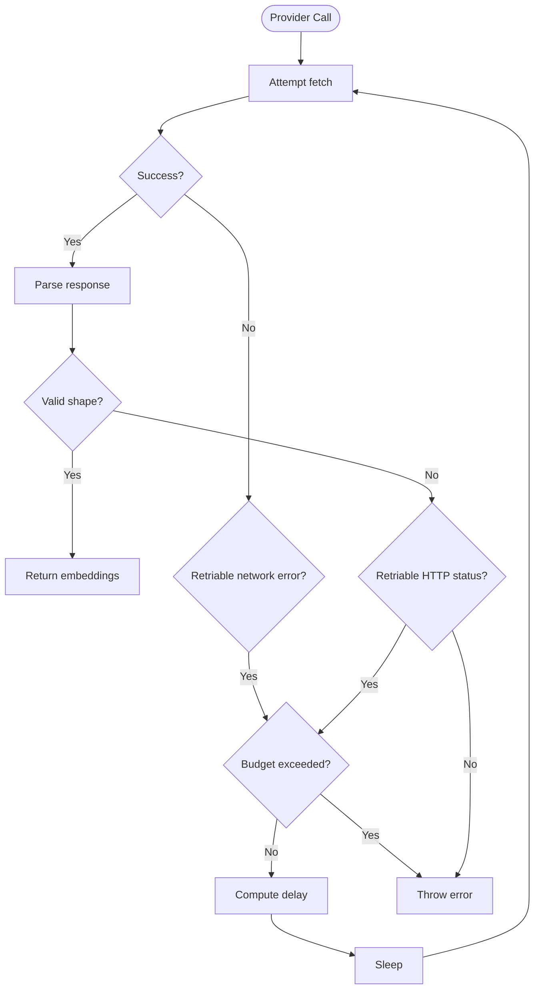

# Embedding Providers

<cite>
**Referenced Files in This Document**
- [providers.ts](file://src/services/embedding/providers.ts)
- [service.ts](file://src/services/embedding/service.ts)
- [fastembed-provider.ts](file://src/services/embedding/fastembed-provider.ts)
- [config.ts](file://src/services/embedding/config.ts)
- [types.ts](file://src/services/embedding/types.ts)
- [audit.ts](file://src/services/embedding/audit.ts)
- [provider-audit.ts](file://src/services/embedding/provider-audit.ts)
- [health.ts](file://src/services/embedding/health.ts)
- [config.ts](file://src/config.ts)
</cite>

## Table of Contents
1. [Introduction](#introduction)
2. [Project Structure](#project-structure)
3. [Core Components](#core-components)
4. [Architecture Overview](#architecture-overview)
5. [Detailed Component Analysis](#detailed-component-analysis)
6. [Dependency Analysis](#dependency-analysis)
7. [Performance Considerations](#performance-considerations)
8. [Troubleshooting Guide](#troubleshooting-guide)
9. [Conclusion](#conclusion)
10. [Appendices](#appendices)

## Introduction
This document explains how SquadRules converts text into vector embeddings through a provider abstraction layer. It covers the supported embedding providers:

- **FastEmbed (local)**: Zero-API-key, in-process ONNX-based embeddings using the FastEmbed SDK.
- **OpenAI**: Cloud or compatible OpenAI-style API endpoints, including Azure OpenAI and local servers that expose an OpenAI-compatible `/v1/embeddings` endpoint.
- **TEI (Text Embeddings Inference)**: A deprecated but still functional path for TEI-compatible inference servers.

The embedding system is designed so that callers interact with `EmbeddingService`, while provider selection, configuration, retries, rate limiting, audit logging, health checks, and dimension probing are handled centrally. The goal is to make it easy to switch providers without changing business logic, while keeping security, observability, and reliability consistent across all backends.

## Project Structure
The embedding subsystem lives under `src/services/embedding`. Its main responsibilities are:

| File | Responsibility |
|---|---|
| `service.ts` | Public embedding service API, metrics, anomaly detection, health check integration, provider resolution, and dimension probing. |
| `providers.ts` | Provider routing, retry/backoff, rate-limit error handling, OpenAI and TEI HTTP clients, and auto-discovery fallback logic. |
| `fastembed-provider.ts` | Local FastEmbed provider implementation with lazy model initialization. |
| `config.ts` | Runtime embedding dimension cache, validation, and OpenAI/TEI endpoint construction. |
| `types.ts` | Shared embedding result types used by the public API. |
| `audit.ts` | Structured audit logging and anomaly detection for latency, norm range, and dimension mismatches. |
| `provider-audit.ts` | Shared structured audit logger used by every provider backend. |
| `health.ts` | Per-provider health checks mirroring runtime provider selection. |

**Diagram sources**
- [service.ts:38-284](file://src/services/embedding/service.ts#L38-L284)
- [providers.ts:75-317](file://src/services/embedding/providers.ts#L75-L317)
- [fastembed-provider.ts:40-80](file://src/services/embedding/fastembed-provider.ts#L40-L80)
- [config.ts:12-36](file://src/services/embedding/config.ts#L12-L36)
- [audit.ts:60-157](file://src/services/embedding/audit.ts#L60-L157)
- [health.ts:88-117](file://src/services/embedding/health.ts#L88-L117)

**Section sources**
- [service.ts:38-284](file://src/services/embedding/service.ts#L38-L284)
- [providers.ts:75-317](file://src/services/embedding/providers.ts#L75-L317)
- [fastembed-provider.ts:40-80](file://src/services/embedding/fastembed-provider.ts#L40-L80)
- [config.ts:12-36](file://src/services/embedding/config.ts#L12-L36)
- [audit.ts:60-157](file://src/services/embedding/audit.ts#L60-L157)
- [health.ts:88-117](file://src/services/embedding/health.ts#L88-L117)

## Core Components
The embedding system exposes a small, stable surface area:

- `EmbeddingService.generateEmbedding(text)` returns a single embedding vector plus metadata.
- `EmbeddingService.generateBatchEmbeddings(texts)` returns multiple vectors.
- `EmbeddingService.calculateCosineSimilarity(embedding1, embedding2)` computes cosine similarity between two vectors.
- `EmbeddingService.healthCheck()` runs a provider-aware health probe.
- `probeEmbeddingDimension()` performs a minimal embedding call at startup to resolve and cache the embedding dimension.

The provider abstraction is implemented by:

- `postEmbeddings(input)` selecting OpenAI, TEI, or FastEmbed based on environment configuration.
- `postEmbeddingsOpenAI(input)` calling the OpenAI-compatible endpoint.
- `postEmbeddingsTEI(input)` calling a TEI-compatible endpoint.
- `postEmbeddingsFastEmbed(input)` running embeddings locally through FastEmbed.

All providers emit structured audit events and update shared metrics. Dimension consistency is enforced through a runtime cache that throws if different models return different vector sizes.

**Section sources**
- [service.ts:49-129](file://src/services/embedding/service.ts#L49-L129)
- [service.ts:131-223](file://src/services/embedding/service.ts#L131-L223)
- [service.ts:225-284](file://src/services/embedding/service.ts#L225-L284)
- [service.ts:286-290](file://src/services/embedding/service.ts#L286-L290)
- [providers.ts:283-317](file://src/services/embedding/providers.ts#L283-L317)

## Architecture Overview
At runtime, embedding requests flow through a layered architecture:

1. Callers use `EmbeddingService`.
2. `EmbeddingService` resolves the active provider from `EMBEDDING_PROVIDER` and environment variables.
3. `postEmbeddings` routes to the selected provider.
4. Each provider validates inputs, emits audit logs, and returns normalized `number[][]` embeddings.
5. `EmbeddingService` validates dimensions, tracks metrics, detects anomalies, and returns typed results.
6. Health checks mirror the same provider selection logic.

**Diagram sources**
- [service.ts:49-129](file://src/services/embedding/service.ts#L49-L129)
- [providers.ts:283-317](file://src/services/embedding/providers.ts#L283-L317)
- [audit.ts:60-157](file://src/services/embedding/audit.ts#L60-L157)

## Detailed Component Analysis

### Provider Abstraction Layer
The provider abstraction is centered around `postEmbeddings`. It supports four modes:

| Mode | Behavior |
|---|---|
| `openai` | Uses OpenAI-compatible endpoint; requires `OPENAI_API_KEY` and `OPENAI_EMBEDDING_MODEL`. |
| `tei` | Uses TEI endpoint; requires `TEI_BASE_URL` and `TEI_MODEL`; emits deprecation warning. |
| `fastembed` | Uses local FastEmbed model; no external API key required. |
| `auto` | Prefers configured OpenAI, then TEI, then falls back to FastEmbed. |

Auto mode does not silently fall back after OpenAI fails during normal embedding calls; it only attempts TEI when OpenAI is explicitly configured but unavailable. This keeps failure visibility clear.

**Diagram sources**
- [providers.ts:283-317](file://src/services/embedding/providers.ts#L283-L317)

**Section sources**
- [providers.ts:283-317](file://src/services/embedding/providers.ts#L283-L317)
- [service.ts:260-268](file://src/services/embedding/service.ts#L260-L268)

### FastEmbed Provider
FastEmbed is the zero-dependency default. It:

- Lazily imports the FastEmbed SDK.
- Initializes the model once per process.
- Downloads model weights on first use into `FASTEMBED_CACHE_DIR`.
- Iterates over streaming batches returned by FastEmbed.
- Sets the resolved embedding dimension from the first successful response.
- Emits structured audit logs.

This design avoids loading native ONNX bindings unless FastEmbed is actually selected, keeping simple local mode lightweight.

**Diagram sources**
- [fastembed-provider.ts:16-38](file://src/services/embedding/fastembed-provider.ts#L16-L38)
- [fastembed-provider.ts:40-80](file://src/services/embedding/fastembed-provider.ts#L40-L80)

**Section sources**
- [fastembed-provider.ts:1-81](file://src/services/embedding/fastembed-provider.ts#L1-L81)

### OpenAI Provider
The OpenAI provider:

- Builds the endpoint from `OPENAI_API_URL` plus `/v1/embeddings`.
- Sends batched string inputs.
- Adds `Authorization: Bearer <OPENAI_API_KEY>`.
- Parses JSON responses and extracts `data[].embedding`.
- Validates response shape.
- Records embedding dimension.
- Handles authentication failures, non-retriable quota errors, rate limits, and transient HTTP errors.

It also supports OpenAI-compatible endpoints such as Azure OpenAI or local servers like Ollama exposing the same contract.

**Diagram sources**
- [providers.ts:92-190](file://src/services/embedding/providers.ts#L92-L190)
- [config.ts:4-10](file://src/services/embedding/config.ts#L4-L10)

**Section sources**
- [providers.ts:92-190](file://src/services/embedding/providers.ts#L92-L190)
- [config.ts:4-10](file://src/services/embedding/config.ts#L4-L10)

### TEI Provider
The TEI provider:

- Requires `TEI_BASE_URL` and `TEI_MODEL`.
- Optionally sends `x-api-key` when `TEI_API_KEY` is set.
- Supports multiple TEI response shapes: `embeddings`, `data`, `result`, or raw arrays.
- Emits a one-time deprecation warning per process.
- Applies the same retry and rate-limit handling as OpenAI.

TEI is marked deprecated because the recommended alternatives are OpenAI-compatible endpoints or the local FastEmbed default.

**Diagram sources**
- [providers.ts:191-282](file://src/services/embedding/providers.ts#L191-L282)

**Section sources**
- [providers.ts:191-282](file://src/services/embedding/providers.ts#L191-L282)

### Embedding Service
`EmbeddingService` is the primary integration point. It:

- Normalizes input text.
- Calls `postEmbeddings`.
- Validates embedding dimension against the cached expected dimension.
- Tracks request duration, vector size, batch size, and error counts.
- Detects anomalies such as high latency, unusual vector norms, and dimension mismatches.
- Exposes cosine similarity calculation.
- Provides a health check wrapper.

**Diagram sources**
- [service.ts:38-284](file://src/services/embedding/service.ts#L38-L284)

**Section sources**
- [service.ts:38-284](file://src/services/embedding/service.ts#L38-L284)

### Configuration and Dimension Management
Embedding configuration is centralized:

- Model names come from environment variables.
- OpenAI endpoint is derived from `OPENAI_API_URL`.
- TEI endpoint is derived from `TEI_BASE_URL`.
- Embedding dimension is resolved once and cached.
- Subsequent calls assert that the model dimension matches the cached value.

If dimension is accessed before probing, the code throws a clear startup error instructing callers to run `probeEmbeddingDimension()`.

**Section sources**
- [config.ts:1-40](file://src/services/embedding/config.ts#L1-L40)
- [config.ts:70-92](file://src/config.ts#L70-L92)

### Types
The public embedding result types include:

- `EmbeddingResult`: single embedding, model name, and usage metadata.
- `BatchEmbeddingResult`: array of embeddings, model name, and usage metadata.

These types are re-exported by `EmbeddingService` so consumers do not need to import internal provider details.

**Section sources**
- [types.ts:1-17](file://src/services/embedding/types.ts#L1-L17)
- [service.ts:35-36](file://src/services/embedding/service.ts#L35-L36)

## Dependency Analysis
The embedding subsystem has clear boundaries:

- `service.ts` depends on `providers.ts`, `config.ts`, `audit.ts`, `health.ts`, metrics, and tenant context.
- `providers.ts` depends on global configuration, structured logging, provider audit, and FastEmbed.
- `fastembed-provider.ts` depends on FastEmbed SDK, global configuration, dimension config, and provider audit.
- `config.ts` manages embedding dimension state and endpoint derivation.
- `audit.ts` depends on global thresholds and anomaly metrics.
- `provider-audit.ts` depends on structured logging and tenant context.
- `health.ts` mirrors provider selection and uses both OpenAI and FastEmbed paths.

**Diagram sources**
- [service.ts:15-33](file://src/services/embedding/service.ts#L15-L33)
- [providers.ts:1-5](file://src/services/embedding/providers.ts#L1-L5)
- [fastembed-provider.ts:11-14](file://src/services/embedding/fastembed-provider.ts#L11-L14)
- [audit.ts:1-8](file://src/services/embedding/audit.ts#L1-L8)
- [provider-audit.ts:8-10](file://src/services/embedding/provider-audit.ts#L8-L10)

**Section sources**
- [service.ts:15-33](file://src/services/embedding/service.ts#L15-L33)
- [providers.ts:1-5](file://src/services/embedding/providers.ts#L1-L5)
- [fastembed-provider.ts:11-14](file://src/services/embedding/fastembed-provider.ts#L11-L14)
- [audit.ts:1-8](file://src/services/embedding/audit.ts#L1-L8)
- [provider-audit.ts:8-10](file://src/services/embedding/provider-audit.ts#L8-L10)

## Performance Considerations
Performance characteristics differ significantly across providers:

| Provider | Latency Profile | Throughput Characteristics | Resource Usage | Security Implications |
|---|---|---|---|---|
| FastEmbed | Local CPU/GPU inference; first-run download may be slow. | Batch iteration is streamed; memory grows with output vectors. | Loads ONNX/native bindings only when selected. | No network secrets; model weights downloaded to cache directory. |
| OpenAI | Network latency plus remote inference time. | Batch requests reduce per-request overhead. | Minimal local processing. | Requires secure secret management for API keys. |
| TEI | Network latency plus remote inference time. | Similar to OpenAI but depends on server implementation. | Minimal local processing. | Requires secure secret management for API keys and base URL. |

Key performance-related behaviors:

- FastEmbed initializes lazily to avoid unnecessary startup cost.
- Embedding dimension is cached once to avoid repeated probing.
- Retry logic uses exponential backoff with jitter and honors `Retry-After`.
- Wall-clock retry budget prevents indefinite retry loops.
- Metrics track request duration, vector size, batch size, and error rates.
- Anomaly detection warns on unusually high latency or unusual vector norms.

[No sources needed since this section provides general guidance]

## Troubleshooting Guide

### Common Errors and Their Meaning

| Error or Symptom | Likely Cause | Recommended Action |
|---|---|---|
| `OpenAI requires OPENAI_API_KEY and OPENAI_EMBEDDING_MODEL` | OpenAI provider selected but missing configuration. | Set `OPENAI_API_KEY` and `OPENAI_EMBEDDING_MODEL`, or change `EMBEDDING_PROVIDER`. |
| `TEI requires TEI_BASE_URL and TEI_MODEL` | TEI provider selected but missing configuration. | Set `TEI_BASE_URL` and `TEI_MODEL`, or change `EMBEDDING_PROVIDER`. |
| `Embedding dimension mismatch` | Different models returning different vector sizes. | Ensure only one embedding model is active; restart after changing models. |
| `Embedding dimension not resolved` | Startup probe did not run. | Call `probeEmbeddingDimension()` before using Qdrant or embedding-dependent code. |
| OpenAI 401 | Invalid or missing API key. | Verify `OPENAI_API_KEY` and endpoint configuration. |
| OpenAI 429 insufficient quota | Billing or quota problem. | Fix billing/quota; this is treated as non-retriable. |
| OpenAI 429 throttled | Rate limit reached. | Respect retry headers or reduce request rate. |
| TEI 401 | Missing or invalid TEI API key. | Verify `TEI_API_KEY` and endpoint. |
| TEI unexpected embedding shape | Server returned unsupported response format. | Adjust TEI server or switch to OpenAI-compatible endpoint. |
| FastEmbed returned no embeddings | Model initialization or inference failure. | Check `FASTEMBED_CACHE_DIR`, network access for first download, and logs. |

### Rate Limiting and Retry Behavior
Rate limiting is handled at the provider level:

- Transient network errors trigger retries with exponential backoff.
- HTTP status codes `429`, `502`, `503`, and `504` are considered retriable.
- `Retry-After` and `retry-after-ms` headers are honored, capped by `EMBEDDING_RETRY_AFTER_CAP_MS`.
- OpenAI `insufficient_quota` is non-retriable and fails fast.
- Total retry wall-clock time is bounded by `EMBEDDING_RETRY_BUDGET_MS`.

**Diagram sources**
- [providers.ts:7-14](file://src/services/embedding/providers.ts#L7-L14)
- [providers.ts:29-73](file://src/services/embedding/providers.ts#L29-L73)
- [providers.ts:75-91](file://src/services/embedding/providers.ts#L75-L91)

**Section sources**
- [providers.ts:7-14](file://src/services/embedding/providers.ts#L7-L14)
- [providers.ts:29-73](file://src/services/embedding/providers.ts#L29-L73)
- [providers.ts:75-91](file://src/services/embedding/providers.ts#L75-L91)

### Health Checks
Use `EmbeddingService.healthCheck()` to verify the active provider:

- Explicit provider preference is respected.
- Auto mode tests configured external providers before falling back to FastEmbed.
- Rate-limited providers are reported as reachable but throttled.
- Authentication failures are reported as unhealthy.
- Health checks can also resolve embedding dimension for external providers.

**Section sources**
- [health.ts:16-86](file://src/services/embedding/health.ts#L16-L86)
- [health.ts:88-117](file://src/services/embedding/health.ts#L88-L117)

### Security Considerations
Security considerations for embedding providers:

- **External API calls**: OpenAI and TEI send secrets over the network. Protect `OPENAI_API_KEY`, `TEI_API_KEY`, and base URLs using environment variables or secret managers. Avoid logging secrets.
- **Local processing**: FastEmbed downloads model weights to `FASTEMBED_CACHE_DIR`. Ensure this directory is accessible only to trusted users and processes.
- **Endpoint trust**: When using OpenAI-compatible endpoints, treat them as external services. Validate TLS and trust boundaries.
- **Dimension consistency**: Mismatched dimensions indicate misconfiguration rather than benign behavior; fail fast to prevent corrupted vector store state.
- **Audit logging**: All provider calls emit structured audit events. Review logs for failures, rate limits, and anomalies.

**Section sources**
- [fastembed-provider.ts:1-14](file://src/services/embedding/fastembed-provider.ts#L1-L14)
- [providers.ts:92-190](file://src/services/embedding/providers.ts#L92-L190)
- [providers.ts:191-282](file://src/services/embedding/providers.ts#L191-L282)
- [provider-audit.ts:25-42](file://src/services/embedding/provider-audit.ts#L25-L42)

## Conclusion
SquadRules embedding providers are built around a clean abstraction that hides provider-specific networking, retries, and response parsing behind a single service interface. FastEmbed provides a fully local default, OpenAI supports cloud and compatible endpoints, and TEI remains available for legacy deployments. Configuration is environment-driven, retries are bounded and observable, rate limits are surfaced clearly, and dimension consistency protects downstream vector storage. For new integrations, prefer FastEmbed for local development and OpenAI-compatible endpoints for production, reserving TEI only where migration constraints require it.

[No sources needed since this section summarizes without analyzing specific files]

## Appendices

### Environment Variables Reference
| Variable | Default | Purpose |
|---|---|---|
| `EMBEDDING_PROVIDER` | `auto` | Selects `openai`, `tei`, `fastembed`, or auto-discovery. |
| `OPENAI_EMBEDDING_MODEL` | `text-embedding-3-small` | OpenAI embedding model name. |
| `OPENAI_API_URL` | `https://api.openai.com` | OpenAI-compatible base URL. |
| `OPENAI_API_KEY` | empty | OpenAI authentication key. |
| `TEI_BASE_URL` | empty | TEI inference server base URL. |
| `TEI_MODEL` | `Alibaba-NLP/gte-large-en-v1.5` | TEI model identifier. |
| `TEI_API_KEY` | empty | Optional TEI API key. |
| `FASTEMBED_MODEL` | see FastEmbed config | Local FastEmbed model name. |
| `FASTEMBED_CACHE_DIR` | see FastEmbed config | Directory for FastEmbed model cache. |
| `EMBEDDING_LATENCY_WARN_MS` | `5000` | Latency anomaly threshold. |
| `EMBEDDING_NORM_MIN` | `0.5` | Lower bound for vector norm anomaly detection. |
| `EMBEDDING_NORM_MAX` | `2.0` | Upper bound for vector norm anomaly detection. |
| `EMBEDDING_MAX_RETRIES` | `2` | Maximum retry attempts. |
| `EMBEDDING_RETRY_BASE_DELAY_MS` | `500` | Base backoff delay. |
| `EMBEDDING_RETRY_MAX_DELAY_MS` | `8000` | Maximum backoff delay. |
| `EMBEDDING_RETRY_AFTER_CAP_MS` | `10000` | Cap for `Retry-After` header. |
| `EMBEDDING_RETRY_BUDGET_MS` | `15000` | Total retry wall-clock budget. |

**Section sources**
- [config.ts:70-92](file://src/config.ts#L70-L92)

### Custom Provider Implementation Example
To implement a custom embedding provider:

1. Create a function that accepts `string[] | string` and returns `number[][]`.
2. Validate inputs and compute input character length.
3. Initialize or reuse any model instance lazily.
4. Emit a structured audit event using `auditProviderCall`.
5. Set the resolved embedding dimension using `setResolvedEmbeddingDimension`.
6. Export the function and wire it into `postEmbeddings` or replace the router with a provider factory.
7. Add a corresponding health check if the provider requires network access.
8. Add environment variables for model name, cache location, and credentials.

This approach keeps the rest of the system unchanged while allowing SquadRules to embed text through a new backend.

**Section sources**
- [providers.ts:283-317](file://src/services/embedding/providers.ts#L283-L317)
- [fastembed-provider.ts:40-80](file://src/services/embedding/fastembed-provider.ts#L40-L80)
- [provider-audit.ts:25-42](file://src/services/embedding/provider-audit.ts#L25-L42)
- [config.ts:15-21](file://src/services/embedding/config.ts#L15-L21)