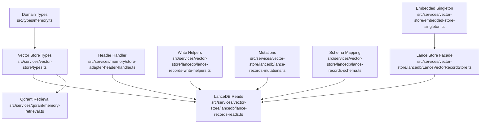
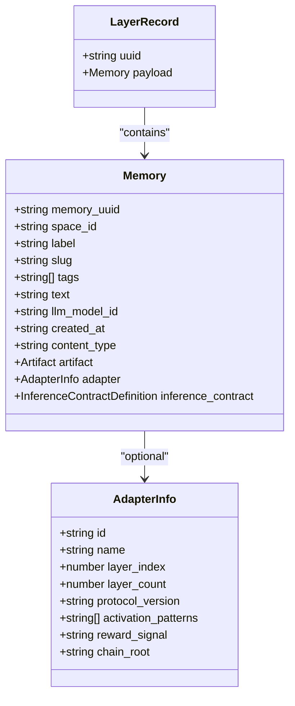
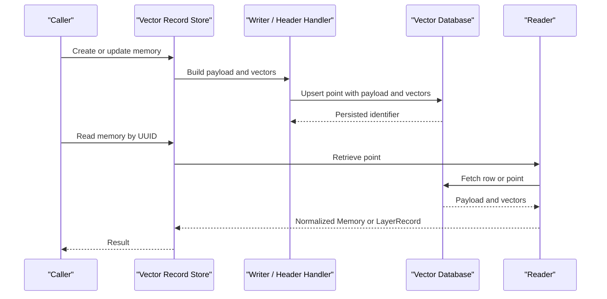
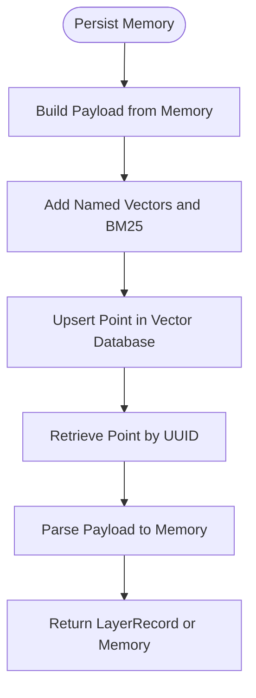
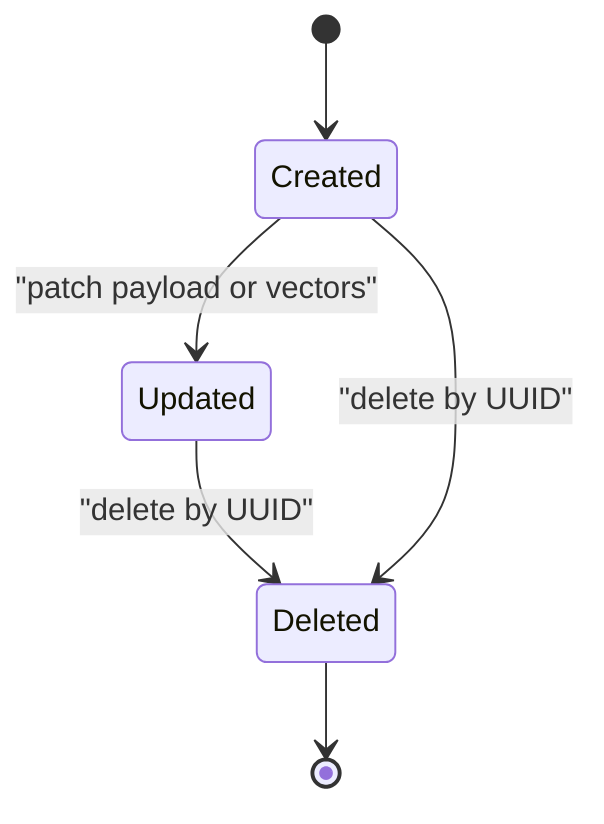
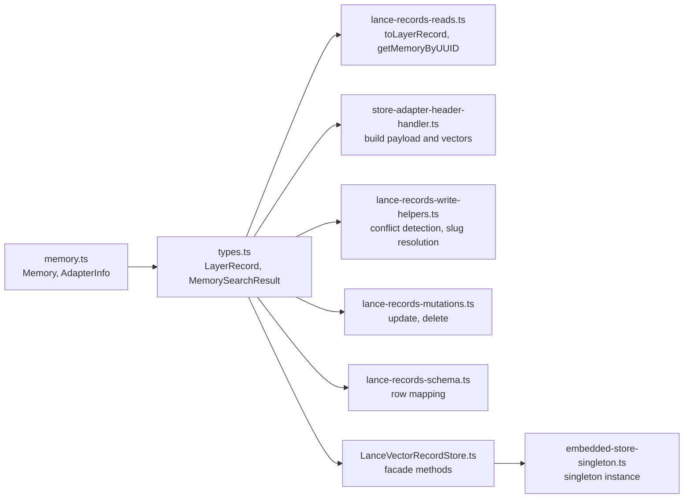

# Memory Data Model

<cite>
**Referenced Files in This Document**
- [memory.ts](file://src/types/memory.ts)
- [types.ts](file://src/services/vector-store/types.ts)
- [lance-records-reads.ts](file://src/services/vector-store/lancedb/lance-records-reads.ts)
- [store-adapter-header-handler.ts](file://src/services/memory/store-adapter-header-handler.ts)
- [lance-records-write-helpers.ts](file://src/services/vector-store/lancedb/lance-records-write-helpers.ts)
- [lance-records-mutations.ts](file://src/services/vector-store/lancedb/lance-records-mutations.ts)
- [lance-records-schema.ts](file://src/services/vector-store/lancedb/lance-records-schema.ts)
- [LanceVectorRecordStore.ts](file://src/services/vector-store/lancedb/LanceVectorRecordStore.ts)
- [embedded-store-singleton.ts](file://src/services/vector-store/embedded-store-singleton.ts)
</cite>

## Table of Contents
1. [Introduction](#introduction)
2. [Project Structure](#project-structure)
3. [Core Components](#core-components)
4. [Architecture Overview](#architecture-overview)
5. [Detailed Component Analysis](#detailed-component-analysis)
6. [Dependency Analysis](#dependency-analysis)
7. [Performance Considerations](#performance-considerations)
8. [Troubleshooting Guide](#troubleshooting-guide)
9. [Conclusion](#conclusion)

## Introduction
This document describes the SquadRules memory data model used by the vector-backed storage layer. It focuses on:
- The core `Memory` domain entity and its adapter-related fields.
- The backend-neutral `LayerRecord` representation used for vector storage.
- How memories map to layered vector records across Qdrant and LanceDB backends.
- Field validation rules, required versus optional properties, and lifecycle patterns.
- Examples of memory creation, transformation, and serialization through source paths rather than inline code.

The documentation is written for both technical readers who need implementation details and non-technical readers who need a clear mental model of how memories, adapters, and vector layers relate.

## Project Structure
The memory data model lives primarily in two places:
- Domain types define the public-facing shape of a memory and its adapter metadata.
- Vector-store types define the backend-neutral record shape used by both Qdrant and LanceDB implementations.

**Diagram sources**
- [memory.ts:1-125](file://src/types/memory.ts#L1-L125)
- [types.ts:10-40](file://src/services/vector-store/types.ts#L10-L40)
- [lance-records-reads.ts:27-37](file://src/services/vector-store/lancedb/lance-records-reads.ts#L27-L37)
- [store-adapter-header-handler.ts:96-135](file://src/services/memory/store-adapter-header-handler.ts#L96-L135)
- [lance-records-write-helpers.ts:166-204](file://src/services/vector-store/lancedb/lance-records-write-helpers.ts#L166-L204)
- [lance-records-mutations.ts:119-162](file://src/services/vector-store/lancedb/lance-records-mutations.ts#L119-L162)
- [lance-records-schema.ts:1-42](file://src/services/vector-store/lancedb/lance-records-schema.ts#L1-L42)
- [LanceVectorRecordStore.ts:35-67](file://src/services/vector-store/lancedb/LanceVectorRecordStore.ts#L35-L67)
- [embedded-store-singleton.ts:1-17](file://src/services/vector-store/embedded-store-singleton.ts#L1-L17)

**Section sources**
- [memory.ts:1-125](file://src/types/memory.ts#L1-L125)
- [types.ts:1-40](file://src/services/vector-store/types.ts#L1-L40)

## Core Components
This section defines the primary data shapes that represent memories and their vector-layered storage.

### Memory Entity
`Memory` is the domain-level representation of an adapter step or artifact. It includes identifiers, human-readable context, tags, text content, LLM model attribution, timestamps, optional artifact information, adapter metadata, and inference contract definitions.

Key characteristics:
- `memory_uuid`: Stable identifier for the memory point.
- `space_id`: Optional scoping field used during export and adapter scrolling.
- `label`: Human-readable title or label for the memory.
- `slug`: Optional slug used for adapter resolution and routing.
- `tags`: Array of string tags used for filtering and search enrichment.
- `text`: Main textual content associated with the memory.
- `llm_model_id`: Identifier of the LLM model used during training or generation.
- `created_at`: Timestamp when the memory was created.
- `content_type`: Optional content type discriminator.
- `artifact`: Optional artifact reference including slug, version, name, hash, and optional relative path.
- `adapter`: Optional adapter metadata describing which adapter chain this memory belongs to.
- `inference_contract`: Optional contract describing expected inputs/outputs for execution.

Adapter metadata (`AdapterInfo`) provides:
- `id`: Stable adapter identifier, typically the head layer UUID.
- `name`: Adapter title.
- `layer_index`: One-based index within the adapter chain.
- `layer_count`: Total number of layers in the adapter chain.
- `protocol_version`: Optional semver carried from frontmatter or training input.
- `activation_patterns`: Optional activation pattern strings.
- `reward_signal`: Optional trailing reward signal marker.
- `chain_root`: Optional root adapter slug that collapses activation URIs.

Validation and requirements are enforced at write time by the store layer; read-side accessors normalize missing fields into safe defaults.

**Section sources**
- [memory.ts:1-125](file://src/types/memory.ts#L1-L125)

### LayerRecord Structure
`LayerRecord` is the backend-neutral representation of one adapter layer stored in a vector database. It contains:
- `uuid`: The persistent identifier of the vector point.
- `payload`: The full `Memory` object attached to the vector record.

This abstraction allows both Qdrant points and LanceDB rows to be treated uniformly by higher-level services.

**Section sources**
- [types.ts:32-40](file://src/services/vector-store/types.ts#L32-L40)

### Relationship Between Memories and Vector Layers
A memory is persisted as a vector record with:
- An identifier (`uuid` / `memory_uuid`).
- A payload containing the `Memory` object plus additional indexing fields.
- Named vectors for semantic search (for example, primary embedding, title embedding, activation-pattern embedding).
- BM25 sparse indices for lexical search.

Readers reconstruct either:
- A raw `{ uuid, payload }` point.
- A normalized `Memory` object.
- A `LayerRecord` for backend-neutral operations.

**Diagram sources**
- [memory.ts:1-125](file://src/types/memory.ts#L1-L125)
- [types.ts:32-40](file://src/services/vector-store/types.ts#L32-L40)

## Architecture Overview
The memory data model flows through several stages:
1. Creation or update of a `Memory` object.
2. Transformation into a vector point with payload and named vectors.
3. Persistence in a vector database (Qdrant or LanceDB).
4. Retrieval and normalization back into `Memory` or `LayerRecord`.

**Diagram sources**
- [LanceVectorRecordStore.ts:35-67](file://src/services/vector-store/lancedb/LanceVectorRecordStore.ts#L35-L67)
- [store-adapter-header-handler.ts:96-135](file://src/services/memory/store-adapter-header-handler.ts#L96-L135)
- [lance-records-reads.ts:27-37](file://src/services/vector-store/lancedb/lance-records-reads.ts#L27-L37)

## Detailed Component Analysis

### Memory Fields and Validation Rules
The `Memory` interface defines the canonical shape. Required fields include identifiers, labels, tags, text, model attribution, and creation timestamp. Optional fields include scoping, slugs, content type, artifact references, adapter metadata, and inference contracts.

Important validation behaviors observed in the codebase:
- Missing adapter metadata is filled in during header processing using adapter UUID, title, layer index, and layer count.
- Missing text or label values are normalized to empty strings during retrieval.
- Missing tags default to an empty array during retrieval.
- Space scoping is derived from payload or context during writes and reads.
- Duplicate or similar adapter titles can trigger conflict errors unless explicitly overridden.

Recommended validation rules:
- Treat `memory_uuid`, `label`, `tags`, `text`, `llm_model_id`, and `created_at` as required for valid memories.
- Treat `space_id`, `slug`, `content_type`, `artifact`, `adapter`, and `inference_contract` as optional but recommended where applicable.
- Validate `adapter.layer_index` and `adapter.layer_count` consistency when writing multi-layer adapters.
- Normalize empty strings and arrays before persistence to ensure consistent query behavior.

**Section sources**
- [memory.ts:99-125](file://src/types/memory.ts#L99-L125)
- [store-adapter-header-handler.ts:96-135](file://src/services/memory/store-adapter-header-handler.ts#L96-L135)
- [lance-records-reads.ts:74-101](file://src/services/vector-store/lancedb/lance-records-reads.ts#L74-L101)
- [lance-records-write-helpers.ts:166-204](file://src/services/vector-store/lancedb/lance-records-write-helpers.ts#L166-L204)

### LayerRecord and Vector Storage Mapping
`LayerRecord` abstracts the underlying vector storage format. In LanceDB, a row maps to a `LayerRecord` by reading the row ID as `uuid` and parsing the JSON payload as `Memory`. In Qdrant, retrieval similarly returns a point whose payload is transformed into a `Memory`.

Key mapping details:
- `uuid` corresponds to the vector point ID.
- `payload` holds the complete `Memory` object plus additional indexing fields such as `space_id`, `adapter_name_text`, `label_text`, `activation_patterns_text`, and `tags_text`.
- Vectors include primary embeddings, title embeddings, activation-pattern embeddings, and BM25 sparse indices.

**Diagram sources**
- [lance-records-reads.ts:27-37](file://src/services/vector-store/lancedb/lance-records-reads.ts#L27-L37)
- [store-adapter-header-handler.ts:114-135](file://src/services/memory/store-adapter-header-handler.ts#L114-L135)

**Section sources**
- [types.ts:32-40](file://src/services/vector-store/types.ts#L32-L40)
- [lance-records-reads.ts:27-37](file://src/services/vector-store/lancedb/lance-records-reads.ts#L27-L37)

### Memory Creation and Transformation
Memory creation involves transforming a domain `Memory` into a vector point suitable for semantic and lexical search. The header handler derives domain/task/type metadata, computes quality metadata, tokenizes sparse text, and constructs the payload and vectors.

Creation steps:
1. Derive domain, task, and type from label, text, and tags.
2. Compute quality metadata based on derived fields and tags.
3. Tokenize sparse text for BM25 indexing.
4. Fill in adapter metadata if missing.
5. Construct payload with scoping, timestamps, actor attribution, and indexed text fields.
6. Attach named vectors for primary, title, and activation-pattern search.

Example creation flow references:
- [store-adapter-header-handler.ts:96-135](file://src/services/memory/store-adapter-header-handler.ts#L96-L135)

**Section sources**
- [store-adapter-header-handler.ts:96-135](file://src/services/memory/store-adapter-header-handler.ts#L96-L135)

### Memory Serialization and Persistence
Serialization converts a `Memory` into a backend-compatible row or point. For LanceDB, scalar filter fields are promoted to columns while the full payload remains a JSON string. Vectors are stored under named keys, and BM25 sparse indices are serialized separately.

Persistence details:
- Promoted scalar columns include space, slug, adapter identity, layer indices, protocol metadata, content type, domain, task, type, artifact slug, protocol step, and timestamps.
- The payload column stores the verbatim JSON representation of the memory payload.
- Vector columns store numeric arrays for ANN search.
- BM25 JSON stores sparse indices and values for lexical search.

Example serialization references:
- [lance-records-schema.ts:22-42](file://src/services/vector-store/lancedb/lance-records-schema.ts#L22-L42)
- [lance-records-schema.ts:172-187](file://src/services/vector-store/lancedb/lance-records-schema.ts#L172-L187)

**Section sources**
- [lance-records-schema.ts:1-42](file://src/services/vector-store/lancedb/lance-records-schema.ts#L1-L42)
- [lance-records-schema.ts:172-187](file://src/services/vector-store/lancedb/lance-records-schema.ts#L172-L187)

### Memory Retrieval and Normalization
Retrieval normalizes backend-specific points back into domain objects. Missing fields are defaulted to safe values, and adapter metadata is reconstructed when present.

Normalization behavior:
- Label and text default to empty strings when absent.
- Tags default to an empty array when absent.
- Type defaults to a context-like value when absent.
- Adapter metadata is conditionally included only when present in the payload.

Example retrieval references:
- [lance-records-reads.ts:74-101](file://src/services/vector-store/lancedb/lance-records-reads.ts#L74-L101)

**Section sources**
- [lance-records-reads.ts:74-101](file://src/services/vector-store/lancedb/lance-records-reads.ts#L74-L101)

### Memory Lifecycle Patterns
Memories follow a lifecycle from creation through updates to deletion:
- Creation: Build payload and vectors, upsert into vector storage.
- Update: Patch payload and vectors, refresh cache, and persist changes.
- Deletion: Validate existence, remove point, invalidate caches.

Lifecycle references:
- Creation and transformation: [store-adapter-header-handler.ts:96-135](file://src/services/memory/store-adapter-header-handler.ts#L96-L135)
- Quality metadata update: [lance-records-mutations.ts:155-162](file://src/services/vector-store/lancedb/lance-records-mutations.ts#L155-L162)
- Deletion with cache invalidation: [lance-records-mutations.ts:119-128](file://src/services/vector-store/lancedb/lance-records-mutations.ts#L119-L128)

**Diagram sources**
- [lance-records-mutations.ts:119-162](file://src/services/vector-store/lancedb/lance-records-mutations.ts#L119-L162)

**Section sources**
- [lance-records-mutations.ts:119-162](file://src/services/vector-store/lancedb/lance-records-mutations.ts#L119-L162)

## Dependency Analysis
The memory data model depends on domain types, vector-store abstractions, and backend-specific implementations.

**Diagram sources**
- [memory.ts:1-125](file://src/types/memory.ts#L1-L125)
- [types.ts:10-40](file://src/services/vector-store/types.ts#L10-L40)
- [lance-records-reads.ts:27-37](file://src/services/vector-store/lancedb/lance-records-reads.ts#L27-L37)
- [store-adapter-header-handler.ts:96-135](file://src/services/memory/store-adapter-header-handler.ts#L96-L135)
- [lance-records-write-helpers.ts:166-204](file://src/services/vector-store/lancedb/lance-records-write-helpers.ts#L166-L204)
- [lance-records-mutations.ts:119-162](file://src/services/vector-store/lancedb/lance-records-mutations.ts#L119-L162)
- [lance-records-schema.ts:1-42](file://src/services/vector-store/lancedb/lance-records-schema.ts#L1-L42)
- [LanceVectorRecordStore.ts:35-67](file://src/services/vector-store/lancedb/LanceVectorRecordStore.ts#L35-L67)
- [embedded-store-singleton.ts:1-17](file://src/services/vector-store/embedded-store-singleton.ts#L1-L17)

**Section sources**
- [memory.ts:1-125](file://src/types/memory.ts#L1-L125)
- [types.ts:1-40](file://src/services/vector-store/types.ts#L1-L40)
- [LanceVectorRecordStore.ts:35-67](file://src/services/vector-store/lancedb/LanceVectorRecordStore.ts#L35-L67)
- [embedded-store-singleton.ts:1-17](file://src/services/vector-store/embedded-store-singleton.ts#L1-L17)

## Performance Considerations
- Use named vectors selectively: primary, title, and activation-pattern vectors enable different search strategies but increase storage and compute costs.
- BM25 sparse indices improve lexical recall but add serialization overhead; ensure sparse tokens are compact.
- Promote frequently filtered scalar fields to columns to avoid scanning large payloads.
- Normalize missing fields at write time to reduce runtime branching during reads.
- Cache invalidated after updates to maintain consistency between vector storage and application caches.

[No sources needed since this section provides general guidance]

## Troubleshooting Guide
Common issues and resolutions:
- Memory not found: Ensure the UUID exists and is accessible within the current space context.
- Similar memory conflict: When adapter titles are too similar, resolve by verifying uniqueness or using force update with the same adapter ID.
- Missing adapter metadata: During header processing, adapter info is auto-filled; verify layer index and count consistency.
- Cache inconsistency: After updates or deletions, ensure cache invalidation runs to reflect changes immediately.

References:
- Conflict detection and guidance: [lance-records-write-helpers.ts:166-204](file://src/services/vector-store/lancedb/lance-records-write-helpers.ts#L166-L204)
- Deletion and cache invalidation: [lance-records-mutations.ts:119-128](file://src/services/vector-store/lancedb/lance-records-mutations.ts#L119-L128)
- Quality metadata update and persistence: [lance-records-mutations.ts:155-162](file://src/services/vector-store/lancedb/lance-records-mutations.ts#L155-L162)

**Section sources**
- [lance-records-write-helpers.ts:166-204](file://src/services/vector-store/lancedb/lance-records-write-helpers.ts#L166-L204)
- [lance-records-mutations.ts:119-162](file://src/services/vector-store/lancedb/lance-records-mutations.ts#L119-L162)

## Conclusion
The SquadRules memory data model centers on a well-defined `Memory` entity and a backend-neutral `LayerRecord` abstraction. Memories are transformed into vector records with rich payloads and multiple named vectors, enabling both semantic and lexical search. Validation, normalization, and lifecycle management are handled consistently across Qdrant and LanceDB backends. By following the field rules, validation patterns, and lifecycle flows described here, developers can create, transform, serialize, retrieve, and manage memories reliably.

[No sources needed since this section summarizes without analyzing specific files]