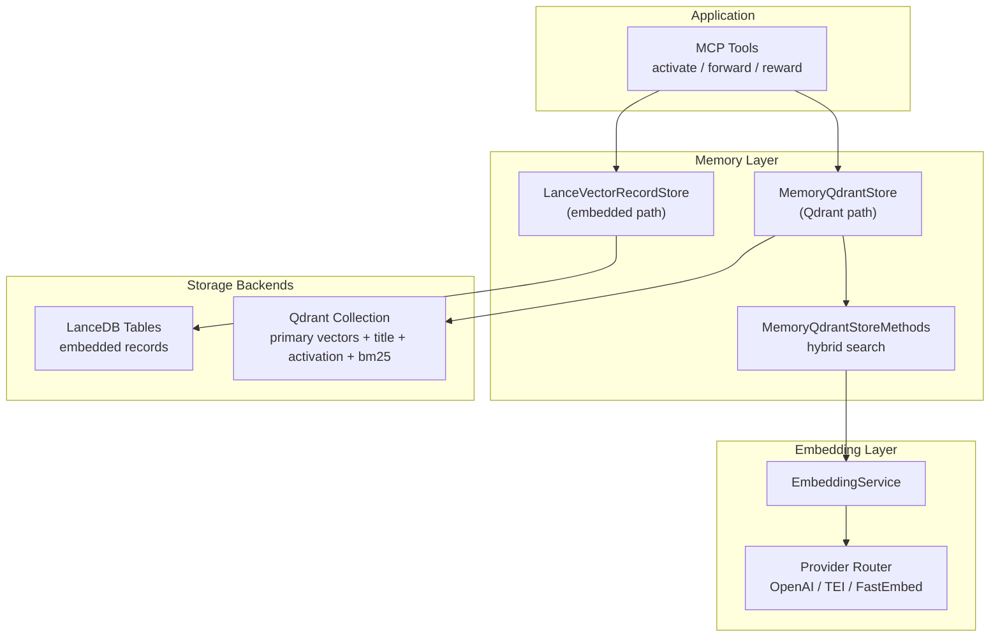
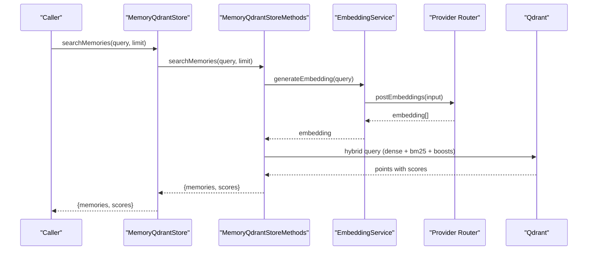
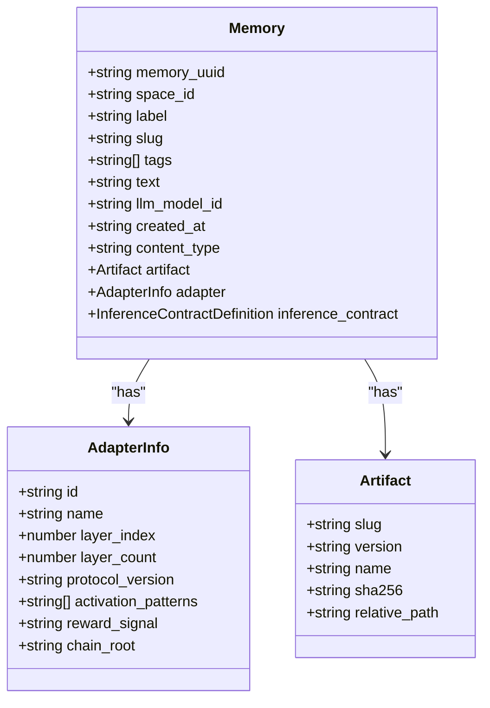
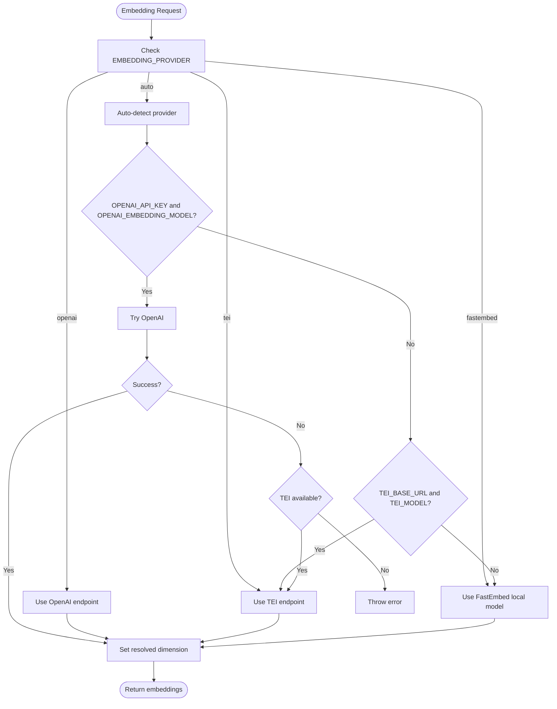
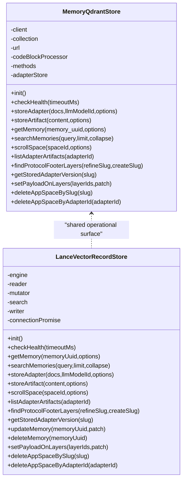
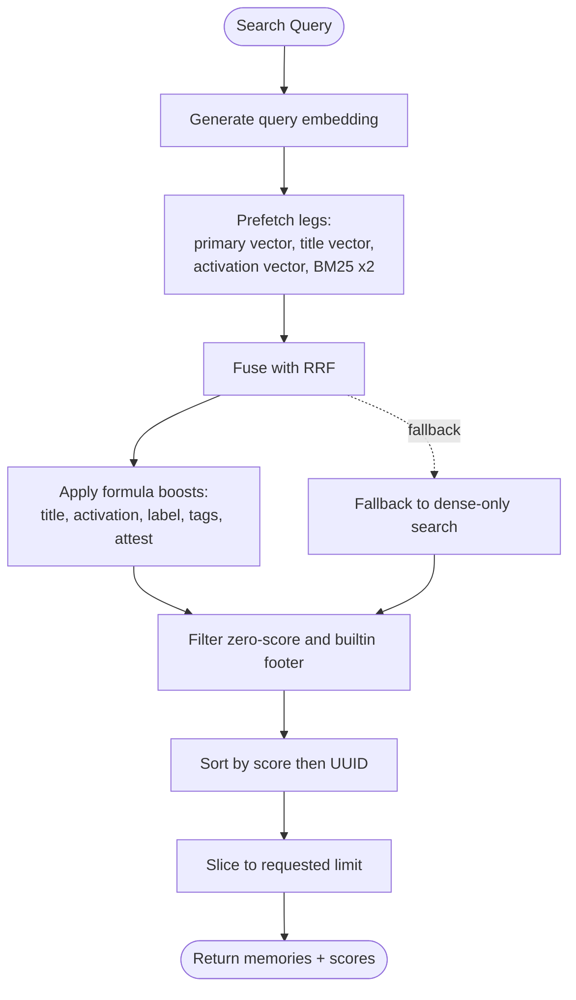
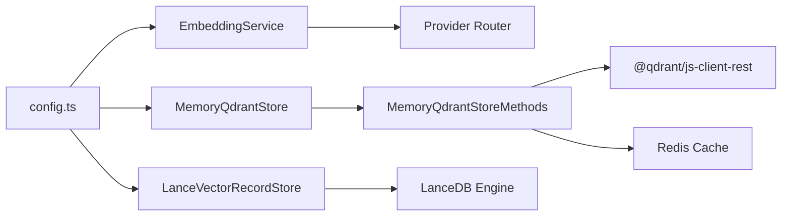

# Memory Management

<cite>
**Referenced Files in This Document**
- [memory.ts](file://src/types/memory.ts)
- [store-methods.ts](file://src/services/memory/store-methods.ts)
- [store.ts](file://src/services/memory/store.ts)
- [providers.ts](file://src/services/embedding/providers.ts)
- [service.ts](file://src/services/embedding/service.ts)
- [fastembed-provider.ts](file://src/services/embedding/fastembed-provider.ts)
- [config.ts](file://src/config.ts)
- [LanceVectorRecordStore.ts](file://src/services/vector-store/lancedb/LanceVectorRecordStore.ts)
- [lance-records-search.ts](file://src/services/vector-store/lancedb/lance-records-search.ts)
- [memory-store.ts](file://src/services/qdrant/memory-store.ts)
</cite>

## Table of Contents
1. [Introduction](#introduction)
2. [Project Structure](#project-structure)
3. [Core Components](#core-components)
4. [Architecture Overview](#architecture-overview)
5. [Detailed Component Analysis](#detailed-component-analysis)
6. [Dependency Analysis](#dependency-analysis)
7. [Performance Considerations](#performance-considerations)
8. [Troubleshooting Guide](#troubleshooting-guide)
9. [Conclusion](#conclusion)
10. [Appendices](#appendices)

## Introduction
This document explains SquadRules’ memory management system: how memories are modeled, embedded, stored, and retrieved through vector-based semantic search. The system supports two storage backends:
- Qdrant as the primary, remote-capable vector database.
- LanceDB as an embedded secondary backend for local/simple mode.

Embeddings are generated by one of three providers:
- OpenAI embeddings API.
- TEI (Text Embeddings Inference).
- FastEmbed, a local ONNX-backed provider used when no external embedding service is configured.

The design emphasizes abstraction: callers interact with a memory store interface, while embedding generation and vector storage are pluggable. Search combines dense vector similarity, sparse BM25 token matching, and field-level text boosts to rank adapter layers and artifacts.

## Project Structure
The memory subsystem spans several layers:
- Data model: `Memory` and related types.
- Embedding layer: provider selection, health checks, dimension probing, and retry/backoff logic.
- Storage layer: Qdrant client wrapper and LanceDB embedded record store.
- Search layer: hybrid query construction, RRF fusion, and post-processing.

**Diagram sources**
- [store.ts:29-62](file://src/services/memory/store.ts#L29-L62)
- [LanceVectorRecordStore.ts:35-46](file://src/services/vector-store/lancedb/LanceVectorRecordStore.ts#L35-L46)
- [store-methods.ts:25-36](file://src/services/memory/store-methods.ts#L25-L36)
- [service.ts:38-47](file://src/services/embedding/service.ts#L38-L47)
- [providers.ts:283-317](file://src/services/embedding/providers.ts#L283-L317)

**Section sources**
- [memory.ts:99-120](file://src/types/memory.ts#L99-L120)
- [store.ts:29-62](file://src/services/memory/store.ts#L29-L62)
- [LanceVectorRecordStore.ts:35-46](file://src/services/vector-store/lancedb/LanceVectorRecordStore.ts#L35-L46)
- [service.ts:38-47](file://src/services/embedding/service.ts#L38-L47)
- [providers.ts:283-317](file://src/services/embedding/providers.ts#L283-L317)

## Core Components
- Memory data model: defines the canonical shape of stored memories, including identifiers, space scoping, labels, slugs, tags, text, adapter metadata, and inference contracts.
- Embedding service: selects provider, probes embedding dimension, and returns normalized embeddings.
- Vector stores:
  - Qdrant-backed store for production-like deployments.
  - LanceDB-backed embedded store for local/simple mode.
- Hybrid search: builds multi-vector queries, fuses results via reciprocal rank fusion, and applies text-field boosts.

Key responsibilities:
- Generate embeddings for query and stored content.
- Persist payloads alongside multiple vector fields.
- Filter searches by space and adapter layer.
- Return ranked memories with scores.

**Section sources**
- [memory.ts:99-120](file://src/types/memory.ts#L99-L120)
- [service.ts:38-47](file://src/services/embedding/service.ts#L38-L47)
- [store.ts:29-62](file://src/services/memory/store.ts#L29-L62)
- [LanceVectorRecordStore.ts:35-46](file://src/services/vector-store/lancedb/LanceVectorRecordStore.ts#L35-L46)
- [store-methods.ts:121-180](file://src/services/memory/store-methods.ts#L121-L180)

## Architecture Overview
SquadRules uses a layered architecture:
- Callers use a memory store abstraction.
- Embeddings are produced by a provider router that can switch between OpenAI, TEI, and FastEmbed.
- Vector data is persisted either in Qdrant or LanceDB depending on configuration.
- Search composes dense vectors, sparse BM25 tokens, and textual field matches into a single ranking.

**Diagram sources**
- [store.ts:151-153](file://src/services/memory/store.ts#L151-L153)
- [store-methods.ts:94-104](file://src/services/memory/store-methods.ts#L94-L104)
- [store-methods.ts:121-180](file://src/services/memory/store-methods.ts#L121-L180)
- [providers.ts:283-317](file://src/services/embedding/providers.ts#L283-L317)

## Detailed Component Analysis

### Memory Data Model
The `Memory` type is the canonical representation of a stored unit of knowledge. It includes:
- `memory_uuid`: stable identifier for the memory point.
- `space_id`: optional space scoping for export and adapter scroll operations.
- `label`: human-readable label/title.
- `slug`: optional slug used for protocol and artifact resolution.
- `tags`: array of categorization tags.
- `text`: main body content.
- `llm_model_id`, `created_at`, `content_type`: provenance and metadata.
- `artifact`: optional skill artifact reference.
- `adapter`: adapter context including layer index, total layers, activation patterns, and chain root.
- `inference_contract`: contract describing inputs/outputs for execution.

**Diagram sources**
- [memory.ts:1-11](file://src/types/memory.ts#L1-L11)
- [memory.ts:99-120](file://src/types/memory.ts#L99-L120)

**Section sources**
- [memory.ts:1-11](file://src/types/memory.ts#L1-L11)
- [memory.ts:99-120](file://src/types/memory.ts#L99-L120)

### Embedding Generation and Provider Selection
The embedding pipeline:
- Resolves the active provider from environment variables (`EMBEDDING_PROVIDER`).
- Supports explicit selection (`openai`, `tei`, `fastembed`) or auto-detection.
- Auto-detection prefers OpenAI if credentials are present; otherwise falls back to TEI; otherwise uses FastEmbed.
- Caches the resolved embedding dimension after the first successful call.
- Implements retries with exponential backoff, jitter, Retry-After header support, and a wall-clock budget.

**Diagram sources**
- [providers.ts:283-317](file://src/services/embedding/providers.ts#L283-L317)
- [service.ts:260-280](file://src/services/embedding/service.ts#L260-L280)
- [config.ts:70-92](file://src/config.ts#L70-L92)

**Section sources**
- [providers.ts:1-327](file://src/services/embedding/providers.ts#L1-L327)
- [service.ts:38-47](file://src/services/embedding/service.ts#L38-L47)
- [service.ts:260-280](file://src/services/embedding/service.ts#L260-L280)
- [fastembed-provider.ts:1-81](file://src/services/embedding/fastembed-provider.ts#L1-L81)
- [config.ts:70-92](file://src/config.ts#L70-L92)

### Vector Storage Abstraction: Qdrant vs LanceDB
Two implementations share a common operational surface:
- Qdrant path: `MemoryQdrantStore` wraps the Qdrant client, resolves collection aliases, initializes collections, and delegates search/mutation methods.
- Embedded path: `LanceVectorRecordStore` implements the same read/write/search/admin surface using LanceDB tables.

Both paths persist:
- Dense vectors for primary semantics.
- Title vectors for adapter titles.
- Activation pattern vectors for activation-focused retrieval.
- Sparse BM25 tokens for lexical matching.
- Payloads containing `space_id`, `label`, `slug`, `tags`, `text`, adapter info, and other metadata.

**Diagram sources**
- [store.ts:29-62](file://src/services/memory/store.ts#L29-L62)
- [LanceVectorRecordStore.ts:35-46](file://src/services/vector-store/lancedb/LanceVectorRecordStore.ts#L35-L46)

**Section sources**
- [store.ts:29-62](file://src/services/memory/store.ts#L29-L62)
- [LanceVectorRecordStore.ts:35-46](file://src/services/vector-store/lancedb/LanceVectorRecordStore.ts#L35-L46)

### Search Algorithms, Similarity Scoring, and Retrieval Optimization
Hybrid search in the Qdrant path:
- Generates a query embedding via the embedding service.
- Builds a multi-leg prefetch query:
  - Primary dense vector.
  - Title dense vector.
  - Activation pattern dense vector.
  - Two BM25 legs with different limits.
- Fuses results using reciprocal rank fusion (RRF).
- Applies a server-side formula boosting title match, activation pattern match, label match, tag match, and attest boost.
- Filters out builtin search footer protocols and sorts by score.
- Falls back to dense-only search if the hybrid query fails.

Embedded LanceDB path:
- Performs JS cosine similarity over stored vectors.
- Uses similar boost constants for title, activation pattern, label, and tag matches.
- Tokenizes text and computes a fraction-of-query-tokens-in-field score.

**Diagram sources**
- [store-methods.ts:121-180](file://src/services/memory/store-methods.ts#L121-L180)
- [store-methods.ts:181-216](file://src/services/memory/store-methods.ts#L181-L216)
- [store-methods.ts:217-259](file://src/services/memory/store-methods.ts#L217-L259)
- [lance-records-search.ts:32-70](file://src/services/vector-store/lancedb/lance-records-search.ts#L32-L70)

**Section sources**
- [store-methods.ts:94-104](file://src/services/memory/store-methods.ts#L94-L104)
- [store-methods.ts:121-180](file://src/services/memory/store-methods.ts#L121-L180)
- [store-methods.ts:181-216](file://src/services/memory/store-methods.ts#L181-L216)
- [store-methods.ts:217-259](file://src/services/memory/store-methods.ts#L217-L259)
- [lance-records-search.ts:32-70](file://src/services/vector-store/lancedb/lance-records-search.ts#L32-L70)

### Configuration Examples
Environment variables control embedding providers and vector storage behavior.

- Embedding provider selection:
  - `EMBEDDING_PROVIDER=auto` (default): auto-detects OpenAI → TEI → FastEmbed.
  - `EMBEDDING_PROVIDER=openai`: requires `OPENAI_API_KEY` and `OPENAI_EMBEDDING_MODEL`.
  - `EMBEDDING_PROVIDER=tei`: requires `TEI_BASE_URL` and `TEI_MODEL`.
  - `EMBEDDING_PROVIDER=fastembed`: local ONNX model; defaults provided by fastembed config.

- OpenAI embedding settings:
  - `OPENAI_EMBEDDING_MODEL=text-embedding-3-small` (default).
  - `OPENAI_API_URL=https://api.openai.com` (default).
  - `OPENAI_API_KEY=<your-key>`.

- TEI embedding settings:
  - `TEI_BASE_URL=http://localhost:8080`.
  - `TEI_MODEL=Alibaba-NLP/gte-large-en-v1.5` (default).
  - `TEI_API_KEY=<optional>`.

- FastEmbed settings:
  - `FASTEMBED_MODEL` and `FASTEMBED_CACHE_DIR` are imported from fastembed config.

- Vector storage:
  - When `QDRANT_URL` is set, Qdrant is used.
  - Otherwise, embedded LanceDB is used.
  - `QDRANT_COLLECTION=squadrules` (default).
  - `QDRANT_API_KEY=<optional>`.

- Search tuning:
  - `SCORE_THRESHOLD=0.5` (default).
  - `SIMILAR_MEMORY_THRESHOLD=0.9` (default).
  - `MIN_ATTEST_RUNS=3`, `RUNS_FULL_CONFIDENCE=10`, `ATTEST_BOOST_MAX=0.08`.

**Section sources**
- [config.ts:70-92](file://src/config.ts#L70-L92)
- [config.ts:105-115](file://src/config.ts#L105-L115)
- [config.ts:283-293](file://src/config.ts#L283-L293)
- [config.ts:296-302](file://src/config.ts#L296-L302)
- [providers.ts:283-317](file://src/services/embedding/providers.ts#L283-L317)

## Dependency Analysis
The memory subsystem depends on:
- Environment configuration for provider selection and vector storage.
- Embedding service for generating query and content embeddings.
- Qdrant client for remote vector operations.
- LanceDB connection for embedded vector operations.
- Redis cache for memory and search result caching.

**Diagram sources**
- [config.ts:70-92](file://src/config.ts#L70-L92)
- [store.ts:29-62](file://src/services/memory/store.ts#L29-L62)
- [LanceVectorRecordStore.ts:35-46](file://src/services/vector-store/lancedb/LanceVectorRecordStore.ts#L35-L46)
- [store-methods.ts:94-104](file://src/services/memory/store-methods.ts#L94-L104)

**Section sources**
- [config.ts:70-92](file://src/config.ts#L70-L92)
- [store.ts:29-62](file://src/services/memory/store.ts#L29-L62)
- [LanceVectorRecordStore.ts:35-46](file://src/services/vector-store/lancedb/LanceVectorRecordStore.ts#L35-L46)
- [store-methods.ts:94-104](file://src/services/memory/store-methods.ts#L94-L104)

## Performance Considerations
- Embedding dimension probing ensures consistent vector dimensions across providers and prevents runtime mismatches.
- Provider retries with exponential backoff and Retry-After handling reduce transient failures.
- Hybrid search leverages RRF fusion and server-side formula boosts to improve relevance without heavy client-side computation.
- Caching reduces repeated lookups and search computations.
- Quantization rescore parameters in Qdrant prefetch legs optimize large-scale vector search performance.

[No sources needed since this section provides general guidance]

## Troubleshooting Guide
Common issues and resolutions:
- Missing embedding provider configuration:
  - Ensure `EMBEDDING_PROVIDER` is set appropriately.
  - For OpenAI, verify `OPENAI_API_KEY` and `OPENAI_EMBEDDING_MODEL`.
  - For TEI, verify `TEI_BASE_URL` and `TEI_MODEL`.
- Embedding dimension mismatch:
  - Confirm that the probe runs at startup before memory store initialization.
- Rate limiting:
  - Handle `EmbeddingRateLimitError` and adjust retry budgets or provider selection.
- Qdrant connectivity:
  - Verify `QDRANT_URL` and `QDRANT_API_KEY`.
  - Check health endpoint and collection alias resolution.
- Embedded mode:
  - If `QDRANT_URL` is unset, ensure LanceDB is available and initialized.

**Section sources**
- [providers.ts:16-28](file://src/services/embedding/providers.ts#L16-L28)
- [providers.ts:75-91](file://src/services/embedding/providers.ts#L75-L91)
- [config.ts:296-302](file://src/config.ts#L296-L302)
- [store.ts:68-130](file://src/services/memory/store.ts#L68-L130)

## Conclusion
SquadRules’ memory management system provides a robust, configurable pipeline for semantic search and storage. By abstracting embedding providers and vector backends, it supports both cloud-hosted and local environments. Hybrid search combining dense vectors, sparse BM25, and field-level boosts delivers high-quality retrieval. Proper configuration of environment variables ensures reliable operation across deployment modes.

[No sources needed since this section summarizes without analyzing specific files]

## Appendices

### Example Configuration Scenarios

- Local development with FastEmbed:
  - `EMBEDDING_PROVIDER=fastembed`
  - No `OPENAI_API_KEY` or `TEI_BASE_URL` required.

- Cloud embeddings with OpenAI:
  - `EMBEDDING_PROVIDER=openai`
  - `OPENAI_API_KEY=<key>`
  - `OPENAI_EMBEDDING_MODEL=text-embedding-3-small`

- Self-hosted embeddings with TEI:
  - `EMBEDDING_PROVIDER=tei`
  - `TEI_BASE_URL=http://localhost:8080`
  - `TEI_MODEL=Alibaba-NLP/gte-large-en-v1.5`

- Remote vector storage with Qdrant:
  - `QDRANT_URL=http://qdrant:6333`
  - `QDRANT_API_KEY=<key>`
  - `QDRANT_COLLECTION=squadrules`

- Embedded vector storage with LanceDB:
  - Do not set `QDRANT_URL`.
  - System automatically uses embedded LanceDB.

**Section sources**
- [config.ts:70-92](file://src/config.ts#L70-L92)
- [config.ts:105-115](file://src/config.ts#L105-L115)
- [config.ts:296-302](file://src/config.ts#L296-L302)
- [providers.ts:283-317](file://src/services/embedding/providers.ts#L283-L317)