# Search Algorithms & Retrieval

<cite>
**Referenced Files in This Document**   
- [search.ts](file://src/tools/search.ts)
- [store-methods.ts](file://src/services/memory/store-methods.ts)
- [bm25-tokenizer.ts](file://src/services/embedding/bm25-tokenizer.ts)
- [space-filter.ts](file://src/utils/space-filter.ts)
- [tenant-context.ts](file://src/utils/tenant-context.ts)
- [lance-records-search.ts](file://src/services/vector-store/lancedb/lance-records-search.ts)
- [store-title-similarity-search.ts](file://src/services/memory/store-title-similarity-search.ts)
- [search.ts](file://src/services/qdrant/search.ts)
</cite>

## Table of Contents
1. [Introduction](#introduction)
2. [Project Structure](#project-structure)
3. [Core Components](#core-components)
4. [Architecture Overview](#architecture-overview)
5. [Detailed Component Analysis](#detailed-component-analysis)
6. [Dependency Analysis](#dependency-analysis)
7. [Performance Considerations](#performance-considerations)
8. [Troubleshooting Guide](#troubleshooting-guide)
9. [Conclusion](#conclusion)

## Introduction
This document explains how SquadRules performs search and retrieval for protocol adapters and related memory records. It covers semantic vector similarity, hybrid dense-plus-keyword search, result ranking, query preprocessing, tokenization, filtering, scoring, pagination behavior, performance tuning, caching, multi-tenant isolation, and space-based filtering. The implementation supports both Qdrant as the primary vector store and LanceDB as an embedded fallback path.

SquadRules is agent-first: agents are the primary users, and human preferences are expressed through agents. Search returns candidate adapters that can be activated or forwarded by agents.

## Project Structure
Search-related code spans tool orchestration, memory store logic, embedding/tokenization utilities, tenant context, and vector store implementations.

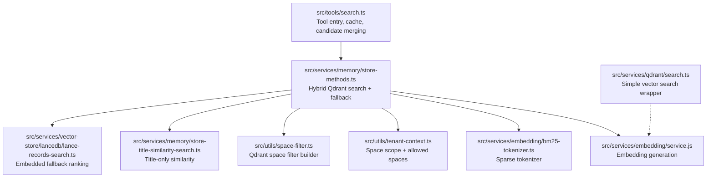

**Diagram sources**
- [search.ts:93-110](file://src/tools/search.ts#L93-L110)
- [store-methods.ts:94-260](file://src/services/memory/store-methods.ts#L94-L260)
- [bm25-tokenizer.ts:37-52](file://src/services/embedding/bm25-tokenizer.ts#L37-L52)
- [tenant-context.ts:141-149](file://src/utils/tenant-context.ts#L141-L149)
- [space-filter.ts:14-26](file://src/utils/space-filter.ts#L14-L26)
- [store-title-similarity-search.ts:9-60](file://src/services/memory/store-title-similarity-search.ts#L9-L60)
- [lance-records-search.ts:99-122](file://src/services/vector-store/lancedb/lance-records-search.ts#L99-L122)
- [search.ts:11-36](file://src/services/qdrant/search.ts#L11-L36)

**Section sources**
- [search.ts:1-254](file://src/tools/search.ts#L1-L254)
- [store-methods.ts:1-270](file://src/services/memory/store-methods.ts#L1-L270)
- [bm25-tokenizer.ts:1-57](file://src/services/embedding/bm25-tokenizer.ts#L1-L57)
- [space-filter.ts:1-48](file://src/utils/space-filter.ts#L1-L48)
- [tenant-context.ts:1-312](file://src/utils/tenant-context.ts#L1-L312)
- [lance-records-search.ts:1-138](file://src/services/vector-store/lancedb/lance-records-search.ts#L1-L138)
- [store-title-similarity-search.ts:1-62](file://src/services/memory/store-title-similarity-search.ts#L1-L62)
- [search.ts:1-83](file://src/services/qdrant/search.ts#L1-L83)

## Core Components
- Tool-level search orchestrator: normalizes input, applies limits, merges candidates from multiple passes, sorts with personal-space tie-breaking, applies a score threshold, and caches results.
- Memory store hybrid search: generates embeddings, builds sparse tokens, executes a multi-leg prefetch-and-fuse query on Qdrant, applies text-field boosts, filters built-in footer protocols, and falls back to dense-only search when needed.
- Sparse tokenizer: converts text into a fixed-size sparse vector using lowercase normalization, alphanumeric splitting, stop-word removal, FNV-1a hashing, and sublinear term frequency values.
- Space and tenant context: derives allowed spaces, default write space, personal space, and optional narrowed search scope; used to build Qdrant filters.
- Space filter utility: composes Qdrant `must` conditions restricting results to allowed spaces.
- LanceDB fallback: scans adapter heads in allowed spaces and scores them in JavaScript using cosine similarity and text match heuristics, mirroring Qdrant’s ranking contract.
- Title similarity search: dedicated adapter title vector similarity query used for specialized discovery paths.
- Simple vector search wrapper: thin Qdrant search helper used elsewhere for domain-scoped memory search.

**Section sources**
- [search.ts:35-51](file://src/tools/search.ts#L35-L51)
- [search.ts:93-110](file://src/tools/search.ts#L93-L110)
- [search.ts:143-186](file://src/tools/search.ts#L143-L186)
- [search.ts:192-253](file://src/tools/search.ts#L192-L253)
- [store-methods.ts:121-260](file://src/services/memory/store-methods.ts#L121-L260)
- [bm25-tokenizer.ts:37-52](file://src/services/embedding/bm25-tokenizer.ts#L37-L52)
- [tenant-context.ts:141-179](file://src/utils/tenant-context.ts#L141-L179)
- [space-filter.ts:14-26](file://src/utils/space-filter.ts#L14-L26)
- [lance-records-search.ts:99-122](file://src/services/vector-store/lancedb/lance-records-search.ts#L99-L122)
- [store-title-similarity-search.ts:9-60](file://src/services/memory/store-title-similarity-search.ts#L9-L60)
- [search.ts:11-36](file://src/services/qdrant/search.ts#L11-L36)

## Architecture Overview
The end-to-end search flow starts at the MCP tool layer, which validates and normalizes the query, enforces limits, optionally narrows the space scope, and then delegates to the memory store. The memory store performs semantic and keyword search against Qdrant, with a fallback to LanceDB-style in-process ranking when necessary. Results are merged, deduplicated, sorted, filtered, and returned as unified output.

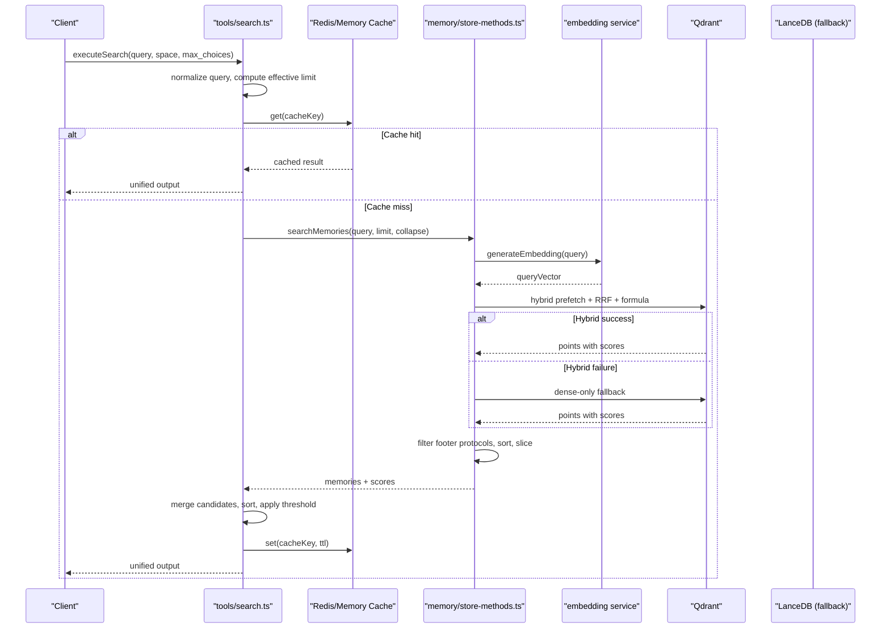

**Diagram sources**
- [search.ts:192-253](file://src/tools/search.ts#L192-L253)
- [store-methods.ts:94-260](file://src/services/memory/store-methods.ts#L94-L260)
- [bm25-tokenizer.ts:37-52](file://src/services/embedding/bm25-tokenizer.ts#L37-L52)

## Detailed Component Analysis

### Query Preprocessing and Tokenization
- Built-in protocol URIs and slugs are stripped from the user query before search and cache key computation. This prevents internal routing identifiers from polluting semantic and keyword matching.
- Query whitespace is normalized to reduce duplicate cache entries.
- For sparse BM25-style indexing, text is lowercased, split on non-alphanumeric characters, filtered by stop words, hashed into a fixed sparse dimension, and scored with sublinear term frequency.

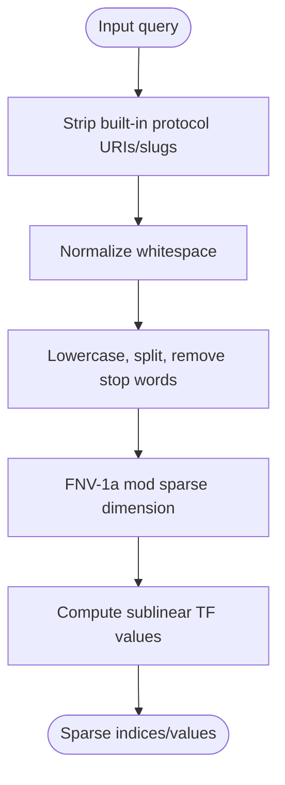

**Diagram sources**
- [search.ts:35-51](file://src/tools/search.ts#L35-L51)
- [bm25-tokenizer.ts:37-52](file://src/services/embedding/bm25-tokenizer.ts#L37-L52)

**Section sources**
- [search.ts:35-51](file://src/tools/search.ts#L35-L51)
- [bm25-tokenizer.ts:1-57](file://src/services/embedding/bm25-tokenizer.ts#L1-L57)

### Semantic Search Implementation
- Embeddings are generated via the embedding service for each query.
- Qdrant queries use the appropriate vector field name based on embedding dimension.
- A simple vector search wrapper demonstrates domain-scoped filtering and rescore configuration.

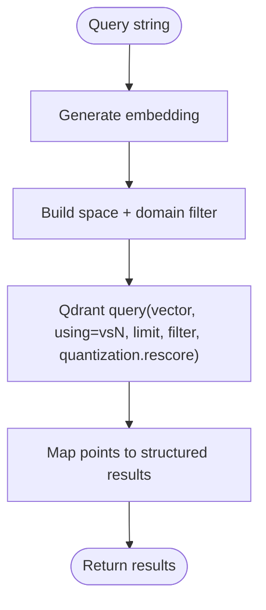

**Diagram sources**
- [search.ts:11-36](file://src/services/qdrant/search.ts#L11-L36)

**Section sources**
- [search.ts:11-36](file://src/services/qdrant/search.ts#L11-L36)

### Hybrid Search: Dense + Keyword Matching
The primary hybrid search pipeline uses Qdrant’s Query API:
- Multiple prefetch legs:
  - Primary dense vector similarity.
  - Adapter title dense vector similarity.
  - Activation pattern dense vector similarity.
  - Two BM25 sparse legs with different limits.
- Results are fused using reciprocal rank fusion (RRF).
- A final formula adds text matches over adapter name, activation patterns, label, tags, and an attest boost.
- If the hybrid query fails, it falls back to dense-only search.

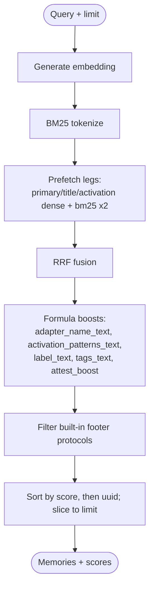

**Diagram sources**
- [store-methods.ts:121-260](file://src/services/memory/store-methods.ts#L121-L260)
- [bm25-tokenizer.ts:37-52](file://src/services/embedding/bm25-tokenizer.ts#L37-L52)

**Section sources**
- [store-methods.ts:121-260](file://src/services/memory/store-methods.ts#L121-L260)

### Result Ranking and Candidate Merging
At the tool level:
- Candidates are collected from one or two search passes depending on group collapse settings.
- Duplicate adapters are merged by keeping higher scores, preferring head-layer adapters, and breaking ties toward the user’s default write space.
- Final sorting prioritizes score, then personal-space preference, then slicing to the effective limit.
- A score threshold is applied before constructing the unified output.

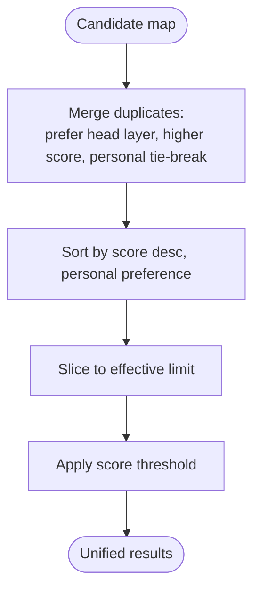

**Diagram sources**
- [search.ts:58-91](file://src/tools/search.ts#L58-L91)
- [search.ts:143-186](file://src/tools/search.ts#L143-L186)

**Section sources**
- [search.ts:58-91](file://src/tools/search.ts#L58-L91)
- [search.ts:143-186](file://src/tools/search.ts#L143-L186)

### Pagination Handling
- The tool enforces minimum and maximum limits around the requested `max_choices`.
- The memory store expands the initial search limit internally to improve recall before final slicing.
- Group collapse may trigger a second pass with a larger limit to fill candidate gaps.
- Final results are sliced to the effective limit after merging and sorting.

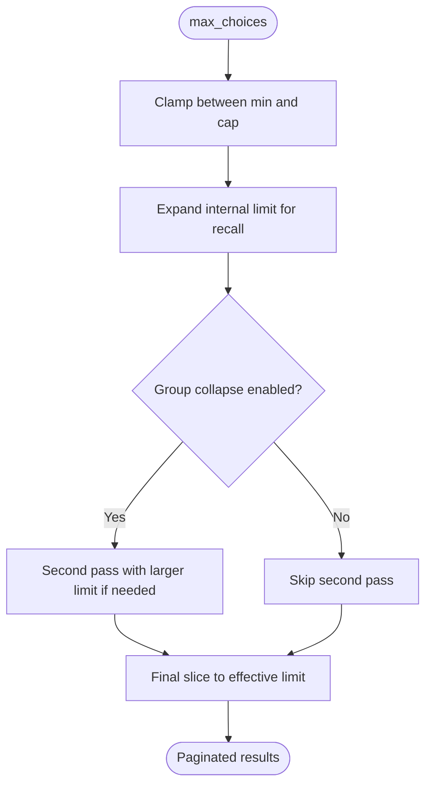

**Diagram sources**
- [search.ts:192-253](file://src/tools/search.ts#L192-L253)
- [store-methods.ts:94-104](file://src/services/memory/store-methods.ts#L94-L104)

**Section sources**
- [search.ts:192-253](file://src/tools/search.ts#L192-L253)
- [store-methods.ts:94-104](file://src/services/memory/store-methods.ts#L94-L104)

### Multi-Tenant Isolation and Space-Based Filtering
- Allowed spaces are derived from authentication context (personal and group spaces), with strict isolation when authentication is enabled but no context is present.
- Search space IDs include allowed spaces plus the Squadrules app space unless explicitly scoped.
- Space narrowing via parameters restricts search to exactly those IDs without implicitly merging the app space.
- All Qdrant queries compose a space filter that requires `space_id` to be in the allowed set.

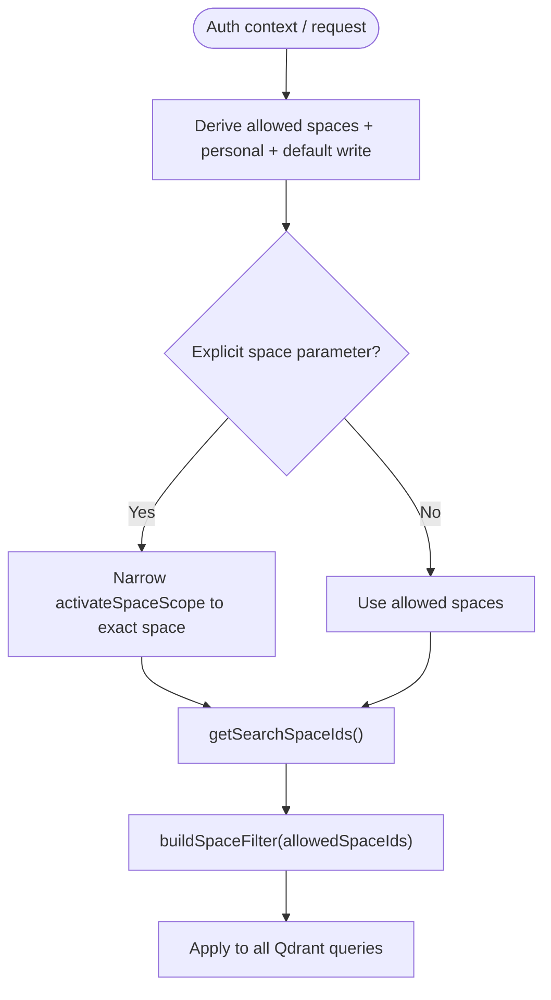

**Diagram sources**
- [tenant-context.ts:141-179](file://src/utils/tenant-context.ts#L141-L179)
- [space-filter.ts:14-26](file://src/utils/space-filter.ts#L14-L26)

**Section sources**
- [tenant-context.ts:141-179](file://src/utils/tenant-context.ts#L141-L179)
- [space-filter.ts:14-26](file://src/utils/space-filter.ts#L14-L26)

### LanceDB Embedded Fallback Ranking
When using LanceDB, the system scans adapter heads within allowed spaces and computes a hybrid-like score in JavaScript:
- Cosine similarity across three stored vectors: primary, adapter title, and activation pattern.
- Text match bonuses for label and tags fields.
- An attest boost field is added.
- Built-in footer protocols are filtered out, and results are sorted and sliced similarly to Qdrant.

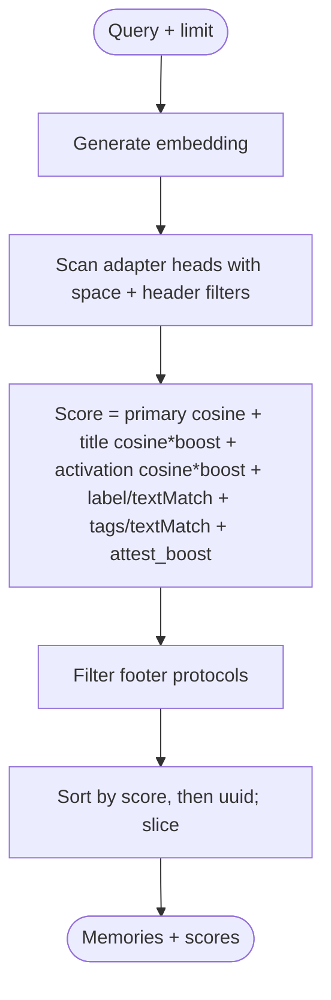

**Diagram sources**
- [lance-records-search.ts:99-122](file://src/services/vector-store/lancedb/lance-records-search.ts#L99-L122)

**Section sources**
- [lance-records-search.ts:1-138](file://src/services/vector-store/lancedb/lance-records-search.ts#L1-L138)

### Title Similarity Search
A dedicated similarity search targets the adapter title vector only, useful for narrow discovery tasks such as finding adapters by their displayed names.

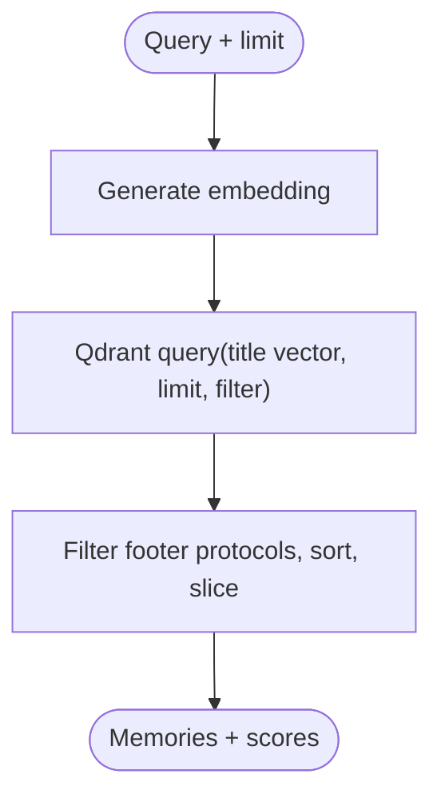

**Diagram sources**
- [store-title-similarity-search.ts:9-60](file://src/services/memory/store-title-similarity-search.ts#L9-L60)

**Section sources**
- [store-title-similarity-search.ts:1-62](file://src/services/memory/store-title-similarity-search.ts#L1-L62)

## Dependency Analysis
The search subsystem depends on embedding generation, tenant context, space filtering, and vector store clients.

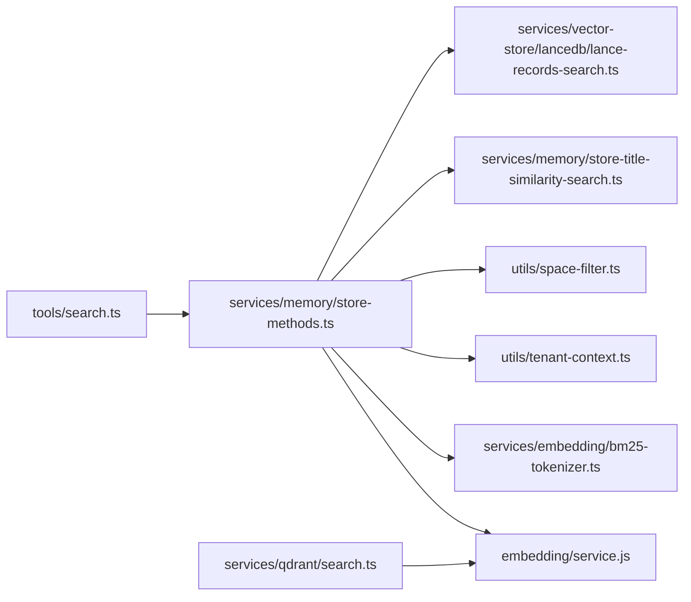

**Diagram sources**
- [search.ts:93-110](file://src/tools/search.ts#L93-L110)
- [store-methods.ts:121-260](file://src/services/memory/store-methods.ts#L121-L260)
- [bm25-tokenizer.ts:37-52](file://src/services/embedding/bm25-tokenizer.ts#L37-L52)
- [tenant-context.ts:141-179](file://src/utils/tenant-context.ts#L141-L179)
- [space-filter.ts:14-26](file://src/utils/space-filter.ts#L14-L26)
- [store-title-similarity-search.ts:9-60](file://src/services/memory/store-title-similarity-search.ts#L9-L60)
- [lance-records-search.ts:99-122](file://src/services/vector-store/lancedb/lance-records-search.ts#L99-L122)
- [search.ts:11-36](file://src/services/qdrant/search.ts#L11-L36)

**Section sources**
- [search.ts:1-254](file://src/tools/search.ts#L1-L254)
- [store-methods.ts:1-270](file://src/services/memory/store-methods.ts#L1-L270)
- [bm25-tokenizer.ts:1-57](file://src/services/embedding/bm25-tokenizer.ts#L1-L57)
- [tenant-context.ts:1-312](file://src/utils/tenant-context.ts#L1-L312)
- [space-filter.ts:1-48](file://src/utils/space-filter.ts#L1-L48)
- [lance-records-search.ts:1-138](file://src/services/vector-store/lancedb/lance-records-search.ts#L1-L138)
- [store-title-similarity-search.ts:1-62](file://src/services/memory/store-title-similarity-search.ts#L1-L62)
- [search.ts:1-83](file://src/services/qdrant/search.ts#L1-L83)

## Performance Considerations
- Embedding generation cost is incurred per query; reuse where possible through caching.
- Qdrant hybrid queries use multiple prefetch legs; tune leg limits and fusion strategy to balance latency and recall.
- Rescore configuration controls whether quantized vectors are rescored for accuracy; enable when precision matters more than throughput.
- Internal search limit expansion improves recall before final slicing; adjust based on dataset size and required top-k quality.
- Group collapse triggers a second search pass; disable if latency is critical and recall loss is acceptable.
- Redis-backed cache reduces repeated work for identical queries within the same space and configuration.
- LanceDB fallback scans rows in JavaScript; this is less efficient than indexed vector search and should be used only when embedded operation is required.

[No sources needed since this section provides general guidance]

## Troubleshooting Guide
- Hybrid query failures: When Qdrant hybrid queries fail, the system logs a warning and falls back to dense-only search. Check Qdrant collection configuration for sparse vector support and ensure the hybrid query syntax is supported.
- Empty results: If no positive-score results remain after filtering built-in footer protocols, the system may return a flat fallback score list to preserve ordering. Verify that data exists in allowed spaces and that filters are not overly restrictive.
- Cache misses: Inspect cache keys including space ID, normalized query length, group collapse flag, and effective limit. Ensure the cache backend is configured correctly.
- Multi-tenant leakage: Confirm that `allowedSpaceIds` and `activateSpaceScope` are correct for the current request. Validate that `buildSpaceFilter` is applied to all queries.
- Personal-space bias: If personal-space adapters appear unexpectedly, verify the default write space and tie-breaking logic.

**Section sources**
- [store-methods.ts:218-232](file://src/services/memory/store-methods.ts#L218-L232)
- [store-methods.ts:241-254](file://src/services/memory/store-methods.ts#L241-L254)
- [search.ts:206-247](file://src/tools/search.ts#L206-L247)
- [tenant-context.ts:141-179](file://src/utils/tenant-context.ts#L141-L179)
- [space-filter.ts:14-26](file://src/utils/space-filter.ts#L14-L26)

## Conclusion
SquadRules implements a robust, multi-stage search pipeline combining semantic vector similarity, sparse keyword matching, and text-field boosting. Hybrid search runs primarily on Qdrant with a resilient fallback to dense-only or embedded LanceDB ranking. Multi-tenant isolation is enforced through space-based filters derived from authentication context. Caching, limit clamping, group collapse, and personal-space tie-breaking provide predictable, tunable behavior for agent-driven workflows.

[No sources needed since this section summarizes without analyzing specific files]