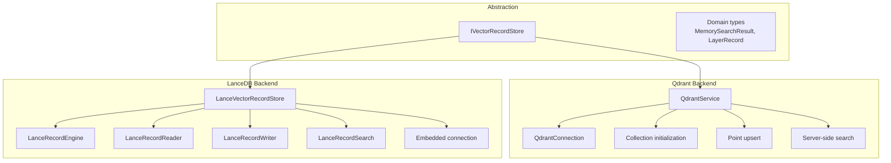
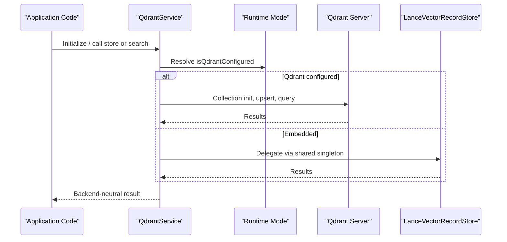
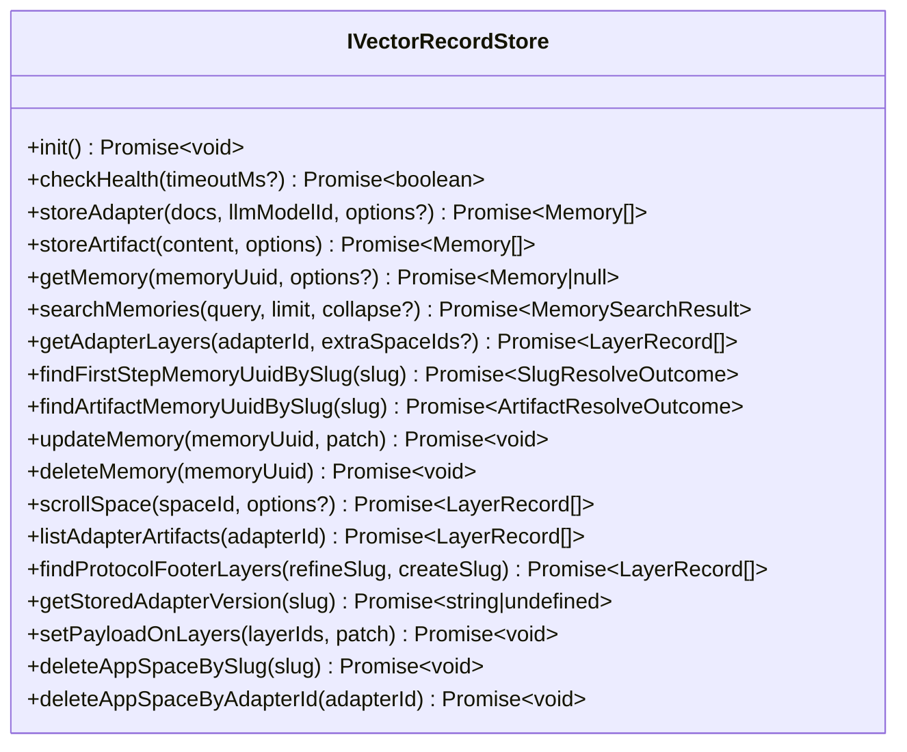
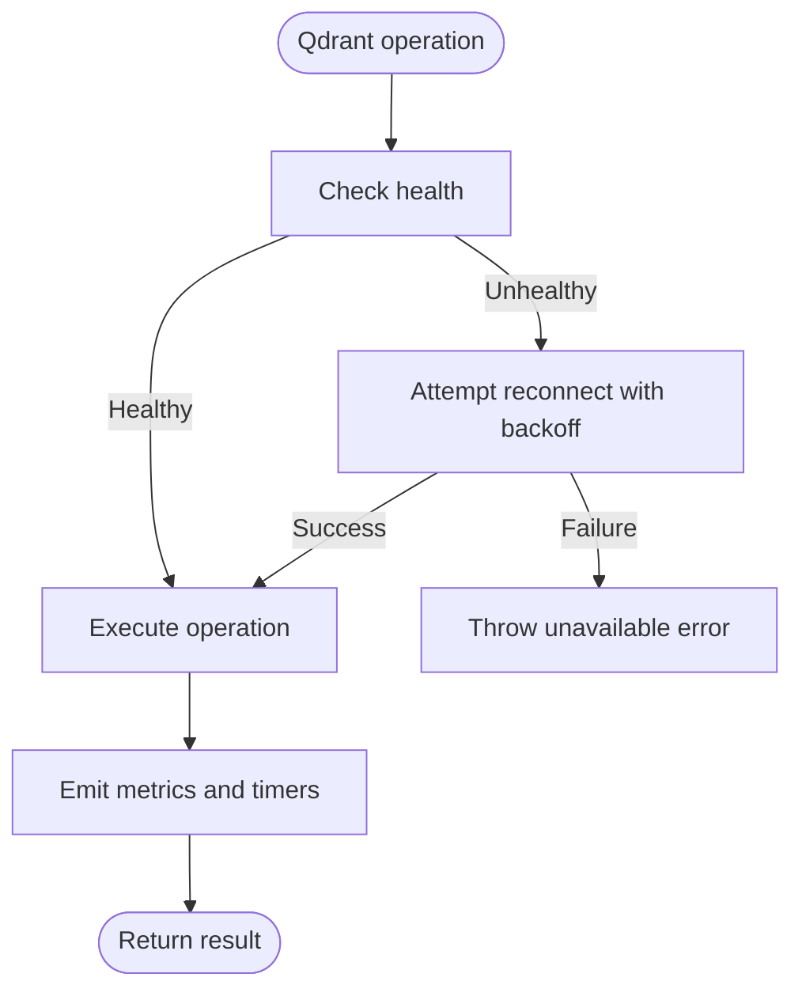
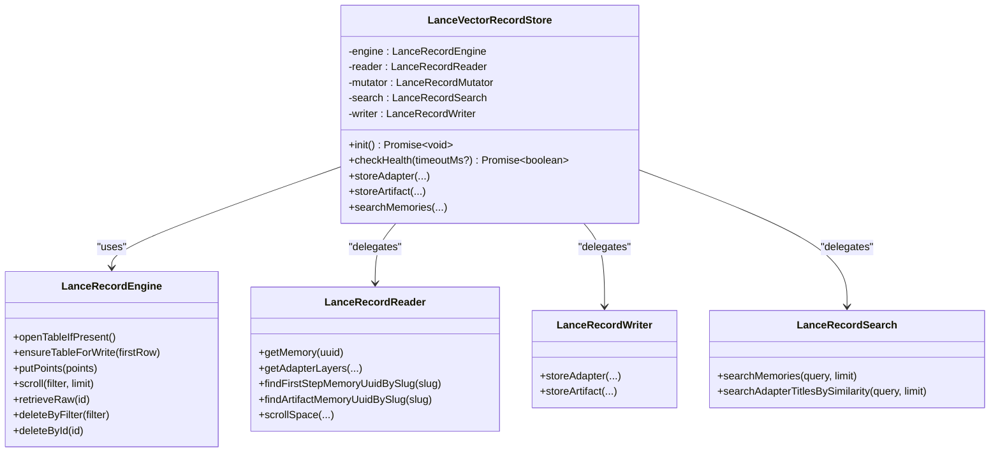
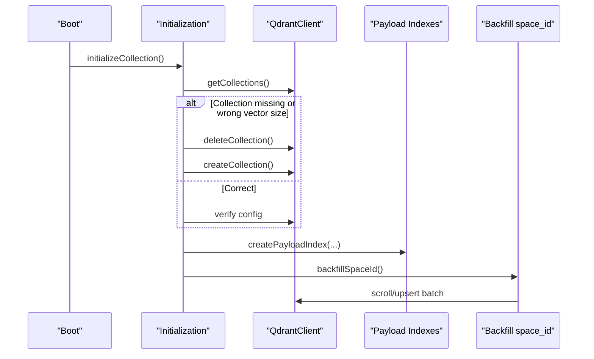
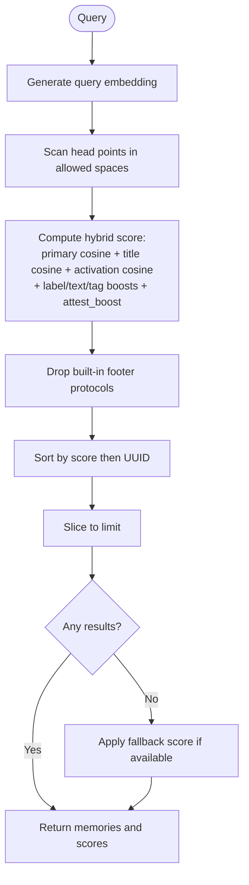
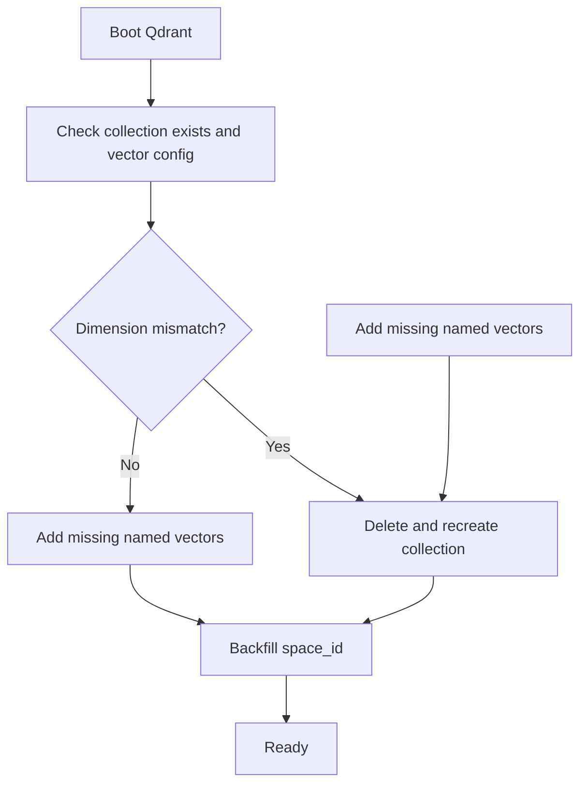
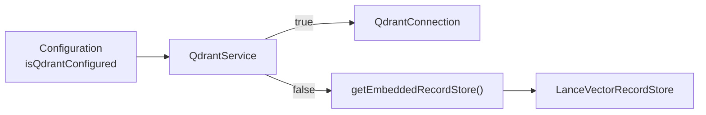
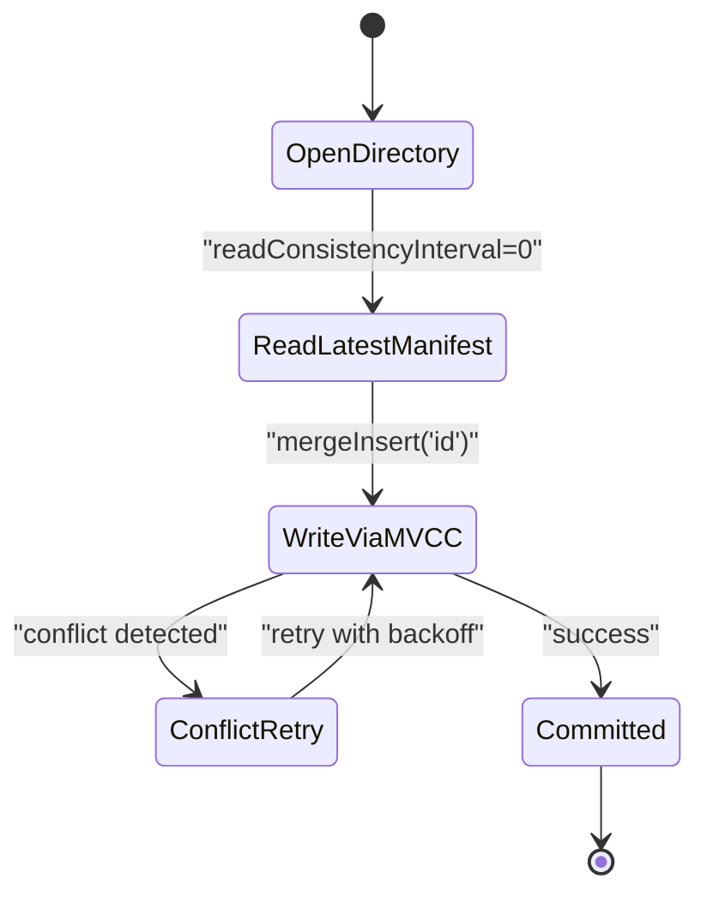

# Vector Database Integration

<cite>
**Referenced Files in This Document**
- [IVectorRecordStore.ts](file://src/services/vector-store/IVectorRecordStore.ts)
- [types.ts](file://src/services/vector-store/types.ts)
- [LanceVectorRecordStore.ts](file://src/services/vector-store/lancedb/LanceVectorRecordStore.ts)
- [lancedb-connection.ts](file://src/services/vector-store/lancedb-connection.ts)
- [lance-records-engine.ts](file://src/services/vector-store/lancedb/lance-records-engine.ts)
- [lance-records-reads.ts](file://src/services/vector-store/lancedb/lance-records-reads.ts)
- [lance-records-writes.ts](file://src/services/vector-store/lancedb/lance-records-writes.ts)
- [lance-records-search.ts](file://src/services/vector-store/lancedb/lance-records-search.ts)
- [embedded-store-singleton.ts](file://src/services/vector-store/embedded-store-singleton.ts)
- [service.ts](file://src/services/qdrant/service.ts)
- [connection.ts](file://src/services/qdrant/connection.ts)
- [initialization.ts](file://src/services/qdrant/initialization.ts)
- [memory-store.ts](file://src/services/qdrant/memory-store.ts)
- [search.ts](file://src/services/qdrant/search.ts)
- [qdrant-vector-management.ts](file://src/utils/qdrant-vector-management.ts)
- [store-init.ts](file://src/services/memory/store-init.ts)
- [config.ts](file://src/config.ts)
- [runtime-mode.ts](file://src/config/runtime-mode.ts)
- [boot-local-runtime.ts](file://src/runtime/boot-local-runtime.ts)
- [0013-embedded-store-multiprocess-safety.md](file://docs/adr/0013-embedded-store-multiprocess-safety.md)
</cite>

## Table of Contents
1. [Introduction](#introduction)
2. [Project Structure](#project-structure)
3. [Core Components](#core-components)
4. [Architecture Overview](#architecture-overview)
5. [Detailed Component Analysis](#detailed-component-analysis)
6. [Dependency Analysis](#dependency-analysis)
7. [Performance Considerations](#performance-considerations)
8. [Troubleshooting Guide](#troubleshooting-guide)
9. [Conclusion](#conclusion)
10. [Appendices](#appendices)

## Introduction
This document explains how SquadRules abstracts vector storage backends so that semantic search over rules, workflows, and adapters can run on either Qdrant or LanceDB without changing application code. Qdrant is the primary remote-capable backend used in clustered deployments. LanceDB is the embedded alternative used in local single-user mode. The abstraction center is `IVectorRecordStore`, which exposes a stable contract for lifecycle, writes, reads, slug resolution, enumeration, and search.

The design ensures:
- Backend switching through configuration only.
- Consistent domain types across backends.
- Deterministic adapter layer management and slug resolution.
- Comparable search behavior between Qdrant’s server-side index and LanceDB’s in-process cosine ranking.
- Safe multi-process access for the embedded store.
- Clear migration and backup/recovery guidance for Qdrant collections.

## Project Structure
The vector integration spans three layers:
- Abstraction layer: interface and shared domain types.
- Qdrant backend: connection, initialization, collection/index management, point operations, and search.
- LanceDB backend: embedded engine, read/query/mutation layers, and JS cosine search.

**Diagram sources**
- [IVectorRecordStore.ts:27-73](file://src/services/vector-store/IVectorRecordStore.ts#L27-L73)
- [types.ts:14-40](file://src/services/vector-store/types.ts#L14-L40)
- [service.ts:17-161](file://src/services/qdrant/service.ts#L17-L161)
- [connection.ts:11-131](file://src/services/qdrant/connection.ts#L11-L131)
- [initialization.ts:12-92](file://src/services/qdrant/initialization.ts#L12-L92)
- [memory-store.ts:14-126](file://src/services/qdrant/memory-store.ts#L14-L126)
- [search.ts:27-45](file://src/services/qdrant/search.ts#L27-L45)
- [LanceVectorRecordStore.ts:35-192](file://src/services/vector-store/lancedb/LanceVectorRecordStore.ts#L35-L192)
- [lance-records-engine.ts:20-128](file://src/services/vector-store/lancedb/lance-records-engine.ts#L20-L128)
- [lance-records-reads.ts:46-256](file://src/services/vector-store/lancedb/lance-records-reads.ts#L46-L256)
- [lance-records-writes.ts:42-349](file://src/services/vector-store/lancedb/lance-records-writes.ts#L42-L349)
- [lance-records-search.ts:96-137](file://src/services/vector-store/lancedb/lance-records-search.ts#L96-L137)
- [lancedb-connection.ts:21-33](file://src/services/vector-store/lancedb-connection.ts#L21-L33)

**Section sources**
- [IVectorRecordStore.ts:1-74](file://src/services/vector-store/IVectorRecordStore.ts#L1-L74)
- [types.ts:1-95](file://src/services/vector-store/types.ts#L1-L95)
- [service.ts:1-161](file://src/services/qdrant/service.ts#L1-L161)
- [LanceVectorRecordStore.ts:1-193](file://src/services/vector-store/lancedb/LanceVectorRecordStore.ts#L1-L193)

## Core Components
- `IVectorRecordStore`: Backend-neutral port defining lifecycle, writes, reads, slug resolution, enumeration, payload patching, deletion, and search. It documents “delegated” methods that mirror existing Qdrant service calls and “neutralized” contracts that replace raw client access.
- Domain types: `MemorySearchResult`, `LayerRecord`, `SlugResolveOutcome`, `ArtifactResolveOutcome`, and options for storing adapters or reading memories. These types must not import backend clients.
- `QdrantService`: HTTP/remote path facade exposing collection initialization, memory upsert, retrieval, protocol steps, quality updates, reward propagation, alias/collection admin, and search.
- `LanceVectorRecordStore`: Embedded implementation satisfying `IVectorRecordStore` and the Qdrant read/admin surface needed by legacy callers. It composes an engine, reader, writer, mutator, and search layer.

Key responsibilities:
- Lifecycle: `init`, `checkHealth`.
- Writes: `storeAdapter`, `storeArtifact`.
- Reads: `getMemory`, `getAdapterLayers`, slug lookups, protocol steps.
- Enumeration: `scrollSpace`, `listAdapterArtifacts`, footer discovery, version lookup.
- Mutations: `updateMemory`, `deleteMemory`, `setPayloadOnLayers`, bulk app-space deletions.
- Search: `searchMemories`, `searchAdapterTitlesBySimilarity`.

**Section sources**
- [IVectorRecordStore.ts:27-73](file://src/services/vector-store/IVectorRecordStore.ts#L27-L73)
- [types.ts:14-52](file://src/services/vector-store/types.ts#L14-L52)
- [service.ts:17-151](file://src/services/qdrant/service.ts#L17-L151)
- [LanceVectorRecordStore.ts:35-192](file://src/services/vector-store/lancedb/LanceVectorRecordStore.ts#L35-L192)

## Architecture Overview
SquadRules selects the backend at runtime based on environment configuration. When `QDRANT_URL` is set, the Qdrant path is active; otherwise, the embedded LanceDB path is selected. Both paths are consumed through the same `QdrantService` singleton, which resolves to either a real Qdrant client or the shared embedded record store.

**Diagram sources**
- [service.ts:153-161](file://src/services/qdrant/service.ts#L153-L161)
- [runtime-mode.ts:148-149](file://src/config/runtime-mode.ts#L148-L149)
- [LanceVectorRecordStore.ts:35-192](file://src/services/vector-store/lancedb/LanceVectorRecordStore.ts#L35-L192)

**Section sources**
- [config.ts:296-302](file://src/config.ts#L296-L302)
- [runtime-mode.ts:148-149](file://src/config/runtime-mode.ts#L148-L149)
- [service.ts:153-161](file://src/services/qdrant/service.ts#L153-L161)

## Detailed Component Analysis

### Abstraction Contract: `IVectorRecordStore`
The interface defines a focused, backend-neutral API:
- Lifecycle: `init()`, `checkHealth(timeoutMs?)`.
- Writes: `storeAdapter(docs, llmModelId, options?)`, `storeArtifact(content, options)`.
- Reads: `getMemory(memoryUuid, options?)`.
- Search: `searchMemories(query, limit, collapse?)`.
- Adapter structure: `getAdapterLayers(adapterId, extraSpaceIds?)`, `findFirstStepMemoryUuidBySlug(slug)`, `findArtifactMemoryUuidBySlug(slug)`.
- Mutations: `updateMemory(memoryUuid, patch)`, `deleteMemory(memoryUuid)`.
- Enumeration/bulk ops: `scrollSpace(spaceId, options?)`, `listAdapterArtifacts(adapterId)`, `findProtocolFooterLayers(refineSlug, createSlug)`, `getStoredAdapterVersion(slug)`, `setPayloadOnLayers(layerIds, patch)`, `deleteAppSpaceBySlug(slug)`, `deleteAppSpaceByAdapterId(adapterId)`.

This contract allows callers to switch from Qdrant to LanceDB without changing business logic.

**Diagram sources**
- [IVectorRecordStore.ts:27-73](file://src/services/vector-store/IVectorRecordStore.ts#L27-L73)

**Section sources**
- [IVectorRecordStore.ts:1-74](file://src/services/vector-store/IVectorRecordStore.ts#L1-L74)
- [types.ts:14-52](file://src/services/vector-store/types.ts#L14-L52)

### Qdrant Backend
Qdrant is the production backend. It manages collections, named vectors, payload indexes, aliases, and point operations with resilient connections.

Key behaviors:
- Connection: URL, optional API key, TLS CA certificate, rescore toggle, health checks, exponential reconnect attempts.
- Initialization: Create or recreate collection when vector dimension mismatches, create payload indexes, backfill missing `space_id`, optionally create/update alias.
- Point upsert: Builds deterministic IDs, constructs payloads with space context, quality metrics, and timestamps, invalidates caches, and emits metrics.
- Search: Uses server-side nearest neighbor queries with quantization rescore controlled by configuration.

**Diagram sources**
- [connection.ts:63-131](file://src/services/qdrant/connection.ts#L63-L131)
- [memory-store.ts:26-126](file://src/services/qdrant/memory-store.ts#L26-L126)
- [search.ts:27-45](file://src/services/qdrant/search.ts#L27-L45)

**Section sources**
- [connection.ts:11-131](file://src/services/qdrant/connection.ts#L11-L131)
- [initialization.ts:12-92](file://src/services/qdrant/initialization.ts#L12-L92)
- [memory-store.ts:14-126](file://src/services/qdrant/memory-store.ts#L14-L126)
- [search.ts:27-45](file://src/services/qdrant/search.ts#L27-L45)

### LanceDB Backend
LanceDB is the embedded backend used when no external Qdrant server is configured. It provides a strong-consistency connection to a per-user directory and implements all required operations using an MVCC table.

Components:
- `LanceVectorRecordStore`: Facade implementing `IVectorRecordStore` and the legacy Qdrant read/admin surface.
- `LanceRecordEngine`: Owns connection and the `memory_records` table; supports open-or-create, atomic upsert, filtered scans, retrieve-by-id, delete-by-filter.
- `LanceRecordReader`: Mirrors Qdrant read semantics including space filtering, slug precedence, pagination, and protocol step lookups.
- `LanceRecordWriter`: Reuses backend-neutral parsing/build helpers to produce identical payload shapes; embeds activation vectors and BM25 sparse fields; deduplicates adapters and allocates slugs.
- `LanceRecordSearch`: Performs in-process cosine similarity over stored dense vectors plus text boosts, mirroring Qdrant ranking behavior.

**Diagram sources**
- [LanceVectorRecordStore.ts:35-192](file://src/services/vector-store/lancedb/LanceVectorRecordStore.ts#L35-L192)
- [lance-records-engine.ts:20-128](file://src/services/vector-store/lancedb/lance-records-engine.ts#L20-L128)
- [lance-records-reads.ts:46-256](file://src/services/vector-store/lancedb/lance-records-reads.ts#L46-L256)
- [lance-records-writes.ts:42-349](file://src/services/vector-store/lancedb/lance-records-writes.ts#L42-L349)
- [lance-records-search.ts:96-137](file://src/services/vector-store/lancedb/lance-records-search.ts#L96-L137)

**Section sources**
- [LanceVectorRecordStore.ts:1-193](file://src/services/vector-store/lancedb/LanceVectorRecordStore.ts#L1-L193)
- [lancedb-connection.ts:1-33](file://src/services/vector-store/lancedb-connection.ts#L1-L33)
- [lance-records-engine.ts:1-129](file://src/services/vector-store/lancedb/lance-records-engine.ts#L1-L129)
- [lance-records-reads.ts:1-257](file://src/services/vector-store/lancedb/lance-records-reads.ts#L1-L257)
- [lance-records-writes.ts:1-349](file://src/services/vector-store/lancedb/lance-records-writes.ts#L1-L349)
- [lance-records-search.ts:1-138](file://src/services/vector-store/lancedb/lance-records-search.ts#L1-L138)

### Collection Management and Point Operations
- Qdrant collection lifecycle:
  - Create or recreate if vector dimension mismatch.
  - Create payload indexes for multitenancy and fast filtering.
  - Backfill missing `space_id` values.
  - Optionally create/update alias pointing to the current collection.
- Point operations:
  - Upsert points with deterministic IDs, embedding vectors, payload metadata, and quality metrics.
  - Invalidate Redis cache after writes.
  - Emit operation counters and duration histograms.

**Diagram sources**
- [initialization.ts:12-92](file://src/services/qdrant/initialization.ts#L12-L92)
- [initialization.ts:127-162](file://src/services/qdrant/initialization.ts#L127-L162)

**Section sources**
- [initialization.ts:12-92](file://src/services/qdrant/initialization.ts#L12-L92)
- [memory-store.ts:14-126](file://src/services/qdrant/memory-store.ts#L14-L126)

### Query Optimization Strategies
- Qdrant:
  - Server-side nearest neighbor search with quantization rescore enabled by default.
  - Payload indexes accelerate filtering by space, domain, type, task, protocol step, adapter fields, slug, content type, and text fields.
  - Rescore toggle controlled by configuration.
- LanceDB:
  - In-process cosine similarity over three stored dense vectors: primary, adapter title, and activation pattern.
  - Text boost scoring over label/tags text fields.
  - Head-only filtering excludes built-in protocol footers and enforces allowed spaces.
  - Fallback score strategy preserves ordering parity with Qdrant when no positive matches exist.

**Diagram sources**
- [lance-records-search.ts:96-137](file://src/services/vector-store/lancedb/lance-records-search.ts#L96-L137)
- [search.ts:27-45](file://src/services/qdrant/search.ts#L27-L45)

**Section sources**
- [lance-records-search.ts:1-138](file://src/services/vector-store/lancedb/lance-records-search.ts#L1-L138)
- [search.ts:27-45](file://src/services/qdrant/search.ts#L27-L45)

### Configuration Examples and Runtime Behavior
Environment-driven selection:
- Set `QDRANT_URL` to enable Qdrant; unset it to use embedded LanceDB.
- `QDRANT_COLLECTION` sets the collection name (default `squadrules`).
- `QDRANT_API_KEY` authenticates to Qdrant.
- `QDRANT_RESCORE` toggles server-side rescore for Qdrant searches.
- `QDRANT_SNAPSHOT_DIR` enables snapshot/backup endpoints when non-empty.
- `QDRANT_SNAPSHOT_ON_START` triggers snapshot on startup when true.
- `EMBEDDING_*` variables control embedding provider, model, retries, latency thresholds, and normalization bounds.

Local vs clustered mode:
- `TRANSPORT_TYPE=stdio` forces simple local mode; Qdrant is disallowed because local mode uses embedded LanceDB and in-process caches.
- `AUTH_ENABLED` defaults to false in stdio and true in http.
- `isQdrantConfigured` reflects whether `QDRANT_URL` is set.

Example configuration patterns:
- Remote Qdrant:
  - `QDRANT_URL=https://qdrant.example.com`
  - `QDRANT_API_KEY=<your-key>`
  - `QDRANT_COLLECTION=squadrules`
  - `QDRANT_RESCORE=true`
  - `QDRANT_SNAPSHOT_DIR=/data/qdrant-snapshots`
  - `QDRANT_SNAPSHOT_ON_START=false`
- Embedded LanceDB:
  - Unset `QDRANT_URL`
  - Ensure `SQUADRULES_MCP_STDIO=1` or use `squadrules serve --transport http` for clustered mode with auth
  - Configure embeddings via `OPENAI_EMBEDDING_MODEL`, `OPENAI_API_KEY`, `EMBEDDING_PROVIDER`, and retry settings

**Section sources**
- [config.ts:105-115](file://src/config.ts#L105-L115)
- [config.ts:267-276](file://src/config.ts#L267-L276)
- [config.ts:296-302](file://src/config.ts#L296-L302)
- [runtime-mode.ts:109-119](file://src/config/runtime-mode.ts#L109-L119)
- [runtime-mode.ts:148-149](file://src/config/runtime-mode.ts#L148-L149)
- [boot-local-runtime.ts:56-64](file://src/runtime/boot-local-runtime.ts#L56-L64)

### Data Migration Between Backends
- Vector dimension migration:
  - On boot, Qdrant detects mismatched vector dimensions and recreates the collection when necessary.
  - Missing named vectors are added; if adding fails due to server limitations, a recreation-based migration path gathers points, rebuilds them with new vectors, and restores data.
  - After successful migration, old vectors may be removed unless they are required.
- Vector space migration:
  - A dedicated helper migrates points from one named vector to another by re-embedding content in batches.
  - It scrolls points with the old vector, computes new embeddings, and upserts updated points.
- Space backfill:
  - Initialization backfills missing `space_id` values across the collection.

**Diagram sources**
- [store-init.ts:235-318](file://src/services/memory/store-init.ts#L235-L318)
- [qdrant-vector-management.ts:27-218](file://src/utils/qdrant-vector-management.ts#L27-L218)
- [initialization.ts:127-162](file://src/services/qdrant/initialization.ts#L127-L162)

**Section sources**
- [store-init.ts:235-318](file://src/services/memory/store-init.ts#L235-L318)
- [qdrant-vector-management.ts:27-218](file://src/utils/qdrant-vector-management.ts#L27-L218)
- [initialization.ts:127-162](file://src/services/qdrant/initialization.ts#L127-L162)

### Backup and Recovery Procedures
- Qdrant snapshots:
  - Enable snapshotting by setting `QDRANT_SNAPSHOT_DIR`; when empty, snapshot endpoints return 503.
  - Optionally trigger snapshot on startup via `QDRANT_SNAPSHOT_ON_START`.
- LanceDB data location:
  - Embedded data resides under `<configDir>/lancedb`.
  - The presence of the records table indicates the store has been seeded.
  - For recovery, copy the directory contents to the target machine’s config directory.

Operational notes:
- Qdrant snapshots should be taken during low-write periods.
- Validate snapshot integrity before restoring.
- For LanceDB, ensure consistent copies across processes; avoid copying while writes are active unless you understand MVCC implications.

**Section sources**
- [config.ts:267-276](file://src/config.ts#L267-L276)
- [lancedb-connection.ts:21-33](file://src/services/vector-store/lancedb-connection.ts#L21-L33)
- [boot-local-runtime.ts:56-64](file://src/runtime/boot-local-runtime.ts#L56-L64)

## Dependency Analysis
Backend selection and injection:
- `QdrantService` is exported as a module singleton. If `isQdrantConfigured` is true, it wraps a real Qdrant connection; otherwise, it delegates to the shared embedded record store.
- The embedded store singleton ensures both DI slots (`memoryStore` and `qdrantService`) share the same Lance connection/engine instance.

**Diagram sources**
- [service.ts:153-161](file://src/services/qdrant/service.ts#L153-L161)
- [embedded-store-singleton.ts:12-17](file://src/services/vector-store/embedded-store-singleton.ts#L12-L17)
- [runtime-mode.ts:148-149](file://src/config/runtime-mode.ts#L148-L149)

**Section sources**
- [service.ts:153-161](file://src/services/qdrant/service.ts#L153-L161)
- [embedded-store-singleton.ts:1-18](file://src/services/vector-store/embedded-store-singleton.ts#L1-L18)
- [runtime-mode.ts:148-149](file://src/config/runtime-mode.ts#L148-L149)

## Performance Considerations
- Qdrant:
  - Use payload indexes for frequently filtered fields (space, adapter fields, slug, content type).
  - Keep rescore enabled for better accuracy; tune `QDRANT_RESCORE` if latency is critical.
  - Monitor operation durations and counts via metrics.
- LanceDB:
  - Strong-consistency reads incur per-read manifest checks; acceptable for local multi-process usage.
  - Commit conflicts are retried with bounded exponential backoff and jitter.
  - Avoid heavy churn without compaction; compaction is deferred.
- Embeddings:
  - Tune retry budgets, base delay, max delay, and Retry-After cap to balance reliability and latency.
  - Normalize embeddings within configured min/max norms to stabilize similarity.

[No sources needed since this section provides general guidance]

## Troubleshooting Guide
Common issues and resolutions:
- Qdrant unavailable:
  - Health checks fail; connection attempts reconnect with exponential backoff.
  - After max attempts, throws a specific unavailable error.
- Local mode misconfiguration:
  - Stdio transport with `QDRANT_URL` set is rejected at startup.
  - Stdio transport with authentication enabled is rejected because there is no OIDC callback surface.
- Embedded store seeding:
  - CLI checks for the presence of the LanceDB records table to skip boot injection when already seeded.
- Vector dimension mismatch:
  - Collection recreated automatically; verify logs for recreation messages.
- Alias creation failures:
  - Alias creation is best-effort; manual creation may be required if REST variants fail.

**Section sources**
- [connection.ts:63-131](file://src/services/qdrant/connection.ts#L63-L131)
- [runtime-mode.ts:91-121](file://src/config/runtime-mode.ts#L91-L121)
- [boot-local-runtime.ts:56-64](file://src/runtime/boot-local-runtime.ts#L56-L64)
- [initialization.ts:82-90](file://src/services/qdrant/initialization.ts#L82-L90)

## Conclusion
SquadRules’ vector integration cleanly separates concerns:
- `IVectorRecordStore` defines a stable contract for memory and adapter records.
- Qdrant provides robust remote capabilities with resilient connections, indexes, and server-side search.
- LanceDB offers a zero-config embedded alternative with strong consistency and process-safe MVCC.
- Configuration controls backend selection, search tuning, and operational features like snapshots.
- Migration utilities protect data integrity during vector dimension changes and named vector transitions.

Adopt Qdrant for clustered, authenticated deployments requiring scalable vector search. Choose LanceDB for local development and single-user scenarios where simplicity and zero configuration matter.

[No sources needed since this section summarizes without analyzing specific files]

## Appendices

### Multi-Process Safety for Embedded Store
The embedded store is safe across multiple local processes:
- Each process opens the shared directory directly.
- Strong-consistency reads check the latest committed manifest.
- Bounded commit retry handles optimistic concurrency conflicts.
- Atomic batched publish ensures logical groups of writes are committed together.

**Diagram sources**
- [0013-embedded-store-multiprocess-safety.md:27-44](file://docs/adr/0013-embedded-store-multiprocess-safety.md#L27-L44)
- [lancedb-connection.ts:26-33](file://src/services/vector-store/lancedb-connection.ts#L26-L33)
- [lance-records-engine.ts:48-63](file://src/services/vector-store/lancedb/lance-records-engine.ts#L48-L63)

**Section sources**
- [0013-embedded-store-multiprocess-safety.md:1-109](file://docs/adr/0013-embedded-store-multiprocess-safety.md#L1-L109)