# Memory System Architecture

<cite>
**Referenced Files in This Document**
- [memory.ts](file://src/types/memory.ts)
- [store.ts](file://src/services/memory/store.ts)
- [store-methods.ts](file://src/services/memory/store-methods.ts)
- [store-adapter.ts](file://src/services/memory/store-adapter.ts)
- [service.ts](file://src/services/qdrant/service.ts)
- [memory-store.ts](file://src/services/qdrant/memory-store.ts)
- [memory-retrieval.ts](file://src/services/qdrant/memory-retrieval.ts)
- [memory-updates.ts](file://src/services/qdrant/memory-updates.ts)
- [types.ts](file://src/services/vector-store/types.ts)
- [tenant-context.ts](file://src/utils/tenant-context.ts)
- [space-filter.ts](file://src/utils/space-filter.ts)
- [resolve-space-param.ts](file://src/utils/resolve-space-param.ts)
- [mem-boot.ts](file://src/config/mem-boot.ts)
- [store-init.ts](file://src/services/memory/store-init.ts)
</cite>

## Table of Contents
1. [Introduction](#introduction)
2. [Project Structure](#project-structure)
3. [Core Components](#core-components)
4. [Architecture Overview](#architecture-overview)
5. [Detailed Component Analysis](#detailed-component-analysis)
6. [Dependency Analysis](#dependency-analysis)
7. [Performance Considerations](#performance-considerations)
8. [Troubleshooting Guide](#troubleshooting-guide)
9. [Conclusion](#conclusion)

## Introduction
This document explains the memory system architecture in SquadRules MCP. Memories are persistent knowledge units that can be created, updated, searched, and archived. The system supports semantic search over adapters and artifacts using vector databases (Qdrant as primary, LanceDB as embedded fallback), enforces space-based multi-tenancy to isolate teams or projects, and provides a clear lifecycle from creation through updates to archival. It also documents how human and agent interactions share the same integrity and security boundaries.

## Project Structure
The memory system is implemented across several layers:
- Domain types define memories, adapters, execution traces, and rewards.
- A Qdrant-backed store exposes high-level operations for adapter storage, artifact storage, retrieval, and hybrid search.
- A service layer composes connection, initialization, retrieval, updates, search, and protocol helpers.
- Vector-store abstraction types keep backend-neutral contracts between ports and adapters.
- Tenant context and space filters enforce isolation by user, group, and application spaces.
- Boot configuration controls injection of built-in app-space adapters.

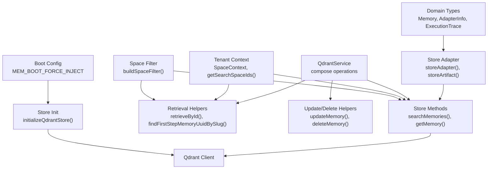

**Diagram sources**
- [memory.ts:87-108](file://src/types/memory.ts#L87-L108)
- [store-adapter.ts:43-147](file://src/services/memory/store-adapter.ts#L43-L147)
- [store-methods.ts:94-268](file://src/services/memory/store-methods.ts#L94-L268)
- [service.ts:17-151](file://src/services/qdrant/service.ts#L17-L151)
- [memory-retrieval.ts:25-339](file://src/services/qdrant/memory-retrieval.ts#L25-L339)
- [memory-updates.ts:15-235](file://src/services/qdrant/memory-updates.ts#L15-L235)
- [tenant-context.ts:23-42](file://src/utils/tenant-context.ts#L23-L42)
- [space-filter.ts:14-47](file://src/utils/space-filter.ts#L14-L47)
- [mem-boot.ts:1-21](file://src/config/mem-boot.ts#L1-L21)
- [store-init.ts:172-350](file://src/services/memory/store-init.ts#L172-L350)

**Section sources**
- [memory.ts:87-108](file://src/types/memory.ts#L87-L108)
- [store.ts:29-62](file://src/services/memory/store.ts#L29-L62)
- [service.ts:17-151](file://src/services/qdrant/service.ts#L17-L151)
- [tenant-context.ts:23-42](file://src/utils/tenant-context.ts#L23-L42)
- [space-filter.ts:14-47](file://src/utils/space-filter.ts#L14-L47)
- [mem-boot.ts:1-21](file://src/config/mem-boot.ts#L1-L21)

## Core Components
- Memory domain model: defines the shape of stored knowledge including identifiers, labels, text, tags, content type, optional artifact references, adapter metadata, and inference contracts.
- Qdrant-backed memory store: orchestrates adapter and artifact persistence, retrieval, and hybrid search with caching and tenant scoping.
- Qdrant service: composes connection, initialization, retrieval, updates, search, and protocol helpers; acts as the backend-selected singleton.
- Vector-store types: provide backend-neutral contracts for records, search results, and training-related structures.
- Tenant context and space filter: derive allowed spaces from authentication and enforce read/write isolation.
- Store initialization: ensures collection schema, vector dimensions, BM25 sparse vectors, full-text indexes, and activation search backfill.

Key responsibilities:
- Create and update memories and adapters with semantic embeddings.
- Search memories using dense vectors, title vectors, activation pattern vectors, and BM25.
- Enforce space-based multi-tenancy on reads and writes.
- Provide boot-time repair and injection for built-in app-space adapters.

**Section sources**
- [memory.ts:87-108](file://src/types/memory.ts#L87-L108)
- [store.ts:29-62](file://src/services/memory/store.ts#L29-L62)
- [service.ts:17-151](file://src/services/qdrant/service.ts#L17-L151)
- [types.ts:14-40](file://src/services/vector-store/types.ts#L14-L40)
- [tenant-context.ts:23-42](file://src/utils/tenant-context.ts#L23-L42)
- [space-filter.ts:14-47](file://src/utils/space-filter.ts#L14-L47)
- [store-init.ts:172-350](file://src/services/memory/store-init.ts#L172-L350)

## Architecture Overview
The memory system uses a layered design:
- Application tools and HTTP APIs call into services and stores.
- Services compose connection, retrieval, updates, and search logic.
- Stores implement domain-specific operations such as adapter storage and hybrid search.
- Tenant context and space filters ensure data isolation per team or project.
- Vector database operations are abstracted behind client calls and helper modules.

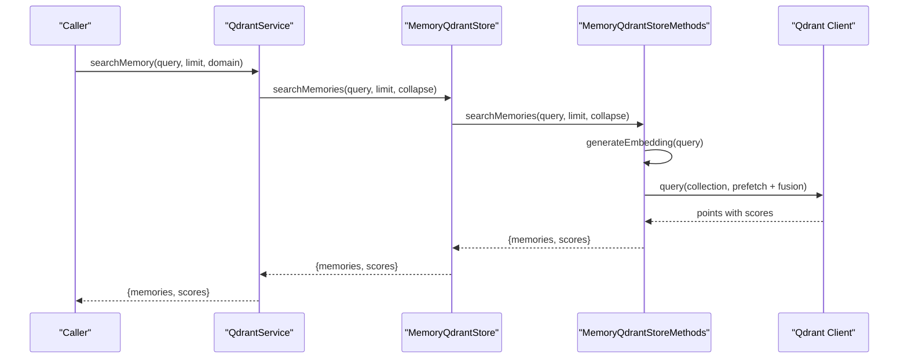

**Diagram sources**
- [service.ts:120-122](file://src/services/qdrant/service.ts#L120-L122)
- [store.ts:151-153](file://src/services/memory/store.ts#L151-L153)
- [store-methods.ts:94-104](file://src/services/memory/store-methods.ts#L94-L104)
- [store-methods.ts:121-260](file://src/services/memory/store-methods.ts#L121-L260)

## Detailed Component Analysis

### Memory Model and Data Structures
Memories encapsulate:
- Stable identifiers and optional space scoping.
- Human-readable label, slug, tags, and text.
- LLM model association and timestamps.
- Optional artifact reference and adapter metadata.
- Optional inference contract definition for deterministic task execution.

Complexity considerations:
- Payload size impacts embedding generation and indexing costs.
- Adapter metadata enables hierarchical traversal and chain resolution.
- Artifact references support skill export layouts and relative paths.

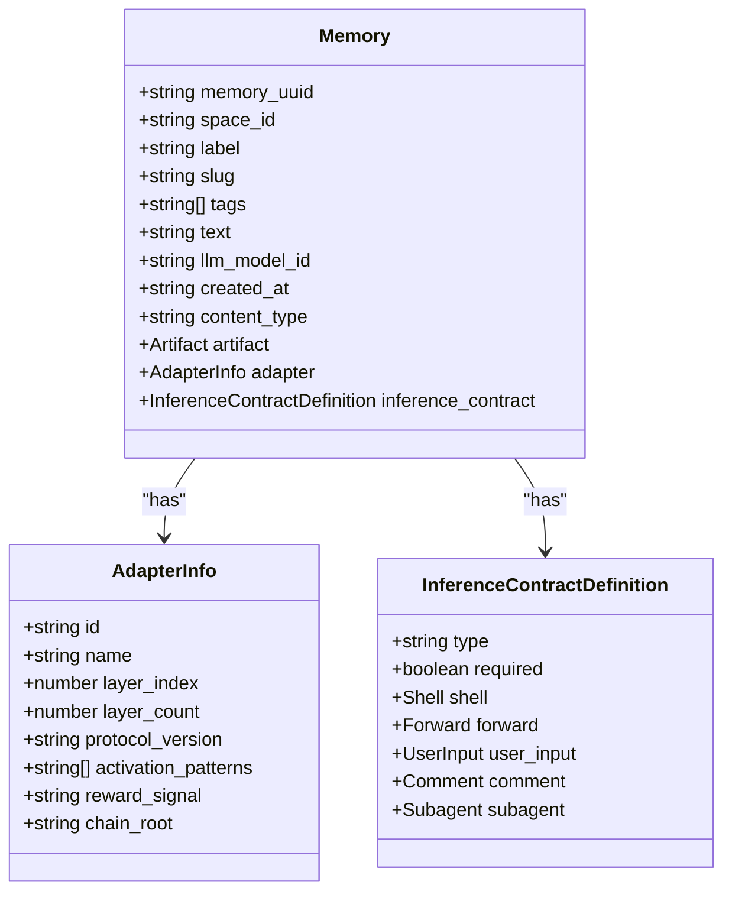

**Diagram sources**
- [memory.ts:3-13](file://src/types/memory.ts#L3-L13)
- [memory.ts:17-46](file://src/types/memory.ts#L17-L46)
- [memory.ts:87-108](file://src/types/memory.ts#L87-L108)

**Section sources**
- [memory.ts:87-108](file://src/types/memory.ts#L87-L108)

### Qdrant Service Composition
The Qdrant service composes:
- Connection management and aliasing.
- Collection initialization and migration.
- Memory storage, retrieval, updates, and deletion.
- Quality metrics and reward propagation.
- Protocol step discovery and listing utilities.
- Search operations delegating to specialized modules.

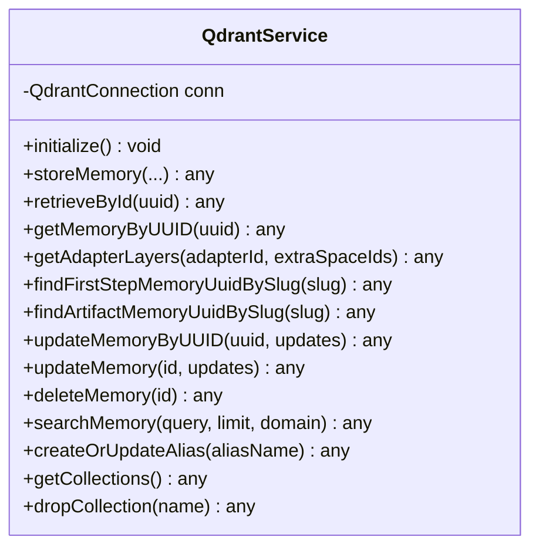

**Diagram sources**
- [service.ts:17-151](file://src/services/qdrant/service.ts#L17-L151)

**Section sources**
- [service.ts:17-151](file://src/services/qdrant/service.ts#L17-L151)

### Memory Store and Adapter Storage
The memory store coordinates:
- Adapter normalization and parsing.
- Header-based vs default adapter handling.
- Similarity checks to avoid duplicate adapters.
- Artifact attachment to adapters.
- Metrics timing and tenant tagging.

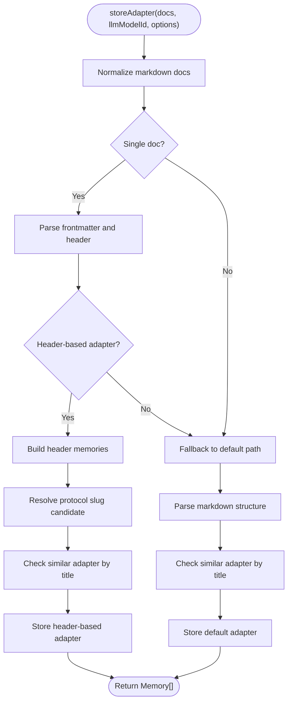

**Diagram sources**
- [store-adapter.ts:43-147](file://src/services/memory/store-adapter.ts#L43-L147)

**Section sources**
- [store-adapter.ts:43-147](file://src/services/memory/store-adapter.ts#L43-L147)

### Hybrid Semantic Search Pipeline
Hybrid search combines:
- Dense vector similarity on primary, title, and activation pattern vectors.
- BM25 sparse vector scoring via Query API.
- RRF fusion and formula-based boosting for title, activation patterns, label, and tags.
- Space filtering and exclusion of builtin search footer protocols.
- Caching of search results.

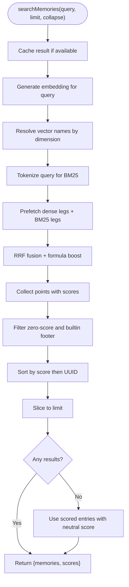

**Diagram sources**
- [store-methods.ts:94-104](file://src/services/memory/store-methods.ts#L94-L104)
- [store-methods.ts:121-260](file://src/services/memory/store-methods.ts#L121-L260)

**Section sources**
- [store-methods.ts:94-104](file://src/services/memory/store-methods.ts#L94-L104)
- [store-methods.ts:121-260](file://src/services/memory/store-methods.ts#L121-L260)

### Space-Based Multi-Tenancy
Multi-tenancy is enforced via:
- SpaceContext derived from JWT claims (user, groups, realm, issuer).
- Allowed space IDs for reads and default write space for writes.
- Search scope narrowing for activate/search parameters.
- Space filter construction to constrain Qdrant queries.
- Resolution helpers for human-oriented space inputs.

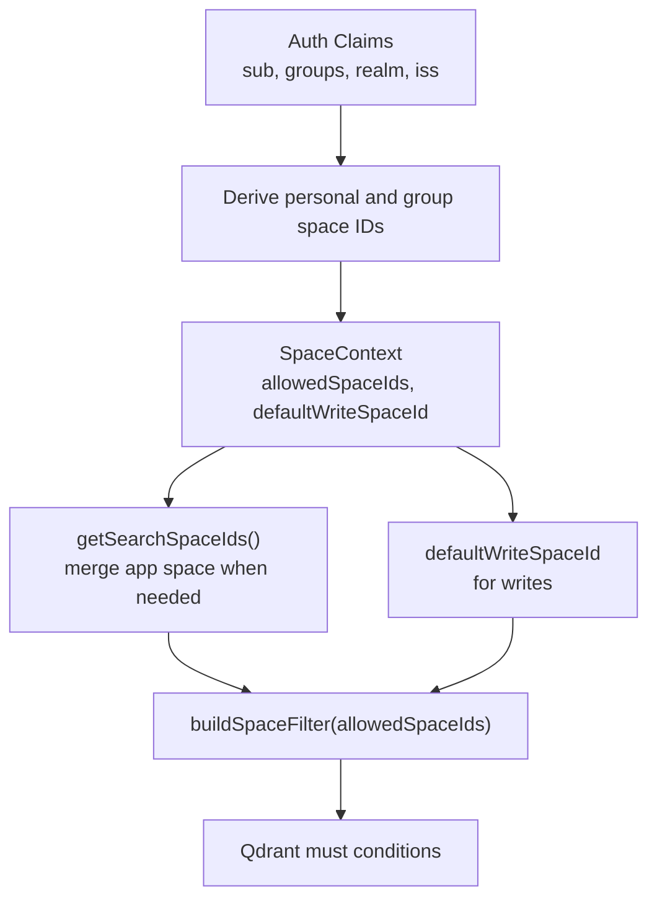

**Diagram sources**
- [tenant-context.ts:23-42](file://src/utils/tenant-context.ts#L23-L42)
- [tenant-context.ts:141-150](file://src/utils/tenant-context.ts#L141-L150)
- [space-filter.ts:14-47](file://src/utils/space-filter.ts#L14-L47)
- [resolve-space-param.ts:26-103](file://src/utils/resolve-space-param.ts#L26-L103)

**Section sources**
- [tenant-context.ts:23-42](file://src/utils/tenant-context.ts#L23-L42)
- [tenant-context.ts:141-150](file://src/utils/tenant-context.ts#L141-L150)
- [space-filter.ts:14-47](file://src/utils/space-filter.ts#L14-L47)
- [resolve-space-param.ts:26-103](file://src/utils/resolve-space-param.ts#L26-L103)

### Memory Lifecycle: Creation, Update, Archival
Lifecycle stages:
- Creation: storeAdapter or storeArtifact persists normalized content, computes embeddings, and attaches metadata.
- Update: updateMemory or updateMemoryByUUID merges fields, recomputes embeddings when text changes, and invalidates caches.
- Archival: deleteMemory removes points and invalidates caches; adapter siblings and artifacts remain scoped by space.

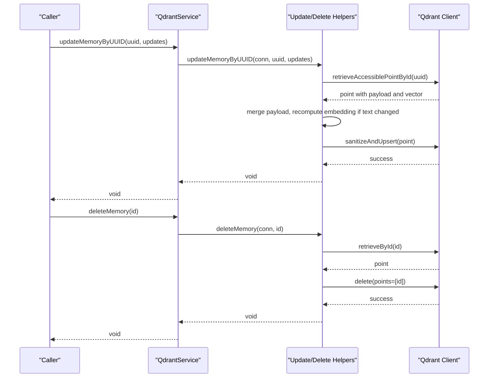

**Diagram sources**
- [memory-updates.ts:15-96](file://src/services/qdrant/memory-updates.ts#L15-L96)
- [memory-updates.ts:199-235](file://src/services/qdrant/memory-updates.ts#L199-L235)
- [memory-retrieval.ts:72-102](file://src/services/qdrant/memory-retrieval.ts#L72-L102)

**Section sources**
- [memory-updates.ts:15-96](file://src/services/qdrant/memory-updates.ts#L15-L96)
- [memory-updates.ts:199-235](file://src/services/qdrant/memory-updates.ts#L199-L235)

### Relationship Between Memories, Adapters, and Vector Database Layer
- Memories represent individual knowledge points, often grouped as adapter layers.
- Adapters encapsulate structured workflows with metadata, activation patterns, and optional inference contracts.
- Artifacts attach binary or skill resources to adapters.
- The vector database layer stores dense vectors, BM25 sparse vectors, and full-text indexes for hybrid search.
- Initialization ensures correct vector schemas, BM25 configuration, and activation search backfill.

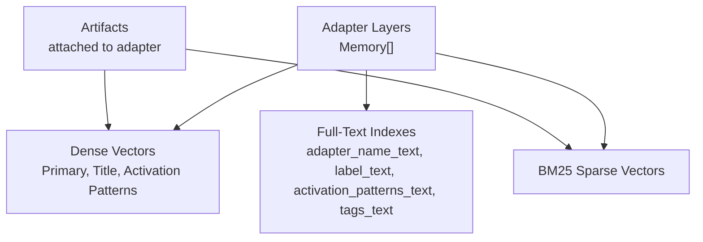

**Diagram sources**
- [store-init.ts:151-170](file://src/services/memory/store-init.ts#L151-L170)
- [store-init.ts:338-341](file://src/services/memory/store-init.ts#L338-L341)
- [store-methods.ts:121-260](file://src/services/memory/store-methods.ts#L121-L260)

**Section sources**
- [store-init.ts:151-170](file://src/services/memory/store-init.ts#L151-L170)
- [store-init.ts:338-341](file://src/services/memory/store-init.ts#L338-L341)
- [store-methods.ts:121-260](file://src/services/memory/store-methods.ts#L121-L260)

### Human and Agent Interactions with Integrity and Security Boundaries
- Authentication-derived SpaceContext ensures only allowed spaces are readable/writable.
- Reads validate space membership before returning payloads.
- Writes use defaultWriteSpaceId to maintain isolation.
- Cache invalidation prevents stale reads after updates/deletes.
- Boot injection allows operators to repair or retrain built-in app-space adapters safely.

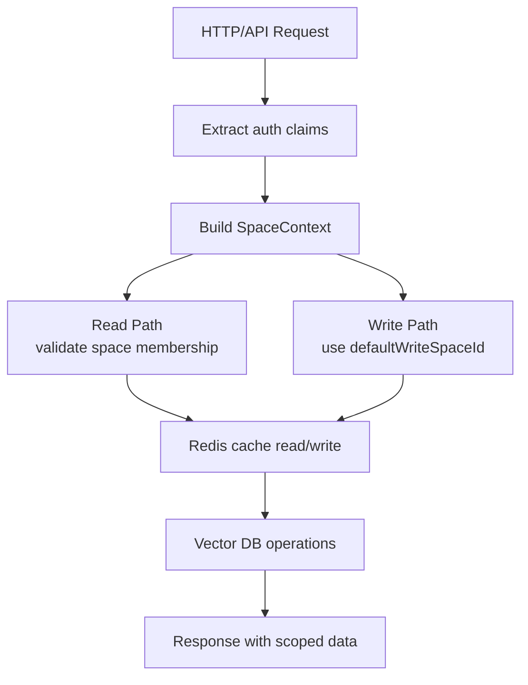

**Diagram sources**
- [tenant-context.ts:256-303](file://src/utils/tenant-context.ts#L256-L303)
- [memory-retrieval.ts:25-61](file://src/services/qdrant/memory-retrieval.ts#L25-L61)
- [memory-store.ts:56-97](file://src/services/qdrant/memory-store.ts#L56-L97)
- [mem-boot.ts:1-21](file://src/config/mem-boot.ts#L1-L21)

**Section sources**
- [tenant-context.ts:256-303](file://src/utils/tenant-context.ts#L256-L303)
- [memory-retrieval.ts:25-61](file://src/services/qdrant/memory-retrieval.ts#L25-L61)
- [memory-store.ts:56-97](file://src/services/qdrant/memory-store.ts#L56-L97)
- [mem-boot.ts:1-21](file://src/config/mem-boot.ts#L1-L21)

## Dependency Analysis
Component dependencies:
- QdrantService depends on connection, initialization, retrieval, updates, quality, resources, search, protocol, listing, and reward propagation modules.
- MemoryQdrantStore depends on QdrantClient, code block processing, store methods, and store adapter.
- Store methods depend on embedding service, BM25 tokenizer, Redis cache, and tenant context.
- Tenant context depends on config constants and space parameter resolution.
- Space filter is used by both store methods and retrieval helpers.

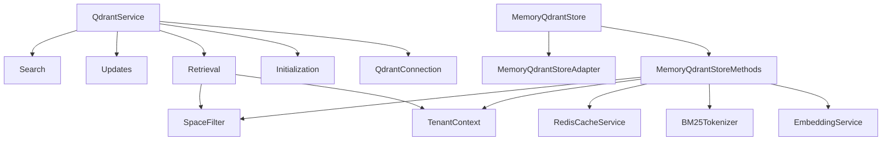

**Diagram sources**
- [service.ts:1-151](file://src/services/qdrant/service.ts#L1-L151)
- [store.ts:29-62](file://src/services/memory/store.ts#L29-L62)
- [store-methods.ts:25-36](file://src/services/memory/store-methods.ts#L25-L36)
- [tenant-context.ts:23-42](file://src/utils/tenant-context.ts#L23-L42)
- [space-filter.ts:14-47](file://src/utils/space-filter.ts#L14-L47)

**Section sources**
- [service.ts:1-151](file://src/services/qdrant/service.ts#L1-L151)
- [store.ts:29-62](file://src/services/memory/store.ts#L29-L62)
- [store-methods.ts:25-36](file://src/services/memory/store-methods.ts#L25-L36)
- [tenant-context.ts:23-42](file://src/utils/tenant-context.ts#L23-L42)
- [space-filter.ts:14-47](file://src/utils/space-filter.ts#L14-L47)

## Performance Considerations
- Hybrid search leverages pre-fetching multiple dense legs and BM25 legs, then fuses results with RRF to reduce latency while improving recall.
- Formula-based boosting prioritizes title and activation pattern matches without moving ranking off Qdrant.
- Vector dimension naming avoids repeated lookups and aligns with embedding service outputs.
- Cache usage reduces redundant retrievals and search computations.
- Initialization migrates vector schemas and adds BM25 configuration efficiently, falling back to recreation when server capabilities are limited.

[No sources needed since this section provides general guidance]

## Troubleshooting Guide
Common issues and resolutions:
- Health check failures: verify Qdrant URL, API key, and collection alias resolution.
- BM25 migration errors: check server version support for sparse_vectors; review temp collection status if recreation path was used.
- Full-text index creation failures: confirm field names and tokenizers; retry idempotently.
- Space access denied: ensure SpaceContext includes the target space_id; validate allowlist and personal/group derivation.
- Stale cache after updates: confirm cache invalidation calls executed; inspect Redis connectivity.

Operational tips:
- Use MEM_BOOT_FORCE_INJECT to force delete-and-retrain of shipped adapters during boot for structural repair.
- Prefer explicit adapter URIs when slug ambiguity is logged to avoid non-deterministic selection.

**Section sources**
- [store.ts:68-130](file://src/services/memory/store.ts#L68-L130)
- [store-init.ts:36-125](file://src/services/memory/store-init.ts#L36-L125)
- [store-init.ts:158-170](file://src/services/memory/store-init.ts#L158-L170)
- [memory-retrieval.ts:228-300](file://src/services/qdrant/memory-retrieval.ts#L228-L300)
- [mem-boot.ts:1-21](file://src/config/mem-boot.ts#L1-L21)

## Conclusion
SquadRules MCP’s memory system models persistent knowledge as memories and adapters, backed by vector databases for semantic search. Space-based multi-tenancy isolates teams and projects, while robust initialization and migration ensure reliable indexing. The lifecycle from creation through updates to archival is supported by clear service abstractions and strict cache invalidation. Human and agent interactions share consistent integrity and security boundaries, enabling safe, scalable operation across diverse workloads.

[No sources needed since this section summarizes without analyzing specific files]