# Model Context Protocol (MCP)

<cite>
**Referenced Files in This Document**
- [server.ts](file://src/server.ts)
- [tool-registry.ts](file://src/tools/tool-registry.ts)
- [http-mcp-handler.ts](file://src/http/http-mcp-handler.ts)
- [stdio-server.ts](file://src/stdio/stdio-server.ts)
- [activate.ts](file://src/tools/activate.ts)
- [forward-register.ts](file://src/tools/forward-register.ts)
- [reward.ts](file://src/tools/reward.ts)
- [train.ts](file://src/tools/train.ts)
- [tune.ts](file://src/tools/tune.ts)
- [delete.ts](file://src/tools/delete.ts)
- [export.ts](file://src/tools/export.ts)
- [spaces.ts](file://src/tools/spaces.ts)
- [activate_schema.ts](file://src/tools/activate_schema.ts)
- [forward_schema.ts](file://src/tools/forward_schema.ts)
- [reward_schema.ts](file://src/tools/reward_schema.ts)
- [train_schema.ts](file://src/tools/train_schema.ts)
- [tune_schema.ts](file://src/tools/tune_schema.ts)
- [delete_schema.ts](file://src/tools/delete_schema.ts)
- [export_schema.ts](file://src/tools/export_schema.ts)
- [spaces_schema.ts](file://src/tools/spaces_schema.ts)
- [http-error-handlers.ts](file://src/http/http-error-handlers.ts)
</cite>

## Table of Contents
1. [Introduction](#introduction)
2. [Project Structure](#project-structure)
3. [Core Components](#core-components)
4. [Architecture Overview](#architecture-overview)
5. [Detailed Component Analysis](#detailed-component-analysis)
6. [Dependency Analysis](#dependency-analysis)
7. [Performance Considerations](#performance-considerations)
8. [Troubleshooting Guide](#troubleshooting-guide)
9. [Conclusion](#conclusion)

## Introduction
This document explains how SquadRules implements the Model Context Protocol (MCP) as its standardized interface for AI agent communication. MCP is used to expose a consistent tool surface across transports: HTTP and stdio. The implementation centers on a canonical tool registry, Zod-based schema validation, capability negotiation through `tools/list`, and structured request/response handling with robust error reporting.

The primary agent workflow follows an activate → forward → reward chain. Adapters are deterministic, auditable execution units that agents create or repair when workflows change. Additional tools support training, tuning, deletion, export, and space discovery.

## Project Structure
SquadRules organizes MCP around three layers:

- Transport layer: HTTP endpoint and stdio server.
- Server layer: MCP server creation, capability configuration, tool registration, and resource/prompt setup.
- Tool layer: Individual tool implementations with schemas, handlers, metrics, and business logic.

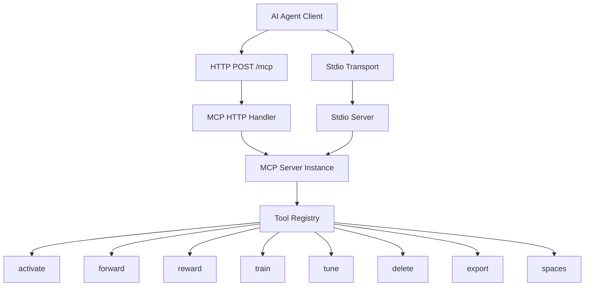

**Diagram sources**
- [http-mcp-handler.ts:115-308](file://src/http/http-mcp-handler.ts#L115-L308)
- [stdio-server.ts:6-12](file://src/stdio/stdio-server.ts#L6-L12)
- [server.ts:44-80](file://src/server.ts#L44-L80)
- [tool-registry.ts:25-91](file://src/tools/tool-registry.ts#L25-L91)

**Section sources**
- [server.ts:44-80](file://src/server.ts#L44-L80)
- [http-mcp-handler.ts:115-308](file://src/http/http-mcp-handler.ts#L115-L308)
- [stdio-server.ts:6-12](file://src/stdio/stdio-server.ts#L6-L12)

## Core Components
- MCP server factory: Creates the MCP server, sets capabilities, registers tools, resources, prompts, and UI capability blocks.
- Tool registry: Canonical list of MCP tools with strict input/output schemas and optional UI metadata.
- HTTP handler: JSON-RPC over HTTP, authentication, concurrency control, audit emission, and error shaping.
- Stdio server: Lightweight stdio transport for non-HTTP clients.
- Tools: activate, forward, reward, train, tune, delete, export, spaces. Each tool has a schema file and a register function.

Key responsibilities:
- Capability negotiation: `tools/list` returns names, titles, descriptions, input/output schemas, and optional `_meta`.
- Schema validation: Zod schemas define inputs and outputs; loose wire schemas accept client-friendly formats where needed.
- Error handling: Structured error responses with `error_code` and `retry_hint`; transport-level 503 overload protection.

**Section sources**
- [server.ts:29-80](file://src/server.ts#L29-L80)
- [tool-registry.ts:16-91](file://src/tools/tool-registry.ts#L16-L91)
- [http-mcp-handler.ts:44-105](file://src/http/http-mcp-handler.ts#L44-L105)
- [stdio-server.ts:6-12](file://src/stdio/stdio-server.ts#L6-L12)

## Architecture Overview
The MCP architecture provides a transport-agnostic tool surface. Clients call MCP methods such as `tools/list` and `tools/call`. The server validates requests, resolves tenant/space context, executes tools, and returns structured results.

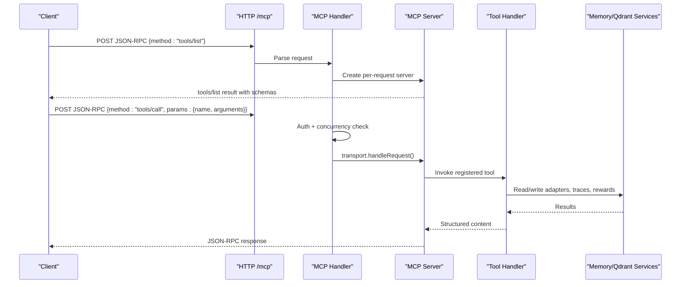

**Diagram sources**
- [http-mcp-handler.ts:115-308](file://src/http/http-mcp-handler.ts#L115-L308)
- [server.ts:44-80](file://src/server.ts#L44-L80)
- [activate.ts:237-286](file://src/tools/activate.ts#L237-L286)
- [forward-register.ts:18-65](file://src/tools/forward-register.ts#L18-L65)

## Detailed Component Analysis

### MCP Server and Tool Registration
The server factory configures capabilities and registers all MCP tools. It also installs a strict `tools/list` handler that converts Zod schemas into JSON Schema for client consumption.

Highlights:
- Capabilities include tools, resources, prompts, and UI capability blocks.
- Tools are registered via dedicated functions that attach schemas and handlers.
- A strict tools list handler ensures clients receive accurate input/output schemas.

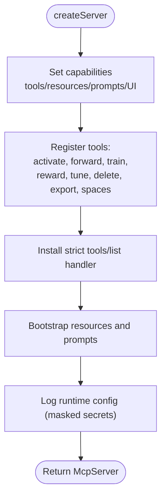

**Diagram sources**
- [server.ts:44-80](file://src/server.ts#L44-L80)
- [server.ts:29-41](file://src/server.ts#L29-L41)

**Section sources**
- [server.ts:29-80](file://src/server.ts#L29-L80)

### Tool Registry and Capability Negotiation
The canonical tool registry defines the complete MCP tool surface. Each entry includes:
- name, title, description
- strictInputSchema and outputSchema
- Optional uiMeta for UI integration

The registry is consumed by:
- MCP `tools/list`
- HTTP routes
- CLI commands

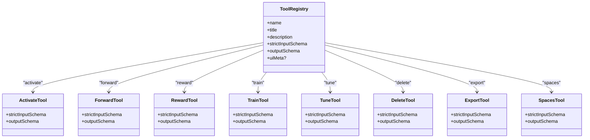

**Diagram sources**
- [tool-registry.ts:25-91](file://src/tools/tool-registry.ts#L25-L91)
- [activate_schema.ts:69-116](file://src/tools/activate_schema.ts#L69-L116)
- [forward_schema.ts:244-339](file://src/tools/forward_schema.ts#L244-L339)
- [reward_schema.ts:10-48](file://src/tools/reward_schema.ts#L10-L48)
- [train_schema.ts:54-187](file://src/tools/train_schema.ts#L54-L187)
- [tune_schema.ts:14-67](file://src/tools/tune_schema.ts#L14-L67)
- [delete_schema.ts:14-29](file://src/tools/delete_schema.ts#L14-L29)
- [export_schema.ts:44-146](file://src/tools/export_schema.ts#L44-L146)
- [spaces_schema.ts:3-52](file://src/tools/spaces_schema.ts#L3-L52)

**Section sources**
- [tool-registry.ts:16-91](file://src/tools/tool-registry.ts#L16-L91)
- [server.ts:29-41](file://src/server.ts#L29-L41)

### HTTP Transport: Authentication, Concurrency, and Audit
The HTTP transport exposes `POST /mcp`. It performs:
- Bearer token validation against trusted issuers and audiences.
- Special handling for `listOfferingsForUI` with proper 401 responses.
- Concurrency limiting with 503 and `Retry-After`.
- Per-request MCP server creation to avoid single-transport limits.
- Audit event emission for request start/end and tool calls.
- Structured error mapping for client-facing messages.

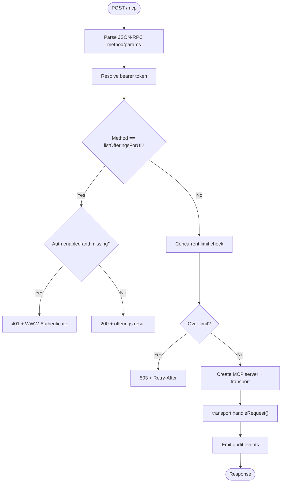

**Diagram sources**
- [http-mcp-handler.ts:44-105](file://src/http/http-mcp-handler.ts#L44-L105)
- [http-mcp-handler.ts:115-308](file://src/http/http-mcp-handler.ts#L115-L308)

**Section sources**
- [http-mcp-handler.ts:44-105](file://src/http/http-mcp-handler.ts#L44-L105)
- [http-mcp-handler.ts:115-308](file://src/http/http-mcp-handler.ts#L115-L308)
- [http-error-handlers.ts:39-53](file://src/http/http-error-handlers.ts#L39-L53)

### Stdio Transport
The stdio transport creates an MCP server and connects it to a stdio transport. It is suitable for local or embedded clients that communicate over standard input/output streams.

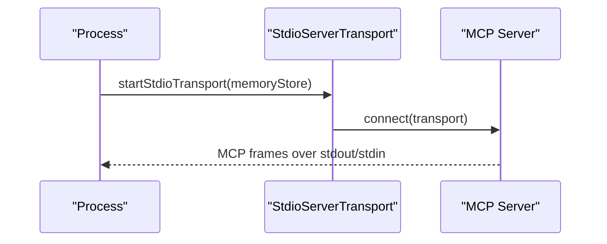

**Diagram sources**
- [stdio-server.ts:6-12](file://src/stdio/stdio-server.ts#L6-L12)

**Section sources**
- [stdio-server.ts:6-12](file://src/stdio/stdio-server.ts#L6-L12)

### Tool: activate
Purpose: Find the best adapter for the current input and return ranked activation choices.

Key behaviors:
- Executes search within the selected space context.
- Maps search results to activation choices with roles: match, refine, create.
- Produces next_action guidance and optional linked artifacts with materialization commands.
- Validates input using Zod and emits metrics.

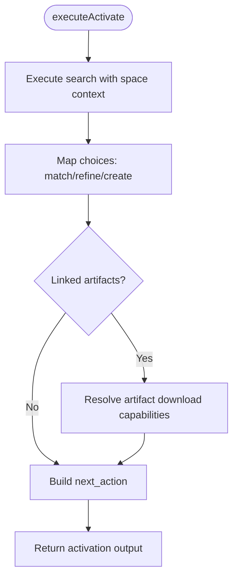

**Diagram sources**
- [activate.ts:44-207](file://src/tools/activate.ts#L44-L207)
- [activate.ts:209-286](file://src/tools/activate.ts#L209-L286)

**Section sources**
- [activate.ts:44-207](file://src/tools/activate.ts#L44-L207)
- [activate.ts:209-286](file://src/tools/activate.ts#L209-L286)
- [activate_schema.ts:69-116](file://src/tools/activate_schema.ts#L69-L116)

### Tool: forward
Purpose: Run the first or next adapter layer. Omit solution on the first call; include solution on continuation calls.

Key behaviors:
- Accepts both strict internal schema and a looser wire schema for MCP clients.
- Normalizes solution shapes and enforces type-specific payloads.
- Returns contract, next_action, proof fields, and optional next_call hints.
- Emits metrics and handles SquadrulesError formatting.

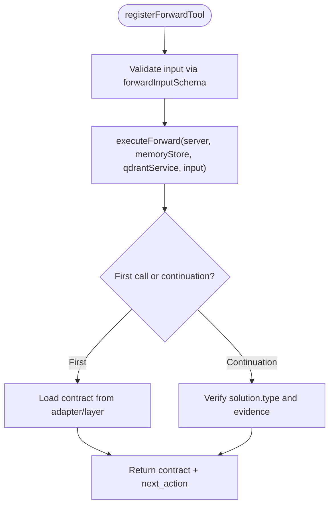

**Diagram sources**
- [forward-register.ts:18-65](file://src/tools/forward-register.ts#L18-L65)
- [forward_schema.ts:244-339](file://src/tools/forward_schema.ts#L244-L339)

**Section sources**
- [forward-register.ts:18-65](file://src/tools/forward-register.ts#L18-L65)
- [forward_schema.ts:244-339](file://src/tools/forward_schema.ts#L244-L339)

### Tool: reward
Purpose: Record adapter reward after execution completes.

Key behaviors:
- Requires a layer URI.
- Evaluates reward quality and computes normalized score.
- Persists reward metrics and execution trace data.
- Returns evaluation labels, eligibility flags, and blockers.

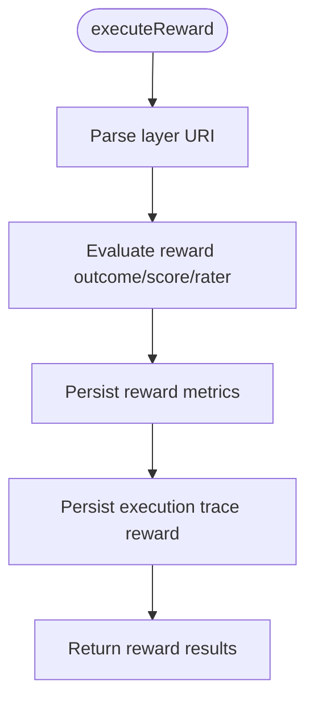

**Diagram sources**
- [reward.ts:27-110](file://src/tools/reward.ts#L27-L110)
- [reward_schema.ts:10-48](file://src/tools/reward_schema.ts#L10-L48)

**Section sources**
- [reward.ts:27-110](file://src/tools/reward.ts#L27-L110)
- [reward_schema.ts:10-48](file://src/tools/reward_schema.ts#L10-L48)

### Tool: train
Purpose: Register a new adapter or store artifacts.

Key behaviors:
- Supports markdown adapters and artifact modes.
- Can fork from an existing adapter via source_adapter_uri.
- Enforces review_evidence for markdown trains.
- Sanitizes error details and maps domain errors to user-friendly payloads.

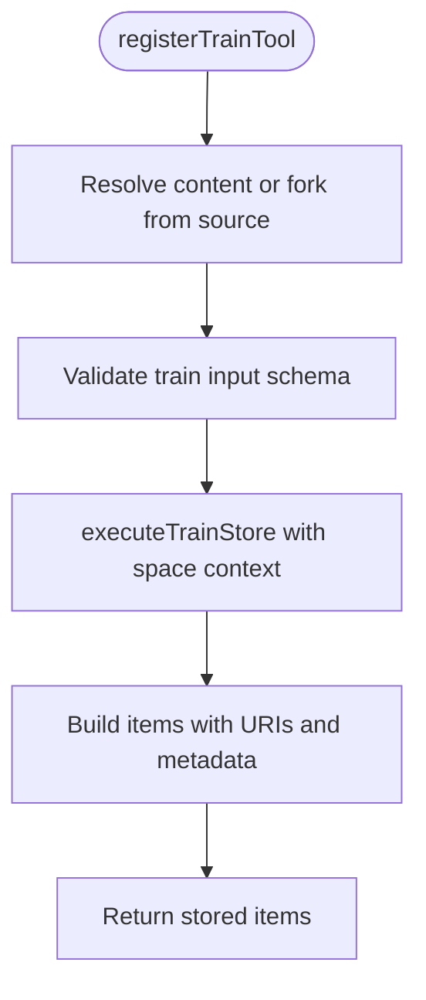

**Diagram sources**
- [train.ts:86-133](file://src/tools/train.ts#L86-L133)
- [train.ts:135-242](file://src/tools/train.ts#L135-L242)
- [train.ts:244-349](file://src/tools/train.ts#L244-L349)
- [train_schema.ts:54-187](file://src/tools/train_schema.ts#L54-L187)

**Section sources**
- [train.ts:86-133](file://src/tools/train.ts#L86-L133)
- [train.ts:135-242](file://src/tools/train.ts#L135-L242)
- [train.ts:244-349](file://src/tools/train.ts#L244-L349)
- [train_schema.ts:54-187](file://src/tools/train_schema.ts#L54-L187)

### Tool: tune
Purpose: Update adapter content or move adapters between spaces.

Key behaviors:
- Validates uris and optional content/updates/space.
- Requires review_evidence when content updates are provided.
- Invalidates caches after successful updates.

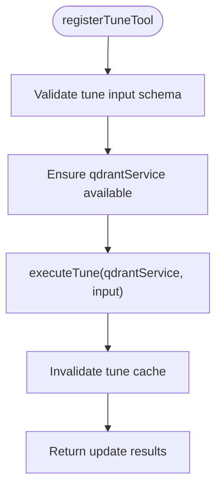

**Diagram sources**
- [tune.ts:19-69](file://src/tools/tune.ts#L19-L69)
- [tune_schema.ts:14-67](file://src/tools/tune_schema.ts#L14-L67)

**Section sources**
- [tune.ts:19-69](file://src/tools/tune.ts#L19-L69)
- [tune_schema.ts:14-67](file://src/tools/tune_schema.ts#L14-L67)

### Tool: delete
Purpose: Delete adapter resources by URIs.

Key behaviors:
- Deletes all layers for an adapter or a specific layer.
- Aggregates per-URI results and counts.

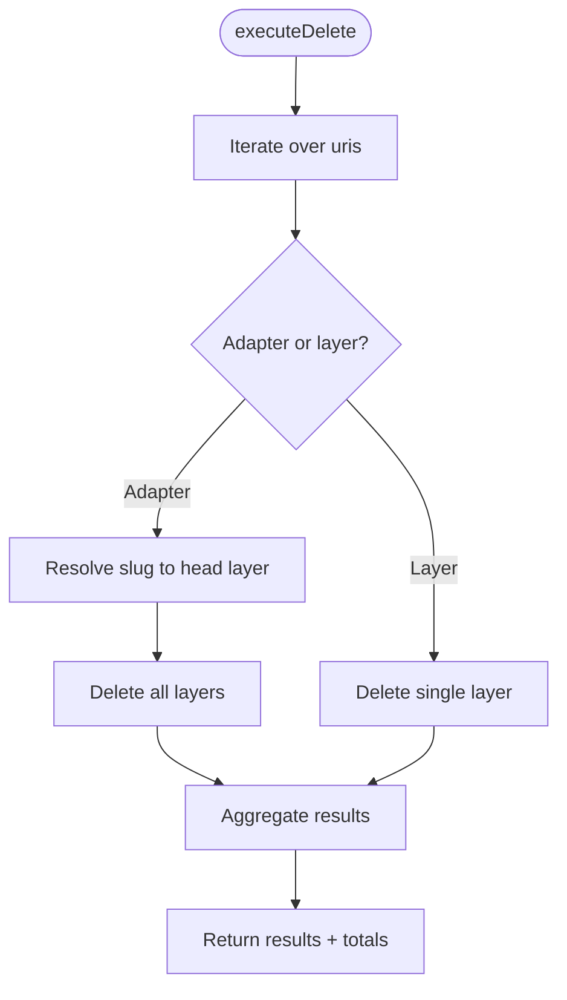

**Diagram sources**
- [delete.ts:12-71](file://src/tools/delete.ts#L12-L71)
- [delete_schema.ts:14-29](file://src/tools/delete_schema.ts#L14-L29)

**Section sources**
- [delete.ts:12-71](file://src/tools/delete.ts#L12-L71)
- [delete_schema.ts:14-29](file://src/tools/delete_schema.ts#L14-L29)

### Tool: export
Purpose: Export adapter or training data in multiple formats.

Key behaviors:
- Supports markdown, training JSONL variants, source, skill_tree, and skill_zip.
- Handles inline base64 delivery or short-lived download references.
- Computes bundle SHA-256 and manifests for skill bundles.

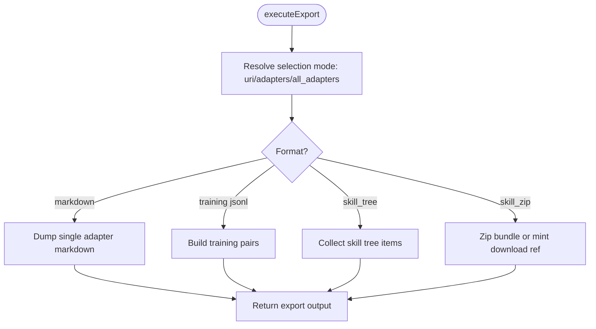

**Diagram sources**
- [export.ts:40-60](file://src/tools/export.ts#L40-L60)
- [export.ts:62-271](file://src/tools/export.ts#L62-L271)
- [export_schema.ts:44-146](file://src/tools/export_schema.ts#L44-L146)

**Section sources**
- [export.ts:40-60](file://src/tools/export.ts#L40-L60)
- [export.ts:62-271](file://src/tools/export.ts#L62-L271)
- [export_schema.ts:44-146](file://src/tools/export_schema.ts#L44-L146)

### Tool: spaces
Purpose: List spaces and adapter counts, optionally including adapter titles and artifacts.

Key behaviors:
- Uses current request space context.
- Builds human-readable space info and adapter summaries.
- Optionally renders widget HTML for UI integration.

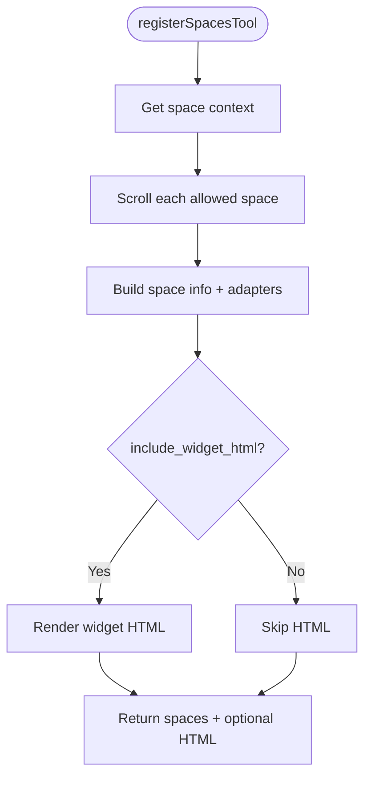

**Diagram sources**
- [spaces.ts:172-189](file://src/tools/spaces.ts#L172-L189)
- [spaces.ts:195-254](file://src/tools/spaces.ts#L195-L254)
- [spaces_schema.ts:3-52](file://src/tools/spaces_schema.ts#L3-L52)

**Section sources**
- [spaces.ts:172-189](file://src/tools/spaces.ts#L172-L189)
- [spaces.ts:195-254](file://src/tools/spaces.ts#L195-L254)
- [spaces_schema.ts:3-52](file://src/tools/spaces_schema.ts#L3-L52)

## Dependency Analysis
The MCP system depends on:
- @modelcontextprotocol/sdk for server and transport abstractions.
- Zod for schema validation.
- Memory and Qdrant services for adapter storage and vector search.
- Metrics and audit utilities for observability.

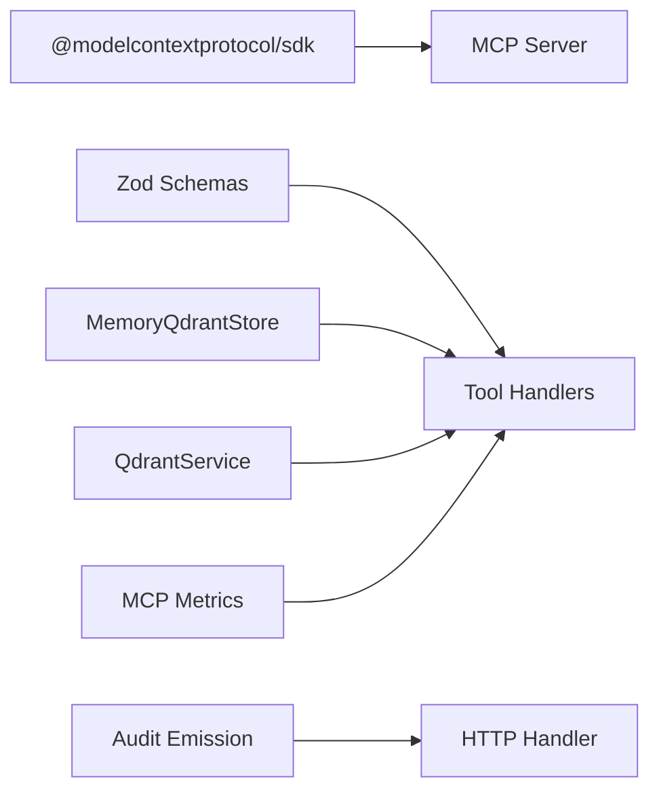

**Diagram sources**
- [server.ts:1-27](file://src/server.ts#L1-L27)
- [http-mcp-handler.ts:1-22](file://src/http/http-mcp-handler.ts#L1-L22)
- [activate.ts:1-23](file://src/tools/activate.ts#L1-L23)
- [forward-register.ts:1-11](file://src/tools/forward-register.ts#L1-L11)
- [reward.ts:1-12](file://src/tools/reward.ts#L1-L12)
- [train.ts:1-26](file://src/tools/train.ts#L1-L26)
- [tune.ts:1-10](file://src/tools/tune.ts#L1-L10)
- [delete.ts:1-9](file://src/tools/delete.ts#L1-L9)
- [export.ts:1-25](file://src/tools/export.ts#L1-L25)
- [spaces.ts:1-20](file://src/tools/spaces.ts#L1-L20)

**Section sources**
- [server.ts:1-27](file://src/server.ts#L1-L27)
- [http-mcp-handler.ts:1-22](file://src/http/http-mcp-handler.ts#L1-L22)

## Performance Considerations
- Per-request MCP server instances avoid single-transport bottlenecks on HTTP.
- Concurrency limiter rejects excess requests with 503 and Retry-After.
- Timeout logging at 25 seconds helps detect slow operations before typical client timeouts.
- Tool handlers emit duration metrics and track input/output sizes.
- Cache invalidation after tune prevents stale reads.

[No sources needed since this section provides general guidance]

## Troubleshooting Guide
Common issues and resolutions:
- 503 overloaded: Reduce concurrent requests or retry after Retry-After.
- 401 unauthorized for UI offerings: Authenticate and reconnect MCP if host caches tokens.
- Transport conflict: If “Already connected to a transport” occurs, start a new MCP session.
- Input validation failures: Adjust parameters according to Zod schema errors returned by tools.
- Domain errors (for example, duplicate adapter): Inspect error_code and follow next_action guidance.

Error shaping:
- HTTP handler maps SquadrulesError and generic errors to helpful messages with error_code and retry_hint.
- Global Express error handler catches payload-too-large and other HTTP-level errors.

**Section sources**
- [http-mcp-handler.ts:62-105](file://src/http/http-mcp-handler.ts#L62-L105)
- [http-mcp-handler.ts:151-191](file://src/http/http-mcp-handler.ts#L151-L191)
- [http-error-handlers.ts:9-33](file://src/http/http-error-handlers.ts#L9-L33)

## Conclusion
SquadRules implements MCP as a standardized, transport-agnostic interface for AI agents. The canonical tool registry, Zod-based schemas, and structured error handling ensure consistency across HTTP and stdio. The activate → forward → reward chain provides a clear, auditable workflow for adapter execution, while additional tools support lifecycle management and data portability. Security is enforced through bearer token validation, space context, and rate limiting, with comprehensive audit and metrics coverage.