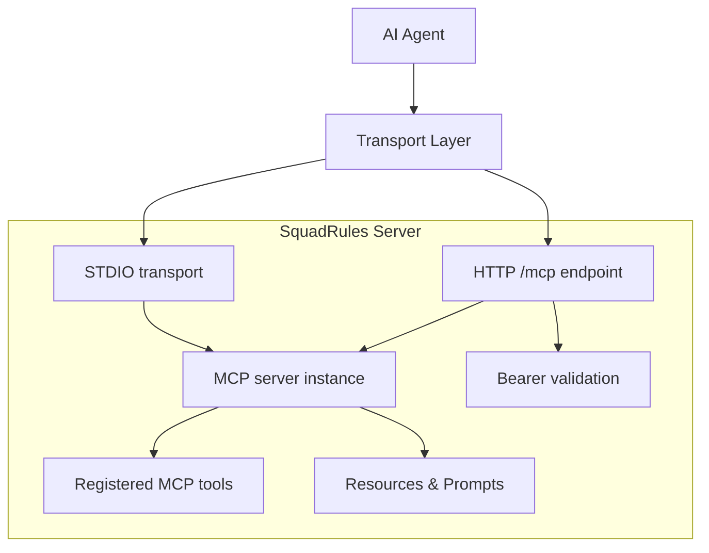
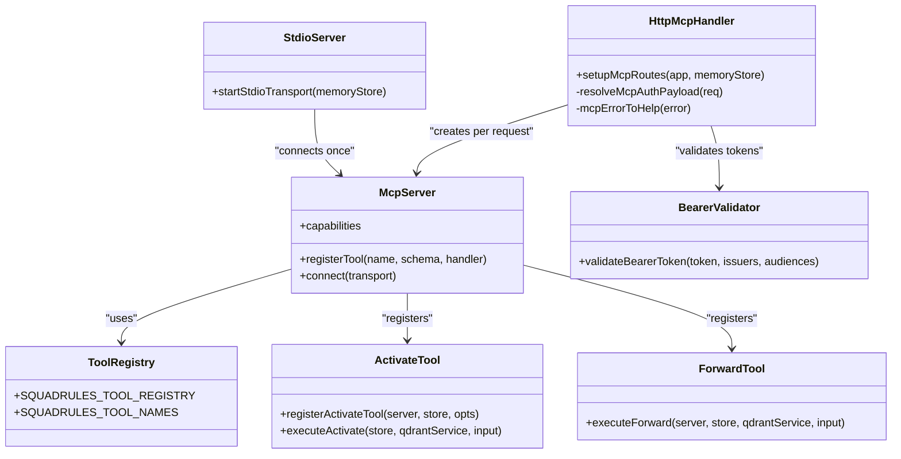
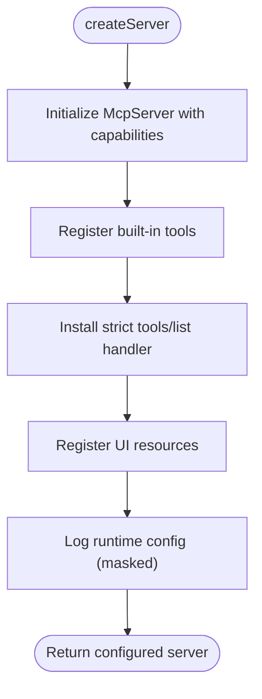
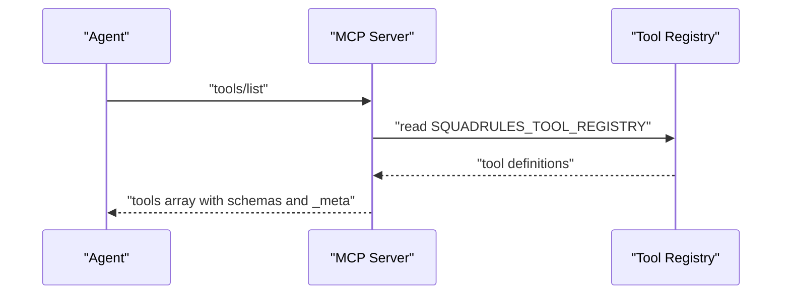
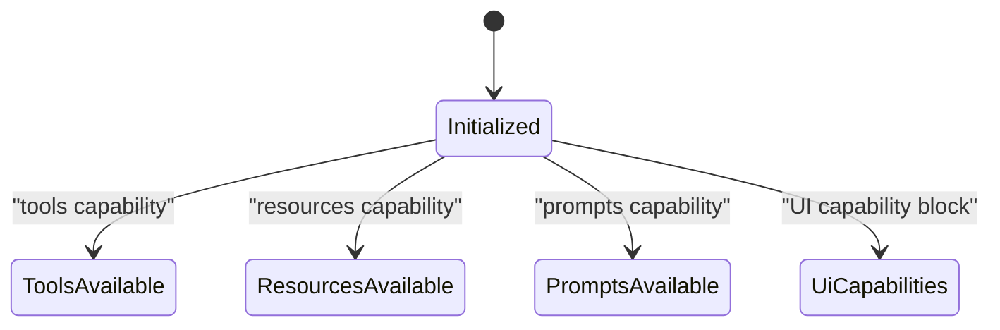
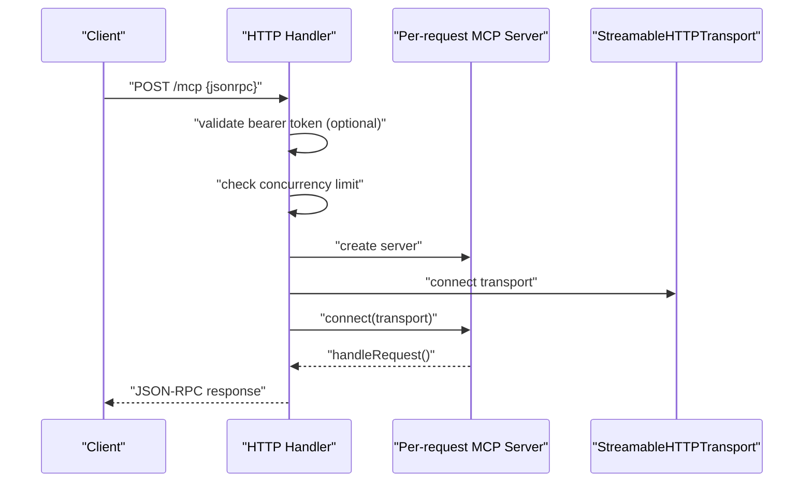
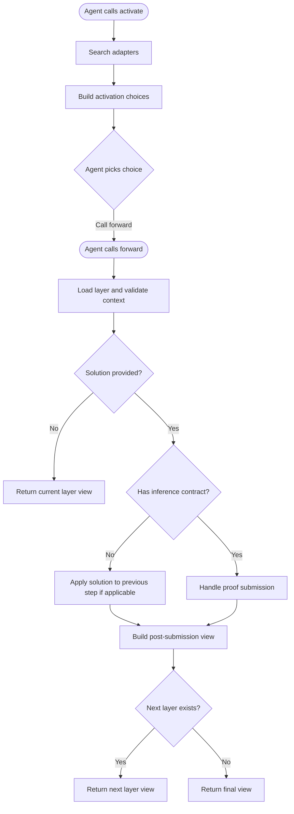
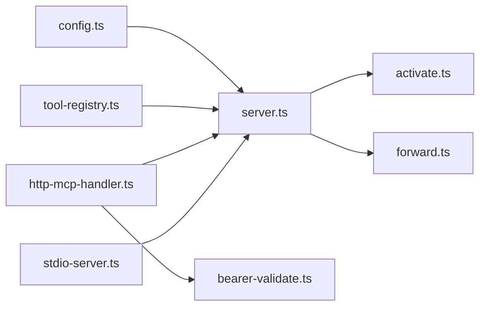
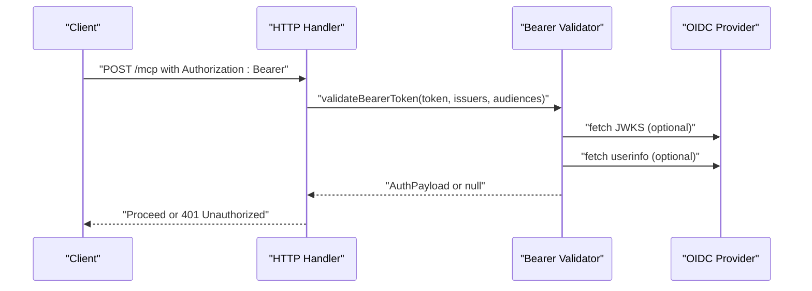

# Model Context Protocol Fundamentals

<cite>
**Referenced Files in This Document**
- [server.ts](file://src/server.ts)
- [http-mcp-handler.ts](file://src/http/http-mcp-handler.ts)
- [stdio-server.ts](file://src/stdio/stdio-server.ts)
- [tool-registry.ts](file://src/tools/tool-registry.ts)
- [activate.ts](file://src/tools/activate.ts)
- [forward.ts](file://src/tools/forward.ts)
- [bearer-validate.ts](file://src/http/bearer-validate.ts)
- [config.ts](file://src/config.ts)
</cite>

## Table of Contents
1. [Introduction](#introduction)
2. [Project Structure](#project-structure)
3. [Core Components](#core-components)
4. [Architecture Overview](#architecture-overview)
5. [Detailed Component Analysis](#detailed-component-analysis)
6. [Dependency Analysis](#dependency-analysis)
7. [Performance Considerations](#performance-considerations)
8. [Security Considerations](#security-considerations)
9. [Troubleshooting Guide](#troubleshooting-guide)
10. [Conclusion](#conclusion)
11. [Appendices](#appendices)

## Introduction
This document explains the Model Context Protocol (MCP) fundamentals that underpin the SquadRules framework. It focuses on how MCP enables standardized communication between AI agents and tools, including tool discovery, capability negotiation, message formats, transport layers, and security. It also documents how SquadRules uses MCP to provide deterministic, auditable workflows while preserving agent autonomy through protocol contracts.

Key principles:
- SquadRules is an agent-first MCP framework. Agents are primary users; humans configure preferences through agents.
- Core workflow: activate → forward → reward. Adapters define deterministic, auditable task execution.
- MCP exposes a stable contract for agents to discover tools, negotiate capabilities, and execute workflows safely.

## Project Structure
At runtime, SquadRules exposes MCP through two transport options:
- HTTP Streamable MCP over REST at `/mcp`
- STDIO MCP for local single-user mode

The MCP server registers tools, resources, prompts, and UI capabilities. Tool definitions come from a canonical registry so that `tools/list`, HTTP routes, CLI commands, and documentation stay consistent.

**Diagram sources**
- [http-mcp-handler.ts:115-348](file://src/http/http-mcp-handler.ts#L115-L348)
- [stdio-server.ts:6-12](file://src/stdio/stdio-server.ts#L6-L12)
- [server.ts:43-80](file://src/server.ts#L43-L80)

**Section sources**
- [http-mcp-handler.ts:115-348](file://src/http/http-mcp-handler.ts#L115-L348)
- [stdio-server.ts:6-12](file://src/stdio/stdio-server.ts#L6-L12)
- [server.ts:43-80](file://src/server.ts#L43-L80)

## Core Components
- MCP server factory: creates a configured server with capabilities, tool registrations, resources, prompts, and UI capability blocks.
- Tool registry: canonical list of tools with schemas and optional UI metadata.
- HTTP handler: receives JSON-RPC requests, validates Bearer tokens when enabled, enforces concurrency limits, and forwards to per-request MCP servers.
- STDIO server: starts a simple STDIO-based MCP server for local use.
- Tool implementations: activate and forward implement the core workflow steps.

**Section sources**
- [server.ts:43-80](file://src/server.ts#L43-L80)
- [tool-registry.ts:16-100](file://src/tools/tool-registry.ts#L16-L100)
- [http-mcp-handler.ts:44-60](file://src/http/http-mcp-handler.ts#L44-L60)
- [stdio-server.ts:6-12](file://src/stdio/stdio-server.ts#L6-L12)
- [activate.ts:231-280](file://src/tools/activate.ts#L231-L280)
- [forward.ts:91-156](file://src/tools/forward.ts#L91-L156)

## Architecture Overview
The architecture separates concerns across transports, server configuration, tool registration, and business logic.

**Diagram sources**
- [server.ts:43-80](file://src/server.ts#L43-L80)
- [http-mcp-handler.ts:115-348](file://src/http/http-mcp-handler.ts#L115-L348)
- [stdio-server.ts:6-12](file://src/stdio/stdio-server.ts#L6-L12)
- [tool-registry.ts:16-100](file://src/tools/tool-registry.ts#L16-L100)
- [activate.ts:231-280](file://src/tools/activate.ts#L231-L280)
- [forward.ts:91-156](file://src/tools/forward.ts#L91-L156)
- [bearer-validate.ts:120-208](file://src/http/bearer-validate.ts#L120-L208)

## Detailed Component Analysis

### MCP Server Configuration and Capabilities
The server factory configures capabilities such as tools, resources, prompts, and UI capability blocks. It registers all built-in tools and UI resources, then installs a strict `tools/list` handler derived from the canonical registry.

Highlights:
- Capability block includes tools, resources, prompts, and UI capability.
- Strict `tools/list` returns deterministic tool metadata and schemas.
- Runtime configuration is logged with secrets masked.

**Diagram sources**
- [server.ts:43-80](file://src/server.ts#L43-L80)
- [server.ts:82-114](file://src/server.ts#L82-L114)

**Section sources**
- [server.ts:43-80](file://src/server.ts#L43-L80)
- [server.ts:82-114](file://src/server.ts#L82-L114)

### Tool Discovery via `tools/list`
Agents discover available tools by calling `tools/list`. SquadRules overrides the default handler to return a deterministic set of tools with JSON Schema input/output definitions and optional UI metadata.

Key points:
- The canonical registry defines tool names, titles, descriptions, schemas, and UI metadata.
- Input and output schemas are converted to JSON Schema for clients.
- UI metadata links tools to MCP Apps widgets where applicable.

**Diagram sources**
- [server.ts:29-41](file://src/server.ts#L29-L41)
- [tool-registry.ts:16-100](file://src/tools/tool-registry.ts#L16-L100)

**Section sources**
- [server.ts:29-41](file://src/server.ts#L29-L41)
- [tool-registry.ts:16-100](file://src/tools/tool-registry.ts#L16-L100)

### Capability Negotiation
Capability negotiation occurs during server initialization. SquadRules advertises support for tools, resources, prompts, and UI capabilities. Clients can inspect capabilities to determine supported features before invoking tools or UI resources.

**Diagram sources**
- [server.ts:43-58](file://src/server.ts#L43-L58)

**Section sources**
- [server.ts:43-58](file://src/server.ts#L43-L58)

### Message Formats and JSON-RPC
MCP uses JSON-RPC messages over transports. The HTTP handler wraps incoming requests into per-request MCP server instances and handles errors, timeouts, cancellation, and audit events.

Important behaviors:
- Per-request MCP server creation avoids single-transport concurrency limits.
- Concurrency control returns 503 with retry guidance when overloaded.
- Errors are sanitized for client consumption and include helpful error codes and retry hints.
- Audit events capture request start/end and tool call details based on audit level.

**Diagram sources**
- [http-mcp-handler.ts:115-348](file://src/http/http-mcp-handler.ts#L115-L348)

**Section sources**
- [http-mcp-handler.ts:115-348](file://src/http/http-mcp-handler.ts#L115-L348)

### Transport Layers: HTTP REST API vs STDIO
- HTTP REST API (`/mcp`): Suitable for clustered deployments, multi-agent environments, and when authentication is required. Uses Streamable HTTP transport.
- STDIO: Suitable for local single-user mode. No HTTP listener; stdout reserved for protocol frames.

When to choose:
- Use HTTP when running behind a reverse proxy, requiring OIDC/Bearer auth, or serving multiple agents.
- Use STDIO for local development or single-user automation without network exposure.

**Section sources**
- [http-mcp-handler.ts:115-348](file://src/http/http-mcp-handler.ts#L115-L348)
- [stdio-server.ts:6-12](file://src/stdio/stdio-server.ts#L6-L12)
- [config.ts:245-246](file://src/config.ts#L245-L246)

### Workflow Execution: Activate and Forward
The core workflow follows a deterministic chain:
- `activate`: Finds the best adapter for the current input and returns ranked choices with next actions.
- `forward`: Executes adapter layers, manages proof-of-work, elicits user input when needed, and advances state.

**Diagram sources**
- [activate.ts:44-166](file://src/tools/activate.ts#L44-L166)
- [activate.ts:168-229](file://src/tools/activate.ts#L168-L229)
- [forward.ts:91-156](file://src/tools/forward.ts#L91-L156)
- [forward.ts:158-339](file://src/tools/forward.ts#L158-L339)

**Section sources**
- [activate.ts:44-166](file://src/tools/activate.ts#L44-L166)
- [activate.ts:168-229](file://src/tools/activate.ts#L168-L229)
- [forward.ts:91-156](file://src/tools/forward.ts#L91-L156)
- [forward.ts:158-339](file://src/tools/forward.ts#L158-L339)

### Concrete Examples

#### Example 1: Discover Available Tools
An agent calls `tools/list` to retrieve the canonical tool surface. The server responds with tool names, titles, descriptions, input/output schemas, and optional UI metadata.

Steps:
1. Agent sends `tools/list`.
2. Server reads the canonical registry.
3. Server converts schemas to JSON Schema.
4. Agent receives the tools array.

**Section sources**
- [server.ts:29-41](file://src/server.ts#L29-L41)
- [tool-registry.ts:16-100](file://src/tools/tool-registry.ts#L16-L100)

#### Example 2: Execute Activate
An agent calls `activate` with a query. The server searches for matching adapters, builds choices, and returns next actions guiding the agent to call `forward`.

Steps:
1. Agent sends `tools/call` with tool name `activate` and parameters.
2. Server validates input against schema.
3. Server executes search and maps results to activation choices.
4. Agent receives structured content with choices and next actions.

**Section sources**
- [activate.ts:231-280](file://src/tools/activate.ts#L231-L280)
- [activate.ts:44-166](file://src/tools/activate.ts#L44-L166)

#### Example 3: Execute Forward
An agent calls `forward` with a URI and optional solution. The server loads the layer, checks contracts, handles proofs, and returns the next view or finalization signal.

Steps:
1. Agent sends `tools/call` with tool name `forward` and parameters.
2. Server parses URI and loads memory.
3. Server validates authoring context and execution continuity.
4. Server processes solution, applies proofs, and builds post-submission view.
5. Agent receives next layer view or finalization message.

**Section sources**
- [forward.ts:91-156](file://src/tools/forward.ts#L91-L156)
- [forward.ts:158-339](file://src/tools/forward.ts#L158-L339)

## Dependency Analysis
The following diagram shows key dependencies among components involved in MCP communication and tool execution.

**Diagram sources**
- [config.ts:1-351](file://src/config.ts#L1-L351)
- [server.ts:1-115](file://src/server.ts#L1-L115)
- [tool-registry.ts:1-100](file://src/tools/tool-registry.ts#L1-L100)
- [http-mcp-handler.ts:1-348](file://src/http/http-mcp-handler.ts#L1-L348)
- [stdio-server.ts:1-13](file://src/stdio/stdio-server.ts#L1-L13)
- [bearer-validate.ts:1-209](file://src/http/bearer-validate.ts#L1-L209)
- [activate.ts:1-281](file://src/tools/activate.ts#L1-L281)
- [forward.ts:1-340](file://src/tools/forward.ts#L1-L340)

**Section sources**
- [config.ts:1-351](file://src/config.ts#L1-L351)
- [server.ts:1-115](file://src/server.ts#L1-L115)
- [tool-registry.ts:1-100](file://src/tools/tool-registry.ts#L1-L100)
- [http-mcp-handler.ts:1-348](file://src/http/http-mcp-handler.ts#L1-L348)
- [stdio-server.ts:1-13](file://src/stdio/stdio-server.ts#L1-L13)
- [bearer-validate.ts:1-209](file://src/http/bearer-validate.ts#L1-L209)
- [activate.ts:1-281](file://src/tools/activate.ts#L1-L281)
- [forward.ts:1-340](file://src/tools/forward.ts#L1-L340)

## Performance Considerations
- Concurrency control: The HTTP handler enforces a maximum concurrent MCP request limit and returns 503 with retry guidance when exceeded.
- Per-request server instances: Avoids single-transport bottlenecks and allows many concurrent requests per node.
- Timeout logging: Requests exceeding thresholds log warnings to aid debugging.
- Cancellation handling: Client cancellations are detected and logged; background operations may continue.

Recommendations:
- Tune `MAX_CONCURRENT_MCP_REQUESTS` based on workload and resource capacity.
- Monitor timeout and cancellation logs to identify slow or long-running workflows.
- Use structured logging levels to balance detail and performance overhead.

**Section sources**
- [http-mcp-handler.ts:168-192](file://src/http/http-mcp-handler.ts#L168-L192)
- [http-mcp-handler.ts:199-215](file://src/http/http-mcp-handler.ts#L199-L215)
- [http-mcp-handler.ts:221-251](file://src/http/http-mcp-handler.ts#L221-L251)
- [config.ts:282-282](file://src/config.ts#L282-L282)

## Security Considerations
Authentication and authorization are enforced at the HTTP layer when enabled.

Key mechanisms:
- Bearer JWT validation verifies issuer, audience, expiration, and signature using JWKS.
- Trusted issuers and allowed audiences are configurable via environment variables.
- Groups are extracted from access tokens or fetched from OIDC userinfo and filtered by allowlist.
- Special handling for Keycloak realms accepts `account` audience or empty audience when appropriate.

Best practices:
- Always configure trusted issuers and allowed audiences in production.
- Use Keycloak internal URL for Dockerized deployments to reach JWKS and userinfo endpoints reliably.
- Enable group allowlists to restrict space access based on identity provider membership.
- Validate inputs strictly using Zod schemas to prevent malformed requests.

**Diagram sources**
- [http-mcp-handler.ts:44-60](file://src/http/http-mcp-handler.ts#L44-L60)
- [bearer-validate.ts:120-208](file://src/http/bearer-validate.ts#L120-L208)

**Section sources**
- [bearer-validate.ts:1-209](file://src/http/bearer-validate.ts#L1-L209)
- [config.ts:141-168](file://src/config.ts#L141-L168)
- [config.ts:306-344](file://src/config.ts#L306-L344)

## Troubleshooting Guide
Common issues and resolutions:
- Authentication failures: Ensure trusted issuers and allowed audiences are correctly configured. Verify JWKS and userinfo endpoints are reachable.
- Overloaded server: If receiving 503 responses, reduce concurrency or increase `MAX_CONCURRENT_MCP_REQUESTS`.
- Long-running requests: Check timeout logs and investigate slow adapters or external dependencies.
- Cancellations: Client cancellations are logged; verify whether background operations need cleanup.

Diagnostic tips:
- Increase log verbosity to debug request flows and tool invocations.
- Inspect audit logs for exact replay data when audit level is high.
- Validate tool input schemas to catch malformed requests early.

**Section sources**
- [http-mcp-handler.ts:74-105](file://src/http/http-mcp-handler.ts#L74-L105)
- [http-mcp-handler.ts:168-192](file://src/http/http-mcp-handler.ts#L168-L192)
- [http-mcp-handler.ts:199-215](file://src/http/http-mcp-handler.ts#L199-L215)
- [http-mcp-handler.ts:221-251](file://src/http/http-mcp-handler.ts#L221-L251)

## Conclusion
SquadRules leverages MCP to provide a standardized, deterministic interface for AI agents to discover tools, negotiate capabilities, and execute workflows securely. The HTTP and STDIO transports cater to different deployment scenarios, while strict tool registries and JSON Schema definitions ensure consistency. Security is enforced through Bearer JWT validation and group-based authorization. By adhering to these protocols, both agent developers and adapter authors can build reliable, auditable systems that maintain agent autonomy within well-defined contracts.

## Appendices

### MCP Best Practices for Agent Developers
- Always call `tools/list` first to discover available tools and their schemas.
- Respect capability negotiation; do not assume UI resources are available unless advertised.
- Follow the activate → forward → reward chain; never skip steps or fabricate proofs.
- Handle structured content and next actions returned by tools to guide subsequent calls.
- Implement retries with backoff for transient errors and respect retry hints.

### MCP Best Practices for Adapter Authors
- Define clear inference contracts to enable deterministic execution and proof verification.
- Provide meaningful labels, tags, and descriptions to improve activation accuracy.
- Include linked artifacts when scripts or files are required for execution.
- Ensure adapters are idempotent and produce auditable outputs.
- Test adapters across spaces and groups to validate authorization behavior.