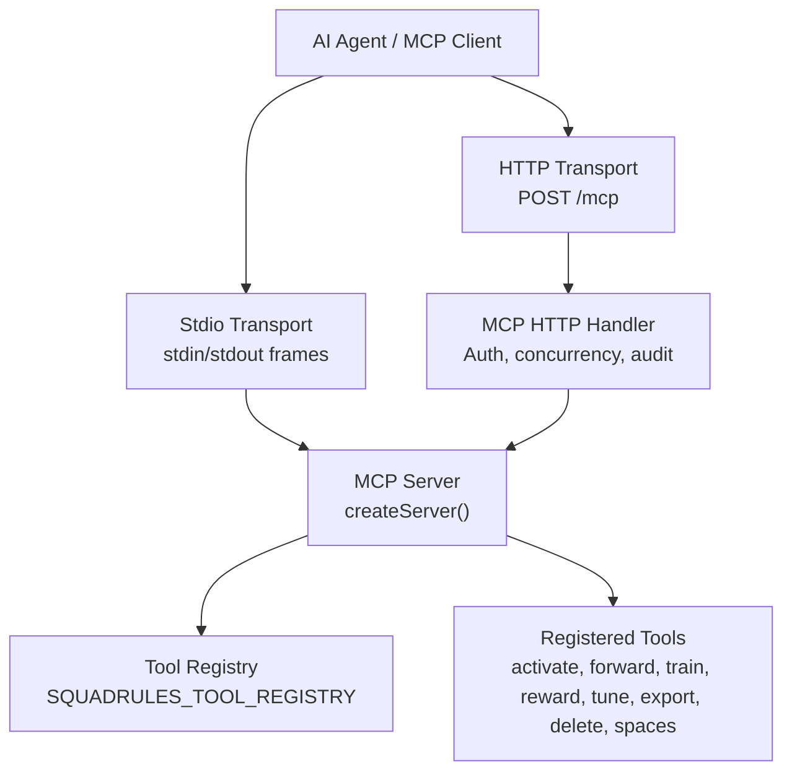
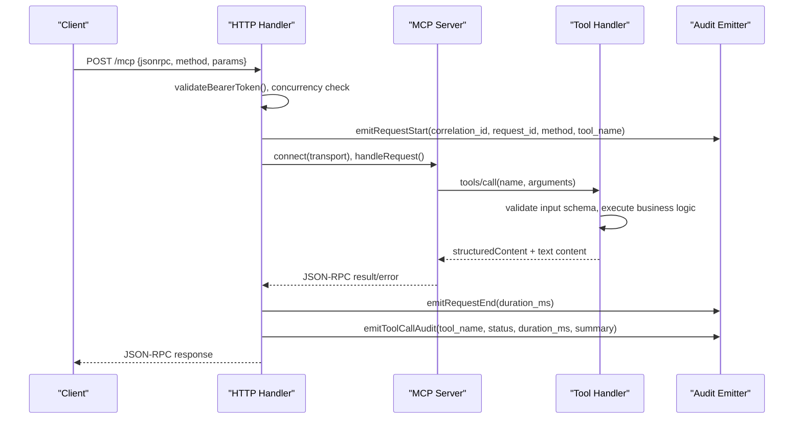
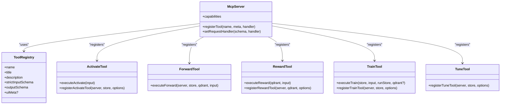
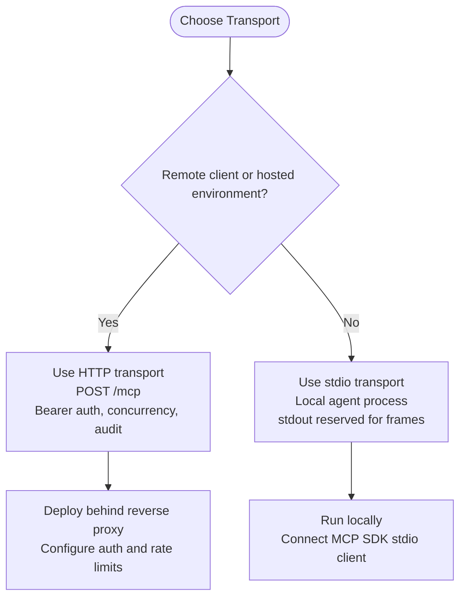
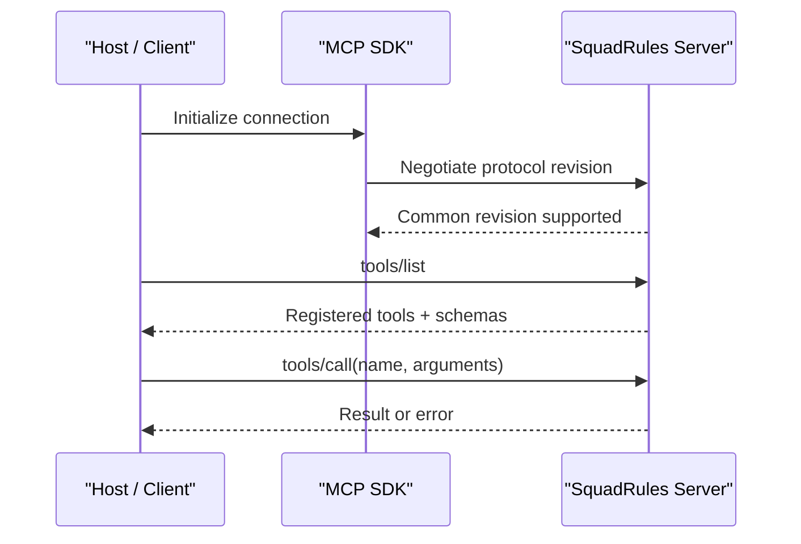
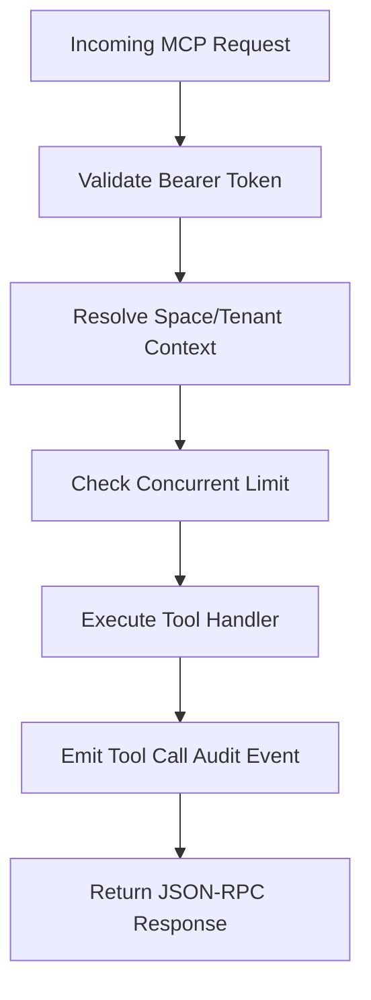
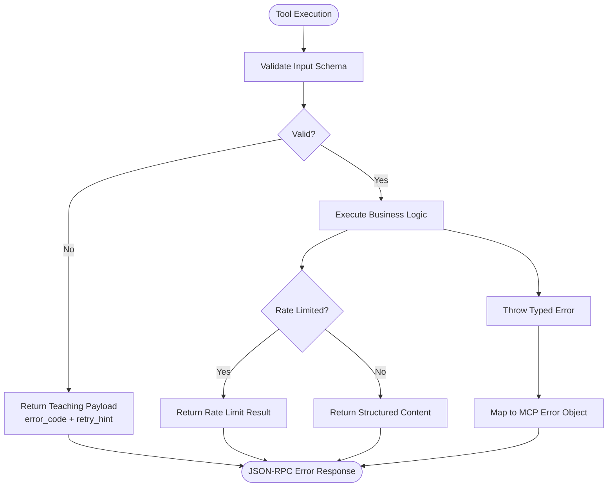
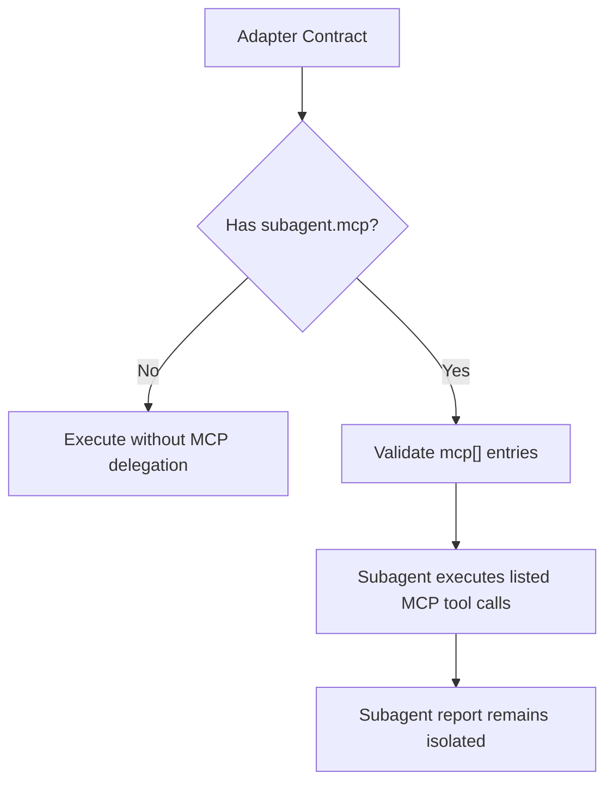
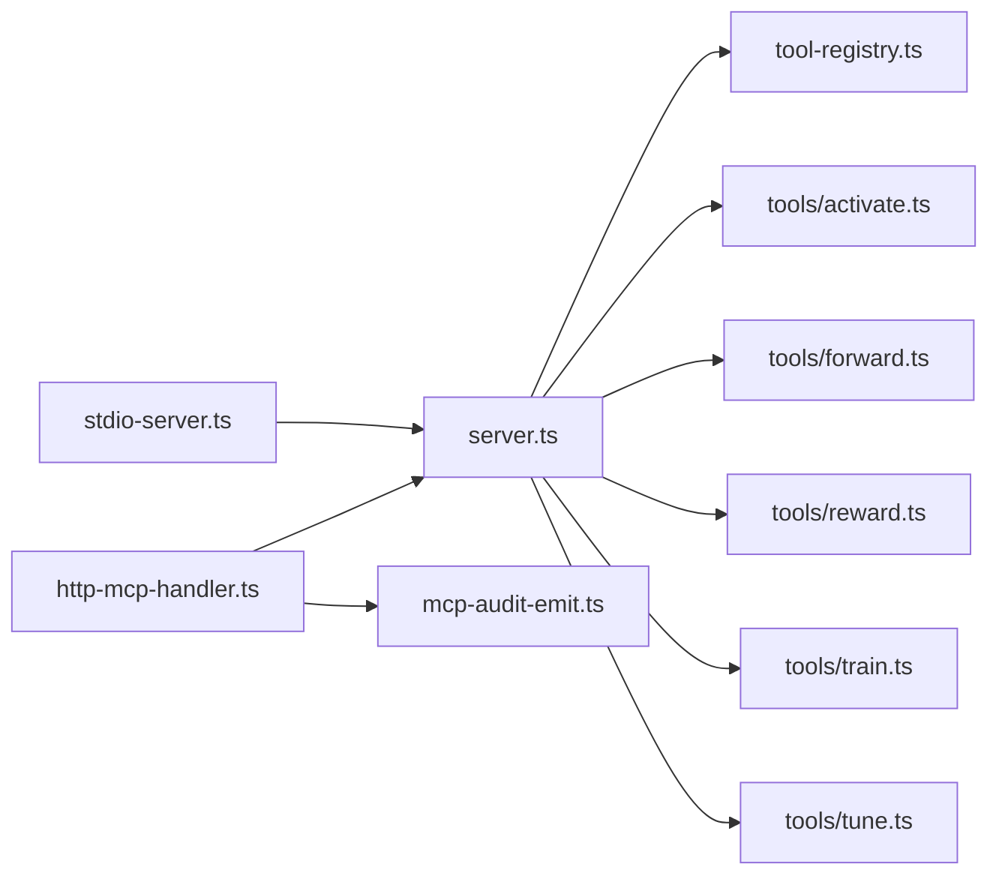

# Model Context Protocol Fundamentals

<cite>
**Referenced Files in This Document**
- [server.ts](file://src/server.ts)
- [tool-registry.ts](file://src/tools/tool-registry.ts)
- [http-mcp-handler.ts](file://src/http/http-mcp-handler.ts)
- [stdio-server.ts](file://src/stdio/stdio-server.ts)
- [mcp-audit-emit.ts](file://src/http/mcp-audit-emit.ts)
- [activate.ts](file://src/tools/activate.ts)
- [forward.ts](file://src/tools/forward.ts)
- [reward.ts](file://src/tools/reward.ts)
- [train.ts](file://src/tools/train.ts)
- [tune.ts](file://src/tools/tune.ts)
- [0014-always-latest-mcp-spec-and-sdk.md](file://docs/adr/0014-always-latest-mcp-spec-and-sdk.md)
- [0029-subagent-mcp-and-context-authority.md](file://docs/adr/0029-subagent-mcp-and-context-authority.md)
</cite>

## Table of Contents
1. [Introduction](#introduction)
2. [Project Structure](#project-structure)
3. [Core Components](#core-components)
4. [Architecture Overview](#architecture-overview)
5. [Detailed Component Analysis](#detailed-component-analysis)
6. [Dependency Analysis](#dependency-analysis)
7. [Performance Considerations](#performance-considerations)
8. [Troubleshooting Guide](#troubleshooting-guide)
9. [Conclusion](#conclusion)

## Introduction
This document explains the Model Context Protocol (MCP) fundamentals and how SquadRules implements MCP as an agent-first framework. It covers specification compliance, transport choices, tool registration, message passing patterns, protocol versioning, security and auditability, error handling, and debugging. The canonical MCP surface is defined once and reused across HTTP, stdio, UI discovery, and CLI commands.

SquadRules centers on a deterministic workflow: activate → forward → reward. Adapters are machine-readable workflows that agents create or repair when behavior changes. MCP tools expose this workflow to AI agents while preserving human oversight through structured contracts, proof-of-work validation, and auditable execution traces.

## Project Structure
At runtime, SquadRules exposes MCP over two transports:
- HTTP: JSON-RPC over HTTP using `StreamableHTTPServerTransport`.
- Stdio: JSON-RPC over standard input/output using `StdioServerTransport`.

The MCP server is created centrally and then connected to the selected transport. Tool definitions, schemas, and UI metadata are registered from a single registry so that `tools/list`, HTTP routes, and CLI commands stay consistent.

**Diagram sources**
- [http-mcp-handler.ts:115-348](file://src/http/http-mcp-handler.ts#L115-L348)
- [stdio-server.ts:6-12](file://src/stdio/stdio-server.ts#L6-L12)
- [server.ts:44-80](file://src/server.ts#L44-L80)
- [tool-registry.ts:25-91](file://src/tools/tool-registry.ts#L25-L91)

**Section sources**
- [server.ts:44-80](file://src/server.ts#L44-L80)
- [http-mcp-handler.ts:115-348](file://src/http/http-mcp-handler.ts#L115-L348)
- [stdio-server.ts:6-12](file://src/stdio/stdio-server.ts#L6-L12)
- [tool-registry.ts:25-91](file://src/tools/tool-registry.ts#L25-L91)

## Core Components
- MCP server factory: creates capabilities, registers tools, resources, prompts, and UI capability blocks.
- Canonical tool registry: defines names, titles, descriptions, strict input schemas, output schemas, and optional UI metadata.
- HTTP handler: authenticates requests, enforces concurrency limits, captures audit data, and delegates to the SDK transport.
- Stdio server: starts the same server over stdio for local agent processes.
- Audit emission: emits request start/end and per-tool-call audit events with correlation IDs and optional summarized payloads.

Key responsibilities:
- Specification compliance: uses the MCP SDK server object and negotiated protocol revisions.
- Single source of truth: `SQUADRULES_TOOL_REGISTRY` drives `tools/list` and tool implementations.
- Security: bearer token validation, space context, tenant isolation, and structured error exposure.
- Auditability: correlation IDs, request lifecycle events, and tool call summaries.

**Section sources**
- [server.ts:29-80](file://src/server.ts#L29-L80)
- [tool-registry.ts:16-99](file://src/tools/tool-registry.ts#L16-L99)
- [http-mcp-handler.ts:44-105](file://src/http/http-mcp-handler.ts#L44-L105)
- [mcp-audit-emit.ts:18-117](file://src/http/mcp-audit-emit.ts#L18-L117)

## Architecture Overview
SquadRules implements MCP as follows:
- Clients send JSON-RPC messages to `/mcp` over HTTP or to stdio.
- The HTTP handler validates auth, applies concurrency backpressure, sets up audit capture, and connects a per-request MCP server instance to the SDK transport.
- The MCP server resolves `tools/list` from the canonical registry and dispatches `tools/call` to registered handlers.
- Each tool validates inputs with Zod schemas, performs domain work, and returns both text content and structured content.
- Audit events record request boundaries and tool calls; correlation IDs group related operations.

**Diagram sources**
- [http-mcp-handler.ts:115-348](file://src/http/http-mcp-handler.ts#L115-L348)
- [server.ts:44-80](file://src/server.ts#L44-L80)
- [mcp-audit-emit.ts:44-117](file://src/http/mcp-audit-emit.ts#L44-L117)

## Detailed Component Analysis

### MCP Server and Tool Registration
The server factory configures capabilities and registers all tools. It also installs a strict `tools/list` handler that maps each registry entry to MCP tool metadata and JSON Schema for inputs and outputs. UI metadata is included where present.

**Diagram sources**
- [server.ts:29-80](file://src/server.ts#L29-L80)
- [tool-registry.ts:25-91](file://src/tools/tool-registry.ts#L25-L91)
- [activate.ts:231-280](file://src/tools/activate.ts#L231-L280)
- [reward.ts:132-175](file://src/tools/reward.ts#L132-L175)
- [train.ts:246-382](file://src/tools/train.ts#L246-L382)
- [tune.ts:19-69](file://src/tools/tune.ts#L19-L69)

**Section sources**
- [server.ts:29-80](file://src/server.ts#L29-L80)
- [tool-registry.ts:16-99](file://src/tools/tool-registry.ts#L16-L99)

### HTTP Transport vs Stdio Transport
- HTTP transport:
  - Endpoint: `POST /mcp`.
  - Uses `StreamableHTTPServerTransport`.
  - Supports bearer token authentication, concurrent request limiting, cancellation notifications, timeout logging, and full audit capture.
  - Creates a new MCP server per request to avoid single-transport contention.
- Stdio transport:
  - Uses `StdioServerTransport`.
  - Suitable for local agent processes where stdout is reserved for protocol frames.

When to use each:
- Use HTTP when exposing MCP to remote clients, integrating with web-based hosts, or requiring bearer-token authorization and centralized audit collection.
- Use stdio when running locally inside an agent process that manages its own stdin/stdout framing.

**Diagram sources**
- [http-mcp-handler.ts:115-348](file://src/http/http-mcp-handler.ts#L115-L348)
- [stdio-server.ts:6-12](file://src/stdio/stdio-server.ts#L6-L12)

**Section sources**
- [http-mcp-handler.ts:115-348](file://src/http/http-mcp-handler.ts#L115-L348)
- [stdio-server.ts:6-12](file://src/stdio/stdio-server.ts#L6-L12)

### Message Passing Patterns and Protocol Versioning
- Messages follow JSON-RPC 2.0 via the MCP SDK.
- Method surfaces include `tools/list`, `tools/call`, resource and prompt handlers, plus UI discovery endpoints handled explicitly by the HTTP layer.
- Protocol version negotiation is delegated to the SDK. SquadRules policy tracks the latest published spec and SDK revision to ensure interop and capability availability.

**Diagram sources**
- [0014-always-latest-mcp-spec-and-sdk.md:10-43](file://docs/adr/0014-always-latest-mcp-spec-and-sdk.md#L10-L43)
- [server.ts:44-80](file://src/server.ts#L44-L80)

**Section sources**
- [0014-always-latest-mcp-spec-and-sdk.md:10-43](file://docs/adr/0014-always-latest-mcp-spec-and-sdk.md#L10-L43)
- [server.ts:44-80](file://src/server.ts#L44-L80)

### Tool Definitions and Client Usage Examples
Canonical tool names and schemas are defined in the registry. Below are conceptual examples of how clients interact with these tools.

- Example: list available tools
  - Request: `tools/list`
  - Response: array of tools with `name`, `title`, `description`, `inputSchema`, `outputSchema`, and optional `_meta.uiMeta`.
- Example: call activate
  - Request: `tools/call` with `name = "activate"` and `arguments` matching `activateInputSchema`.
  - Response: structured activation choices with guidance such as `next_action`, `execution_id`, and artifact instructions.
- Example: call forward
  - Request: `tools/call` with `name = "forward"` and `arguments` matching `forwardInputSchema`.
  - Response: current layer view, next layer view, or finalization guidance.
- Example: call reward
  - Request: `tools/call` with `name = "reward"` and `arguments` matching `rewardInputSchema`.
  - Response: evaluation results, scores, and eligibility flags.

These examples illustrate the pattern: clients discover tools via `tools/list`, validate arguments against the provided JSON Schema, and interpret structured content returned by each tool.

**Section sources**
- [tool-registry.ts:25-91](file://src/tools/tool-registry.ts#L25-L91)
- [activate.ts:231-280](file://src/tools/activate.ts#L231-L280)
- [forward.ts:91-339](file://src/tools/forward.ts#L91-L339)
- [reward.ts:132-175](file://src/tools/reward.ts#L132-L175)

### Security and Auditability
Security controls:
- Bearer token validation before processing MCP requests.
- Space context and tenant isolation for multi-tenant operations.
- Structured error responses that sanitize internal details.

Audit controls:
- Correlation IDs group related requests.
- Request start and end events capture timing and method/tool context.
- Per-tool-call audit events include status, duration, and optionally summarized request/response payloads.

**Diagram sources**
- [http-mcp-handler.ts:44-105](file://src/http/http-mcp-handler.ts#L44-L105)
- [http-mcp-handler.ts:115-348](file://src/http/http-mcp-handler.ts#L115-L348)
- [mcp-audit-emit.ts:44-117](file://src/http/mcp-audit-emit.ts#L44-L117)

**Section sources**
- [http-mcp-handler.ts:44-105](file://src/http/http-mcp-handler.ts#L44-L105)
- [mcp-audit-emit.ts:18-117](file://src/http/mcp-audit-emit.ts#L18-L117)

### MCP-Specific Error Handling and Debugging
Error handling strategy:
- Input validation errors return structured teaching payloads with hints for clients.
- Domain errors use typed errors with stable codes and retry hints.
- HTTP-level failures map to JSON-RPC error objects with sanitized details.
- Overload protection returns 503 with `Retry-After` guidance.

Debugging approach:
- Enable debug logging for detailed request tracing.
- Use correlation IDs to trace a request across logs.
- Inspect audit events for request boundaries and tool call summaries.
- For long-running operations, watch timeout logs and cancellation notifications.

**Diagram sources**
- [activate.ts:247-279](file://src/tools/activate.ts#L247-L279)
- [reward.ts:142-173](file://src/tools/reward.ts#L142-L173)
- [train.ts:295-379](file://src/tools/train.ts#L295-L379)
- [http-mcp-handler.ts:62-105](file://src/http/http-mcp-handler.ts#L62-L105)
- [http-mcp-handler.ts:168-192](file://src/http/http-mcp-handler.ts#L168-L192)

**Section sources**
- [activate.ts:247-279](file://src/tools/activate.ts#L247-L279)
- [reward.ts:142-173](file://src/tools/reward.ts#L142-L173)
- [train.ts:295-379](file://src/tools/train.ts#L295-L379)
- [http-mcp-handler.ts:62-105](file://src/http/http-mcp-handler.ts#L62-L105)
- [http-mcp-handler.ts:168-192](file://src/http/http-mcp-handler.ts#L168-L192)

### Agent Automation and Subagent MCP Delegation
SquadRules extends MCP usage for agent automation by structuring delegation between subagents and MCP tool calls:
- Contracts can declare required MCP tool calls under `subagent.mcp`.
- The validator enforces the shape of `subagent.mcp` entries, ensuring tool names and argument shapes are valid.
- Rung-3 contracts specify what the subagent must do, making delegation verifiable rather than purely narrative.

**Diagram sources**
- [0029-subagent-mcp-and-context-authority.md:90-117](file://docs/adr/0029-subagent-mcp-and-context-authority.md#L90-L117)

**Section sources**
- [0029-subagent-mcp-and-context-authority.md:90-117](file://docs/adr/0029-subagent-mcp-and-context-authority.md#L90-L117)

## Dependency Analysis
High-level dependencies:
- `server.ts` depends on tool registration modules and resource/prompt bootstrap modules.
- HTTP handler depends on auth middleware, concurrency limits, audit emission, and tenant context utilities.
- Stdio server depends only on the server factory and SDK stdio transport.
- Tools depend on memory stores, Qdrant service, metrics, and structured logging.

**Diagram sources**
- [server.ts:44-80](file://src/server.ts#L44-L80)
- [http-mcp-handler.ts:115-348](file://src/http/http-mcp-handler.ts#L115-L348)
- [stdio-server.ts:6-12](file://src/stdio/stdio-server.ts#L6-L12)
- [mcp-audit-emit.ts:18-117](file://src/http/mcp-audit-emit.ts#L18-L117)

**Section sources**
- [server.ts:44-80](file://src/server.ts#L44-L80)
- [http-mcp-handler.ts:115-348](file://src/http/http-mcp-handler.ts#L115-L348)
- [stdio-server.ts:6-12](file://src/stdio/stdio-server.ts#L6-L12)

## Performance Considerations
- Concurrency control: the HTTP handler enforces a maximum number of concurrent MCP requests and returns 503 with `Retry-After` when exceeded.
- Per-request server instances prevent transport contention and allow higher throughput.
- Timeout logging at 25 seconds helps detect slow operations before typical client timeouts.
- Metrics observe tool call counts, durations, input/output sizes, and specific signals such as similar adapter detection during training.

Recommendations:
- Monitor `mcp_request_rejected_concurrent_limit` and adjust `MAX_CONCURRENT_MCP_REQUESTS_RAW` based on capacity.
- Watch `mcp_request_timeout` and investigate slow tool paths.
- Use structured content to reduce parsing overhead on clients.

**Section sources**
- [http-mcp-handler.ts:168-192](file://src/http/http-mcp-handler.ts#L168-L192)
- [http-mcp-handler.ts:199-215](file://src/http/http-mcp-handler.ts#L199-L215)
- [train.ts:361-363](file://src/tools/train.ts#L361-L363)

## Troubleshooting Guide
Common issues and resolutions:
- Authentication failures:
  - Ensure bearer tokens are present and valid.
  - Reconnect after SSO sign-in if the host caches tokens.
- Overloaded server:
  - Respect `Retry-After` and retry later.
- Invalid tool input:
  - Validate arguments against the tool’s `inputSchema`.
  - Use the teaching payload’s `retry_hint` to correct the request.
- Missing or invalid URIs:
  - Use canonical `squadrules://adapter/{slug}` or layer URIs as required by each tool.
- Audit visibility:
  - Use correlation IDs to trace requests across logs.
  - Increase audit log level to capture summarized request/response data.

**Section sources**
- [http-mcp-handler.ts:44-105](file://src/http/http-mcp-handler.ts#L44-L105)
- [http-mcp-handler.ts:153-165](file://src/http/http-mcp-handler.ts#L153-L165)
- [http-mcp-handler.ts:168-192](file://src/http/http-mcp-handler.ts#L168-L192)
- [mcp-audit-emit.ts:44-117](file://src/http/mcp-audit-emit.ts#L44-L117)

## Conclusion
SquadRules implements MCP as a secure, auditable, and extensible foundation for agent automation. The canonical tool registry ensures consistency across transports and surfaces. HTTP and stdio transports serve different deployment needs, while structured schemas, typed errors, and audit events provide clarity and reliability. Protocol versioning is kept current through deliberate SDK upgrades, enabling interoperability with evolving MCP hosts. The activate → forward → reward chain, combined with subagent MCP delegation rules, gives agents deterministic workflows they can create, repair, and verify.