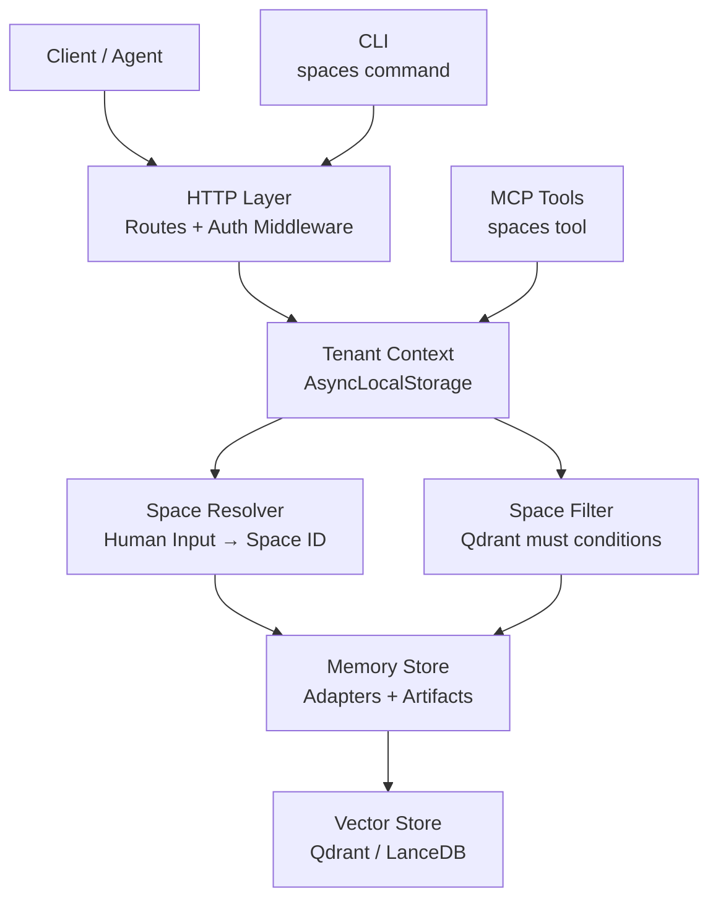
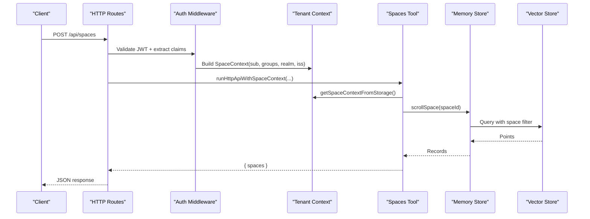
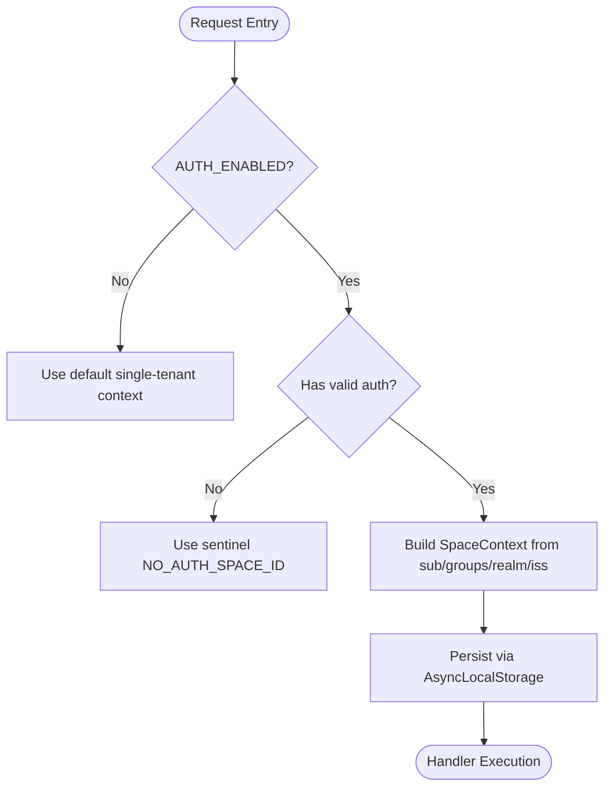
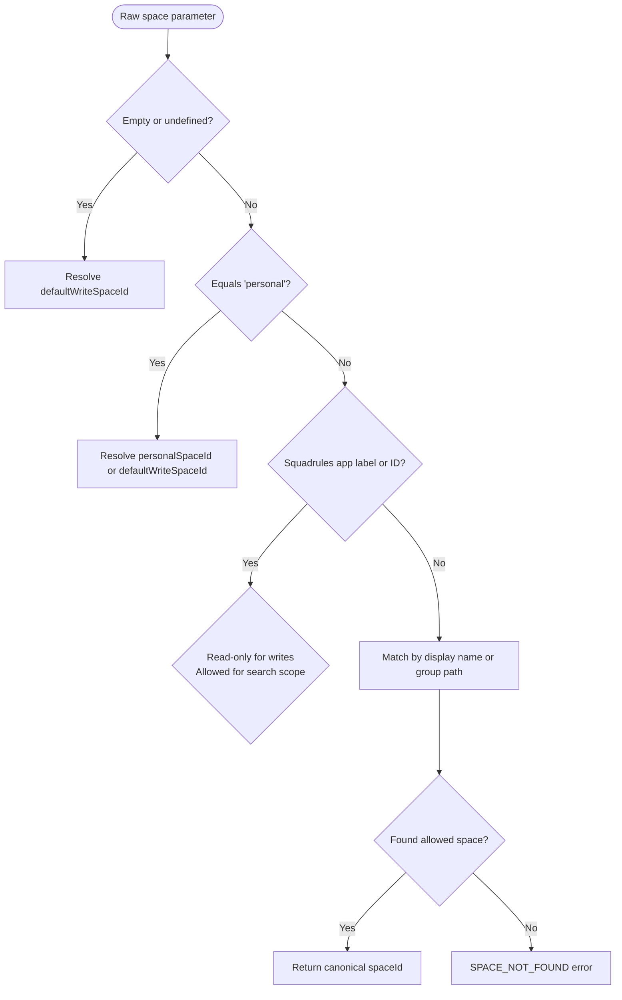
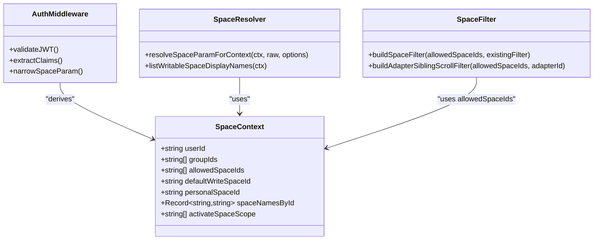
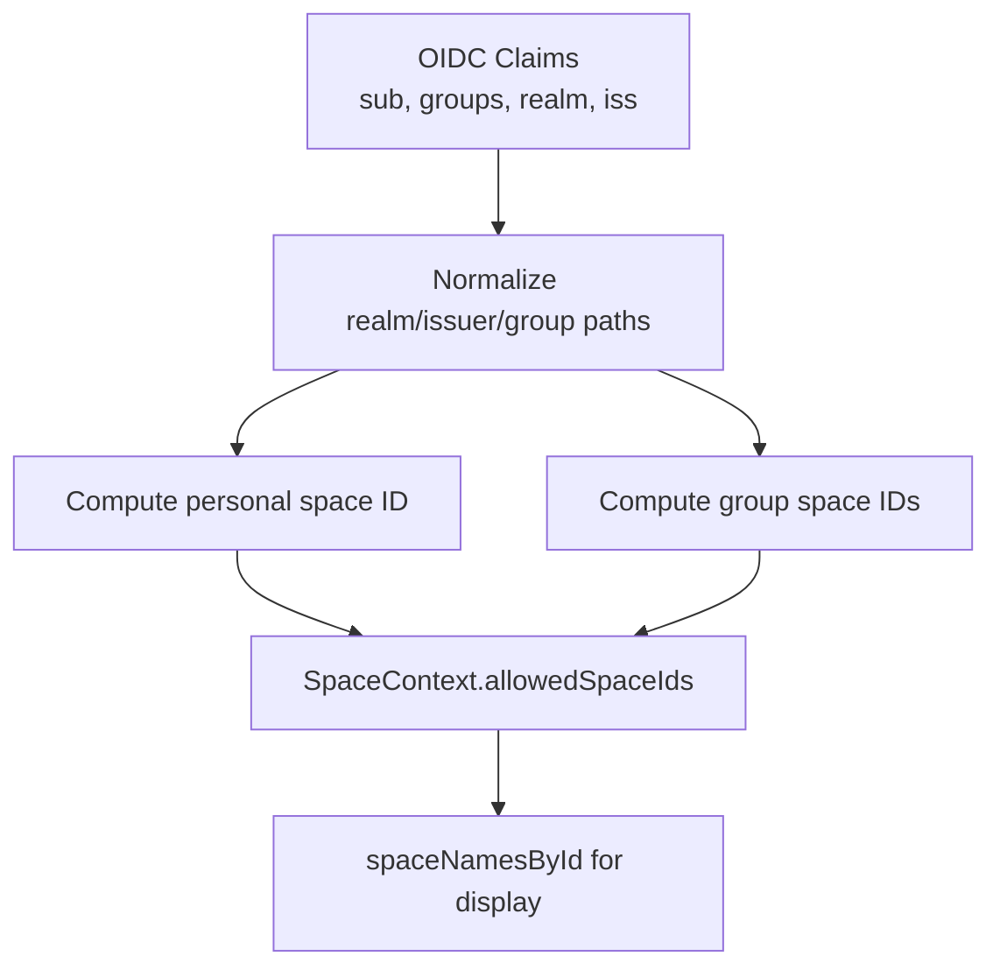
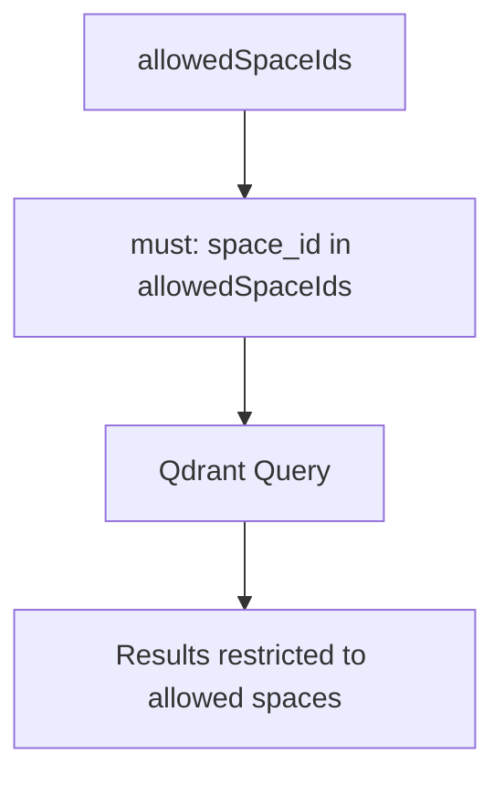
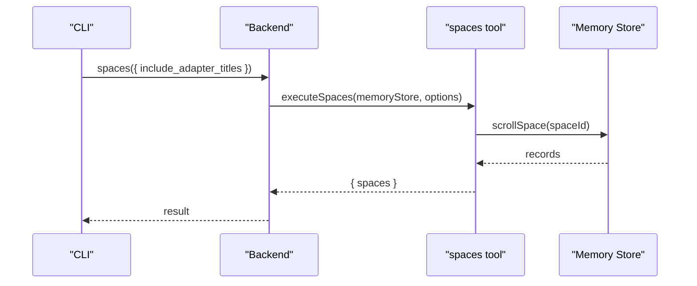
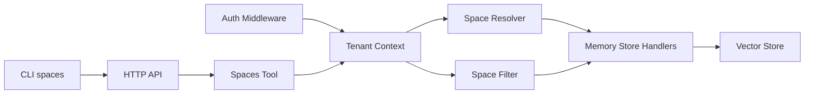

# Spaces & Multi-tenancy

<cite>
**Referenced Files in This Document**
- [tenant-context.ts](file://src/utils/tenant-context.ts)
- [resolve-space-param.ts](file://src/utils/resolve-space-param.ts)
- [space-filter.ts](file://src/utils/space-filter.ts)
- [spaces.ts](file://src/tools/spaces.ts)
- [http-api-spaces.ts](file://src/http/http-api-spaces.ts)
- [spaces.ts](file://src/cli/commands/spaces.ts)
- [http-auth-middleware.ts](file://src/http/http-auth-middleware.ts)
- [oidc-profile-claims.ts](file://src/http/oidc-profile-claims.ts)
- [oidc-scopes.ts](file://src/http/oidc-scopes.ts)
- [store-adapter-default-handler.ts](file://src/services/memory/store-adapter-default-handler.ts)
- [store-adapter-header-handler.ts](file://src/services/memory/store-adapter-header-handler.ts)
- [store-artifact.ts](file://src/services/memory/store-artifact.ts)
- [activation-search-backfill.ts](file://src/services/memory/activation-search-backfill.ts)
- [mem-resources-boot.ts](file://src/resources/mem-resources-boot.ts)
</cite>

## Table of Contents
1. [Introduction](#introduction)
2. [Project Structure](#project-structure)
3. [Core Components](#core-components)
4. [Architecture Overview](#architecture-overview)
5. [Detailed Component Analysis](#detailed-component-analysis)
6. [Dependency Analysis](#dependency-analysis)
7. [Performance Considerations](#performance-considerations)
8. [Troubleshooting Guide](#troubleshooting-guide)
9. [Conclusion](#conclusion)
10. [Appendices](#appendices)

## Introduction
Spaces are the logical isolation boundary in SquadRules for multi-tenant operation. A space groups adapters, artifacts, and metadata so that teams or projects can operate independently while sharing the same runtime. The system supports:

- Logical isolation per space for adapters, artifacts, and metadata.
- Space-based access control derived from authentication (Keycloak).
- Tenant context propagation through HTTP requests and async execution boundaries.
- Space resolution helpers for human-friendly inputs such as personal, group names, or explicit IDs.
- Search filtering to ensure queries only touch allowed spaces.
- Read-only app space behavior for built-in SquadRules adapters.

This document explains how spaces work end-to-end, including request lifecycle integration, permission mapping, default handling, cross-space operations, migration guidance, and performance considerations.

## Project Structure
The spaces feature spans several layers:

- Authentication and OIDC layer: derives user identity, groups, realm, and issuer into a space context.
- Context propagation: stores and retrieves tenant and space context across async boundaries.
- Space resolution: converts user input into canonical space IDs with read/write semantics.
- Storage and search: applies space filters to Qdrant operations.
- Tools and API: exposes spaces listing and uses the resolved context for all operations.
- CLI: provides a command to list available spaces.

**Diagram sources**
- [http-auth-middleware.ts](file://src/http/http-auth-middleware.ts)
- [tenant-context.ts](file://src/utils/tenant-context.ts)
- [resolve-space-param.ts](file://src/utils/resolve-space-param.ts)
- [space-filter.ts](file://src/utils/space-filter.ts)
- [http-api-spaces.ts](file://src/http/http-api-spaces.ts)
- [spaces.ts](file://src/tools/spaces.ts)
- [spaces.ts](file://src/cli/commands/spaces.ts)

**Section sources**
- [tenant-context.ts:1-312](file://src/utils/tenant-context.ts#L1-L312)
- [resolve-space-param.ts:1-117](file://src/utils/resolve-space-param.ts#L1-L117)
- [space-filter.ts:1-48](file://src/utils/space-filter.ts#L1-L48)
- [http-api-spaces.ts:1-32](file://src/http/http-api-spaces.ts#L1-L32)
- [spaces.ts](file://src/tools/spaces.ts)
- [spaces.ts](file://src/cli/commands/spaces.ts)

## Core Components
- Space context model: defines user identity, group membership, allowed spaces, default write space, personal space, display names, and optional activation scope.
- Context propagation: AsyncLocalStorage-backed storage for synchronous and asynchronous execution paths.
- Space resolver: maps human-oriented inputs like personal, group names, or raw IDs to canonical space IDs with read/write rules.
- Space filter: builds Qdrant query filters enforcing space isolation.
- Spaces tool and HTTP route: expose listing capabilities using current context.
- CLI spaces command: allows users to list spaces via the CLI.

Key responsibilities:
- Derive allowed spaces from Keycloak groups and user identity.
- Enforce strict isolation when authentication is enabled but no context exists.
- Provide safe defaults for single-tenant mode.
- Ensure writes target the correct space while searches may include read-only app space.

**Section sources**
- [tenant-context.ts:23-42](file://src/utils/tenant-context.ts#L23-L42)
- [tenant-context.ts:55-129](file://src/utils/tenant-context.ts#L55-L129)
- [resolve-space-param.ts:10-20](file://src/utils/resolve-space-param.ts#L10-L20)
- [space-filter.ts:14-26](file://src/utils/space-filter.ts#L14-L26)
- [http-api-spaces.ts:11-31](file://src/http/http-api-spaces.ts#L11-L31)
- [spaces.ts:172-189](file://src/tools/spaces.ts#L172-L189)
- [spaces.ts:12-34](file://src/cli/commands/spaces.ts#L12-L34)

## Architecture Overview
The multi-tenant architecture centers on deriving a SpaceContext from authentication and propagating it through the request lifecycle. All storage and search operations use this context to enforce isolation.

**Diagram sources**
- [http-api-spaces.ts:11-31](file://src/http/http-api-spaces.ts#L11-L31)
- [http-auth-middleware.ts](file://src/http/http-auth-middleware.ts)
- [tenant-context.ts:256-303](file://src/utils/tenant-context.ts#L256-L303)
- [spaces.ts:172-189](file://src/tools/spaces.ts#L172-L189)

## Detailed Component Analysis

### Space Context and Tenant Propagation
The space context carries:
- User identity and group IDs.
- Allowed space IDs derived from Keycloak groups.
- Default write space for new data.
- Personal space ID for explicit personal scoping.
- Optional activation scope for narrowing search to specific spaces.
- Request correlation ID for tracing.

Propagation mechanisms:
- Synchronous context wrapping for simple callbacks.
- Asynchronous context wrapping for handlers that await store operations.
- Fallbacks:
  - When AUTH_ENABLED is false: single-tenant default context with personal and app spaces.
  - When AUTH_ENABLED is true but no auth context: sentinel space with no shared data.

**Diagram sources**
- [tenant-context.ts:57-87](file://src/utils/tenant-context.ts#L57-L87)
- [tenant-context.ts:95-129](file://src/utils/tenant-context.ts#L95-L129)
- [tenant-context.ts:256-303](file://src/utils/tenant-context.ts#L256-L303)

**Section sources**
- [tenant-context.ts:23-42](file://src/utils/tenant-context.ts#L23-L42)
- [tenant-context.ts:57-129](file://src/utils/tenant-context.ts#L57-L129)
- [tenant-context.ts:256-303](file://src/utils/tenant-context.ts#L256-L303)

### Space Resolution Mechanisms
Space resolution translates user-facing parameters into canonical space IDs:
- Empty or undefined resolves to default write space if present; otherwise fails.
- personal resolves to the user’s personal space from JWT or falls back to default write space.
- Squadrules app space is read-only for writes; allowed for read-only search scoping.
- Group names support both raw IDs and display names, including optional Group: prefix and path normalization.
- Writable space name listing helps UIs and agents choose valid targets.

**Diagram sources**
- [resolve-space-param.ts:26-103](file://src/utils/resolve-space-param.ts#L26-L103)
- [resolve-space-param.ts:105-116](file://src/utils/resolve-space-param.ts#L105-L116)

**Section sources**
- [resolve-space-param.ts:10-20](file://src/utils/resolve-space-param.ts#L10-L20)
- [resolve-space-param.ts:26-103](file://src/utils/resolve-space-param.ts#L26-L103)
- [resolve-space-param.ts:105-116](file://src/utils/resolve-space-param.ts#L105-L116)

### Space-Based Access Controls
Access control is enforced at multiple layers:
- Authentication layer derives allowed spaces from Keycloak groups and user identity.
- HTTP middleware validates optional ?space= query parameter against allowed spaces and narrows context accordingly.
- Writes always target defaultWriteSpaceId unless explicitly scoped; reads/searches may include app space depending on configuration.
- Space filters applied to vector store queries ensure results belong to allowed spaces.

**Diagram sources**
- [tenant-context.ts:23-42](file://src/utils/tenant-context.ts#L23-L42)
- [http-auth-middleware.ts](file://src/http/http-auth-middleware.ts)
- [resolve-space-param.ts:26-103](file://src/utils/resolve-space-param.ts#L26-L103)
- [space-filter.ts:14-47](file://src/utils/space-filter.ts#L14-L47)

**Section sources**
- [http-auth-middleware.ts](file://src/http/http-auth-middleware.ts)
- [resolve-space-param.ts:26-103](file://src/utils/resolve-space-param.ts#L26-L103)
- [space-filter.ts:14-47](file://src/utils/space-filter.ts#L14-L47)

### Relationship Between Spaces and Authentication
Authentication integrates with spaces through Keycloak:
- User identity (sub), groups, realm, and issuer are used to compute deterministic space IDs.
- Personal space ID is derived from issuer and user sub.
- Group space IDs are derived from issuer and normalized full group paths.
- Space names map to canonical group paths for display.
- OIDC profile claims and scopes provide the necessary fields for context derivation.

**Diagram sources**
- [tenant-context.ts:187-248](file://src/utils/tenant-context.ts#L187-L248)
- [oidc-profile-claims.ts](file://src/http/oidc-profile-claims.ts)
- [oidc-scopes.ts](file://src/http/oidc-scopes.ts)

**Section sources**
- [tenant-context.ts:187-248](file://src/utils/tenant-context.ts#L187-L248)
- [oidc-profile-claims.ts](file://src/http/oidc-profile-claims.ts)
- [oidc-scopes.ts](file://src/http/oidc-scopes.ts)

### Default Space Handling and Cross-Space Operations
Defaults:
- Single-tenant mode: personal space plus app space are allowed; personal is default write space.
- Auth-enabled without context: sentinel space prevents accidental sharing.
- Explicit personal: resolves to user’s personal space even when query scope is narrowed to a group.

Cross-space operations:
- Searches may include app space for broader discovery unless activated scope restricts them.
- Writes should not target app space; attempts return read-only errors.
- Activation scope narrows allowed spaces and default write space appropriately.

**Section sources**
- [tenant-context.ts:57-87](file://src/utils/tenant-context.ts#L57-L87)
- [tenant-context.ts:137-179](file://src/utils/tenant-context.ts#L137-L179)
- [resolve-space-param.ts:56-67](file://src/utils/resolve-space-param.ts#L56-L67)

### Space Filtering in Search and Retrieval
Space filtering ensures vector store queries respect isolation:
- buildSpaceFilter adds a must condition restricting space_id to allowedSpaceIds.
- Adapter sibling scroll filter includes older rows without space_id payload to maintain compatibility during migrations.
- Activation search backfill uses allowed spaces to scope backfills.

**Diagram sources**
- [space-filter.ts:14-26](file://src/utils/space-filter.ts#L14-L26)
- [space-filter.ts:32-47](file://src/utils/space-filter.ts#L32-L47)
- [activation-search-backfill.ts:24-24](file://src/services/memory/activation-search-backfill.ts#L24-L24)

**Section sources**
- [space-filter.ts:14-47](file://src/utils/space-filter.ts#L14-L47)
- [activation-search-backfill.ts:24-24](file://src/services/memory/activation-search-backfill.ts#L24-L24)

### Spaces Tool and HTTP API
Spaces tool:
- Lists available spaces with adapter counts and optionally adapter titles and artifacts.
- Uses current request space context to determine allowed spaces.
- Integrates metrics and structured logging.

HTTP API:
- POST /api/spaces accepts include_adapter_titles and include_artifacts flags.
- Wraps execution with runHttpApiWithSpaceContext to propagate context across async boundaries.

CLI:
- spaces command calls backend.spaces and renders results in pretty or text format.

**Diagram sources**
- [spaces.ts](file://src/tools/spaces.ts)
- [http-api-spaces.ts:11-31](file://src/http/http-api-spaces.ts#L11-L31)
- [spaces.ts](file://src/cli/commands/spaces.ts)

**Section sources**
- [spaces.ts:172-189](file://src/tools/spaces.ts#L172-L189)
- [http-api-spaces.ts:11-31](file://src/http/http-api-spaces.ts#L11-L31)
- [spaces.ts:12-34](file://src/cli/commands/spaces.ts#L12-L34)

### Data Isolation Guarantees
Guarantees:
- Vector store queries apply space filters to prevent cross-space leakage.
- Writes target defaultWriteSpaceId unless explicitly scoped; app space is read-only.
- Sentinel space isolates unauthenticated contexts when AUTH_ENABLED.
- Personal space remains stable across group-scoped queries.

Operational notes:
- Backfills and adapter sibling scans consider legacy rows without space_id to avoid breaking history.
- Resource bootstrapping sets app space context for internal resources.

**Section sources**
- [space-filter.ts:14-47](file://src/utils/space-filter.ts#L14-L47)
- [tenant-context.ts:57-87](file://src/utils/tenant-context.ts#L57-L87)
- [mem-resources-boot.ts:43-45](file://src/resources/mem-resources-boot.ts#L43-L45)

### Practical Examples

#### Example: Creating and Using Spaces
- Create Keycloak groups for each team or project.
- Assign users to groups; ensure realm and issuer are configured.
- On login, SpaceContext.allowedSpaceIds will include personal and group spaces.
- Use personal for individual work; use group names for team collaboration.
- For search, you can narrow to a specific space using ?space= or tool parameters.

#### Example: Configuring Access Control
- Map Keycloak groups to space IDs deterministically.
- Restrict writes to personal or group spaces; app space remains read-only.
- Validate ?space= parameter against allowed spaces in middleware.

#### Example: Listing Spaces
- Call POST /api/spaces with include_adapter_titles or include_artifacts flags.
- Use CLI spaces command to list spaces and adapter counts.

[No code snippets included; see referenced files for implementation details]

**Section sources**
- [http-api-spaces.ts:11-31](file://src/http/http-api-spaces.ts#L11-L31)
- [spaces.ts](file://src/tools/spaces.ts)
- [spaces.ts](file://src/cli/commands/spaces.ts)

### Space Migration Strategies
Migration considerations:
- Legacy rows without space_id payload are considered during adapter sibling scans to preserve history.
- When migrating data, ensure new rows include space_id aligned with allowedSpaceIds.
- Use buildAdapterSiblingScrollFilter to include older rows without space_id.
- Backfills should scope to allowed spaces to avoid cross-tenant contamination.

Best practices:
- Phase out missing space_id payloads gradually.
- Validate that all writes set space_id correctly.
- Monitor backfills and sibling scans for anomalies.

**Section sources**
- [space-filter.ts:32-47](file://src/utils/space-filter.ts#L32-L47)
- [activation-search-backfill.ts:24-24](file://src/services/memory/activation-search-backfill.ts#L24-L24)

### Performance Considerations
- Space filters add a must condition to Qdrant queries; keep allowedSpaceIds minimal to reduce query complexity.
- Avoid unnecessary inclusion of app space in search scopes unless required.
- Use pagination limits in tools to prevent large payloads.
- Metrics and structured logging help identify slow operations and errors.

[No sources needed since this section provides general guidance]

## Dependency Analysis
The following diagram shows key dependencies among components involved in spaces and multi-tenancy.

**Diagram sources**
- [http-auth-middleware.ts](file://src/http/http-auth-middleware.ts)
- [tenant-context.ts](file://src/utils/tenant-context.ts)
- [resolve-space-param.ts](file://src/utils/resolve-space-param.ts)
- [space-filter.ts](file://src/utils/space-filter.ts)
- [http-api-spaces.ts](file://src/http/http-api-spaces.ts)
- [spaces.ts](file://src/tools/spaces.ts)
- [spaces.ts](file://src/cli/commands/spaces.ts)

**Section sources**
- [http-auth-middleware.ts](file://src/http/http-auth-middleware.ts)
- [tenant-context.ts](file://src/utils/tenant-context.ts)
- [resolve-space-param.ts](file://src/utils/resolve-space-param.ts)
- [space-filter.ts](file://src/utils/space-filter.ts)
- [http-api-spaces.ts](file://src/http/http-api-spaces.ts)
- [spaces.ts](file://src/tools/spaces.ts)
- [spaces.ts](file://src/cli/commands/spaces.ts)

## Performance Considerations
- Keep allowedSpaceIds small and precise to minimize filter overhead.
- Prefer explicit activation scopes for targeted searches to avoid scanning unrelated spaces.
- Use include_adapter_titles and include_artifacts selectively to reduce payload size.
- Monitor metrics for tool duration, input/output sizes, and error rates.

[No sources needed since this section provides general guidance]

## Troubleshooting Guide
Common issues and resolutions:
- SPACE_NOT_FOUND: The requested space does not exist in allowed spaces; verify group membership or personal space configuration.
- SPACE_READ_ONLY: Attempted to write to app space; use personal or a group space instead.
- No default space: Ensure defaultWriteSpaceId is set or that allowedSpaceIds contains a writable space.
- Cross-space leakage: Verify space filters are applied to all queries and writes target defaultWriteSpaceId.
- Unauthenticated isolation: When AUTH_ENABLED is true, unauthenticated requests use sentinel space; ensure proper authentication.

Diagnostic steps:
- Inspect SpaceContext fields (allowedSpaceIds, defaultWriteSpaceId, personalSpaceId).
- Check OIDC claims and group mappings.
- Review HTTP middleware validation of ?space=.
- Validate Qdrant filters include space_id constraints.

**Section sources**
- [resolve-space-param.ts:26-103](file://src/utils/resolve-space-param.ts#L26-L103)
- [tenant-context.ts:57-87](file://src/utils/tenant-context.ts#L57-L87)
- [http-auth-middleware.ts](file://src/http/http-auth-middleware.ts)
- [space-filter.ts:14-47](file://src/utils/space-filter.ts#L14-L47)

## Conclusion
Spaces provide robust logical isolation for multi-tenant operations in SquadRules. By deriving allowed spaces from Keycloak, propagating context through async boundaries, resolving human-friendly inputs safely, and applying strict filters to storage and search, the system ensures secure and predictable behavior. Adhering to the recommended patterns for default handling, cross-space operations, and migration strategies will help teams design effective multi-tenant applications.

[No sources needed since this section summarizes without analyzing specific files]

## Appendices

### Write Path Integration Points
Writes consistently use defaultWriteSpaceId:
- Default adapter handler writes to defaultWriteSpaceId.
- Header adapter handler writes to defaultWriteSpaceId.
- Artifact store writes to defaultWriteSpaceId.

**Section sources**
- [store-adapter-default-handler.ts:145-145](file://src/services/memory/store-adapter-default-handler.ts#L145-L145)
- [store-adapter-header-handler.ts:93-93](file://src/services/memory/store-adapter-header-handler.ts#L93-L93)
- [store-artifact.ts:188-188](file://src/services/memory/store-artifact.ts#L188-L188)