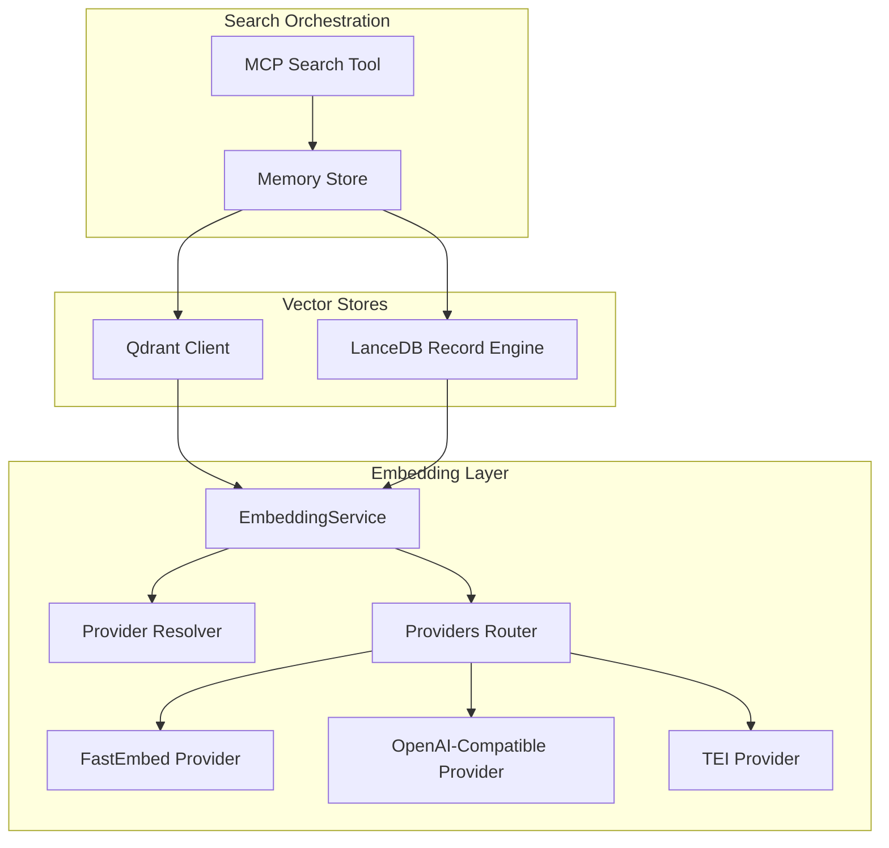
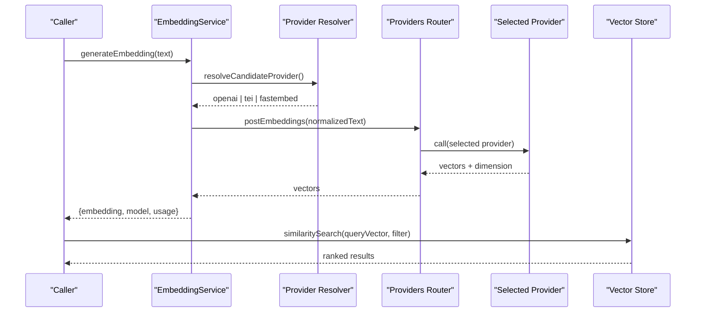
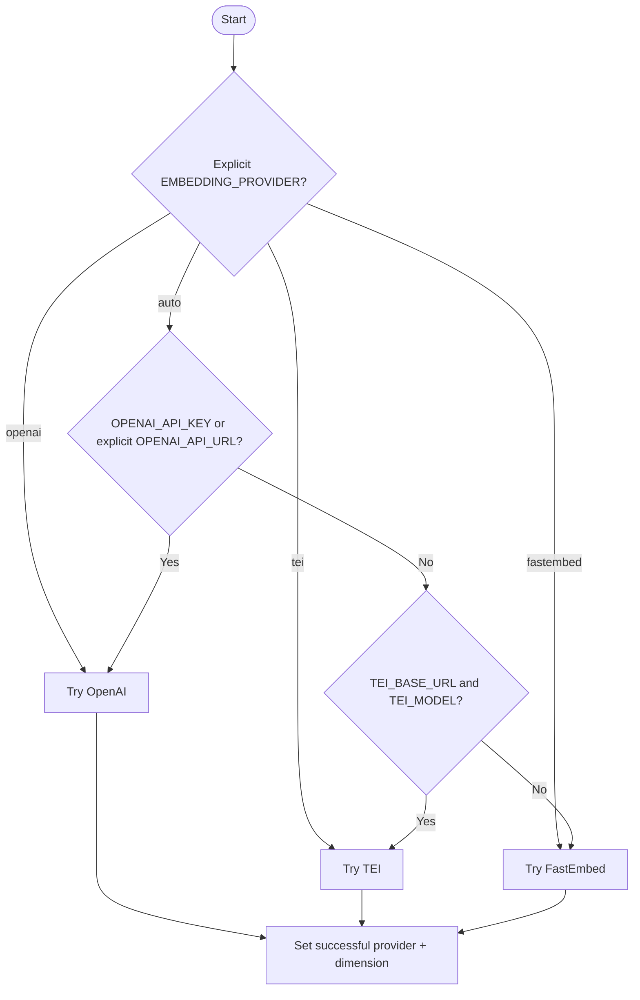
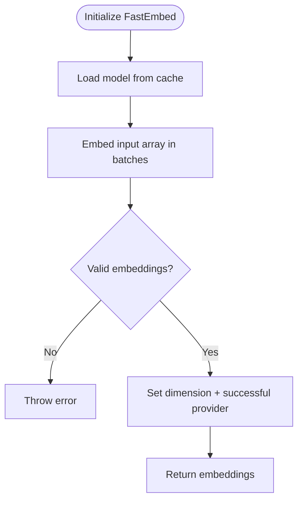
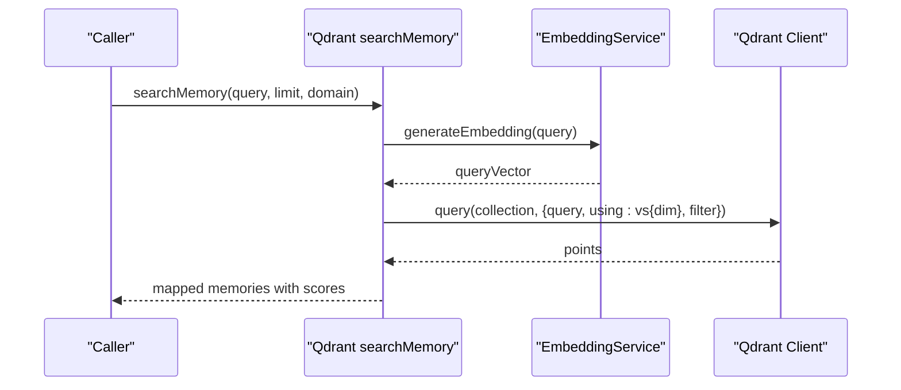
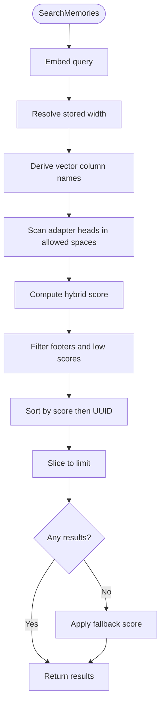
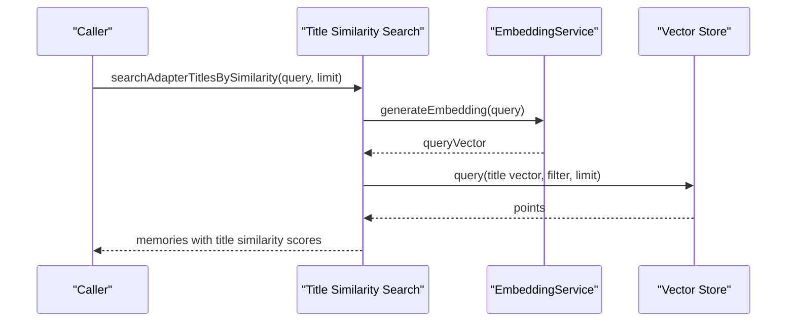
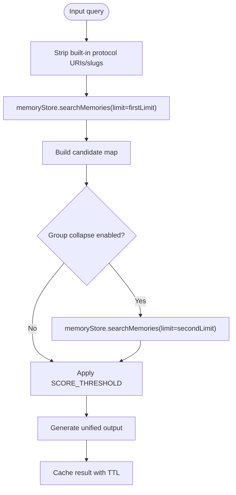
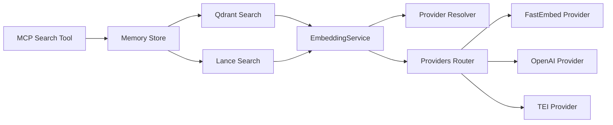

# Vector Search & Embeddings

<cite>
**Referenced Files in This Document**
- [service.ts](file://src/services/embedding/service.ts)
- [providers.ts](file://src/services/embedding/providers.ts)
- [provider-resolver.ts](file://src/services/embedding/provider-resolver.ts)
- [fastembed-provider.ts](file://src/services/embedding/fastembed-provider.ts)
- [config.ts](file://src/services/embedding/config.ts)
- [types.ts](file://src/services/embedding/types.ts)
- [embedding-fastembed.ts](file://src/config/embedding-fastembed.ts)
- [search.ts](file://src/services/qdrant/search.ts)
- [memory-retrieval.ts](file://src/services/qdrant/memory-retrieval.ts)
- [lance-records-search.ts](file://src/services/vector-store/lancedb/lance-records-search.ts)
- [store-title-similarity-search.ts](file://src/services/memory/store-title-similarity-search.ts)
- [tools-search.ts](file://src/tools/search.ts)
- [0021-embedding-provider-auto-resolution-and-store-width-binding.md](file://docs/adr/0021-embedding-provider-auto-resolution-and-store-width-binding.md)
- [0004-fastembed-default-for-testing.md](file://docs/adr/0004-fastembed-default-for-testing.md)
- [0003-no-lancedb-store-snapshot.md](file://docs/adr/0003-no-lancedb-store-snapshot.md)
</cite>

## Table of Contents
1. [Introduction](#introduction)
2. [Project Structure](#project-structure)
3. [Core Components](#core-components)
4. [Architecture Overview](#architecture-overview)
5. [Detailed Component Analysis](#detailed-component-analysis)
6. [Dependency Analysis](#dependency-analysis)
7. [Performance Considerations](#performance-considerations)
8. [Troubleshooting Guide](#troubleshooting-guide)
9. [Conclusion](#conclusion)

## Introduction
This document explains how SquadRules performs semantic search and similarity matching through its embedding and vector search pipeline. It covers the end-to-end flow from text processing to vector generation, storage, retrieval, and hybrid ranking. It also documents the provider abstraction supporting FastEmbed, OpenAI-compatible endpoints, and TEI; the relationship between embeddings and adapter metadata; and practical guidance for configuration, performance tuning, and troubleshooting embedding quality.

SquadRules uses two vector backends:
- Qdrant as the primary remote-capable vector store.
- LanceDB as the embedded secondary backend.

Both are used to index and retrieve adapters and related memory records using dense vectors plus keyword-style boosts.

## Project Structure
The embedding and vector search functionality is organized into three main layers:
- Embedding providers and service: abstracts model selection, dimension resolution, retries, and metrics.
- Vector stores: Qdrant client wrappers and LanceDB record engine with JS-side cosine scoring.
- Search orchestration: MCP tool and HTTP entry points that combine semantic results, deduplicate candidates, and produce unified output.



**Diagram sources**
- [service.ts:39-278](file://src/services/embedding/service.ts#L39-L278)
- [provider-resolver.ts:28-46](file://src/services/embedding/provider-resolver.ts#L28-L46)
- [providers.ts:296-333](file://src/services/embedding/providers.ts#L296-L333)
- [fastembed-provider.ts:41-82](file://src/services/embedding/fastembed-provider.ts#L41-L82)
- [search.ts:11-36](file://src/services/qdrant/search.ts#L11-L36)
- [lance-records-search.ts:96-125](file://src/services/vector-store/lancedb/lance-records-search.ts#L96-L125)
- [tools-search.ts:143-186](file://src/tools/search.ts#L143-L186)

**Section sources**
- [service.ts:39-278](file://src/services/embedding/service.ts#L39-L278)
- [providers.ts:296-333](file://src/services/embedding/providers.ts#L296-L333)
- [search.ts:11-36](file://src/services/qdrant/search.ts#L11-L36)
- [lance-records-search.ts:96-125](file://src/services/vector-store/lancedb/lance-records-search.ts#L96-L125)
- [tools-search.ts:143-186](file://src/tools/search.ts#L143-L186)

## Core Components
- EmbeddingService: public API for single and batch embeddings, cosine similarity, health checks, and provider/model/dimension reporting.
- Provider resolver and router: selects candidate provider based on explicit preference or auto-detection, then routes to OpenAI-compatible, TEI, or FastEmbed.
- FastEmbed provider: local ONNX-based embeddings with lazy initialization and shared cache directory.
- Qdrant search wrapper: embeds query text, builds space-scoped filters, and executes vector similarity search.
- LanceDB search: scans adapter heads in allowed spaces and scores them in JavaScript using stored dense vectors plus text boosts.
- Memory retrieval helpers: access control, slug resolution, and adapter layer listing.
- MCP search tool: orchestrates candidate building, deduplication, thresholding, caching, and unified output.

Key responsibilities:
- Dimension resolution at startup prevents silent mismatches between query and stored vectors.
- Provider auto-resolution keeps zero-config installs working while respecting configured endpoints.
- Hybrid ranking combines semantic similarity with title, activation pattern, label, tag, and attest boosts.

**Section sources**
- [service.ts:48-127](file://src/services/embedding/service.ts#L48-L127)
- [service.ts:130-221](file://src/services/embedding/service.ts#L130-L221)
- [provider-resolver.ts:28-46](file://src/services/embedding/provider-resolver.ts#L28-L46)
- [providers.ts:296-333](file://src/services/embedding/providers.ts#L296-L333)
- [fastembed-provider.ts:26-39](file://src/services/embedding/fastembed-provider.ts#L26-L39)
- [search.ts:11-36](file://src/services/qdrant/search.ts#L11-L36)
- [lance-records-search.ts:96-125](file://src/services/vector-store/lancedb/lance-records-search.ts#L96-L125)
- [memory-retrieval.ts:152-199](file://src/services/qdrant/memory-retrieval.ts#L152-L199)
- [tools-search.ts:93-111](file://src/tools/search.ts#L93-L111)

## Architecture Overview
The embedding pipeline proceeds as follows:
1. Text normalization and validation occur in the embedding service.
2. The provider resolver determines the candidate provider (explicit preference or auto).
3. The provider router calls the selected implementation with retry/backoff logic.
4. Successful responses set the resolved embedding dimension and successful provider descriptor.
5. Vector stores use the resolved dimension to name vector columns and select named vectors.
6. Search queries are embedded and matched against stored vectors, optionally boosted by keyword-like fields.
7. Results are filtered, scored, deduplicated, and returned to callers.



**Diagram sources**
- [service.ts:48-127](file://src/services/embedding/service.ts#L48-L127)
- [provider-resolver.ts:28-46](file://src/services/embedding/provider-resolver.ts#L28-L46)
- [providers.ts:296-333](file://src/services/embedding/providers.ts#L296-L333)
- [search.ts:11-36](file://src/services/qdrant/search.ts#L11-L36)

## Detailed Component Analysis

### Embedding Service and Types
EmbeddingService exposes:
- Single embedding generation with anomaly detection, dimension validation, metrics, and audit logging.
- Batch embedding generation with per-vector dimension checks and aggregated metrics.
- Cosine similarity calculation with dimension checks.
- Health check delegation to the embedding health module.
- Provider and model introspection via the provider resolver.

Types define the shape of single and batch embedding results, including model identity and token usage placeholders.

```mermaid
classDiagram
class EmbeddingService {
+generateEmbedding(text) EmbeddingResult
+generateBatchEmbeddings(texts) BatchEmbeddingResult
+calculateCosineSimilarity(a, b) number
+generateMemoryEmbedding(memory) number[]
+healthCheck() Promise~{healthy,message}~
+getProvider() string
+getConfig() object
}
class EmbeddingResult {
+number[] embedding
+string model
+object usage
}
class BatchEmbeddingResult {
+number[][] embeddings
+string model
+object usage
}
EmbeddingService --> EmbeddingResult : "returns"
EmbeddingService --> BatchEmbeddingResult : "returns"
```

**Diagram sources**
- [service.ts:39-278](file://src/services/embedding/service.ts#L39-L278)
- [types.ts:1-17](file://src/services/embedding/types.ts#L1-L17)

**Section sources**
- [service.ts:48-127](file://src/services/embedding/service.ts#L48-L127)
- [service.ts:130-221](file://src/services/embedding/service.ts#L130-L221)
- [service.ts:224-278](file://src/services/embedding/service.ts#L224-L278)
- [types.ts:1-17](file://src/services/embedding/types.ts#L1-L17)

### Provider Abstraction and Auto-Resolution
Provider resolution separates what will be tried from what succeeded:
- Candidate selection supports explicit preferences (`openai`, `tei`, `fastembed`) and auto-detection.
- Auto-detection prefers an OpenAI-compatible endpoint when a key or explicitly overridden URL is present, falls back to TEI if configured, otherwise uses FastEmbed.
- Successful providers record provider, model, and dimension once valid vectors are returned.

Configuration includes:
- OpenAI endpoint construction and default embedding model.
- TEI endpoint construction.
- Runtime dimension cache with strict mismatch protection.



**Diagram sources**
- [provider-resolver.ts:28-46](file://src/services/embedding/provider-resolver.ts#L28-L46)
- [providers.ts:296-333](file://src/services/embedding/providers.ts#L296-L333)
- [config.ts:1-40](file://src/services/embedding/config.ts#L1-L40)

**Section sources**
- [provider-resolver.ts:28-46](file://src/services/embedding/provider-resolver.ts#L28-L46)
- [providers.ts:296-333](file://src/services/embedding/providers.ts#L296-L333)
- [config.ts:1-40](file://src/services/embedding/config.ts#L1-L40)

### FastEmbed Provider
FastEmbed provides local embeddings without external keys:
- Lazy initialization downloads model weights into a shared cache directory.
- Embeddings are streamed in batches and validated for non-empty arrays.
- On success, it sets the resolved dimension and successful provider descriptor.

Configuration:
- Default model is a small English embedding with 384 dimensions.
- Cache directory defaults to a user-shared location to avoid duplicate downloads.



**Diagram sources**
- [fastembed-provider.ts:26-39](file://src/services/embedding/fastembed-provider.ts#L26-L39)
- [fastembed-provider.ts:41-82](file://src/services/embedding/fastembed-provider.ts#L41-L82)
- [embedding-fastembed.ts:14-22](file://src/config/embedding-fastembed.ts#L14-L22)

**Section sources**
- [fastembed-provider.ts:26-39](file://src/services/embedding/fastembed-provider.ts#L26-L39)
- [fastembed-provider.ts:41-82](file://src/services/embedding/fastembed-provider.ts#L41-L82)
- [embedding-fastembed.ts:14-22](file://src/config/embedding-fastembed.ts#L14-L22)

### Qdrant Vector Search
Qdrant search wraps embedding generation and vector similarity search:
- Generates a query embedding using the embedding service.
- Builds space-scoped filters and domain filters.
- Executes a vector query using a named vector column derived from the query vector dimension.
- Maps Qdrant points to memory objects with confidence and relevance scores.



**Diagram sources**
- [search.ts:11-36](file://src/services/qdrant/search.ts#L11-L36)
- [search.ts:47-72](file://src/services/qdrant/search.ts#L47-L72)

**Section sources**
- [search.ts:11-36](file://src/services/qdrant/search.ts#L11-L36)
- [search.ts:47-72](file://src/services/qdrant/search.ts#L47-L72)

### LanceDB Hybrid Ranking
LanceDB implements hybrid-style ranking in JavaScript:
- Embeds the query and derives column names from the store’s bound width rather than the query length.
- Scans adapter head records within allowed spaces.
- Scores each record using:
  - Primary dense vector cosine similarity.
  - Adapter title vector cosine similarity.
  - Activation pattern vector cosine similarity.
  - Label and tag text matches.
  - Stored attest boost.
- Filters built-in footer protocols, sorts by score then UUID, slices to limit, and applies fallback scoring when needed.



**Diagram sources**
- [lance-records-search.ts:96-125](file://src/services/vector-store/lancedb/lance-records-search.ts#L96-L125)
- [lance-records-search.ts:127-140](file://src/services/vector-store/lancedb/lance-records-search.ts#L127-L140)

**Section sources**
- [lance-records-search.ts:96-125](file://src/services/vector-store/lancedb/lance-records-search.ts#L96-L125)
- [lance-records-search.ts:127-140](file://src/services/vector-store/lancedb/lance-records-search.ts#L127-L140)

### Adapter Title Similarity Search
Adapter title similarity search is available for both Qdrant and LanceDB:
- Qdrant path uses a dedicated named vector for adapter titles and rescores with quantization enabled.
- LanceDB path mirrors this behavior by scoring only the adapter title vector.



**Diagram sources**
- [store-title-similarity-search.ts:9-61](file://src/services/memory/store-title-similarity-search.ts#L9-L61)
- [lance-records-search.ts:127-140](file://src/services/vector-store/lancedb/lance-records-search.ts#L127-L140)

**Section sources**
- [store-title-similarity-search.ts:9-61](file://src/services/memory/store-title-similarity-search.ts#L9-L61)
- [lance-records-search.ts:127-140](file://src/services/vector-store/lancedb/lance-records-search.ts#L127-L140)

### MCP Search Orchestration and Hybrid Ranking
The MCP search tool coordinates candidate building and result unification:
- Normalizes the query by stripping built-in protocol URIs and slugs.
- Calls the memory store’s semantic search with an initial limit and optional group collapse.
- Deduplicates candidates by adapter ID or memory UUID, preferring head layers and higher scores.
- Applies a score threshold and generates unified output including next actions and protocol versions.
- Caches results in Redis or memory with a TTL.



**Diagram sources**
- [tools-search.ts:35-51](file://src/tools/search.ts#L35-L51)
- [tools-search.ts:93-111](file://src/tools/search.ts#L93-L111)
- [tools-search.ts:143-186](file://src/tools/search.ts#L143-L186)
- [tools-search.ts:206-247](file://src/tools/search.ts#L206-L247)

**Section sources**
- [tools-search.ts:35-51](file://src/tools/search.ts#L35-L51)
- [tools-search.ts:93-111](file://src/tools/search.ts#L93-L111)
- [tools-search.ts:143-186](file://src/tools/search.ts#L143-L186)
- [tools-search.ts:206-247](file://src/tools/search.ts#L206-L247)

### Relationship Between Embeddings and Adapter Metadata
Embeddings are associated with adapter metadata through stored payload fields:
- Adapter identifiers, layer indices, layer counts, protocol versions, activation patterns, reward signals, and chain roots are included in memory payloads.
- Title similarity search targets adapter titles specifically.
- Activation pattern vectors enable semantic matching of adapter behavior patterns.
- Slug resolution helpers find first step memory UUIDs for protocol slugs, scoped to searchable spaces.

This design allows semantic search to improve adapter discovery by combining:
- Dense vector similarity across primary, title, and activation pattern vectors.
- Keyword-like boosts on labels and tags.
- Structural filters such as adapter layer index and slug.

**Section sources**
- [memory-retrieval.ts:104-149](file://src/services/qdrant/memory-retrieval.ts#L104-L149)
- [memory-retrieval.ts:152-199](file://src/services/qdrant/memory-retrieval.ts#L152-L199)
- [memory-retrieval.ts:228-300](file://src/services/qdrant/memory-retrieval.ts#L228-L300)
- [lance-records-search.ts:112-123](file://src/services/vector-store/lancedb/lance-records-search.ts#L112-L123)

## Dependency Analysis
Embedding and vector search components have clear dependencies:
- EmbeddingService depends on provider resolver, providers router, metrics, tenant context, and audit utilities.
- Providers depend on environment configuration, retry utilities, and dimension resolution.
- Qdrant search depends on embedding service, tenant context, space filters, and Qdrant client.
- LanceDB search depends on embedding service, space filters, vector type utilities, and record engine.
- MCP search depends on memory store, qdrant service, config constants, and output utilities.



**Diagram sources**
- [service.ts:39-278](file://src/services/embedding/service.ts#L39-L278)
- [provider-resolver.ts:28-46](file://src/services/embedding/provider-resolver.ts#L28-L46)
- [providers.ts:296-333](file://src/services/embedding/providers.ts#L296-L333)
- [search.ts:11-36](file://src/services/qdrant/search.ts#L11-L36)
- [lance-records-search.ts:96-125](file://src/services/vector-store/lancedb/lance-records-search.ts#L96-L125)
- [tools-search.ts:143-186](file://src/tools/search.ts#L143-L186)

**Section sources**
- [service.ts:39-278](file://src/services/embedding/service.ts#L39-L278)
- [providers.ts:296-333](file://src/services/embedding/providers.ts#L296-L333)
- [search.ts:11-36](file://src/services/qdrant/search.ts#L11-L36)
- [lance-records-search.ts:96-125](file://src/services/vector-store/lancedb/lance-records-search.ts#L96-L125)
- [tools-search.ts:143-186](file://src/tools/search.ts#L143-L186)

## Performance Considerations
- Use FastEmbed for zero-cost local embeddings in CI and local development.
- Prefer OpenAI-compatible endpoints when a key or explicitly overridden URL is configured for better model quality.
- Avoid unnecessary re-embedding by ensuring warm stores and reuse rules are active.
- Keep vector dimensions consistent across processes; mismatched dimensions cause silent failures or schema errors.
- Tune limits and thresholds:
  - Increase initial search limits when group collapse is disabled to capture more candidates.
  - Adjust SCORE_THRESHOLD to balance precision and recall.
- Monitor metrics:
  - Embedding request counts, duration, errors, vector size, and batch size.
  - Qdrant operation counts and query durations.
- For large datasets:
  - Use Qdrant with quantization rescore enabled for faster approximate nearest neighbor search.
  - Use LanceDB for embedded scenarios where remote infrastructure is not available.

[No sources needed since this section provides general guidance]

## Troubleshooting Guide

### Symptom: Silent Zero Scores or Missing Columns
- Cause: Query vector dimension differs from stored vector dimension.
- Resolution: Ensure probeEmbeddingDimension runs before store initialization; verify resolved dimension and successful provider.
- Evidence: Reads derive column names from query vector length when stored width is unavailable, causing cosine to return zero for missing columns.

**Section sources**
- [0021-embedding-provider-auto-resolution-and-store-width-binding.md:72-88](file://docs/adr/0021-embedding-provider-auto-resolution-and-store-width-binding.md#L72-L88)
- [lance-records-search.ts:104-109](file://src/services/vector-store/lancedb/lance-records-search.ts#L104-L109)

### Symptom: Schema Field Not Found Errors on Writes
- Cause: Writes attempt to insert vectors with a different dimension than the table schema.
- Resolution: Align provider and store width; do not rely on MEM_BOOT_FORCE_INJECT as a repair path because it deletes and retrains against the same fixed schema.
- Evidence: Embedded store creates tables once from the first row and does not reconcile columns during merge inserts.

**Section sources**
- [0021-embedding-provider-auto-resolution-and-store-width-binding.md:72-88](file://docs/adr/0021-embedding-provider-auto-resolution-and-store-width-binding.md#L72-L88)

### Symptom: OpenAI Endpoint Not Selected When Only URL Is Set
- Cause: Auto-detection requires either a key or an explicitly overridden URL.
- Resolution: Set OPENAI_API_KEY or ensure OPENAI_API_URL_EXPLICIT indicates an operator-set URL.
- Evidence: Auto branch tests key presence and explicit URL override.

**Section sources**
- [0021-embedding-provider-auto-resolution-and-store-width-binding.md:54-70](file://docs/adr/0021-embedding-provider-auto-resolution-and-store-width-binding.md#L54-L70)
- [provider-resolver.ts:36-45](file://src/services/embedding/provider-resolver.ts#L36-L45)

### Symptom: High Boot Time on Cold Stores
- Cause: Full boot injection and embedding of shipped adapters.
- Resolution: Warm stores skip in-sync adapters; ensure reuse rules are active and model weights are cached.
- Evidence: CI measurements show cold injection cost versus warm boot time.

**Section sources**
- [0004-fastembed-default-for-testing.md:67-78](file://docs/adr/0004-fastembed-default-for-testing.md#L67-L78)
- [0003-no-lancedb-store-snapshot.md:29-40](file://docs/adr/0003-no-lancedb-store-snapshot.md#L29-L40)

### Symptom: Rate Limiting or Quota Failures
- Cause: External provider rate limits or insufficient quota.
- Resolution: Handle EmbeddingRateLimitError; adjust retry budgets and backoff; verify billing/quota settings for OpenAI.
- Evidence: Provider router distinguishes transient network errors and non-retriable quota conditions.

**Section sources**
- [providers.ts:17-29](file://src/services/embedding/providers.ts#L17-L29)
- [providers.ts:65-74](file://src/services/embedding/providers.ts#L65-L74)
- [providers.ts:147-172](file://src/services/embedding/providers.ts#L147-L172)

### Symptom: Poor Semantic Relevance
- Causes:
  - Inappropriate model choice (e.g., too small for domain-specific vocabulary).
  - Insufficient text boosts or overly aggressive filtering.
  - Mismatched vector dimensions.
- Resolutions:
  - Switch to a larger OpenAI-compatible model or tune FastEmbed model selection.
  - Adjust TITLE_MATCH_BOOST, ACTIVATION_PATTERN_MATCH_BOOST, LABEL_MATCH_BOOST, TAG_MATCH_BOOST, and attest_boost.
  - Verify dimension consistency and successful provider descriptor.

**Section sources**
- [lance-records-search.ts:32-35](file://src/services/vector-store/lancedb/lance-records-search.ts#L32-L35)
- [lance-records-search.ts:112-123](file://src/services/vector-store/lancedb/lance-records-search.ts#L112-L123)
- [provider-resolver.ts:58-62](file://src/services/embedding/provider-resolver.ts#L58-L62)

## Conclusion
SquadRules’ vector search and embeddings system provides a robust, multi-provider abstraction with strong operational safeguards. The embedding service centralizes dimension resolution, retries, and auditing; the provider resolver ensures predictable auto-selection; and the vector stores implement efficient similarity search with hybrid ranking. By aligning provider configuration, vector dimensions, and ranking boosts, operators can achieve reliable semantic search and improved adapter discovery. Monitoring metrics, maintaining warm stores, and handling rate limits are essential for stable performance.

[No sources needed since this section summarizes without analyzing specific files]