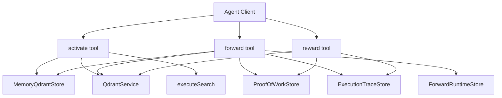
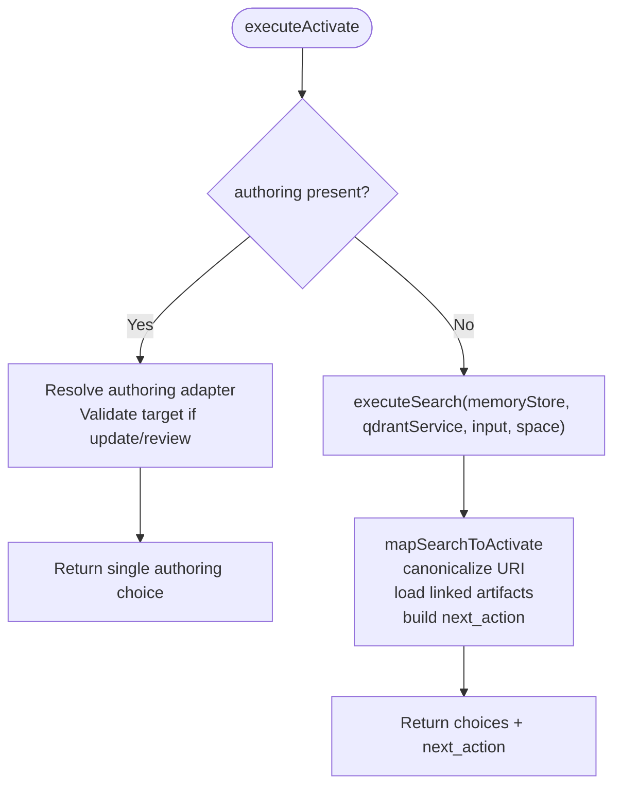
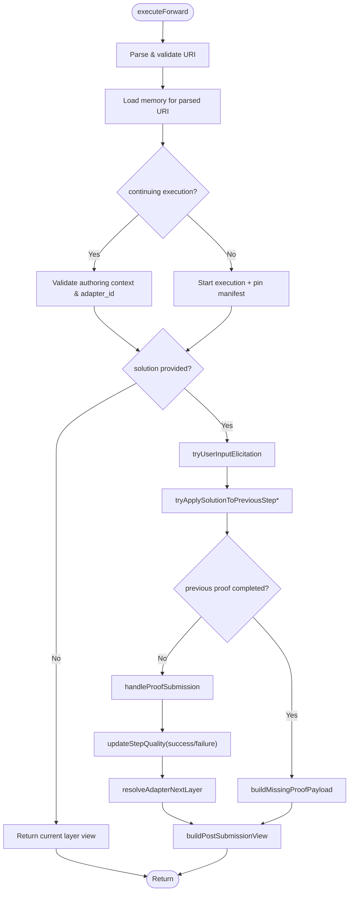
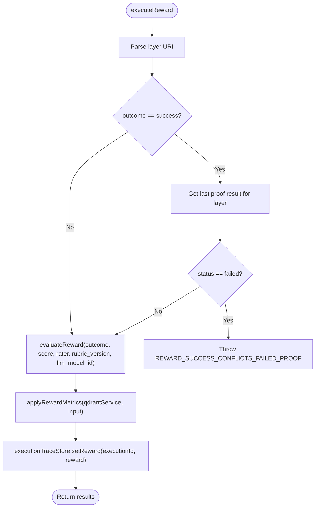
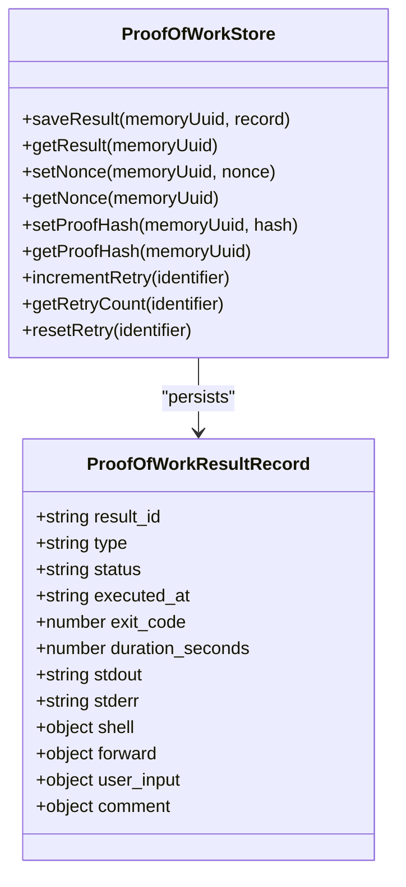
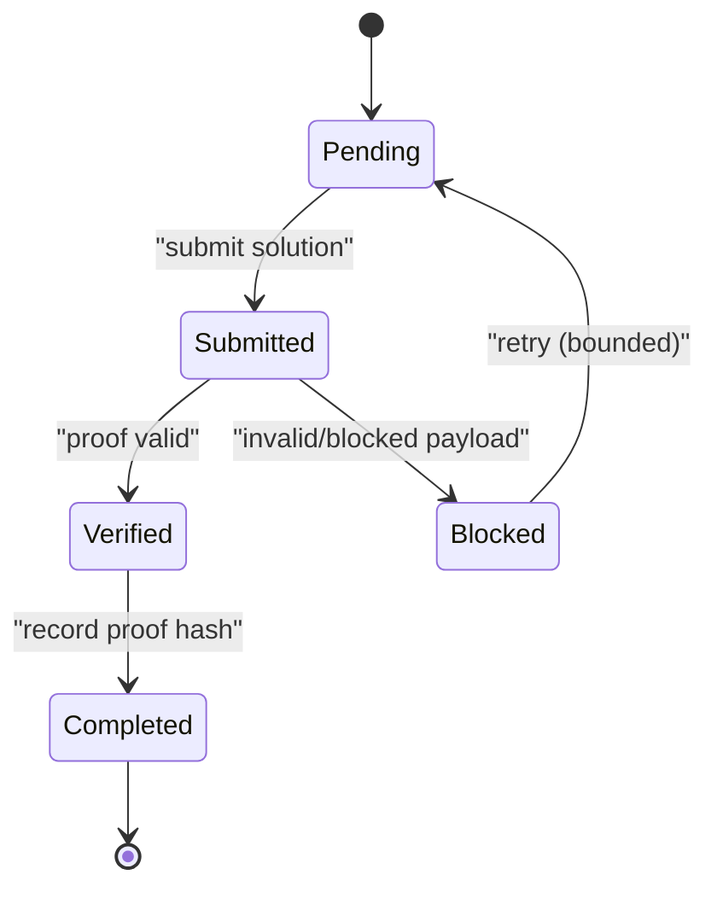
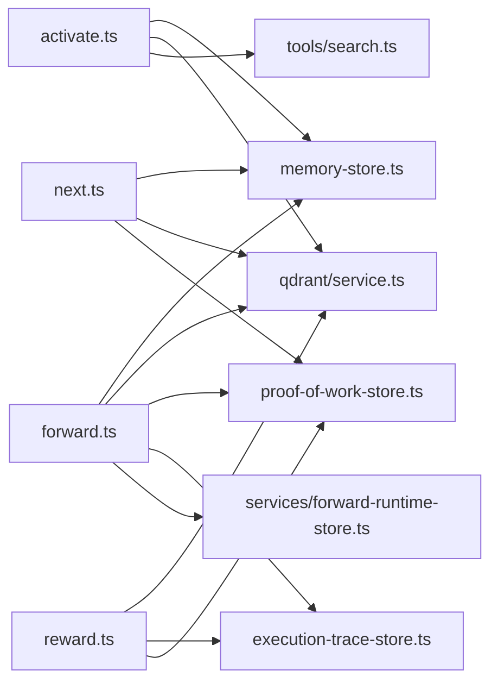

# Workflow Orchestration

<cite>
**Referenced Files in This Document**
- [activate.ts](file://src/tools/activate.ts)
- [forward.ts](file://src/tools/forward.ts)
- [reward.ts](file://src/tools/reward.ts)
- [next.ts](file://src/tools/next.ts)
- [challenge-types.md](file://docs/examples/challenge-types.md)
- [proof-of-work-store.ts](file://src/services/proof-of-work-store.ts)
- [memory-store.ts](file://src/services/memory-store.ts)
- [execution-trace-store.ts](file://src/services/execution-trace-store.ts)
</cite>

## Table of Contents
1. [Introduction](#introduction)
2. [Project Structure](#project-structure)
3. [Core Components](#core-components)
4. [Architecture Overview](#architecture-overview)
5. [Detailed Component Analysis](#detailed-component-analysis)
6. [Dependency Analysis](#dependency-analysis)
7. [Performance Considerations](#performance-considerations)
8. [Troubleshooting Guide](#troubleshooting-guide)
9. [Conclusion](#conclusion)
10. [Appendices](#appendices)

## Introduction
This document explains the workflow orchestration system that drives the activate→forward→reward chain in SquadRules. The system is agent-first: AI agents select and execute adapters, while humans configure preferences and provide feedback. Adapters are deterministic, auditable workflows composed of steps with contracts. The engine manages state transitions across adapter layers, collects evidence through challenge-response patterns, and persists execution traces for reproducibility.

The three phases are:
- Activation: semantic search over stored adapters to select the best match or guide creation/refinement.
- Forwarding: step-by-step task execution with proof generation, verification, conditional branching, and optional user elicitation.
- Rewarding: feedback collection, evaluation, and persistence that closes the loop and improves future retrieval.

## Project Structure
At a high level, the workflow spans MCP tools, services, and storage backends:
- Tools: `activate`, `forward`, `reward`, and shared logic in `next`.
- Services: proof-of-work store, memory store, execution trace store, Qdrant integration, and vector/embedding services.
- Storage: Redis-backed key-value store (or in-memory fallback), Qdrant/LanceDB for vectors and traces, filesystem for artifacts.



**Diagram sources**
- [activate.ts:168-229](file://src/tools/activate.ts#L168-L229)
- [forward.ts:91-339](file://src/tools/forward.ts#L91-L339)
- [reward.ts:28-130](file://src/tools/reward.ts#L28-L130)
- [next.ts:137-279](file://src/tools/next.ts#L137-L279)
- [proof-of-work-store.ts:47-172](file://src/services/proof-of-work-store.ts#L47-L172)
- [execution-trace-store.ts:31-289](file://src/services/execution-trace-store.ts#L31-L289)

**Section sources**
- [activate.ts:168-229](file://src/tools/activate.ts#L168-L229)
- [forward.ts:91-339](file://src/tools/forward.ts#L91-L339)
- [reward.ts:28-130](file://src/tools/reward.ts#L28-L130)
- [next.ts:137-279](file://src/tools/next.ts#L137-L279)

## Core Components
- Activation engine: resolves candidate adapters, enriches choices with linked artifacts, and returns actionable next steps. It supports authoring workflows and refine guidance.
- Forward engine: validates URIs, starts or resumes executions, applies solutions, enforces previous-step proofs, handles challenges, and advances to the next layer.
- Reward engine: evaluates feedback, guards against rewarding failed steps as success, updates metrics, and persists structured rewards.
- Proof-of-work store: persists results, nonces, proof hashes, and retry counters with TTLs.
- Execution trace store: records per-execution traces, activation queries, and rewards; supports training pair extraction.
- Memory store: in-memory key-value implementation used when Redis is not configured; supports TTLs and space-scoped keys.

**Section sources**
- [activate.ts:30-166](file://src/tools/activate.ts#L30-L166)
- [forward.ts:43-89](file://src/tools/forward.ts#L43-L89)
- [reward.ts:19-130](file://src/tools/reward.ts#L19-L130)
- [proof-of-work-store.ts:47-172](file://src/services/proof-of-work-store.ts#L47-L172)
- [execution-trace-store.ts:31-289](file://src/services/execution-trace-store.ts#L31-L289)
- [memory-store.ts:27-201](file://src/services/memory-store.ts#L27-L201)

## Architecture Overview
The orchestration follows a strict lifecycle:
1. Activate selects an adapter and may return a first forward call.
2. Forward executes steps, generates and verifies proofs, and either continues to the next layer or signals completion.
3. Reward finalizes the run, recording outcome, score, and metadata.

```mermaid
sequenceDiagram
participant Agent as "Agent"
participant Activate as "activate"
participant Store as "Memory/Qdrant"
participant Forward as "forward"
participant Proof as "ProofOfWorkStore"
participant Trace as "ExecutionTraceStore"
participant Reward as "reward"
Agent->>Activate : query + optional authoring/space
Activate->>Store : search adapters
Store-->>Activate : ranked choices
Activate-->>Agent : choices + next_action
Agent->>Forward : uri + solution (optional)
Forward->>Store : load layer/adapter
Forward->>Proof : verify previous hash / record proof
Forward->>Trace : append execution trace
alt no next layer
Forward-->>Agent : final message + next_call=reward
else next layer exists
Forward-->>Agent : current_step + challenge
end
Agent->>Reward : layer_uri + outcome + feedback
Reward->>Trace : persist reward
Reward-->>Agent : results + total_rated
```

**Diagram sources**
- [activate.ts:168-229](file://src/tools/activate.ts#L168-L229)
- [forward.ts:91-339](file://src/tools/forward.ts#L91-L339)
- [reward.ts:28-130](file://src/tools/reward.ts#L28-L130)
- [proof-of-work-store.ts:65-121](file://src/services/proof-of-work-store.ts#L65-L121)
- [execution-trace-store.ts:119-186](file://src/services/execution-trace-store.ts#L119-L186)

## Detailed Component Analysis

### Activation Phase: Adapter Selection and Refine Guidance
Activation performs semantic search over adapters, maps search results into activation choices, and enriches each choice with artifact instructions and a suggested next action. It also supports:
- Authoring mode: routes to a built-in authoring workflow for create/review/update operations.
- Refine mode: includes refine choices and guidance for iterative improvement.
- Artifact materialization hints: instructs agents to download and verify linked artifacts before running shell contracts.

Key behaviors:
- Canonicalizes adapter URIs and normalizes slugs.
- Loads linked artifacts and attaches them to choices when available.
- Produces a grounding reminder and confidence messaging around matches.
- Tracks refine counts per execution to control refine footer visibility.



**Diagram sources**
- [activate.ts:168-229](file://src/tools/activate.ts#L168-L229)
- [activate.ts:44-166](file://src/tools/activate.ts#L44-L166)

**Section sources**
- [activate.ts:30-166](file://src/tools/activate.ts#L30-L166)
- [activate.ts:168-229](file://src/tools/activate.ts#L168-L229)

### Forwarding Phase: Step Execution, Evidence Collection, and State Transitions
Forward is the core orchestrator for step execution. It:
- Parses and validates the requested URI (adapter or layer).
- Starts or resumes an execution, pinning layer manifests to prevent UUID churn.
- Optionally elicits user input when required by the contract.
- Applies solutions to previous steps when appropriate.
- Verifies previous-step proofs and blocks progression until they complete.
- Submits solutions to proof handlers, tracks tensor outputs, and appends execution traces.
- Advances to the next layer or signals completion.



**Diagram sources**
- [forward.ts:91-339](file://src/tools/forward.ts#L91-L339)
- [next.ts:137-279](file://src/tools/next.ts#L137-L279)

**Section sources**
- [forward.ts:43-89](file://src/tools/forward.ts#L43-L89)
- [forward.ts:91-339](file://src/tools/forward.ts#L91-L339)
- [next.ts:85-129](file://src/tools/next.ts#L85-L129)

### Rewarding Phase: Feedback Evaluation and Persistence
Reward finalizes runs by evaluating outcomes, applying rubrics, updating metrics, and persisting structured rewards. It includes a critical guard:
- A layer whose last stored proof failed cannot be rated as success; this prevents inconsistent audit trails.

It also:
- Normalizes scores and labels via evaluation logic.
- Persists rewards to the execution trace store.
- Returns aggregated results including total rated and failed counts.



**Diagram sources**
- [reward.ts:28-130](file://src/tools/reward.ts#L28-L130)

**Section sources**
- [reward.ts:19-130](file://src/tools/reward.ts#L19-L130)

### Challenge-Response Patterns and Contract Types
Contracts define how work is verified. Common types include:
- Shell: empirical execution with interpreter and command.
- Forward: link to another adapter only.
- Subagent: delegated judgment or MCP tool work with report evidence.
- User input: emergency authority gap requiring human confirmation.
- Comment: read-only acknowledgement, last resort.

The server issues challenges with nonces and proof hashes; agents must echo these values when submitting solutions.



**Diagram sources**
- [proof-of-work-store.ts:8-36](file://src/services/proof-of-work-store.ts#L8-L36)
- [proof-of-work-store.ts:47-172](file://src/services/proof-of-work-store.ts#L47-L172)
- [challenge-types.md:25-99](file://docs/examples/challenge-types.md#L25-L99)

**Section sources**
- [challenge-types.md:25-99](file://docs/examples/challenge-types.md#L25-L99)
- [proof-of-work-store.ts:47-172](file://src/services/proof-of-work-store.ts#L47-L172)

### Conditional Branching and Parallel Execution
- Conditional branching:
  - If a submitted solution matches a previous step, forward can apply it retroactively and continue.
  - If a previous proof is missing, forward blocks progression and returns a missing-proof payload with retry guidance.
  - Reward refuses success on layers with a failed last proof.
- Parallel execution:
  - Activation maps visible choices in parallel to load linked artifacts concurrently.
  - Execution trace mutations are serialized per execution ID to avoid concurrent writes.

**Section sources**
- [activate.ts:57-136](file://src/tools/activate.ts#L57-L136)
- [forward.ts:171-241](file://src/tools/forward.ts#L171-L241)
- [forward.ts:244-339](file://src/tools/forward.ts#L244-L339)
- [reward.ts:37-54](file://src/tools/reward.ts#L37-L54)
- [execution-trace-store.ts:76-97](file://src/services/execution-trace-store.ts#L76-L97)

### Proof Generation and Verification Mechanisms
- Nonce management: challenges carry nonces with TTLs to prevent replay.
- Proof hashing: successful proofs are hashed and stored with TTLs; forward uses expected previous hashes to enforce ordering.
- Retry counters: bounded retries ensure agents do not loop indefinitely; after thresholds, responses indicate must_obey=false.
- Result persistence: shell, forward, user_input, and comment results are persisted with type-specific fields.



**Diagram sources**
- [proof-of-work-store.ts:38-45](file://src/services/proof-of-work-store.ts#L38-L45)
- [proof-of-work-store.ts:65-121](file://src/services/proof-of-work-store.ts#L65-L121)
- [proof-of-work-store.ts:127-169](file://src/services/proof-of-work-store.ts#L127-L169)

**Section sources**
- [proof-of-work-store.ts:38-45](file://src/services/proof-of-work-store.ts#L38-L45)
- [proof-of-work-store.ts:65-121](file://src/services/proof-of-work-store.ts#L65-L121)
- [proof-of-work-store.ts:127-169](file://src/services/proof-of-work-store.ts#L127-L169)

### Workflow Definitions, State Management, and Error Handling
- Workflow definitions:
  - Adapters are markdown documents with H1/H2 structure and trailing JSON contract blocks per step.
  - Contracts specify verification semantics and solution shapes.
- State management:
  - ForwardRuntimeStore tracks execution metadata (adapter_id, adapter_uri, authoring, merge_depth).
  - ExecutionTraceStore serializes mutation chains per execution ID.
- Error handling:
  - Input validation errors are normalized and returned via MCP teaching helpers.
  - Rate limiting and service errors are surfaced consistently.
  - Quality metrics are updated even when quality updates fail (logged warnings).

**Section sources**
- [challenge-types.md:18-23](file://docs/examples/challenge-types.md#L18-L23)
- [forward.ts:133-152](file://src/tools/forward.ts#L133-L152)
- [execution-trace-store.ts:76-97](file://src/services/execution-trace-store.ts#L76-L97)
- [activate.ts:247-278](file://src/tools/activate.ts#L247-L278)
- [reward.ts:142-175](file://src/tools/reward.ts#L142-L175)

### Integration Points
- Memory store:
  - In-memory fallback provides Redis-like API with TTLs and space-scoped keys.
- Embedding services:
  - Activation relies on semantic search backed by Qdrant and embedding providers.
- Audit logging:
  - Execution traces capture activation queries, per-layer inputs/outputs, and rewards.
  - Metrics and quality updates integrate with Qdrant for retrieval scoring.

**Section sources**
- [memory-store.ts:27-201](file://src/services/memory-store.ts#L27-L201)
- [activate.ts:214-228](file://src/tools/activate.ts#L214-L228)
- [execution-trace-store.ts:119-186](file://src/services/execution-trace-store.ts#L119-L186)
- [next.ts:85-129](file://src/tools/next.ts#L85-L129)

## Dependency Analysis
The following diagram shows how tools depend on services and stores during orchestration.



**Diagram sources**
- [activate.ts:168-229](file://src/tools/activate.ts#L168-L229)
- [forward.ts:91-339](file://src/tools/forward.ts#L91-L339)
- [reward.ts:28-130](file://src/tools/reward.ts#L28-L130)
- [next.ts:137-279](file://src/tools/next.ts#L137-L279)
- [proof-of-work-store.ts:47-172](file://src/services/proof-of-work-store.ts#L47-L172)
- [execution-trace-store.ts:31-289](file://src/services/execution-trace-store.ts#L31-L289)

**Section sources**
- [activate.ts:168-229](file://src/tools/activate.ts#L168-L229)
- [forward.ts:91-339](file://src/tools/forward.ts#L91-L339)
- [reward.ts:28-130](file://src/tools/reward.ts#L28-L130)
- [next.ts:137-279](file://src/tools/next.ts#L137-L279)

## Performance Considerations
- Concurrency:
  - Activation loads linked artifacts for multiple choices concurrently using Promise.all.
  - Execution trace mutations are serialized per execution ID to avoid race conditions.
- Caching:
  - Memory store supports TTLs for transient flow state (nonces, retry counters).
  - Embedded LanceDB path avoids heavy dependencies when Qdrant is not configured.
- I/O:
  - Trace persistence is fire-and-forget in some paths to avoid blocking forward latency.
  - Quality metric updates are best-effort; failures are logged and counted.

[No sources needed since this section provides general guidance]

## Troubleshooting Guide
Common issues and resolutions:
- Invalid adapter URI:
  - Ensure URIs are slug-form at emit time and wire-compatible for forward.
- Missing previous proof:
  - Forward will block progression; follow the missing-proof payload and retry within bounds.
- Reward conflicts:
  - Cannot record success for a layer whose last proof failed; fix the step and rerun, or record failure.
- Authoring context mismatch:
  - When continuing an authoring workflow, adapter_id and authoring context must remain stable.
- Artifact loading failures:
  - Activation warns about unknown artifact files; re-run activate or export the adapter to materialize scripts.

Operational tips:
- Inspect execution traces to reconstruct the full sequence of inputs, outputs, and rewards.
- Use Qdrant quality metrics to diagnose retrieval performance and step-level success/failure trends.
- For local development without Redis, rely on the in-memory store but note its lack of cross-process invalidation.

**Section sources**
- [activate.ts:30-42](file://src/tools/activate.ts#L30-L42)
- [forward.ts:113-131](file://src/tools/forward.ts#L113-L131)
- [reward.ts:37-54](file://src/tools/reward.ts#L37-L54)
- [proof-of-work-store.ts:127-169](file://src/services/proof-of-work-store.ts#L127-L169)
- [memory-store.ts:1-9](file://src/services/memory-store.ts#L1-L9)

## Conclusion
The SquadRules workflow engine implements a robust activate→forward→reward pipeline that ensures deterministic, auditable execution. Activation surfaces the right adapters with actionable guidance; forwarding enforces proof-based verification, conditional branching, and safe state transitions; rewarding captures feedback and integrates it into retrieval and training pipelines. Together with persistent traces and quality metrics, the system supports reproducible workflows and continuous improvement.

[No sources needed since this section summarizes without analyzing specific files]

## Appendices

### Designing Effective Workflows
- Prefer shell contracts for empirical checks; wrap build tools in shell lines.
- Use forward links to compose complex tasks across adapters.
- Reserve subagent for delegated judgment or MCP tool work with explicit reports.
- Limit user_input to genuine authority gaps; use comment only for knowledge acknowledgements.
- Keep adapters small and focused; split large workflows into composable steps.

**Section sources**
- [challenge-types.md:25-99](file://docs/examples/challenge-types.md#L25-L99)