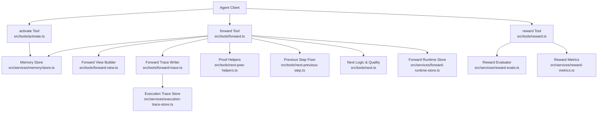
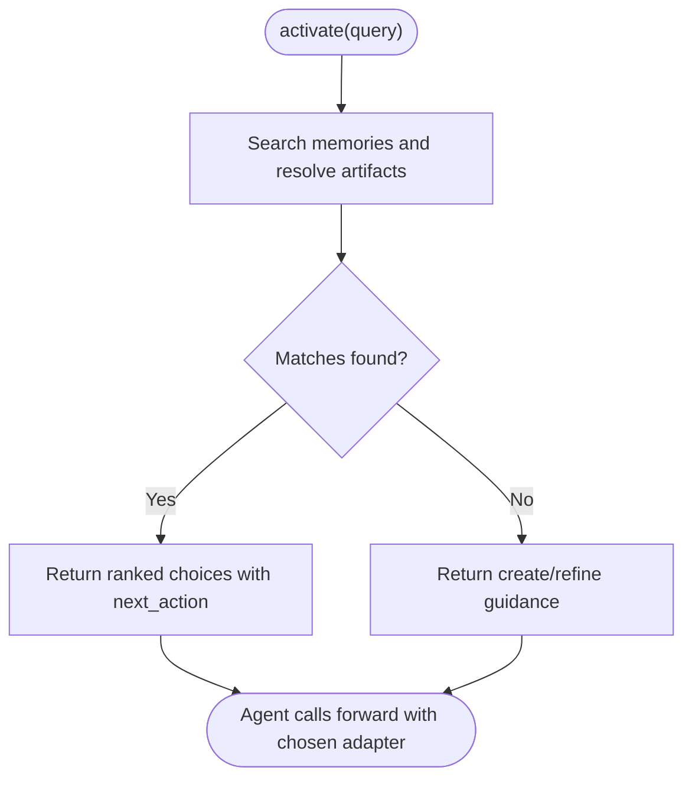
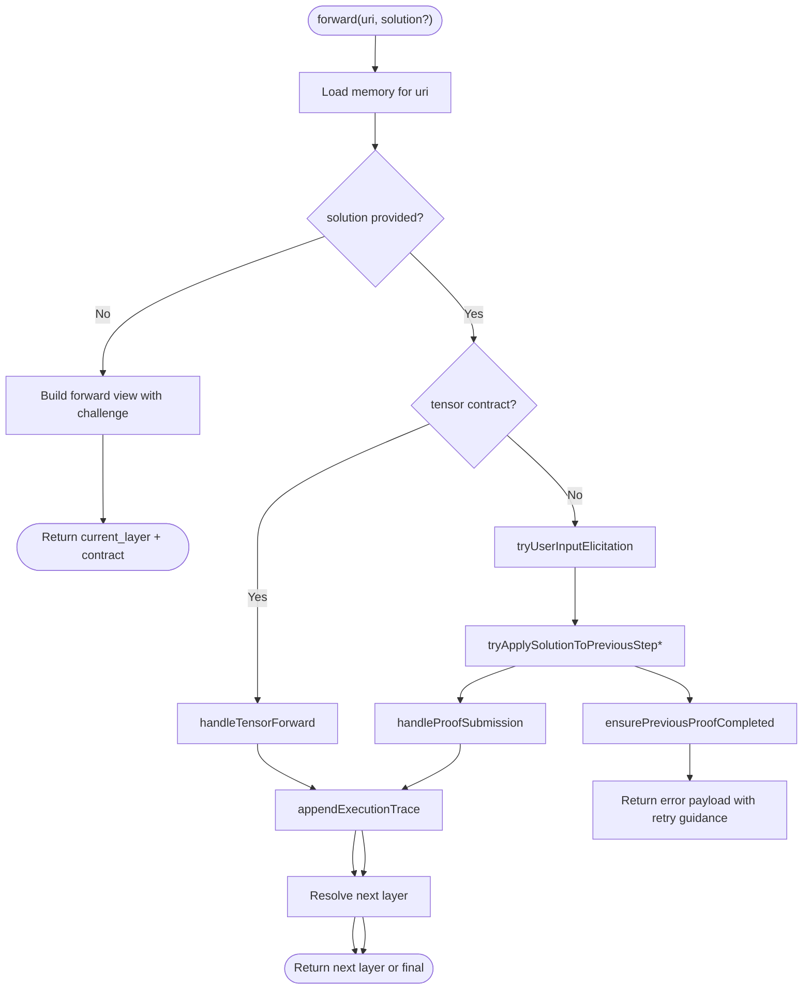
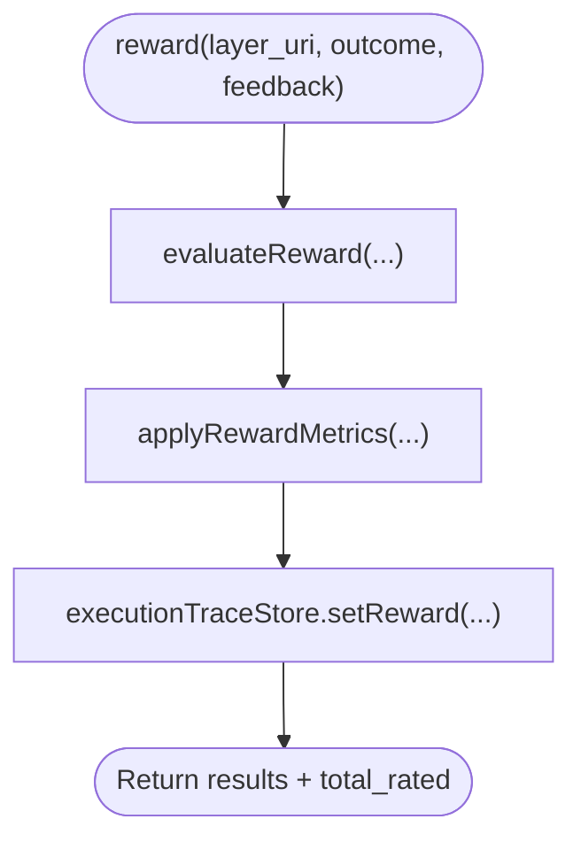
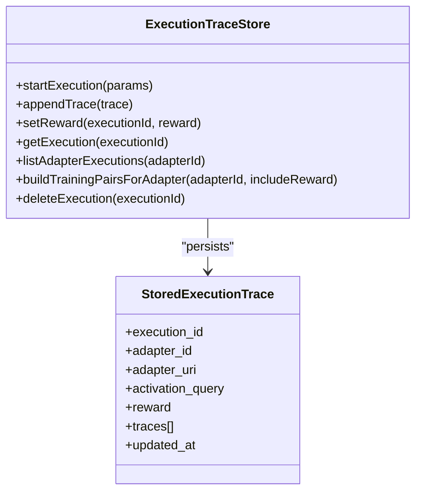
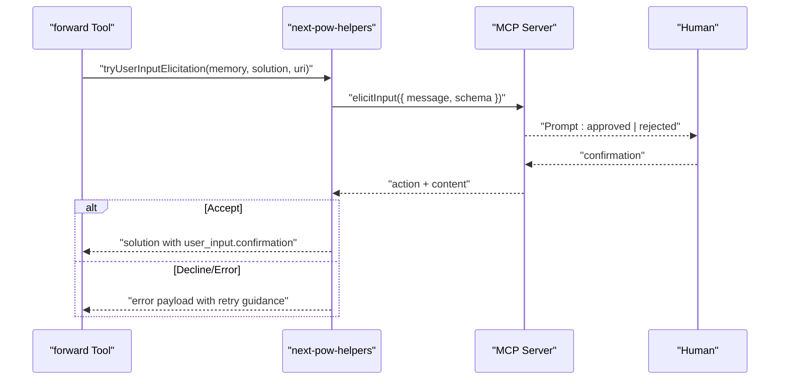
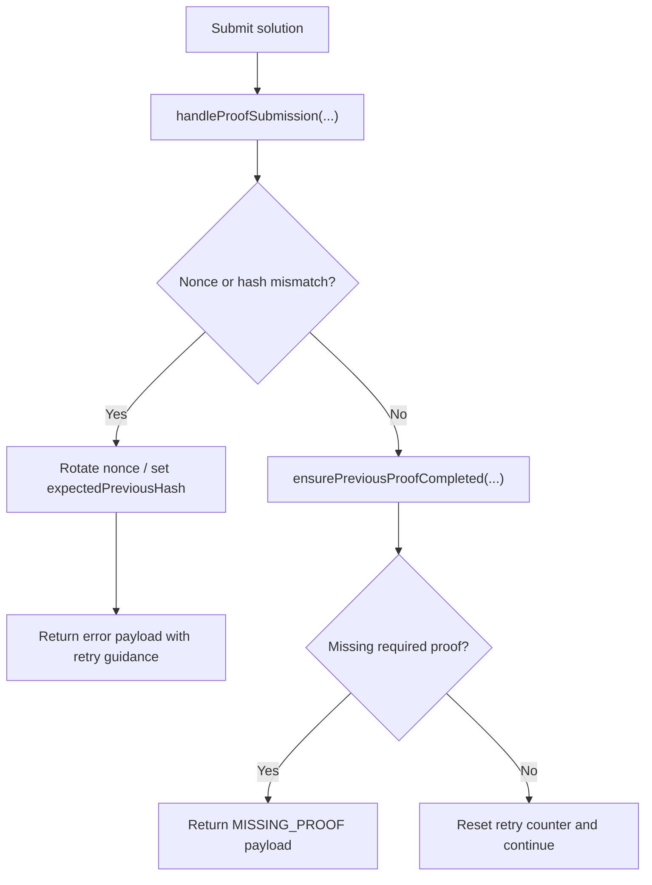
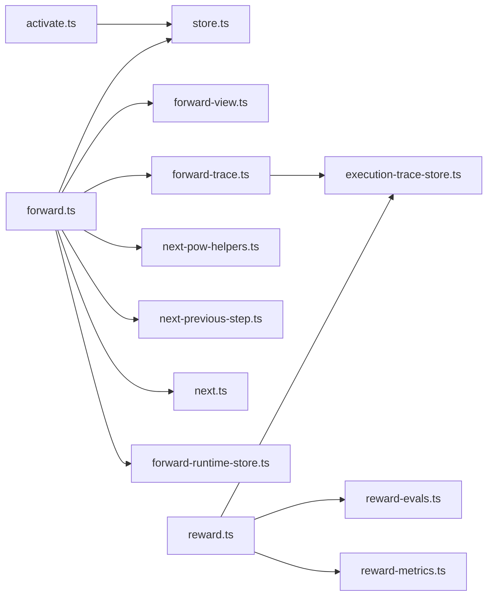

# Workflow Patterns

<cite>
**Referenced Files in This Document**
- [activate.ts](file://src/tools/activate.ts)
- [forward.ts](file://src/tools/forward.ts)
- [reward.ts](file://src/tools/reward.ts)
- [forward-view.ts](file://src/tools/forward-view.ts)
- [forward-trace.ts](file://src/tools/forward-trace.ts)
- [execution-trace-store.ts](file://src/services/execution-trace-store.ts)
- [forward-runtime-store.ts](file://src/services/forward-runtime-store.ts)
- [next-pow-helpers.ts](file://src/tools/next-pow-helpers.ts)
- [next-previous-step.ts](file://src/tools/next-previous-step.ts)
- [next.ts](file://src/tools/next.ts)
- [reward-evals.ts](file://src/services/reward-evals.ts)
- [reward-metrics.ts](file://src/services/reward-metrics.ts)
- [store.ts](file://src/services/memory/store.ts)
</cite>

## Table of Contents
1. [Introduction](#introduction)
2. [Project Structure](#project-structure)
3. [Core Components](#core-components)
4. [Architecture Overview](#architecture-overview)
5. [Detailed Component Analysis](#detailed-component-analysis)
6. [Dependency Analysis](#dependency-analysis)
7. [Performance Considerations](#performance-considerations)
8. [Troubleshooting Guide](#troubleshooting-guide)
9. [Conclusion](#conclusion)

## Introduction
This document explains the core workflow patterns in SquadRules, focusing on the activate → forward → reward chain. It shows how protocols define multi-step workflows with state persistence and recovery, how the execution trace system captures complete history, how human-in-the-loop approval integrates with automation, and how errors, retries, and recovery are handled. Practical examples and best practices are included to help design robust agent workflows.

SquadRules is an agent-first MCP framework where AI agents are primary users and humans configure preferences through agents. The canonical flow is:
- Activate: select or create an adapter for a query.
- Forward: execute one or more protocol layers with proof-of-work validation.
- Reward: record outcome, score, feedback, and quality metrics.

Adapters provide deterministic, auditable task execution. Agents must create or repair adapters when workflows change. Vector stores (Qdrant and LanceDB) support semantic search and trace storage; Redis supports sessions and cache invalidation; filesystem holds configuration and artifacts.

## Project Structure
The workflow spans tool handlers, runtime stores, and persistence services:
- Tools: activate, forward, reward, next helpers.
- Runtime stores: forward execution metadata and tensors.
- Trace store: execution traces and rewards.
- Memory store: adapter layers and inference contracts.
- Proof-of-work helpers: challenges, nonce rotation, retry logic, and user elicitation.



**Diagram sources**
- [activate.ts:209-235](file://src/tools/activate.ts#L209-L235)
- [forward.ts:93-317](file://src/tools/forward.ts#L93-L317)
- [reward.ts:27-110](file://src/tools/reward.ts#L27-L110)
- [forward-view.ts:242-321](file://src/tools/forward-view.ts#L242-L321)
- [forward-trace.ts:94-117](file://src/tools/forward-trace.ts#L94-L117)
- [execution-trace-store.ts:119-186](file://src/services/execution-trace-store.ts#L119-L186)
- [forward-runtime-store.ts:25-62](file://src/services/forward-runtime-store.ts#L25-L62)
- [next-pow-helpers.ts:155-326](file://src/tools/next-pow-helpers.ts#L155-L326)
- [next-previous-step.ts:29-156](file://src/tools/next-previous-step.ts#L29-L156)
- [next.ts:85-129](file://src/tools/next.ts#L85-L129)
- [reward-evals.ts:105-147](file://src/services/reward-evals.ts#L105-L147)
- [reward-metrics.ts:20-119](file://src/services/reward-metrics.ts#L20-L119)
- [store.ts:144-149](file://src/services/memory/store.ts#L144-L149)

**Section sources**
- [activate.ts:209-235](file://src/tools/activate.ts#L209-L235)
- [forward.ts:93-317](file://src/tools/forward.ts#L93-L317)
- [reward.ts:27-110](file://src/tools/reward.ts#L27-L110)
- [forward-view.ts:242-321](file://src/tools/forward-view.ts#L242-L321)
- [forward-trace.ts:94-117](file://src/tools/forward-trace.ts#L94-L117)
- [execution-trace-store.ts:119-186](file://src/services/execution-trace-store.ts#L119-L186)
- [forward-runtime-store.ts:25-62](file://src/services/forward-runtime-store.ts#L25-L62)
- [next-pow-helpers.ts:155-326](file://src/tools/next-pow-helpers.ts#L155-L326)
- [next-previous-step.ts:29-156](file://src/tools/next-previous-step.ts#L29-L156)
- [next.ts:85-129](file://src/tools/next.ts#L85-L129)
- [reward-evals.ts:105-147](file://src/services/reward-evals.ts#L105-L147)
- [reward-metrics.ts:20-119](file://src/services/reward-metrics.ts#L20-L119)
- [store.ts:144-149](file://src/services/memory/store.ts#L144-L149)

## Core Components
- Activate tool: searches for matching adapters, presents choices, and instructs the agent to call forward with the selected adapter URI. It can also guide creation or refinement flows.
- Forward tool: loads the current layer, validates solutions against inference contracts, manages proof-of-work, advances to the next layer, and records execution traces.
- Reward tool: evaluates outcomes, computes normalized scores and eligibility, updates Qdrant quality metrics, and persists rewards to the execution trace store.
- Execution trace store: persists per-execution traces, including inputs, outputs, activation queries, and rewards, with mutation locks and collection management.
- Forward runtime store: keeps execution metadata and tensor values across forward steps with TTL-based expiration.
- Proof-of-work helpers: build challenges, rotate nonces, validate submissions, handle missing proofs, and integrate human elicitation.
- Memory store: provides access to adapter layers and inference contracts.

Key responsibilities:
- State persistence: forward runtime store for ephemeral step data; execution trace store for durable history; memory store for protocol definitions.
- Recovery: nonce rotation, retry counters, previous-step application, and missing-proof guidance.
- Human-in-the-loop: optional user_input elicitation integrated into forward validation.
- Auditing: structured logging, metrics, and trace exportability.

**Section sources**
- [activate.ts:209-235](file://src/tools/activate.ts#L209-L235)
- [forward.ts:93-317](file://src/tools/forward.ts#L93-L317)
- [reward.ts:27-110](file://src/tools/reward.ts#L27-L110)
- [execution-trace-store.ts:119-186](file://src/services/execution-trace-store.ts#L119-L186)
- [forward-runtime-store.ts:25-62](file://src/services/forward-runtime-store.ts#L25-L62)
- [next-pow-helpers.ts:155-326](file://src/tools/next-pow-helpers.ts#L155-L326)
- [store.ts:144-149](file://src/services/memory/store.ts#L144-L149)

## Architecture Overview
The activate → forward → reward chain orchestrates agent-driven workflows:

```mermaid
sequenceDiagram
participant Agent as "Agent"
participant Activate as "activate Tool"
participant Memory as "Memory Store"
participant Forward as "forward Tool"
participant FView as "Forward View"
participant FTrace as "Forward Trace"
participant TraceStore as "Execution Trace Store"
participant Runtime as "Forward Runtime Store"
participant Reward as "reward Tool"
participant REvals as "Reward Evals"
participant RMetrics as "Reward Metrics"
Agent->>Activate : "query + space"
Activate->>Memory : "searchMemories / list artifacts"
Activate-->>Agent : "choices + next_action"
Agent->>Forward : "forward(adapter_uri)"
Forward->>Runtime : "startExecution(executionId)"
Forward->>FView : "buildForwardView(memory)"
FView-->>Forward : "current_layer + contract"
Agent->>Forward : "forward(layer_uri, solution)"
Forward->>FTrace : "appendExecutionTrace(...)"
FTrace->>TraceStore : "appendTrace(...)"
Forward->>FView : "buildForwardView(next or final)"
FView-->>Agent : "next_action = forward|reward"
Agent->>Reward : "reward(layer_uri, outcome, feedback)"
Reward->>REvals : "evaluateReward(...)"
Reward->>RMetrics : "applyRewardMetrics(...)"
RMetrics-->>Reward : "results"
Reward->>TraceStore : "setReward(executionId, reward)"
Reward-->>Agent : "results + total_rated"
```

**Diagram sources**
- [activate.ts:209-235](file://src/tools/activate.ts#L209-L235)
- [forward.ts:93-317](file://src/tools/forward.ts#L93-L317)
- [forward-view.ts:242-321](file://src/tools/forward-view.ts#L242-L321)
- [forward-trace.ts:94-117](file://src/tools/forward-trace.ts#L94-L117)
- [execution-trace-store.ts:119-186](file://src/services/execution-trace-store.ts#L119-L186)
- [forward-runtime-store.ts:25-62](file://src/services/forward-runtime-store.ts#L25-L62)
- [reward.ts:27-110](file://src/tools/reward.ts#L27-L110)
- [reward-evals.ts:105-147](file://src/services/reward-evals.ts#L105-L147)
- [reward-metrics.ts:20-119](file://src/services/reward-metrics.ts#L20-L119)

## Detailed Component Analysis

### Activate Flow
Activate resolves the best adapter for a query and returns actionable choices. It normalizes URIs, enriches choices with linked artifacts, and sets next_action instructions for the agent. When no match exists, it guides creation or refinement.

Key behaviors:
- Canonicalize adapter URIs and resolve artifact download capabilities.
- Include local artifact directory fields for materialization.
- Provide clear next_action guidance for selection, creation, or refinement.



**Diagram sources**
- [activate.ts:44-207](file://src/tools/activate.ts#L44-L207)
- [activate.ts:209-235](file://src/tools/activate.ts#L209-L235)

**Section sources**
- [activate.ts:44-207](file://src/tools/activate.ts#L44-L207)
- [activate.ts:209-235](file://src/tools/activate.ts#L209-L235)

### Forward Flow and Multi-Step Workflows
Forward drives protocol execution by loading the current layer, validating solutions, advancing to the next layer, and recording traces. It supports multiple contract types: shell, MCP, comment, user_input, and tensor.

Core responsibilities:
- Resolve adapter or layer URI and load memory.
- Start execution metadata if not already present.
- Handle tensor contracts separately via handleTensorForward.
- Validate and apply solutions using proof-of-work helpers.
- Apply previous-step fixes for missing proofs or mismatched hashes.
- Build forward view with next_action guidance.
- Append execution traces asynchronously.



**Diagram sources**
- [forward.ts:93-317](file://src/tools/forward.ts#L93-L317)
- [forward-view.ts:242-321](file://src/tools/forward-view.ts#L242-L321)
- [forward-trace.ts:94-117](file://src/tools/forward-trace.ts#L94-L117)
- [next-pow-helpers.ts:155-326](file://src/tools/next-pow-helpers.ts#L155-L326)
- [next-previous-step.ts:29-156](file://src/tools/next-previous-step.ts#L29-L156)

**Section sources**
- [forward.ts:93-317](file://src/tools/forward.ts#L93-L317)
- [forward-view.ts:242-321](file://src/tools/forward-view.ts#L242-L321)
- [forward-trace.ts:94-117](file://src/tools/forward-trace.ts#L94-L117)
- [next-pow-helpers.ts:155-326](file://src/tools/next-pow-helpers.ts#L155-L326)
- [next-previous-step.ts:29-156](file://src/tools/next-previous-step.ts#L29-L156)

### Reward Flow and Evaluation
Reward evaluates outcomes, computes normalized scores, updates Qdrant quality metrics, and persists rewards to the execution trace store.

Key behaviors:
- Parse layer URI and evaluate reward parameters.
- Apply reward metrics to update step quality and propagate rewards.
- Persist reward record to execution trace store.
- Return results with evaluation labels and eligibility flags.



**Diagram sources**
- [reward.ts:27-110](file://src/tools/reward.ts#L27-L110)
- [reward-evals.ts:105-147](file://src/services/reward-evals.ts#L105-L147)
- [reward-metrics.ts:20-119](file://src/services/reward-metrics.ts#L20-L119)
- [execution-trace-store.ts:176-186](file://src/services/execution-trace-store.ts#L176-L186)

**Section sources**
- [reward.ts:27-110](file://src/tools/reward.ts#L27-L110)
- [reward-evals.ts:105-147](file://src/services/reward-evals.ts#L105-L147)
- [reward-metrics.ts:20-119](file://src/services/reward-metrics.ts#L20-L119)
- [execution-trace-store.ts:176-186](file://src/services/execution-trace-store.ts#L176-L186)

### Execution Trace System
The execution trace system captures the complete history of workflow execution, including activation queries, layer instructions, inputs, outputs, and rewards. It uses Qdrant or embedded LanceDB depending on configuration.

Features:
- Start execution with adapter identity and activation query.
- Append traces keyed by layer index and URI, deduplicating by key.
- Set reward for an execution atomically with mutation locks.
- Build training pairs from traces and rewards for downstream tasks.



**Diagram sources**
- [execution-trace-store.ts:31-117](file://src/services/execution-trace-store.ts#L31-L117)
- [execution-trace-store.ts:119-186](file://src/services/execution-trace-store.ts#L119-L186)
- [execution-trace-store.ts:188-269](file://src/services/execution-trace-store.ts#L188-L269)

**Section sources**
- [execution-trace-store.ts:31-117](file://src/services/execution-trace-store.ts#L31-L117)
- [execution-trace-store.ts:119-186](file://src/services/execution-trace-store.ts#L119-L186)
- [execution-trace-store.ts:188-269](file://src/services/execution-trace-store.ts#L188-L269)

### Human-in-the-Loop Approval
Human-in-the-loop integration occurs primarily through user_input challenges during forward validation. If the client supports elicitation, the server prompts the user for confirmation and injects the result back into the solution flow.

Behavior:
- Detect user_input contract without confirmation.
- Request confirmation via elicitation capability.
- On accept, inject confirmation timestamp and continue.
- On decline or failure, return error payload with retry guidance.



**Diagram sources**
- [next-pow-helpers.ts:58-120](file://src/tools/next-pow-helpers.ts#L58-L120)
- [forward.ts:142-149](file://src/tools/forward.ts#L142-L149)

**Section sources**
- [next-pow-helpers.ts:58-120](file://src/tools/next-pow-helpers.ts#L58-L120)
- [forward.ts:142-149](file://src/tools/forward.ts#L142-L149)

### Error Handling, Retry, and Recovery
Error handling is built around proof-of-work validation, nonce rotation, retry counters, and previous-step application.

Patterns:
- Nonce mismatch rotates nonce and returns error payload with fresh challenge.
- Missing proof blocks progression and instructs agent to complete previous step.
- Max retries exceeded switches next_action to tune/reward/help options.
- Previous-step application allows fixing missed prior steps transparently.



**Diagram sources**
- [next-pow-helpers.ts:155-326](file://src/tools/next-pow-helpers.ts#L155-L326)
- [next-previous-step.ts:108-156](file://src/tools/next-previous-step.ts#L108-L156)
- [next.ts:229-255](file://src/tools/next.ts#L229-L255)

**Section sources**
- [next-pow-helpers.ts:155-326](file://src/tools/next-pow-helpers.ts#L155-L326)
- [next-previous-step.ts:108-156](file://src/tools/next-previous-step.ts#L108-L156)
- [next.ts:229-255](file://src/tools/next.ts#L229-L255)

### Practical Examples and Best Practices
Common workflow patterns:
- Linear shell pipeline: each layer executes a command and passes outputs to the next. Use shell contracts and ensure exit_code success.
- MCP tool orchestration: call external tools with arguments and capture results. Validate MCP submission against contract.
- Human confirmation gates: use user_input for genuine ambiguity; otherwise prefer objective verification.
- Tensor pipelines: pass typed values between layers with conditions and min/max constraints.

Best practices:
- Always include nonce and proof_hash from the contract in forward submissions.
- Materialize linked artifacts before calling forward when instructed.
- Provide meaningful feedback in reward calls to improve model stats and quality metadata.
- Use tensor contracts for structured data flows and enforce output types and lengths.
- Design adapters to be self-healing: include critic-loop evidence and post-mutation verification.

[No sources needed since this section provides general guidance]

## Dependency Analysis
The workflow components depend on each other as follows:



**Diagram sources**
- [activate.ts:209-235](file://src/tools/activate.ts#L209-L235)
- [forward.ts:93-317](file://src/tools/forward.ts#L93-L317)
- [forward-view.ts:242-321](file://src/tools/forward-view.ts#L242-L321)
- [forward-trace.ts:94-117](file://src/tools/forward-trace.ts#L94-L117)
- [execution-trace-store.ts:119-186](file://src/services/execution-trace-store.ts#L119-L186)
- [forward-runtime-store.ts:25-62](file://src/services/forward-runtime-store.ts#L25-L62)
- [next-pow-helpers.ts:155-326](file://src/tools/next-pow-helpers.ts#L155-L326)
- [next-previous-step.ts:29-156](file://src/tools/next-previous-step.ts#L29-L156)
- [next.ts:85-129](file://src/tools/next.ts#L85-L129)
- [reward.ts:27-110](file://src/tools/reward.ts#L27-L110)
- [reward-evals.ts:105-147](file://src/services/reward-evals.ts#L105-L147)
- [reward-metrics.ts:20-119](file://src/services/reward-metrics.ts#L20-L119)
- [store.ts:144-149](file://src/services/memory/store.ts#L144-L149)

**Section sources**
- [activate.ts:209-235](file://src/tools/activate.ts#L209-L235)
- [forward.ts:93-317](file://src/tools/forward.ts#L93-L317)
- [forward-view.ts:242-321](file://src/tools/forward-view.ts#L242-L321)
- [forward-trace.ts:94-117](file://src/tools/forward-trace.ts#L94-L117)
- [execution-trace-store.ts:119-186](file://src/services/execution-trace-store.ts#L119-L186)
- [forward-runtime-store.ts:25-62](file://src/services/forward-runtime-store.ts#L25-L62)
- [next-pow-helpers.ts:155-326](file://src/tools/next-pow-helpers.ts#L155-L326)
- [next-previous-step.ts:29-156](file://src/tools/next-previous-step.ts#L29-L156)
- [next.ts:85-129](file://src/tools/next.ts#L85-L129)
- [reward.ts:27-110](file://src/tools/reward.ts#L27-L110)
- [reward-evals.ts:105-147](file://src/services/reward-evals.ts#L105-L147)
- [reward-metrics.ts:20-119](file://src/services/reward-metrics.ts#L20-L119)
- [store.ts:144-149](file://src/services/memory/store.ts#L144-L149)

## Performance Considerations
- Asynchronous trace persistence: appendExecutionTrace uses fire-and-forget to avoid blocking forward responses while still capturing history.
- Mutation locks: execution trace store serializes writes per execution ID to prevent concurrent corruption.
- Cache usage: memory reads may be cached via Redis to reduce latency.
- TTL-based runtime state: forward runtime store expires execution metadata and tensors after a default period to free resources.
- Batch operations: reward metrics update and propagation are performed per URI with minimal overhead.

[No sources needed since this section provides general guidance]

## Troubleshooting Guide
Common issues and resolutions:
- Nonce mismatch: rotate nonce and resubmit with the new nonce from the response contract.
- Missing proof: complete the previous step’s required proof before continuing; follow next_action guidance.
- Max retries exceeded: consider tuning the failing step or rewarding failure to abort; ask the user for help.
- Tensor validation failures: ensure tensor name, type, length, and item count match contract constraints.
- Reward persistence errors: retry the same reward call once storage is healthy; check Qdrant connectivity and collection availability.

Operational checks:
- Verify Qdrant collection existence and indexes for execution traces.
- Confirm Redis cache health for memory and begin-cache invalidation.
- Inspect structured logs for pow events, quality update warnings, and reward errors.

**Section sources**
- [next-pow-helpers.ts:122-153](file://src/tools/next-pow-helpers.ts#L122-L153)
- [next-previous-step.ts:108-156](file://src/tools/next-previous-step.ts#L108-L156)
- [forward-trace.ts:16-22](file://src/tools/forward-trace.ts#L16-L22)
- [execution-trace-store.ts:50-74](file://src/services/execution-trace-store.ts#L50-L74)
- [reward.ts:18-25](file://src/tools/reward.ts#L18-L25)

## Conclusion
SquadRules implements a robust activate → forward → reward workflow that supports multi-step protocols with strong state persistence, recovery mechanisms, and comprehensive execution tracing. The system balances autonomous execution with optional human-in-the-loop approvals, ensuring determinism and auditability. By following the patterns and best practices outlined here, teams can design resilient agent workflows that adapt to changes, recover from errors, and produce high-quality training data through thoughtful reward signals.

[No sources needed since this section summarizes without analyzing specific files]