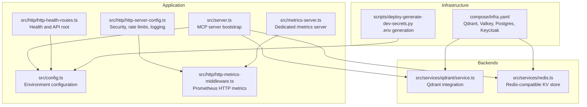
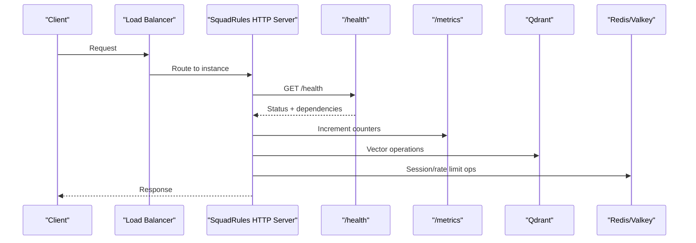
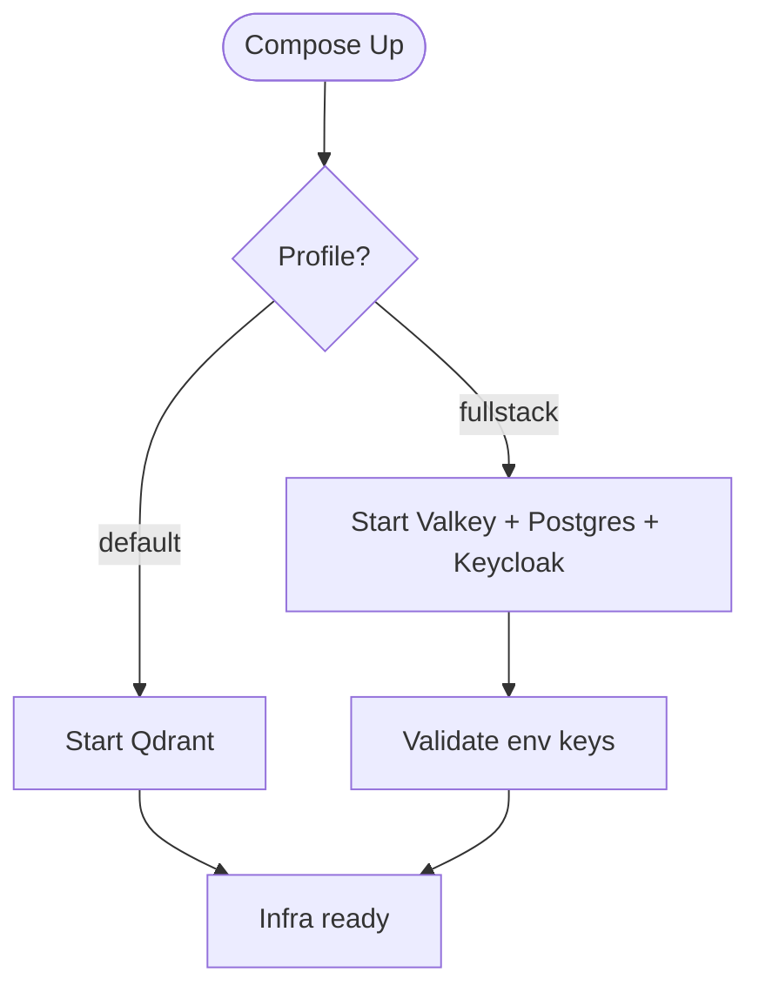
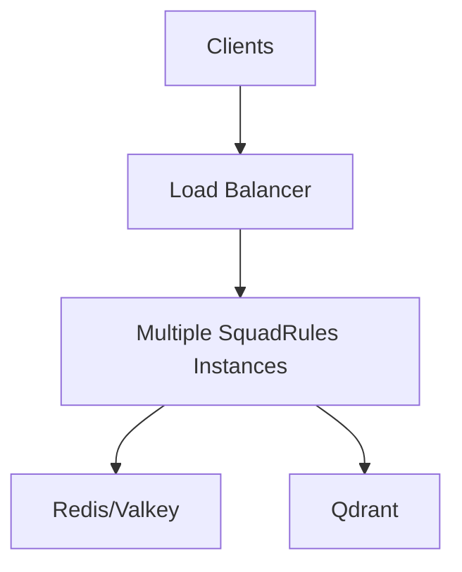
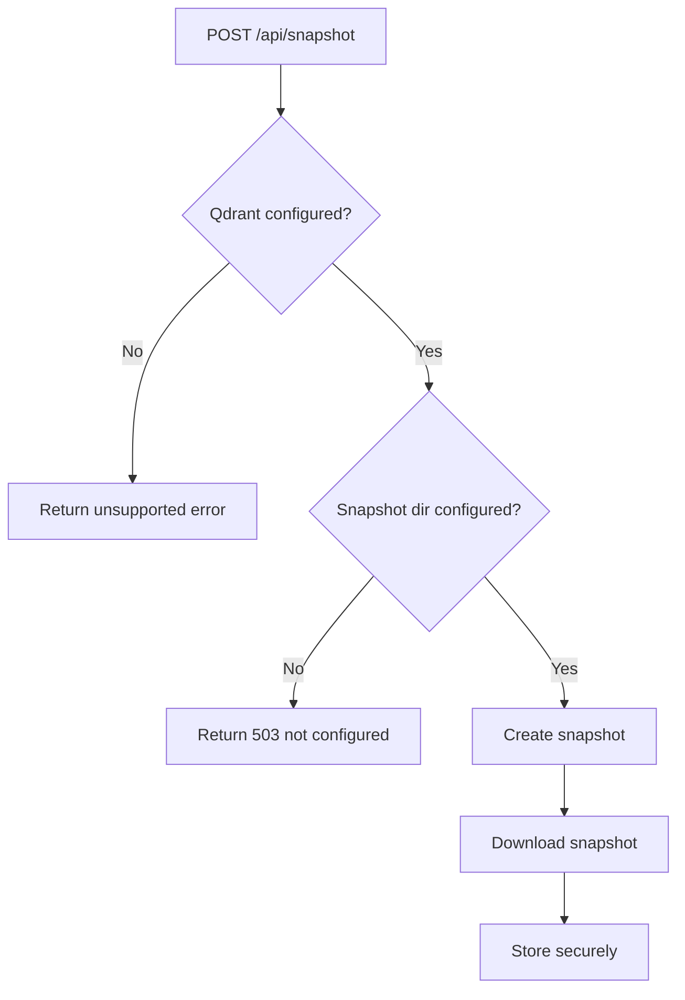
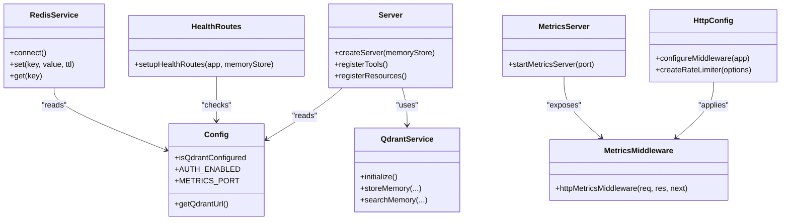

# Deployment & Operations

<cite>
**Referenced Files in This Document**
- [README.md](file://README.md)
- [compose/infra.yaml](file://compose/infra.yaml)
- [scripts/deploy-generate-dev-secrets.py](file://scripts/deploy-generate-dev-secrets.py)
- [src/config.ts](file://src/config.ts)
- [src/server.ts](file://src/server.ts)
- [src/http/http-server-config.ts](file://src/http/http-server-config.ts)
- [src/http/http-health-routes.ts](file://src/http/http-health-routes.ts)
- [src/http/http-metrics-middleware.ts](file://src/http/http-metrics-middleware.ts)
- [src/metrics-server.ts](file://src/metrics-server.ts)
- [src/services/qdrant/service.ts](file://src/services/qdrant/service.ts)
- [src/services/redis.ts](file://src/services/redis.ts)
- [src/http/http-api-snapshot.ts](file://src/http/http-api-snapshot.ts)
- [src/services/qdrant/snapshots.ts](file://src/services/qdrant/snapshots.ts)
</cite>

## Table of Contents
1. [Introduction](#introduction)
2. [Project Structure](#project-structure)
3. [Core Components](#core-components)
4. [Architecture Overview](#architecture-overview)
5. [Detailed Component Analysis](#detailed-component-analysis)
6. [Dependency Analysis](#dependency-analysis)
7. [Performance Considerations](#performance-considerations)
8. [Troubleshooting Guide](#troubleshooting-guide)
9. [Conclusion](#conclusion)
10. [Appendices](#appendices)

## Introduction
This document provides production deployment and operations guidance for SquadRules, an agent-first MCP framework where AI agents maintain shared preferences and workflows. The application exposes MCP tools (activate, forward, reward, train, tune, delete, export, spaces), supports HTTP transport with optional OIDC authentication, and uses Qdrant as the primary vector store with LanceDB as an embedded fallback. Redis or a compatible key-value store is used for sessions and rate limiting when configured.

Key operational modes:
- Local stdio mode: single-process, embedded storage, no HTTP server.
- Clustered HTTP mode: REST API, Streamable HTTP MCP, UI, metrics, and optional OIDC.

The repository ships Docker Compose infrastructure for development and CI, including Qdrant, Valkey/Redis, Postgres, and Keycloak. Production images are built from the published npm package; this repository’s Compose file focuses on infrastructure services rather than the app container.

**Section sources**
- [README.md:1-66](file://README.md#L1-L66)

## Project Structure
SquadRules separates runtime configuration, HTTP middleware, health endpoints, metrics collection, and backend integrations into focused modules. Infrastructure is defined in Compose, while secrets and environment variables are generated via a helper script.

**Diagram sources**
- [src/server.ts:43-114](file://src/server.ts#L43-L114)
- [src/config.ts:1-350](file://src/config.ts#L1-L350)
- [src/http/http-server-config.ts:1-83](file://src/http/http-server-config.ts#L1-L83)
- [src/http/http-health-routes.ts:1-119](file://src/http/http-health-routes.ts#L1-L119)
- [src/http/http-metrics-middleware.ts:1-73](file://src/http/http-metrics-middleware.ts#L1-L73)
- [src/metrics-server.ts:1-45](file://src/metrics-server.ts#L1-L45)
- [src/services/qdrant/service.ts:1-161](file://src/services/qdrant/service.ts#L1-L161)
- [src/services/redis.ts:1-293](file://src/services/redis.ts#L1-L293)
- [compose/infra.yaml:1-168](file://compose/infra.yaml#L1-L168)
- [scripts/deploy-generate-dev-secrets.py:1-181](file://scripts/deploy-generate-dev-secrets.py#L1-L181)

**Section sources**
- [compose/infra.yaml:1-168](file://compose/infra.yaml#L1-L168)
- [scripts/deploy-generate-dev-secrets.py:1-181](file://scripts/deploy-generate-dev-secrets.py#L1-L181)
- [src/config.ts:1-350](file://src/config.ts#L1-L350)

## Core Components
- Configuration layer: Centralized environment parsing, auth settings, embedding provider options, search tuning, rate limits, snapshot configuration, and metrics port.
- HTTP server configuration: Helmet CSP, structured logging, Prometheus metrics middleware, per-route rate limiting, and JSON body size limits.
- Health checks: Dependency-aware readiness endpoint reporting Qdrant/LanceDB, Redis/memory cache, and embedding provider status.
- Metrics: Dedicated metrics server exposing Prometheus-compatible metrics, plus HTTP request counters, durations, sizes, and active connections.
- Backends:
  - QdrantService: Vector store abstraction with initialization, CRUD, search, aliasing, and quality/reward propagation.
  - RedisService: Namespaced key-value store implementation with connection lifecycle, pub/sub, and JSON helpers.

Operational implications:
- Use QDRANT_URL to enable remote Qdrant; otherwise, embedded LanceDB is used.
- Set KEY_VALUE_STORE_URL or REDIS_URL to enable shared session/rate-limit storage.
- Enable OIDC by setting required Keycloak variables and AUTH_ENABLED.
- Configure QDRANT_SNAPSHOT_DIR to enable server-side snapshots.

**Section sources**
- [src/config.ts:1-350](file://src/config.ts#L1-L350)
- [src/http/http-server-config.ts:1-83](file://src/http/http-server-config.ts#L1-L83)
- [src/http/http-health-routes.ts:1-119](file://src/http/http-health-routes.ts#L1-L119)
- [src/metrics-server.ts:1-45](file://src/metrics-server.ts#L1-L45)
- [src/services/qdrant/service.ts:1-161](file://src/services/qdrant/service.ts#L1-L161)
- [src/services/redis.ts:1-293](file://src/services/redis.ts#L1-L293)

## Architecture Overview
The HTTP transport serves three main surfaces:
- REST API endpoints (activate, forward, reward, train, tune, delete, export, spaces).
- Streamable HTTP MCP protocol.
- Optional UI and well-known endpoints.

Observability and security are applied at the HTTP layer, while backends are abstracted behind service classes.

**Diagram sources**
- [src/http/http-health-routes.ts:13-92](file://src/http/http-health-routes.ts#L13-L92)
- [src/http/http-metrics-middleware.ts:15-70](file://src/http/http-metrics-middleware.ts#L15-L70)
- [src/services/qdrant/service.ts:17-161](file://src/services/qdrant/service.ts#L17-L161)
- [src/services/redis.ts:26-293](file://src/services/redis.ts#L26-L293)

**Section sources**
- [src/server.ts:43-114](file://src/server.ts#L43-L114)
- [src/http/http-health-routes.ts:13-119](file://src/http/http-health-routes.ts#L13-L119)
- [src/http/http-metrics-middleware.ts:15-73](file://src/http/http-metrics-middleware.ts#L15-L73)

## Detailed Component Analysis

### Production Deployment Strategies
- Transport selection:
  - stdio: local-only, embedded storage, no HTTP listener.
  - http: clustered posture with REST, MCP, UI, metrics, and optional OIDC.
- Backend selection:
  - Qdrant when QDRANT_URL is set; otherwise embedded LanceDB.
  - Shared Redis/Valkey when KEY_VALUE_STORE_URL or REDIS_URL is set; otherwise in-memory.
- Authentication:
  - OIDC via Keycloak when AUTH_ENABLED=true and required variables are present.
- Entrypoints:
  - CLI usage and MCP client configuration are documented in the repository README.

Recommended production patterns:
- Run multiple HTTP instances behind a load balancer.
- Use external Qdrant and Redis/Valkey clusters.
- Expose only /health and /metrics internally; proxy /api and /mcp through a secure gateway.

**Section sources**
- [src/config.ts:131-139](file://src/config.ts#L131-L139)
- [src/config.ts:244-246](file://src/config.ts#L244-L246)
- [src/config.ts:295-302](file://src/config.ts#L295-L302)
- [README.md:13-50](file://README.md#L13-L50)

### Containerization with Docker
- Infrastructure services:
  - Qdrant: default profile, persistent volume, API key required.
  - Valkey/Redis: fullstack profile, password required, memory policy tuned.
  - Postgres: fullstack profile, Keycloak database.
  - Keycloak: fullstack profile, admin credentials and DB URL configured via .env.
  - Optional RedisInsight UI: infra-ui profile.
- App packaging:
  - The app runs via npm; container images are built from the published npm package outside this repository.

Compose profiles:
- Default (mini): Qdrant only.
- Fullstack: Valkey, Postgres, Keycloak.
- Infra UI: RedisInsight alongside fullstack.

Startup example:
- Generate .env with secrets.
- Start infrastructure with docker compose using the appropriate profile.

**Section sources**
- [compose/infra.yaml:1-168](file://compose/infra.yaml#L1-L168)
- [scripts/deploy-generate-dev-secrets.py:126-175](file://scripts/deploy-generate-dev-secrets.py#L126-L175)

### Infrastructure as Code Using Compose
- Networking:
  - Single bridge network named squadrules-network.
- Volumes:
  - Persistent data for Qdrant, Valkey, RedisInsight, and Postgres.
- Health checks:
  - Valkey ping with password.
  - Postgres pg_isready.
  - Qdrant TCP port probe.
- Secrets management:
  - Environment variables loaded from .env files.
  - Required variables enforced at startup or compose validation.

**Diagram sources**
- [compose/infra.yaml:13-168](file://compose/infra.yaml#L13-L168)
- [scripts/deploy-generate-dev-secrets.py:137-175](file://scripts/deploy-generate-dev-secrets.py#L137-L175)

**Section sources**
- [compose/infra.yaml:13-168](file://compose/infra.yaml#L13-L168)

### Monitoring and Observability
- Health checks:
  - /health reports dependency status for vector store (Qdrant or embedded LanceDB), Redis/memory cache, and embedding provider.
  - Returns 200 when critical dependencies are healthy; 503 otherwise.
- Metrics:
  - Dedicated metrics server exposes /metrics for Prometheus scraping.
  - HTTP middleware tracks requests, durations, payload sizes, and active connections with tenant context.
- Logging:
  - Structured logging is integrated across HTTP, Redis, and other components.

Operational recommendations:
- Scrape /metrics from an internal network.
- Monitor /health for readiness and liveness probes.
- Aggregate logs centrally; ensure AUDIT_LOG_FILE is configured for audit trails.

**Section sources**
- [src/http/http-health-routes.ts:13-92](file://src/http/http-security-routes.ts#L13-L92)
- [src/metrics-server.ts:19-42](file://src/metrics-server.ts#L19-L42)
- [src/http/http-metrics-middleware.ts:15-70](file://src/http/http-metrics-middleware.ts#L15-L70)
- [src/config.ts:96-104](file://src/config.ts#L96-L104)

### Scaling, Load Balancing, and High Availability
- Horizontal scaling:
  - Stateless HTTP instances can be scaled behind a load balancer.
  - Use external Redis/Valkey for shared sessions and rate limiting.
  - Use external Qdrant for vector persistence and durability.
- Rate limiting:
  - Per-route rate limits for /auth, /api, and /mcp.
  - Configurable windows and maximums via environment variables.
- High availability:
  - Ensure Qdrant and Redis/Valkey are deployed with HA configurations.
  - Use health checks and readiness gates to avoid routing traffic to unhealthy instances.

**Diagram sources**
- [src/http/http-server-config.ts:32-82](file://src/http/http-server-config.ts#L32-L82)
- [src/services/redis.ts:26-293](file://src/services/redis.ts#L26-L293)
- [src/services/qdrant/service.ts:17-161](file://src/services/qdrant/service.ts#L17-L161)

**Section sources**
- [src/http/http-server-config.ts:32-82](file://src/http/http-server-config.ts#L32-L82)
- [src/config.ts:120-125](file://src/config.ts#L120-L125)

### Backup and Recovery
- Server-side snapshots:
  - POST /api/snapshot triggers Qdrant snapshot creation and download when QDRANT_SNAPSHOT_DIR is configured.
  - Unsupported on embedded LanceDB; returns a clear error indicating manual backup is required.
- Snapshot workflow:
  - Create snapshot via API.
  - Download snapshot artifact.
  - Store artifacts offsite.
  - Restore by uploading snapshot to Qdrant.

**Diagram sources**
- [src/http/http-api-snapshot.ts:14-53](file://src/http/http-api-snapshot.ts#L14-L53)
- [src/services/qdrant/snapshots.ts:68-124](file://src/services/qdrant/snapshots.ts#L68-L124)

**Section sources**
- [src/http/http-api-snapshot.ts:14-53](file://src/http/http-api-snapshot.ts#L14-L53)
- [src/services/qdrant/snapshots.ts:68-124](file://src/services/qdrant/snapshots.ts#L68-L124)

### Disaster Recovery Planning
- Data stores:
  - Qdrant collections and snapshots.
  - Redis/Valkey for sessions and rate limiting.
  - Filesystem for config and adapters.
- Recovery steps:
  - Restore Qdrant from latest snapshot.
  - Reconfigure Redis/Valkey with correct credentials and prefix.
  - Validate /health and /metrics before resuming traffic.
- Testing:
  - Regularly test restore procedures in staging.
  - Verify that OIDC clients and scopes remain consistent.

**Section sources**
- [src/config.ts:267-276](file://src/config.ts#L267-L276)
- [src/services/qdrant/snapshots.ts:68-124](file://src/services/qdrant/snapshots.ts#L68-L124)

### Maintenance Tasks
- Rotate secrets:
  - Regenerate .env secrets using the provided script.
- Update embeddings:
  - Adjust embedding provider and model settings via environment variables.
- Tune search:
  - Modify overfetch factor, max fetch, and group collapse settings.
- Audit logging:
  - Configure AUDIT_LOG_FILE and AUDIT_LOG_LEVEL for compliance.

**Section sources**
- [scripts/deploy-generate-dev-secrets.py:126-175](file://scripts/deploy-generate-dev-secrets.py#L126-L175)
- [src/config.ts:70-92](file://src/config.ts#L70-L92)
- [src/config.ts:107-115](file://src/config.ts#L107-L115)
- [src/config.ts:96-104](file://src/config.ts#L96-L104)

### Performance Tuning Guidelines
- Embedding providers:
  - OpenAI or TEI; auto-detection prefers external providers.
  - Retry policies and budgets configurable via environment variables.
- Search performance:
  - Overfetch factor and max fetch cap control result sets.
  - Group collapse reduces response size.
- Concurrency:
  - MAX_CONCURRENT_MCP_REQUESTS controls concurrency; defaults may be overridden in dev.
- Qdrant performance:
  - Working memory and log level tunables in Compose.

**Section sources**
- [src/config.ts:70-92](file://src/config.ts#L70-L92)
- [src/config.ts:107-115](file://src/config.ts#L107-L115)
- [src/config.ts:279-281](file://src/config.ts#L279-L281)
- [compose/infra.yaml:56-75](file://compose/infra.yaml#L56-L75)

### Resource Allocation Recommendations
- Qdrant:
  - Allocate sufficient memory for working sets; adjust MAX_WORKING_MEMORY_MB based on dataset size.
- Redis/Valkey:
  - Set maxmemory and eviction policy; use allkeys-lru for caching workloads.
- Application:
  - Size Node.js processes based on concurrent request expectations and embedding latency.
  - Use external backends for horizontal scaling.

**Section sources**
- [compose/infra.yaml:14-34](file://compose/infra.yaml#L14-L34)
- [compose/infra.yaml:56-75](file://compose/infra.yaml#L56-L75)

### Security Hardening and Compliance
- HTTP hardening:
  - Helmet CSP directives restrict scripts, styles, and frames.
  - Rate limiting protects /auth, /api, and /mcp routes.
- Authentication:
  - OIDC via Keycloak; validate trusted issuers and audiences.
  - Session secret and callback base URL must be configured.
- Audit logging:
  - Configurable verbosity levels for MCP audit events.

Compliance considerations:
- Restrict /metrics to internal networks.
- Enforce least privilege for Keycloak realms and groups.
- Maintain audit logs for regulatory requirements.

**Section sources**
- [src/http/http-server-config.ts:16-82](file://src/http/http-server-config.ts#L16-L82)
- [src/config.ts:140-167](file://src/config.ts#L140-L167)
- [src/config.ts:96-104](file://src/config.ts#L96-L104)

### Operational Best Practices
- Use profiles in Compose to separate environments.
- Keep .env out of version control; generate secrets per environment.
- Monitor health and metrics continuously.
- Test snapshot restore procedures regularly.
- Align OIDC scopes and group allowlists with organizational policies.

**Section sources**
- [compose/infra.yaml:1-12](file://compose/infra.yaml#L1-L12)
- [scripts/deploy-generate-dev-secrets.py:126-175](file://scripts/deploy-generate-dev-secrets.py#L126-L175)
- [src/http/http-health-routes.ts:13-92](file://src/http/http-health-routes.ts#L13-L92)

## Dependency Analysis
The application composes several subsystems:
- Server bootstrap registers MCP tools and resources.
- Configuration drives backend selection and feature flags.
- HTTP middleware applies security and observability.
- Backends provide persistence and retrieval capabilities.

**Diagram sources**
- [src/server.ts:43-114](file://src/server.ts#L43-L114)
- [src/config.ts:1-350](file://src/config.ts#L1-L350)
- [src/http/http-server-config.ts:1-83](file://src/http/http-server-config.ts#L1-L83)
- [src/http/http-health-routes.ts:1-119](file://src/http/http-health-routes.ts#L1-L119)
- [src/http/http-metrics-middleware.ts:1-73](file://src/http/http-metrics-middleware.ts#L1-L73)
- [src/metrics-server.ts:1-45](file://src/metrics-server.ts#L1-L45)
- [src/services/qdrant/service.ts:1-161](file://src/services/qdrant/service.ts#L1-L161)
- [src/services/redis.ts:1-293](file://src/services/redis.ts#L1-L293)

**Section sources**
- [src/server.ts:43-114](file://src/server.ts#L43-L114)
- [src/config.ts:1-350](file://src/config.ts#L1-L350)
- [src/http/http-server-config.ts:1-83](file://src/http/http-server-config.ts#L1-L83)
- [src/http/http-health-routes.ts:1-119](file://src/http/http-health-routes.ts#L1-L119)
- [src/http/http-metrics-middleware.ts:1-73](file://src/http/http-metrics-middleware.ts#L1-L73)
- [src/metrics-server.ts:1-45](file://src/metrics-server.ts#L1-L45)
- [src/services/qdrant/service.ts:1-161](file://src/services/qdrant/service.ts#L1-L161)
- [src/services/redis.ts:1-293](file://src/services/redis.ts#L1-L293)

## Performance Considerations
- Embedding latency:
  - Tune retry budgets and thresholds to balance reliability and responsiveness.
- Search throughput:
  - Adjust overfetch factor and max fetch to reduce downstream processing.
- Concurrency:
  - Scale horizontally and tune MAX_CONCURRENT_MCP_REQUESTS according to workload.
- Storage:
  - Ensure Qdrant has adequate memory and disk I/O capacity.
  - Use Redis/Valkey with appropriate eviction policies.

[No sources needed since this section provides general guidance]

## Troubleshooting Guide
Common issues and resolutions:
- Missing environment variables:
  - Verify required keys for OIDC, Qdrant, and Redis/Valkey.
  - Use the secrets generator to create a valid .env.
- Health check failures:
  - Inspect dependency statuses returned by /health.
  - Confirm network connectivity to Qdrant and Redis/Valkey.
- Rate limiting errors:
  - Review per-route limits and window settings.
- Snapshot failures:
  - Ensure QDRANT_SNAPSHOT_DIR is set and writable.
  - Check Qdrant API responses for snapshot creation errors.

Diagnostic steps:
- Check /health for dependency status.
- Scrape /metrics for request rates and durations.
- Review structured logs for Redis and Qdrant errors.
- Validate Compose profiles and environment variable interpolation.

**Section sources**
- [scripts/deploy-generate-dev-secrets.py:137-175](file://scripts/deploy-generate-dev-secrets.py#L137-L175)
- [src/http/http-health-routes.ts:13-92](file://src/http/http-health-routes.ts#L13-L92)
- [src/http/http-server-config.ts:32-82](file://src/http/http-server-config.ts#L32-L82)
- [src/http/http-api-snapshot.ts:14-53](file://src/http/http-api-snapshot.ts#L14-L53)
- [src/services/qdrant/snapshots.ts:68-124](file://src/services/qdrant/snapshots.ts#L68-L124)

## Conclusion
SquadRules provides a robust, extensible MCP framework suitable for production deployments. By leveraging Compose for infrastructure, centralized configuration, and comprehensive observability, teams can deploy scalable and secure services. Following the recommended practices for scaling, backup, security, and maintenance ensures reliable operation and compliance.

[No sources needed since this section summarizes without analyzing specific files]

## Appendices
- Quick start:
  - Install Node.js and connect via MCP as described in the repository README.
  - Add the SquadRules skill to your AI app.
- Compose commands:
  - Generate .env and start infrastructure with docker compose profiles.

**Section sources**
- [README.md:13-50](file://README.md#L13-L50)
- [scripts/deploy-generate-dev-secrets.py:126-175](file://scripts/deploy-generate-dev-secrets.py#L126-L175)