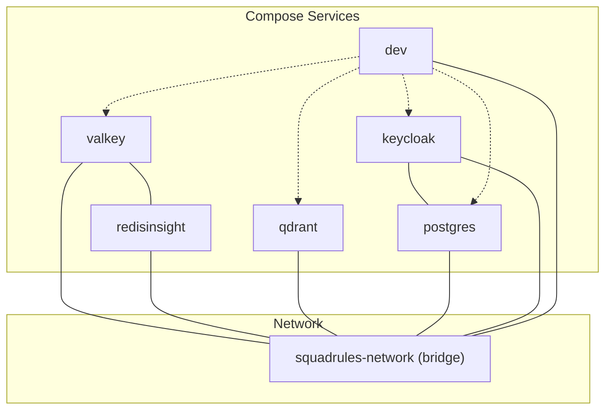
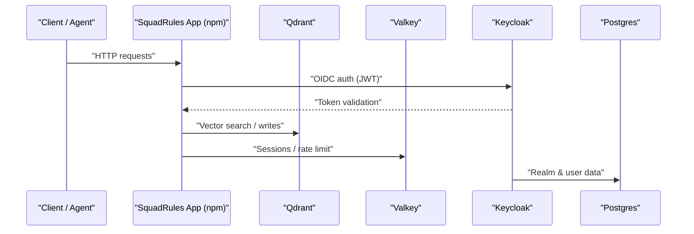
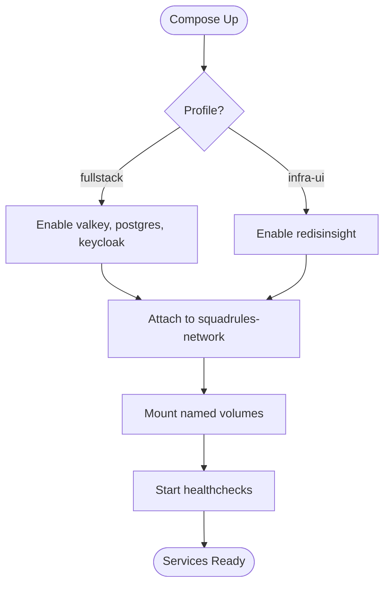
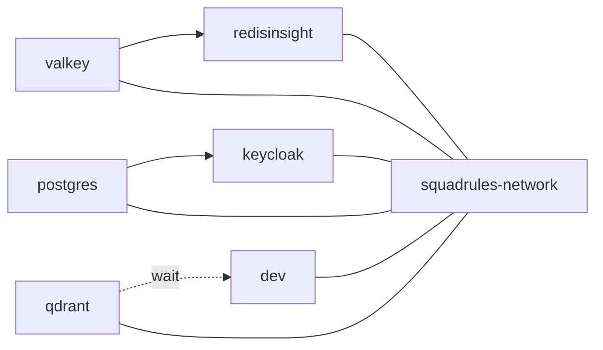

# Container Deployment

<cite>
**Referenced Files in This Document**
- [infra.yaml](file://compose/infra.yaml)
- [install.md](file://.agents/skills/squadrules/references/install.md)
- [SECURITY.md](file://SECURITY.md)
</cite>

## Table of Contents
1. [Introduction](#introduction)
2. [Project Structure](#project-structure)
3. [Core Components](#core-components)
4. [Architecture Overview](#architecture-overview)
5. [Detailed Component Analysis](#detailed-component-analysis)
6. [Dependency Analysis](#dependency-analysis)
7. [Performance Considerations](#performance-considerations)
8. [Troubleshooting Guide](#troubleshooting-guide)
9. [Conclusion](#conclusion)
10. [Appendices](#appendices)

## Introduction
This document provides comprehensive container deployment guidance for the SquadRules framework using Docker Compose. It focuses on orchestration with compose/infra.yaml, environment configuration via .env files, secret management strategies, image building and optimization, health checks, restart policies, resource limits, step-by-step deployments across environments, backup strategies for vector databases (Qdrant/LanceDB), Redis sessions (Valkey), and configuration files, as well as security best practices including network isolation and access control.

SquadRules is an agent-first MCP framework where AI agents are primary users. The core flow is activate → forward → reward. Adapters provide deterministic, auditable task execution. Vector stores include Qdrant (primary, remote-capable) and LanceDB (secondary, embedded). Storage includes Redis-compatible stores (sessions, rate limiting), vector DBs (embeddings), and filesystem (config, adapters). Authentication uses Keycloak + Google IdP for OAuth2/JWT.

## Project Structure
The repository provides a dedicated infrastructure composition file that defines shared services used by the application and development tooling:

- Infrastructure services: Valkey (Redis-compatible), Qdrant, Postgres (for Keycloak), Keycloak, optional RedisInsight UI, and a minimal dev container for managing infrastructure.
- Networking: A single bridge network named squadrules-network connects all services.
- Volumes: Persistent storage for Valkey, Qdrant, Postgres, and RedisInsight.
- Profiles: fullstack enables Valkey, Postgres, Keycloak; infra-ui adds RedisInsight.

**Diagram sources**
- [infra.yaml:13-157](file://compose/infra.yaml#L13-L157)
- [infra.yaml:159-167](file://compose/infra.yaml#L159-L167)

**Section sources**
- [infra.yaml:1-167](file://compose/infra.yaml#L1-L167)

## Core Components
- Valkey (Redis-compatible): Provides session storage and rate limiting. Configured with password authentication, memory limits, persistence options, and health checks.
- Qdrant: Primary vector database for embeddings and semantic search. Exposes HTTP and gRPC ports, API key protection, and persistent storage.
- Postgres: Database for Keycloak only.
- Keycloak: OIDC provider for authentication. Uses Postgres and supports health endpoints.
- RedisInsight: Optional UI to inspect Valkey data when enabled via profiles.
- Dev container: Minimal CLI container to manage infrastructure from within a devcontainer.

Key operational characteristics:
- Health checks: Valkey and Postgres have explicit health checks; Qdrant uses a port-based check; Keycloak exposes health endpoint.
- Restart policy: unless-stopped for resilience.
- Profiles: fullstack and infra-ui allow selective service activation.
- Environment variables: Many services read from ../.env or require specific env vars at runtime.

**Section sources**
- [infra.yaml:14-34](file://compose/infra.yaml#L14-L34)
- [infra.yaml:56-84](file://compose/infra.yaml#L56-L84)
- [infra.yaml:87-109](file://compose/infra.yaml#L87-L109)
- [infra.yaml:112-141](file://compose/infra.yaml#L112-L141)
- [infra.yaml:143-157](file://compose/infra.yaml#L143-L157)

## Architecture Overview
The containerized architecture centers around the application running outside this compose file (npm-only package), while infrastructure services are orchestrated here. Clients interact with the application, which in turn communicates with Qdrant for vector operations, Valkey for sessions/rate limiting, and Keycloak for OIDC authentication backed by Postgres.

**Diagram sources**
- [infra.yaml:56-84](file://compose/infra.yaml#L56-L84)
- [infra.yaml:14-34](file://compose/infra.yaml#L14-L34)
- [infra.yaml:112-141](file://compose/infra.yaml#L112-L141)
- [infra.yaml:87-109](file://compose/infra.yaml#L87-L109)

## Detailed Component Analysis

### Infrastructure Orchestration (compose/infra.yaml)
- Service definitions:
  - valkey: Password-protected, maxmemory 512mb, LRU eviction, persistence enabled, healthcheck via ping.
  - redisinsight: Optional UI depending on profile, depends on valkey.
  - qdrant: HTTP/GRPC ports exposed, API key required, performance tuning via working memory, persistent volume.
  - postgres: For Keycloak, healthcheck via pg_isready.
  - keycloak: start-dev mode, OIDC settings, health enabled, depends on postgres healthy.
  - dev: Docker-in-Docker-like capability for devcontainer to manage infra.
- Networking: All services attached to squadrules-network.
- Volumes: Named volumes for persistence across containers.
- Profiles:
  - fullstack: Enables valkey, postgres, keycloak.
  - infra-ui: Adds redisinsight.

**Diagram sources**
- [infra.yaml:13-157](file://compose/infra.yaml#L13-L157)
- [infra.yaml:159-167](file://compose/infra.yaml#L159-L167)

**Section sources**
- [infra.yaml:1-167](file://compose/infra.yaml#L1-L167)

### Environment Variables and Secrets
- Required variables:
  - QDRANT_API_KEY: Mandatory for Qdrant API access.
  - KEY_VALUE_STORE_PASSWORD or REDIS_PASSWORD: Required when enabling valkey via fullstack.
  - KEYCLOAK_ADMIN_PASSWORD: Required for Keycloak bootstrap admin.
  - KEYCLOAK_DB_PASSWORD: Required for Keycloak Postgres connection.
- Env file usage:
  - Services reference ../.env for shared secrets.
  - Some services also accept inline environment overrides.
- Secret management strategies:
  - Use .env for local development; avoid committing secrets.
  - For production, inject secrets through your orchestrator’s secret store (e.g., Kubernetes Secrets, Docker Swarm secrets, CI/CD vaults).
  - Rotate keys regularly and restrict access to .env files.

Environment variable references:
- Qdrant API key requirement and URL defaults documented in skill references.
- Security guidance emphasizes setting QDRANT_API_KEY for any exposed Qdrant instance.

**Section sources**
- [infra.yaml:19-22](file://compose/infra.yaml#L19-L22)
- [infra.yaml:64-72](file://compose/infra.yaml#L64-L72)
- [infra.yaml:91-96](file://compose/infra.yaml#L91-L96)
- [infra.yaml:115-134](file://compose/infra.yaml#L115-L134)
- [install.md:50-58](file://.agents/skills/squadrules/references/install.md#L50-L58)
- [install.md:99-99](file://.agents/skills/squadrules/references/install.md#L99-L99)
- [SECURITY.md:38-38](file://SECURITY.md#L38-L38)

### Container Image Building and Optimization
- Application packaging:
  - The app is an npm-only package; container images are built from the published npm package in external repositories (SquadRules/containers).
- Multi-stage builds:
  - Recommended pattern: builder stage installs dependencies and compiles TypeScript/React UI; runtime stage copies only artifacts into a slim base image.
- Optimization techniques:
  - Pin exact versions for Node.js and dependencies.
  - Use .dockerignore to exclude node_modules, tests, docs, and dev artifacts.
  - Cache dependency layers by copying package.json and lockfiles first.
  - Minimize final image size by using alpine or distroless runtimes.
  - Run as non-root user inside the container.

[No sources needed since this section provides general guidance]

### Health Checks, Restart Policies, and Resource Limits
- Health checks:
  - Valkey: ping via valkey-cli with password.
  - Postgres: pg_isready against keycloak db/user.
  - Qdrant: Port-based readiness check.
  - Keycloak: Health endpoint enabled.
- Restart policies:
  - unless-stopped applied to all services for resilience.
- Resource limits:
  - Valkey configured with maxmemory 512mb and LRU eviction.
  - Qdrant tuned with MAX_WORKING_MEMORY_MB for performance.
  - For production, set explicit CPU/memory limits in your orchestrator (Docker Compose deploy.resources or Kubernetes resources).

**Section sources**
- [infra.yaml:29-34](file://compose/infra.yaml#L29-L34)
- [infra.yaml:78-84](file://compose/infra.yaml#L78-L84)
- [infra.yaml:104-109](file://compose/infra.yaml#L104-L109)
- [infra.yaml:66-72](file://compose/infra.yaml#L66-L72)

### Step-by-Step Deployment Procedures

#### Development
- Start minimal infrastructure (Qdrant only):
  - docker compose -p squadrules-mcp -f compose/infra.yaml up -d
- Start fullstack (Valkey, Postgres, Keycloak):
  - Ensure .env contains required secrets (QDRANT_API_KEY, KEY_VALUE_STORE_PASSWORD/REDIS_PASSWORD, KEYCLOAK_ADMIN_PASSWORD, KEYCLOAK_DB_PASSWORD).
  - docker compose -p squadrules-mcp -f compose/infra.yaml --profile fullstack up -d
- Optional UI for Valkey:
  - docker compose -p squadrules-mcp -f compose/infra.yaml --profile fullstack --profile infra-ui up -d

Notes:
- The application itself runs via npm on host or inside devcontainer; no app service is defined in this compose file.

**Section sources**
- [infra.yaml:1-11](file://compose/infra.yaml#L1-L11)
- [infra.yaml:14-34](file://compose/infra.yaml#L14-L34)
- [infra.yaml:56-84](file://compose/infra.yaml#L56-L84)
- [infra.yaml:87-141](file://compose/infra.yaml#L87-L141)

#### Staging
- Prepare environment:
  - Provide production-grade secrets via orchestrator secret stores (not .env files).
  - Set QDRANT_API_KEY, KEY_VALUE_STORE_PASSWORD, KEYCLOAK_ADMIN_PASSWORD, KEYCLOAK_DB_PASSWORD.
- Deploy infrastructure:
  - Use profiles fullstack and infra-ui if needed.
- Apply resource limits:
  - Configure CPU/memory constraints per service.
- Validate health:
  - Confirm health checks pass for all services.

[No sources needed since this section provides general guidance]

#### Production
- Externalize secrets:
  - Use vault/KMS-backed secret injection.
- Harden networking:
  - Restrict ports to internal networks; expose only necessary ingress.
- Persistence:
  - Ensure volumes are backed by durable storage.
- Monitoring and logging:
  - Centralize logs; enable metrics endpoints where available.
- Backup strategy:
  - See Backup Strategies below.

[No sources needed since this section provides general guidance]

### Backup Strategies

#### Qdrant (Vector Database)
- Persistent volume: qdrant-data mounted at /qdrant/storage.
- Strategy:
  - Periodically snapshot the volume or use Qdrant’s built-in snapshot mechanisms if available in your version.
  - Store backups off-node and encrypt them.
- Restore:
  - Stop Qdrant, replace volume contents with backup, restart service.

**Section sources**
- [infra.yaml:56-63](file://compose/infra.yaml#L56-L63)
- [infra.yaml:163-167](file://compose/infra.yaml#L163-L167)

#### LanceDB (Embedded Vector Store)
- LanceDB is embedded and typically stores data under application directories.
- Strategy:
  - Back up the application workspace directory containing LanceDB data.
  - Coordinate backups with application downtime or consistent snapshots.

[No sources needed since this section provides general guidance]

#### Redis Sessions (Valkey)
- Persistent volume: valkey-data mounted at /data.
- Strategy:
  - Rely on Valkey’s appendonly persistence and periodic snapshots configured in the service command.
  - Regularly back up valkey-data.
- Restore:
  - Stop Valkey, restore volume, restart service.

**Section sources**
- [infra.yaml:14-34](file://compose/infra.yaml#L14-L34)
- [infra.yaml:163-167](file://compose/infra.yaml#L163-L167)

#### Configuration Files
- .env files contain sensitive configuration; treat as secrets.
- Strategy:
  - Do not commit .env to version control.
  - Back up securely and rotate credentials regularly.

**Section sources**
- [infra.yaml:64-65](file://compose/infra.yaml#L64-L65)
- [infra.yaml:91-92](file://compose/infra.yaml#L91-L92)
- [infra.yaml:115-116](file://compose/infra.yaml#L115-L116)

### Container Security Best Practices
- Network isolation:
  - Use the provided squadrules-network bridge network to isolate services.
  - Avoid exposing unnecessary ports to the host; restrict to internal networks in production.
- Access control:
  - Always set QDRANT_API_KEY for any exposed Qdrant instance.
  - Protect Valkey with password authentication.
  - Secure Keycloak with strong admin passwords and proper realm configuration.
- Least privilege:
  - Run containers as non-root users.
  - Limit capabilities and resources.
- Secrets management:
  - Never hardcode secrets; use orchestrator secret stores.
  - Rotate secrets regularly and audit access.

**Section sources**
- [infra.yaml:159-161](file://compose/infra.yaml#L159-L161)
- [infra.yaml:19-22](file://compose/infra.yaml#L19-L22)
- [infra.yaml:66-72](file://compose/infra.yaml#L66-L72)
- [SECURITY.md:38-38](file://SECURITY.md#L38-L38)

## Dependency Analysis
Service dependencies and interactions:
- Keycloak depends on Postgres being healthy.
- RedisInsight depends on Valkey.
- Dev container waits for Qdrant readiness before signaling infra ready.
- All services share the same bridge network.

**Diagram sources**
- [infra.yaml:118-120](file://compose/infra.yaml#L118-L120)
- [infra.yaml:42-43](file://compose/infra.yaml#L42-L43)
- [infra.yaml:147-157](file://compose/infra.yaml#L147-L157)
- [infra.yaml:159-161](file://compose/infra.yaml#L159-L161)

**Section sources**
- [infra.yaml:118-120](file://compose/infra.yaml#L118-L120)
- [infra.yaml:42-43](file://compose/infra.yaml#L42-L43)
- [infra.yaml:147-157](file://compose/infra.yaml#L147-L157)
- [infra.yaml:159-161](file://compose/infra.yaml#L159-L161)

## Performance Considerations
- Qdrant:
  - Increase MAX_WORKING_MEMORY_MB based on workload and available memory.
  - Tune log level to INFO for production to reduce overhead.
- Valkey:
  - Adjust maxmemory and eviction policy according to session volume.
  - Monitor persistence performance (appendonly and snapshots).
- General:
  - Pin image versions and use content-addressed digests for reproducibility.
  - Use pull_policy missing in dev to speed up iterations; switch to always in production for strict control.

**Section sources**
- [infra.yaml:66-72](file://compose/infra.yaml#L66-L72)
- [infra.yaml:17-22](file://compose/infra.yaml#L17-L22)
- [infra.yaml:18-18](file://compose/infra.yaml#L18-L18)
- [infra.yaml:40-40](file://compose/infra.yaml#L40-L40)

## Troubleshooting Guide
- Missing secrets:
  - If KEY_VALUE_STORE_PASSWORD (or REDIS_PASSWORD legacy alias) is not set, Valkey will fail to start.
  - If QDRANT_API_KEY is not set, Qdrant will reject API calls.
  - If KEYCLOAK_ADMIN_PASSWORD or KEYCLOAK_DB_PASSWORD is missing, Keycloak may fail to initialize.
- Health check failures:
  - Verify network connectivity between services on squadrules-network.
  - Check port bindings and firewall rules.
- Qdrant connectivity:
  - Ensure QDRANT_URL and QDRANT_API_KEY are correctly configured in the application environment.
- Keycloak integration:
  - Confirm KC_* environment variables match your deployment (hostname, DB URL, credentials).
  - Re-run realm configuration scripts after changes.

**Section sources**
- [infra.yaml:19-22](file://compose/infra.yaml#L19-L22)
- [infra.yaml:66-72](file://compose/infra.yaml#L66-L72)
- [infra.yaml:125-134](file://compose/infra.yaml#L125-L134)
- [install.md:50-58](file://.agents/skills/squadrules/references/install.md#L50-L58)
- [install.md:99-99](file://.agents/skills/squadrules/references/install.md#L99-L99)

## Conclusion
This guide outlines how to deploy SquadRules’ infrastructure using Docker Compose, configure environment variables and secrets, build optimized container images, enforce health checks and resource limits, and implement robust backup and security practices. By following these procedures across development, staging, and production environments, you can ensure reliable, secure, and performant operations for the SquadRules framework.

[No sources needed since this section summarizes without analyzing specific files]

## Appendices

### Quick Reference: Profiles and Commands
- Minimal (Qdrant only):
  - docker compose -p squadrules-mcp -f compose/infra.yaml up -d
- Fullstack (Valkey, Postgres, Keycloak):
  - docker compose -p squadrules-mcp -f compose/infra.yaml --profile fullstack up -d
- Fullstack with UI:
  - docker compose -p squadrules-mcp -f compose/infra.yaml --profile fullstack --profile infra-ui up -d

**Section sources**
- [infra.yaml:1-11](file://compose/infra.yaml#L1-L11)