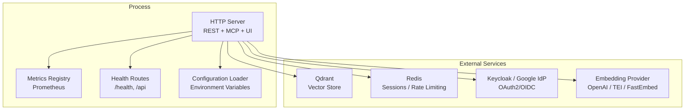
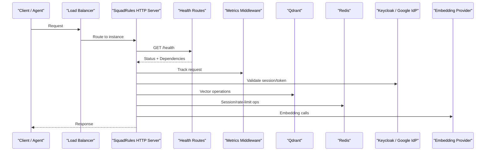
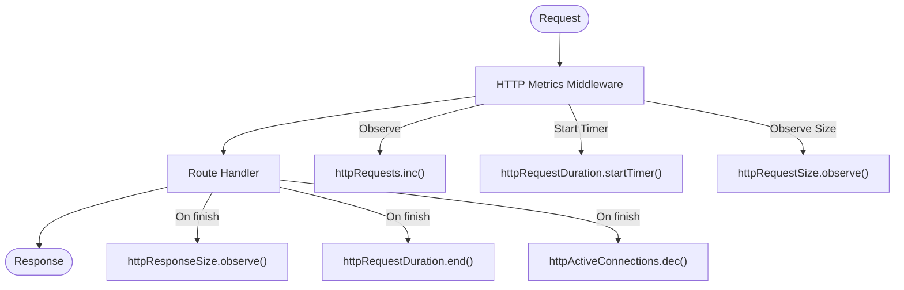
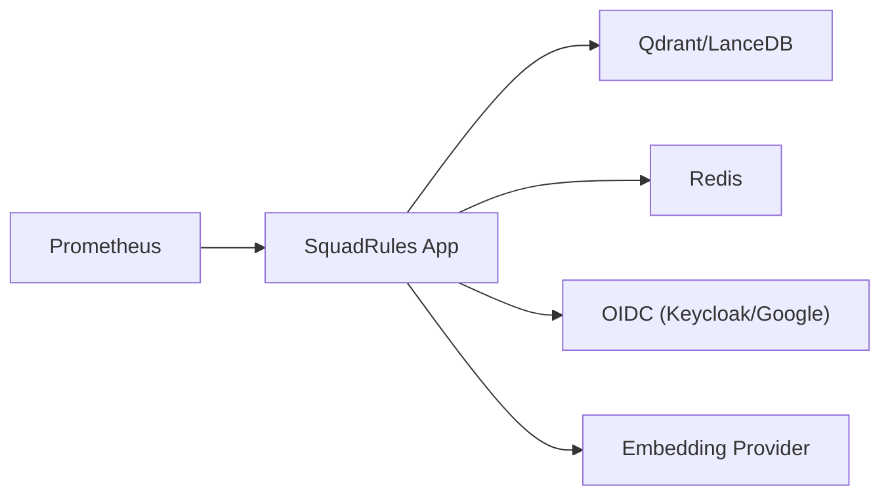

# Deployment & Operations

<cite>
**Referenced Files in This Document**
- [README.md](file://docs/README.md)
- [config.ts](file://src/config.ts)
- [server.ts](file://src/server.ts)
- [http-health-routes.ts](file://src/http/http-health-routes.ts)
- [http-metrics-middleware.ts](file://src/http/http-metrics-middleware.ts)
- [registry.ts](file://src/services/metrics/registry.ts)
</cite>

## Table of Contents
1. [Introduction](#introduction)
2. [Project Structure](#project-structure)
3. [Core Components](#core-components)
4. [Architecture Overview](#architecture-overview)
5. [Detailed Component Analysis](#detailed-component-analysis)
6. [Dependency Analysis](#dependency-analysis)
7. [Performance Considerations](#performance-considerations)
8. [Troubleshooting Guide](#troubleshooting-guide)
9. [Conclusion](#conclusion)
10. [Appendices](#appendices)

## Introduction
This document provides production-oriented deployment and operations guidance for the SquadRules framework. It focuses on containerized orchestration, environment configuration, observability (metrics, logging, health), security hardening, scaling and high availability, backup and disaster recovery, and long-running maintenance practices.

SquadRules is an agent-first MCP framework where AI agents are primary users and humans configure preferences through agents. The core flow is activate → forward → reward. Adapters provide deterministic, auditable task execution. Vector databases include Qdrant (primary, remote-capable) and LanceDB (secondary, embedded). Storage includes Redis (sessions, rate limiting), vector DBs (embeddings), and filesystem (configuration and adapters). Authentication integrates with Keycloak + Google IdP via OAuth2/JWT.

Container images, Docker Compose deployment, and Helm charts are owned by sibling repositories:
- Containers: https://github.com/SquadRules/containers
- Charts: https://github.com/SquadRules/charts

The repository’s docs router clarifies that code-derivable content lives in the project Wiki; this directory holds curated, non-code-derivable records.

**Section sources**
- [README.md:1-33](file://docs/README.md#L1-L33)

## Project Structure
At runtime, the application exposes:
- HTTP server (UI, REST API, Streamable HTTP MCP) when running in http transport mode
- Metrics endpoint for Prometheus scraping
- Health endpoints for readiness/liveness checks
- MCP tool surface (activate, forward, train, reward, tune, delete, export, spaces)

**Diagram sources**
- [server.ts:43-80](file://src/server.ts#L43-L80)
- [http-health-routes.ts:13-91](file://src/http/http-health-routes.ts#L13-L91)
- [http-metrics-middleware.ts:15-70](file://src/http/http-metrics-middleware.ts#L15-L70)
- [registry.ts:11-18](file://src/services/metrics/registry.ts#L11-L18)
- [config.ts:245-280](file://src/config.ts#L245-L280)

**Section sources**
- [server.ts:43-80](file://src/server.ts#L43-L80)
- [config.ts:245-280](file://src/config.ts#L245-L280)

## Core Components
- Configuration loader: centralizes all environment variables, including vector store selection, embedding provider, auth settings, rate limits, metrics port, snapshot behavior, and search tuning.
- MCP server bootstrap: registers tools, resources, prompts, and UI capabilities.
- HTTP health routes: expose service status, dependency health, version, uptime, and backend details.
- HTTP metrics middleware: collects request counts, durations, payload sizes, and active connections for Prometheus.
- Metrics registry: defines default labels and a shared registry instance.

Operational implications:
- Use environment variables to control deployment posture (stdio vs http), authentication, vector store backends, embedding providers, and observability ports.
- Ensure external dependencies (Qdrant, Redis, OIDC, embedding provider) are reachable and healthy before routing traffic.

**Section sources**
- [config.ts:1-120](file://src/config.ts#L1-L120)
- [config.ts:245-351](file://src/config.ts#L245-L351)
- [server.ts:43-80](file://src/server.ts#L43-L80)
- [http-health-routes.ts:13-91](file://src/http/http-health-routes.ts#L13-L91)
- [http-metrics-middleware.ts:15-70](file://src/http/http-metrics-middleware.ts#L15-L70)
- [registry.ts:11-18](file://src/services/metrics/registry.ts#L11-L18)

## Architecture Overview
The production architecture centers on a single process exposing HTTP services, backed by external state and identity systems.

**Diagram sources**
- [http-health-routes.ts:13-91](file://src/http/http-health-routes.ts#L13-L91)
- [http-metrics-middleware.ts:15-70](file://src/http/http-metrics-middleware.ts#L15-L70)
- [config.ts:245-351](file://src/config.ts#L245-L351)

## Detailed Component Analysis

### Containerized Deployment with Docker Compose
- Service orchestration:
  - Run one or more SquadRules instances behind a load balancer.
  - Externalize Qdrant, Redis, and OIDC (Keycloak/Google IdP).
  - Expose HTTP port (default SERVER_PORT=3000) and metrics port (default METRICS_PORT=9090).
- Volume management:
  - Persist Qdrant snapshots if using local snapshots (see QDRANT_SNAPSHOT_DIR).
  - Persist audit logs if AUDIT_LOG_FILE is configured.
  - Mount configuration files and adapter directories as needed.
- Environment configuration:
  - Set transport type to http for clustered deployments.
  - Configure AUTH_ENABLED and OIDC parameters (KEYCLOAK_URL, KEYCLOAK_REALM, KEYCLOAK_CLIENT_ID, AUTH_CALLBACK_BASE_URL, SESSION_SECRET).
  - Configure vector store (QDRANT_URL, QDRANT_API_KEY, QDRANT_COLLECTION) or use embedded LanceDB.
  - Configure embedding provider (OPENAI_* or TEI_* or fastembed defaults).
  - Tune search and scoring thresholds (SCORE_THRESHOLD, SIMILAR_MEMORY_THRESHOLD, SQUADRULES_SEARCH_*).
  - Enable metrics collection (METRICS_PORT) and set INSTANCE_ID for unique labeling.

Recommended compose-level considerations:
- Resource limits and requests for CPU/memory.
- Readiness probes against /health and liveness probes after startup.
- Network policies isolating app from Qdrant/Redis/OIDC.
- Secrets management for sensitive env vars (API keys, session secret).

**Section sources**
- [config.ts:106-126](file://src/config.ts#L106-L126)
- [config.ts:141-164](file://src/config.ts#L141-L164)
- [config.ts:245-280](file://src/config.ts#L245-L280)
- [config.ts:268-277](file://src/config.ts#L268-L277)

### Monitoring and Observability
- Metrics:
  - HTTP metrics middleware tracks request counts, duration histograms, request/response sizes, and active connections.
  - Prometheus registry sets default labels (service, squadrules_version, instance).
  - Scrape /metrics at METRICS_PORT.
- Logging:
  - LOG_LEVEL and LOG_FORMAT control structured logging.
  - AUDIT_LOG_FILE and AUDIT_LOG_LEVEL enable file-based audit logging with configurable verbosity.
- Health checks:
  - /health returns status, version, uptime, dependency health (vector store, cache, embedding), and backend details.
  - /api lists available endpoints and indicates whether authentication is required.

**Diagram sources**
- [http-metrics-middleware.ts:15-70](file://src/http/http-metrics-middleware.ts#L15-L70)
- [registry.ts:11-18](file://src/services/metrics/registry.ts#L11-L18)

**Section sources**
- [http-metrics-middleware.ts:15-70](file://src/http/http-metrics-middleware.ts#L15-L70)
- [registry.ts:11-18](file://src/services/metrics/registry.ts#L11-L18)
- [http-health-routes.ts:13-91](file://src/http/http-health-routes.ts#L13-L91)
- [config.ts:97-105](file://src/config.ts#L97-L105)

### Health Check System
- /health evaluates:
  - Vector store health (Qdrant or embedded LanceDB).
  - Redis connectivity when configured.
  - Embedding provider health with a short timeout to keep the endpoint responsive.
- Returns:
  - Overall status (healthy/unhealthy) and HTTP 200/503 accordingly.
  - Dependency statuses and details such as cache backend and vector store backend.
  - Build version, transport type, and uptime.

Operational guidance:
- Use /health for readiness gates; do not rely solely on process exit codes.
- Alert on unhealthy dependencies (especially vector store and embedding provider).

**Section sources**
- [http-health-routes.ts:13-91](file://src/http/http-health-routes.ts#L13-L91)

### Performance Monitoring and Capacity Planning
- Monitor:
  - HTTP request rates, latencies, and payload sizes via Prometheus metrics.
  - Active connections to detect saturation.
  - Embedding provider latency and error rates.
- Tuning knobs:
  - Search overfetch and caps: SQUADRULES_SEARCH_OVERFETCH_FACTOR, SQUADRULES_SEARCH_MAX_FETCH, SQUADRULES_SEARCH_LIMIT_CAP, SQUADRULES_SEARCH_LIMIT_MIN.
  - Score thresholds: SCORE_THRESHOLD, SIMILAR_MEMORY_THRESHOLD.
  - Concurrency budget: MAX_CONCURRENT_MCP_REQUESTS (positive override, -1 disabled, 0 auto-detect).
  - Rate limits: HTTP_RATE_LIMIT_WINDOW_MS/MAX, AUTH_RATE_LIMIT_WINDOW_MS/MAX, MCP_RATE_LIMIT_WINDOW_MS/MAX.
- Capacity planning:
  - Right-size containers based on observed CPU/memory usage under load.
  - Provision Qdrant and Redis clusters sized for expected data volume and throughput.
  - Plan embedding provider quotas and retry budgets (EMBEDDING_MAX_RETRIES, EMBEDDING_RETRY_BUDGET_MS).

**Section sources**
- [config.ts:108-126](file://src/config.ts#L108-L126)
- [config.ts:280-294](file://src/config.ts#L280-L294)
- [http-metrics-middleware.ts:15-70](file://src/http/http-metrics-middleware.ts#L15-L70)

### Backup and Disaster Recovery
- Vector database:
  - If using Qdrant snapshots, configure QDRANT_SNAPSHOT_DIR and optionally QDRANT_SNAPSHOT_ON_START to create snapshots at boot.
  - Back up the snapshot directory regularly and test restore procedures.
- Configuration and secrets:
  - Version-control configuration manifests and .env files outside the container image.
  - Rotate SESSION_SECRET and other secrets periodically.
- Audit logs:
  - When AUDIT_LOG_FILE is set, back up the log path and rotate logs externally.
- Data consistency:
  - Ensure snapshots are taken consistently and verify integrity post-restore.
  - Coordinate backups across Qdrant, Redis, and persistent volumes.

**Section sources**
- [config.ts:268-277](file://src/config.ts#L268-L277)
- [config.ts:97-105](file://src/config.ts#L97-L105)

### Security Hardening Guidelines
- Authentication:
  - Enable AUTH_ENABLED and configure OIDC (KEYCLOAK_URL, KEYCLOAK_REALM, KEYCLOAK_CLIENT_ID, AUTH_CALLBACK_BASE_URL, SESSION_SECRET).
  - For Bearer token validation, set AUTH_MODE and trusted issuers/audiences.
- Network isolation:
  - Restrict inbound access to only necessary ports (SERVER_PORT, METRICS_PORT).
  - Isolate internal services (Qdrant, Redis, OIDC) from public networks.
- Secrets management:
  - Inject secrets via secure secret stores; avoid committing secrets to repositories.
- Least privilege:
  - Run containers as non-root where possible.
  - Limit filesystem permissions for mounted volumes.

**Section sources**
- [config.ts:141-164](file://src/config.ts#L141-L164)
- [config.ts:245-280](file://src/config.ts#L245-L280)

### Scaling Strategies and High Availability
- Horizontal scaling:
  - Run multiple replicas behind a load balancer.
  - Use sticky sessions only if required; prefer stateless design with Redis-backed sessions.
- Load balancing:
  - TCP/HTTP load balancer with health checks against /health.
  - Configure timeouts and retries aligned with embedding provider SLAs.
- High availability:
  - Multi-AZ/Qdrant cluster with replication.
  - Redis HA (sentinel or managed service).
  - OIDC provider redundancy.

**Section sources**
- [http-health-routes.ts:13-91](file://src/http/http-health-routes.ts#L13-L91)
- [config.ts:245-280](file://src/config.ts#L245-L280)

### Troubleshooting Common Deployment Issues
- Startup failures due to missing auth configuration:
  - When AUTH_ENABLED=true, ensure all required OIDC variables are set; otherwise the process throws a startup error.
- Unhealthy /health responses:
  - Inspect dependency statuses returned by /health (vector store, cache, embedding).
  - Verify network reachability and credentials for Qdrant, Redis, and embedding provider.
- Metrics not scraped:
  - Confirm METRICS_PORT exposure and scrape targets.
  - Verify default labels (service, squadrules_version, instance) are present.

**Section sources**
- [config.ts:252-266](file://src/config.ts#L252-L266)
- [http-health-routes.ts:13-91](file://src/http/http-health-routes.ts#L13-L91)
- [registry.ts:11-18](file://src/services/metrics/registry.ts#L11-L18)

### Maintenance Procedures for Long-Running Deployments
- Rotate secrets and tokens (SESSION_SECRET, OIDC client secrets).
- Update embeddings and models; monitor embedding provider latency and errors.
- Review and adjust rate limits and concurrency budgets based on observed load.
- Perform periodic restore drills for Qdrant snapshots and audit logs.
- Upgrade images following vendor release notes; validate /health and metrics post-upgrade.

[No sources needed since this section provides general guidance]

## Dependency Analysis
Runtime dependencies and their roles:
- Qdrant/LanceDB: vector storage for semantic search.
- Redis: sessions and rate limiting.
- OIDC (Keycloak/Google): authentication and authorization.
- Embedding provider: generates embeddings for rules/workflows.
- Prometheus: scrapes metrics exposed by the application.

**Diagram sources**
- [config.ts:106-126](file://src/config.ts#L106-L126)
- [config.ts:141-164](file://src/config.ts#L141-L164)
- [config.ts:245-280](file://src/config.ts#L245-L280)
- [http-metrics-middleware.ts:15-70](file://src/http/http-metrics-middleware.ts#L15-L70)

**Section sources**
- [config.ts:106-126](file://src/config.ts#L106-L126)
- [config.ts:141-164](file://src/config.ts#L141-L164)
- [config.ts:245-280](file://src/config.ts#L245-L280)

## Performance Considerations
- Embedding provider resilience:
  - Tune retries and budgets (EMBEDDING_MAX_RETRIES, EMBEDDING_RETRY_BASE_DELAY_MS, EMBEDDING_RETRY_MAX_DELAY_MS, EMBEDDING_RETRY_AFTER_CAP_MS, EMBEDDING_RETRY_BUDGET_MS).
- Search performance:
  - Adjust overfetch factor and max fetch limits to balance recall and latency.
- Concurrency:
  - Use MAX_CONCURRENT_MCP_REQUESTS to cap concurrent workloads; consider cgroup memory detection when set to 0.
- Payload sizes:
  - Monitor request/response sizes via metrics; tune HTTP_JSON_BODY_LIMIT and HTTP_TRAIN_RAW_BODY_LIMIT as needed.

**Section sources**
- [config.ts:84-93](file://src/config.ts#L84-L93)
- [config.ts:108-119](file://src/config.ts#L108-L119)
- [config.ts:280-294](file://src/config.ts#L280-L294)

## Troubleshooting Guide
- Symptom: /health reports unhealthy vector store
  - Action: Verify QDRANT_URL, QDRANT_API_KEY, and network connectivity; check collection existence.
- Symptom: /health reports unhealthy embedding provider
  - Action: Validate provider configuration (OPENAI_* or TEI_*); check rate limits and quotas; review latency warnings.
- Symptom: /health reports unhealthy Redis
  - Action: Confirm REDIS_URL/KEY_VALUE_STORE_URL and password; ensure firewall allows access.
- Symptom: Auth flows fail
  - Action: Ensure AUTH_ENABLED and all OIDC variables are set; verify redirect URIs and session secret.
- Symptom: Metrics not visible
  - Action: Confirm METRICS_PORT is exposed; check Prometheus scrape config and label presence.

**Section sources**
- [http-health-routes.ts:13-91](file://src/http/http-health-routes.ts#L13-L91)
- [config.ts:252-266](file://src/config.ts#L252-L266)
- [registry.ts:11-18](file://src/services/metrics/registry.ts#L11-L18)

## Conclusion
For production deployments, run SquadRules in http transport mode behind a load balancer, externalize Qdrant, Redis, and OIDC, and expose /health and /metrics for operational visibility. Harden security with OIDC, least-privilege networking, and secret management. Scale horizontally with stateless replicas, plan capacity around embedding provider and vector store performance, and implement robust backup and disaster recovery for snapshots and audit logs. Continuously monitor metrics and health to maintain reliability and performance.

[No sources needed since this section summarizes without analyzing specific files]

## Appendices
- Container images, Docker Compose, and Helm chart ownership reside in sibling repositories:
  - Containers: https://github.com/SquadRules/containers
  - Charts: https://github.com/SquadRules/charts

**Section sources**
- [README.md:23-26](file://docs/README.md#L23-L26)