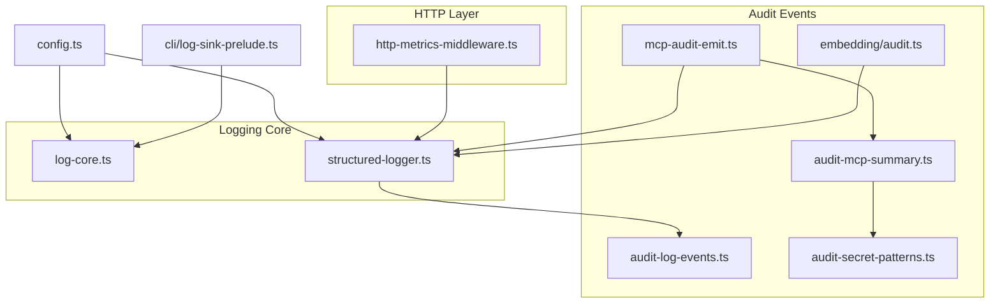
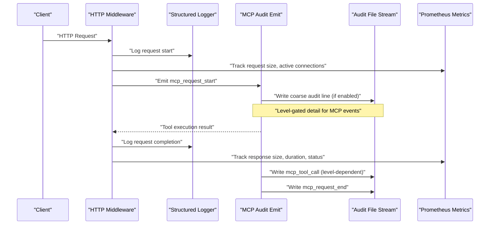
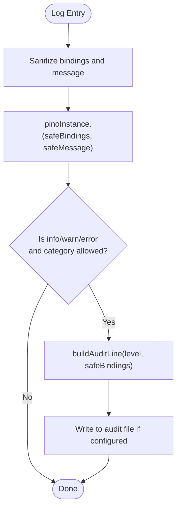
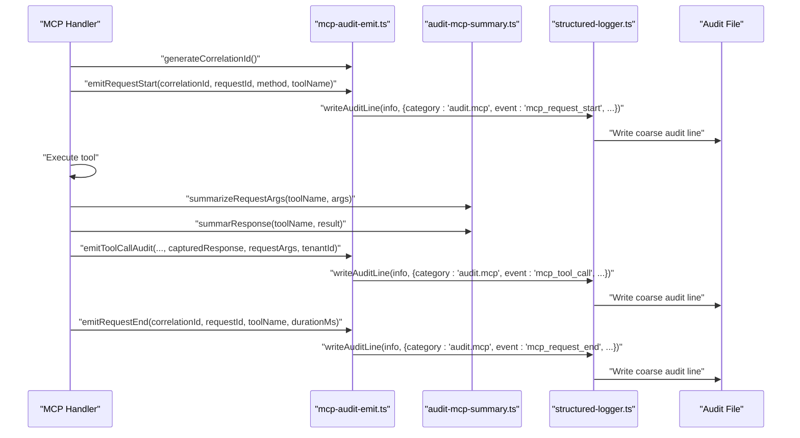
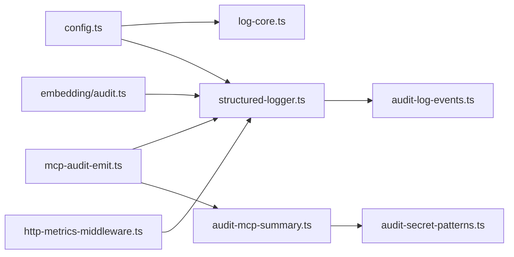

# Logging & Audit

<cite>
**Referenced Files in This Document**
- [structured-logger.ts](file://src/utils/structured-logger.ts)
- [log-core.ts](file://src/utils/log-core.ts)
- [audit-log-events.ts](file://src/utils/audit-log-events.ts)
- [audit-mcp-summary.ts](file://src/utils/audit-mcp-summary.ts)
- [audit-secret-patterns.ts](file://src/utils/audit-secret-patterns.ts)
- [mcp-audit-emit.ts](file://src/http/mcp-audit-emit.ts)
- [http-metrics-middleware.ts](file://src/http/http-metrics-middleware.ts)
- [config.ts](file://src/config.ts)
- [audit-log.md](file://docs/security/audit-log.md)
- [audit.ts](file://src/services/embedding/audit.ts)
- [log-sink-prelude.ts](file://src/cli/log-sink-prelude.ts)
</cite>

## Table of Contents
1. [Introduction](#introduction)
2. [Project Structure](#project-structure)
3. [Core Components](#core-components)
4. [Architecture Overview](#architecture-overview)
5. [Detailed Component Analysis](#detailed-component-analysis)
6. [Dependency Analysis](#dependency-analysis)
7. [Performance Considerations](#performance-considerations)
8. [Troubleshooting Guide](#troubleshooting-guide)
9. [Conclusion](#conclusion)
10. [Appendices](#appendices)

## Introduction
This document describes SquadRules logging and audit capabilities with a focus on production operations, security, and compliance. It explains the structured log format, log levels, audit event taxonomy, sanitization and secret redaction, optional append-only audit file behavior, rotation and retention responsibilities, and integration guidance for platforms such as ELK or Splunk. It also provides example analysis queries and operational recommendations for secure storage and monitoring.

SquadRules uses a shared Pino-based logger for consistent JSON shape across HTTP and stdio transports. Audit events are emitted into the main structured log and, when configured, into an optional append-only audit file containing coarse allowlisted lines. MCP tool calls, embedding/search anomalies, and HTTP request lifecycle events are all observable through this system.

## Project Structure
The logging and audit subsystem is centered around a small set of modules:

- Shared Pino core configuration and output routing
- Structured logger wrapper with HTTP middleware and audit side-stream
- Audit event schema and category mapping
- MCP audit emission helpers and request/response summarization
- Secret redaction patterns
- Embedding and search anomaly auditing
- CLI stdout/stderr separation prelude
- Configuration constants for log levels and audit verbosity

**Diagram sources**
- [log-core.ts:1-105](file://src/utils/log-core.ts#L1-L105)
- [structured-logger.ts:1-350](file://src/utils/structured-logger.ts#L1-L350)
- [audit-log-events.ts:1-89](file://src/utils/audit-log-events.ts#L1-L89)
- [audit-mcp-summary.ts:1-169](file://src/utils/audit-mcp-summary.ts#L1-L169)
- [audit-secret-patterns.ts:1-27](file://src/utils/audit-secret-patterns.ts#L1-L27)
- [mcp-audit-emit.ts:1-118](file://src/http/mcp-audit-emit.ts#L1-L118)
- [http-metrics-middleware.ts:1-73](file://src/http/http-metrics-middleware.ts#L1-L73)
- [config.ts:97-105](file://src/config.ts#L97-L105)
- [log-sink-prelude.ts:1-25](file://src/cli/log-sink-prelude.ts#L1-L25)

**Section sources**
- [log-core.ts:1-105](file://src/utils/log-core.ts#L1-L105)
- [structured-logger.ts:1-350](file://src/utils/structured-logger.ts#L1-L350)
- [audit-log-events.ts:1-89](file://src/utils/audit-log-events.ts#L1-L89)
- [audit-mcp-summary.ts:1-169](file://src/utils/audit-mcp-summary.ts#L1-L169)
- [audit-secret-patterns.ts:1-27](file://src/utils/audit-secret-patterns.ts#L1-L27)
- [mcp-audit-emit.ts:1-118](file://src/http/mcp-audit-emit.ts#L1-L118)
- [http-metrics-middleware.ts:1-73](file://src/http/http-metrics-middleware.ts#L1-L73)
- [config.ts:97-105](file://src/config.ts#L97-L105)
- [log-sink-prelude.ts:1-25](file://src/cli/log-sink-prelude.ts#L1-L25)

## Core Components
- Pino base logger: centralizes log level, timestamping, redaction paths, and transport-specific output (stdout vs stderr).
- Structured logger wrapper: exposes typed methods (`debug`, `info`, `warn`, `error`), HTTP access logging, child contexts, and audit line writing.
- Audit event builder: maps sanitized bindings to coarse JSONL records with stable categories and derived event names.
- MCP audit emission: emits start/end/tool-call events with correlation IDs and configurable detail levels.
- MCP summary utilities: sanitize and bound request/response payloads for audit, including secret redaction.
- Embedding/anomaly audit: logs embedding success/failure and heuristic anomalies (latency, norm, dimension mismatch, search quality).
- CLI log sink prelude: ensures CLI data commands do not corrupt stdout by forcing logs to stderr.

Key configuration variables:
- `LOG_LEVEL`: Pino log level (default `info`).
- `LOG_FORMAT`: Output format (`text` or `json`).
- `AUDIT_LOG_FILE`: Optional append-only audit file path.
- `AUDIT_LOG_LEVEL`: MCP audit verbosity (0–3).

**Section sources**
- [log-core.ts:1-105](file://src/utils/log-core.ts#L1-L105)
- [structured-logger.ts:1-350](file://src/utils/structured-logger.ts#L1-L350)
- [audit-log-events.ts:1-89](file://src/utils/audit-log-events.ts#L1-L89)
- [mcp-audit-emit.ts:1-118](file://src/http/mcp-audit-emit.ts#L1-L118)
- [audit-mcp-summary.ts:1-169](file://src/utils/audit-mcp-summary.ts#L1-L169)
- [audit.ts:1-197](file://src/services/embedding/audit.ts#L1-L197)
- [config.ts:97-105](file://src/config.ts#L97-L105)
- [log-sink-prelude.ts:1-25](file://src/cli/log-sink-prelude.ts#L1-L25)

## Architecture Overview
The logging architecture separates concerns between general application logs and security-sensitive audit trails:

- Application logs: Pino-based structured logs written to stdout or stderr depending on transport and environment flags.
- Audit trail: Optional append-only JSONL file for allowlisted categories (`audit.embedding`, `audit.anomaly`, `audit.mcp`).
- HTTP layer: Adds request metadata (method, path, status, duration, client IP, request ID) and integrates with metrics.
- MCP layer: Emits correlated audit events for tool calls with configurable payload inclusion.
- Embedding/search layer: Emits rich audit and anomaly events with tenant and request context.

**Diagram sources**
- [structured-logger.ts:149-183](file://src/utils/structured-logger.ts#L149-L183)
- [mcp-audit-emit.ts:44-117](file://src/http/mcp-audit-emit.ts#L44-L117)
- [http-metrics-middleware.ts:15-70](file://src/http/http-metrics-middleware.ts#L15-L70)

**Section sources**
- [structured-logger.ts:149-183](file://src/utils/structured-logger.ts#L149-L183)
- [mcp-audit-emit.ts:44-117](file://src/http/mcp-audit-emit.ts#L44-L117)
- [http-metrics-middleware.ts:15-70](file://src/http/http-metrics-middleware.ts#L15-L70)

## Detailed Component Analysis

### Structured Logger and Pino Core
Responsibilities:
- Create and cache the base Pino logger with redaction paths and serializers.
- Route logs to stdout or stderr based on transport type and explicit flag.
- Provide a typed API for structured logging with safe binding sanitization.
- Implement HTTP access logging with request ID, client IP, method, path, protocol, status, duration, and user agent.
- Write audit lines to the optional file stream after sanitization.

Security and safety:
- Sanitizes strings and object keys to prevent control characters and line breaks from breaking log lines.
- Clones records before passing to Pino to avoid prototype leakage.
- Caps audit record depth, key count, and string length.

Operational notes:
- CLI mode forces logs to stderr to keep stdout reserved for command payloads.
- HTTP server defaults to stdout for containerized environments.

**Diagram sources**
- [structured-logger.ts:55-148](file://src/utils/structured-logger.ts#L55-L148)
- [audit-log-events.ts:68-88](file://src/utils/audit-log-events.ts#L68-L88)

**Section sources**
- [log-core.ts:1-105](file://src/utils/log-core.ts#L1-L105)
- [structured-logger.ts:55-148](file://src/utils/structured-logger.ts#L55-L148)
- [structured-logger.ts:149-183](file://src/utils/structured-logger.ts#L149-L183)
- [structured-logger.ts:211-335](file://src/utils/structured-logger.ts#L211-L335)
- [log-sink-prelude.ts:1-25](file://src/cli/log-sink-prelude.ts#L1-L25)

### Audit Event Schema and Categories
Categories:
- `audit.embedding`: Embedding request outcomes and provider-stage results.
- `audit.anomaly`: Heuristic anomalies (high latency, unusual vector norm, dimension mismatch, search zero results, low score).
- `audit.mcp`: MCP tool call lifecycle events.

Event derivation:
- For `audit.mcp`, event names include `mcp_request_start`, `mcp_tool_call`, and `mcp_request_end`.
- For `audit.embedding`, event names derive from stage and status.
- For `audit.anomaly`, event names map from `anomaly_type`.

Output:
- Coarse JSONL lines include `time`, `level`, `category`, `event`, plus non-category/event fields.
- The optional audit file is append-only and disabled when `AUDIT_LOG_FILE` is empty.

**Section sources**
- [audit-log-events.ts:1-89](file://src/utils/audit-log-events.ts#L1-L89)
- [audit-log.md:157-186](file://docs/security/audit-log.md#L157-L186)

### MCP Audit Emission and Correlation
Features:
- Generates correlation IDs to group related requests within short time windows per tenant.
- Emits `mcp_request_start` before space context resolution; `tenant_id` may be unknown at that point.
- Emits `mcp_tool_call` after tool execution with status, duration, error code, and level-dependent request/response snapshots.
- Emits `mcp_request_end` in the response finish handler.

Verbosity:
- Level 0: Off
- Level 1: Metadata only
- Level 2: + request arguments (sanitized)
- Level 3: + response body (sanitized)

Sanitization:
- Bounded depth, capped arrays, limited keys, string truncation, and secret redaction.

**Diagram sources**
- [mcp-audit-emit.ts:24-117](file://src/http/mcp-audit-emit.ts#L24-L117)
- [audit-mcp-summary.ts:63-129](file://src/utils/audit-mcp-summary.ts#L63-L129)
- [structured-logger.ts:144-148](file://src/utils/structured-logger.ts#L144-L148)

**Section sources**
- [mcp-audit-emit.ts:1-118](file://src/http/mcp-audit-emit.ts#L1-L118)
- [audit-mcp-summary.ts:1-169](file://src/utils/audit-mcp-summary.ts#L1-L169)
- [audit-log.md:89-155](file://docs/security/audit-log.md#L89-L155)

### Embedding and Search Anomaly Auditing
Capabilities:
- Logs embedding success and failure with provider, model, input sizing, output dimension, and latency.
- Detects anomalies:
  - High latency beyond threshold
  - Unusual vector norm outside configured range
  - Dimension mismatch between expected and actual
  - Search returning zero results for non-trivial queries
  - Search top score below warning threshold

Integration:
- Emits structured logs under `audit.embedding` and `audit.anomaly`.
- Increments anomaly metrics counters for observability.

**Section sources**
- [audit.ts:1-197](file://src/services/embedding/audit.ts#L1-L197)

### HTTP Metrics Middleware
Purpose:
- Tracks Prometheus metrics for HTTP requests: counts, durations, request/response sizes, and active connections.
- Tags metrics with method, route, status, and tenant ID.

Relationship to logging:
- Complements structured logs with machine-readable metrics for SLOs and alerting.

**Section sources**
- [http-metrics-middleware.ts:1-73](file://src/http/http-metrics-middleware.ts#L1-L73)

### Secret Redaction and Safe Logging
Policies:
- Centralized regex patterns for known secrets (Bearer tokens, GitHub/GitLab tokens, Slack tokens, Google API keys).
- Redaction applied to MCP request/response summaries and other sensitive values.
- Additional Pino-level redaction for authorization headers, cookies, passwords, and secrets.

Safety measures:
- Control character neutralization and line break removal in log messages.
- Object key sanitization to prevent injection via malformed bindings.
- Depth and size limits to protect against oversized or deeply nested payloads.

**Section sources**
- [audit-secret-patterns.ts:1-27](file://src/utils/audit-secret-patterns.ts#L1-L27)
- [audit-mcp-summary.ts:18-57](file://src/utils/audit-mcp-summary.ts#L18-L57)
- [log-core.ts:12-19](file://src/utils/log-core.ts#L12-L19)
- [structured-logger.ts:55-148](file://src/utils/structured-logger.ts#L55-L148)

## Dependency Analysis
High-level dependencies:

- `config.ts` defines logging and audit configuration consumed by the logger and audit components.
- `log-core.ts` creates the Pino instance and determines output destination.
- `structured-logger.ts` wraps Pino, implements HTTP logging, and writes audit lines.
- `audit-log-events.ts` builds coarse audit JSONL records for allowlisted categories.
- `mcp-audit-emit.ts` orchestrates MCP audit events and uses summary utilities.
- `audit-mcp-summary.ts` sanitizes MCP request/response data using secret redaction.
- `embedding/audit.ts` emits embedding and anomaly audit events.
- `http-metrics-middleware.ts` emits Prometheus metrics alongside logs.

**Diagram sources**
- [config.ts:97-105](file://src/config.ts#L97-L105)
- [log-core.ts:1-105](file://src/utils/log-core.ts#L1-L105)
- [structured-logger.ts:1-350](file://src/utils/structured-logger.ts#L1-L350)
- [audit-log-events.ts:1-89](file://src/utils/audit-log-events.ts#L1-L89)
- [mcp-audit-emit.ts:1-118](file://src/http/mcp-audit-emit.ts#L1-L118)
- [audit-mcp-summary.ts:1-169](file://src/utils/audit-mcp-summary.ts#L1-L169)
- [audit-secret-patterns.ts:1-27](file://src/utils/audit-secret-patterns.ts#L1-L27)
- [audit.ts:1-197](file://src/services/embedding/audit.ts#L1-L197)
- [http-metrics-middleware.ts:1-73](file://src/http/http-metrics-middleware.ts#L1-L73)

**Section sources**
- [config.ts:97-105](file://src/config.ts#L97-L105)
- [log-core.ts:1-105](file://src/utils/log-core.ts#L1-L105)
- [structured-logger.ts:1-350](file://src/utils/structured-logger.ts#L1-L350)
- [audit-log-events.ts:1-89](file://src/utils/audit-log-events.ts#L1-L89)
- [mcp-audit-emit.ts:1-118](file://src/http/mcp-audit-emit.ts#L1-L118)
- [audit-mcp-summary.ts:1-169](file://src/utils/audit-mcp-summary.ts#L1-L169)
- [audit-secret-patterns.ts:1-27](file://src/utils/audit-secret-patterns.ts#L1-L27)
- [audit.ts:1-197](file://src/services/embedding/audit.ts#L1-L197)
- [http-metrics-middleware.ts:1-73](file://src/http/http-metrics-middleware.ts#L1-L73)

## Performance Considerations
- Audit file writes are best-effort and never fail the request path; failures are silently ignored to avoid impacting latency.
- Audit line construction enforces maximum byte size to prevent oversized records.
- Sanitization bounds depth, key count, array length, and string length to limit CPU and memory usage.
- Pino serialization clones safe records to avoid prototype traversal overhead.
- HTTP metrics middleware tracks request/response sizes and durations without blocking the response pipeline.

Recommendations:
- Keep `AUDIT_LOG_LEVEL` at 1 in production unless detailed request/response capture is required.
- Use separate log shipping pipelines for main logs and audit files to optimize indexing and retention policies.
- Monitor audit file growth and configure external rotation tools accordingly.

[No sources needed since this section provides general guidance]

## Troubleshooting Guide
Common issues and resolutions:

- No audit file created:
  - Ensure `AUDIT_LOG_FILE` is set to a writable path. If opening fails, the stream remains disabled and requests continue normally.
  - Verify filesystem permissions and volume mounts.

- Missing MCP audit events:
  - Check `AUDIT_LOG_LEVEL`; level 0 disables MCP audit events.
  - Confirm that MCP handler emits start/end/tool-call events and that correlation IDs are present.

- Excessive audit file size:
  - Reduce `AUDIT_LOG_LEVEL` to 1 or 2.
  - Configure external rotation (for example, logrotate or platform-native rotation) and retention policies.

- Secrets appearing in logs:
  - Verify secret redaction patterns are active and that MCP summaries are used for request/response capture.
  - Review Pino redaction paths for authorization headers and cookies.

- CLI stdout corruption:
  - Ensure the CLI log sink prelude runs first so logs go to stderr and stdout remains a pure data channel.

**Section sources**
- [audit-log.md:30-46](file://docs/security/audit-log.md#L30-L46)
- [audit-log.md:89-155](file://docs/security/audit-log.md#L89-L155)
- [structured-logger.ts:47-53](file://src/utils/structured-logger.ts#L47-L53)
- [structured-logger.ts:134-148](file://src/utils/structured-logger.ts#L134-L148)
- [log-sink-prelude.ts:1-25](file://src/cli/log-sink-prelude.ts#L1-L25)

## Conclusion
SquadRules provides a robust, secure, and extensible logging and audit framework suitable for production environments. The structured logger ensures consistent JSON output, while the optional audit file offers a compact, allowlisted side channel for embedding/search anomalies and MCP tool calls. Security is enforced through comprehensive sanitization and secret redaction. Operators should rely on the main structured log for investigation and use the audit file for dedicated compliance reporting where appropriate. Rotation, retention, and secure storage are managed by the deployment environment, enabling flexible integration with ELK stack, Splunk, or other log management platforms.

[No sources needed since this section summarizes without analyzing specific files]

## Appendices

### Log Levels and Format
- `LOG_LEVEL`: Controls Pino verbosity (for example, `debug`, `info`, `warn`, `error`).
- `LOG_FORMAT`: Selects `text` or `json` output.
- `TRANSPORT_TYPE`: Determines whether logs go to stdout or stderr; CLI mode forces stderr to preserve stdout as a data channel.

**Section sources**
- [config.ts:97-105](file://src/config.ts#L97-L105)
- [log-core.ts:21-32](file://src/utils/log-core.ts#L21-L32)
- [log-sink-prelude.ts:1-25](file://src/cli/log-sink-prelude.ts#L1-L25)

### Audit Configuration
- `AUDIT_LOG_FILE`: Enables optional append-only audit file.
- `AUDIT_LOG_LEVEL`: MCP audit verbosity (0–3).

**Section sources**
- [config.ts:99-105](file://src/config.ts#L99-L105)
- [audit-log.md:30-46](file://docs/security/audit-log.md#L30-L46)

### Audit Event Taxonomy
- `audit.embedding`: Embedding success/failure and provider-stage outcomes.
- `audit.anomaly`: Latency, norm, dimension mismatch, search zero results, low score.
- `audit.mcp`: `mcp_request_start`, `mcp_tool_call`, `mcp_request_end`.

**Section sources**
- [audit-log-events.ts:1-89](file://src/utils/audit-log-events.ts#L1-L89)
- [audit-log.md:69-87](file://docs/security/audit-log.md#L69-L87)

### Example Log Analysis Queries
These examples assume standard JSON logs indexed by a platform like Elasticsearch/Kibana or Splunk. Adjust field names to match your ingestion pipeline.

- Find failed MCP tool calls with error codes:
  - KQL (Splunk): `index=squadrules_logs category="audit.mcp" event="mcp_tool_call" status="error" | stats count by tool_name, error_code`
  - Lucene (ELK): `category:"audit.mcp" AND event:"mcp_tool_call" AND status:"error"`

- Investigate high-latency embedding providers:
  - KQL: `category="audit.anomaly" anomaly_type="embedding_high_latency" | sort by @timestamp desc`
  - Lucene: `category:"audit.anomaly" AND anomaly_type:"embedding_high_latency"`

- Track search quality issues:
  - KQL: `category="audit.anomaly" (anomaly_type="search_zero_results" OR anomaly_type="search_low_score")`
  - Lucene: `category:"audit.anomaly" AND (anomaly_type:"search_zero_results" OR anomaly_type:"search_low_score")`

- Correlate MCP requests by correlation ID:
  - KQL: `category="audit.mcp" correlation_id="<CORRELATION_ID>" | sort by @timestamp asc`
  - Lucene: `category:"audit.mcp" AND correlation_id:"<CORRELATION_ID>"`

- HTTP request latency distribution:
  - KQL: `category="http" response_time_ms > 0 | stats avg(response_time_ms) by method, route`
  - Lucene: `category:"http" AND response_time_ms:[* TO *]`

[No sources needed since this section provides general guidance]

### Integration with ELK Stack
- Ingest JSON logs via Filebeat or Fluent Bit.
- Use a JSON codec and index by date.
- Map fields: `category`, `event`, `tenant_id`, `request_id`, `correlation_id`, `tool_name`, `status`, `duration_ms`, `error_code`.
- Create dashboards for:
  - MCP error rates by tool
  - Embedding latency anomalies
  - Search quality warnings
  - HTTP request duration percentiles

[No sources needed since this section provides general guidance]

### Integration with Splunk
- Forward JSON logs via Splunk Heavy Forwarder or Universal Forwarder.
- Parse JSON and index fields: `category`, `event`, `tenant_id`, `request_id`, `correlation_id`, `tool_name`, `status`, `duration_ms`, `error_code`.
- Build alerts for:
  - MCP errors exceeding thresholds
  - Embedding anomalies
  - Search zero results spikes
  - HTTP 5xx rate increases

[No sources needed since this section provides general guidance]

### Rotation, Retention, and Secure Storage
- Rotation and retention are environment responsibilities (for example, log shipper, logrotate, or container volume policies).
- Store audit files on encrypted volumes with restricted access.
- Separate main logs and audit files into different indices or buckets to apply distinct retention policies.
- Avoid storing secrets in logs; rely on built-in redaction and sanitization.

**Section sources**
- [audit-log.md:43-46](file://docs/security/audit-log.md#L43-L46)