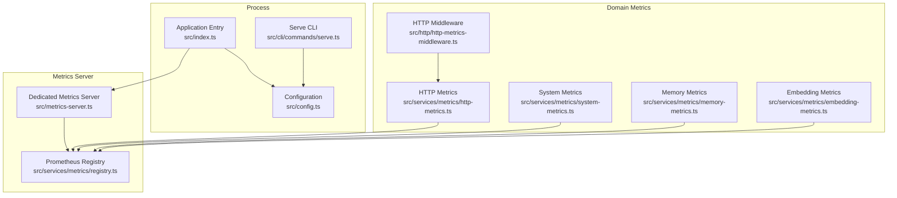
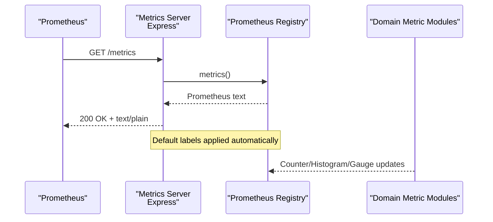
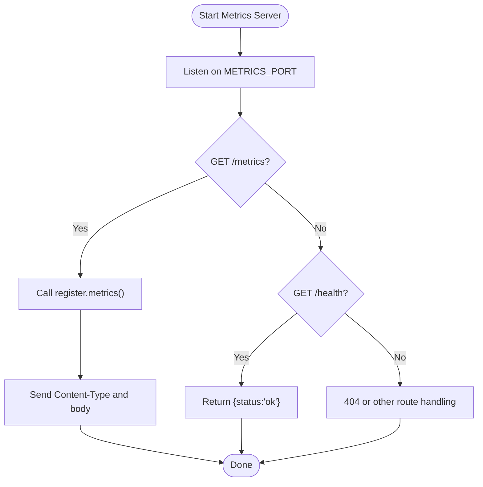
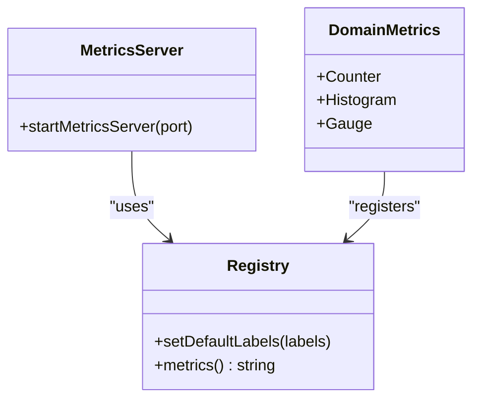
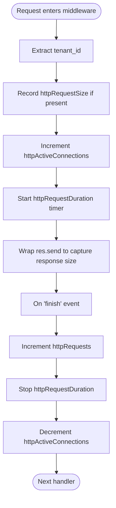
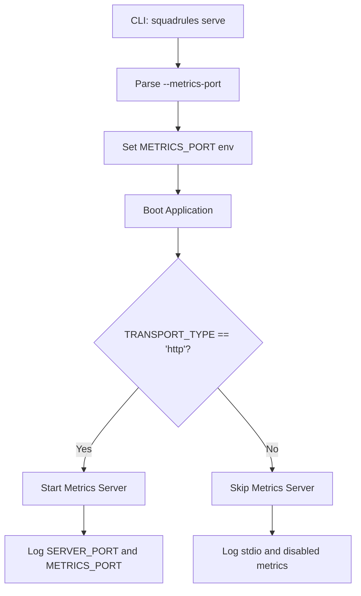
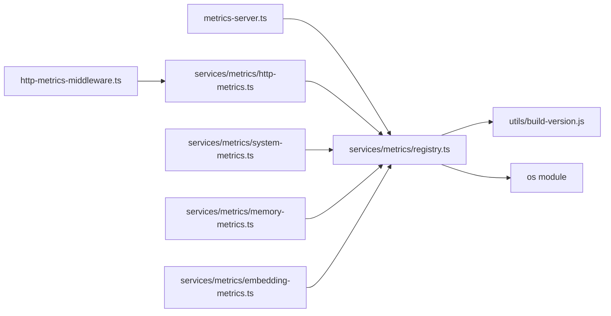

# Metrics Collection

<cite>
**Referenced Files in This Document**
- [metrics-server.ts](file://src/metrics-server.ts)
- [registry.ts](file://src/services/metrics/registry.ts)
- [http-metrics-middleware.ts](file://src/http/http-metrics-middleware.ts)
- [http-metrics.ts](file://src/services/metrics/http-metrics.ts)
- [system-metrics.ts](file://src/services/metrics/system-metrics.ts)
- [memory-metrics.ts](file://src/services/metrics/memory-metrics.ts)
- [embedding-metrics.ts](file://src/services/metrics/embedding-metrics.ts)
- [config.ts](file://src/config.ts)
- [serve.ts](file://src/cli/commands/serve.ts)
- [index.ts](file://src/index.ts)
</cite>

## Table of Contents
1. [Introduction](#introduction)
2. [Project Structure](#project-structure)
3. [Core Components](#core-components)
4. [Architecture Overview](#architecture-overview)
5. [Detailed Component Analysis](#detailed-component-analysis)
6. [Dependency Analysis](#dependency-analysis)
7. [Performance Considerations](#performance-considerations)
8. [Troubleshooting Guide](#troubleshooting-guide)
9. [Conclusion](#conclusion)
10. [Appendices](#appendices)

## Introduction
This document explains how SquadRules collects and exposes metrics for Prometheus scraping. It covers the dedicated metrics server, available metric categories (HTTP requests, system resources, memory operations, embedding performance), custom metric registration, naming conventions, cardinality controls, PromQL query examples, alerting guidance, retention and storage considerations, and the performance impact of metrics collection.

SquadRules is an agent-first MCP framework where AI agents drive workflows through adapters. The metrics layer provides observability for HTTP traffic, process health, memory store operations, and embedding provider performance so operators can monitor reliability, capacity, and cost drivers.

## Project Structure
The metrics implementation is split into:
- A standalone Express server exposing only `/metrics` and a small `/health` endpoint.
- A shared Prometheus registry that applies default labels such as service name, version, and instance identifier.
- Domain-specific metric modules for HTTP, system, memory, and embedding subsystems.
- An HTTP middleware that instruments request counts, durations, payload sizes, and active connections.
- Configuration and CLI wiring to start the metrics server on a separate port.

**Diagram sources**
- [index.ts:12-25](file://src/index.ts#L12-L25)
- [metrics-server.ts:1-43](file://src/metrics-server.ts#L1-L43)
- [registry.ts:1-23](file://src/services/metrics/registry.ts#L1-L23)
- [http-metrics-middleware.ts:1-73](file://src/http/http-metrics-middleware.ts#L1-L73)
- [http-metrics.ts:1-53](file://src/services/metrics/http-metrics.ts#L1-L53)
- [system-metrics.ts:1-47](file://src/services/metrics/system-metrics.ts#L1-L47)
- [memory-metrics.ts:1-38](file://src/services/metrics/memory-metrics.ts#L1-L38)
- [embedding-metrics.ts:1-51](file://src/services/metrics/embedding-metrics.ts#L1-L51)
- [config.ts:280-280](file://src/config.ts#L280-L280)
- [serve.ts:99-123](file://src/cli/commands/serve.ts#L99-L123)

**Section sources**
- [metrics-server.ts:1-43](file://src/metrics-server.ts#L1-L43)
- [registry.ts:1-23](file://src/services/metrics/registry.ts#L1-L23)
- [http-metrics-middleware.ts:1-73](file://src/http/http-metrics-middleware.ts#L1-L73)
- [http-metrics.ts:1-53](file://src/services/metrics/http-metrics.ts#L1-L53)
- [system-metrics.ts:1-47](file://src/services/metrics/system-metrics.ts#L1-L47)
- [memory-metrics.ts:1-38](file://src/services/metrics/memory-metrics.ts#L1-L38)
- [embedding-metrics.ts:1-51](file://src/services/metrics/embedding-metrics.ts#L1-L51)
- [config.ts:280-280](file://src/config.ts#L280-L280)
- [serve.ts:99-123](file://src/cli/commands/serve.ts#L99-L123)
- [index.ts:83-101](file://src/index.ts#L83-L101)

## Core Components
- Dedicated metrics server: Starts an isolated Express app listening on `METRICS_PORT`, serving `/metrics` and `/health`.
- Shared registry: Centralizes Prometheus registry and default labels (`service`, `squadrules_version`, `instance`).
- HTTP instrumentation: Middleware increments counters, records histograms for duration and payload sizes, and tracks active connections per tenant.
- System metrics: Periodically updates uptime, process start time, and memory usage gauges.
- Domain metrics: Counters and histograms for memory store operations and embedding provider performance.

Key responsibilities:
- Keep metrics collection off the main application port to avoid contention with user traffic.
- Apply consistent default labels while allowing optional high-cardinality labels like `tenant_id` when needed.
- Provide clear metric names following the `squadrules_` prefix convention.

**Section sources**
- [metrics-server.ts:8-43](file://src/metrics-server.ts#L8-L43)
- [registry.ts:5-23](file://src/services/metrics/registry.ts#L5-L23)
- [http-metrics-middleware.ts:11-71](file://src/http/http-metrics-middleware.ts#L11-L71)
- [system-metrics.ts:4-41](file://src/services/metrics/system-metrics.ts#L4-L41)
- [memory-metrics.ts:5-32](file://src/services/metrics/memory-metrics.ts#L5-L32)
- [embedding-metrics.ts:5-47](file://src/services/metrics/embedding-metrics.ts#L5-L47)

## Architecture Overview
The metrics architecture separates scraping from application traffic:
- The main application runs on `SERVER_PORT` and uses HTTP middleware to record operational metrics.
- The metrics server runs on `METRICS_PORT` and exposes the aggregated metrics via the Prometheus exposition format.
- All metrics are registered against a single registry with default labels applied globally.

**Diagram sources**
- [metrics-server.ts:19-43](file://src/metrics-server.ts#L19-L43)
- [registry.ts:11-18](file://src/services/metrics/registry.ts#L11-L18)

**Section sources**
- [index.ts:83-101](file://src/index.ts#L83-L101)
- [metrics-server.ts:19-43](file://src/metrics-server.ts#L19-L43)
- [registry.ts:11-18](file://src/services/metrics/registry.ts#L11-L18)

## Detailed Component Analysis

### Metrics Server
Responsibilities:
- Start an Express server bound to `METRICS_PORT`.
- Expose `/metrics` returning the current Prometheus scrape output.
- Provide `/health` for liveness checks.
- Log startup details including the metrics endpoint URL.

Operational notes:
- In stdio mode, the metrics server is not started; it is only enabled for HTTP transport.
- Errors during metrics generation are logged and return a 500 response.

**Diagram sources**
- [metrics-server.ts:19-43](file://src/metrics-server.ts#L19-L43)

**Section sources**
- [metrics-server.ts:1-43](file://src/metrics-server.ts#L1-L43)
- [index.ts:83-101](file://src/index.ts#L83-L101)

### Prometheus Registry and Default Labels
The registry centralizes metric registration and applies default labels:
- `service`: Fixed to `squadrules`.
- `squadrules_version`: Derived from build metadata.
- `instance`: From environment variable `INSTANCE_ID` or hostname.

Cardinality policy:
- Tenant isolation is achieved by adding `tenant_id` explicitly per metric rather than as a global default label. This avoids uncontrolled cardinality growth across tenants.

**Diagram sources**
- [registry.ts:11-18](file://src/services/metrics/registry.ts#L11-L18)
- [metrics-server.ts:19-43](file://src/metrics-server.ts#L19-L43)

**Section sources**
- [registry.ts:1-23](file://src/services/metrics/registry.ts#L1-L23)

### HTTP Metrics Middleware
Tracks:
- Total request count by method, route, status, and tenant.
- Request duration histogram with buckets spanning milliseconds to seconds.
- Request and response size histograms.
- Active connection gauge per tenant.

Label strategy:
- High-cardinality labels include `method`, `route`, `status`, and `tenant_id`.
- Route values come from Express route path when available, otherwise fallback to request path.

**Diagram sources**
- [http-metrics-middleware.ts:15-71](file://src/http/http-metrics-middleware.ts#L15-L71)

**Section sources**
- [http-metrics-middleware.ts:1-73](file://src/http/http-metrics-middleware.ts#L1-L73)

### HTTP Metrics Definitions
Metric types:
- `squadrules_http_requests_total`: Counter for total requests.
- `squadrules_http_request_duration_seconds`: Histogram for latency.
- `squadrules_http_request_size_bytes`: Histogram for request payload size.
- `squadrules_http_response_size_bytes`: Histogram for response payload size.
- `squadrules_http_active_connections`: Gauge for concurrent connections.

Naming convention:
- Prefix `squadrules_` ensures namespace clarity.
- Suffixes indicate type semantics: `_total`, `_seconds`, `_bytes`.

**Section sources**
- [http-metrics.ts:1-53](file://src/services/metrics/http-metrics.ts#L1-L53)

### System Metrics
Metrics:
- `squadrules_system_uptime_seconds`: Process uptime.
- `squadrules_system_memory_usage_bytes`: Memory usage by type (`rss`, `heapTotal`, `heapUsed`).
- `squadrules_system_process_start_time_seconds`: Unix timestamp of process start.

Update cadence:
- Uptime and memory gauges update every 5 seconds.

**Section sources**
- [system-metrics.ts:1-47](file://src/services/metrics/system-metrics.ts#L1-L47)

### Memory Operation Metrics
Metrics:
- `squadrules_memory_store_total`: Counter for stored memories, labeled by quality and tenant.
- `squadrules_memory_store_duration_seconds`: Histogram for storage operation latency.
- `squadrules_memory_adapter_size`: Histogram for adapter layer count per tenant.

Use cases:
- Monitor write throughput and latency.
- Detect anomalies in adapter complexity.

**Section sources**
- [memory-metrics.ts:1-38](file://src/services/metrics/memory-metrics.ts#L1-L38)

### Embedding Performance Metrics
Metrics:
- `squadrules_embedding_requests_total`: Counter by provider, status, and tenant.
- `squadrules_embedding_duration_seconds`: Histogram for embedding generation latency.
- `squadrules_embedding_errors_total`: Error counter by provider, status, and tenant.
- `squadrules_embedding_vector_size_bytes`: Histogram for vector payload size.
- `squadrules_embedding_batch_size`: Histogram for batch processing sizes.

Insights:
- Provider performance comparison.
- Error rate monitoring per provider.
- Vector size distribution for storage planning.

**Section sources**
- [embedding-metrics.ts:1-51](file://src/services/metrics/embedding-metrics.ts#L1-L51)

### Custom Metric Registration and Naming Conventions
Registration pattern:
- Create a Counter, Histogram, or Gauge with a unique name under the `squadrules_` prefix.
- Include `registers: [register]` to attach the metric to the shared registry.
- Define labelNames carefully to control cardinality.

Naming guidelines:
- Use descriptive suffixes: `_total`, `_seconds`, `_bytes`.
- Avoid dynamic values in labelNames unless necessary.
- Prefer stable dimensions like `provider`, `quality`, `method`, `route`, `status`, and `tenant_id`.

**Section sources**
- [registry.ts:11-18](file://src/services/metrics/registry.ts#L11-L18)
- [http-metrics.ts:11-47](file://src/services/metrics/http-metrics.ts#L11-L47)
- [system-metrics.ts:10-27](file://src/services/metrics/system-metrics.ts#L10-L27)
- [memory-metrics.ts:11-32](file://src/services/metrics/memory-metrics.ts#L11-L32)
- [embedding-metrics.ts:11-47](file://src/services/metrics/embedding-metrics.ts#L11-L47)

### Cardinality Management
Practices implemented:
- Global default labels are limited to low-cardinality fields.
- `tenant_id` is added explicitly where required for multi-tenant visibility.
- Bucket configurations are bounded to prevent excessive series growth.

Recommendations:
- Avoid using high-cardinality identifiers (e.g., UUIDs) as labels.
- Aggregate or sample metrics when cardinality grows too large.
- Monitor Prometheus series growth and adjust label sets accordingly.

**Section sources**
- [registry.ts:14-21](file://src/services/metrics/registry.ts#L14-L21)
- [http-metrics.ts:18-47](file://src/services/metrics/http-metrics.ts#L18-L47)
- [embedding-metrics.ts:18-47](file://src/services/metrics/embedding-metrics.ts#L18-L47)

### Prometheus Endpoint Configuration
Environment variables:
- `METRICS_PORT`: Port for the dedicated metrics server (default 9090).
- `SERVER_PORT`: Main application HTTP port.

CLI options:
- `squadrules serve --metrics-port <n>` sets `METRICS_PORT` before starting the child process.

Startup behavior:
- When running in HTTP transport, the metrics server starts alongside the main HTTP server.
- Logs indicate both ports and confirm whether metrics are disabled in stdio mode.

**Diagram sources**
- [serve.ts:99-123](file://src/cli/commands/serve.ts#L99-L123)
- [index.ts:83-101](file://src/index.ts#L83-L101)
- [config.ts:280-280](file://src/config.ts#L280-L280)

**Section sources**
- [config.ts:280-280](file://src/config.ts#L280-L280)
- [serve.ts:99-123](file://src/cli/commands/serve.ts#L99-L123)
- [index.ts:83-101](file://src/index.ts#L83-L101)

## Dependency Analysis
The metrics layer depends on:
- Express for the metrics server.
- `@prometheus-io/client` for Counter, Histogram, and Gauge types.
- Build version utility for default labels.
- OS module for hostname resolution.

**Diagram sources**
- [metrics-server.ts:1-6](file://src/metrics-server.ts#L1-L6)
- [registry.ts:1-3](file://src/services/metrics/registry.ts#L1-L3)
- [http-metrics-middleware.ts:1-9](file://src/http/http-metrics-middleware.ts#L1-L9)
- [http-metrics.ts:1-2](file://src/services/metrics/http-metrics.ts#L1-L2)
- [system-metrics.ts:1-2](file://src/services/metrics/system-metrics.ts#L1-L2)
- [memory-metrics.ts:1-2](file://src/services/metrics/memory-metrics.ts#L1-L2)
- [embedding-metrics.ts:1-2](file://src/services/metrics/embedding-metrics.ts#L1-L2)

**Section sources**
- [metrics-server.ts:1-6](file://src/metrics-server.ts#L1-L6)
- [registry.ts:1-3](file://src/services/metrics/registry.ts#L1-L3)
- [http-metrics-middleware.ts:1-9](file://src/http/http-metrics-middleware.ts#L1-L9)
- [http-metrics.ts:1-2](file://src/services/metrics/http-metrics.ts#L1-L2)
- [system-metrics.ts:1-2](file://src/services/metrics/system-metrics.ts#L1-L2)
- [memory-metrics.ts:1-2](file://src/services/metrics/memory-metrics.ts#L1-L2)
- [embedding-metrics.ts:1-2](file://src/services/metrics/embedding-metrics.ts#L1-L2)

## Performance Considerations
- Isolated metrics server: Scraping does not compete with application endpoints, reducing latency variance.
- Bounded histograms: Buckets are defined to limit cardinality and memory usage.
- Periodic updates: System metrics update every 5 seconds, balancing freshness and overhead.
- Label discipline: Avoid high-cardinality labels to keep series growth manageable.
- Middleware overhead: Wrapping `res.send` and tracking sizes adds minimal CPU and memory overhead but should be monitored under high load.

[No sources needed since this section provides general guidance]

## Troubleshooting Guide
Common issues and resolutions:
- Metrics server not reachable:
  - Verify `METRICS_PORT` is set correctly and the process is running in HTTP transport.
  - Confirm firewall rules allow access to the metrics port.
- Missing metrics:
  - Ensure domain metric modules are imported so they initialize and register metrics.
  - Check that the registry is used consistently across all metric definitions.
- High cardinality:
  - Review labelNames for dynamic values; consider aggregating or sampling.
  - Monitor Prometheus series growth and adjust label strategies.
- Incorrect content type:
  - The metrics server sets `Content-Type` from the registry; ensure the registry is initialized before scraping.

**Section sources**
- [metrics-server.ts:23-42](file://src/metrics-server.ts#L23-L42)
- [registry.ts:11-18](file://src/services/metrics/registry.ts#L11-L18)
- [index.ts:83-101](file://src/index.ts#L83-L101)

## Conclusion
SquadRules implements a clean separation between application traffic and metrics scraping. The dedicated metrics server, shared registry, and domain-specific metric modules provide comprehensive observability for HTTP operations, system health, memory store activity, and embedding performance. By following the established naming conventions and cardinality management practices, operators can reliably monitor and alert on critical thresholds while maintaining performance and scalability.

[No sources needed since this section summarizes without analyzing specific files]

## Appendices

### Available Metrics Summary
- HTTP:
  - `squadrules_http_requests_total`
  - `squadrules_http_request_duration_seconds`
  - `squadrules_http_request_size_bytes`
  - `squadrules_http_response_size_bytes`
  - `squadrules_http_active_connections`
- System:
  - `squadrules_system_uptime_seconds`
  - `squadrules_system_memory_usage_bytes`
  - `squadrules_system_process_start_time_seconds`
- Memory Operations:
  - `squadrules_memory_store_total`
  - `squadrules_memory_store_duration_seconds`
  - `squadrules_memory_adapter_size`
- Embedding:
  - `squadrules_embedding_requests_total`
  - `squadrules_embedding_duration_seconds`
  - `squadrules_embedding_errors_total`
  - `squadrules_embedding_vector_size_bytes`
  - `squadrules_embedding_batch_size`

**Section sources**
- [http-metrics.ts:11-47](file://src/services/metrics/http-metrics.ts#L11-L47)
- [system-metrics.ts:10-27](file://src/services/metrics/system-metrics.ts#L10-L27)
- [memory-metrics.ts:11-32](file://src/services/metrics/memory-metrics.ts#L11-L32)
- [embedding-metrics.ts:11-47](file://src/services/metrics/embedding-metrics.ts#L11-L47)

### PromQL Query Examples
- HTTP error rate by route:
  - Sum errors and divide by total requests within a time window.
- P95 request latency:
  - Use histogram quantile over duration metric.
- Active connections trend:
  - Time series of active connections gauge.
- Embedding error rate by provider:
  - Ratio of embedding errors to total embedding requests.
- Memory usage trends:
  - Track RSS and heap usage over time.

[No sources needed since this section provides general guidance]

### Alerting Thresholds
- HTTP error rate exceeds threshold:
  - Alert when error ratio surpasses a defined percentage over a sliding window.
- Latency SLO breach:
  - Alert when P95 or P99 latency exceeds target thresholds.
- Embedding provider failures:
  - Alert on sustained error rates or latency spikes per provider.
- Memory pressure:
  - Alert when RSS or heap usage approaches limits.

[No sources needed since this section provides general guidance]

### Retention and Storage Considerations
- Prometheus retention policies should align with cardinality and storage capacity.
- Prefer aggregation at scrape time or downstream to reduce long-term series growth.
- Monitor disk usage and adjust retention windows based on operational needs.

[No sources needed since this section provides general guidance]