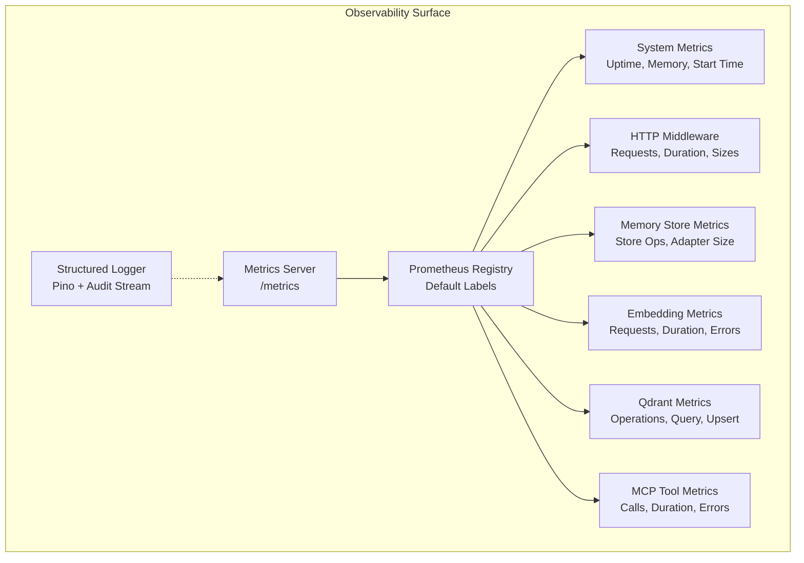
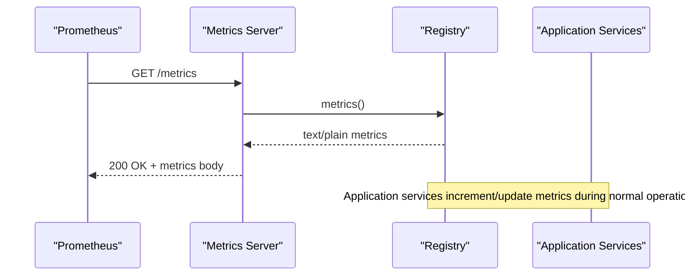
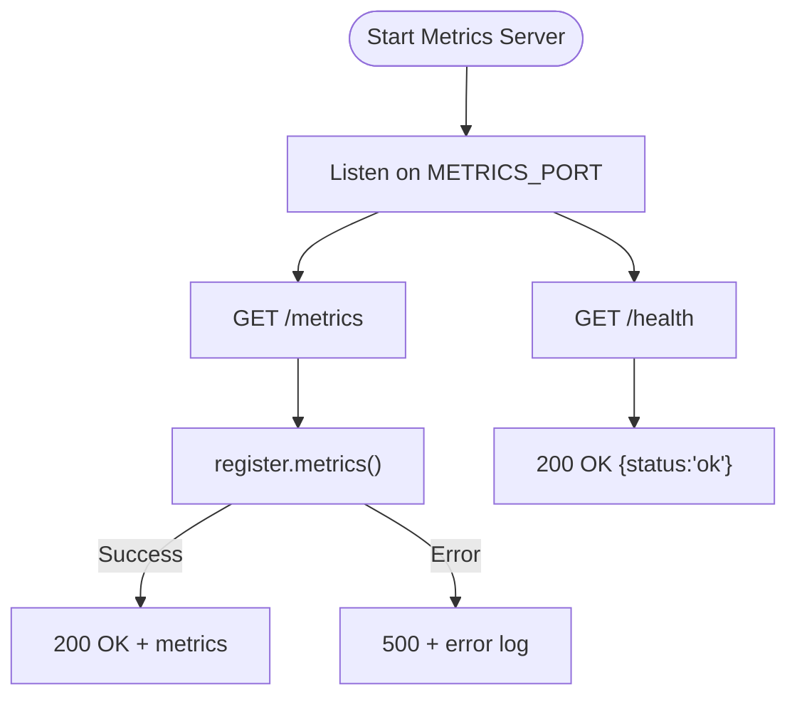
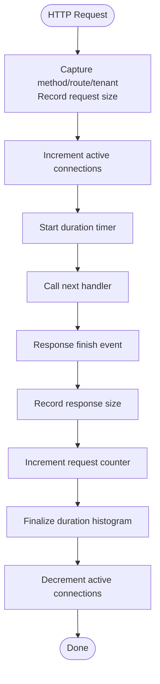
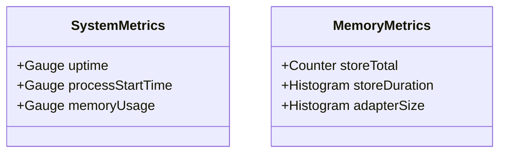
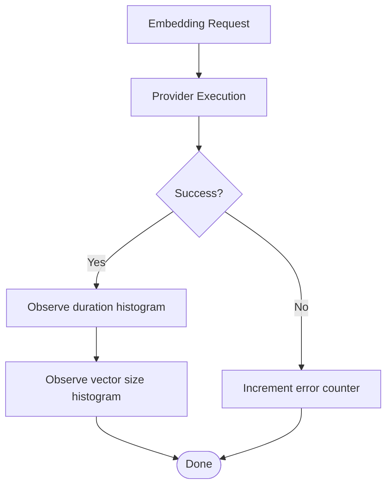
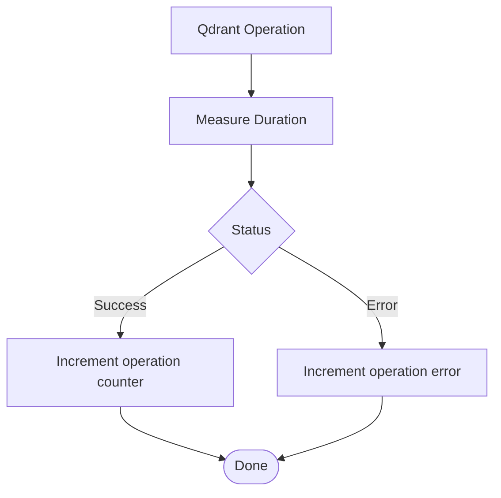
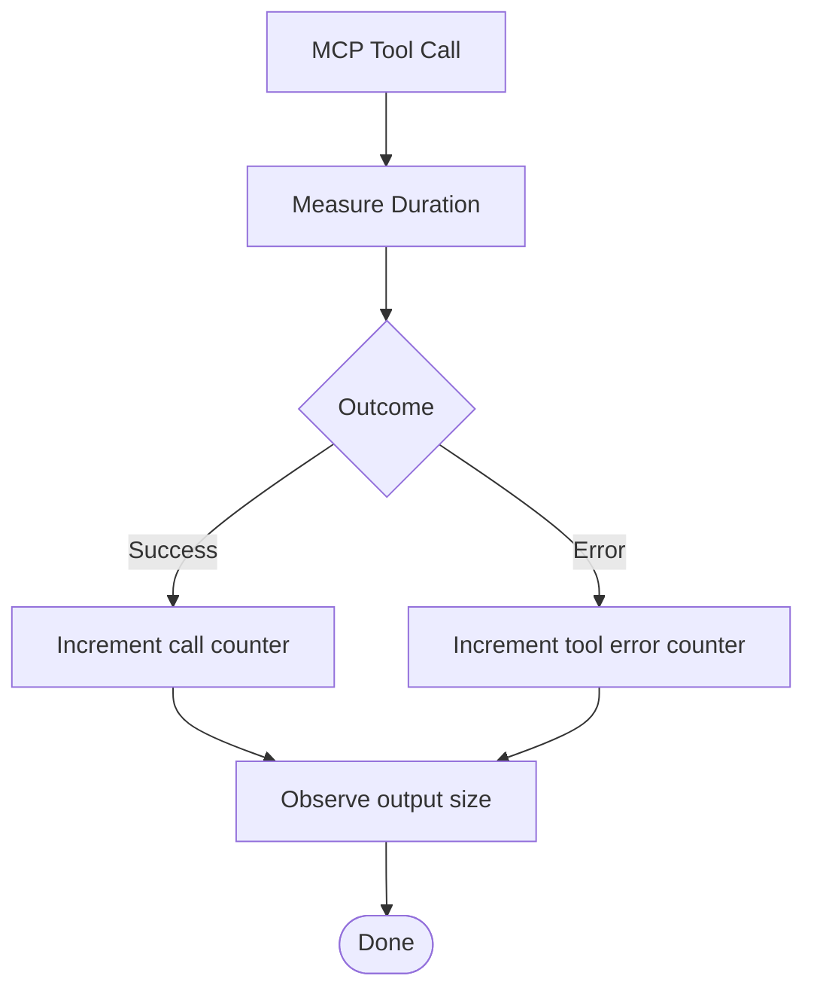
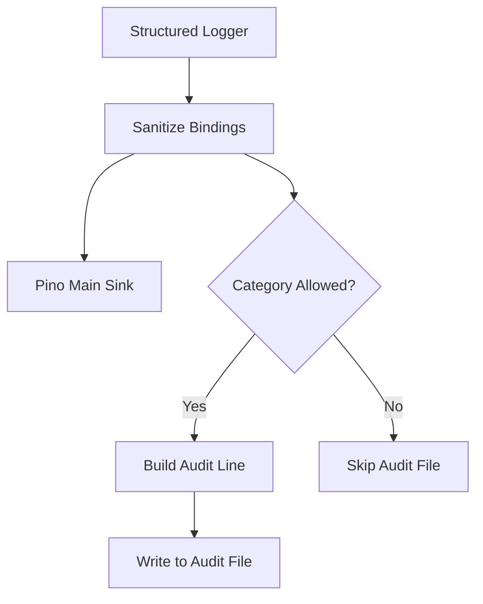
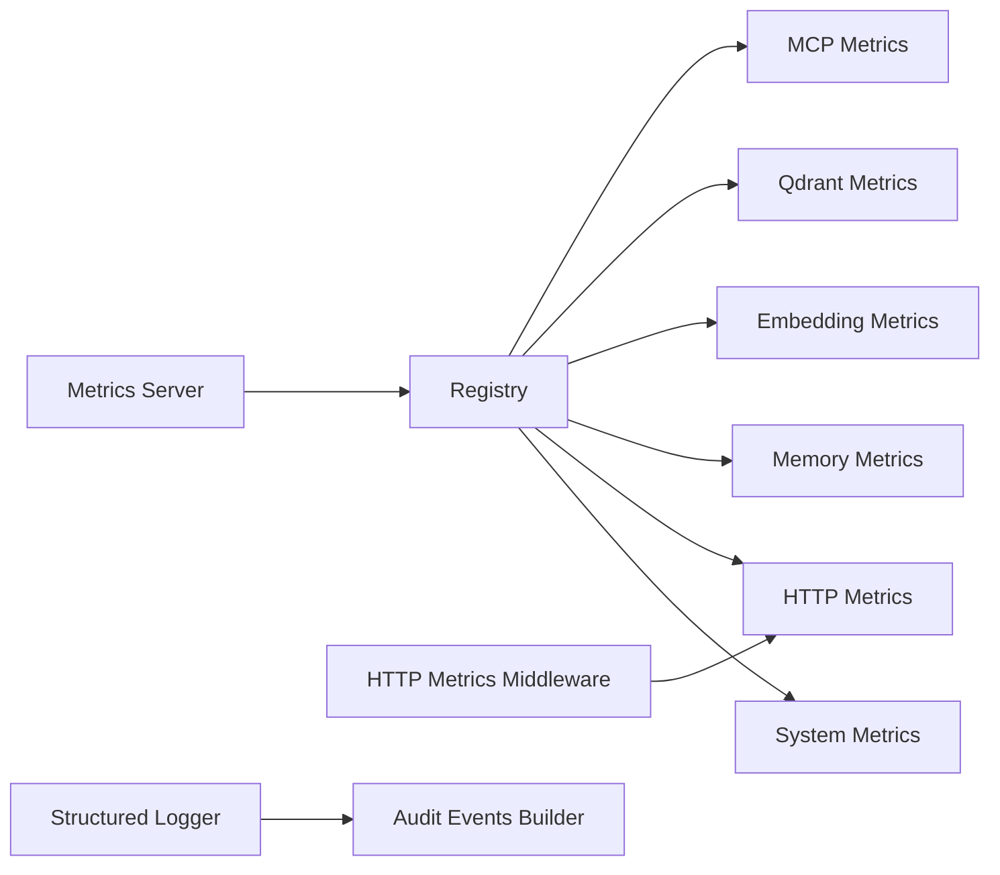

# Monitoring & Observability

<cite>
**Referenced Files in This Document**
- [metrics-server.ts](file://src/metrics-server.ts)
- [registry.ts](file://src/services/metrics/registry.ts)
- [system-metrics.ts](file://src/services/metrics/system-metrics.ts)
- [http-metrics.ts](file://src/services/metrics/http-metrics.ts)
- [http-metrics-middleware.ts](file://src/http/http-metrics-middleware.ts)
- [memory-metrics.ts](file://src/services/metrics/memory-metrics.ts)
- [embedding-metrics.ts](file://src/services/metrics/embedding-metrics.ts)
- [qdrant-metrics.ts](file://src/services/metrics/qdrant-metrics.ts)
- [mcp-metrics.ts](file://src/services/metrics/mcp-metrics.ts)
- [structured-logger.ts](file://src/utils/structured-logger.ts)
- [audit-log-events.ts](file://src/utils/audit-log-events.ts)
- [audit-log.md](file://docs/security/audit-log.md)
</cite>

## Table of Contents
1. [Introduction](#introduction)
2. [Project Structure](#project-structure)
3. [Core Components](#core-components)
4. [Architecture Overview](#architecture-overview)
5. [Detailed Component Analysis](#detailed-component-analysis)
6. [Dependency Analysis](#dependency-analysis)
7. [Performance Considerations](#performance-considerations)
8. [Troubleshooting Guide](#troubleshooting-guide)
9. [Conclusion](#conclusion)
10. [Appendices](#appendices)

## Introduction
This document describes monitoring and observability for SquadRules production deployments. It covers:
- The built-in Prometheus-compatible metrics server and HTTP request metrics middleware.
- System, memory, embedding, vector database (Qdrant), and MCP tool metrics.
- Structured logging and audit log collection for security compliance.
- Alerting guidance for critical components such as vector database connectivity, authentication failures, and performance degradation.
- Distributed tracing recommendations for MCP tool execution flows and adapter lifecycle events.
- Grafana dashboard templates for key performance indicators.
- Troubleshooting workflows using metrics and logs to diagnose slow search queries, authentication problems, and memory leaks.

## Project Structure
The observability surface is split across three main areas:
- Metrics server and registry: exposes a dedicated `/metrics` endpoint and centralizes default labels.
- HTTP instrumentation: middleware that captures request counts, durations, payload sizes, and active connections.
- Domain-specific metrics: system, memory, embedding, Qdrant, and MCP tool metrics.
- Logging and auditing: structured Pino-based logger with optional append-only audit file stream.

**Diagram sources**
- [metrics-server.ts:1-45](file://src/metrics-server.ts#L1-L45)
- [registry.ts:1-23](file://src/services/metrics/registry.ts#L1-L23)
- [system-metrics.ts:1-47](file://src/services/metrics/system-metrics.ts#L1-L47)
- [http-metrics-middleware.ts:1-73](file://src/http/http-metrics-middleware.ts#L1-L73)
- [memory-metrics.ts:1-38](file://src/services/metrics/memory-metrics.ts#L1-L38)
- [embedding-metrics.ts:1-51](file://src/services/metrics/embedding-metrics.ts#L1-L51)
- [qdrant-metrics.ts:1-42](file://src/services/metrics/qdrant-metrics.ts#L1-L42)
- [mcp-metrics.ts:1-63](file://src/services/metrics/mcp-metrics.ts#L1-L63)
- [structured-logger.ts:1-350](file://src/utils/structured-logger.ts#L1-L350)

**Section sources**
- [metrics-server.ts:1-45](file://src/metrics-server.ts#L1-L45)
- [registry.ts:1-23](file://src/services/metrics/registry.ts#L1-L23)

## Core Components
- Dedicated metrics server:
  - Exposes only `/metrics` for Prometheus scraping and an optional `/health` probe.
  - Uses the shared Prometheus registry to serialize metrics.
- Shared registry:
  - Applies default labels `service`, `squadrules_version`, and `instance`.
  - Tenant isolation uses per-metric `tenant_id` label where appropriate.
- HTTP metrics middleware:
  - Tracks request count, duration histogram, request/response size histograms, and active connection gauge.
  - Enriches metrics with method, route, status, and tenant context.
- Domain metrics:
  - System: uptime, process start time, and memory usage gauges updated periodically.
  - Memory store: counters and histograms for store operations and adapter layer sizes.
  - Embedding: request counters, duration histograms, error counters, vector size, and batch size.
  - Qdrant: operation counters, query/upsert duration histograms.
  - MCP tools: call counters, duration histograms, error counters, input/output size histograms, plus quality update and similar-adapter-found counters.

**Section sources**
- [metrics-server.ts:1-45](file://src/metrics-server.ts#L1-L45)
- [registry.ts:1-23](file://src/services/metrics/registry.ts#L1-L23)
- [http-metrics-middleware.ts:1-73](file://src/http/http-metrics-middleware.ts#L1-L73)
- [system-metrics.ts:1-47](file://src/services/metrics/system-metrics.ts#L1-L47)
- [memory-metrics.ts:1-38](file://src/services/metrics/memory-metrics.ts#L1-L38)
- [embedding-metrics.ts:1-51](file://src/services/metrics/embedding-metrics.ts#L1-L51)
- [qdrant-metrics.ts:1-42](file://src/services/metrics/qdrant-metrics.ts#L1-L42)
- [mcp-metrics.ts:1-63](file://src/services/metrics/mcp-metrics.ts#L1-L63)

## Architecture Overview
The metrics pipeline is intentionally decoupled from application traffic by running a separate Express server solely for Prometheus scraping. All metric definitions register against a single registry that applies default labels. HTTP requests are instrumented via middleware that updates counters, histograms, and gauges. Domain services emit their own metrics for embeddings, vector stores, and MCP tool executions.

**Diagram sources**
- [metrics-server.ts:1-45](file://src/metrics-server.ts#L1-L45)
- [registry.ts:1-23](file://src/services/metrics/registry.ts#L1-L23)

## Detailed Component Analysis

### Built-in Metrics Server
- Purpose: Provide a stable, isolated scrape target for Prometheus.
- Endpoints:
  - `/metrics`: returns serialized metrics from the registry.
  - `/health`: simple liveness/readiness check for the metrics service.
- Error handling: wraps serialization in try/catch and returns 500 on failure while logging via the structured logger.

**Diagram sources**
- [metrics-server.ts:1-45](file://src/metrics-server.ts#L1-L45)

**Section sources**
- [metrics-server.ts:1-45](file://src/metrics-server.ts#L1-L45)

### HTTP Request Metrics Middleware
- Captures:
  - Request count by method, route, status, tenant.
  - Request duration histogram.
  - Request and response size histograms.
  - Active connection gauge.
- Context:
  - Extracts tenant ID from request context.
  - Uses route path or fallback to URL path.
- Lifecycle:
  - On request start: record size, increment active connections, start timer.
  - On response finish: record response size, increment request counter, finalize duration, decrement active connections.

**Diagram sources**
- [http-metrics-middleware.ts:1-73](file://src/http/http-metrics-middleware.ts#L1-L73)
- [http-metrics.ts:1-53](file://src/services/metrics/http-metrics.ts#L1-L53)

**Section sources**
- [http-metrics-middleware.ts:1-73](file://src/http/http-metrics-middleware.ts#L1-L73)
- [http-metrics.ts:1-53](file://src/services/metrics/http-metrics.ts#L1-L53)

### System and Memory Metrics
- System metrics:
  - Uptime gauge updated every 5 seconds.
  - Process start timestamp set at initialization.
  - Memory usage gauges for RSS, heap total, and heap used.
- Memory store metrics:
  - Counter for total stored memories.
  - Histogram for storage operation duration.
  - Histogram for number of layers in stored adapters.

**Diagram sources**
- [system-metrics.ts:1-47](file://src/services/metrics/system-metrics.ts#L1-L47)
- [memory-metrics.ts:1-38](file://src/services/metrics/memory-metrics.ts#L1-L38)

**Section sources**
- [system-metrics.ts:1-47](file://src/services/metrics/system-metrics.ts#L1-L47)
- [memory-metrics.ts:1-38](file://src/services/metrics/memory-metrics.ts#L1-L38)

### Embedding Performance Metrics
- Tracks:
  - Total embedding requests by provider, status, tenant.
  - Duration histogram for embedding generation.
  - Error counter by provider, status, tenant.
  - Vector size histogram and batch size histogram.

**Diagram sources**
- [embedding-metrics.ts:1-51](file://src/services/metrics/embedding-metrics.ts#L1-L51)

**Section sources**
- [embedding-metrics.ts:1-51](file://src/services/metrics/embedding-metrics.ts#L1-L51)

### Vector Database (Qdrant) Metrics
- Tracks:
  - Operation counters by operation type, status, tenant.
  - Operation duration histogram.
  - Query and upsert duration histograms.

**Diagram sources**
- [qdrant-metrics.ts:1-42](file://src/services/metrics/qdrant-metrics.ts#L1-L42)

**Section sources**
- [qdrant-metrics.ts:1-42](file://src/services/metrics/qdrant-metrics.ts#L1-L42)

### MCP Tool Metrics
- Tracks:
  - Tool call counters by tool, status, tenant.
  - Tool duration histogram.
  - Tool error counters.
  - Input/output size histograms.
  - Quality update errors and similar adapter found counters.

**Diagram sources**
- [mcp-metrics.ts:1-63](file://src/services/metrics/mcp-metrics.ts#L1-L63)

**Section sources**
- [mcp-metrics.ts:1-63](file://src/services/metrics/mcp-metrics.ts#L1-L63)

### Structured Logging and Audit Collection
- Structured logger:
  - Wraps Pino with sanitization for safe audit writes.
  - Provides HTTP access logging with request ID, client IP, duration, and status.
  - Supports child contexts and transport/format introspection.
- Audit stream:
  - Optional append-only file configured via environment variable.
  - Coarse JSON lines for allowlisted categories: `audit.embedding`, `audit.anomaly`, `audit.mcp`.
  - MCP audit levels control verbosity for MCP events.

**Diagram sources**
- [structured-logger.ts:1-350](file://src/utils/structured-logger.ts#L1-L350)
- [audit-log-events.ts:1-89](file://src/utils/audit-log-events.ts#L1-L89)
- [audit-log.md:1-217](file://docs/security/audit-log.md#L1-L217)

**Section sources**
- [structured-logger.ts:1-350](file://src/utils/structured-logger.ts#L1-L350)
- [audit-log-events.ts:1-89](file://src/utils/audit-log-events.ts#L1-L89)
- [audit-log.md:1-217](file://docs/security/audit-log.md#L1-L217)

## Dependency Analysis
- Registry coupling:
  - All metric modules import the shared registry to apply default labels consistently.
- Server coupling:
  - Metrics server depends on registry and imports system metrics to ensure initialization.
- Middleware coupling:
  - HTTP metrics middleware depends on HTTP metric definitions and tenant context utilities.
- Logging coupling:
  - Structured logger integrates with audit line builder and configuration values.

**Diagram sources**
- [registry.ts:1-23](file://src/services/metrics/registry.ts#L1-L23)
- [metrics-server.ts:1-45](file://src/metrics-server.ts#L1-L45)
- [http-metrics-middleware.ts:1-73](file://src/http/http-metrics-middleware.ts#L1-L73)
- [structured-logger.ts:1-350](file://src/utils/structured-logger.ts#L1-L350)
- [audit-log-events.ts:1-89](file://src/utils/audit-log-events.ts#L1-L89)

**Section sources**
- [registry.ts:1-23](file://src/services/metrics/registry.ts#L1-L23)
- [metrics-server.ts:1-45](file://src/metrics-server.ts#L1-L45)
- [http-metrics-middleware.ts:1-73](file://src/http/http-metrics-middleware.ts#L1-L73)
- [structured-logger.ts:1-350](file://src/utils/structured-logger.ts#L1-L350)
- [audit-log-events.ts:1-89](file://src/utils/audit-log-events.ts#L1-L89)

## Performance Considerations
- Isolated metrics server:
  - Keeps Prometheus scraping overhead out of the application request path.
- Histogram bucket selection:
  - Ensure buckets align with expected latency ranges for HTTP, embedding, Qdrant, and MCP tool calls.
- Label cardinality:
  - Avoid high-cardinality labels beyond `tenant_id`, `method`, `route`, `status`, `provider`, and `operation`.
- Periodic updates:
  - System metrics update interval balances freshness with CPU overhead.
- Audit file I/O:
  - Keep audit events coarse and bounded; rely on main structured logs for rich context.

[No sources needed since this section provides general guidance]

## Troubleshooting Guide

### Slow Search Queries
- Indicators:
  - High `squadrules_qdrant_query_duration_seconds` percentiles.
  - Elevated `squadrules_mcp_tool_duration_seconds` for search-related tools.
  - Low or zero results in embedding/search anomaly audit events.
- Actions:
  - Inspect Qdrant query duration histograms by tenant.
  - Correlate with embedding anomalies (`search_zero_results`, `search_low_score`).
  - Check embedding vector norms and dimensions for drift.

**Section sources**
- [qdrant-metrics.ts:1-42](file://src/services/metrics/qdrant-metrics.ts#L1-L42)
- [mcp-metrics.ts:1-63](file://src/services/metrics/mcp-metrics.ts#L1-L63)
- [embedding-metrics.ts:1-51](file://src/services/metrics/embedding-metrics.ts#L1-L51)
- [audit-log.md:1-217](file://docs/security/audit-log.md#L1-L217)

### Authentication Problems
- Indicators:
  - Spikes in HTTP 4xx/5xx responses for auth endpoints.
  - MCP tool error counters for authentication-related tools.
  - Audit events around MCP tool calls with error codes.
- Actions:
  - Use HTTP request duration and status histograms to isolate slow or failing routes.
  - Correlate with structured logs using `request_id` and `error_code`.
  - Review MCP audit events for failed tool invocations and sanitized payloads.

**Section sources**
- [http-metrics.ts:1-53](file://src/services/metrics/http-metrics.ts#L1-L53)
- [mcp-metrics.ts:1-63](file://src/services/metrics/mcp-metrics.ts#L1-L63)
- [structured-logger.ts:1-350](file://src/utils/structured-logger.ts#L1-L350)
- [audit-log.md:1-217](file://docs/security/audit-log.md#L1-L217)

### Memory Leaks
- Indicators:
  - Rising `squadrules_system_memory_usage_bytes` (heapUsed, rss).
  - Increasing `squadrules_memory_adapter_size` histogram indicating growing adapter layers.
  - Elevated GC pressure reflected in longer embedding or Qdrant operation durations.
- Actions:
  - Monitor heapUsed trend and correlate with adapter growth.
  - Investigate large embedding batches or oversized payloads via embedding histograms.
  - Validate Qdrant upsert/query durations for signs of resource contention.

**Section sources**
- [system-metrics.ts:1-47](file://src/services/metrics/system-metrics.ts#L1-L47)
- [memory-metrics.ts:1-38](file://src/services/metrics/memory-metrics.ts#L1-L38)
- [embedding-metrics.ts:1-51](file://src/services/metrics/embedding-metrics.ts#L1-L51)
- [qdrant-metrics.ts:1-42](file://src/services/metrics/qdrant-metrics.ts#L1-L42)

## Conclusion
SquadRules provides a robust observability foundation:
- A dedicated metrics server with a shared registry ensures clean separation between scraping and application workloads.
- Comprehensive HTTP, system, memory, embedding, Qdrant, and MCP tool metrics enable deep performance analysis.
- Structured logging with optional audit streams supports security compliance and incident investigation.
- With proper alerting, tracing, and Grafana dashboards, operators can proactively detect and resolve issues across the full agent workflow.

[No sources needed since this section summarizes without analyzing specific files]

## Appendices

### Prometheus Configuration
- Scrape target:
  - Endpoint: `/metrics` on the metrics server port.
  - Content-Type: text/plain (Prometheus exposition format).
- Default labels:
  - `service="squadrules"`
  - `squadrules_version=<build version>`
  - `instance=<hostname or INSTANCE_ID>`

**Section sources**
- [registry.ts:1-23](file://src/services/metrics/registry.ts#L1-L23)
- [metrics-server.ts:1-45](file://src/metrics-server.ts#L1-L45)

### Alerting Rules Guidance
- Vector database connectivity:
  - Alert on rising Qdrant operation error counters and prolonged query/upsert durations.
- Authentication failures:
  - Alert on spikes in HTTP 4xx/5xx rates for auth routes and MCP tool error counters.
- Performance degradation:
  - Alert on elevated HTTP request duration percentiles, embedding duration outliers, and MCP tool duration regressions.
- Resource exhaustion:
  - Alert on sustained increases in heapUsed and RSS, and growing adapter sizes.

[No sources needed since this section provides general guidance]

### Distributed Tracing Recommendations
- Instrument MCP tool execution flows:
  - Add trace spans around tool invocation, embedding generation, Qdrant queries, and response assembly.
- Correlate traces with logs:
  - Propagate `request_id` and `correlation_id` across spans and structured logs.
- Adapter lifecycle events:
  - Emit spans for adapter activation, forward steps, and reward processing to visualize end-to-end flows.

[No sources needed since this section provides general guidance]

### Grafana Dashboard Templates
- HTTP overview:
  - Panels: request rate, error rate, p50/p95/p99 latency, active connections, request/response sizes.
- Embedding performance:
  - Panels: request rate by provider, duration percentiles, error rate, vector size distribution, batch size.
- Vector database health:
  - Panels: operation error rate, query/upsert latency percentiles, operation volume by type.
- MCP tool performance:
  - Panels: call rate by tool, duration percentiles, error rate, input/output sizes, quality update errors.
- System resources:
  - Panels: uptime, process start time, RSS/heapTotal/heapUsed, GC pauses if available.

[No sources needed since this section provides general guidance]