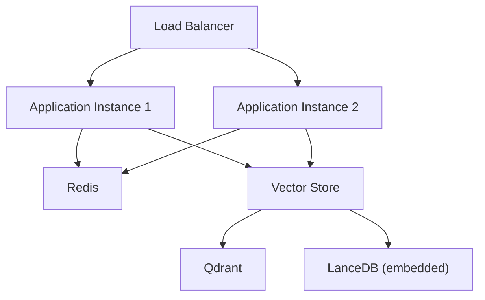
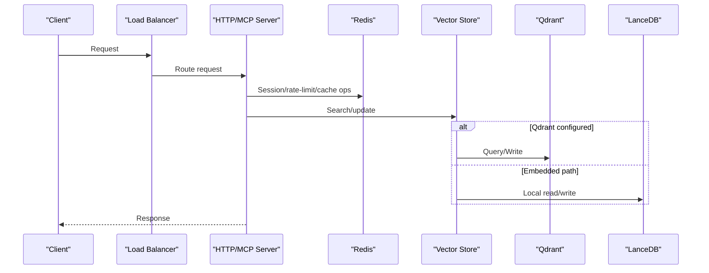
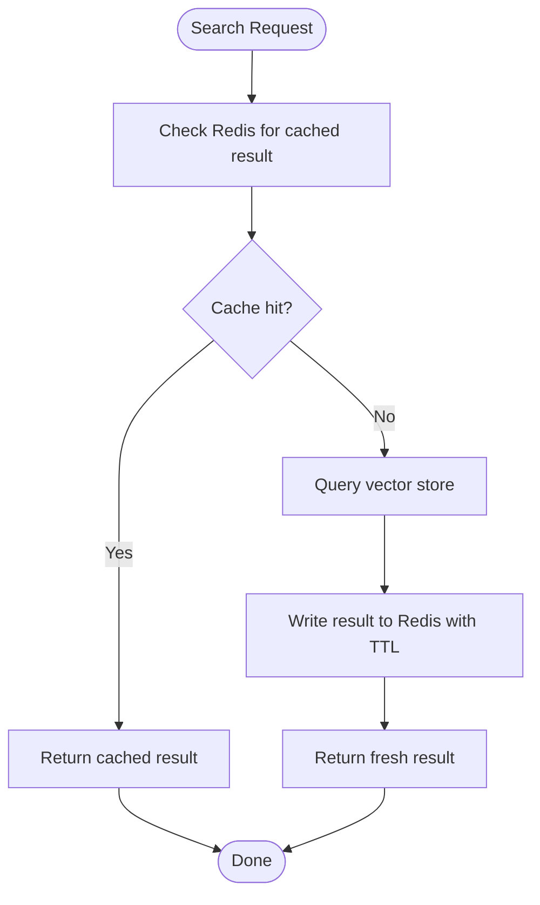
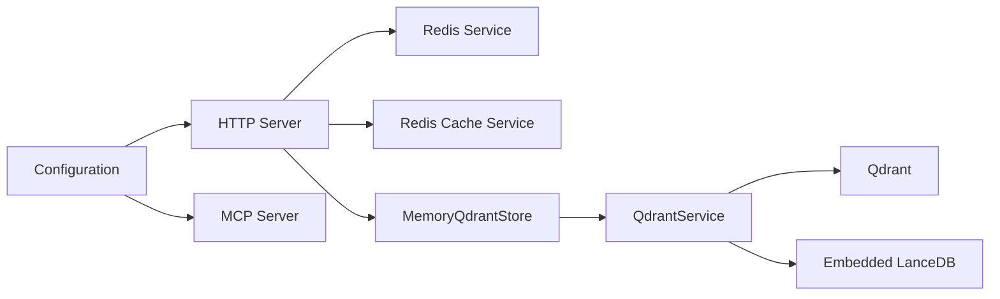

# Scaling & High Availability

<cite>
**Referenced Files in This Document**
- [config.ts](file://src/config.ts)
- [http-server.ts](file://src/http/http-server.ts)
- [server.ts](file://src/server.ts)
- [redis.ts](file://src/services/redis.ts)
- [redis-cache.ts](file://src/services/redis-cache.ts)
- [service.ts](file://src/services/qdrant/service.ts)
- [store.ts](file://src/services/memory/store.ts)
- [lancedb-connection.ts](file://src/services/vector-store/lancedb-connection.ts)
</cite>

## Table of Contents
1. [Introduction](#introduction)
2. [Project Structure](#project-structure)
3. [Core Components](#core-components)
4. [Architecture Overview](#architecture-overview)
5. [Detailed Component Analysis](#detailed-component-analysis)
6. [Dependency Analysis](#dependency-analysis)
7. [Performance Considerations](#performance-considerations)
8. [Troubleshooting Guide](#troubleshooting-guide)
9. [Conclusion](#conclusion)

## Introduction
This document provides scaling and high availability guidance for SquadRules deployments. It focuses on:
- Horizontal scaling of stateless application instances behind load balancers.
- Vertical scaling considerations for vector database performance, memory allocation, and CPU utilization.
- Caching strategies using Redis for session management, rate limiting, and query result caching.
- Database sharding strategies for Qdrant collections and LanceDB partitioning approaches.
- Disaster recovery procedures, failover configurations, and data replication strategies.
- Capacity planning guidelines, performance benchmarking, and bottleneck identification techniques.
- Scaling challenges specific to vector search workloads and embedding model inference.

SquadRules is an agent-first MCP framework where AI agents are the primary users. The core flow is activate → forward → reward. Adapters provide deterministic, auditable task execution. Vector databases include Qdrant (primary, remote-capable) and LanceDB (secondary, embedded). Storage includes Redis for sessions and rate limiting, vector stores for embeddings, and filesystems for configuration and artifacts. Authentication uses Keycloak with Google IdP for OAuth2/JWT.

## Project Structure
The deployment surface consists of:
- An HTTP server exposing REST API, UI, and Streamable HTTP MCP routes.
- An MCP server registering tools and resources.
- A key-value store abstraction backed by Redis when configured.
- A vector layer that selects Qdrant or embedded LanceDB based on environment configuration.
- Configuration that centralizes environment variables for transport mode, authentication, rate limits, vector backends, and snapshotting.

**Diagram sources**
- [http-server.ts:22-47](file://src/http/http-server.ts#L22-L47)
- [server.ts:44-69](file://src/server.ts#L44-L69)
- [config.ts:50-56](file://src/config.ts#L50-L56)
- [config.ts:137-137](file://src/config.ts#L137-L137)
- [service.ts:153-161](file://src/services/qdrant/service.ts#L153-L161)

**Section sources**
- [http-server.ts:22-47](file://src/http/http-server.ts#L22-L47)
- [server.ts:44-69](file://src/server.ts#L44-L69)
- [config.ts:50-56](file://src/config.ts#L50-L56)
- [config.ts:137-137](file://src/config.ts#L137-L137)
- [service.ts:153-161](file://src/services/qdrant/service.ts#L153-L161)

## Core Components
- Stateless HTTP and MCP servers: The HTTP server composes middleware, auth, health, export, API, MCP, and UI routes. The MCP server registers tools and resources. Both are suitable for horizontal scaling when backed by shared external services.
- Redis-backed key-value store: Provides session storage, rate limiting, and cache operations. Keys can be namespaced per space, with global prefixes for memory and OIDC state.
- Redis cache service: Implements search result caching, memory resource caching, invalidation via pub/sub, and hit/miss statistics.
- Vector store selection: At runtime, the system chooses Qdrant if configured; otherwise it falls back to embedded LanceDB.
- Configuration: Centralizes environment-driven behavior for transport mode, authentication, rate limits, vector backend selection, and snapshotting.

**Section sources**
- [http-server.ts:22-47](file://src/http/http-server.ts#L22-L47)
- [server.ts:44-69](file://src/server.ts#L44-L69)
- [redis.ts:26-117](file://src/services/redis.ts#L26-L117)
- [redis-cache.ts:21-41](file://src/services/redis-cache.ts#L21-L41)
- [service.ts:153-161](file://src/services/qdrant/service.ts#L153-L161)
- [config.ts:50-56](file://src/config.ts#L50-L56)
- [config.ts:121-126](file://src/config.ts#L121-L126)
- [config.ts:268-277](file://src/config.ts#L268-L277)

## Architecture Overview
The scalable architecture centers around stateless application instances sharing Redis and a remote vector store. When Qdrant is configured, all instances connect to the same collection; when not configured, each instance runs embedded LanceDB locally.

**Diagram sources**
- [http-server.ts:22-47](file://src/http/http-server.ts#L22-L47)
- [redis.ts:119-155](file://src/services/redis.ts#L119-L155)
- [service.ts:153-161](file://src/services/qdrant/service.ts#L153-L161)
- [lancedb-connection.ts:21-33](file://src/services/vector-store/lancedb-connection.ts#L21-L33)

## Detailed Component Analysis

### Horizontal Scaling Strategy
- Run multiple identical application instances behind a load balancer.
- Ensure no process-local mutable state is required between requests.
- Use Redis for shared sessions, rate limiting counters, and cache.
- Configure the same vector store endpoint across instances.

Key behaviors:
- HTTP server starts Express, configures middleware, auth, health, export, API, MCP, UI, and error handlers, then starts listening.
- MCP server registers tools and resources, logging runtime configuration including vector backend selection.

Operational recommendations:
- Place a TCP/HTTP load balancer in front of instances.
- Enable health checks against the HTTP health route.
- Keep process lifetimes short and rely on Redis for durable state.

**Section sources**
- [http-server.ts:22-47](file://src/http/http-server.ts#L22-L47)
- [server.ts:44-69](file://src/server.ts#L44-L69)

### Vertical Scaling for Vector Databases
- Qdrant:
  - Tune CPU cores, RAM, and disk I/O according to collection size, dimensionality, and query throughput.
  - Use replicas and partitions at the Qdrant level to distribute load and improve resilience.
  - Monitor index build time, recall, latency, and memory usage.
- LanceDB:
  - Embedded mode is single-process per instance; vertical scaling means increasing CPU/RAM per instance.
  - Strong consistency is achieved by opening connections with explicit read consistency settings.

Operational recommendations:
- For Qdrant, scale horizontally at the database layer (replicas/partitions) and vertically at the node level (CPU/RAM/disk).
- For LanceDB, increase instance resources and consider running more instances behind a load balancer while accepting local data isolation.

**Section sources**
- [service.ts:153-161](file://src/services/qdrant/service.ts#L153-L161)
- [lancedb-connection.ts:21-33](file://src/services/vector-store/lancedb-connection.ts#L21-L33)

### Redis Caching Strategies
- Session management:
  - Use Redis for OIDC state and session data. Global prefixes ensure cross-instance consistency.
- Rate limiting:
  - Apply windowed counters in Redis for HTTP, auth, and MCP endpoints.
- Query result caching:
  - Cache search results keyed by query text, limit, and collapse mode.
  - Invalidate caches on writes using pub/sub channels.
  - Provide bounded TTLs for memory resources to prevent stale data.

Implementation highlights:
- RedisService wraps client lifecycle, connection events, error handling, and namespacing.
- RedisCacheService manages search and memory caches, invalidation, and stats.

**Diagram sources**
- [redis-cache.ts:38-79](file://src/services/redis-cache.ts#L38-L79)
- [redis.ts:119-155](file://src/services/redis.ts#L119-L155)

**Section sources**
- [redis.ts:26-117](file://src/services/redis.ts#L26-L117)
- [redis-cache.ts:21-79](file://src/services/redis-cache.ts#L21-L79)
- [redis-cache.ts:81-152](file://src/services/redis-cache.ts#L81-L152)
- [redis-cache.ts:186-213](file://src/services/redis-cache.ts#L186-L213)

### Database Sharding and Partitioning
- Qdrant collections:
  - Use Qdrant’s built-in sharding and replication features to distribute points across nodes.
  - Align shard keys with tenant/space filters to optimize query locality.
  - Maintain aliases for zero-downtime rollouts and blue/green deployments.
- LanceDB partitioning:
  - Embedded mode does not provide distributed sharding; use logical partitioning via directory layout and strong-consistency reads.
  - Each process opens a consistent connection to the shared directory.

Operational recommendations:
- For multi-tenant environments, map spaces to Qdrant collections or partitions to isolate workloads.
- For LanceDB, prefer Qdrant for clustered deployments requiring shared state across processes.

**Section sources**
- [service.ts:132-141](file://src/services/qdrant/service.ts#L132-L141)
- [lancedb-connection.ts:21-33](file://src/services/vector-store/lancedb-connection.ts#L21-L33)

### Disaster Recovery and Failover
- Snapshots:
  - When Qdrant snapshotting is enabled, snapshots can be triggered at startup based on configuration.
- Health checks:
  - Expose health endpoints indicating status of Redis, Qdrant/LanceDB, and overall service readiness.
- Failover:
  - Rely on load balancer health checks to remove unhealthy instances.
  - For Qdrant, leverage cluster-level failover and replica sets.
  - For Redis, use managed services with automatic failover or sentinel/cluster topologies.

Operational recommendations:
- Automate snapshot creation and retention policies.
- Monitor health endpoints and integrate with alerting systems.
- Test failover scenarios regularly.

**Section sources**
- [config.ts:268-277](file://src/config.ts#L268-L277)
- [http-server.ts:38-43](file://src/http/http-server.ts#L38-L43)

### Capacity Planning Guidelines
- Embedding model inference:
  - Size CPU and memory based on batch sizes, concurrency, and model dimensions.
  - Configure retry policies and budgets to handle transient provider errors.
- Vector search:
  - Plan for overfetch factors and max fetch limits to balance recall and latency.
  - Monitor Qdrant index size, dimensionality, and query patterns.
- Redis:
  - Size memory for session volume, rate limit windows, and cache footprint.
  - Monitor eviction policies and persistence requirements.

Tunable parameters:
- Embedding retries, base delay, max delay, Retry-After cap, and total budget.
- Search overfetch factor, max fetch, group collapse toggle.
- HTTP, auth, and MCP rate limit windows and maximums.

**Section sources**
- [config.ts:87-93](file://src/config.ts#L87-L93)
- [config.ts:108-116](file://src/config.ts#L108-L116)
- [config.ts:121-126](file://src/config.ts#L121-L126)

### Performance Benchmarking and Bottleneck Identification
- Metrics:
  - Track HTTP, MCP, embedding, memory, and Qdrant metrics through dedicated registries.
- Benchmarks:
  - Measure end-to-end latency for activate → forward → reward flows.
  - Profile embedding provider latency and failure rates.
  - Evaluate cache hit ratios and invalidation latency.
- Bottlenecks:
  - Identify slow vector queries, embedding provider throttling, Redis contention, and CPU saturation during indexing.

Operational recommendations:
- Instrument endpoints and expose metrics on a dedicated port.
- Use APM tools to trace request paths across Redis and vector stores.
- Establish SLOs for latency, error rates, and cache hit ratios.

**Section sources**
- [config.ts:280-282](file://src/config.ts#L280-L282)

### Scaling Challenges Specific to Vector Search and Embeddings
- Vector search workloads:
  - High-dimensional vectors increase memory pressure and CPU cost.
  - Overfetch and rescore tuning affect recall and latency trade-offs.
- Embedding inference:
  - External providers may throttle or return errors; configure retries and budgets.
  - Local fastembed requires sufficient CPU and memory; consider batching.

Mitigations:
- Use Redis to cache frequent queries and reduce vector store load.
- Scale embedding providers horizontally or switch providers based on capacity.
- Tune search parameters and enable group collapse to reduce payload sizes.

**Section sources**
- [config.ts:87-93](file://src/config.ts#L87-L93)
- [config.ts:108-116](file://src/config.ts#L108-L116)
- [redis-cache.ts:38-79](file://src/services/redis-cache.ts#L38-L79)

## Dependency Analysis
The following diagram shows how components depend on each other for scalable operation.

**Diagram sources**
- [config.ts:50-56](file://src/config.ts#L50-L56)
- [http-server.ts:22-47](file://src/http/http-server.ts#L22-L47)
- [server.ts:44-69](file://src/server.ts#L44-L69)
- [redis.ts:26-117](file://src/services/redis.ts#L26-L117)
- [redis-cache.ts:21-41](file://src/services/redis-cache.ts#L21-L41)
- [store.ts:29-62](file://src/services/memory/store.ts#L29-L62)
- [service.ts:17-28](file://src/services/qdrant/service.ts#L17-L28)
- [service.ts:153-161](file://src/services/qdrant/service.ts#L153-L161)

**Section sources**
- [config.ts:50-56](file://src/config.ts#L50-L56)
- [http-server.ts:22-47](file://src/http/http-server.ts#L22-L47)
- [server.ts:44-69](file://src/server.ts#L44-L69)
- [redis.ts:26-117](file://src/services/redis.ts#L26-L117)
- [redis-cache.ts:21-41](file://src/services/redis-cache.ts#L21-L41)
- [store.ts:29-62](file://src/services/memory/store.ts#L29-L62)
- [service.ts:17-28](file://src/services/qdrant/service.ts#L17-L28)
- [service.ts:153-161](file://src/services/qdrant/service.ts#L153-L161)

## Performance Considerations
- Prefer Qdrant for clustered deployments requiring shared state and advanced sharding.
- Use Redis for shared sessions, rate limiting, and caching to decouple application instances.
- Tune embedding provider retries and budgets to avoid cascading failures under load.
- Monitor cache hit ratios and invalidate aggressively after writes.
- Right-size vector database nodes for CPU, memory, and disk I/O based on workload characteristics.

[No sources needed since this section provides general guidance]

## Troubleshooting Guide
- Redis connectivity:
  - Inspect connection logs and error codes from the Redis client wrapper.
  - Verify URL masking and prefix configuration for multi-tenant isolation.
- Vector store health:
  - Use health endpoints to detect Qdrant or LanceDB issues.
  - Validate collection alias resolution and configuration values.
- Cache invalidation:
  - Confirm pub/sub channels are active and invalidation events are published.
  - Check TTLs and key patterns for search and memory caches.

**Section sources**
- [redis.ts:47-84](file://src/services/redis.ts#L47-L84)
- [http-server.ts:38-43](file://src/http/http-server.ts#L38-L43)
- [redis-cache.ts:141-152](file://src/services/redis-cache.ts#L141-L152)

## Conclusion
SquadRules supports scalable deployments by combining stateless application instances with shared Redis and a configurable vector store. Horizontal scaling is straightforward when sessions, rate limits, and caches are externalized. Vertical scaling should focus on vector database performance and embedding inference capacity. Redis-based caching improves throughput and reduces vector store pressure. For production-grade reliability, adopt Qdrant with sharding and replication, automate snapshots, and monitor health and metrics closely.

[No sources needed since this section summarizes without analyzing specific files]