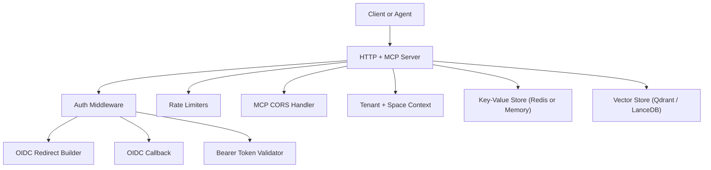
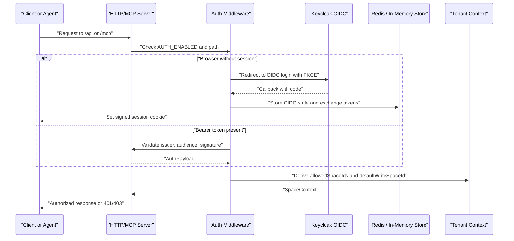
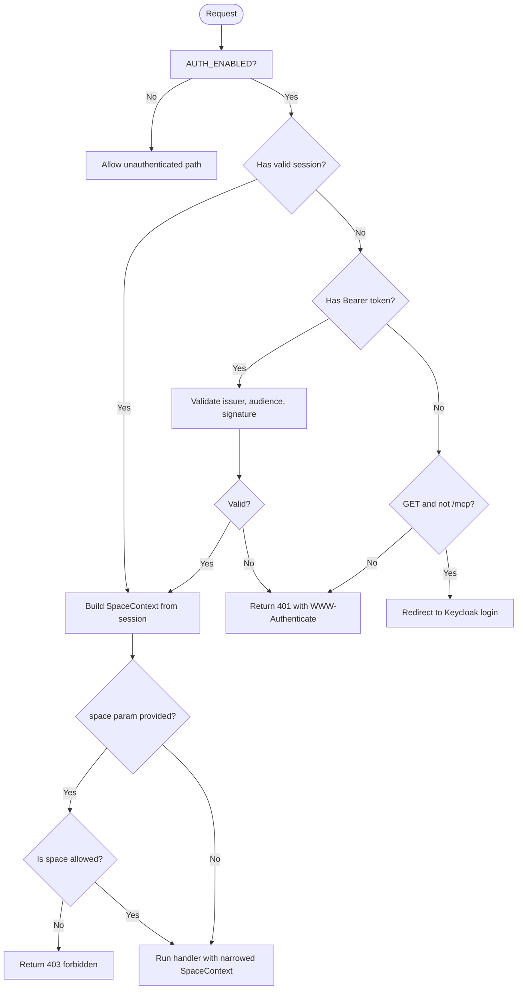
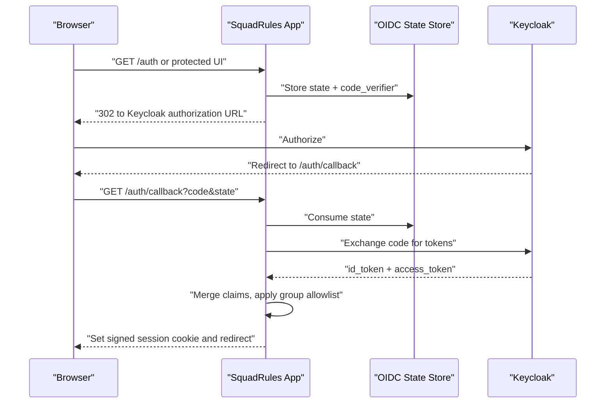
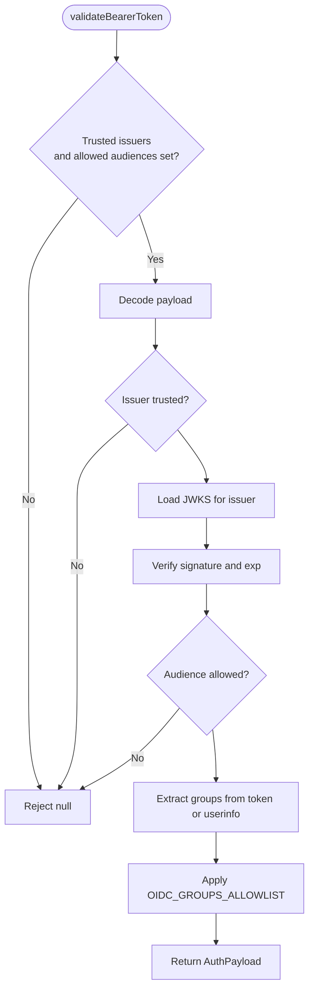
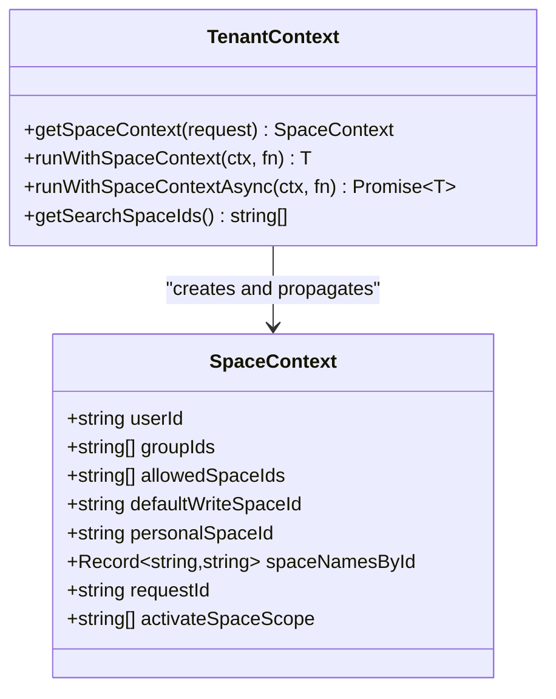
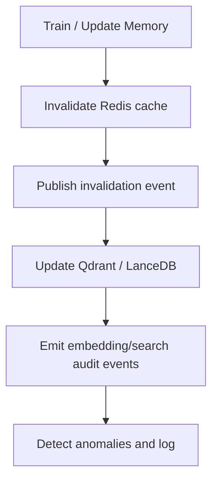
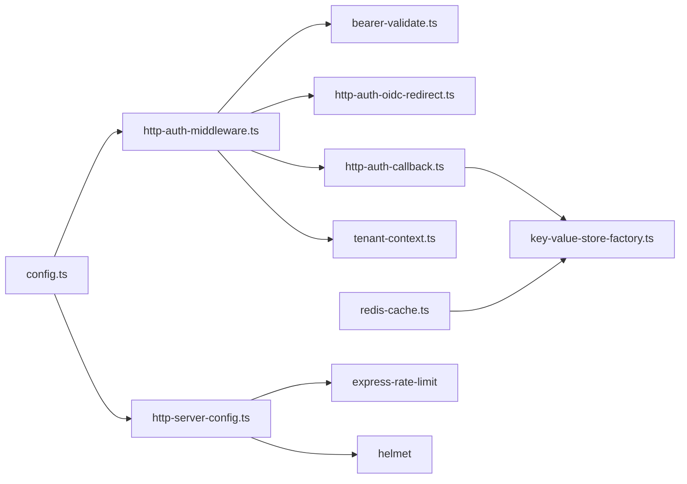

# Security Hardening

<cite>
**Referenced Files in This Document**
- [threat-model.md](file://docs/security/threat-model.md)
- [audit-log.md](file://docs/security/audit-log.md)
- [incident-runbook.md](file://docs/security/incident-runbook.md)
- [http-auth-middleware.ts](file://src/http/http-auth-middleware.ts)
- [bearer-validate.ts](file://src/http/bearer-validate.ts)
- [http-auth-oidc-redirect.ts](file://src/http/http-auth-oidc-redirect.ts)
- [http-auth-callback.ts](file://src/http/http-auth-callback.ts)
- [redis-cache.ts](file://src/services/redis-cache.ts)
- [key-value-store-factory.ts](file://src/services/key-value-store-factory.ts)
- [http-server-config.ts](file://src/http/http-server-config.ts)
- [http-mcp-cors.ts](file://src/http/http-mcp-cors.ts)
- [tenant-context.ts](file://src/utils/tenant-context.ts)
- [protected-space-write-guard.ts](file://src/utils/protected-space-write-guard.ts)
- [config.ts](file://src/config.ts)
</cite>

## Table of Contents
1. [Introduction](#introduction)
2. [Project Structure](#project-structure)
3. [Core Components](#core-components)
4. [Architecture Overview](#architecture-overview)
5. [Detailed Component Analysis](#detailed-component-analysis)
6. [Dependency Analysis](#dependency-analysis)
7. [Performance Considerations](#performance-considerations)
8. [Troubleshooting Guide](#troubleshooting-guide)
9. [Conclusion](#conclusion)

## Introduction
This document provides production security hardening guidance for SquadRules, an agent-first MCP framework where AI agents are the primary users and humans configure preferences through agents. The core operational flow is activate → forward → reward, with deterministic adapter execution and strong auditability.

SquadRules uses:
- Keycloak-based OIDC authentication with JWT validation for both browser sessions and Bearer tokens.
- Space-based authorization derived from Keycloak groups and issuer context.
- Redis for sessions, state, rate limiting, and optional caching; Qdrant or LanceDB for vector storage; filesystem for configuration and artifacts.
- Structured audit logging, anomaly detection, and incident response procedures.

The goal is to secure HTTP and MCP endpoints, enforce tenant isolation, protect sensitive data at rest and in transit, and provide operational controls for scanning, monitoring, and compliance.

## Project Structure
Security-relevant code is concentrated in:
- HTTP middleware and routes for authentication, CORS, rate limiting, and CSP.
- OIDC redirect, callback, and Bearer token validation.
- Tenant and space context utilities that derive access control from identity claims.
- Redis-backed key-value store abstraction used for sessions, state, and cache invalidation.
- Configuration module centralizing environment-driven security settings.
- Security documentation covering threat model, audit logging, and incident response.

**Diagram sources**
- [http-auth-middleware.ts:172-327](file://src/http/http-auth-middleware.ts#L172-L327)
- [bearer-validate.ts:120-208](file://src/http/bearer-validate.ts#L120-L208)
- [http-auth-oidc-redirect.ts:15-77](file://src/http/http-auth-oidc-redirect.ts#L15-L77)
- [http-auth-callback.ts:122-228](file://src/http/http-auth-callback.ts#L122-L228)
- [http-server-config.ts:74-99](file://src/http/http-server-config.ts#L74-L99)
- [http-mcp-cors.ts:3-27](file://src/http/http-mcp-cors.ts#L3-L27)
- [tenant-context.ts:256-303](file://src/utils/tenant-context.ts#L256-L303)
- [key-value-store-factory.ts:13-22](file://src/services/key-value-store-factory.ts#L13-L22)

**Section sources**
- [threat-model.md:1-25](file://docs/security/threat-model.md#L1-L25)
- [config.ts:141-195](file://src/config.ts#L141-L195)

## Core Components
- Authentication and authorization:
  - Browser OIDC login via Keycloak with PKCE and signed session cookies.
  - Bearer JWT validation against trusted issuers and allowed audiences using JWKS.
  - Space-based access control derived from `sub`, `groups`, `realm`, and `iss`.
- Network security:
  - Helmet CSP, JSON body limits, per-route rate limiting, and MCP CORS handling.
- Data protection:
  - Redis-backed sessions and OIDC state with bounded TTLs.
  - Search and memory caches with explicit invalidation and bounded TTLs.
  - Protected system spaces preventing accidental overwrites.
- Audit and observability:
  - Structured logs, MCP audit events, embedding/anomaly events, and optional append-only audit file stream.
  - Incident runbook with request correlation by `request_id` and `correlation_id`.

**Section sources**
- [http-auth-middleware.ts:1-330](file://src/http/http-auth-middleware.ts#L1-L330)
- [bearer-validate.ts:1-209](file://src/http/bearer-validate.ts#L1-L209)
- [http-auth-oidc-redirect.ts:1-92](file://src/http/http-auth-oidc-redirect.ts#L1-L92)
- [http-auth-callback.ts:1-231](file://src/http/http-auth-callback.ts#L1-L231)
- [http-server-config.ts:1-100](file://src/http/http-server-config.ts#L1-L100)
- [http-mcp-cors.ts:1-29](file://src/http/http-mcp-cors.ts#L1-L29)
- [redis-cache.ts:21-274](file://src/services/redis-cache.ts#L21-L274)
- [tenant-context.ts:1-312](file://src/utils/tenant-context.ts#L1-L312)
- [audit-log.md:1-217](file://docs/security/audit-log.md#L1-L217)
- [incident-runbook.md:1-115](file://docs/security/incident-runbook.md#L1-L115)

## Architecture Overview
The security architecture centers on a hardened HTTP/MCP server that enforces authentication before route handlers execute, derives tenant and space context from identity claims, and applies strict write guards and audit logging. External systems include Keycloak for identity, Redis for shared state and caching, and vector stores for semantic search.

**Diagram sources**
- [http-auth-middleware.ts:172-327](file://src/http/http-auth-middleware.ts#L172-L327)
- [bearer-validate.ts:120-208](file://src/http/bearer-validate.ts#L120-L208)
- [http-auth-oidc-redirect.ts:52-77](file://src/http/http-auth-oidc-redirect.ts#L52-L77)
- [http-auth-callback.ts:122-228](file://src/http/http-auth-callback.ts#L122-L228)
- [tenant-context.ts:256-303](file://src/utils/tenant-context.ts#L256-L303)

## Detailed Component Analysis

### Authentication and Authorization
SquadRules supports two authenticated entry paths:
- Browser-initiated OIDC login with PKCE, token exchange, and signed session cookies.
- Programmatic Bearer JWT validation for MCP clients and service-to-service calls.

Authentication middleware protects `/api`, `/api/*`, `/mcp`, `/ui`, and `/ui/*`. Unauthenticated GET requests may redirect to Keycloak; MCP clients receive structured 401 responses with `WWW-Authenticate` hints.

Authorization is space-scoped:
- Personal space IDs are derived from `sub`, `realm`, and `iss`.
- Group space IDs are derived from normalized group paths.
- Allowed spaces are enforced when a `space` or `space_id` query parameter is provided.
- System and application spaces are protected from user writes.

**Diagram sources**
- [http-auth-middleware.ts:151-327](file://src/http/http-auth-middleware.ts#L151-L327)
- [bearer-validate.ts:120-208](file://src/http/bearer-validate.ts#L120-L208)
- [tenant-context.ts:156-179](file://src/utils/tenant-context.ts#L156-L179)

**Section sources**
- [http-auth-middleware.ts:1-330](file://src/http/http-auth-middleware.ts#L1-L330)
- [bearer-validate.ts:1-209](file://src/http/bearer-validate.ts#L1-L209)
- [http-auth-oidc-redirect.ts:1-92](file://src/http/http-auth-oidc-redirect.ts#L1-L92)
- [http-auth-callback.ts:1-231](file://src/http/http-auth-callback.ts#L1-L231)
- [tenant-context.ts:1-312](file://src/utils/tenant-context.ts#L1-L312)
- [protected-space-write-guard.ts:1-17](file://src/utils/protected-space-write-guard.ts#L1-L17)

#### Keycloak Integration and OIDC Flow
- Browser login uses PKCE (`code_challenge_method=S256`) and stores transient state in Redis or in-memory store.
- Callback exchanges authorization code for tokens, merges id_token and access_token claims, applies group allowlist, and sets a signed session cookie.
- Logout clears the session cookie and can initiate Keycloak RP-initiated logout with `id_token_hint`.

**Diagram sources**
- [http-auth-oidc-redirect.ts:15-77](file://src/http/http-auth-oidc-redirect.ts#L15-L77)
- [http-auth-callback.ts:122-228](file://src/http/http-auth-callback.ts#L122-L228)

**Section sources**
- [http-auth-oidc-redirect.ts:1-92](file://src/http/http-auth-oidc-redirect.ts#L1-L92)
- [http-auth-callback.ts:1-231](file://src/http/http-auth-callback.ts#L1-L231)

#### JWT Token Validation
Bearer tokens are validated only when trusted issuers and allowed audiences are configured. Validation includes:
- Issuer check against `AUTH_TRUSTED_ISSUERS`.
- Audience check against `AUTH_ALLOWED_AUDIENCES`, including Keycloak-specific allowances.
- Expiration and signature verification via JWKS.
- Optional userinfo call to merge group membership when access token lacks groups.

**Diagram sources**
- [bearer-validate.ts:120-208](file://src/http/bearer-validate.ts#L120-L208)
- [config.ts:305-344](file://src/config.ts#L305-L344)

**Section sources**
- [bearer-validate.ts:1-209](file://src/http/bearer-validate.ts#L1-L209)
- [config.ts:163-195](file://src/config.ts#L163-L195)
- [config.ts:305-344](file://src/config.ts#L305-L344)

#### Space-Based Access Controls
Space context is derived from identity claims:
- Personal space ID: deterministic UUIDv5 based on issuer, realm, and subject.
- Group space IDs: deterministic UUIDv5 based on issuer, realm, and normalized group path.
- Allowed spaces include personal and group spaces; app space may be included for read/search depending on scope.
- Explicit `space` or `space_id` parameters narrow allowed spaces and default write space.

**Diagram sources**
- [tenant-context.ts:23-42](file://src/utils/tenant-context.ts#L23-L42)
- [tenant-context.ts:256-303](file://src/utils/tenant-context.ts#L256-L303)

**Section sources**
- [tenant-context.ts:1-312](file://src/utils/tenant-context.ts#L1-L312)
- [http-auth-middleware.ts:196-220](file://src/http/http-auth-middleware.ts#L196-L220)

### Network Security Measures
- TLS termination should be handled by a reverse proxy or ingress controller; the application does not terminate TLS itself.
- Helmet CSP restricts script, style, image, connect, font, media, frame, and frame ancestor sources.
- JSON body size is limited via Express JSON parser limit.
- Per-route rate limiting protects `/auth`, `/api`, and `/mcp`.
- MCP CORS allows dynamic origin reflection for `/mcp` and exposes `WWW-Authenticate`.

Operational recommendations:
- Enforce HTTPS at the edge and require HSTS.
- Restrict inbound traffic to known CIDRs and ports.
- Use WAF rules to block common web vulnerabilities and abuse patterns.
- Monitor rate-limited responses and adjust thresholds per tenant load.

**Section sources**
- [http-server-config.ts:33-99](file://src/http/http-server-config.ts#L33-L99)
- [http-mcp-cors.ts:3-27](file://src/http/http-mcp-cors.ts#L3-L27)
- [config.ts:117-126](file://src/config.ts#L117-L126)

### Data Protection Strategies
Sensitive data protection spans sessions, cache, and vector storage:

- Sessions and OIDC state:
  - Session cookies are HMAC-signed and contain bounded expiration.
  - OIDC state is stored in Redis or in-memory store with short-lived entries.
  - Logout clears session cookies and optionally initiates Keycloak logout.

- Redis sessions and cache:
  - Key-value store factory selects Redis when configured, otherwise in-memory store.
  - Search results and memory resources are cached with TTLs and explicit invalidation.
  - Cache invalidation publishes events and deletes scoped keys.

- Vector databases:
  - Qdrant is the primary remote-capable vector store; LanceDB is embedded secondary.
  - Embedding and search operations emit audit and anomaly events.
  - Space-scoped filtering prevents cross-tenant leakage.

- File storage:
  - Local artifact directories are controlled by configuration and CLI hints.
  - Protected system spaces prevent overwriting critical adapters.

**Diagram sources**
- [redis-cache.ts:81-152](file://src/services/redis-cache.ts#L81-L152)
- [redis-cache.ts:203-252](file://src/services/redis-cache.ts#L203-L252)
- [key-value-store-factory.ts:13-22](file://src/services/key-value-store-factory.ts#L13-L22)
- [audit-log.md:48-87](file://docs/security/audit-log.md#L48-L87)

**Section sources**
- [http-auth-callback.ts:57-72](file://src/http/http-auth-callback.ts#L57-L72)
- [http-auth-callback.ts:218-228](file://src/http/http-auth-callback.ts#L218-L228)
- [http-auth-oidc-redirect.ts:52-77](file://src/http/http-auth-oidc-redirect.ts#L52-L77)
- [key-value-store-factory.ts:1-23](file://src/services/key-value-store-factory.ts#L1-L23)
- [redis-cache.ts:21-274](file://src/services/redis-cache.ts#L21-L274)
- [protected-space-write-guard.ts:1-17](file://src/utils/protected-space-write-guard.ts#L1-L17)
- [config.ts:50-70](file://src/config.ts#L50-L70)

### Security Scanning, Vulnerability Assessment, and Penetration Testing
Guidance aligned with the repository’s threat model and CI practices:
- Static analysis and dependency scanning are part of CI gates.
- SBOM generation and image signing support supply-chain integrity.
- Threat scenarios include data poisoning, prompt injection, cross-tenant leakage, embedding API abuse, and supply-chain compromise.
- Penetration testing should focus on:
  - OIDC flows, token validation, and session handling.
  - MCP JSON-RPC error paths and auth-required endpoints.
  - Space scoping and write guards.
  - Embedding provider integration and cost amplification.
  - Rate limiting bypass attempts and header manipulation.

Residual risks include heuristic anomaly detection limitations, third-party embedding providers, identity misconfiguration, and delayed key rotation.

**Section sources**
- [threat-model.md:48-114](file://docs/security/threat-model.md#L48-L114)
- [threat-model.md:107-129](file://docs/security/threat-model.md#L107-L129)

### Incident Response Procedures
Incident response emphasizes request-level traceability:
- Collect `request_id`, time window, tenant/space identifier, and suspected operation.
- Classify severity as sev-1, sev-2, or sev-3.
- Trace request flow through structured logs and audit logs.
- Confirm tenant boundaries and inspect write metadata.
- Contain compromised credentials and risky paths.
- Recover and verify expected behavior.

Common playbooks cover data poisoning suspicion, embedding API abuse or key compromise, and cross-tenant access suspicion.

**Section sources**
- [incident-runbook.md:1-115](file://docs/security/incident-runbook.md#L1-L115)

### Compliance Requirements for Regulated Environments
While this project does not assert alignment with a specific compliance framework, operators should map controls to their assessments:
- Maintain audit trails for embedding/search anomalies and MCP tool calls.
- Ensure sensitive secrets are externalized and rotated regularly.
- Enforce retention and access controls for production logging.
- Keep incident response staffing and escalation coverage active.
- Review threat model after major changes to auth, storage, or release pipelines.

**Section sources**
- [audit-log.md:1-29](file://docs/security/audit-log.md#L1-L29)
- [audit-log.md:145-155](file://docs/security/audit-log.md#L145-L155)
- [threat-model.md:116-129](file://docs/security/threat-model.md#L116-L129)

### MCP Framework and AI Agent Interaction Vulnerabilities
Specific risks for MCP frameworks and AI agent interactions:
- Prompt injection through stored adapter layers.
- Data poisoning via crafted content affecting retrieval quality.
- Cross-tenant data leakage in retrieval, cache scoping, and direct memory operations.
- Embedding API abuse and cost amplification.
- Supply-chain compromise through dependencies or release artifacts.

Mitigations implemented:
- Deterministic adapter execution flow and structured validation during train/store.
- Input validation and schema enforcement on tool and HTTP entry points.
- Audit logging with tenant and request correlation.
- Anomaly logging for unusual vector norms, latency spikes, and low-score searches.
- Space-scoped filtering and forbidden access handling for out-of-scope memory IDs.
- CI scanning, SBOM generation, image signing, and Dependabot prioritization.

**Section sources**
- [threat-model.md:53-95](file://docs/security/threat-model.md#L53-L95)
- [audit-log.md:48-87](file://docs/security/audit-log.md#L48-L87)

## Dependency Analysis
Security-related dependencies and relationships:
- HTTP server depends on helmet, express-rate-limit, and Express JSON parser for network hardening.
- Auth middleware depends on OIDC redirect utilities, bearer validation, and tenant context.
- OIDC callback depends on OIDC state store (Redis or in-memory).
- Redis cache depends on key-value store factory, which selects Redis or in-memory backend.
- Configuration centralizes all security-sensitive environment variables.

**Diagram sources**
- [config.ts:117-195](file://src/config.ts#L117-L195)
- [http-auth-middleware.ts:1-330](file://src/http/http-auth-middleware.ts#L1-L330)
- [bearer-validate.ts:1-209](file://src/http/bearer-validate.ts#L1-L209)
- [http-auth-oidc-redirect.ts:1-92](file://src/http/http-auth-oidc-redirect.ts#L1-L92)
- [http-auth-callback.ts:1-231](file://src/http/http-auth-callback.ts#L1-L231)
- [redis-cache.ts:1-274](file://src/services/redis-cache.ts#L1-L274)
- [key-value-store-factory.ts:1-23](file://src/services/key-value-store-factory.ts#L1-L23)
- [http-server-config.ts:1-100](file://src/http/http-server-config.ts#L1-L100)

**Section sources**
- [config.ts:117-195](file://src/config.ts#L117-L195)
- [http-server-config.ts:1-100](file://src/http/http-server-config.ts#L1-L100)
- [key-value-store-factory.ts:1-23](file://src/services/key-value-store-factory.ts#L1-L23)

## Performance Considerations
Security controls should not degrade performance unnecessarily:
- Tune rate limits per endpoint based on observed traffic patterns.
- Use Redis for distributed caching and session sharing in clustered deployments.
- Enable embedding retry budgets and backoff to avoid cascading failures.
- Monitor cache hit/miss ratios and invalidate aggressively after writes.
- Keep MCP widget presentation-only mode enabled if host bridge crashes are isolated.

[No sources needed since this section provides general guidance]

## Troubleshooting Guide
Common issues and resolutions:
- Missing OIDC configuration:
  - Ensure `KEYCLOAK_URL`, `KEYCLOAK_REALM`, `KEYCLOAK_CLIENT_ID`, `AUTH_CALLBACK_BASE_URL`, and `SESSION_SECRET` are set when `AUTH_ENABLED=true`.
- Bearer token rejected:
  - Verify `AUTH_TRUSTED_ISSUERS` and `AUTH_ALLOWED_AUDIENCES`; ensure JWKS endpoint is reachable.
- Cross-tenant access errors:
  - Confirm group mappings in Keycloak and `OIDC_GROUPS_ALLOWLIST`.
- Cache inconsistency:
  - Trigger explicit invalidation after updates and verify TTLs.
- Audit log gaps:
  - Check `AUDIT_LOG_FILE` and `AUDIT_LOG_LEVEL`; confirm category allowlist.

Operational queries:
- Filter logs by `request_id`, `category`, and `tenant_id`.
- Use the optional audit file stream for append-only records.
- Correlate embedding anomalies and MCP tool calls for incident triage.

**Section sources**
- [config.ts:252-266](file://src/config.ts#L252-L266)
- [bearer-validate.ts:120-208](file://src/http/bearer-validate.ts#L120-L208)
- [redis-cache.ts:81-152](file://src/services/redis-cache.ts#L81-L152)
- [audit-log.md:30-46](file://docs/security/audit-log.md#L30-L46)
- [audit-log.md:145-187](file://docs/security/audit-log.md#L145-L187)
- [incident-runbook.md:47-99](file://docs/security/incident-runbook.md#L47-L99)

## Conclusion
Production hardening for SquadRules requires disciplined configuration of OIDC identity, JWT validation, space-based authorization, network protections, and data safeguards. Operators should combine these controls with robust auditing, anomaly detection, incident response, and continuous scanning. Regularly review the threat model, validate group-to-space mappings, rotate secrets, and test penetration scenarios to maintain a strong security posture for MCP frameworks and AI agent interactions.

[No sources needed since this section summarizes without analyzing specific files]